# Lecture 1 — Introduction to ML: Past and Present (2026)

> ES 335 / ES 678 Machine Learning, Sem I 2026 — Prof. Udit Bhatia, Prof. Krishna Prasad Miyapuram
> Source: `Lectures/L01_student_ml_intro_past_present_2026.pdf` (26 slides) · Next: [`L02_mathematical_foundations.md`](L02_mathematical_foundations.md)

**How to use this file.** Part A builds every bit of maths Lecture 1 uses, starting from Class 10 (algebra, coordinate geometry, quadratics, basic probability). Part B walks through all 26 slides and links each idea back to Part A. Part C is practice. Strong readers can start at Part B and jump back to Part A when a symbol is unfamiliar.

The most important mindset: **mathematical notation is compression.** Every symbol is a short name for an idea you could say in a sentence. Reading a formula means decompressing it back into that sentence.

**Guiding question of the lecture:** *When a model looks impressive, what would make the result untrustworthy?*

## Contents

**Part A — Maths from the ground up**
1. [Sets](#1-sets--the-containers) · 2. [Indices, hat/star](#2-indices-subscripts-and-the-hatstar-convention) · 3. [Functions](#3-functions--machines-with-knobs) · 4. [Summation](#4-summation-σ-and-averages) · 5. [Weighted averages](#5-weighted-averages--the-secret-behind-simpsons-paradox) · 6. [Vectors](#6-vectors--a-list-that-is-also-an-arrow) · 7. [Slopes & trends](#7-lines-slopes-and-trends) · 8. [Probability](#8-probability-rebuilt-properly) · 9. [Random variables & expectation](#9-random-variables-distributions-expectation) · 10. [Exponents, e, logs](#10-exponents--e--logarithms) · 11. [Loss building blocks](#11-squares-absolute-values-indicators--ways-to-measure-wrong) · 12. [min / argmin](#12-min-max-argmin--finding-the-best) · 13. [Confusion matrix](#13-rates-and-the-confusion-matrix) · 14. [Curve fitting & capacity](#14-fitting-curves-through-points--why-bigger-models-get-weird) · 15. [Formula decoder](#15-decoding-every-lecture-1-formula)

**Part B — Slides 1–26** · [Jump](#part-b--lecture-1-slide-by-slide-all-26-pages)

**Part C — Practice** · [Jump](#part-c--practice)

---

# Part A — Maths From the Ground Up

## 1. Sets — the containers

**Intuition.** A set is a bag of distinct things. Order doesn't matter, duplicates don't count.

**Notation.**

| Write | Say | Means |
|---|---|---|
| $A = \{1, 2, 3\}$ | "A is the set 1, 2, 3" | listing members |
| $2 \in A$ | "2 is in A" | membership |
| $5 \notin A$ | "5 is not in A" | |
| $B \subseteq A$ | "B is a subset of A" | everything in B is also in A |
| $\{x \in \mathbb{R} : x > 0\}$ | "all real x such that x > 0" | *set-builder*: describe members by a rule |
| $\lvert A \rvert$ | "size of A" | number of members (here 3) |

**The number sets** (you met these in class 9–10):

$$\mathbb{N} = \{1, 2, 3, \dots\} \subseteq \mathbb{Z} = \{\dots,-1,0,1,\dots\} \subseteq \mathbb{Q}\ (\text{fractions}) \subseteq \mathbb{R}\ (\text{all points on the number line})$$

ML lives almost entirely in $\mathbb{R}$.

**Pairs and the Cartesian product.** An *ordered pair* $(a, b)$ cares about order: $(2, 5) \neq (5, 2)$. The set of all pairs is

$$A \times B = \{(a, b) : a \in A,\ b \in B\}.$$

You already know one: the coordinate plane is $\mathbb{R} \times \mathbb{R} = \mathbb{R}^2$. Every point $(x, y)$ is a pair of reals.

Generalise: $\mathbb{R}^3$ = all triples (3D space), and $\mathbb{R}^d$ = all lists of $d$ real numbers. You can't *picture* $\mathbb{R}^{100}$, but you can *compute* in it exactly as in $\mathbb{R}^2$ — that's the trick ML uses constantly.

**Why ML needs this.** A training example is a pair $(x, y)$: the input and its correct answer. A flood event described by (rainfall, area, slope) is $x \in \mathbb{R}^3$. A yes/no label is $y \in \{0, 1\}$. A whole dataset is a set of such pairs.

> **Check:** What is $\{0,1\} \times \{0,1\}$? → $\{(0,0),(0,1),(1,0),(1,1)\}$, four pairs.

---

## 2. Indices, subscripts, and the hat/star convention

**Subscripts count.** When you have many similar things, number them: $x_1, x_2, \dots, x_n$. The letter $i$ is the conventional "which one" counter, so $x_i$ means "the $i$-th input" and $(x_i, y_i)$ means "the $i$-th example".

**Standard letters in ML (memorise these; they're used everywhere):**

| Letter | Meaning |
|---|---|
| $n$ | number of examples (rows in the spreadsheet) |
| $d$ | number of features (columns) |
| $i$ | index over examples, $i = 1, \dots, n$ |
| $j$ | index over features, $j = 1, \dots, d$ |
| $x_{ij}$ | feature $j$ of example $i$ (one cell of the spreadsheet) |
| $\theta$ (theta) | the model's adjustable numbers (parameters) |
| $w$, $b$ | weights and bias — the parameters of a linear model |

**Decorations carry meaning:**

- **Hat** $\hat{y}$, $\hat{R}$, $\hat{f}$ → *estimated / computed from data*. "My guess."
- **Star** $f^\star$ → *the true, unknown thing*. "Nature's answer."
- **No decoration** → the general object or the true quantity.

So $y$ is the real flood depth and $\hat y$ is what the model predicted. $R$ is the true error and $\hat R$ is the error we measured on our data. **The whole of ML is the gap between hat and no-hat.**

**Collections with indices:**

$$\{(x_i, y_i)\}_{i=1}^{n} \quad=\quad \{(x_1,y_1), (x_2,y_2), \dots, (x_n,y_n)\}$$

Read: "the pairs $(x_i, y_i)$ for $i$ running from 1 to $n$."

---

## 3. Functions — machines with knobs

**Intuition.** A function is a machine: put an input in, get **exactly one** output out. Same input → always same output.

**Notation.**

$$f : \mathcal{X} \to \mathcal{Y}$$

"$f$ takes inputs from the set $\mathcal{X}$ (the *domain*) and gives outputs in the set $\mathcal{Y}$ (the *codomain*)." Then $f(x)$ is the output for input $x$.

| Example | Domain → Codomain |
|---|---|
| $f(x) = x^2$ | $\mathbb{R} \to \mathbb{R}$ |
| "is this email spam?" | emails $\to \{0,1\}$ |
| "predict flood depth from 3 features" | $\mathbb{R}^3 \to \mathbb{R}$ |
| loss $\ell(\hat y, y)$ — takes *two* numbers | $\mathbb{R} \times \mathbb{R} \to \mathbb{R}$ |

**Functions with knobs (parameters).** From class 10 you know $y = mx + c$. That's not *one* line; it's a *family* of lines. Each choice of $(m, c)$ picks one. ML renames:

$$f_\theta(x) = wx + b, \qquad \theta = (w, b).$$

- $x$ is the **input** — changes for every example.
- $\theta$ is the **knob setting** — fixed once the model is trained.

**Learning = turning the knobs until the machine's outputs match the data.** That's it. Everything else is about *how* to turn them and *how to know* the result is any good.

**Composition: feeding one machine into another.** In $\ell(f(x), y)$, first $f$ turns $x$ into a prediction $\hat y = f(x)$, then $\ell$ compares $\hat y$ with the truth $y$. Read inside-out.

> **Check:** If $f_\theta(x) = 2x + 1$ and $\ell(\hat y, y) = (\hat y - y)^2$, what is $\ell(f_\theta(3), 5)$? → $f(3) = 7$, $(7-5)^2 = 4$.

---

## 4. Summation Σ and averages

**Intuition.** $\Sigma$ (capital Greek sigma, "S" for Sum) is a compact for-loop.

$$\sum_{i=1}^{n} a_i = a_1 + a_2 + \dots + a_n$$

- Below: where the counter starts ($i = 1$).
- Above: where it stops ($n$).
- Right: what to add each time ($a_i$).

**Examples.**

$$\sum_{i=1}^{4} i = 1+2+3+4 = 10, \qquad \sum_{i=1}^{3} i^2 = 1+4+9 = 14, \qquad \sum_{i=1}^{5} 7 = 35.$$

**Three rules you'll use constantly** (they're just the distributive law):

1. Constants come out: $\sum c\,a_i = c\sum a_i$.
2. Sums split: $\sum (a_i + b_i) = \sum a_i + \sum b_i$.
3. Summing a constant $n$ times: $\sum_{i=1}^n c = nc$.

**The mean (average)** is a sum divided by the count:

$$\bar a = \frac{1}{n}\sum_{i=1}^{n} a_i.$$

The bar $\bar a$ is another decoration meaning "average of".

**Why ML cares.** The training error of a model is literally "the average of the per-example errors":

$$\hat R = \frac{1}{n}\sum_{i=1}^{n} \underbrace{\ell(f(x_i), y_i)}_{\text{error on example } i}.$$

Decompress: "go through every example, compute how wrong the model was, add those up, divide by how many." You can now read the most important formula of Lecture 1.

---

## 5. Weighted averages — the secret behind Simpson's paradox

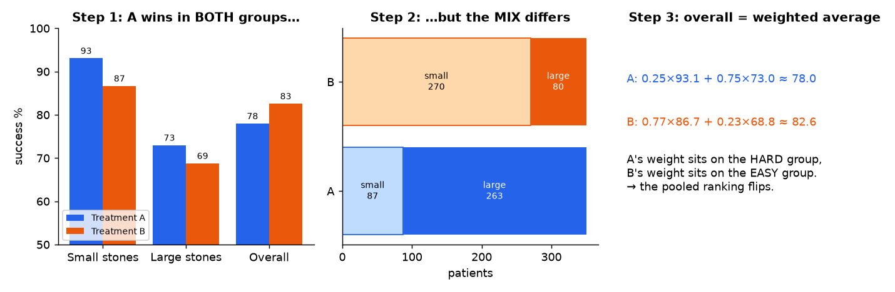
*📊 Step by step: A wins inside each group, but A's patients are mostly the hard cases, so its weighted average falls below B's.*

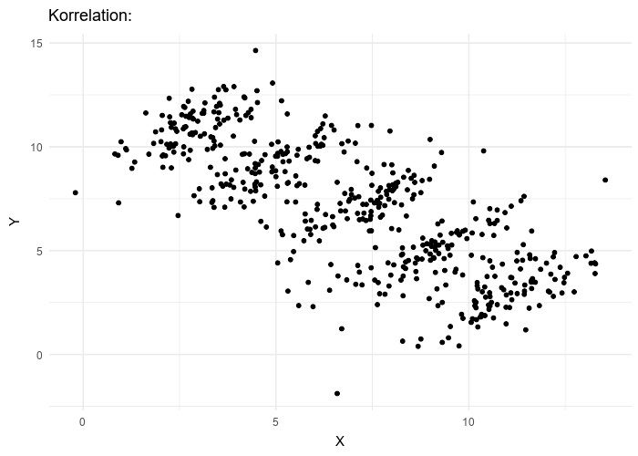
*Simpson's paradox: each group trends up, the pooled data trends down. (Wikimedia Commons: [Simpsons_paradox_-_animation.gif](https://commons.wikimedia.org/wiki/File:Simpsons_paradox_-_animation.gif), CC BY-SA 4.0)*

**Intuition.** An ordinary average gives every item equal say. A weighted average lets some items count more.

$$\text{weighted average} = \sum_{k} w_k\, a_k, \qquad \text{with } w_k \ge 0,\ \sum_k w_k = 1.$$

**Example.** Your marks: 90 in a test worth 20%, 60 in an exam worth 80%. Overall $= 0.2 \times 90 + 0.8 \times 60 = 66$, not the plain average 75. The exam dominates because it has more weight.

**Key fact:** a weighted average always lies between the smallest and largest $a_k$, and it is pulled toward whichever $a_k$ has the biggest weight.

**Simpson's paradox, explained by weighted averages.** Kidney-stone data (Part B, Slide 14):

| | Small stones | Large stones | Overall |
|---|---|---|---|
| Treatment A | 93.1% (87 patients) | 73.0% (263 patients) | 78.0% |
| Treatment B | 86.7% (270 patients) | 68.8% (80 patients) | 82.6% |

Each overall rate is a weighted average of the group rates, **weighted by how many patients were in each group**:

$$\text{A: } \tfrac{87}{350}(93.1\%) + \tfrac{263}{350}(73.0\%) = 0.25(93.1) + 0.75(73.0) \approx 78.0\%$$

$$\text{B: } \tfrac{270}{350}(86.7\%) + \tfrac{80}{350}(68.8\%) = 0.77(86.7) + 0.23(68.8) \approx 82.6\%$$

A beats B **inside both groups**. But A's average is dragged down because 75% of its weight sits on the hard group, while B's average is lifted because 77% of its weight sits on the easy group. **The reversal comes from the weights, not the treatments.**

This is a general law, not a trick: whenever the *mix* of groups differs between the things you compare, the pooled numbers can say the opposite of the grouped numbers.

---

## 6. Vectors — a list that is also an arrow

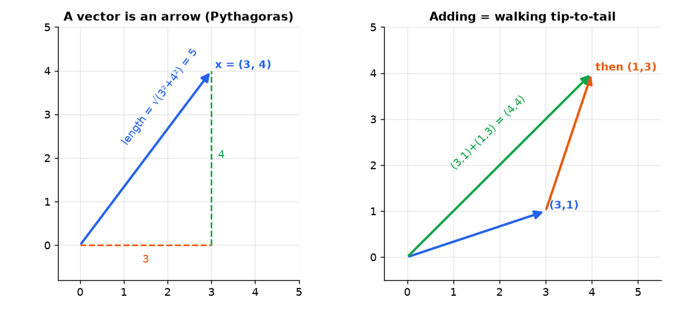
*📊 Left: a vector's length is Pythagoras. Right: adding vectors = walking one arrow, then the other.*

**Intuition 1: a list.** A vector is an ordered list of numbers describing one thing:

$$x = \begin{pmatrix} 120 \\ 45 \\ 0.3 \end{pmatrix} \quad \leftarrow \text{rainfall (mm), catchment area (km}^2\text{), slope}$$

$x \in \mathbb{R}^3$ because it has 3 real entries. Entry $j$ is written $x_j$.

**Intuition 2: an arrow.** In $\mathbb{R}^2$, the vector $(3, 4)$ is an arrow from the origin to the point $(3,4)$. Its length (Pythagoras, class 10!) is $\sqrt{3^2 + 4^2} = 5$. Each example in a dataset is a **point in feature space**; similar examples are nearby points.

**Operations** (entry by entry):

- Add: $(1, 2) + (3, 5) = (4, 7)$.
- Scale: $3 \cdot (1, 2) = (3, 6)$.

**The dot product — the most important operation in ML.** Multiply matching entries and add:

$$w^\top x = w_1x_1 + w_2x_2 + \dots + w_dx_d = \sum_{j=1}^{d} w_j x_j.$$

Example: $w = (0.02,\ 0.01,\ 2)$, $x = (120,\ 45,\ 0.3)$:

$$w^\top x = 0.02(120) + 0.01(45) + 2(0.3) = 2.4 + 0.45 + 0.6 = 3.45.$$

**Interpretation:** a dot product is a **weighted vote**. Each feature votes, and $w_j$ says how much that feature's vote counts (and in which direction, if negative). A **linear model** is just

$$\hat y = w^\top x + b,$$

i.e. $y = mx + c$ upgraded to many inputs. (The $\top$, "transpose", is explained properly in the Lecture 2 file; for now read $w^\top x$ as "dot product of $w$ and $x$".)

---

## 7. Lines, slopes, and trends

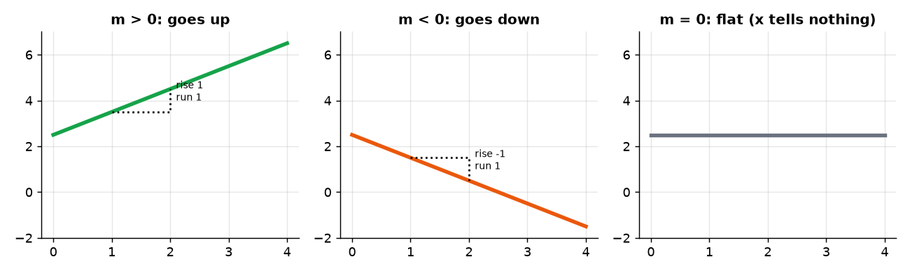
*📊 The sign of m is all that 'positive trend' or 'negative trend' means.*

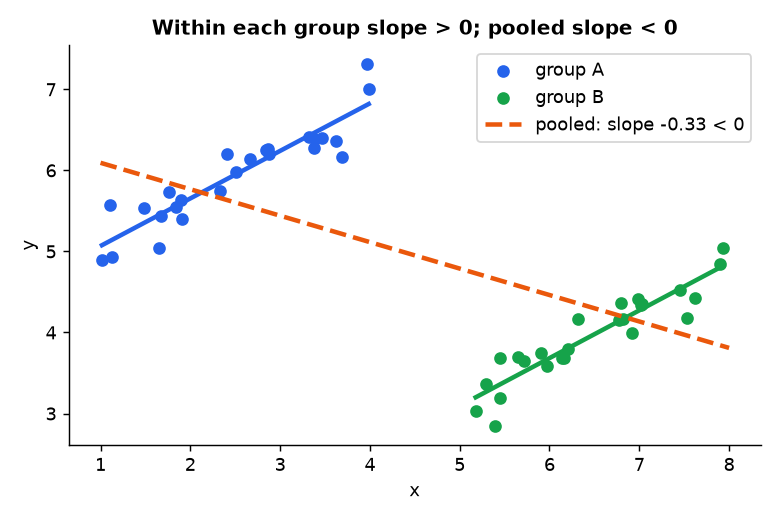
*📊 The §7 picture: both groups slope up, the single line through all points slopes down.*

From coordinate geometry: the line $y = mx + c$ has **slope** $m = \frac{\Delta y}{\Delta x}$ ("rise over run").

- $m > 0$: going right, the line goes **up** (positive trend).
- $m < 0$: going right, it goes **down** (negative trend).
- $m = 0$: flat; $x$ tells you nothing about $y$.

**Trend line through data.** Real data doesn't sit on a line, but we can ask for the line that passes "closest" to all the points. Its slope summarises the relationship. (How to find that line is Lecture 2–4: least squares.)

**Simpson's paradox, in pictures (Lecture 1, slide 14).** Imagine:

- Group A: points at $x \in [1, 4]$, $y$ rising from 5 to 7.
- Group B: points at $x \in [5, 8]$, $y$ rising from 3 to 5.

Inside each group, slope $> 0$. But B sits to the right and lower than A. A single line through *all* points must go from A's high cloud down to B's low cloud: slope $< 0$. Same phenomenon as §5: the pooled trend is dominated by the **difference between groups**, not the trend within them.

---

## 8. Probability, rebuilt properly

Class 10 gave you: $P(E) = \dfrac{\text{favourable outcomes}}{\text{total outcomes}}$ for equally likely outcomes. Let's extend that into the toolkit ML actually uses.

### 8.1 The basic objects

- **Experiment**: something with an uncertain result (roll a die, observe tomorrow's rainfall).
- **Sample space** $\Omega$: set of all possible results. Die: $\Omega = \{1,\dots,6\}$.
- **Event**: a subset of $\Omega$. "Even" $= \{2,4,6\}$.
- **Probability** $P(E)$: a number in $[0,1]$ measuring how likely $E$ is.

The three rules everything follows from:

1. $0 \le P(E) \le 1$.
2. $P(\Omega) = 1$ (something happens).
3. If $E$ and $F$ can't both happen, $P(E \text{ or } F) = P(E) + P(F)$.

Consequence: $P(\text{not } E) = 1 - P(E)$.

### 8.2 Joint probability — "and"

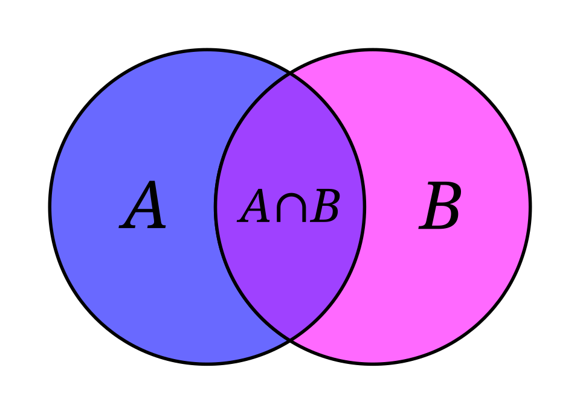
*A ∩ B: outcomes in both A and B. Joint probability is the size of this overlap. (Wikimedia Commons: [Venn_A_intersect_B.svg](https://commons.wikimedia.org/wiki/File:Venn_A_intersect_B.svg), Public domain)*

$P(A, B)$ (also written $P(A \cap B)$) is the probability that **both** happen.

**Use a two-way table.** 100 days of records:

| | Flood | No flood | Total |
|---|---|---|---|
| Heavy rain | 8 | 12 | 20 |
| Light rain | 2 | 78 | 80 |
| **Total** | 10 | 90 | 100 |

$P(\text{heavy}, \text{flood}) = 8/100 = 0.08$.

### 8.3 Marginal probability — "ignore the other variable"

Add across a row or column: $P(\text{flood}) = (8 + 2)/100 = 0.10$. It's called *marginal* because you write it in the table's margin.

### 8.4 Conditional probability — "shrink the universe"

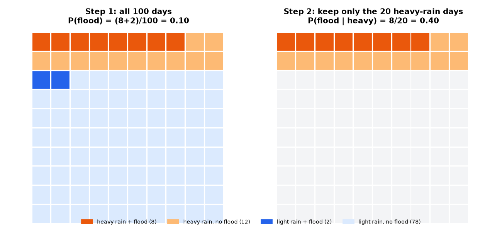
*📊 Conditioning = throwing away the squares that don't match what you know, then counting again.*

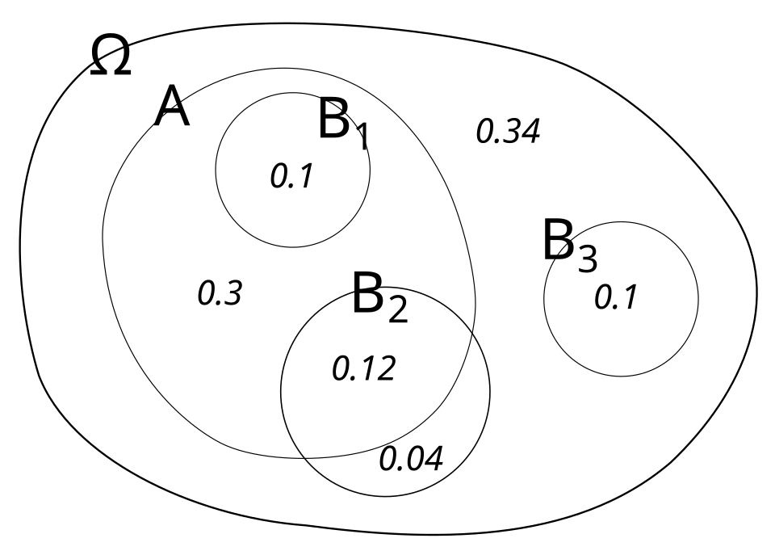
*Shrink the universe to B, then ask what share of B is also A. P(A|B₂) = 0.12 / (0.12 + 0.04) = 0.75; P(A|B₁) = 1 (B₁ sits inside A); P(A|B₃) = 0 (no overlap). (Wikimedia Commons: [Conditional_probability.svg](https://commons.wikimedia.org/wiki/File:Conditional_probability.svg), CC0)*

**Intuition.** $P(A \mid B)$ = "probability of $A$ **given** that we already know $B$ happened". Knowing $B$ throws away every outcome where $B$ didn't happen. Your new universe is just the $B$ row/column.

$P(\text{flood} \mid \text{heavy})$: look only at the heavy-rain row (20 days). Floods: 8. So $8/20 = 0.4$.

**Formula** (same thing, written with probabilities):

$$P(A \mid B) = \frac{P(A, B)}{P(B)} = \frac{0.08}{0.20} = 0.4.$$

Compare: $P(\text{flood}) = 0.1$ but $P(\text{flood} \mid \text{heavy}) = 0.4$. **Information changes probability.** That is what a predictive model exploits: it estimates $P(y \mid x)$, "how likely is each answer *given* what I see?"

⚠️ **Direction matters.** $P(\text{heavy} \mid \text{flood}) = 8/10 = 0.8 \neq 0.4$. "Most floods had heavy rain" is not "most heavy rain causes floods".

**Multiplication rule** (rearrange the formula):

$$P(A, B) = P(A \mid B)\,P(B).$$

### 8.5 Conditioning on more than one thing

$P(Y \mid X, G)$: condition on both $X$ and a third variable $G$ — shrink the universe to rows where *both* hold. Simpson's paradox is exactly the statement:

$$P(Y \mid X) \text{ and } P(Y \mid X, G) \text{ can point in opposite directions.}$$

In §5: $P(\text{success} \mid \text{A}) < P(\text{success} \mid \text{B})$, yet $P(\text{success} \mid \text{A}, \text{small}) > P(\text{success} \mid \text{B}, \text{small})$ and the same for large.

### 8.6 Independence

$A$ and $B$ are **independent** if knowing one tells you nothing about the other:

$$P(A \mid B) = P(A) \quad\Longleftrightarrow\quad P(A, B) = P(A)\,P(B).$$

Two coin flips are independent. Rain and flood are not ($0.4 \neq 0.1$).

### 8.7 Total probability — "split into cases, then recombine"

If $B_1, B_2, \dots$ cover every possibility without overlapping:

$$P(A) = \sum_k P(A \mid B_k)\,P(B_k).$$

**This is a weighted average** (§5)! The overall chance of $A$ is the average of the in-case chances, weighted by how common each case is.

Check with the table: $P(\text{flood}) = P(\text{flood}\mid\text{heavy})P(\text{heavy}) + P(\text{flood}\mid\text{light})P(\text{light}) = 0.4(0.2) + 0.025(0.8) = 0.08 + 0.02 = 0.1$. ✓

### 8.8 Bayes' rule — "flip the condition"

Combine the multiplication rule both ways: $P(A\mid B)P(B) = P(A,B) = P(B\mid A)P(A)$. Divide:

$$\boxed{P(A \mid B) = \frac{P(B \mid A)\,P(A)}{P(B)}}$$

**Why it matters for ML — the rare-event trap.** A disease affects 1% of people. A test catches 99% of sick people and wrongly flags 5% of healthy people. You test positive. Chance you're sick?

$$P(\text{sick}\mid+) = \frac{P(+\mid\text{sick})P(\text{sick})}{P(+)} = \frac{0.99 \times 0.01}{0.99\times0.01 + 0.05\times0.99} = \frac{0.0099}{0.0594} \approx 0.17.$$

Only **17%**! Because healthy people are 99× more common, their 5% false alarms outnumber the real cases. The **base rate** $P(\text{sick})$ dominates. Same root cause as Lecture 1's accuracy paradox: when one class is rare, intuition built on balanced cases breaks.

---

## 9. Random variables, distributions, expectation

### 9.1 Random variable

A **random variable** is a number whose value is decided by chance. Convention:

- Capital $X$, $Y$: the random variable itself (tomorrow's rainfall, not yet known).
- Lowercase $x$, $y$: a particular value it took (it rained 90 mm).

### 9.2 Distribution

The **distribution** of $X$ lists every possible value and how likely it is. For a fair die, $p(x) = 1/6$ for $x = 1,\dots,6$. Probabilities over all values sum to 1.

Lecture 1 writes $\mathcal{D}$ for **the unknown distribution that generates the data** — think of it as "the world's dice". Every real flood event, every patient, every email is one roll of these dice. We never see the dice, only the rolls.

$(X, Y) \sim \mathcal{D}$ reads "the pair $(X,Y)$ **is drawn from** $\mathcal{D}$".

### 9.3 iid

A dataset is often assumed **iid** — *independent and identically distributed*:

- **Identically distributed**: every example comes from the *same* $\mathcal{D}$ (same dice).
- **Independent**: one example doesn't influence another (rolls don't affect each other).

Where it breaks: consecutive days of weather (today affects tomorrow), neighbouring towns (similar weather), many rows from the same user, data from before and after a policy change.

### 9.4 Expectation — the long-run average

**Intuition.** Roll a die a million times and average the results. You'll get very close to 3.5. That limit is the **expected value**:

$$\mathbb{E}[X] = \sum_{x} x\,p(x).$$

Die: $\mathbb{E}[X] = 1\cdot\tfrac16 + 2\cdot\tfrac16 + \dots + 6\cdot\tfrac16 = \tfrac{21}{6} = 3.5$.

Look closely: **expectation is a weighted average of the possible values, weighted by their probabilities.** (§5 again! Weighted averages are everywhere.)

Expectation of a *function* of $X$ works the same way: $\mathbb{E}[g(X)] = \sum_x g(x)\,p(x)$. E.g. $\mathbb{E}[X^2]$ for a die $= \tfrac{1+4+9+16+25+36}{6} \approx 15.17$.

Subscripts say *what is random*: $\mathbb{E}_{(X,Y)\sim\mathcal{D}}[\cdot]$ = "average over pairs $(X,Y)$ drawn from $\mathcal{D}$".

### 9.5 Expectation vs sample mean — the heart of ML

![Roll a die again and again: the running average wanders, then settles at E[X] = 3.5.](images/L01/figures/sample_mean_to_expectation.png)
*📊 Roll a die again and again: the running average wanders, then settles at E[X] = 3.5.*

| | True expectation | Sample mean |
|---|---|---|
| Formula | $\mathbb{E}[g(X)] = \sum_x g(x)p(x)$ | $\frac{1}{n}\sum_{i=1}^n g(x_i)$ |
| Needs | the full distribution | only $n$ observed values |
| Computable? | No (we don't know $\mathcal{D}$) | Yes |

**Law of large numbers (intuition):** as $n$ grows, the sample mean gets closer to the expectation. With 6 die rolls your average might be 4.2; with 6,000 it'll be about 3.5.

Now apply it to errors:

$$\underbrace{R(f) = \mathbb{E}_{(X,Y)\sim\mathcal{D}}\big[\ell(f(X),Y)\big]}_{\text{true risk: what we want}} \qquad \underbrace{\hat R(f) = \frac{1}{n}\sum_{i=1}^n \ell(f(x_i),y_i)}_{\text{empirical risk: what we can compute}}$$

$\hat R$ is the sample-mean estimate of $R$. **But there's a catch** the law of large numbers doesn't cover: we *choose* $f$ to make $\hat R$ small on these very examples. A model that memorised the training set has $\hat R = 0$ but may have large $R$. That gap is **overfitting**, and fighting it is half of this course.

---

## 10. Exponents → e → logarithms

### 10.1 Exponents (class 9–10 recap)

$a^n$ = $a$ multiplied $n$ times. Rules: $a^m a^n = a^{m+n}$, $(a^m)^n = a^{mn}$, $a^0 = 1$, $a^{-n} = 1/a^n$.

### 10.2 The number e

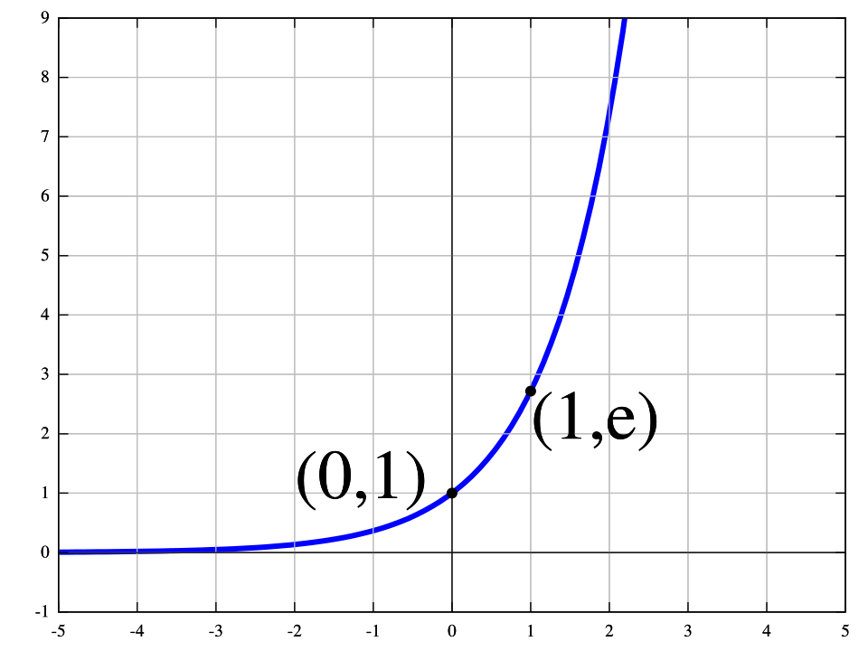
*y = eˣ: always positive, slope at each point equals its height. (Wikimedia Commons: [Exp.svg](https://commons.wikimedia.org/wiki/File:Exp.svg), CC BY-SA 3.0)*

Put ₹1 in a bank at 100% interest per year.

- Paid once a year: $(1+1)^1 = 2$.
- Twice: $(1+\tfrac12)^2 = 2.25$.
- Monthly: $(1+\tfrac1{12})^{12} \approx 2.613$.
- Every instant: $\lim_{n\to\infty}(1+\tfrac1n)^n = e \approx 2.71828$.

$e$ is the natural base of continuous growth. $e^z$ (also written $\exp(z)$):

- is always positive,
- $e^0 = 1$,
- grows explosively for $z > 0$, shrinks toward 0 for $z < 0$.

### 10.3 Logarithms — the inverse of exponents

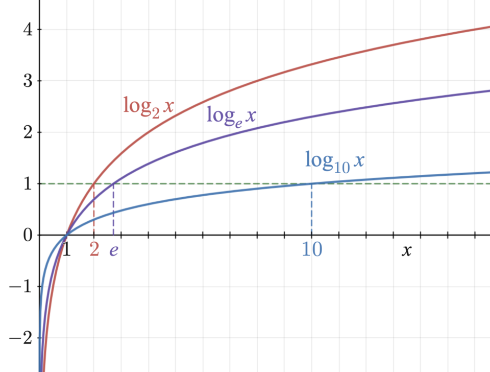
*log curves for several bases: all pass through (1, 0) and grow slowly. (Wikimedia Commons: [Logarithm_plots.png](https://commons.wikimedia.org/wiki/File:Logarithm_plots.png), CC BY-SA 3.0)*

**Intuition.** $\log_b(y)$ answers: "**what power** of $b$ gives $y$?"

$$\log_{10}(1000) = 3 \text{ because } 10^3 = 1000; \qquad \log_2(8) = 3.$$

In ML, $\log$ means the **natural log** $\ln = \log_e$, so $\log(e^z) = z$ and $e^{\log y} = y$.

**Rules** (each is an exponent rule read backwards):

| Log rule | Comes from |
|---|---|
| $\log(ab) = \log a + \log b$ | $e^m e^n = e^{m+n}$ |
| $\log(a/b) = \log a - \log b$ | |
| $\log(a^k) = k\log a$ | |
| $\log 1 = 0$ | $e^0 = 1$ |

**Shape.** $\log y$ is only defined for $y > 0$. It's increasing (bigger input → bigger output). It's negative for $0<y<1$, zero at $y = 1$, and plunges to $-\infty$ as $y \to 0$.

### 10.4 Why ML loves logs

1. **Products → sums.** Probabilities of independent events multiply. Multiplying 1000 numbers like 0.01 gives $10^{-2000}$ — a computer rounds that to 0. Taking logs turns it into a sum of 1000 numbers like $-4.6$: perfectly manageable. (Central in Lecture 2.)
2. **Log preserves order.** Because $\log$ is increasing, whatever maximises $P$ also maximises $\log P$. So we can switch to logs freely when searching for the best model.
3. **$-\log p$ is a natural "surprise" score.**

| Model's probability for the true answer, $p$ | $-\log p$ | Feeling |
|---|---|---|
| 0.99 | 0.01 | "I knew it" |
| 0.9 | 0.11 | |
| 0.5 | 0.69 | coin flip |
| 0.1 | 2.30 | surprised |
| 0.01 | 4.61 | shocked |
| → 0 | → ∞ | "impossible!" |

That's the **log loss** from Lecture 1: penalty $= -\log \hat p_y$.

---

## 11. Squares, absolute values, indicators — ways to measure "wrong"

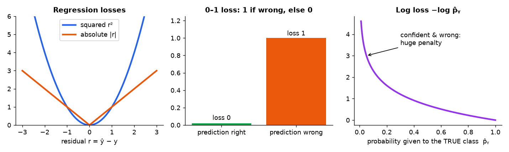
*📊 Three ways to measure 'wrong': squared grows fast, absolute grows steadily, log loss explodes when you're confident and wrong.*

Let the **residual** be $r = y - \hat y$ (truth minus prediction). It can be positive or negative, so we can't just average residuals — $+3$ and $-3$ would cancel to "zero error". Three fixes:

**Absolute value** $|r|$: drop the sign. Errors of 1 and 3 cost 1 and 3. Penalty grows *linearly*.

**Square** $r^2$: also drops the sign, but grows *quadratically*. Errors of 1 and 3 cost 1 and **9**. Big mistakes are punished much more. Also smooth (no sharp corner at 0), which makes calculus easy — that's why it's the default for regression. (Lecture 2 shows a deeper reason: it comes from assuming bell-curve noise.)

**Indicator** $\mathbb{1}\{\text{condition}\}$: 1 if true, 0 if false.

$$\mathbb{1}\{\hat y \neq y\} = \begin{cases}1 & \text{wrong}\\0 & \text{right}\end{cases}$$

That's the **0-1 loss**. It only asks "right or wrong?", not "how wrong?". Averaging it gives the error rate:

$$\frac{1}{n}\sum_{i=1}^n \mathbb{1}\{\hat y_i \neq y_i\} = \frac{\#\text{mistakes}}{n} = 1 - \text{accuracy}.$$

The general idea: a **loss function** $\ell(\hat y, y)$ is any rule that turns (prediction, truth) into a non-negative "how bad" number. **Choosing it means choosing which mistakes matter.**

---

## 12. min, max, argmin — finding the best

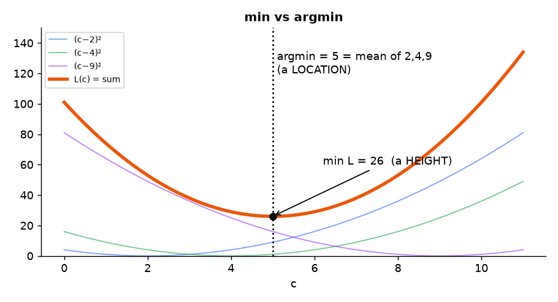
*📊 The mini-problem 2, 4, 9: add three parabolas; the lowest point is at c = 5 (argmin) with height 26 (min).*

For a function $L(u)$:

- $\min_u L(u)$ — the **lowest value** $L$ reaches. (A number on the *vertical* axis.)
- $\arg\min_u L(u)$ — the **input** $u$ where that happens. (A location on the *horizontal* axis.)
- $\max$, $\arg\max$ — same for the highest.

**Class 10 tool: completing the square.** Any quadratic $L(u) = a(u - h)^2 + k$ with $a > 0$ has a lowest point (vertex) at $u = h$, value $k$, because a square is never negative.

$$L(u) = (u-3)^2 \Rightarrow \min_u L = 0,\quad \arg\min_u L = 3.$$

$$L(u) = u^2 - 6u + 11 = (u-3)^2 + 2 \Rightarrow \min = 2,\quad \arg\min = 3.$$

General: $au^2 + bu + c$ with $a > 0$ has $\arg\min = -\dfrac{b}{2a}$.

**Mini-ML problem you can already solve.** You have three measurements of the same quantity: 2, 4, 9. Which single number $c$ is "closest" to all of them, measured by total squared error?

$$L(c) = (c-2)^2 + (c-4)^2 + (c-9)^2 = 3c^2 - 30c + 101.$$

$\arg\min = -(-30)/(2\cdot3) = 5$ — **the mean** $(2+4+9)/3$! Fact worth remembering: *the mean is the best constant predictor under squared loss.* (Under absolute loss it's the median — 4 here.)

**Why ML cares.** Training = $\arg\min$ over the knobs:

$$\hat\theta = \arg\min_{\theta} \hat R(\theta).$$

We want the *knob setting* (argmin), not the error value (min). For one knob, completing the square works; for many knobs we'll need calculus (see the Lecture 2 file).

---

## 13. Rates and the confusion matrix

For yes/no prediction, every case falls in one of four boxes:

| | Predicted 1 | Predicted 0 |
|---|---|---|
| **Actually 1** | TP (true positive) | FN (false negative — missed) |
| **Actually 0** | FP (false positive — false alarm) | TN (true negative) |

Each metric is just a fraction — but **with a different denominator**, i.e. a different "universe" (§8.4: it's conditional probability!):

| Metric | Formula | Question it answers | As a conditional probability |
|---|---|---|---|
| Accuracy | $\frac{TP+TN}{\text{all}}$ | How often right overall? | $P(\hat y = y)$ |
| Recall | $\frac{TP}{TP+FN}$ | Of real positives, how many caught? | $P(\hat y=1 \mid y=1)$ |
| Precision | $\frac{TP}{TP+FP}$ | Of alarms raised, how many real? | $P(y=1 \mid \hat y=1)$ |

**Lecture 1's example:** 990 negatives, 10 positives, model always says 0. TP = 0, FN = 10, FP = 0, TN = 990.

- Accuracy $= 990/1000 = 99\%$.
- Recall $= 0/10 = 0\%$.
- Precision $= 0/0$ — undefined: the model never raised an alarm.

Accuracy is a weighted average of how well you do on each class, weighted by class frequency (§5 again). If one class is 99% of the data, it gets 99% of the weight, and you can ignore the other class entirely and still score 99%.

---

## 14. Fitting curves through points — why bigger models get weird

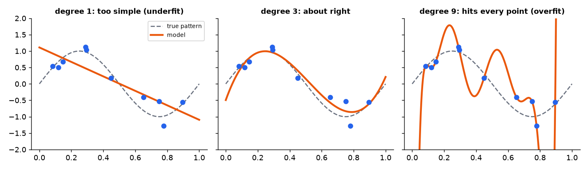
*📊 Same 10 points, three capacities: too simple, about right, memorises the noise.*

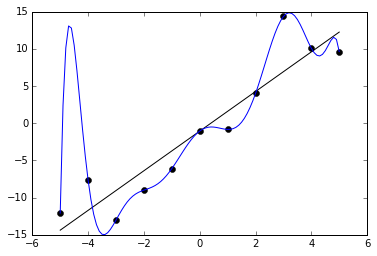
*A high-degree polynomial passes through every point (overfits); the line captures the trend. (Wikimedia Commons: [Overfitted_Data.png](https://commons.wikimedia.org/wiki/File:Overfitted_Data.png), CC BY-SA 4.0)*

**A fact you can verify yourself.** Through 2 points you can draw exactly one line ($y = mx + c$, 2 knobs). Through 3 points (not on a line) you can draw exactly one parabola ($y = ax^2 + bx + c$, 3 knobs). In general:

> A polynomial with $n$ knobs (degree $n-1$) can pass **exactly** through any $n$ points with different $x$ values.

**Capacity** = how many shapes a model family can make; roughly, how many knobs.

Now take 10 noisy data points:

- **Degree 1 (a line, 2 knobs):** too stiff, misses the curve → **underfit**. Training and test errors both high.
- **Degree 3:** bends enough to follow the real shape → good test error.
- **Degree 9 (10 knobs = 10 points):** passes through *every* point exactly — training error **zero**. This is the **interpolation threshold**. But to hit every noisy point it must wiggle wildly between them → test error explodes. **Overfit.**

That gives the classical **U-shaped** test-error curve.

**Double descent (Lecture 1, slide 20).** What if we use *far more* knobs than points (say 1000 knobs, 10 points)? Now infinitely many curves pass through every point. Training methods tend to pick the *smoothest* of them, and smooth curves generalise well — so test error **falls again**. The worst place is right *at* the threshold, where exactly one wiggly curve fits and the model has no freedom to be smooth.

Lesson: neither "small models are safe" nor "big models are better" is a law. Only measuring on held-out data tells you.

---

## 15. Decoding every Lecture 1 formula

| Formula | Decompressed into a sentence |
|---|---|
| $S_{\text{train}} = \{(x_i, y_i)\}_{i=1}^n$ | "The training set is $n$ examples, each an input paired with its correct answer." |
| $f : \mathcal{X} \to \mathcal{Y}$ | "The model is a machine turning any possible input into an output." |
| $f_\theta$ | "A model whose behaviour is set by knobs $\theta$." |
| $\hat y = f(x)$ | "The prediction is what the model outputs for input $x$." |
| $p(Y \mid X)$ vs $p(Y \mid X, G)$ | "The chance of outcome $Y$ knowing only $X$, versus knowing $X$ and the group $G$ — can disagree (Simpson)." |
| $\ell(f(x), y)$ | "How bad the model's prediction for $x$ was, compared to truth $y$." |
| $(\hat y - y)^2$ | "Squared miss — big misses cost a lot." |
| $\mathbb{1}\{\hat y \neq y\}$ | "1 if wrong, 0 if right." |
| $-\log \hat p_y$ | "Surprise at the true answer: small if the model gave it high probability." |
| $\mathcal{D}$ | "The unknown world process that generates examples." |
| $R(f) = \mathbb{E}_{(X,Y)\sim\mathcal{D}}[\ell(f(X),Y)]$ | "The model's average loss over everything the world could ever produce. What we truly care about; can't compute." |
| $\hat R(f) = \frac1n\sum_i \ell(f(x_i), y_i)$ | "The model's average loss on our data. Computable; an estimate of $R$." |

If you can read this table without looking at the right column, you've got the maths of Lecture 1.

---

# Part B — Lecture 1, Slide by Slide (all 26 pages)

Each slide: what it says → what it means → the maths behind it (with a link back to Part A).

## Slide 1 — Title

*Machine Learning, Lecture 1: Introduction, Past and Present.* Prof. Udit Bhatia (Civil Engineering; CSE) and Prof. Krishna Prasad Miyapuram (Cognitive & Brain Sciences; AI), Semester I 2026.

Notice the instructors' backgrounds: civil engineering and brain science. That's why examples throughout (flood depth, rainfall, catchment area) come from real physical systems where wrong predictions have real costs.

## Slide 2 — Course Roadmap: You Are Here

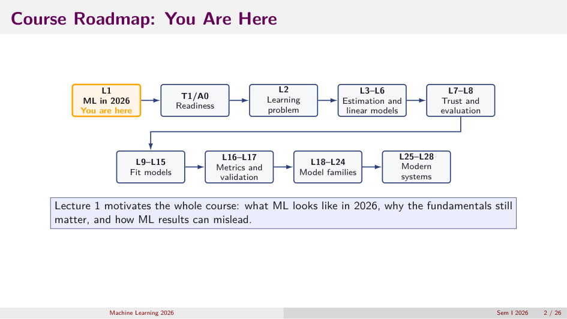
*👀 Slide 2 — The orange L1 box is today; every later lecture hangs off this route.*

| Block | Lectures | Theme |
|---|---|---|
| L1 | 1 | ML in 2026 ← **you are here** |
| T1/A0 | tutorial | Readiness check |
| L2 | 2 | The learning problem (maths language) |
| L3–L6 | 3–6 | Estimation and linear models |
| L7–L8 | 7–8 | Trust and evaluation |
| L9–L15 | 9–15 | Fitting models |
| L16–L17 | 16–17 | Metrics and validation |
| L18–L24 | 18–24 | Model families |
| L25–L28 | 25–28 | Modern systems |

**Message:** Lecture 1 is motivation — *what ML looks like in 2026, why fundamentals still matter, and how ML results can mislead*. No algorithms yet; the job is to install the right suspicion.

## Slide 3 — Course Coordinates

- **Codes:** ES 335 (UG), ES 678 (PG).
- **Instructor:** Prof. Udit Bhatia. **Tutor:** Prof. Krishna Prasad Miyapuram.
- **Lectures:** J1 Tuesday and K2 Thursday, 14:00–15:20, room 10/103.
- **Tutorial:** B2 Friday 08:30–09:50, Jagdish Patel / Harsha Patel Learning Theatre.
- Bring the dedicated course notebook to every lecture and tutorial; changes are announced on the official channel.

## Slide 4 — Course Content

Four pillars, plus assessment:

1. **Foundations** — data, loss, risk; maths, probability, optimization. (Part A of these notes and the Lecture 2 file.)
2. **Supervised ML** — regression (predict a number), classification (predict a category), regularization (stop overfitting), validation (honest testing).
3. **Classical models** — decision trees, ensembles (many models voting), KNN (predict from nearest neighbours), SVMs (widest-margin boundary), PCA (compress features), clustering (group unlabeled data).
4. **Modern ML systems** — neural nets, transformers (the architecture behind LLMs), agents, accountability.

Plus assignments, quizzes, and a project.

**The spine:** *learn from data → evaluate honestly → reason about deployment.* Every topic hangs off this.

## Slide 5 — Lecture Objectives

By the end you should be able to:

1. Explain why 2026 ML still depends on classical foundations. → Slides 6–10
2. Describe the ML loop: data → representation → model → decision. → Slide 11
3. Recognise four ways results mislead: **aggregation, metrics, shortcuts, model capacity**. → Slides 13–21
4. State the notation $S_{\text{train}}, x, y, f, \ell, R, \hat R$. → Slides 23–26 + Part A §15
5. Understand course expectations (assignments, AI tools, quizzes, conduct). → see `course-documents/` PDFs

**Guiding question:** *When a model looks impressive, what would make the result untrustworthy?* Keep this question in your head for the whole course.

## Slide 6 — The Claim for This Course

> In 2026, ML is not just "fit a model". It is the craft of building **data-driven systems** whose predictions, explanations, and decisions remain **reliable outside the notebook**.

"Outside the notebook" = on new data, in the real world, after deployment. In maths language: we care about the true risk $R$, not the training error $\hat R$ (Part A §9.5).

**Insight:** tools change quickly; the fundamentals of **data, loss, risk, generalization, evaluation** stay useful. A library from 2026 will be outdated by 2030; the idea "measure on held-out data" won't.

## Slide 7 — Section: ML in 2026

Section divider.

## Slide 8 — A Short History of the Interface

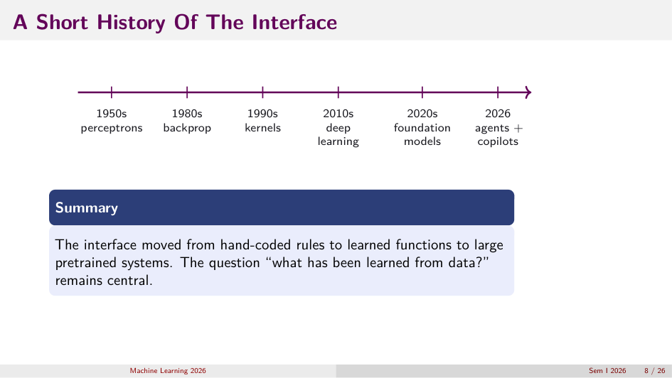
*👀 Slide 8 — Read left to right: each era hands more of the job from hand-written rules to learned functions.*

| Era | Milestone | Plain explanation |
|---|---|---|
| 1950s | **Perceptron** | Compute $w^\top x + b$ (Part A §6); output 1 if positive, else 0. When it's wrong, nudge $w$ toward the right answer. The first machine that *learned* its weights. Only able to draw straight-line boundaries. |
| 1980s | **Backpropagation** | Stack many perceptron-like units in layers. Backprop uses the chain rule of calculus to work out how much each weight contributed to the error, so all layers can be trained together. |
| 1990s | **Kernels** (SVMs) | Get curved boundaries from linear methods by implicitly mapping data into a richer space where a straight cut works. Strong mathematical guarantees. |
| 2010s | **Deep learning** | Big data + GPUs make very deep networks trainable. They learn their *own* features (edges → shapes → objects) instead of humans hand-designing them. |
| 2020s | **Foundation models** | One enormous model pretrained on huge data (most of the internet), then reused for many tasks. LLMs are the famous example. |
| 2026 | **Agents + copilots** | Models that use tools, write and run code, and take multi-step actions. |

**Summary:** the interface moved *hand-coded rules → learned functions → large pretrained systems*. The question **"what has been learned from data?"** stays central. A 2026 agent is still a function fitted to data and inherits every problem that implies.

## Slide 9 — What Changed

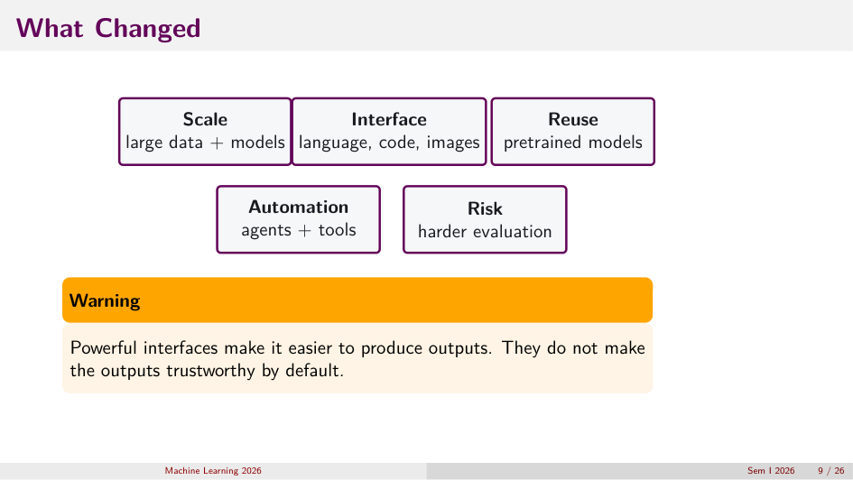
*👀 Slide 9 — Four boxes are gains (scale, interface, reuse, automation); the fifth (risk) is their price.*

| Change | Meaning |
|---|---|
| **Scale** | Datasets of trillions of words; models with billions of parameters. |
| **Interface** | You interact through language, code, images — not just tables. |
| **Reuse** | Start from a pretrained model and adapt, instead of training from scratch. |
| **Automation** | Agents chain tools: search → code → run → report. |
| **Risk** | Evaluation is **harder**: outputs are open-ended, failures are subtle, training data is unknown. |

> ⚠️ Powerful interfaces make it easier to **produce** outputs. They do not make outputs **trustworthy** by default.

A fluent, confident answer is not evidence of a correct one.

## Slide 10 — What Did Not Change

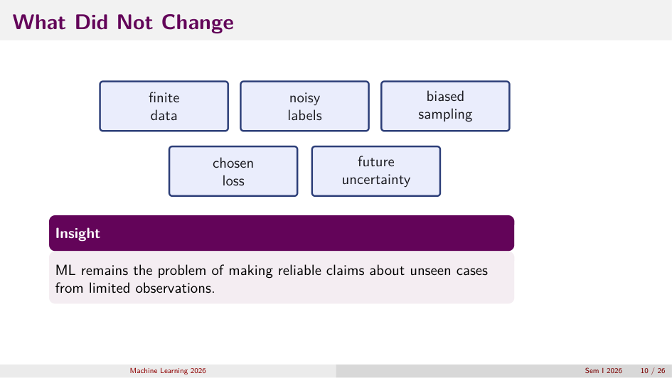
*👀 Slide 10 — Five limits that no amount of compute removes.*

| Constant | Meaning | Maths link |
|---|---|---|
| **Finite data** | You only ever have $n$ examples. | $\hat R$ is an average over $n$, not the true $R$ (§9.5) |
| **Noisy labels** | The "correct answers" contain errors. | $y$ itself is random (§9.1) |
| **Biased sampling** | Your data isn't a fair picture of the world. | $S_{\text{train}}$ is not a fair draw from $\mathcal{D}$ (§9.3) |
| **Chosen loss** | Someone decides what counts as "wrong". | choice of $\ell$ (§11) |
| **Future uncertainty** | The world shifts after you deploy. | $\mathcal{D}_{\text{past}} \neq \mathcal{D}_{\text{future}}$ — *non-stationarity* |

**Insight:** ML remains the problem of making **reliable claims about unseen cases from limited observations.** That sentence is the definition of the field.

## Slide 11 — The 2026 ML Loop

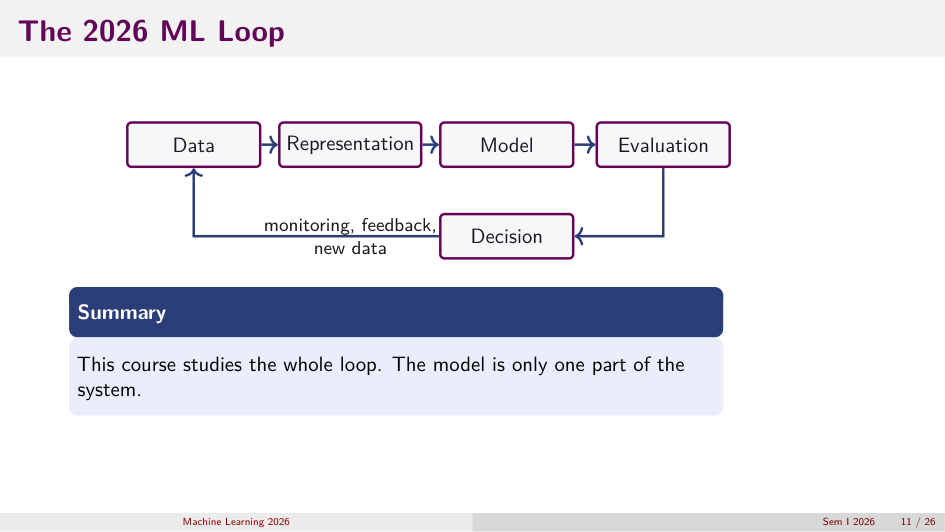
*👀 Slide 11 — Follow the arrows: the decision feeds back into new data, so it's a loop, not a straight line.*

```
Data ──► Representation ──► Model ──► Evaluation ──► Decision
  ▲                                                     │
  └──────────── monitoring, feedback, new data ◄────────┘
```

| Stage | Question | Flood example |
|---|---|---|
| **Data** | What was collected, how, from whom? | Gauge readings — but gauges exist mostly in big cities |
| **Representation** | How do raw observations become the vector $x$? | rainfall, catchment area, slope → $x \in \mathbb{R}^3$ |
| **Model** | Which function $f$, which knobs? | linear $\hat y = w^\top x + b$ |
| **Evaluation** | How well on *unseen* cases, by which metric? | error on held-out storms |
| **Decision** | What action, at what cost? | evacuate if predicted depth > 1 m |
| **Feedback** | How do decisions change future data? | evacuated areas record fewer injuries → data looks "safer" |

**Summary:** this course studies the *whole* loop; the model is only one part. Most real failures come from the other boxes.

## Slide 12 — Section: Four Paradoxes

Section divider.

## Slide 13 — Why Start With Paradoxes?

> ML is powerful partly because it finds patterns. ML is dangerous partly because it finds **the wrong patterns with great confidence**.

**Question:** the first skill in ML is not coding a model. It's **noticing when the apparent pattern is not the claim you think it is.** Each of the four paradoxes below is a different way a true pattern in the data supports a false claim.

## Slide 14 — Paradox 1: Aggregation Can Reverse a Conclusion

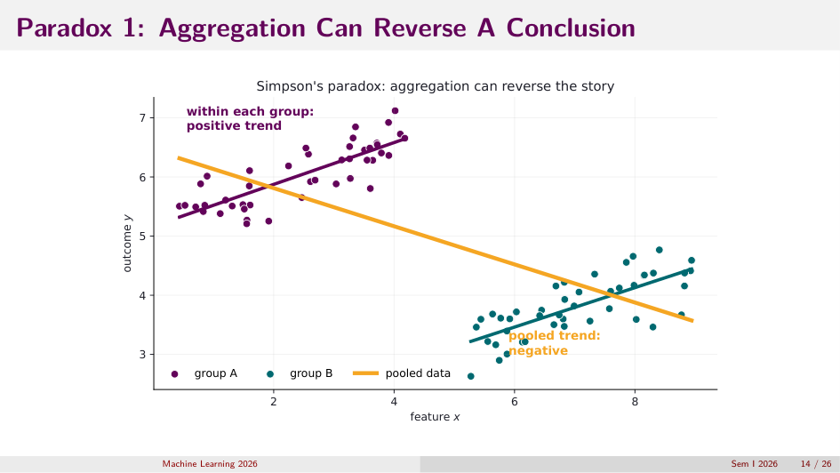
*👀 Slide 14 — Each coloured cloud slopes UP; the orange pooled line slopes DOWN.*

**The plot:** horizontal axis feature $x$ (2–8), vertical axis outcome $y$ (3–7). Two clusters:

- **Group A** (left, higher): within it, $y$ rises with $x$.
- **Group B** (right, lower): within it, $y$ also rises with $x$.
- **Pooled** (both together): the best-fit line goes from A's high cloud down to B's low cloud → **negative** slope.

This is **Simpson's paradox**: aggregation reverses the story.

**Why it happens** (Part A §5 and §7): the pooled trend mixes two things: (1) the trend *within* each group and (2) the *gap between* groups. If the gap is large and points the other way, it wins.

**Real data (kidney-stone treatments):**

| | Small stones | Large stones | All patients |
|---|---|---|---|
| Treatment A | 81/87 = **93%** | 192/263 = **73%** | 273/350 = 78% |
| Treatment B | 234/270 = 87% | 55/80 = 69% | 289/350 = **83%** |

A wins in each group but loses overall: doctors gave A mostly to the hard (large-stone) cases. Stone size is a **confounder**: it influences both *which* treatment was given and *whether* it worked.

## Slide 15 — What Simpson's Paradox Teaches

**Conditioning:** before trusting a relationship between $X$ and $Y$, ask whether a third variable $G$ changes the story.

$$p(Y \mid X) \quad \text{may look very different from} \quad p(Y \mid X, G).$$

Decompress (Part A §8.4–8.5):

- $p(Y \mid X)$ — "the chance of the outcome, knowing only the treatment".
- $p(Y \mid X, G)$ — "the chance of the outcome, knowing the treatment **and** the group".

They're linked by total probability (§8.7): $p(Y\mid X) = \sum_g p(Y \mid X, g)\,p(g \mid X)$. The weights $p(g\mid X)$ — *which groups got which treatment* — differ between A and B. That's the whole paradox in one equation.

**Insight:** subgroups, context, and sampling mechanisms are not details. They can **change the sign** of the conclusion. An ML model trained on pooled data will happily learn the reversed pattern.

## Slide 16 — Paradox 2: High Accuracy Can Be Useless

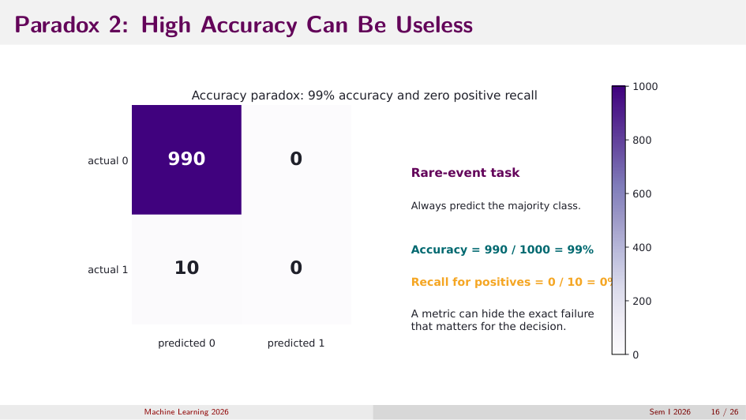
*👀 Slide 16 — The 990 in the top-left drowns everything; the bottom-right 0 means not one real positive was caught.*

**Rare-event task:** 1000 cases, 990 actual 0, 10 actual 1. Strategy: *always predict the majority class (0).*

| | predicted 0 | predicted 1 |
|---|---|---|
| actual 0 | 990 | 0 |
| actual 1 | 10 | 0 |

$$\text{Accuracy} = \frac{990}{1000} = 99\%, \qquad \text{Recall for positives} = \frac{0}{10} = 0\%.$$

(Bar chart on the slide: a tall bar at 990, a tiny one at 10 — the imbalance made visible.)

**A metric can hide the exact failure that matters for the decision.** See Part A §13: accuracy is a weighted average where the majority class gets 99% of the weight.

## Slide 17 — What the Accuracy Paradox Teaches

For rare-event tasks the majority class dominates accuracy. Examples where the rare class is the whole point:

- **Flood damage detection** — most map tiles show no damage.
- **Disease screening** — most people are healthy.
- **Fraud detection** — most transactions are legitimate.
- **Equipment failure prediction** — machines usually work.

> ⚠️ **The metric must match the decision.** Otherwise the best score may reward the wrong behaviour.

Also notice the cost asymmetry: missing a flood (false negative) is far worse than a false alarm. Accuracy treats them as equal. Lectures 9–10 build better tools (precision, recall, ROC/AUC, cost-weighted thresholds).

## Slide 18 — Paradox 3: Right Prediction, Wrong Reason

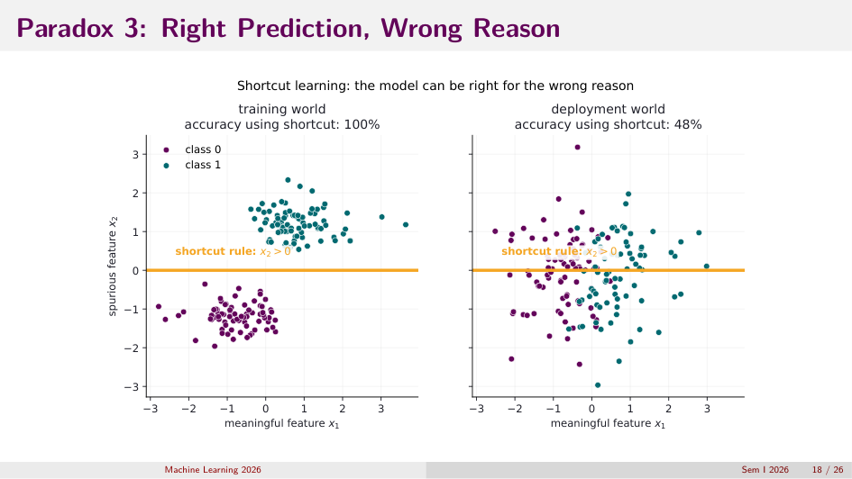
*👀 Slide 18 — Left: the rule x₂ > 0 separates the classes perfectly. Right: the same rule at deployment is a coin flip (48%).*

**Two panels**, each with meaningful feature $x_1$ (horizontal) and spurious feature $x_2$ (vertical), two classes.

- **Training world:** class 1 points all have $x_2 > 0$, class 0 all have $x_2 < 0$. The shortcut rule "predict 1 if $x_2 > 0$" scores **100%**.
- **Deployment world:** class depends on $x_1$, and $x_2$ is now unrelated. The same rule scores **48%** — worse than a coin flip.

**Shortcut learning:** the model can be right for the wrong reason. In maths terms, the model learned a pattern in $\mathcal{D}_{\text{train}}$ that does not exist in $\mathcal{D}_{\text{deploy}}$. Training-set $\hat R$ was perfect; deployment $R$ is terrible.

## Slide 19 — What Shortcut Learning Teaches

Models exploit **whatever predictive signal is easiest**. It might be the real mechanism, or a shortcut:

| Shortcut | Instead of | Real example |
|---|---|---|
| **Background** | the object | "wolf" classifier actually detecting snow |
| **Hospital** | the disease | X-ray model learning which hospital's scanner (sicker patients go to certain hospitals) |
| **Sensor artifact** | the event | a gauge glitch that happens to coincide with storms |
| **Future information** | present information | a feature recorded *after* the outcome (e.g. "insurance claim filed" when predicting damage) — *data leakage* |

**The question to ask of every feature:** *Would this feature still be available, valid, and causal enough at deployment time?*

## Slide 20 — Paradox 4: Bigger Models Can Behave Strangely

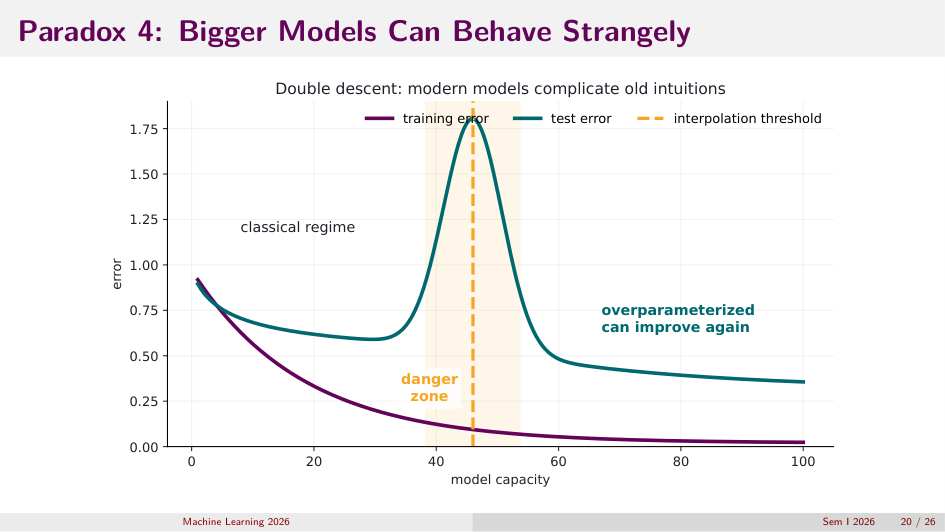
*👀 Slide 20 — Test error rises to a peak at the dashed interpolation line, then falls again as capacity keeps growing.*

**The plot:** horizontal = model capacity (0–100), vertical = error.

- **Training error** (falls steadily) → reaches ~0 at the **interpolation threshold** (dashed line).
- **Test error**: falls (classical regime) → rises into a **danger zone** peaking at the threshold → then **falls again** in the **overparameterized** region.

This is **double descent**. Mechanism explained in Part A §14 (polynomials through points).

## Slide 21 — What Double Descent Teaches

- **Classical intuition:** more flexible models overfit → keep models small.
- **Modern twist:** after the interpolation threshold, very large models can sometimes improve again — which is partly why huge neural networks work at all.

**Insight:** this does **not** remove the need for validation; it makes careful validation **more** important. When neither "small is safe" nor "big is better" holds, only measurement on held-out data can tell you where you are on the curve.

**The four paradoxes together:**

| # | Paradox | What misleads you | Defence |
|---|---|---|---|
| 1 | Simpson's | Pooling hides a confounding group | Condition on relevant variables; inspect subgroups |
| 2 | Accuracy | Metric dominated by the majority class | Choose a metric matching the decision's costs |
| 3 | Shortcut | An easy spurious feature replaces the real signal | Ask whether each feature is valid at deployment |
| 4 | Double descent | Capacity-vs-error intuition breaks | Validate on held-out data |

## Slide 22 — Section: The Learning Language

Section divider.

## Slide 23 — From Data-Generating Process to Decision

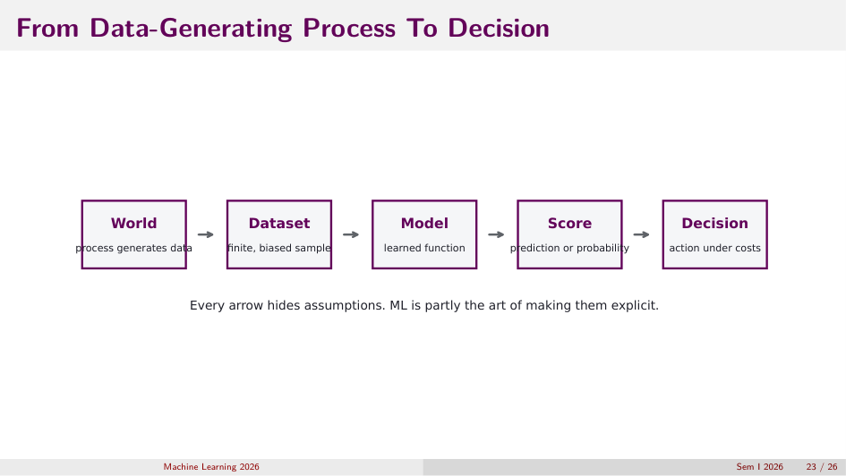
*👀 Slide 23 — Every arrow hides an assumption: world → dataset → model → score → decision.*

```
World ──► Dataset ──► Model ──► Score ──► Decision
```

| Box | Description | Hidden assumption on the arrow *into* it |
|---|---|---|
| **World** | process generates data | — |
| **Dataset** | finite, biased sample | that sampling represents the world (iid, §9.3) |
| **Model** | learned function | that the model family can capture the pattern; that the loss is right |
| **Score** | prediction or probability | that the model works on *this* new input (no shift) |
| **Decision** | action under costs | a threshold, and the costs of each type of mistake |

> **Every arrow hides assumptions. ML is partly the art of making them explicit.**

## Slide 24 — The Basic Learning Problem

> **Given** examples $S_{\text{train}} = \{(x_i, y_i)\}_{i=1}^{n}$, **learn** a function $f : \mathcal{X} \to \mathcal{Y}$ that **performs well on future examples.**

- $x_i$: input (features) of example $i$ — a vector (§6).
- $y_i$: target (correct answer) of example $i$.
- $f$: the model (§3).

Read symbol by symbol with Part A §1–3. The crucial words are **"future examples"**: doing well on $S_{\text{train}}$ is easy (memorise it); doing well on unseen cases — **generalization** — is the actual goal.

## Slide 25 — Four Objects We Must Not Confuse

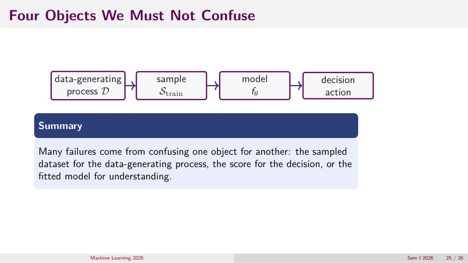
*👀 Slide 25 — Four different things: the process D, the sample, the fitted model, the action.*

```
data-generating process 𝒟 ──► sample S_train ──► model f_θ ──► decision / action
```

| Object | What it is | Typical confusion |
|---|---|---|
| $\mathcal{D}$ | The world's unknown dice (§9.2) | — |
| $S_{\text{train}}$ | $n$ rolls of those dice | **sample ↔ world:** "my dataset says X, so the world is X" |
| $f_\theta$ | The fitted function with knobs $\theta$ | **fitted model ↔ understanding:** "it predicts well, so it knows *why*" |
| decision | The action taken | **score ↔ decision:** "probability 0.6, so act" — but acting depends on costs |

**Summary:** many failures come from treating one of these objects as if it were another.

## Slide 26 — Loss: What Error Means

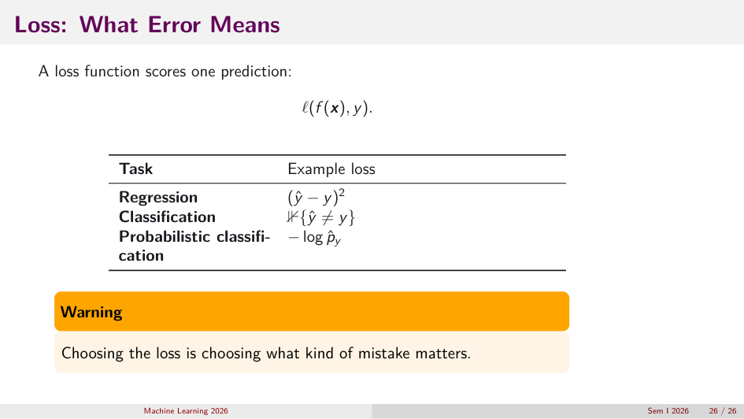
*👀 Slide 26 — One loss per task: squared, 0–1, and −log p.*

A loss function scores **one** prediction: $\ell(f(x), y)$.

| Task | Example loss | Behaviour |
|---|---|---|
| Regression | $(\hat y - y)^2$ | Punishes big misses quadratically (§11) |
| Classification | $\mathbb{1}\{\hat y \neq y\}$ | Counts right/wrong only (§11) |
| Probabilistic classification | $-\log \hat p_y$ | Surprise at the true class (§10.4) |

Worked numbers:

- Squared: $\hat y = 5, y = 4 \to 1$; $\hat y = 7, y = 4 \to 9$.
- 0-1: wrong → 1, right → 0, no matter how close.
- Log: true class given 0.9 → 0.105; given 0.1 → 2.303.

> ⚠️ **Choosing the loss is choosing what kind of mistake matters.**

**Where the lecture ends, and what comes next.** The objectives promised $R$ and $\hat R$. Average the loss over the world and you get the **risk** $R(f) = \mathbb{E}_{\mathcal{D}}[\ell(f(X),Y)]$; average it over your data and you get the **empirical risk** $\hat R(f) = \frac1n\sum_i \ell(f(x_i),y_i)$ (Part A §9.5). Training picks the $f$ that minimises $\hat R$ (§12). Each paradox is a way a small $\hat R$ fails to mean a small $R$:

- Simpson / biased sampling → $S_{\text{train}}$ doesn't represent $\mathcal{D}$.
- Accuracy paradox → the chosen $\ell$ doesn't match the decision.
- Shortcut → $\mathcal{D}$ at deployment differs from $\mathcal{D}$ at training.
- Double descent → the gap between $\hat R$ and $R$ behaves non-intuitively with capacity.

Lecture 2 makes all of this precise.

---

# Part C — Practice

1. Compute $\sum_{i=1}^{4}(2i - 1)$. What pattern do you notice?
2. $x = (1, 0, 3)$, $w = (2, 5, -1)$, $b = 4$. Compute $\hat y = w^\top x + b$.
3. From the rain/flood table in §8: find $P(\text{light} \mid \text{no flood})$ and $P(\text{no flood} \mid \text{light})$.
4. Are "heavy rain" and "flood" independent? Show with numbers.
5. A fraud detector: 0.1% of transactions are fraud. It catches 95% of fraud and flags 2% of legitimate ones. Given a flag, chance of fraud?
6. Compute $\mathbb{E}[X]$ where $X$ is 10 with probability 0.2, 0 with probability 0.5, and −4 with probability 0.3.
7. Simplify $\log(e^5 \cdot e^{-2})$ and $\log(0.2) + \log(5)$.
8. Find $\arg\min_c\ (c-1)^2 + (c-7)^2$. Then the min.
9. True labels $y = (1, 0, 1, 1)$, predictions $\hat y = (1, 1, 0, 1)$. Compute 0-1 empirical risk, accuracy, recall, precision.
10. A model gives probabilities 0.7, 0.2, 0.9 to the true classes of three examples. Compute the average log loss.
11. **Think:** You build a pass/fail predictor on students from one school and get 95% accuracy. Name two ways this could mislead you, using Lecture 1's paradoxes.

<details>
<summary><b>Answers</b></summary>

1. $1+3+5+7 = 16 = 4^2$. The sum of the first $n$ odd numbers is $n^2$.
2. $2 + 0 - 3 + 4 = 3$.
3. $P(\text{light}\mid\text{no flood}) = 78/90 \approx 0.867$; $P(\text{no flood}\mid\text{light}) = 78/80 = 0.975$. Different denominators, different answers.
4. No: $P(\text{heavy},\text{flood}) = 0.08$ but $P(\text{heavy})P(\text{flood}) = 0.2 \times 0.1 = 0.02$.
5. $\frac{0.95\times0.001}{0.95\times0.001 + 0.02\times0.999} = \frac{0.00095}{0.00095+0.01998} \approx 0.045$ — under 5%.
6. $10(0.2) + 0(0.5) + (-4)(0.3) = 2 - 1.2 = 0.8$.
7. $\log(e^3) = 3$; $\log(0.2 \times 5) = \log 1 = 0$.
8. Expand: $2c^2 - 16c + 50$; argmin $= 16/4 = 4$ (the mean of 1 and 7); min $= 9 + 9 = 18$.
9. Wrong on examples 2 and 3 → risk $= 2/4 = 0.5$, accuracy 0.5. TP = 2, FN = 1, FP = 1: recall $= 2/3$, precision $= 2/3$.
10. $\frac13\big(0.357 + 1.609 + 0.105\big) \approx 0.690$.
11. Any two: (a) **shortcut** — the model may use something specific to that school (e.g. a teacher's grading quirk) that won't hold elsewhere; (b) **accuracy paradox** — if 95% of students pass, "always predict pass" scores 95% and catches no failing students; (c) **Simpson / sampling** — one school isn't the population $\mathcal{D}$, so $\hat R$ there says little about $R$ elsewhere.

</details>
