# Lecture 2 — Mathematical Foundations for Learning from Data

> ES 335 / ES 678 Machine Learning, Sem I 2026 — Prof. Udit Bhatia, Prof. Krishna Prasad Miyapuram
> Source: `Lectures/L02_student_mathematical_foundations.pdf` (39 slides) · Previous: [`L01_ml_intro_past_present.md`](L01_ml_intro_past_present.md)

**How to use this file.** Part A builds the *new* maths Lecture 2 needs, on top of Lecture 1's Part A (sets, functions, Σ, vectors, probability, expectation, logs, argmin). Part B goes through all 39 slides. The "In Class / Work It Out" slides are left blank in the PDF, so they are **fully solved** here. Part C is practice.

**What this lecture is really about:** building one precise chain you'll use all course:

$$\underbrace{x_i}_{\text{one input}} \xrightarrow{f_\theta} \underbrace{\hat y_i}_{\text{one prediction}} \xrightarrow{\ell} \underbrace{\ell_i}_{\text{one loss}} \xrightarrow{\frac1n\sum} \underbrace{\hat R(f_\theta)}_{\text{one number for the whole dataset}}$$

and understanding *why* squared error, *what* training returns, and *two different ways* to build a predictor.

## Contents

**Part A — Maths from the ground up**
1. [Types of mathematical objects](#a1-types-of-mathematical-objects)
2. [Vectors, properly](#a2-vectors-properly)
3. [Matrices](#a3-matrices--a-whole-dataset-in-one-symbol)
4. [Functions of many variables, surfaces, contours](#a4-functions-of-many-variables-surfaces-and-contour-maps)
5. [Derivatives from zero](#a5-derivatives-from-zero)
6. [Partial derivatives, gradients, gradient descent](#a6-partial-derivatives-gradients-gradient-descent)
7. [Convexity](#a7-convexity--bowls-have-one-bottom)
8. [What does and doesn't change an argmin](#a8-what-does-and-doesnt-change-an-argmin)
9. [Continuous probability and densities](#a9-continuous-probability-and-densities)
10. [Mean, variance, standard deviation](#a10-mean-variance-standard-deviation)
11. [The normal (Gaussian) distribution](#a11-the-normal-gaussian-distribution)
12. [Bayes' rule with densities; generative stories](#a12-bayes-rule-with-densities-generative-stories)
13. [Odds, log-odds, and the sigmoid](#a13-odds-log-odds-and-the-sigmoid)
14. [Products Π, independence, likelihood](#a14-products-π-independence-and-likelihood)
15. [Chain rule of probability](#a15-the-chain-rule-of-probability)

**Part B — Slides 1–39** · [Jump](#part-b--lecture-2-slide-by-slide-all-39-pages)

**Part C — Practice** · [Jump](#part-c--practice)

---

# Part A — Maths From the Ground Up

## A1. Types of mathematical objects

Before computing anything, ask **what kind of object** each symbol is. Mixing types is the most common source of nonsense.

| Type | Symbol style | Shape | Example |
|---|---|---|---|
| **Scalar** | $y_i$, $\hat y_i$, $b$ | one number | flood depth 2.3 m |
| **Vector** | $x_i$, $w$, $\theta$ | list of $d$ numbers, $\mathbb{R}^d$ | (rainfall, area, slope) |
| **Matrix** | $X$ (capital, often bold) | table $n \times d$ | the full dataset |
| **Function** | $f_\theta$, $\ell$, $L$ | a rule: input → output | $f_\theta(x) = w^\top x + b$ |
| **Distribution** | $\mathcal{D}$, $p$, $\mathcal{N}(\mu,\sigma^2)$ | describes how likely values are | "the world's dice" |
| **Set** | $\mathcal{F}$, $\mathcal{H}$, $\mathcal{X}$ | a collection | all linear functions |

Quick test: $\hat y_i = f_\theta(x_i)$ — scalar = function applied to vector. ✓. $R(f)$ — a number that depends on a whole function. ✓. "$\mathcal{D} = 3.2$" — nonsense: a distribution isn't a number.

## A2. Vectors, properly

### Column vs row, and transpose

By convention a vector is a **column**:

$$x = \begin{pmatrix} x_1 \\ x_2 \\ x_3 \end{pmatrix} \quad (3 \times 1).$$

The **transpose** $x^\top$ flips it into a **row**: $x^\top = (x_1,\ x_2,\ x_3)$, shape $1 \times 3$.

Then the dot product is a row times a column:

$$w^\top x = (w_1, w_2, w_3)\begin{pmatrix}x_1\\x_2\\x_3\end{pmatrix} = w_1x_1 + w_2x_2 + w_3x_3.$$

That's why we write $w^\top x$ and not $wx$: the transpose makes the shapes $(1\times d)(d \times 1) = 1\times1$ legal.

### Length (norm)

By Pythagoras (extended to $d$ dimensions):

$$\|x\| = \sqrt{x_1^2 + x_2^2 + \dots + x_d^2} = \sqrt{x^\top x}.$$

$\|(3,4)\| = 5$. The squared length $\|x\|^2 = x^\top x$ is a sum of squares — remember this; a sum of squared residuals is $\|r\|^2$.

### Geometry of the dot product

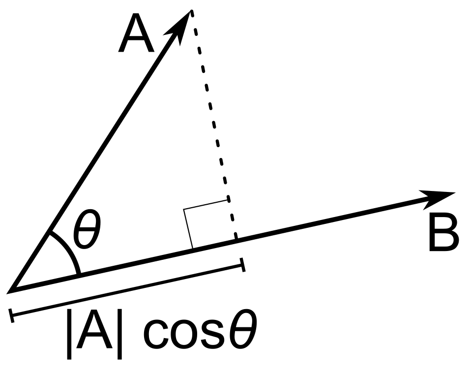
*a·b = |a||b|cos θ: the length of a's shadow on b, times |b|. (Wikimedia Commons: [Dot_Product.svg](https://commons.wikimedia.org/wiki/File:Dot_Product.svg), Public domain)*

$$w^\top x = \|w\|\,\|x\|\cos\phi,$$

where $\phi$ is the angle between the arrows. So:

- same direction → large positive,
- perpendicular ($\phi = 90°$) → **zero**,
- opposite → negative.

A linear model $w^\top x$ measures **how much $x$ points along $w$**. The set of $x$ where $w^\top x + b = 0$ is a line (2D), plane (3D), or *hyperplane* (higher) perpendicular to $w$ — the "cut" a linear classifier makes.

## A3. Matrices — a whole dataset in one symbol

### The data matrix

Stack the $n$ examples as **rows**:

$$X = \begin{pmatrix} — x_1^\top — \\ — x_2^\top — \\ \vdots \\ — x_n^\top — \end{pmatrix} \in \mathbb{R}^{n \times d}.$$

Row $i$ = example $i$. Column $j$ = feature $j$ across all examples. Entry $X_{ij}$ = feature $j$ of example $i$. **Shape is always (rows × columns).**

### Matrix × vector = many dot products at once

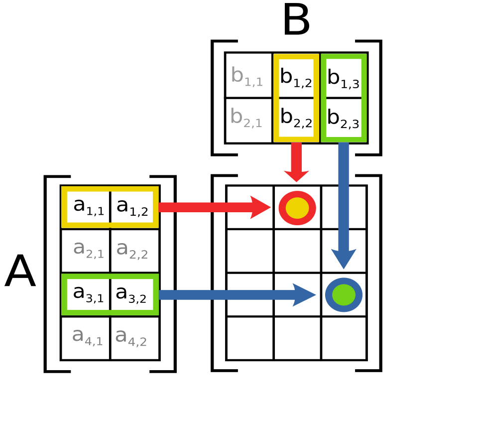
*Each output entry = one row of the left matrix dotted with one column of the right. (Wikimedia Commons: [Matrix_multiplication_diagram_2.svg](https://commons.wikimedia.org/wiki/File:Matrix_multiplication_diagram_2.svg), CC BY-SA 3.0)*

$$X\theta = \begin{pmatrix} x_1^\top\theta \\ x_2^\top\theta \\ \vdots \\ x_n^\top\theta\end{pmatrix}$$

Each row dotted with $\theta$. Example:

$$\begin{pmatrix} 1 & 2 \\ 3 & 0 \\ -1 & 4 \end{pmatrix}\begin{pmatrix} 2 \\ 1 \end{pmatrix} = \begin{pmatrix} 1\cdot2 + 2\cdot1 \\ 3\cdot2 + 0\cdot1 \\ -1\cdot2 + 4\cdot1\end{pmatrix} = \begin{pmatrix} 4 \\ 6 \\ 2 \end{pmatrix}.$$

**One line of maths = predictions for the whole dataset.**

### The dimension rule

$$(a \times \underline{b})\,(\underline{b} \times c) = (a \times c).$$

The **inner** numbers must match; the **outer** numbers give the result's shape. $(n\times d)(d\times1) = n \times 1$ ✓. $(d \times 1)(n \times d)$ — inner $1 \ne n$ → **undefined**. Checking shapes catches most algebra mistakes instantly.

### Matrix transpose and matrix × matrix

$X^\top$ swaps rows and columns: $(n \times d) \to (d \times n)$.

$AB$: entry $(i, k)$ is row $i$ of $A$ dotted with column $k$ of $B$. You'll meet $X^\top X$ ($d \times d$) in Lecture 5's normal equation.

### The bias trick

$\hat y = w^\top x + b$ has a separate $b$. Add a constant feature $1$ to every $x$: $\tilde x = (1, x_1, \dots, x_d)$, $\theta = (b, w_1, \dots, w_d)$. Then $\theta^\top\tilde x = b + w^\top x$. So we can write the whole model as just $\hat y = X\theta$, with a column of 1s in $X$.

## A4. Functions of many variables, surfaces, and contour maps

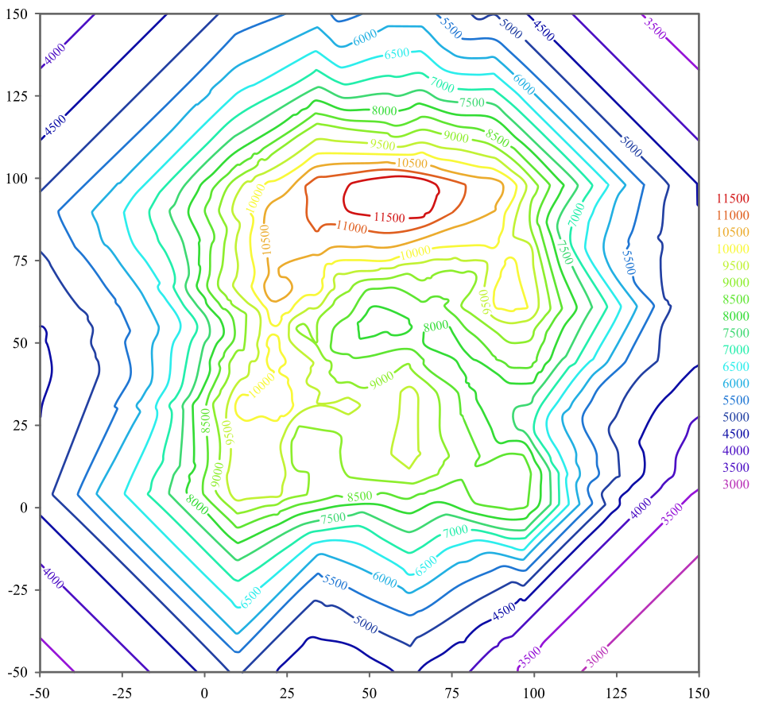
*Contour map: slice the surface at fixed heights and look from above. (Wikimedia Commons: [Contour2D.svg](https://commons.wikimedia.org/wiki/File:Contour2D.svg), CC BY-SA 3.0)*

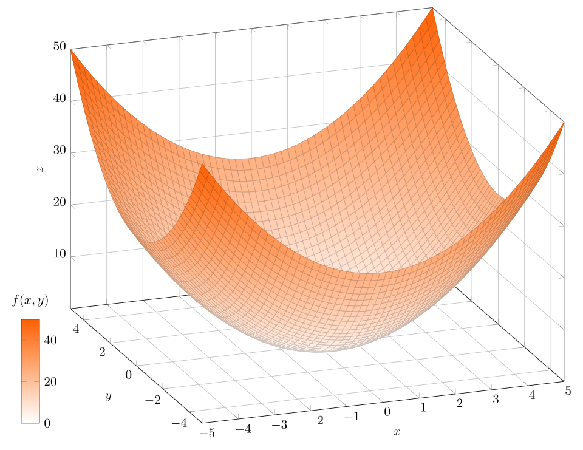
*A function of two inputs is a surface; each (x, y) gets a height. (Wikimedia Commons: [3d-function-2.svg](https://commons.wikimedia.org/wiki/File:3d-function-2.svg), CC BY 3.0)*

A training objective depends on **several** knobs: $L(w, b)$. Picture it as a landscape: $w$ east–west, $b$ north–south, $L$ = height.

A **contour plot** is the map view: each curve joins points of **equal height** (equal loss), like contour lines on a hill map. Nested ovals around a point = a bowl with its bottom at that point.

Lecture 2, slide 11 shows exactly this for linear regression: oval contours (labelled 0.15 … 5.13) around the least-squares solution.

## A5. Derivatives from zero

### The question

For a curve $L(u)$, how steep is it **at one point**? Slope of a line is rise/run, but a curve's steepness changes from point to point.

### Secant → tangent

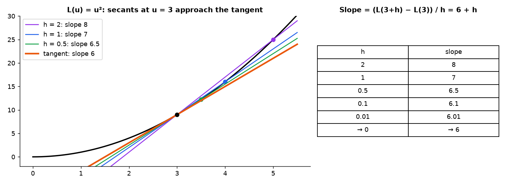
*📊 Shrink h and the secant slope 6 + h walks down to the tangent slope 6 = L'(3).*

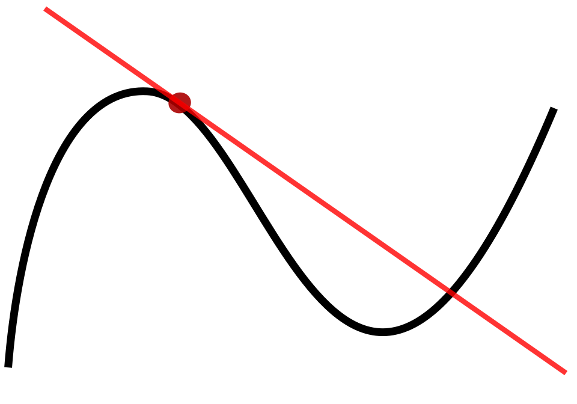
*The tangent line touches the curve and has the curve's instantaneous slope. (Wikimedia Commons: [Tangent_to_a_curve.svg](https://commons.wikimedia.org/wiki/File:Tangent_to_a_curve.svg), Public domain)*

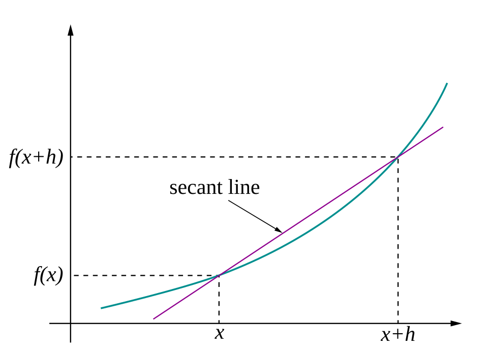
*Secant through two points; as h → 0 the secant slope becomes the tangent slope. (Wikimedia Commons: [Secant-calculus.svg](https://commons.wikimedia.org/wiki/File:Secant-calculus.svg), CC BY-SA 3.0)*

Pick two nearby points, $u$ and $u + h$. Slope between them:

$$\frac{L(u+h) - L(u)}{h}.$$

Shrink $h$ toward 0. The limit is the **derivative**:

$$L'(u) = \frac{dL}{du} = \lim_{h\to0}\frac{L(u+h)-L(u)}{h}.$$

**Example from scratch:** $L(u) = u^2$.

$$\frac{(u+h)^2 - u^2}{h} = \frac{2uh + h^2}{h} = 2u + h \ \xrightarrow{h\to0}\ 2u.$$

So the slope of $u^2$ at $u = 3$ is 6; at $u = 0$ it's 0 (the bottom!); at $u = -1$ it's $-2$ (negative: the curve is going downhill as you move right).

### Rules (each provable like the example above)

| Function | Derivative |
|---|---|
| constant $c$ | $0$ |
| $u^k$ | $k u^{k-1}$ |
| $c\,g(u)$ | $c\,g'(u)$ |
| $g(u) + h(u)$ | $g'(u) + h'(u)$ |
| $e^u$ | $e^u$ |
| $\log u$ | $1/u$ |
| **chain rule**: $g(h(u))$ | $g'(h(u))\cdot h'(u)$ — "outside derivative × inside derivative" |

**Chain rule example:** $L(u) = (u-3)^2$. Outside: $(\cdot)^2 \to 2(\cdot)$. Inside: $u - 3 \to 1$. So $L'(u) = 2(u-3)$.

### Why ML cares: the bottom has zero slope

At the lowest point of a smooth curve the tangent is flat: $L'(u) = 0$.

$(u-3)^2$: $2(u-3) = 0 \Rightarrow u = 3$ = the argmin. ✓ (Same answer as completing the square, but this method works for *any* smooth function.)

**Second derivative** $L''$ = slope of the slope = curvature. $L'' > 0$: curve bends up (bowl) → the flat point is a minimum. For $(u-3)^2$, $L'' = 2 > 0$. ✓

## A6. Partial derivatives, gradients, gradient descent

### Partial derivative

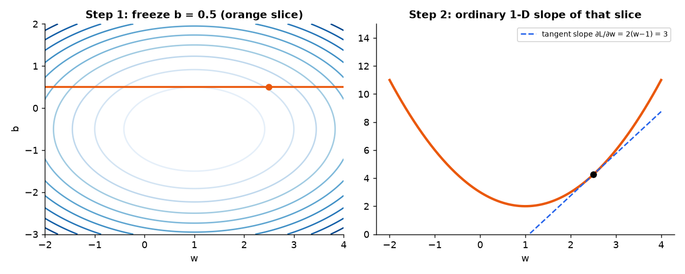
*📊 A partial derivative is the ordinary slope of a slice where every other variable is frozen.*

For $L(w, b)$: freeze $b$, differentiate in $w$ → $\dfrac{\partial L}{\partial w}$. Freeze $w$, differentiate in $b$ → $\dfrac{\partial L}{\partial b}$. ($\partial$ = "partial", a curly d.)

Example: $L(w,b) = (wx + b - y)^2$ for one data point. Chain rule:

$$\frac{\partial L}{\partial w} = 2(wx+b-y)\cdot x, \qquad \frac{\partial L}{\partial b} = 2(wx+b-y)\cdot 1.$$

### Gradient

Stack the partials into a vector: $\nabla L = \left(\dfrac{\partial L}{\partial w}, \dfrac{\partial L}{\partial b}\right)$. It points in the direction of **steepest uphill**. At a minimum of a smooth bowl, $\nabla L = 0$.

### Gradient descent (preview of later lectures)

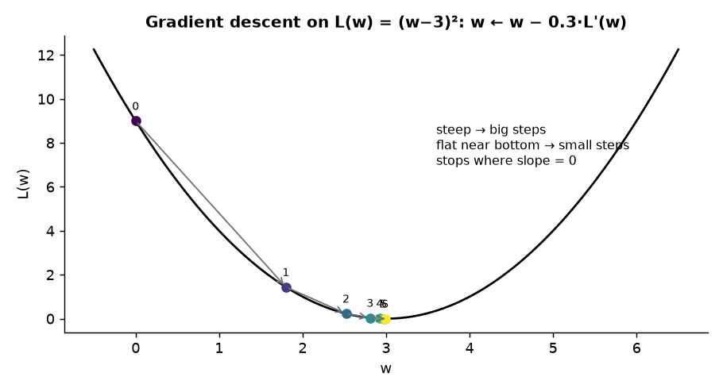
*📊 Each step moves against the slope; steps shrink by themselves as the slope flattens.*

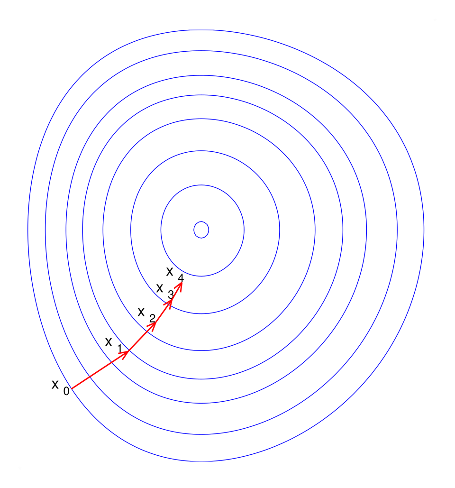
*Gradient descent on a contour map: each step moves against the gradient, at right angles to the contours. (Wikimedia Commons: [Gradient_descent.svg](https://commons.wikimedia.org/wiki/File:Gradient_descent.svg), Public domain)*

Walk downhill in small steps: $\theta \leftarrow \theta - \eta\,\nabla L(\theta)$, with step size $\eta$.

Example: $L(u) = (u-3)^2$, $L'(u) = 2(u-3)$, $\eta = 0.25$, start $u = 0$:

| step | $u$ | $L'(u)$ | new $u = u - 0.25 L'(u)$ |
|---|---|---|---|
| 0 | 0 | −6 | 1.5 |
| 1 | 1.5 | −3 | 2.25 |
| 2 | 2.25 | −1.5 | 2.625 |
| … | → 3 | → 0 | |

### Worked example: fitting a line by setting the gradient to zero

Data: $(1, 2), (2, 3), (3, 5)$. Model $\hat y = wx + b$. Objective $L(w,b) = \sum_i (wx_i + b - y_i)^2$.

Set $\partial L/\partial b = 2\sum(wx_i + b - y_i) = 0$ → $b = \bar y - w\bar x$ (the line passes through the mean point).

Set $\partial L/\partial w = 2\sum(wx_i+b-y_i)x_i = 0$ and substitute $b$ → the classic result

$$w = \frac{\sum_i (x_i - \bar x)(y_i - \bar y)}{\sum_i (x_i - \bar x)^2}.$$

Numbers: $\bar x = 2$, $\bar y = 10/3 \approx 3.333$.

| $x_i$ | $y_i$ | $x_i - \bar x$ | $y_i - \bar y$ | product | $(x_i-\bar x)^2$ |
|---|---|---|---|---|---|
| 1 | 2 | −1 | −1.333 | 1.333 | 1 |
| 2 | 3 | 0 | −0.333 | 0 | 0 |
| 3 | 5 | 1 | 1.667 | 1.667 | 1 |
| | | | **sum** | **3** | **2** |

$w = 3/2 = 1.5$, $b = 3.333 - 1.5(2) = 0.333$. Predictions $1.833, 3.333, 4.833$; residuals $0.167, -0.333, 0.167$ (they sum to 0 — always true with an intercept). This is **least squares**, the subject of Lectures 3–5.

## A7. Convexity — bowls have one bottom

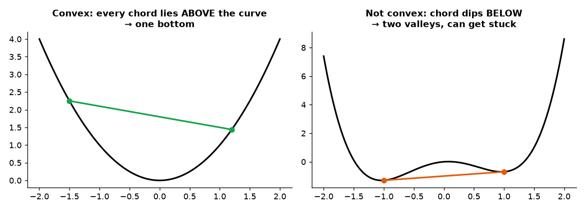
*📊 The chord test in pictures: convex has one bottom; non-convex can trap you in the wrong valley.*

### Mixing two points

For $0 \le \lambda \le 1$, the point $\lambda u + (1-\lambda)v$ is a **weighted average** of $u$ and $v$ — it slides from $v$ ($\lambda = 0$) to $u$ ($\lambda = 1$) along the segment between them.

### Definition

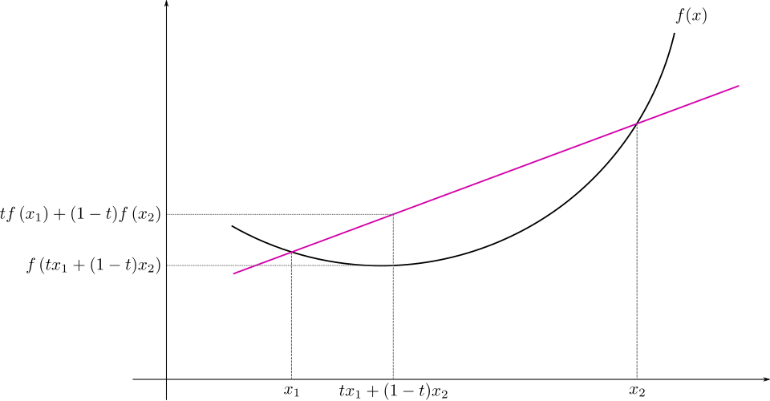
*Convex: the chord between any two points lies on or above the curve. (Wikimedia Commons: [ConvexFunction.svg](https://commons.wikimedia.org/wiki/File:ConvexFunction.svg), CC BY-SA 3.0)*

$g$ is **convex** if for all $u, v$ and all $0\le\lambda\le1$:

$$g\big(\lambda u + (1-\lambda)v\big) \le \lambda g(u) + (1-\lambda) g(v).$$

**Picture:** pick any two points on the graph and draw the straight chord between them. A convex function's graph is never **above** the chord. It's a bowl, never a hill or a wave.

Check $g(u) = u^2$, $u = 0$, $v = 2$, $\lambda = \tfrac12$: left $= g(1) = 1$; right $= \tfrac12(0) + \tfrac12(4) = 2$. $1 \le 2$ ✓.

### Why it matters

**For a convex function, every local minimum is a global minimum.** No false valleys to get stuck in. Downhill always leads to the true best answer. That's why slide 3 says "no higher valley between two points".

### Recognising convex functions

| Convex ✓ | Not convex ✗ |
|---|---|
| $u^2$, $(au+b)^2$, $\lvert u\rvert$, $e^u$, $-\log u$ | $\sin u$, $u^3$ (on all of $\mathbb{R}$), $-u^2$ |

- Smooth test: $g''(u) \ge 0$ everywhere.
- **A sum of convex functions is convex.**
- A convex function of a **linear** expression in the parameters is convex in the parameters.

### "Convex in *what*?"

$L(w,b) = \frac1n\sum_i (w^\top x_i + b - y_i)^2$. For fixed data, $w^\top x_i + b - y_i$ is **linear in $(w,b)$**, its square is convex, and a sum of convex functions is convex. So $L$ is convex in $(w,b)$.

This stays true even if the features are nonlinear in the raw input (e.g. $x_i = (\text{rain}, \text{rain}^2)$): the model curves in $x$ but is still linear in the **parameters**, so training is still a nice bowl. Convexity is always about the variable you're optimising.

## A8. What does and doesn't change an argmin

Training only needs the **location** of the minimum, so we may freely simplify the objective as long as the location doesn't move:

| Operation | Effect on argmin | Why |
|---|---|---|
| Add a constant: $L + c$ | unchanged | shifts the whole curve up; bottom stays put |
| Multiply by $c > 0$ | unchanged | stretches vertically |
| Apply an increasing function: $\log L$, $\sqrt L$ | unchanged (for $L > 0$) | order of values preserved |
| Multiply by $-1$ | **max ↔ min** | flips the curve upside down |

So $\arg\max_\theta \mathcal{L}(\theta) = \arg\max_\theta \log\mathcal{L}(\theta) = \arg\min_\theta\,[-\log\mathcal{L}(\theta)]$. This table is the entire trick behind slide 35.

## A9. Continuous probability and densities

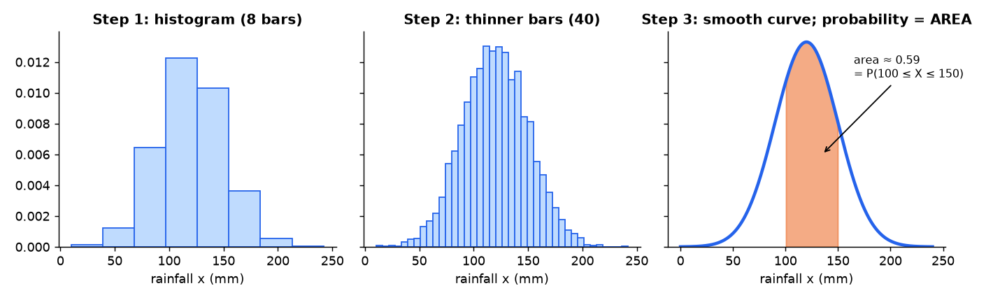
*📊 Thinner and thinner histogram bars become a smooth density; probability is the shaded area.*

Rainfall can be 90.0, 90.01, 90.001 … mm — infinitely many values. The chance of *exactly* 90.000… is 0. So we describe continuous variables with a **density** $p(x)$:

- Think of a histogram with ever-thinner bars, scaled so the total **area** is 1.
- **Probability = area under the curve**: $P(a \le X \le b) = \int_a^b p(x)\,dx$. (The $\int$ is a continuous sum, the area under the curve.)
- $p(x)$ itself is **not** a probability. It's "probability per unit of $x$" and can be larger than 1. Compare densities to see which values are *relatively* more likely.
- Total probability becomes an integral: $p(y) = \int p(y\mid x)p(x)\,dx$.

## A10. Mean, variance, standard deviation

- **Mean** $\mu = \mathbb{E}[X]$ — the centre.
- **Variance** $\sigma^2 = \mathbb{E}[(X-\mu)^2]$ — average squared distance from the centre.
- **Standard deviation** $\sigma = \sqrt{\sigma^2}$ — spread, in the original units.

Example: values $2, 4, 6$ equally likely. $\mu = 4$, deviations $-2, 0, 2$, $\sigma^2 = (4 + 0 + 4)/3 = 8/3$, $\sigma \approx 1.63$.

## A11. The normal (Gaussian) distribution

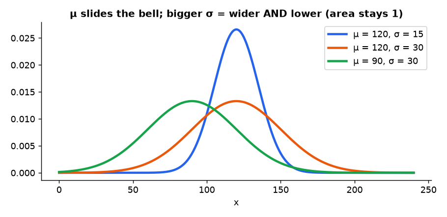
*📊 μ moves the bell, σ widens it; a wider bell must be lower so the area stays 1.*

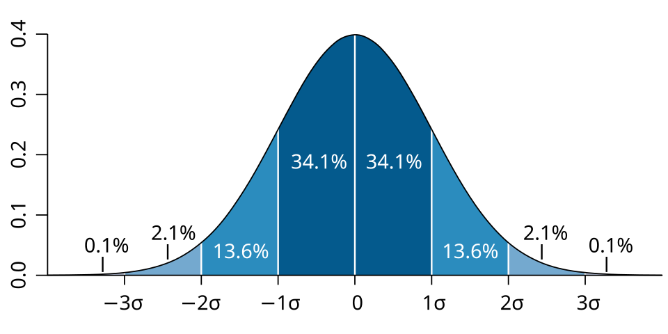
*Normal curve: ~68% within 1σ, ~95% within 2σ, ~99.7% within 3σ. (Wikimedia Commons: [Standard_deviation_diagram.svg](https://commons.wikimedia.org/wiki/File:Standard_deviation_diagram.svg), CC BY 2.5)*

The bell curve. Written $X \sim \mathcal{N}(\mu, \sigma^2)$ — centre $\mu$, spread $\sigma$.

$$p(x) = \frac{1}{\sqrt{2\pi\sigma^2}}\exp\!\left[-\frac{(x-\mu)^2}{2\sigma^2}\right].$$

Decompress piece by piece:

1. $(x - \mu)$ — how far $x$ is from the centre.
2. $\frac{(x-\mu)^2}{2\sigma^2}$ — that distance squared, measured in units of the spread.
3. $\exp[-\,\cdot\,]$ — turns "far" into "small": 1 at the centre, falling fast.
4. $\frac{1}{\sqrt{2\pi\sigma^2}}$ — a constant that makes the total area exactly 1.

**z-score:** $z = (x-\mu)/\sigma$, "how many spreads from the centre". Then $p(x) = \frac{1}{\sigma\sqrt{2\pi}}e^{-z^2/2}$.

**Rule of thumb:** about 68% of values lie within $1\sigma$, 95% within $2\sigma$, 99.7% within $3\sigma$.

**Why it's everywhere:** adding up many small independent effects produces a bell curve (*central limit theorem*). Measurement noise is the sum of many tiny disturbances, so Gaussian noise is a natural default.

**Worked (used in slide 18):**

- $\mathcal{N}(120, 30^2)$ at $x = 90$: $z = -1$; $e^{-0.5} = 0.6065$; $\frac{1}{30\sqrt{2\pi}} = 0.013298$; $p = 0.00807$.
- $\mathcal{N}(40, 20^2)$ at $x = 90$: $z = 2.5$; $e^{-3.125} = 0.04394$; $\frac{1}{20\sqrt{2\pi}} = 0.019947$; $p = 0.000876$.

## A12. Bayes' rule with densities; generative stories

Joint = conditional × marginal (L1 Part A §8.4), with densities for continuous $x$:

$$p(x, y) = p(x \mid y)\,p(y).$$

Read as a **story of how data is generated**: first nature picks the class $y$ (flood or not, with probability $p(y)$); then, given the class, it produces a rainfall $x$ from $p(x \mid y)$.

Bayes turns the story around into a prediction:

$$p(y \mid x) = \frac{p(x\mid y)\,p(y)}{p(x)}, \qquad p(x) = \sum_{y'} p(x\mid y')\,p(y').$$

- $p(y)$ — **prior**: belief before seeing $x$.
- $p(x \mid y)$ — **likelihood**: how typical $x$ is for class $y$.
- $p(y \mid x)$ — **posterior**: belief after seeing $x$.
- $p(x)$ — **evidence**: the same for every class, so it just normalises (makes the posteriors sum to 1).

Recipe: **weight each class's likelihood by its prior, then normalise.**

**argmax over classes.** To decide, choose the class with the highest posterior: $\hat y = \arg\max_y p(y\mid x)$. For two classes: predict the one above 0.5.

## A13. Odds, log-odds, and the sigmoid

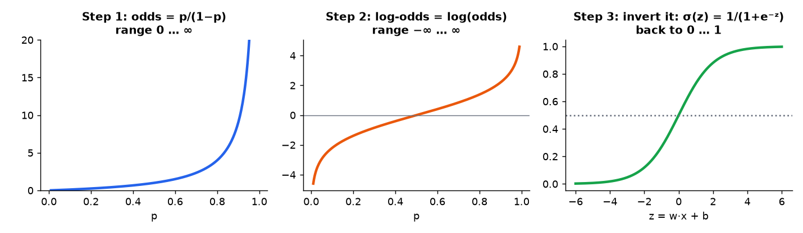
*📊 p → odds → log-odds stretches (0, 1) onto the whole number line; the sigmoid undoes it.*

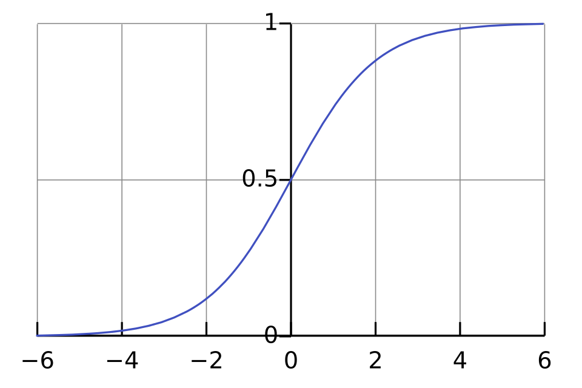
*The sigmoid σ(z) = 1/(1+e⁻ᶻ) squashes any real number into (0, 1). (Wikimedia Commons: [Logistic-curve.svg](https://commons.wikimedia.org/wiki/File:Logistic-curve.svg), Public domain)*

- **Odds** $= \dfrac{p}{1-p}$. $p = 0.8$ → odds 4 ("4 to 1"). $p = 0.5$ → odds 1.
- **Log-odds (logit)** $= \log\dfrac{p}{1-p}$. Ranges over all of $\mathbb{R}$: negative when $p < 0.5$, 0 at $p = 0.5$, positive when $p > 0.5$.

A linear expression $wx + b$ can be any real number, so it can't be a probability directly — but it **can** be a log-odds. Set $\log\frac{p}{1-p} = z$ and solve for $p$:

$$p = \sigma(z) = \frac{1}{1 + e^{-z}}.$$

The **sigmoid**: an S-curve from 0 to 1; $\sigma(0) = 0.5$; $\sigma(-z) = 1 - \sigma(z)$.

| $z$ | −4 | −1.8 | −1 | 0 | 1 | 1.8 | 4 |
|---|---|---|---|---|---|---|---|
| $\sigma(z)$ | 0.018 | 0.142 | 0.269 | 0.5 | 0.731 | 0.858 | 0.982 |

So $p(y=1\mid x) = \sigma(wx + b)$ means "**the log-odds are linear in $x$**". The **decision boundary** ($p = 0.5$) is where $wx + b = 0$, i.e. $x = -b/w$. This is **logistic regression** (Lecture 6).

## A14. Products Π, independence, and likelihood

**Product notation** — like Σ but multiply:

$$\prod_{i=1}^n a_i = a_1 \cdot a_2 \cdots a_n.$$

**Independence → multiply.** For independent events, $P(A, B) = P(A)P(B)$ (L1 Part A §8.6). For $n$ independent observations:

$$p(y_1, \dots, y_n) = \prod_{i=1}^n p(y_i).$$

**Likelihood.** Fix the observed data; ask how probable it was under parameter value $\theta$:

$$\mathcal{L}(\theta) = \prod_{i=1}^n p_\theta(y_i \mid x_i).$$

It's a function of $\theta$, not of the data. **Maximum likelihood**: pick the $\theta$ that made the data you actually saw most probable.

Toy example: a coin lands H, H, T. If $P(H) = \theta$, then $\mathcal{L}(\theta) = \theta^2(1-\theta)$. Try values: $\mathcal{L}(0.5) = 0.125$, $\mathcal{L}(2/3) \approx 0.148$, $\mathcal{L}(0.9) = 0.081$. The best is $\theta = 2/3$ — the observed frequency.

**Log-likelihood.** $\log$ turns the product into a sum (L1 Part A §10.4), avoids numbers too small for a computer, and keeps the argmax (§A8):

$$\log\mathcal{L}(\theta) = \sum_{i=1}^n \log p_\theta(y_i\mid x_i).$$

## A15. The chain rule of probability

Apply the multiplication rule repeatedly:

$$p(a, b, c) = p(a)\,p(b\mid a)\,p(c\mid a, b).$$

A sentence is a sequence of tokens $t_1, t_2, \dots$, so

$$p(\text{sentence}) = p(t_1)\,p(t_2\mid t_1)\,p(t_3\mid t_1,t_2)\cdots$$

A language model learns **one** piece: $p_\theta(\text{next token} \mid \text{preceding text})$, and generates text by applying it repeatedly. That's the maths behind slide 4.

---

# Part B — Lecture 2, Slide by Slide (all 39 pages)

## Slide 1 — Title

*Lecture 2: Mathematical Foundations for Learning from Data.* Same instructors as Lecture 1.

## Slide 2 — Course Roadmap: You Are Here

Now at **L2: the learning problem**. Purpose: give the mathematical language to move carefully between **one observation, a dataset, a prediction rule, and an average loss** — the four levels of the chain in this file's intro.

## Slide 3 — Recall: Words We Used Last Time

| Term | Working meaning | Unpacked |
|---|---|---|
| **Conditional probability** | $p(y\mid x)$: what we believe about $Y$ after observing $X = x$ | "Shrink the universe" to cases where $X = x$ (L1 §8.4). Every predictor is an estimate of this. |
| **Total probability** | $p(y) = \sum_x p(y\mid x)p(x)$, or an integral if $X$ is continuous | Weighted average over cases (L1 §8.7; §A9 for the integral). |
| **Non-stationarity** | $\mathcal{D}_{\text{past}} \neq \mathcal{D}_{\text{future}}$ | The world changes: a model trained on past data faces a different distribution. Climate change makes old flood data less representative. |
| **Weights $w$** | adjustable numbers that set the prediction, e.g. $\hat y = w^\top x + b$ | The knobs (§A2). |
| **Optimization** | choosing parameters to make an objective as small as possible | Finding an argmin (§A5–A6). |
| **Convexity** | no higher "valley" between two points; local minima are global | Bowl shape (§A7). |

## Slide 4 — A Better Answer to the ChatGPT Question

**Question:** why can a language model help with substantial software, yet give an unconvincing answer to a very short number series (like "2, 4, 8, ?")?

At its core an LLM estimates $p_\theta(\text{next token}\mid\text{preceding text})$ (§A15). It continues text in a way that was likely in its training data.

- **Programming works because:** the prompt usually names a familiar task family ("write a function that sorts…"), code patterns are hugely abundant in training data, and **execution and tests can reject a wrong answer** — there is an external check.
- **Short series fail because:** many rules $g$ fit the same few values. $2, 4, 8$ fits $2^n$ (next 16), but also $n^2 - n + 2$ (next 14), and infinitely many others (L1 Part A §14: $k$ points can be fit exactly by many curves). The intended rule **isn't determined by the prefix**, so "most likely continuation" is a guess about the examiner, not a deduction.
- **Tools matter:** running code or checking a rule symbolically gives *feedback* that plain next-token prediction doesn't have.

ML lesson: **finite data underdetermines the function.** Learning needs assumptions (a model class) plus checks against reality (evaluation).

## Slide 5 — Lecture Objectives

1. State whether a symbol is a scalar, vector, matrix, function, or distribution, and check its dimension. → slides 12–13, §A1–A3
2. Formalise supervised learning from one example to a fitted function. → slides 6–9
3. Explain the four choices inside a learning rule and what $\arg\min$ returns. → slides 8–11
4. Distinguish discriminative and generative targets, then move from one prediction error to empirical risk. → slides 14–23, 27–38

## Slide 6 — One Learning Example

One observed flood event:

$$x_i = \begin{pmatrix}\text{rainfall}\\ \text{catchment area}\\ \text{slope}\end{pmatrix} \in \mathbb{R}^3, \qquad y_i = \text{observed flood depth} \in \mathbb{R}.$$

Choose a prediction rule $f_\theta$ and compute $\hat y_i = f_\theta(x_i)$. For a linear rule, $\hat y_i = w^\top x_i + b$.

**Insight:** $w$ (3 numbers) and $b$ (1 number) are the **parameters**, written together as $\theta = (w, b)$ — 4 knobs. **Learning means choosing their values from data.**

Example: $w = (0.02, 0.01, 2)$, $b = -1$, $x_i = (120, 45, 0.3)$ → $\hat y_i = 3.45 - 1 = 2.45$ m. If the real depth was $y_i = 2.0$ m, the model over-predicted by 0.45 m.

## Slide 7 — What Are We Trying to Estimate?

Imagine nature works like this:

$$Y = f^\star(X) + \varepsilon$$

- $f^\star$ — the **systematic** relationship (true physics of rain → flood). Star = true and unknown.
- $\varepsilon$ (epsilon) — **noise**: unmeasured causes (soil moisture, blocked drains), measurement error. Even knowing $f^\star$ perfectly, you couldn't predict $Y$ exactly.

We never see $f^\star$. We see a finite sample $S_{\text{train}} = \{(x_i,y_i)\}_{i=1}^n$ and build an estimate $\hat f$ (hat = from data) to predict future $Y$ from future $X$.

**Future-performance target:**

$$R(f) = \mathbb{E}_{(X,Y)\sim\mathcal{D}}\big[\ell(f(X), Y)\big].$$

"Average loss over all future cases the world could generate." This is the score we really want $\hat f$ to be good at. Note: even $f = f^\star$ has $R > 0$ because of $\varepsilon$ — **noise sets a floor no model can beat.**

## Slide 8 — Machine Learning Is Four Explicit Choices

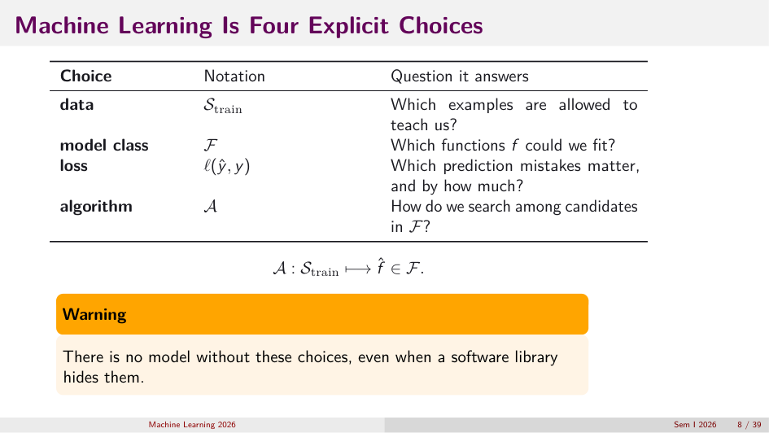
*👀 Slide 8 — Data, model class, loss, algorithm: every ML method is these four choices.*

| Choice | Notation | Question | Linear-regression example |
|---|---|---|---|
| **Data** | $S_{\text{train}}$ | Which examples are allowed to teach us? | 500 past storms |
| **Model class** | $\mathcal{F}$ | Which functions could we fit? | all $f(x) = w^\top x + b$ |
| **Loss** | $\ell(\hat y, y)$ | Which mistakes matter, and how much? | squared error |
| **Algorithm** | $\mathcal{A}$ | How do we search $\mathcal{F}$? | solve gradient = 0, or gradient descent |

$$\mathcal{A} : S_{\text{train}} \longmapsto \hat f \in \mathcal{F}.$$

The algorithm is itself a function: **dataset in, fitted model out.** (The $\mapsto$ arrow means "maps this to that".)

> ⚠️ There is no model without these four choices, even when a library hides them. `model.fit(X, y)` made all four for you.

## Slide 9 — What Does argmin Mean?

Let $L(\theta)$ assign one number (the objective) to each candidate parameter.

- $\min_\theta L(\theta)$ — the **smallest objective value**.
- $\arg\min_\theta L(\theta)$ — the **parameter that achieves it**.

Toy: $L(u) = (u-3)^2$ → $\min = 0$, $\arg\min = 3$ (§A5: set $2(u-3) = 0$).

In supervised learning, **empirical-risk minimisation**:

$$\hat f \in \arg\min_{f\in\mathcal{F}}\ \underbrace{\frac1n\sum_{i=1}^n \ell\big(f(x_i), y_i\big)}_{\hat R_{S_{\text{train}}}(f)\text{: computed from observed data}}$$

Why "$\in$" and not "$=$"? The argmin is a **set**: several functions may tie for the lowest training loss. $\hat f$ is one of them.

## Slide 10 — Convexity Is Always With Respect to a Variable

Definition (§A7): $g$ is convex if $g(\lambda u + (1-\lambda)v) \le \lambda g(u) + (1-\lambda) g(v)$ for all $u, v$ and $0\le\lambda\le1$ — the graph lies on or below every chord.

**The question must name the variable.** In fitting, what matters is whether the objective $L(\theta)$ is convex in the **parameters** $\theta$. A prediction rule can be wildly nonlinear in the input $x$ while its training objective is convex in $\theta$.

$$L(w,b) = \frac1n\sum_{i=1}^n\big(w^\top x_i + b - y_i\big)^2 \quad\text{is convex in } (w,b).$$

Proof sketch: each term is (linear in $(w,b)$)², which is convex; averaging convex functions keeps convexity. Consequence: any point with zero gradient is **the** global best fit.

## Slide 11 — Seeing the Objective: A Convex Bowl

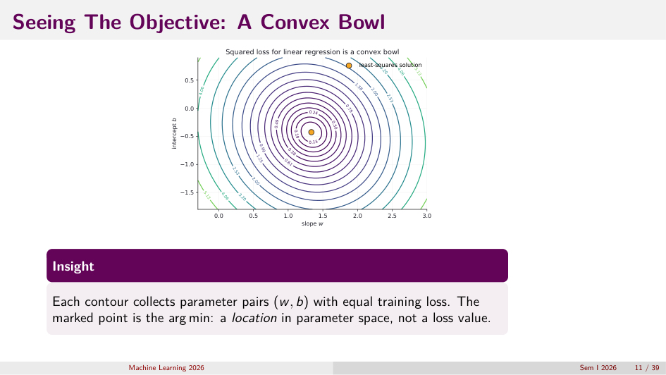
*👀 Slide 11 — Contours of the training loss over (w, b); the marked centre is the argmin.*

The plot: horizontal axis slope $w$ (0 to 3), vertical axis intercept $b$ (−1.5 to 0.5). Nested ovals labelled 0.15, 0.19, … , 5.13 are **contours** of equal training loss (§A4). The marked dot at the centre is the **least-squares solution**.

**Insight:** each contour collects $(w, b)$ pairs with equal training loss. The marked point is the **argmin — a location in parameter space, not a loss value.** The loss value *at* that point is the min (≈ 0.15 or a bit less).

Notice the ovals are tilted: changing $w$ and $b$ together in a certain direction changes the loss less than changing either alone. Slope and intercept trade off. Lecture 5 explains this with eigendirections.

## Slide 12 — Mathematical Objects Have Types

| Object | Symbol | Meaning |
|---|---|---|
| scalar | $y_i$, $\hat y_i \in \mathbb{R}$ | one observed or predicted number |
| vector | $x_i \in \mathbb{R}^d$ | the $d$ features of one observation |
| matrix | $X \in \mathbb{R}^{n\times d}$ | $n$ observations, each with $d$ features |
| function | $f_\theta : \mathcal{X}\to\mathcal{Y}$ | a rule with adjustable parameters $\theta$ |
| distribution | $\mathcal{D}$ | the unknown process that generates observations |

**Insight:** when two expressions are confused, first ask whether they're even the same **type** of object. "Is the model's accuracy equal to $\mathcal{D}$?" is a type error. See §A1.

## Slide 13 — Dimensions Are a Correctness Check

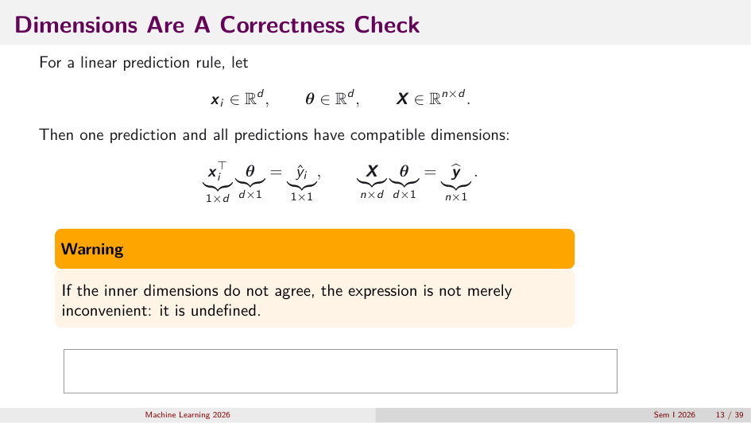
*👀 Slide 13 — Write the shape under each symbol; inner sizes must match and cancel.*

With $x_i \in \mathbb{R}^d$, $\theta \in \mathbb{R}^d$, $X \in \mathbb{R}^{n\times d}$:

$$\underbrace{x_i^\top}_{1\times d}\ \underbrace{\theta}_{d\times1} = \underbrace{\hat y_i}_{1\times1}, \qquad \underbrace{X}_{n\times d}\ \underbrace{\theta}_{d\times1} = \underbrace{\hat y}_{n\times1}.$$

Left: one prediction (a dot product). Right: all $n$ predictions at once (§A3).

> ⚠️ If inner dimensions don't agree, the expression is not merely inconvenient — it's **undefined**. Writing $\theta X$ (shapes $(d\times1)(n\times d)$) is meaningless. Always annotate shapes when deriving.

## Slide 14 — Two Mathematical Views of Prediction

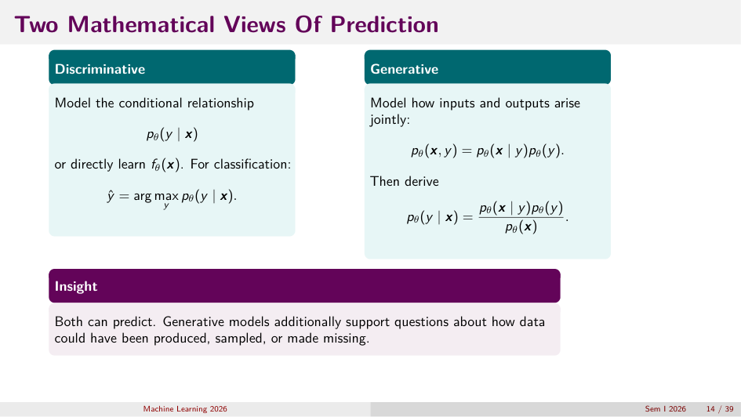
*👀 Slide 14 — Discriminative models p(y | x) directly; generative models p(x | y) and p(y), then uses Bayes.*

**Discriminative** — model only what you need for the answer:

$$p_\theta(y\mid x) \text{ or directly } f_\theta(x). \qquad \text{Classify with } \hat y = \arg\max_y p_\theta(y\mid x).$$

**Generative** — model how inputs and outputs arise **together**:

$$p_\theta(x, y) = p_\theta(x\mid y)\,p_\theta(y), \quad\text{then}\quad p_\theta(y\mid x) = \frac{p_\theta(x\mid y)\,p_\theta(y)}{p_\theta(x)}.$$

(§A12.)

**Insight:** both can predict. Generative models also answer questions about how data could have been **produced, sampled, or made missing** — they can simulate fake data and handle missing inputs, because they model $x$ itself.

## Slide 15 — One Question, Asked Two Ways

> It rained 90 mm today. Will there be a flood?

- Input: $x$ = daily rainfall (mm).
- Label: $y \in \{\text{flood}, \text{no flood}\}$.

Two honest routes, differing in **how much of the world you bother to model**. Slides 16–23 work both out with real numbers.

## Slide 16 — Route 1: Model How Rainfall Behaves (generative)

Describe a typical rainy day **separately** for each class, plus how often each class occurs:

| | How often ($p(y)$) | Rainfall on such a day ($p(x\mid y)$) |
|---|---|---|
| Flood days | 0.10 | $\mathcal{N}(120, 30^2)$ — centred at 120 mm, spread 30 |
| Dry days | 0.90 | $\mathcal{N}(40, 20^2)$ — centred at 40 mm, spread 20 |

Reading: floods happen on 10% of days; flood days usually have ~90–150 mm; dry days ~20–60 mm (§A11).

**Insight:** this is a story about how the data **arose**. It's enough to *invent* a plausible rainfall figure for tomorrow (pick a class with 10/90 odds, then draw from its bell curve) — more than we need to answer the question.

## Slide 17 — Route 1, Pictured

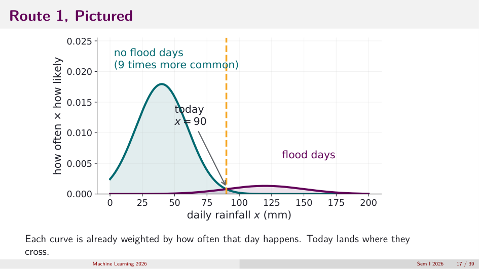
*👀 Slide 17 — Two bells (no-flood, flood) already weighted by how often each happens; at x = 90 compare their heights.*

Horizontal: daily rainfall (0–200 mm). Vertical: "how often × how likely", i.e. $p(y)\,p(x\mid y) = p(x, y)$.

- **No-flood curve**: tall, centred at 40 (9 times more common, so scaled up by 0.9).
- **Flood curve**: short and wide, centred at 120 (scaled by 0.1).
- **Today, $x = 90$**: lands almost exactly where the two curves **cross**.

Each curve is already weighted by how often that kind of day happens. Where they cross, the two explanations for "90 mm" are about equally plausible → posterior ≈ 0.5.

## Slide 18 — Route 1: Turn the Story Into an Answer

Reading the curves at $x = 90$ (computed in §A11):

$$p(x\mid\text{flood}) = 0.00807, \qquad p(x\mid\text{no flood}) = 0.000876.$$

90 mm is about **9 times more typical** of a flood day than a dry day. But dry days are 9 times more common. Who wins? Recipe: weight each by how often, then normalise.

## Slide 19 — Route 1: Work It Out ✍️ (solved)

**Line 1 — weight by prior (joint):**

$$p(x, \text{flood}) = 0.10 \times 0.00807 = 0.000807$$
$$p(x, \text{no flood}) = 0.90 \times 0.000876 = 0.000788$$

**Line 2 — evidence (total probability):**

$$p(x) = 0.000807 + 0.000788 = 0.001595$$

**Line 3 — normalise (Bayes):**

$$p(\text{flood}\mid x = 90) = \frac{0.000807}{0.001595} \approx 0.506, \qquad p(\text{no flood}\mid x=90) \approx 0.494.$$

The 9× likelihood advantage and the 9× prior disadvantage almost exactly cancel. Today is right at the **decision boundary** — a coin flip, very slightly toward flood.

## Slide 20 — Route 2: Model Only the Cut (discriminative)

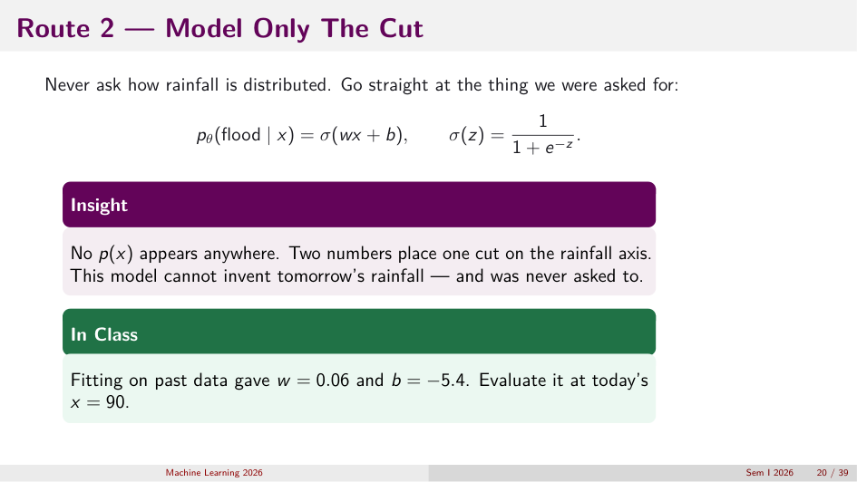
*👀 Slide 20 — Route 2 skips the bells and models the cut directly with a sigmoid.*

Never ask how rainfall is distributed. Go straight at what we were asked:

$$p_\theta(\text{flood}\mid x) = \sigma(wx + b), \qquad \sigma(z) = \frac{1}{1+e^{-z}}.$$

(§A13: the log-odds of flood are a straight line in rainfall.)

**Insight:** no $p(x)$ appears anywhere. **Two numbers** ($w$, $b$) place **one cut** on the rainfall axis. This model can't invent tomorrow's rainfall — and was never asked to.

Fitting on past data gave $w = 0.06$, $b = -5.4$. Evaluate at $x = 90$.

## Slide 21 — Route 2: Work It Out ✍️ (solved)

$$z = wx + b = 0.06 \times 90 - 5.4 = 5.4 - 5.4 = 0$$
$$p(\text{flood}\mid x=90) = \sigma(0) = \frac{1}{1 + e^0} = \frac{1}{2} = 0.500.$$

$x = 90$ is **exactly** this model's boundary: the cut is at $x = -b/w = 5.4/0.06 = 90$ mm.

Interpretation of $w = 0.06$: each extra mm of rain adds 0.06 to the log-odds of flood. 10 more mm multiplies the odds by $e^{0.6} \approx 1.82$.

## Slide 22 — Both Routes, One Picture

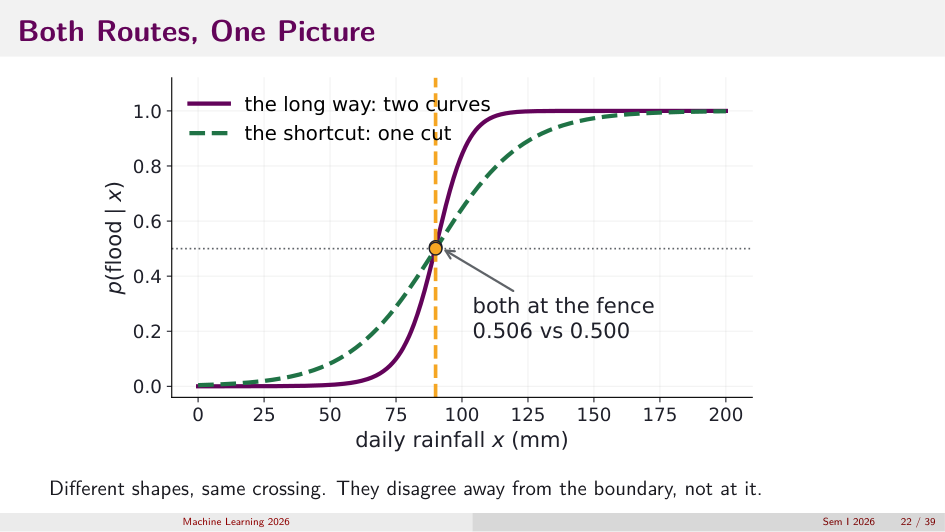
*👀 Slide 22 — Solid vs dashed curve: same 0.5 crossing near the fence, different steepness.*

Plot of $p(\text{flood}\mid x)$ against rainfall (0–200 mm):

- **Generative ("the long way: two curves")**: a steep S-curve.
- **Discriminative ("the shortcut: one cut")**: a gentler sigmoid.
- **Both cross 0.5 at the fence** (~90 mm): 0.506 vs 0.500.

**Different shapes, same crossing.** They disagree **away from** the boundary, not **at** it.

## Slide 23 — Same Decision, Different Confidence

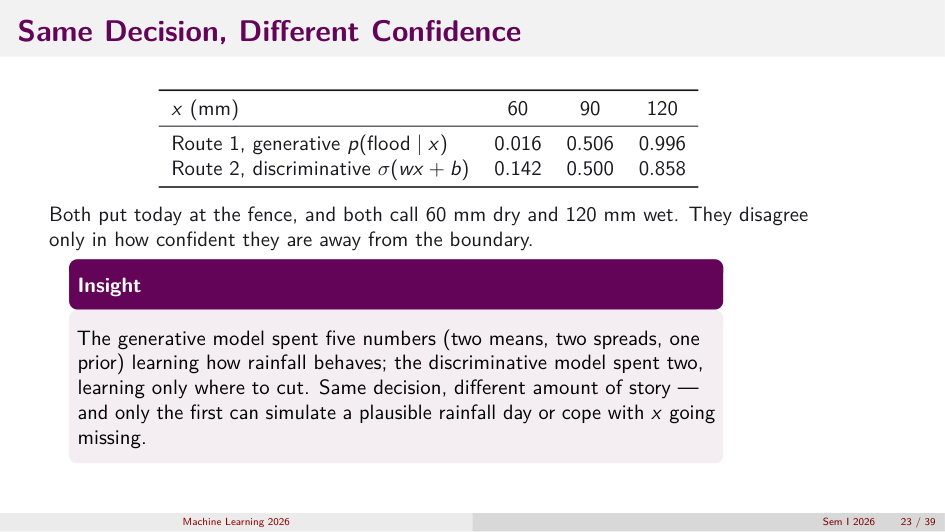
*👀 Slide 23 — Same decisions, different probabilities away from the boundary.*

| $x$ (mm) | 60 | 90 | 120 |
|---|---|---|---|
| Route 1, generative $p(\text{flood}\mid x)$ | 0.016 | 0.506 | 0.996 |
| Route 2, discriminative $\sigma(wx+b)$ | 0.142 | 0.500 | 0.858 |

Check Route 2: at 60, $z = 3.6 - 5.4 = -1.8 \Rightarrow \sigma = 0.142$; at 120, $z = 1.8 \Rightarrow 0.858$. (Route 1 at 60 and 120 uses the same three-line recipe as slide 19.)

Both call 60 mm dry and 120 mm wet (same side of 0.5) — **same decisions**. They differ only in **confidence** away from the boundary: the generative model is far more certain because its bell curves have thin tails, so it trusts its story strongly. If that story (Gaussian shapes) is wrong, that confidence is misplaced. The discriminative model makes fewer assumptions.

**Insight — counting parameters:**

- Generative spent **five** numbers: two means (120, 40), two spreads (30, 20), one prior (0.1). It learned how rainfall behaves.
- Discriminative spent **two**: $w$, $b$. It learned only where to cut.

Same decision, different amount of story. Only the generative one can **simulate** a plausible rainfall day or **cope with $x$ going missing** (if the gauge breaks, it falls back on the prior $p(\text{flood}) = 0.1$, and with several inputs it can reason about the missing one from the others).

General trade-off: generative models do more and can be more data-efficient if their story is right; discriminative models are simpler and usually more accurate at pure prediction when the story is doubtful.

## Slide 24 — The Statistical Setup

$$Z = (X, Y) \sim \mathcal{D}$$

$\mathcal{D}$ is the unknown distribution over input–output pairs. The training set is idealised as

$$S_{\text{train}} = \{Z_1, \dots, Z_n\}, \qquad Z_i \overset{\text{iid}}{\sim} \mathcal{D}.$$

**iid** = each example is drawn **independently** from the **same** distribution (L1 Part A §9.3). It's the assumption that makes "average over the sample" a fair estimate of "average over the world".

## Slide 25 — Why the iid Assumption Is a Model

It's an **assumption**, often false:

| Violation | Why it breaks iid | Example |
|---|---|---|
| **Time series** | tomorrow depends on today (not independent) | river levels on consecutive days |
| **Spatial data** | nearby locations are correlated | neighbouring districts share a storm |
| **Repeated users/assets** | many rows from one source aren't independent | 50 readings from the same sensor |
| **Policy changes** | before/after differ (not identical) | new drainage built in 2022 |
| **Sensors** | missingness and error have structure | gauges fail during the biggest storms |

> ⚠️ Many ML mistakes begin when a dataset is treated as iid **because the spreadsheet rows look independent.** Practical consequence: if you randomly split correlated rows into train and test, near-duplicates land on both sides, and your test score is falsely optimistic.

## Slide 26 — Three Objects to Keep Separate

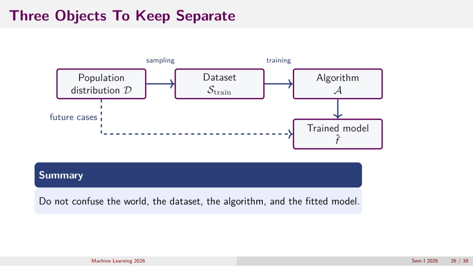
*👀 Slide 26 — Population D → dataset → algorithm → trained model. Don't mix them up.*

```
Population distribution 𝒟 ──sampling──► Dataset S_train ──► Algorithm 𝒜 ──training──► Trained model f̂ ──► future cases
```

Don't confuse:

- **the world** $\mathcal{D}$ (what we want to learn about),
- **the dataset** $S_{\text{train}}$ (one random sample from it),
- **the algorithm** $\mathcal{A}$ (the recipe, e.g. least squares),
- **the fitted model** $\hat f$ (the recipe's output on *this* dataset).

A different sample would give a different $\hat f$ from the same $\mathcal{A}$. The fitted model is itself random — a theme returning in bias–variance (Lecture 7 onward).

## Slide 27 — A Loss Function Scores One Prediction

$$\ell : \mathcal{Y}\times\mathcal{Y}\to\mathbb{R}_{\ge0}$$

"Takes a (prediction, target) pair and returns a non-negative penalty."

| Loss | Formula | Behaviour |
|---|---|---|
| Squared | $\ell_{\text{sq}}(\hat y, y) = (\hat y - y)^2$ | smooth; big errors hurt a lot; justified by Gaussian noise (slides 32–36) |
| Absolute | $\ell_{\text{abs}}(\hat y, y) = \lvert\hat y - y\rvert$ | linear penalty; less dominated by outliers; best constant = median |
| 0-1 | $\ell_{0/1}(\hat y, y) = \mathbb{1}\{\hat y \neq y\}$ | classification: right or wrong |

Example: $\hat y = 4$, $y = 1$ → squared 9, absolute 3. With $\hat y = 1.5$: 0.25 vs 0.5 — squared loss is *gentler* on small errors and *harsher* on large ones.

## Slide 28 — Risk: The Quantity We Actually Care About

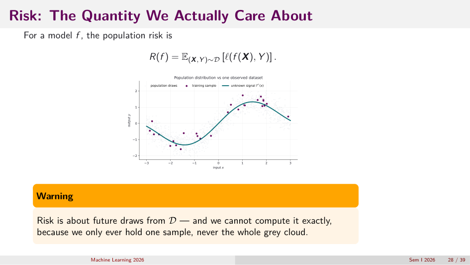
*👀 Slide 28 — Risk averages over the whole grey population, which we never see.*

$$R(f) = \mathbb{E}_{(X,Y)\sim\mathcal{D}}\big[\ell(f(X), Y)\big]$$

**The plot:** a grey cloud of many "population draws" (the whole world), a few highlighted "training sample" points, and a curve for the unknown signal $f^\star(x)$. Risk averages the loss over the **whole grey cloud**.

> ⚠️ Risk is about future draws from $\mathcal{D}$, and we can't compute it exactly — we only ever hold one sample, never the whole cloud.

## Slide 29 — Empirical Risk: The Quantity We Can Compute

$$\hat R_{S_{\text{train}}}(f) = \frac1n\sum_{i=1}^n \ell(f(x_i), y_i).$$

**Empirical Risk Minimisation (ERM):**

$$\hat f = \arg\min_{f\in\mathcal{H}} \hat R_{S_{\text{train}}}(f).$$

($\mathcal{H}$, "hypothesis class", is the same idea as $\mathcal{F}$: the set of allowed functions.)

**Insight:** ERM is the workhorse of supervised ML. Its logic: $\hat R$ is a sample average estimating $R$ (L1 Part A §9.5), so minimise what you can compute and hope it tracks what you care about. Restricting $\mathcal{H}$ (e.g. to lines) is what keeps that hope honest — with an unlimited class, you could memorise the data, get $\hat R = 0$, and learn nothing.

## Slide 30 — A Concrete ERM Example

Linear regression: $f_{w,b}(x) = w^\top x + b$. Training picks

$$(\hat w, \hat b) = \arg\min_{w,b} \hat R_{S_{\text{train}}}(w,b).$$

The class is all linear functions, so searching over functions = searching over the numbers $(w,b)$.

## Slide 31 — Concrete ERM: Work It Out ✍️ (solved)

**Step 1 — residual** (truth minus prediction) for example $i$:

$$r_i = y_i - (w^\top x_i + b).$$

**Step 2 — one-example squared loss:**

$$\ell_i = r_i^2 = \big(y_i - w^\top x_i - b\big)^2.$$

**Step 3 — average over all $n$:**

$$\hat R_{S_{\text{train}}}(w,b) = \frac1n\sum_{i=1}^n \big(y_i - w^\top x_i - b\big)^2 = \frac1n\|y - Xw - b\mathbf{1}\|^2.$$

(The last form is the same thing in vector notation: the squared length of the residual vector, §A2.) It is a convex bowl in $(w,b)$ (slides 10–11); §A6 shows how to find its bottom by setting the gradient to zero.

## Slide 32 — Gaussian Noise Gives a Conditional Density

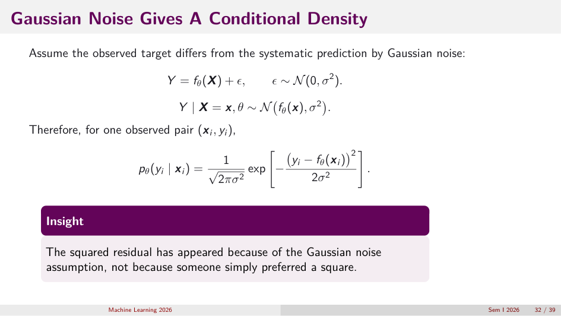
*👀 Slide 32 — Gaussian noise turns a prediction into a bell-shaped density around it.*

Now **why squared error?** Assume the observed target is the systematic prediction plus bell-curve noise:

$$Y = f_\theta(X) + \epsilon, \qquad \epsilon \sim \mathcal{N}(0, \sigma^2).$$

Adding a fixed number $f_\theta(x)$ to a $\mathcal{N}(0,\sigma^2)$ variable shifts its centre:

$$Y \mid X = x, \theta \ \sim\ \mathcal{N}\big(f_\theta(x), \sigma^2\big).$$

For one observed pair (§A11 formula with $\mu = f_\theta(x_i)$):

$$p_\theta(y_i\mid x_i) = \frac{1}{\sqrt{2\pi\sigma^2}}\exp\!\left[-\frac{\big(y_i - f_\theta(x_i)\big)^2}{2\sigma^2}\right].$$

**Insight:** look at the exponent. The **squared residual** is already sitting there. It appears because of the Gaussian assumption, not because someone just liked squares.

## Slide 33 — Derivation: Likelihood to Least Squares

If the $n$ examples are conditionally independent given $\theta$, the likelihood is a **product**, and logs turn it into a **sum** (§A14):

$$\mathcal{L}(\theta) = \prod_{i=1}^n p_\theta(y_i\mid x_i), \qquad \log\mathcal{L}(\theta) = \sum_{i=1}^n \log p_\theta(y_i\mid x_i).$$

In class: take the log of the single-example density. Which two terms appear, and which depends on $\theta$?

## Slide 34 — Likelihood to Least Squares: Work It Out ✍️ (solved)

Use $\log(ab) = \log a + \log b$, $\log(e^z) = z$, and $\log\frac{1}{\sqrt{c}} = -\frac12\log c$:

$$\log p_\theta(y_i\mid x_i) = \underbrace{-\tfrac12\log(2\pi\sigma^2)}_{\text{term 1: no }\theta} \;\underbrace{-\;\frac{\big(y_i - f_\theta(x_i)\big)^2}{2\sigma^2}}_{\text{term 2: depends on }\theta}.$$

- **Term 1** is a constant (depends only on $\sigma$). Changing $\theta$ doesn't touch it.
- **Term 2** is minus the squared residual, scaled by $\frac{1}{2\sigma^2}$. **This is the only part $\theta$ affects.**

## Slide 35 — From Log-Likelihood to Least Squares

Sum over $n$ examples (term 1 appears $n$ times):

$$\log\mathcal{L}(\theta) = -\frac n2\log(2\pi\sigma^2) - \frac{1}{2\sigma^2}\sum_{i=1}^n\big(y_i - f_\theta(x_i)\big)^2.$$

Now apply §A8:

- First term: constant → drop it (doesn't move the argmax).
- Factor $\frac{1}{2\sigma^2}$: positive constant → drop it.
- What's left: maximise $-\sum(\cdot)^2$, i.e. **minimise** $\sum(\cdot)^2$ (multiplying by −1 swaps max and min).

$$\boxed{\arg\max_\theta \mathcal{L}(\theta) = \arg\max_\theta \log\mathcal{L}(\theta) = \arg\min_\theta \sum_{i=1}^n\big(y_i - f_\theta(x_i)\big)^2}$$

**Maximum likelihood under Gaussian noise = least squares.** (Dividing by $n$ to get $\hat R$ also doesn't move the argmin, so it's ERM with squared loss too.)

Bonus: under *Laplace* (double-exponential) noise, the same derivation gives **absolute** loss. Your loss function encodes your belief about the noise.

## Slide 36 — The Picture Behind the Algebra

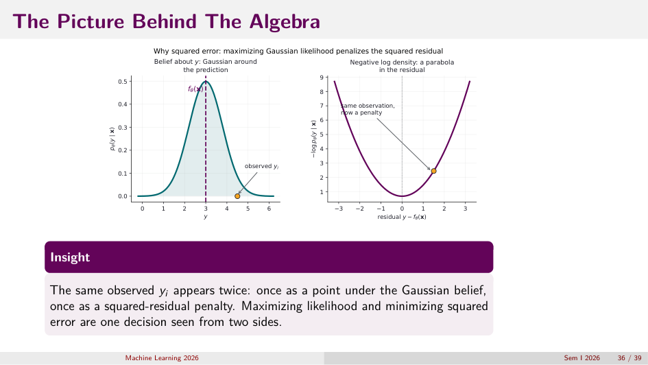
*👀 Slide 36 — Left: a point under the bell. Right: the same residual as a parabola. High density = low squared error.*

**Left panel:** $p_\theta(y\mid x)$ — a bell curve centred at the prediction $f_\theta(x)$, with the observed $y_i$ marked as a point under it. "Belief about $y$: Gaussian around the prediction." The higher the curve at $y_i$, the more the model "expected" that observation.

**Right panel:** $-\log p_\theta(y\mid x)$ plotted against the residual $y - f_\theta(x)$: a **parabola**. "Same observation, now a penalty."

**Insight:** the same $y_i$ appears twice — once as a point under the Gaussian belief, once as a squared-residual penalty. Taking $-\log$ turns the bell into a bowl. **Maximising likelihood and minimising squared error are one decision seen from two sides.**

## Slide 37 — Worked Example: One Error to Empirical Risk

A model predicts flood depths for three events:

$$y = \begin{pmatrix}2\\4\\5\end{pmatrix}, \qquad \hat y = \begin{pmatrix}1\\5\\4\end{pmatrix}.$$

Find the residual vector $r$ and $\hat R$ under squared loss. Keep the signs.

## Slide 38 — One Error to Empirical Risk: Work It Out ✍️ (solved)

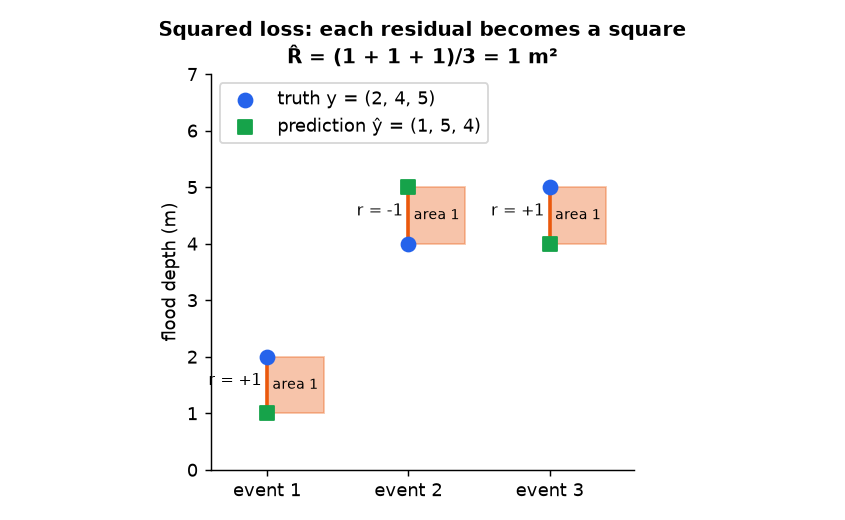
*📊 Slide 38's numbers drawn: each residual of size 1 becomes a 1×1 square; the risk is the average area.*

**Residual vector** (truth − prediction, entry by entry):

$$r = y - \hat y = \begin{pmatrix}2-1\\4-5\\5-4\end{pmatrix} = \begin{pmatrix}+1\\-1\\+1\end{pmatrix}.$$

Signs: event 1 under-predicted, event 2 over-predicted, event 3 under-predicted.

**Per-example squared loss:** $\ell_i = r_i^2 = (1, 1, 1)$.

**Empirical risk:**

$$\hat R_{S_{\text{train}}}(f) = \frac13(1 + 1 + 1) = 1 \ \text{m}^2.$$

Notes:

- Plain residual average $= \frac13(1 - 1 + 1) = \frac13$ — misleadingly small because signs cancel. That's why we square.
- In vector form: $\hat R = \frac1n\|r\|^2 = \frac1n r^\top r = \frac13 \cdot 3 = 1$.
- Units are m² (squared metres). Its square root, the **RMSE** $= 1$ m, is back in the original units.

## Slide 39 — The Mathematical Spine

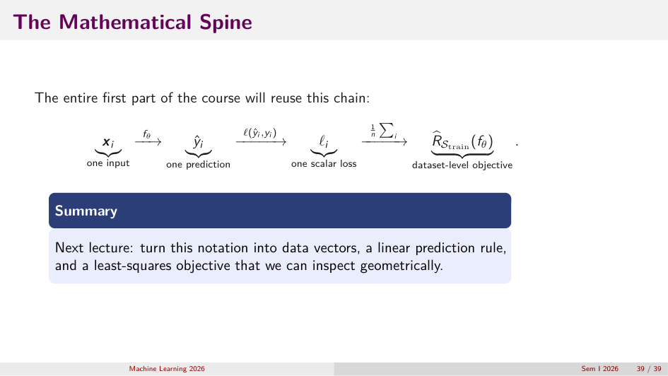
*👀 Slide 39 — The spine: x → ŷ → ℓ → R̂.*

$$\underbrace{x_i}_{\text{one input}} \xrightarrow{\ f_\theta\ } \underbrace{\hat y_i}_{\text{one prediction}} \xrightarrow{\ \ell(\hat y_i, y_i)\ } \underbrace{\ell_i}_{\text{one scalar loss}} \xrightarrow{\ \frac1n\sum_i\ } \underbrace{\hat R_{S_{\text{train}}}(f_\theta)}_{\text{dataset-level objective}}$$

The whole first part of the course reuses this chain. Training = choose $\theta$ to make the right end small (argmin). Evaluation = check that small $\hat R$ really means small $R$ on new data.

**Next lecture:** turn this notation into data vectors, a linear prediction rule, and a least-squares objective that can be inspected geometrically.

---

# Part C — Practice

1. $X$ is $5\times3$ and $\theta$ is $3\times1$. What shape is $X\theta$? Is $\theta^\top X$ defined? Is $X^\top X$?
2. Compute $X\theta$ for $X = \begin{pmatrix}1&2\\3&0\\-1&1\end{pmatrix}$, $\theta = \begin{pmatrix}2\\-1\end{pmatrix}$.
3. Find the derivative of $L(w) = (2w - 4)^2$ using the chain rule, then $\arg\min_w L$.
4. Which are convex on $\mathbb{R}$: $|u|$, $u^3$, $(3u-1)^2 + e^u$, $-u^2$?
5. Without calculus: $\arg\max_\theta\ [-5(\theta-2)^2 + 7]$? And $\arg\min_\theta \log\big(1 + (\theta-2)^2\big)$?
6. Evaluate the $\mathcal{N}(0,1)$ density at $x = 0$ and $x = 1$.
7. In the flood example, suppose climate change makes floods occur on 50% of days (same bell curves). Recompute $p(\text{flood}\mid x=90)$.
8. With $w = 0.06$, $b = -5.4$: compute $p(\text{flood}\mid x=100)$. At what rainfall is it 0.5?
9. $y = (3, 1, 4, 2)$, $\hat y = (2, 1, 6, 2)$. Find $r$, $\hat R$ under squared loss, and under absolute loss.
10. Fit $\hat y = wx$ (no intercept) to $(1, 1), (2, 3)$ by minimising squared error.
11. Coin tosses H, T, T, T. With $P(H) = \theta$, write $\mathcal{L}(\theta)$ and find the maximum-likelihood $\theta$ by setting the derivative of $\log\mathcal{L}$ to zero.
12. You split 10 years of daily river-level data randomly into 80% train / 20% test. Why might the test error be too optimistic? What split is better?
13. Count parameters: a generative model with 3 classes, one feature, each class $\mathcal{N}(\mu_k, \sigma_k^2)$, plus class priors.

<details>
<summary><b>Answers</b></summary>

1. $X\theta$: $5\times1$. $\theta^\top X$: $(1\times3)(5\times3)$ — inner 3 ≠ 5, **undefined**. $X^\top X$: $(3\times5)(5\times3) = 3\times3$ ✓.
2. $(1\cdot2 + 2\cdot(-1),\ 3\cdot2 + 0,\ -2 - 1) = (0, 6, -3)$.
3. $L'(w) = 2(2w-4)\cdot2 = 8w - 16$; zero at $w = 2$.
4. Convex: $|u|$, $(3u-1)^2 + e^u$ (sum of convex). Not: $u^3$ (curves down for $u<0$), $-u^2$ (a hill).
5. Both are $\theta = 2$: the first is a downward parabola peaking at 2; the second is an increasing function ($\log(1+\cdot)$) of $(\theta-2)^2$, which is smallest at 2.
6. $\frac{1}{\sqrt{2\pi}} \approx 0.399$; $0.399\,e^{-0.5} \approx 0.242$.
7. Priors cancel: $\frac{0.00807}{0.00807 + 0.000876} \approx 0.902$. The prior shift moves today from coin-flip to 90% flood.
8. $z = 6 - 5.4 = 0.6$; $\sigma(0.6) = 1/(1 + e^{-0.6}) = 1/1.549 \approx 0.646$. Boundary: $x = 90$ mm.
9. $r = (1, 0, -2, 0)$. Squared: $(1 + 0 + 4 + 0)/4 = 1.25$. Absolute: $(1 + 0 + 2 + 0)/4 = 0.75$.
10. $L(w) = (w-1)^2 + (2w-3)^2$; $L'(w) = 2(w-1) + 4(2w-3) = 10w - 14 = 0 \Rightarrow w = 1.4$. (General formula: $w = \sum x_iy_i/\sum x_i^2 = 7/5$.)
11. $\mathcal{L} = \theta(1-\theta)^3$; $\log\mathcal{L} = \log\theta + 3\log(1-\theta)$; derivative $\frac1\theta - \frac{3}{1-\theta} = 0 \Rightarrow 1 - \theta = 3\theta \Rightarrow \theta = \frac14$ (the observed frequency).
12. Days aren't independent: a test day's neighbours (yesterday, tomorrow) are almost identical and sit in training, so the model is effectively tested on near-copies. Better: split by **time** — train on earlier years, test on later ones (this also checks for non-stationarity).
13. Means 3 + spreads 3 + priors 2 (the third is $1 -$ the other two) = **8**.

</details>
