# Lecture 3 — Estimating Our First Parameters

> ES 335 / ES 678 Machine Learning, Sem I 2026 — Prof. Udit Bhatia, Prof. Krishna Prasad Miyapuram
> Source: `Lectures/L03_student_estimating_parameters.pdf` (29 slides); board annotations in `L03a_…` / `L03b_…` · Previous: [`L02_mathematical_foundations.md`](L02_mathematical_foundations.md)

**How to use this file.** Part A builds the *new* maths Lecture 3 needs, on top of Lectures 1–2 (probability, densities, the normal, logs, derivatives, argmin/argmax, Π and likelihood). Part B goes through all 29 slides. The "In Class / Work It Out" steps are left blank in the PDF, so they are **fully solved** here. Part C is practice.

**What this lecture is really about:** one recipe, used for the rest of the course:

$$\underbrace{p(x_i\mid\theta)}_{\text{one reading}} \xrightarrow{\ \prod_i\ } \underbrace{L(\theta)}_{\text{independence}} \xrightarrow{\ \log\ } \underbrace{\ell(\theta)=\sum_i \log p(x_i\mid\theta)}_{\text{logs}} \xrightarrow{\ \frac{d}{d\theta}=0\ } \underbrace{\hat\theta}_{\text{the estimate}}$$

The recipe works the same whatever distribution you pick. When data are scarce, add a **prior** and you get **MAP**, plus a measure of **how uncertain** $\theta$ is.

## Contents

**Part A — Maths from the ground up**
1. [Data vs parameters, estimators and hats](#a1-data-vs-parameters-estimators-and-hats)
2. [Distributions: PMF vs PDF](#a2-distributions-pmf-vs-pdf)
3. [The distribution zoo, with formulas](#a3-the-distribution-zoo-with-formulas)
4. [Why these shapes keep appearing](#a4-why-these-shapes-keep-appearing)
5. [Likelihood is not probability](#a5-likelihood-is-not-probability)
6. [Logs: products to sums, peaks stay put](#a6-logs-products-to-sums-peaks-stay-put)
7. [Finding a maximum: derivative = 0, then check](#a7-finding-a-maximum-derivative--0-then-check)
8. [Bayes' rule for parameters: prior, likelihood, posterior](#a8-bayes-rule-for-parameters-prior-likelihood-posterior)
9. [The Beta distribution and conjugacy](#a9-the-beta-distribution-and-conjugacy)
10. [MLE vs MAP vs posterior mean](#a10-mle-vs-map-vs-posterior-mean)

**Part B — Slides 1–29** · [Jump](#part-b--lecture-3-slide-by-slide-all-29-pages)

**Part C — Practice** · [Jump](#part-c--practice)

---

# Part A — Maths From the Ground Up

## A1. Data vs parameters, estimators and hats

From now on every problem has two kinds of symbol:

| Symbol | What it is | Who provides it | Lecture 3 example |
|---|---|---|---|
| $x = (x_1,\dots,x_n)$ | **data** | handed to you | 40 recorded flood-day rainfalls |
| $\theta$ | **parameters**, the numbers inside the model | unknown, so **you guess them** | centre $\mu$ and spread $\sigma$ |
| $\hat\theta$ | **estimate**, your guess | computed from $x$ | $\hat\mu \approx 118$ mm, $\hat\sigma \approx 31$ mm |

- An **estimator** is a *rule* that turns data into a guess: $\hat\theta = g(x_1,\dots,x_n)$. Example: "add them up and divide by $n$".
- An **estimate** is the number that rule gives on *this* dataset.
- The **hat** (L1 §2) means "computed from data". $\theta$ is the true unknown value; $\hat\theta$ is our guess. Different data would give a different $\hat\theta$, so an estimator is itself a random variable (this matters in L8: bias and variance of estimators).

## A2. Distributions: PMF vs PDF

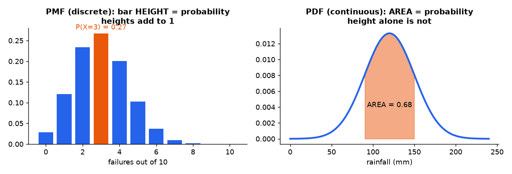
*📊 Discrete: read the bar height. Continuous: read an area, never a single height.*

A **distribution** is a rule that says how often each value shows up. It has three parts:

- **support**: which values are allowed (rainfall $\ge 0$; a coin $\in\{0,1\}$);
- **parameters**: the adjustable numbers inside the rule ($\mu,\sigma$; $\theta$; $\lambda$);
- **normalisation**: the total must be 1.

**Discrete → probability mass function (PMF).**
$$p(x) = \Pr(X = x), \qquad \sum_x p(x) = 1, \qquad 0 \le p(x) \le 1.$$
Each value carries an actual probability.

**Continuous → probability density function (PDF).**
$$\Pr(a \le X \le b) = \int_a^b p(x)\,dx, \qquad \int_{-\infty}^{\infty} p(x)\,dx = 1, \qquad p(x)\ge 0.$$

> ⚠️ **A density is not a probability. Only its area is.** For a continuous $X$, $\Pr(X = 90) = 0$ exactly (a line has zero area). A density can also be **bigger than 1**: Uniform on $[0, 0.5]$ has $p(x) = 2$ on that interval, and the area is still $2 \times 0.5 = 1$.

Why use densities in likelihoods, then? Because $\Pr(x \le X \le x + \Delta) \approx p(x)\,\Delta$ for a tiny width $\Delta$. Comparing two $\theta$'s, the $\Delta$ is the same for both, so the density does the comparison by itself.

## A3. The distribution zoo, with formulas

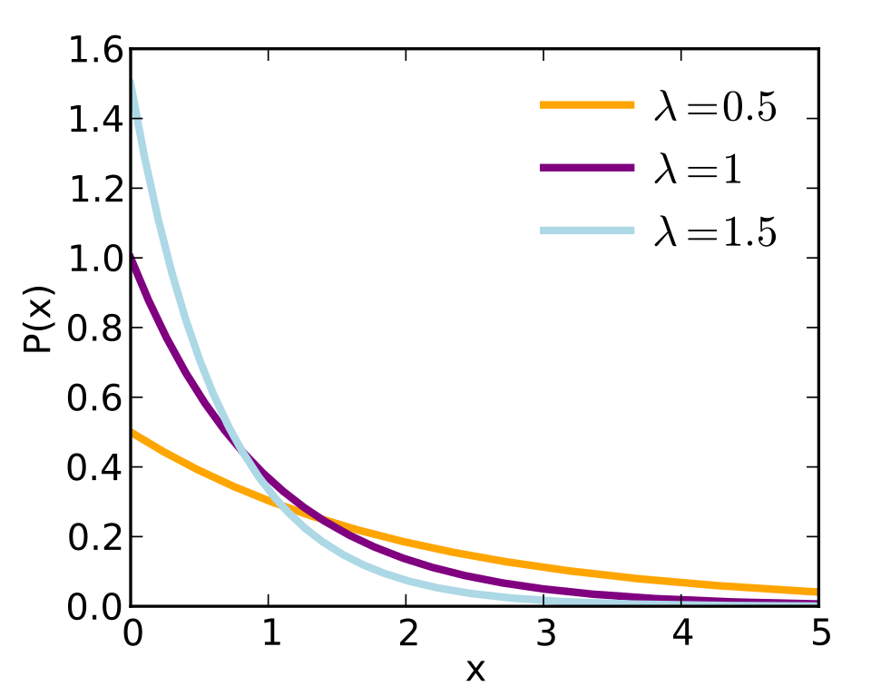
*Exponential PDFs: waiting times, highest at 0. (Wikimedia Commons: [Exponential_pdf.svg](https://commons.wikimedia.org/wiki/File:Exponential_pdf.svg), CC BY 3.0)*

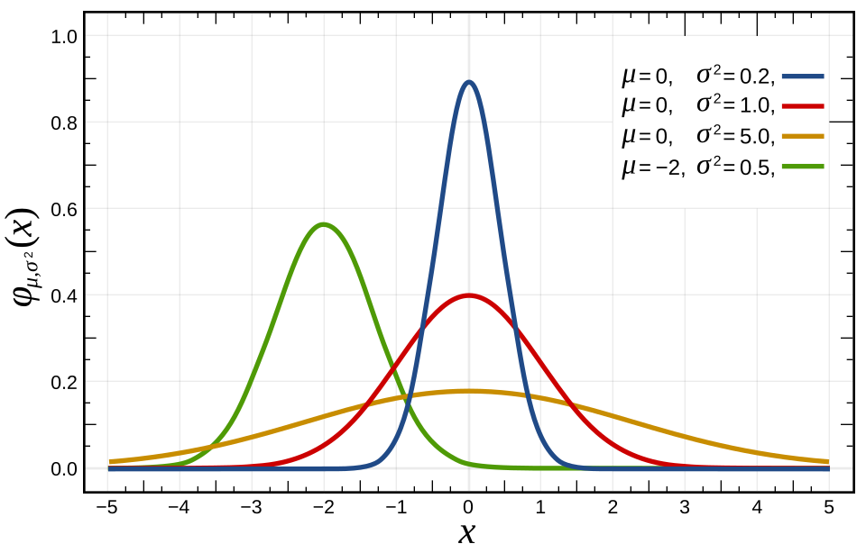
*Normal PDFs: μ shifts the bell, σ widens it. (Wikimedia Commons: [Normal_Distribution_PDF.svg](https://commons.wikimedia.org/wiki/File:Normal_Distribution_PDF.svg), Public domain)*

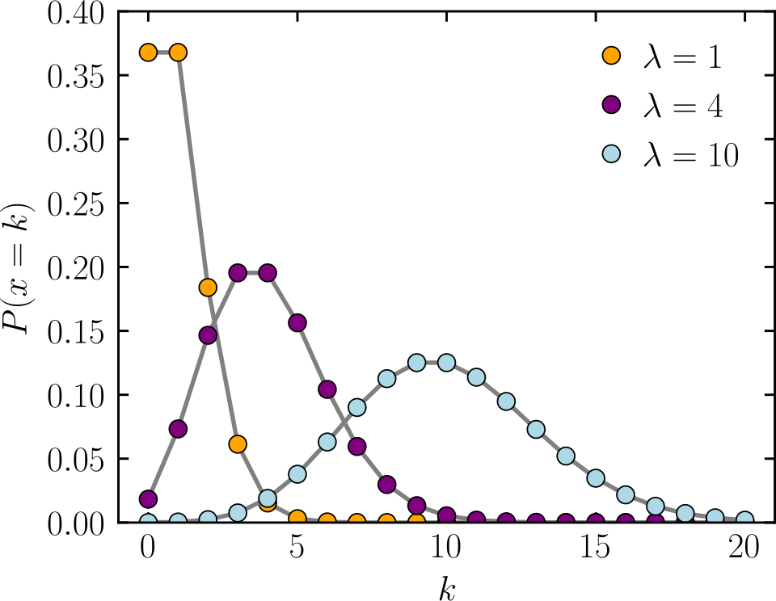
*Poisson PMF for several rates λ. (Wikimedia Commons: [Poisson_pmf.svg](https://commons.wikimedia.org/wiki/File:Poisson_pmf.svg), CC BY 3.0)*

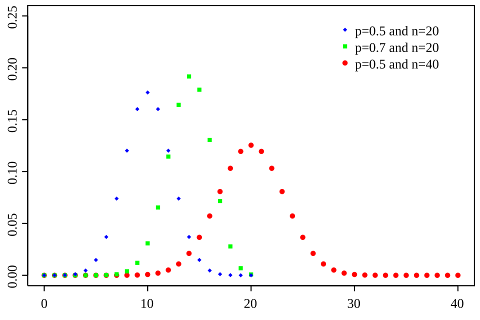
*Binomial PMF: bars, because counts are discrete. (Wikimedia Commons: [Binomial_distribution_pmf.svg](https://commons.wikimedia.org/wiki/File:Binomial_distribution_pmf.svg), Public domain)*

**Discrete (PMF):**

| Name | Story | PMF $p(x\mid\theta)$ | Mean | Variance |
|---|---|---|---|---|
| Bernoulli($\theta$) | one yes/no | $\theta^x(1-\theta)^{1-x},\ x\in\{0,1\}$ | $\theta$ | $\theta(1-\theta)$ |
| Binomial($n,\theta$) | number of yeses in $n$ tries | $\binom{n}{x}\theta^x(1-\theta)^{n-x}$ | $n\theta$ | $n\theta(1-\theta)$ |
| Categorical($\theta_1..\theta_K$) | one of $K$ labels | $\theta_x$, with $\sum_k\theta_k = 1$ | — | — |
| Poisson($\lambda$) | counts per interval | $\dfrac{\lambda^x e^{-\lambda}}{x!},\ x = 0,1,2,\dots$ | $\lambda$ | $\lambda$ |

**Continuous (PDF):**

| Name | Story | PDF $p(x\mid\theta)$ | Mean | Variance |
|---|---|---|---|---|
| Normal($\mu,\sigma^2$) | measurements spread around a centre | $\dfrac{1}{\sqrt{2\pi\sigma^2}}e^{-(x-\mu)^2/2\sigma^2}$ | $\mu$ | $\sigma^2$ |
| Exponential($\lambda$) | waiting time | $\lambda e^{-\lambda x},\ x\ge0$ | $1/\lambda$ | $1/\lambda^2$ |
| Uniform($a,b$) | no reason to prefer any value | $\dfrac{1}{b-a}$ on $[a,b]$ | $\frac{a+b}{2}$ | $\frac{(b-a)^2}{12}$ |
| Beta($a,b$) | a proportion in $[0,1]$ | $\propto \theta^{a-1}(1-\theta)^{b-1}$ | $\frac{a}{a+b}$ | see A9 |

**The Bernoulli trick:** $\theta^x(1-\theta)^{1-x}$ is $\theta$ when $x=1$ and $1-\theta$ when $x=0$. It's one formula covering both cases, which makes products easy (slide 22).

**Notation:** $x!$ ("x factorial") $= x(x-1)\cdots 1$, with $0! = 1$. $\binom{n}{x} = \frac{n!}{x!(n-x)!}$ counts the ways to choose which $x$ of the $n$ tries were yeses.

## A4. Why these shapes keep appearing

These shapes aren't arbitrary conventions. Each one follows from an assumption about the **mechanism** that produced the data:

| If you believe… | …you are forced into | Why (one line) |
|---|---|---|
| many small independent effects add up | **Normal** | Central Limit Theorem: sums of many small independent pieces look bell-shaped |
| rare events, many chances to happen | **Poisson** | Binomial with $n$ huge, $\theta$ tiny, $n\theta = \lambda$ fixed → Poisson |
| waiting with no memory of time already waited | **Exponential** | the only continuous distribution with $\Pr(T > s+t \mid T>s) = \Pr(T>t)$ |
| one trial, two outcomes | **Bernoulli** | nothing else is possible |

The choice also decides your **loss function**. A normal assumption leads to squared error $(y-\hat y)^2$ (Lecture 4, and L2 slides 32–36). A Bernoulli assumption leads to cross-entropy (logistic regression, L6).

## A5. Likelihood is not probability

The same formula $p(x\mid\theta)$ can be read two ways:

| Reading | Fixed | Varies | Name | Sums/integrates to 1? |
|---|---|---|---|---|
| forwards | $\theta$ | $x$ | probability / density of data | **yes**, over $x$ |
| backwards | $x$ (already happened) | $\theta$ | **likelihood** $L(\theta)$ | **no**, not over $\theta$ |

Example: Bernoulli, one observation $x = 1$. Then $L(\theta) = \theta$ on $[0,1]$, and $\int_0^1 \theta\,d\theta = \tfrac12 \ne 1$. So the likelihood is not a distribution over $\theta$. It's a **score**: higher means "this $\theta$ makes my data less surprising".

For independent data the scores multiply (L2 §A14):
$$L(\theta) = \prod_{i=1}^n p(x_i\mid\theta).$$

## A6. Logs: products to sums, peaks stay put

The rules you need (natural log, $\log = \ln$):

| Rule | Example |
|---|---|
| $\log(ab) = \log a + \log b$ | $\log\prod_i p_i = \sum_i \log p_i$ |
| $\log(a^k) = k\log a$ | $\log\theta^k = k\log\theta$ |
| $\log(1/a) = -\log a$ | $\log\frac{1}{\sqrt{2\pi\sigma^2}} = -\tfrac12\log(2\pi\sigma^2)$ |
| $\log e^u = u$ | $\log e^{-(x-\mu)^2/2\sigma^2} = -\frac{(x-\mu)^2}{2\sigma^2}$ |
| $\frac{d}{d\theta}\log\theta = \frac1\theta$ | |
| $\frac{d}{d\theta}\log(1-\theta) = -\frac{1}{1-\theta}$ | chain rule: inner derivative is $-1$ |

**Why logs are allowed:** $\log$ is strictly increasing, so if $L(\theta_1) > L(\theta_2)$ then $\log L(\theta_1) > \log L(\theta_2)$. The argmax doesn't move (L2 §A8):
$$\arg\max_\theta L(\theta) = \arg\max_\theta \log L(\theta).$$

**Why logs are needed:** 40 densities around 0.01 multiply to about $10^{-80}$, which is close to the limit where a computer rounds to 0 (*underflow*). Its log is $-80\ln 10 \approx -184$, an ordinary number.

## A7. Finding a maximum: derivative = 0, then check

For a smooth function of one variable:

1. Differentiate: $\ell'(\theta)$.
2. Set $\ell'(\theta) = 0$ and solve. These are the *stationary points*.
3. Check that it's a **maximum**: $\ell''(\theta) < 0$ (curving down, like a hill). If $\ell$ is concave everywhere, the stationary point is *the* global max.
4. Check the edges of the allowed range (e.g. $\theta = 0$ or $1$). With little data the peak can sit **on the edge** (slide 25).

**Several parameters** ($\mu$ and $\sigma$): take each **partial derivative** (L2 §A6), set *all* of them to 0, and solve together. In the normal case they decouple: $\hat\mu$ doesn't depend on $\sigma$, so you solve for $\mu$ first, then plug $\hat\mu$ into the $\sigma$ equation.

**Useful fact:** the constant terms (those without $\theta$) disappear when you differentiate. That's why we can ignore $-\frac n2\log(2\pi\sigma^2)$ when solving for $\mu$.

## A8. Bayes' rule for parameters: prior, likelihood, posterior

L1 §8.8 used Bayes' rule on events. Use it on $\theta$ itself (this was written on the board):

$$\underbrace{p(\theta\mid x)}_{\text{posterior}} = \frac{\overbrace{p(x\mid\theta)}^{\text{likelihood}}\ \overbrace{p(\theta)}^{\text{prior}}}{\underbrace{p(x)}_{\text{evidence}}}, \qquad p(x) = \int p(x\mid\theta)\,p(\theta)\,d\theta.$$

- **Prior** $p(\theta)$: what you believed about $\theta$ *before* the data.
- **Likelihood**: what the data say (A5).
- **Posterior**: what you believe *after* the data. Unlike the likelihood, it is a real distribution over $\theta$.
- **Evidence** $p(x)$: the marginal probability of the data. It doesn't depend on $\theta$, so for finding the peak we only need
$$p(\theta\mid x) \propto p(x\mid\theta)\,p(\theta).$$

($\propto$ = "proportional to": equal up to a constant that doesn't involve $\theta$.)

## A9. The Beta distribution and conjugacy

![Beta(a, b) shapes: flat, hill, U, skewed. All live on [0, 1].](images/L03/web/beta_pdf.png)
*Beta(a, b) shapes: flat, hill, U, skewed. All live on [0, 1]. (Wikimedia Commons: [Beta_distribution_pdf.svg](https://commons.wikimedia.org/wiki/File:Beta_distribution_pdf.svg), Public domain)*

For a proportion $\theta\in[0,1]$:
$$\text{Beta}(\theta\mid a,b) \propto \theta^{a-1}(1-\theta)^{b-1}, \qquad a, b > 0.$$

| Quantity | Formula | Beta(2,2) |
|---|---|---|
| mean | $\bar\theta = \dfrac{a}{a+b}$ | 0.5 |
| mode (peak), for $a,b>1$ | $\dfrac{a-1}{a+b-2}$ | 0.5 |
| variance | $\dfrac{\bar\theta(1-\bar\theta)}{a+b+1}$ | $0.25/5 = 0.05$ |

Shapes: Beta(1,1) is flat (uniform). Beta(2,2) is a gentle hill at 0.5 ("probably not 0 or 1"). Large $a,b$ give a sharp spike.

**Conjugacy.** Multiply a Beta prior by a Bernoulli/Binomial likelihood $\theta^k(1-\theta)^{n-k}$. The exponents add, and you get a Beta again:
$$\theta^{a-1}(1-\theta)^{b-1}\cdot\theta^k(1-\theta)^{n-k} = \theta^{(a+k)-1}(1-\theta)^{(b+n-k)-1} \;\Rightarrow\; \text{Beta}(a+k,\ b+n-k).$$
A prior whose posterior has the same family is called **conjugate**. Updating is just bookkeeping: add the failures to $a$ and the passes to $b$.

**Pseudo-counts.** $a-1$ acts like $a-1$ imagined failures and $b-1$ like imagined passes, seen before the real data.

## A10. MLE vs MAP vs posterior mean

| Estimate | Definition | Uses prior? | Bernoulli answer (Beta($a,b$) prior) |
|---|---|---|---|
| **MLE** | $\arg\max_\theta p(x\mid\theta)$ | no | $\dfrac{k}{n}$ |
| **MAP** (maximum a posteriori) | $\arg\max_\theta p(\theta\mid x)$ = posterior mode | yes | $\dfrac{k+a-1}{n+a+b-2}$ |
| **Posterior mean** | $\mathbb{E}[\theta\mid x]$ | yes | $\dfrac{k+a}{n+a+b}$ |

- With a flat prior Beta(1,1), MAP = MLE.
- As $n\to\infty$ the data swamp the pseudo-counts and all three agree.
- MAP in log form: $\hat\theta_{\text{MAP}} = \arg\max_\theta\,[\ell(\theta) + \log p(\theta)]$, i.e. log-likelihood + a penalty. **This is exactly where regularisation comes from** (L7: ridge = Gaussian prior, lasso = Laplace prior).
- Neither MLE nor MAP gives the uncertainty. The **posterior width** (its standard deviation) does.

---

# Part B — Lecture 3 Slide by Slide (all 29 pages)

## Slide 1 — Title

*Machine Learning, Lecture 3: Estimating Our First Parameters.* Prof. Udit Bhatia, Semester I 2026.

## Slide 2 — Course Roadmap: You Are Here

L1 ML in 2026 → T1/A0 readiness → L2 learning problem → **L3–L6 estimation and linear models (you are here)** → L7–L8 trust and evaluation → L9–L15 fit models → L16–L17 metrics and validation → L18–L24 model families → L25–L28 modern systems.

Data come from a distribution whose numbers we don't know. **Maximum likelihood** is how we guess them, and the recipe doesn't care which distribution it is.

## Slide 3 — Where We Got To Last Time

From L2:
- learning = four choices: **data, model, objective, algorithm**;
- $\arg\min$ and convexity;
- types and dimensions as a correctness check.

> ⚠️ We named a **model** but never said where its numbers come from. Today: they are **estimated**, and here is how.

## Slide 4 — Section: The Estimation Problem

## Slide 5 — Two Symbols, For The Rest Of The Course

![Slide 5 — x is handed to you, θ you must guess (teacher's ink: E[x] = θ₁).](images/L03/slides/s05_two_symbols.png)
*👀 Slide 5 — x is handed to you, θ you must guess (teacher's ink: E[x] = θ₁).*

| | What it is | Today |
|---|---|---|
| $x$ | the data. **Handed to you.** | 40 recorded rainfalls |
| $\theta$ | the parameters. **You must guess.** | the centre and spread |

**Insight:** every lecture from here is one sentence: *we are handed $x$, and we must guess $\theta$.* (Linear regression: $\theta = (w,b)$. Logistic regression: the same. Neural nets: millions of $\theta$'s.)

## Slide 6 — The Setup: Data Comes From Somewhere

$$x_1, x_2, \dots, x_n \text{ drawn independently from } p(x\mid\theta).$$

| We know | We don't know | We want |
|---|---|---|
| the **shape** of $p$ (e.g. bell) | the **numbers** $\theta$ in it | a good guess $\hat\theta$ |

> ⚠️ Two real assumptions: (1) observations are **independent**; (2) the **shape** we chose is right. Neither is free, and slide 28 comes back to both.

## Slide 7 — What A Distribution Is

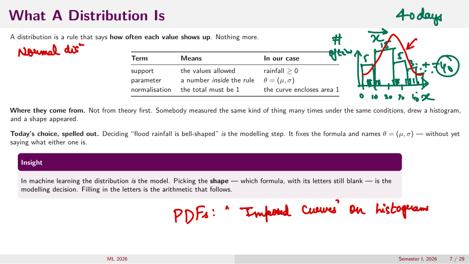
*👀 Slide 7 — Board note at the bottom: PDFs are curves imposed on histograms.*

A rule that says **how often each value shows up**. Nothing more.

| Term | Means | In our case |
|---|---|---|
| support | the values allowed | rainfall $\ge 0$ |
| parameter | a number *inside* the rule | $\theta = (\mu,\sigma)$ |
| normalisation | the total must be 1 | the curve encloses area 1 |

**Where they come from.** Not from theory first. Someone measured the same kind of thing many times under the same conditions, drew a histogram, and a shape appeared. (Board: PDFs are curves *imposed on histograms*. Take the 40 flood days, histogram them, and lay a bell over the bars.)

**Today's choice, spelled out:** saying "flood rainfall is bell-shaped" *is* the modelling step. It fixes the formula and names $\theta = (\mu,\sigma)$ without yet saying what either one is.

**Insight:** in ML **the distribution is the model**. Choosing the *shape* (a formula with blanks) is the modelling decision. Filling in the blanks is the arithmetic that follows.

*(Small catch: a normal has support $\mathbb{R}$, so it puts a little probability on negative rainfall. Around 120 with spread 30, 0 mm is 4σ away, so that probability is negligible. It's still an example of "the shape is only approximately right".)*

## Slide 8 — Two Kinds: PMF And PDF

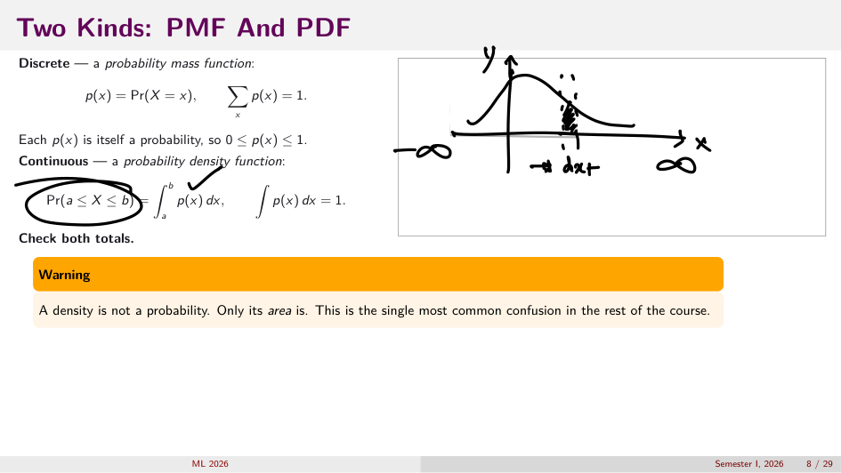
*👀 Slide 8 — Teacher's sketch on the right: probability is the area between a and b.*

Discrete (PMF): $p(x) = \Pr(X=x)$, $\sum_x p(x) = 1$, and each $p(x)\in[0,1]$.

Continuous (PDF): $\Pr(a\le X\le b) = \int_a^b p(x)\,dx$, $\int p(x)\,dx = 1$.

**Check both totals** (worked):
- Bernoulli: $\sum_{x\in\{0,1\}} p(x) = (1-\theta) + \theta = 1$ ✓.
- Exponential: $\int_0^\infty \lambda e^{-\lambda x}dx = \big[-e^{-\lambda x}\big]_0^\infty = 0 - (-1) = 1$ ✓.

> ⚠️ **A density is not a probability. Only its area is.** This is the most common confusion in the rest of the course. (See A2: densities can exceed 1.)

## Slide 9 — The Ones You Will Actually Meet

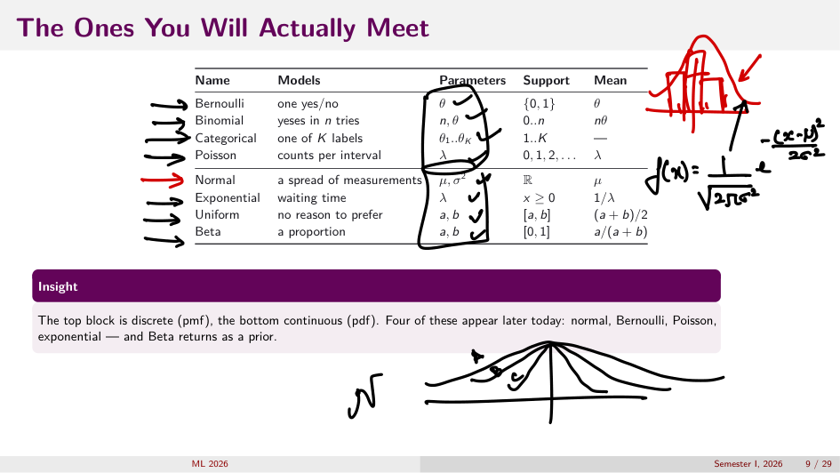
*👀 Slide 9 — The ticked rows are the ones used today: normal and Bernoulli.*

| Name | Models | Parameters | Support | Mean |
|---|---|---|---|---|
| Bernoulli | one yes/no | $\theta$ | $\{0,1\}$ | $\theta$ |
| Binomial | yeses in $n$ tries | $n,\theta$ | $0..n$ | $n\theta$ |
| Categorical | one of $K$ labels | $\theta_1..\theta_K$ | $1..K$ | — |
| Poisson | counts per interval | $\lambda$ | $0,1,2,\dots$ | $\lambda$ |
| Normal | a spread of measurements | $\mu,\sigma^2$ | $\mathbb{R}$ | $\mu$ |
| Exponential | waiting time | $\lambda$ | $x\ge0$ | $1/\lambda$ |
| Uniform | no reason to prefer | $a,b$ | $[a,b]$ | $(a+b)/2$ |
| Beta | a proportion | $a,b$ | $[0,1]$ | $a/(a+b)$ |

The top four are discrete (PMF); the bottom four are continuous (PDF). Four show up later today: **normal, Bernoulli, Poisson, exponential**. **Beta** comes back as a prior. Full formulas: A3.

Categorical has no "mean" because labels like {cat, dog, bird} aren't numbers you can average.

## Slide 10 — Why These Shapes Keep Reappearing

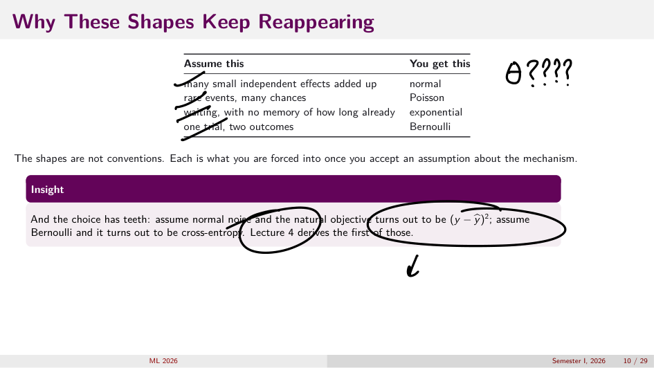
*👀 Slide 10 — Each shape is the consequence of an assumption about how the data arose.*

| Assume this | You get this |
|---|---|
| many small independent effects added up | normal |
| rare events, many chances | Poisson |
| waiting, with no memory of how long already | exponential |
| one trial, two outcomes | Bernoulli |

The shapes aren't conventions. Each is forced on you once you accept an assumption about the mechanism (A4).

**Insight:** the choice has consequences. Normal noise makes the natural objective $(y-\hat y)^2$. Bernoulli makes it **cross-entropy**. Lecture 4 derives the first.

## Slide 11 — Today's Question

**Data:** the 40 flood days. The rainfall recorded on each scatters around 120 mm.

**Question:** where is the curve **centred**, and how **wide** is it? Nobody tells us; we have only the 40 numbers.

**Insight:** making a bad guess is easy. We need a **rule** that says which guess is best and can defend the answer. That rule is maximum likelihood.

## Slide 12 — Section: Maximum Likelihood For The Normal

## Slide 13 — Reading A Normal Curve

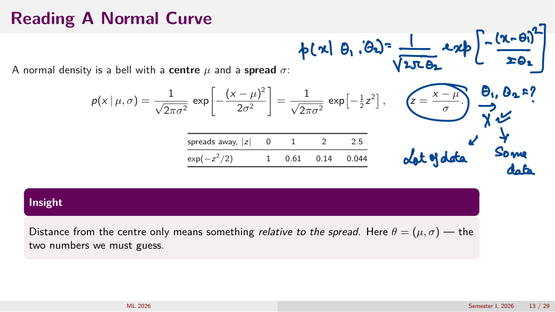
*👀 Slide 13 — Teacher's ink: z = (x − μ)/σ counts spreads from the centre.*

$$p(x\mid\mu,\sigma) = \frac{1}{\sqrt{2\pi\sigma^2}}\exp\!\Big[-\frac{(x-\mu)^2}{2\sigma^2}\Big] = \frac{1}{\sqrt{2\pi\sigma^2}}\exp\!\Big[-\tfrac12 z^2\Big], \qquad z = \frac{x-\mu}{\sigma}.$$

| spreads away, $\lvert z\rvert$ | 0 | 1 | 2 | 2.5 |
|---|---|---|---|---|
| $\exp(-z^2/2)$ | 1 | 0.61 | 0.14 | 0.044 |

($e^{-0.5} = 0.607$, $e^{-2} = 0.135$, $e^{-3.125} = 0.044$.)

- $\mu$ = **centre** (where the peak is), $\sigma$ = **spread** (how wide).
- $z$ counts "how many spreads away". The front factor $\frac{1}{\sqrt{2\pi\sigma^2}}$ makes the area 1. A wider bell is also a lower bell.

**Insight:** distance from the centre only means something **relative to the spread**. 30 mm off is ordinary if $\sigma = 30$ and shocking if $\sigma = 5$. Here $\theta = (\mu,\sigma)$, the two numbers we must guess.

## Slide 14 — Step 1: How Surprising Is *One* Reading? ✍️ (solved)

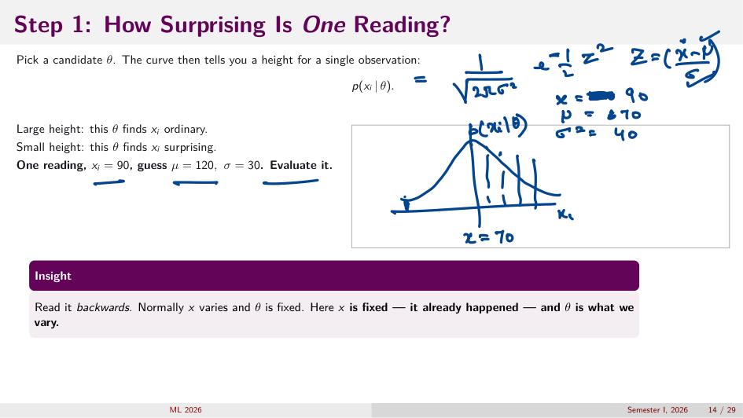
*👀 Slide 14 — The sketch: a bell centred at μ, reading x = 90 marked; its height is the score.*

Choose a candidate $\theta$. The curve gives a height $p(x_i\mid\theta)$ for one observation. **Large height** means this $\theta$ finds $x_i$ ordinary. **Small height** means this $\theta$ finds it surprising.

**Evaluate:** $x_i = 90$, guess $\mu = 120$, $\sigma = 30$.

$$z = \frac{90-120}{30} = -1, \qquad \exp(-\tfrac12\cdot1) = 0.6065$$
$$\frac{1}{\sqrt{2\pi\cdot 900}} = \frac{1}{30\sqrt{2\pi}} = \frac{1}{75.20} = 0.01330$$
$$p(90\mid 120, 30) = 0.01330 \times 0.6065 \approx \mathbf{0.0081}\ \text{per mm}.$$

(The same 0.00807 as the flood-likelihood in L2 slide 19.) Compare another guess, $\mu = 90$, $\sigma = 30$: $z = 0$ gives $0.0133$, which is higher, so $\mu = 90$ "explains" this one reading better. One reading alone would pull $\hat\mu$ onto itself; with all 40, they negotiate.

**Insight:** read the formula **backwards**. Normally $x$ varies and $\theta$ is fixed. Here $x$ is fixed (it already happened) and $\theta$ varies.

## Slide 15 — Step 2: All *n* Readings At Once

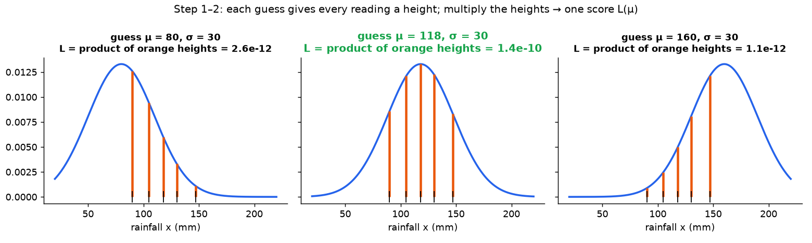
*📊 Steps 1–2: slide the bell to a guess μ, read each reading's height, multiply. The middle guess scores highest.*

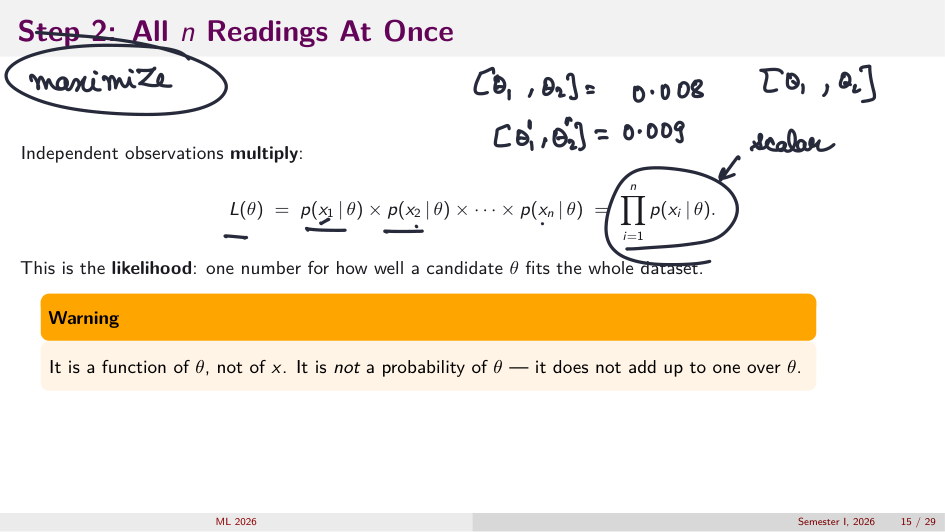
*👀 Slide 15 — Two candidate pairs scored 0.008 vs 0.009; maximise, so the second wins.*

Independent observations **multiply**:
$$L(\theta) = p(x_1\mid\theta)\times p(x_2\mid\theta)\times\cdots\times p(x_n\mid\theta) = \prod_{i=1}^n p(x_i\mid\theta).$$

This is the **likelihood**: one number (a scalar) for how well a candidate $\theta$ fits the whole dataset. Board example: three readings, each with density around 0.01–0.02, give $L \approx 0.009 \times 0.013 \times 0.02 \approx 2\times10^{-6}$. It's already tiny with $n=3$.

The **multiplication is where independence enters** (L1 §8.6: $P(A\cap B) = P(A)P(B)$ only if independent).

> ⚠️ It is a function of $\theta$, **not** of $x$. It is **not** a probability of $\theta$: it doesn't sum to one over $\theta$ (A5).

**Board, on this slide:** two candidates compared by their likelihood score: $L(\theta_1,\theta_2) = 0.008$ vs $L(\theta_1',\theta_2') = 0.009$. The second pair wins, because the job is to **maximise** $L$. The circled $\prod$ was labelled "scalar": the whole dataset collapses to one number per candidate.

## Board pages — What was written in class (annotated PDF pp. 15–16, 18–22)

The annotated deck (`L03b_…`) has seven handwritten pages around slides 14–15. They redo the whole MLE recipe on a tiny dataset, step by step. Notation on the board: $\theta_1$ = centre ($\mu$), $\theta_2$ = spread.

> ⚠️ **Two board slips to watch for.** (1) The board writes $\sqrt{3\pi\theta_2}$ in places; it should be $\sqrt{2\pi\theta_2^2}$ (the normal's front factor is always $2\pi$). (2) $\theta_2$ is used both as the variance (in $2\theta_2$) and as the standard deviation (in $2\theta_2^2$). Pick one: these notes use $\theta_2 = \sigma$, so the exponent is $-(x-\theta_1)^2/2\theta_2^2$.

### Board p. 15 — The data and the model

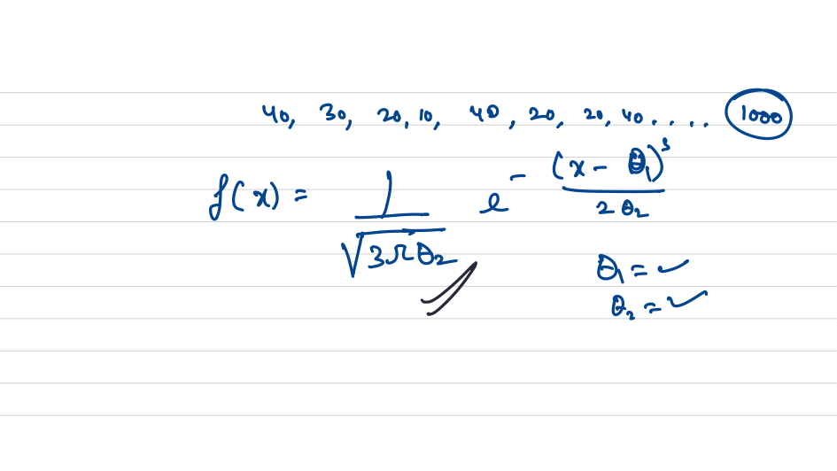
*👀 Board p. 15 — Rainfall readings and the normal curve with two unknowns θ₁, θ₂.*

Rainfall readings $40, 30, 20, 10, 40, 20, 20, 40, \dots$ ($n = 1000$ of them). Assume each one comes from a normal curve
$$f(x) = \frac{1}{\sqrt{2\pi\theta_2^2}}\,e^{-(x-\theta_1)^2/2\theta_2^2}.$$
Goal: find the two numbers $\theta_1, \theta_2$ (the ticks mean "these are what we'll solve for").

### Board p. 16 — The approach, and why we multiply

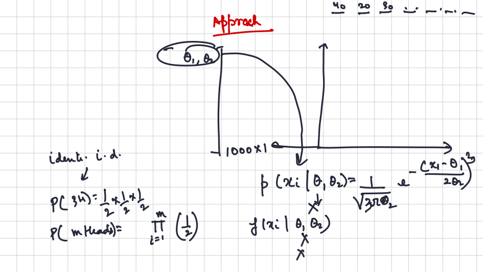
*👀 Board p. 16 — Knobs (θ₁, θ₂) pick a curve; the coin example shows why i.i.d. probabilities multiply.*

The picture: the knobs $(\theta_1,\theta_2)$ choose one bell curve; the $1000\times1$ data vector is then scored by that curve. Each reading gets a height $p(x_i\mid\theta_1,\theta_2)$.

**Why multiply? A coin warm-up.** Toss a fair coin. The tosses are **i.i.d.** (independent and identically distributed: no toss affects another, and every toss uses the same coin). Then
$$P(3\text{ heads}) = \tfrac12\times\tfrac12\times\tfrac12 = \tfrac18, \qquad P(m\text{ heads in a row}) = \prod_{i=1}^{m}\tfrac12 = \left(\tfrac12\right)^m.$$
Same idea for rainfall: independent readings, so their densities multiply.

### Board p. 18 — From one reading to a vector of readings

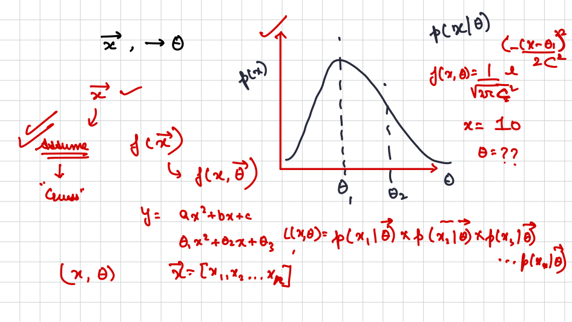
*👀 Board p. 18 — Two candidate centres θ₁, θ₂ on one bell; L is a product over all readings.*

- Write the data as one vector $\vec x = [x_1, x_2, \dots, x_n]$ and the knobs as $\vec\theta$.
- **Assume** a curve shape (the board stresses: this is a *guess*). Writing $f(\vec x)$ becomes $f(\vec x, \vec\theta)$: the curve depends on its knobs.
- "Knobs" are not special to probability: a parabola $y = ax^2 + bx + c$ is the family $\theta_1x^2 + \theta_2x + \theta_3$.
- The sketch: one bell, two candidate centres $\theta_1$ and $\theta_2$ marked on the axis. Different knobs, different heights for the same data.
- Example: one reading $x = 10$, $\theta = ??$ That's the question.
$$L(\vec x, \vec\theta) = p(x_1\mid\vec\theta)\times p(x_2\mid\vec\theta)\times\cdots\times p(x_n\mid\vec\theta).$$

### Board p. 19 — Product → sum

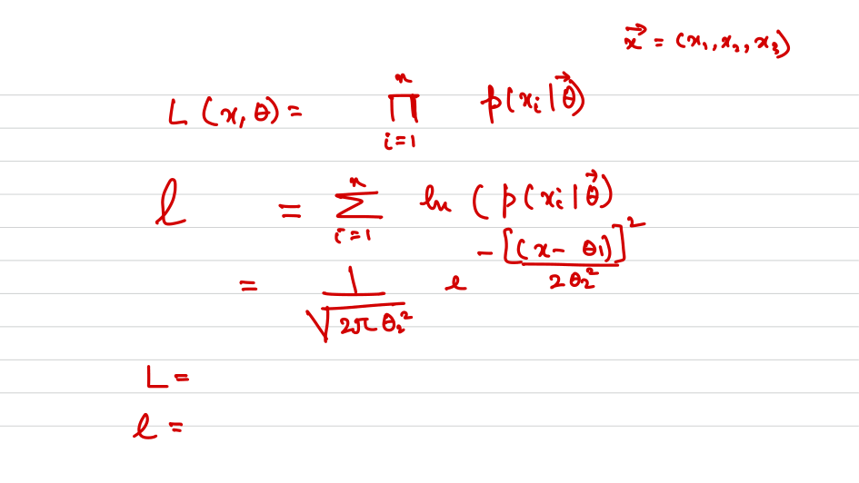
*👀 Board p. 19 — Product of densities → sum of logs.*

Three readings $\vec x = (x_1, x_2, x_3)$:
$$L = \prod_{i=1}^{n} p(x_i\mid\vec\theta), \qquad \ell = \ln L = \sum_{i=1}^{n}\ln p(x_i\mid\vec\theta).$$

### Board p. 20 — Expanding for $n = 3$, step by step

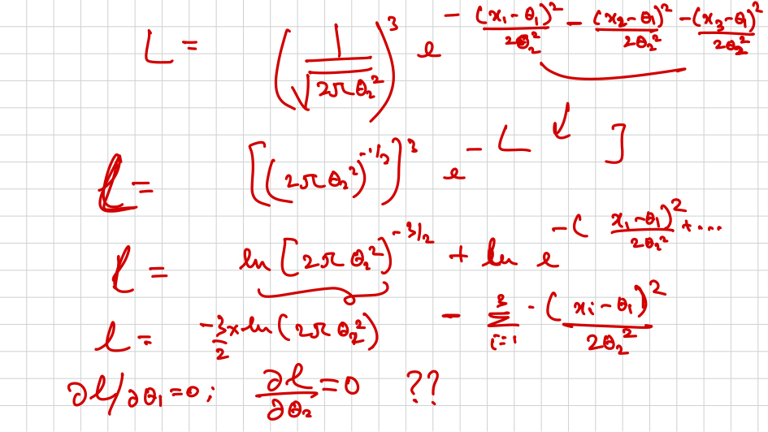
*👀 Board p. 20 — n = 3 expanded: exponents add, then take ln.*

1. Multiply three bells. Same front factor three times, and exponents add ($e^a e^b = e^{a+b}$):
$$L = \left(\frac{1}{\sqrt{2\pi\theta_2^2}}\right)^{3} e^{-\frac{(x_1-\theta_1)^2}{2\theta_2^2} - \frac{(x_2-\theta_1)^2}{2\theta_2^2} - \frac{(x_3-\theta_1)^2}{2\theta_2^2}}.$$
2. Rewrite the front: $\left((2\pi\theta_2^2)^{-1/2}\right)^3 = (2\pi\theta_2^2)^{-3/2}$.
3. Take $\ln$. The log of a product is a sum, and $\ln e^u = u$:
$$\ell = -\tfrac32\ln(2\pi\theta_2^2) - \sum_{i=1}^{3}\frac{(x_i-\theta_1)^2}{2\theta_2^2}.$$
4. Two knobs, so two equations: $\dfrac{\partial\ell}{\partial\theta_1} = 0$ and $\dfrac{\partial\ell}{\partial\theta_2} = 0$.

### Board p. 21 — The answers

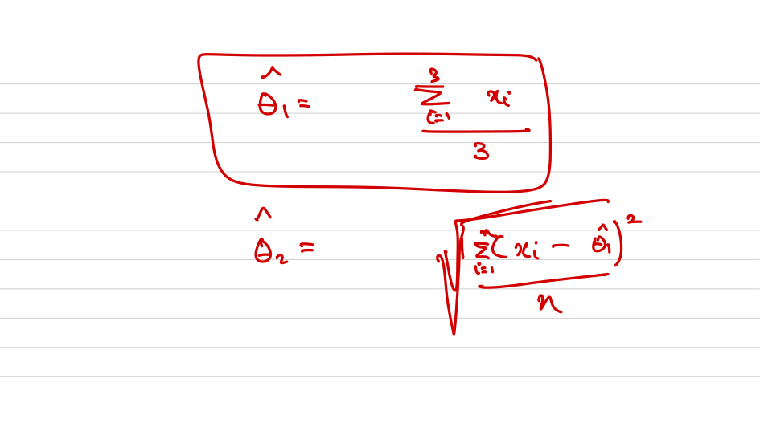
*👀 Board p. 21 — Boxed answer: θ̂₁ = average; θ̂₂ = RMS distance from it.*

$$\hat\theta_1 = \frac{1}{3}\sum_{i=1}^{3}x_i \quad(\text{the average}), \qquad \hat\theta_2 = \sqrt{\frac{1}{n}\sum_{i=1}^{n}(x_i-\hat\theta_1)^2}\quad(\text{the RMS distance from the average}).$$
These are exactly slides 17 and 18 with $n = 3$. Note the $1/n$, not $1/(n-1)$ (slide 18's warning).

### Board p. 22 — Bayes' rule for parameters, from the joint

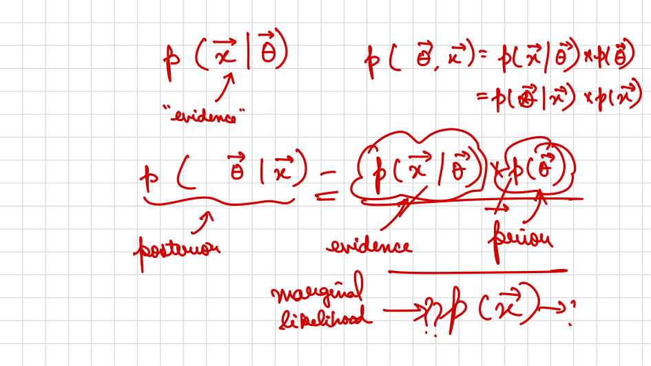
*👀 Board p. 22 — Joint split two ways gives posterior = likelihood × prior / evidence.*

Start from the joint probability of data and knobs, and split it both ways (L1 §8.4: $P(A\cap B) = P(A\mid B)P(B)$):
$$p(\vec\theta, \vec x) = p(\vec x\mid\vec\theta)\,p(\vec\theta) = p(\vec\theta\mid\vec x)\,p(\vec x).$$
Divide by $p(\vec x)$:
$$\underbrace{p(\vec\theta\mid\vec x)}_{\text{posterior}} = \frac{\overbrace{p(\vec x\mid\vec\theta)}^{\text{likelihood}}\;\overbrace{p(\vec\theta)}^{\text{prior}}}{\underbrace{p(\vec x)}_{\text{evidence / marginal likelihood}}}.$$
- MLE maximises only the likelihood (the cloud the board drew around $p(\vec x\mid\vec\theta)$). Adding the prior and maximising the top line gives **MAP** (slides 25–27).
- ⚠️ **Naming trap.** The board labels $p(\vec x\mid\vec\theta)$ "evidence". In standard usage that term is the **likelihood**; "evidence" means the bottom, $p(\vec x)$, also called the **marginal likelihood** (also written on the board). It doesn't depend on $\vec\theta$, so it never moves the peak.

## Slide 16 — Step 3: Take Logs ✍️ (solved)

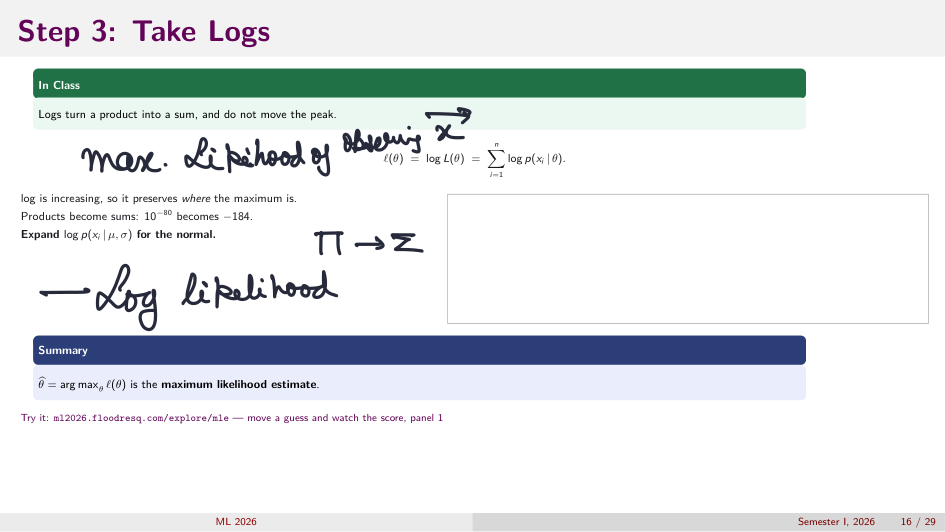
*👀 Slide 16 — Ink: Π → Σ, 'log likelihood'.*

$$\ell(\theta) = \log L(\theta) = \sum_{i=1}^n \log p(x_i\mid\theta).$$

- $\log$ is increasing, so it keeps the **location** of the maximum (A6).
- Products become sums: $10^{-80}$ becomes $-184$ ($= -80\times\ln 10 = -80\times2.3026$).

**In Class — expand $\log p(x_i\mid\mu,\sigma)$ for the normal.** Use $\log(ab) = \log a + \log b$ and $\log e^u = u$:
$$\log p(x_i\mid\mu,\sigma) = \log\frac{1}{\sqrt{2\pi\sigma^2}} + \log\exp\!\Big[-\frac{(x_i-\mu)^2}{2\sigma^2}\Big] = -\tfrac12\log(2\pi\sigma^2) - \frac{(x_i-\mu)^2}{2\sigma^2}.$$

Sum over the $n$ readings (the first term is the same every time, so it's multiplied by $n$):
$$\boxed{\ell(\mu,\sigma) = -\frac n2\log(2\pi\sigma^2) - \frac{1}{2\sigma^2}\sum_{i=1}^n (x_i-\mu)^2.}$$

The second term is the negative **sum of squared errors** around $\mu$, scaled by $1/2\sigma^2$. Squared error is already appearing.

**Summary:** $\hat\theta = \arg\max_\theta \ell(\theta)$ is the **maximum likelihood estimate (MLE)**.

Try it: `ml2026.floodresq.com/explore/mle` panel 1. Move a guess and watch the score.

## Slide 17 — Step 4: Find The Peak — The Centre ✍️ (solved)

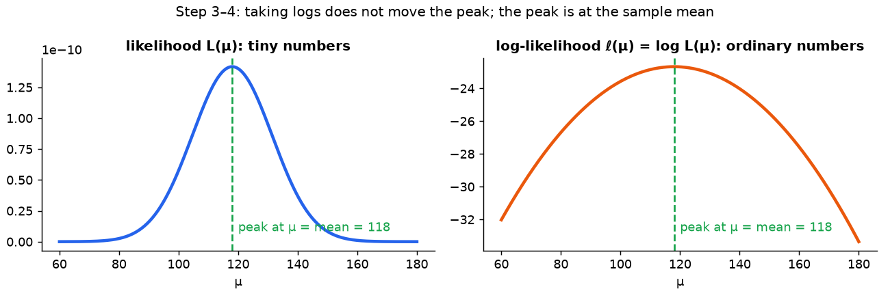
*📊 Steps 3–4: L and log L peak at the same μ, the sample mean. Logs just make the numbers readable.*

With $\sigma$ fixed:
$$\ell(\mu) = -\frac n2\log(2\pi\sigma^2) - \frac{1}{2\sigma^2}\sum_{i=1}^n (x_i-\mu)^2.$$
Only the second term contains $\mu$.

**Differentiate** (chain rule: $\frac{d}{d\mu}(x_i-\mu)^2 = 2(x_i-\mu)\cdot(-1)$):
$$\frac{d\ell}{d\mu} = -\frac{1}{2\sigma^2}\sum_i 2(x_i-\mu)(-1) = \frac{1}{\sigma^2}\sum_{i=1}^n (x_i-\mu).$$

**Set to zero and solve:**
$$\sum_i (x_i - \mu) = 0 \;\Rightarrow\; \sum_i x_i - n\mu = 0 \;\Rightarrow\; \boxed{\hat\mu = \frac1n\sum_{i=1}^n x_i = \bar x.}$$

**Check it's a max:** $\frac{d^2\ell}{d\mu^2} = -\frac{n}{\sigma^2} < 0$ ✓ (a downward parabola in $\mu$, so this is the only peak).

**Notice:** maximising $\ell(\mu)$ is the same as **minimising** $\sum(x_i-\mu)^2$. MLE under a normal = least squares. And $\sigma$ dropped out, so $\hat\mu$ is the same whatever $\sigma$ is.

**Summary:** the MLE of the centre is the **sample mean**.

## Slide 18 — Step 4 Again, For The Spread ✍️ (solved)

Write $v = \sigma^2$ (differentiating with respect to the variance is cleaner) and plug in $\hat\mu$:
$$\ell(v) = -\frac n2\log(2\pi v) - \frac{1}{2v}\sum_i (x_i-\hat\mu)^2.$$

Let $S = \sum_i (x_i-\hat\mu)^2$ (a fixed number once the data are in). Note $\log(2\pi v) = \log 2\pi + \log v$.

**Differentiate:**
$$\frac{d\ell}{dv} = -\frac{n}{2}\cdot\frac{1}{v} - S\cdot\frac{d}{dv}\Big(\frac{1}{2v}\Big) = -\frac{n}{2v} + \frac{S}{2v^2}.$$

**Set to zero:** multiply by $2v^2$, giving $-nv + S = 0$:
$$\boxed{\hat v = \hat\sigma^2 = \frac1n\sum_{i=1}^n (x_i-\hat\mu)^2, \qquad \hat\sigma = \sqrt{\hat\sigma^2}.}$$

**Check:** for $v < S/n$ the derivative is positive, and for $v > S/n$ it's negative. So the function rises then falls, and this is a max ✓.

> ⚠️ Note the **$1/n$, not $1/(n-1)$**. This estimate of the spread is slightly **too small** on average. Reason: $\hat\mu$ was fitted to the same data, so the data sit closer to $\hat\mu$ than to the true $\mu$. In fact $\mathbb{E}[\hat\sigma^2] = \frac{n-1}{n}\sigma^2$. Dividing by $n-1$ instead fixes this ("Bessel's correction"). For $n = 40$ the factor is $0.975$, which is tiny. L8 explains why (bias of estimators).

## Slide 19 — On Our Forty Days

$$\text{centre: } \hat\mu = \frac1n\sum x_i, \qquad \text{spread: } \hat\sigma = \sqrt{\frac1n\sum (x_i-\hat\mu)^2}.$$

Add the forty readings and divide by forty. Then do the same for the squared deviations and take the square root.

**Insight:** the forty days give $\hat\mu \approx 118$ mm and $\hat\sigma \approx 31$ mm. Rounded, that's the "centred 120, spread 30" used in L2's flood example. **Those numbers were never given to us**; they were estimated from recorded days exactly like this. Real estimates don't come out round.

Try it: `ml2026.floodresq.com/explore/mle` panel 1, the same forty points.

## Slide 20 — Section: The Method Beyond The Normal

## Slide 21 — None Of The Steps Used The Normal

The four steps:
1. write $p(x_i\mid\theta)$ for one observation;
2. multiply over the $n$ observations;
3. take logs;
4. differentiate, set to zero, solve for $\theta$.

Swap the distribution and **only line 1 changes**:

| Data looks like | Use | MLE turns out to be |
|---|---|---|
| a spread of measurements | normal | the sample mean |
| yes/no outcomes | Bernoulli | the fraction of yeses, $k/n$ |
| counts per interval | Poisson | the average count |
| waiting times | exponential | $1/$the average wait |

**Worked: Poisson.** $p(x_i\mid\lambda) = \lambda^{x_i}e^{-\lambda}/x_i!$
$$\ell(\lambda) = \sum_i \big[x_i\log\lambda - \lambda - \log x_i!\big] = \Big(\sum_i x_i\Big)\log\lambda - n\lambda - \text{const}$$
$$\ell'(\lambda) = \frac{\sum x_i}{\lambda} - n = 0 \;\Rightarrow\; \hat\lambda = \frac{1}{n}\sum x_i = \bar x.$$

**Worked: Exponential.** $p(x_i\mid\lambda) = \lambda e^{-\lambda x_i}$
$$\ell(\lambda) = n\log\lambda - \lambda\sum_i x_i, \qquad \ell'(\lambda) = \frac n\lambda - \sum_i x_i = 0 \;\Rightarrow\; \hat\lambda = \frac{n}{\sum x_i} = \frac{1}{\bar x}.$$

This makes sense: if the average wait is 5 days, events happen at a rate of 1/5 per day.

## Slide 22 — Example Two: Steps 1 To 3, For A Bernoulli ✍️ (solved)

A concrete cube either **fails** its strength test or **passes**. In $n$ tests, $k$ failed. $\theta = $ Pr(fail).

**Step 1. One observation:** it scores $\theta$ if it failed and $1-\theta$ if it passed. With $x_i = 1$ for fail:
$$p(x_i\mid\theta) = \theta^{x_i}(1-\theta)^{1-x_i}.$$

**Step 2. Multiply over the $n$ tests:** each failure contributes a $\theta$ and each pass a $(1-\theta)$, so
$$L(\theta) = \underbrace{\theta\cdots\theta}_{k}\ \underbrace{(1-\theta)\cdots(1-\theta)}_{n-k} = \theta^{k}(1-\theta)^{n-k}.$$

**Step 3. Take logs:**
$$\ell(\theta) = k\log\theta + (n-k)\log(1-\theta).$$

**Insight:** the same three moves, and the powers collect themselves. The order of passes and fails doesn't matter; only the **count** $k$ does.

## Slide 23 — Example Two: Step 4, And The Answer ✍️ (solved)

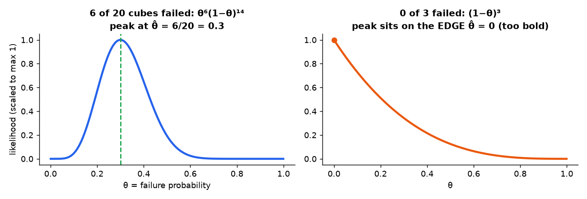
*📊 Bernoulli likelihoods: 6 of 20 peaks at 0.3; 0 of 3 peaks on the edge at 0 (the problem slide 25 fixes).*

**Differentiate** (A6):
$$\ell'(\theta) = \frac{k}{\theta} - \frac{n-k}{1-\theta}.$$

**Set to zero, multiply out, collect the $\theta$ terms:**
$$\frac{k}{\theta} = \frac{n-k}{1-\theta} \;\Rightarrow\; k(1-\theta) = (n-k)\theta \;\Rightarrow\; k - k\theta = n\theta - k\theta \;\Rightarrow\; \boxed{\hat\theta = \frac{k}{n}.}$$

**Check max:** $\ell''(\theta) = -\frac{k}{\theta^2} - \frac{n-k}{(1-\theta)^2} < 0$ ✓ (concave).

**Summary:** 6 of 20 cubes failed, so $\hat\theta = 6/20 = 0.3$. Two examples, one method: write $p(x\mid\theta)$, multiply, take logs, find the peak.

Try it: `ml2026.floodresq.com/explore/mle` panel 2, the same 6 of 20 and two more distributions.

## Slide 24 — Section: Priors, MAP, And Uncertainty

## Slide 25 — When *k/n* Is Not Usable

**A small survey:** three cubes tested, none failed. So $n = 3$, $k = 0$, and MLE says $\hat\theta = 0/3 = 0$.

> ⚠️ That answer says failure **never** happens. Three tests are not enough to support it.

Look at the likelihood: $L(\theta) = (1-\theta)^3$ is largest at $\theta = 0$, the **edge** of $[0,1]$. Setting the derivative to zero doesn't even apply here: $\ell'(\theta) = -3/(1-\theta)$ is never 0. The max is at the boundary (A7 step 4).

**Insight:** MLE uses the data **and nothing else**. With little data the peak can sit on the edge, and that edge is a claim we wouldn't make. (The same failure appears in language models and Naive Bayes as the "zero-count problem", fixed by add-one/Laplace smoothing, which is exactly the MAP result below.)

## Slide 26 — Writing Down What You Knew Before ✍️ (solved)

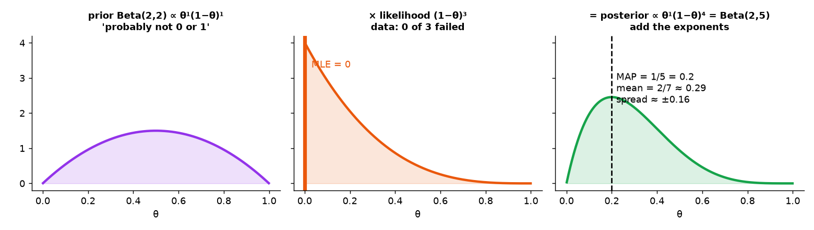
*📊 Prior × likelihood = posterior, drawn: Beta(2,2) × (1−θ)³ = Beta(2,5). MAP = 0.2 instead of the MLE's 0.*

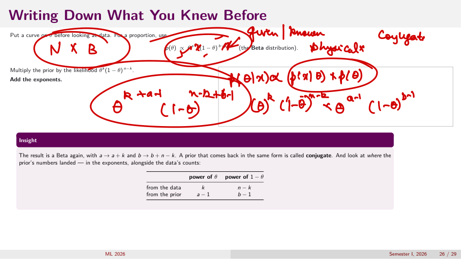
*👀 Slide 26 — Ink: posterior ∝ likelihood × prior; add the exponents → conjugate.*

Put a curve on $\theta$ **before** looking at data. For a proportion, use the **Beta** distribution:
$$p(\theta) \propto \theta^{a-1}(1-\theta)^{b-1}.$$

**Multiply the prior by the likelihood** $\theta^k(1-\theta)^{n-k}$ (A8: posterior ∝ likelihood × prior), then **add the exponents**:
$$p(\theta\mid x) \propto \theta^{k}(1-\theta)^{n-k}\cdot\theta^{a-1}(1-\theta)^{b-1} = \theta^{\,a+k-1}(1-\theta)^{\,b+n-k-1}.$$

**Insight:** the result is a Beta again, with $a\to a+k$ and $b\to b+n-k$. A prior that comes back in the same form is called **conjugate** (A9). Look at **where** the prior's numbers landed: in the exponents, next to the data's counts:

| | power of $\theta$ | power of $1-\theta$ |
|---|---|---|
| from the data | $k$ | $n-k$ |
| from the prior | $a-1$ | $b-1$ |

## Slide 27 — MLE, MAP, And How Sure We Are ✍️ (solved)

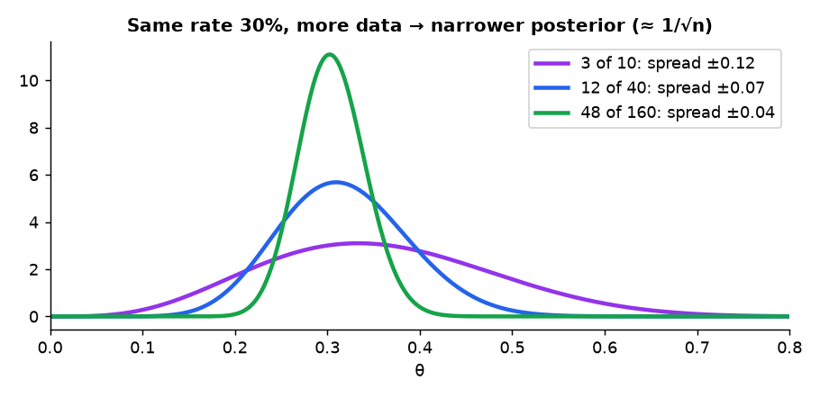
*📊 Same 30% rate, more tests: the posterior gets narrower, so we become surer.*

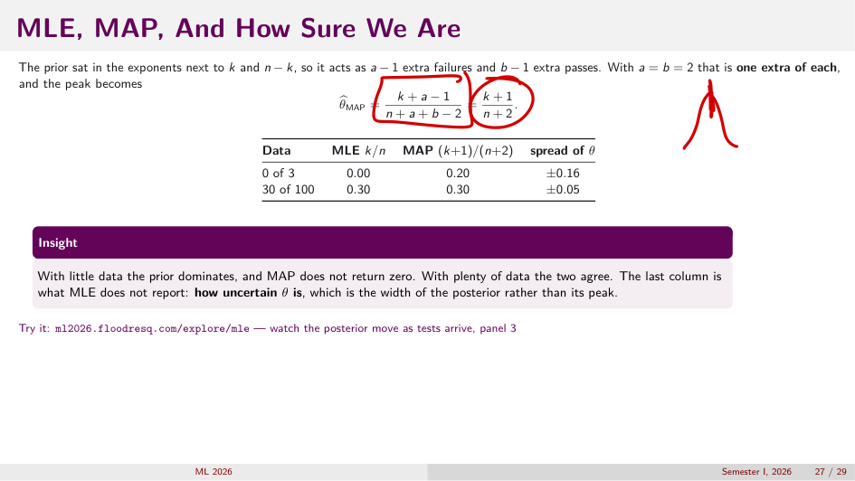
*👀 Slide 27 — The sketch at the top: the prior is a hump; the table compares MLE, MAP and spread.*

The prior sits in the exponents next to $k$ and $n-k$, so it acts as **$a-1$ extra failures and $b-1$ extra passes**. Find the peak of the posterior by repeating slide 23 with $k \to k + a - 1$ and $n \to n + a + b - 2$:
$$\hat\theta_{\text{MAP}} = \frac{k+a-1}{n+a+b-2}.$$
With $a = b = 2$ (one extra of each):
$$\hat\theta_{\text{MAP}} = \frac{k+1}{n+2}.$$

| Data | MLE $k/n$ | MAP $(k+1)/(n+2)$ | spread of $\theta$ |
|---|---|---|---|
| 0 of 3 | 0.00 | 0.20 | ±0.16 |
| 30 of 100 | 0.30 | 0.30 | ±0.05 |

**Where the last column comes from.** The posterior is Beta($\alpha,\beta$) with $\alpha = a+k$, $\beta = b+n-k$. Its standard deviation is
$$\text{spread} = \sqrt{\frac{\bar\theta(1-\bar\theta)}{\alpha+\beta+1}}, \qquad \bar\theta = \frac{\alpha}{\alpha+\beta}\ (\text{posterior mean}).$$
That's the familiar $\sqrt{\bar\theta(1-\bar\theta)/n}$ with the prior's counts included.

**Verify both rows:**
- **0 of 3:** $\alpha = 2$, $\beta = 2+3 = 5$. MAP $= 1/5 = 0.20$. $\bar\theta = 2/7 = 0.286$. Spread $= \sqrt{0.286\times0.714/8} = \sqrt{0.0255} = 0.16$ ✓.
- **30 of 100:** $\alpha = 32$, $\beta = 72$. MAP $= 31/102 = 0.304 \approx 0.30$. $\bar\theta = 32/104 = 0.308$. Spread $= \sqrt{0.308\times0.692/105} = \sqrt{0.00203} = 0.045 \approx 0.05$ ✓.

**Insight:** with **little data the prior dominates**, so MAP doesn't return zero. With **plenty of data** the two agree. The last column is what MLE doesn't report: **how uncertain $\theta$ is**, which is the *width* of the posterior rather than its peak. With 0 of 3 we know very little (±0.16). With 100 tests we know a lot more (±0.05). The spread shrinks roughly like $1/\sqrt n$.

Try it: `ml2026.floodresq.com/explore/mle` panel 3. Watch the posterior move as tests arrive.

## Slide 28 — What We Just Assumed

| Assumption | Where it entered | When it breaks |
|---|---|---|
| independence | the multiplication in Step 2 | sensors in a row, days in a storm |
| the shape is right | writing $p(x\mid\theta)$ at all | a bell fitted to lopsided data |
| one best answer | setting the derivative to zero | several peaks, or a flat ridge |

> ⚠️ Maximum likelihood answers "which $\theta$ makes my data **least surprising**". It does **not** say the model is right, and it returns **one number with no uncertainty attached**.

What each failure looks like:
- **Dependence:** 40 correlated storm days carry less information than 40 independent ones, so you'll be over-confident.
- **Wrong shape:** rainfall is often right-skewed (long upper tail). A symmetric bell fitted to it puts its centre and spread in misleading places. The MLE is still "the best bell", just best within the wrong family.
- **Non-unique peak:** e.g. two features that are copies of each other, so infinitely many $(w_1,w_2)$ fit equally well (a flat ridge). Regularisation/MAP (L7) picks one.

## Slide 29 — What Today Gives You

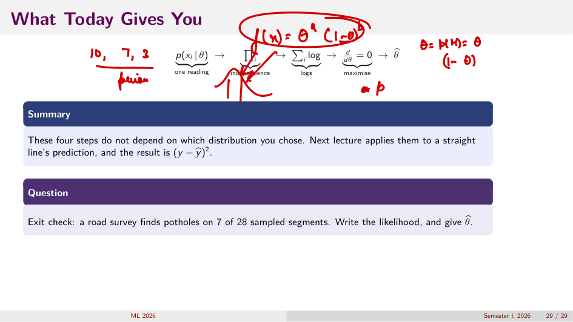
*👀 Slide 29 — Ink: the exit check's likelihood θᵏ(1−θ)ⁿ⁻ᵏ.*

$$\underbrace{p(x_i\mid\theta)}_{\text{one reading}} \to \underbrace{\prod_i}_{\text{independence}} \to \underbrace{\sum_i\log}_{\text{logs}} \to \underbrace{\tfrac{d}{d\theta} = 0}_{\text{maximise}} \to \hat\theta$$

**Summary:** these four steps don't depend on which distribution you chose. Next lecture applies them to a **straight line's prediction**, and the result is $(y-\hat y)^2$.

**Exit check (solved):** a road survey finds potholes on 7 of 28 sampled segments.
- Likelihood (Bernoulli, $k=7$, $n=28$): $L(\theta) = \theta^7(1-\theta)^{21}$.
- Log-likelihood: $\ell(\theta) = 7\log\theta + 21\log(1-\theta)$.
- $\ell'(\theta) = \frac7\theta - \frac{21}{1-\theta} = 0 \Rightarrow 7(1-\theta) = 21\theta \Rightarrow \hat\theta = \frac{7}{28} = \mathbf{0.25}$.
- (Bonus, MAP with Beta(2,2): $\frac{8}{30} \approx 0.267$.)

---

# Part C — Practice

1. Is each a valid PMF/PDF? (a) $p(0) = 0.3, p(1) = 0.8$. (b) $p(x) = 3$ on $[0, \tfrac13]$, else 0. (c) $p(x) = 2x$ on $[0,1]$.
2. $x = 150$ mm, $\mu = 120$, $\sigma = 30$. Compute $p(x\mid\mu,\sigma)$. Is it more or less surprising than $x = 90$?
3. Rainfalls $(100, 120, 140)$. Find $\hat\mu$ and $\hat\sigma^2$ (MLE). What would the $1/(n-1)$ version give?
4. Write $\ell(\mu)$ for $(100,120,140)$ with $\sigma = 20$, and evaluate it at $\mu = 120$ and $\mu = 110$. Which is bigger, and why did you expect that?
5. Why is $\arg\max_\theta L(\theta) = \arg\max_\theta \log L(\theta)$? Would $\arg\max_\theta \sqrt{L(\theta)}$ also be the same? $\arg\max_\theta (-L(\theta))$?
6. Daily count of trucks over a bridge in a 5-minute window: $3, 5, 2, 6, 4$. Assuming Poisson, find $\hat\lambda$.
7. Times between pump failures (days): $10, 30, 20$. Assuming exponential, find $\hat\lambda$ and interpret it.
8. Derive the MLE of $\theta$ for a Binomial: $k$ successes in $n$ tries, $p(k\mid\theta) = \binom nk\theta^k(1-\theta)^{n-k}$. What happened to $\binom nk$?
9. 0 of 10 sensors failed. Give MLE, MAP with Beta(2,2), and MAP with Beta(1,1).
10. Prior Beta(3,7), data 4 failures in 10. What's the posterior? Its mean and MAP?
11. A friend says "the likelihood of $\theta = 0.3$ is 0.002, so there's a 0.2% chance $\theta = 0.3$." What's wrong?
12. You fit a normal to 1000 hourly river levels from one month. List two assumptions from slide 28 that are likely violated and what each does to your estimate.
13. Show that MAP = $\arg\max_\theta[\ell(\theta) + \log p(\theta)]$, and say which term "regularises".

<b>Answers</b>

1. (a) No: $0.3 + 0.8 = 1.1 \ne 1$. (b) Yes: area $= 3\times\frac13 = 1$ (density > 1 is fine). (c) Yes: $\int_0^1 2x\,dx = [x^2]_0^1 = 1$, and $2x \ge 0$.
2. $z = 1$, so the same as $x = 90$: $p \approx 0.0081$. Equally surprising, since the normal is symmetric.
3. $\hat\mu = 120$. Deviations $-20, 0, 20$; squares sum to 800. $\hat\sigma^2 = 800/3 \approx 266.7$ ($\hat\sigma \approx 16.3$). The $1/(n-1)$ version: $800/2 = 400$ ($s = 20$).
4. $\ell(\mu) = -\frac32\log(2\pi\cdot400) - \frac{1}{800}\sum(x_i-\mu)^2$. Constant $= -1.5\ln(2513.3) = -1.5\times7.829 = -11.74$. At 120: SSE $= 800$, so $\ell = -11.74 - 1 = -12.74$. At 110: deviations $-10, 10, 30$ give SSE $= 1100$, so $\ell = -11.74 - 1.375 = -13.12$. $\mu = 120$ is bigger, as expected, since it's the sample mean (the MLE).
5. $\log$ is strictly increasing, so it preserves order and therefore the argmax. $\sqrt{\cdot}$ is also strictly increasing on $[0,\infty)$, so yes, the same. $-L$ flips the order: $\arg\max(-L) = \arg\min L$, which is different.
6. $\hat\lambda = \bar x = 20/5 = 4$ trucks per window.
7. $\bar x = 20$ days, so $\hat\lambda = 1/20 = 0.05$ failures per day: one failure per 20 days on average.
8. $\ell = \log\binom nk + k\log\theta + (n-k)\log(1-\theta)$. The first term has no $\theta$, so it vanishes when you differentiate. The rest is slide 23, giving $\hat\theta = k/n$. Constants never move the argmax.
9. MLE $= 0/10 = 0$. MAP Beta(2,2) $= 1/12 \approx 0.083$. MAP Beta(1,1) $= 0/10 = 0$ (a flat prior adds no pseudo-counts, so MAP = MLE).
10. Beta($3+4,\ 7+6$) = Beta(7, 13). Mean $= 7/20 = 0.35$. MAP $= 6/18 \approx 0.333$. (The MLE alone would be 0.4; the prior, centred at 0.3, pulls it down.)
11. Likelihood is not a probability of $\theta$ (it doesn't sum to 1 over $\theta$, and $\theta$ is continuous so $\Pr(\theta = 0.3) = 0$ anyway). It's a relative score. To make probability statements about $\theta$ you need a prior and the posterior.
12. **Independence:** consecutive hours are strongly correlated, so the effective sample size is far below 1000 and you're over-confident (the spread of $\theta$ is too small). **Shape:** river levels are skewed with flood spikes, so a bell under-represents extremes. Also **identical distribution:** one month may not represent other seasons.
13. $p(\theta\mid x) \propto p(x\mid\theta)p(\theta)$. Take logs (increasing, so the argmax is unchanged) and drop the evidence (no $\theta$): $\arg\max[\log p(x\mid\theta) + \log p(\theta)] = \arg\max[\ell(\theta) + \log p(\theta)]$. The $\log p(\theta)$ term regularises: it penalises $\theta$ values the prior finds implausible (e.g. $\theta = 0$ under Beta(2,2) has $\log p = -\infty$).

