# Lecture 4 — Linear Regression: Loss, Least Squares, and Projection

> ES 335 / ES 678 Machine Learning, Sem I 2026 — Prof. Udit Bhatia, Prof. Krishna Prasad Miyapuram
> Source: `Lectures/L04a_student_loss_risk_erm.pdf` (33 slides + 6 board pages = 39 pages) and `Lectures/L04b_student_linear_regression_four_routes.pdf` (24 slides, solved classroom copy) · Previous: [`L03_estimating_parameters.md`](L03_estimating_parameters.md)

**How to use this file.** Part A builds the *new* maths Lecture 4 needs, on top of Lectures 1–3 (likelihood, logs, MLE, derivatives, argmin). Most of it is linear algebra: vectors, matrices, column space, rank, gradients of matrix expressions. Part B goes through every page of 4A (including the handwritten board pages) and every slide of 4B. The "work it out" slides in 4A are left blank in the PDF, so they are **fully solved** here, with numbers on the running dataset. Part C is practice.

**What this lecture is really about:** Lecture 3's recipe, applied to a prediction that *depends on an input*:

$$\underbrace{Y_i\mid x_i \sim \mathcal N(\theta_0+\theta_1x_i,\ \sigma^2)}_{\text{model}} \xrightarrow{\ -\log\prod\ } \underbrace{\sum_i (y_i-\hat y_i)^2}_{\text{least squares}} \xrightarrow{\ \nabla=0\ } \underbrace{X^\top X\hat\theta = X^\top y}_{\text{normal equations}} \xrightarrow{\ } \underbrace{\hat y = P_X\,y}_{\text{projection}}$$

Change the noise model and the loss changes (Laplace → absolute error). Change nothing and look at it geometrically: least squares is **the nearest point in the column space**, and the residual is **perpendicular** to it.

## Contents

**Part A — Maths from the ground up**
1. [Expectation and conditional expectation](#a1-expectation-and-conditional-expectation)
2. [Five objects: parameter → prediction](#a2-five-objects-parameter--prediction)
3. [Residuals, losses and risk](#a3-residuals-losses-and-risk)
4. [Negative log-likelihood is a loss generator](#a4-negative-log-likelihood-is-a-loss-generator)
5. [Squared loss → mean, absolute loss → median](#a5-squared-loss--mean-absolute-loss--median)
6. [Vectors: dot product, norm, orthogonality](#a6-vectors-dot-product-norm-orthogonality)
7. [Matrices: shapes, transpose rules, design matrix](#a7-matrices-shapes-transpose-rules-design-matrix)
8. [Span, column space and rank](#a8-span-column-space-and-rank)
9. [Gradients of matrix expressions](#a9-gradients-of-matrix-expressions)
10. [Hessian, positive (semi)definite, convexity](#a10-hessian-positive-semidefinite-convexity)
11. [Projection matrices](#a11-projection-matrices)

**Part B — Slides** · [4A (39 pages)](#part-b1--lecture-4a-page-by-page-all-39-pages) · [4B (24 slides)](#part-b2--lecture-4b-slide-by-slide-all-24-slides)

**Part C — Practice** · [Jump](#part-c--practice)

---

# Part A — Maths From the Ground Up

## A1. Expectation and conditional expectation

**Expectation** = probability-weighted average (L1 §8):
$$\mathbb E[X] = \sum_x x\,p(x)\quad(\text{discrete}),\qquad \mathbb E[X] = \int x\,p(x)\,dx\quad(\text{continuous}).$$

**Board analogy (civil engineering).** Loads $F_1,F_2,F_3$ sit on a beam at distances $x_1,x_2,x_3$ from end $A$. The moment about $A$ is $\sum_k F_k x_k$. Replace the loads by probability masses $p(x_k)$ and the moment becomes $\sum x\,p(x) = \mathbb E[X]$: the **mean is the balance point** (centre of mass) of the distribution. Higher **moments** follow the same pattern: $\mathbb E[X^2] = \sum x^2 p(x)$, …, $\mathbb E[X^k]$.

**Rules you need:**

| Rule | Meaning |
|---|---|
| $\mathbb E[aX + b] = a\,\mathbb E[X] + b$ | constants pull out (linearity) |
| $\mathbb E[X + Y] = \mathbb E[X] + \mathbb E[Y]$ | always, even if dependent |
| $\mathrm{Var}(X) = \mathbb E[X^2] - (\mathbb E X)^2$ | second moment minus squared mean |

**Conditional expectation** $\mathbb E[Y\mid X=x]$: the average of $Y$ *among cases where the input equals $x$*. It's a **function of $x$**, and it's the thing regression tries to estimate.

**Board derivation.** Suppose $Y = wX + \varepsilon$ with $\varepsilon\sim\mathcal N(0,\sigma^2)$ independent of $X$. Then
$$\mathbb E[Y\mid X] = \mathbb E[wX\mid X] + \mathbb E[\varepsilon] = wX + 0 = wX.$$
Knowing $X$ makes $wX$ a constant; the noise averages to zero. So **the line is the conditional mean**, and the data scatter around it with spread $\sigma$.

## A2. Five objects: parameter → prediction

L3 §A1 separated data from parameters. Lecture 4 splits the parameter side further:

| Object | Notation | What it is | Running example |
|---|---|---|---|
| **parameter** | $\theta$ | unknown true value inside the model | true intercept and slope |
| **estimator** | $\hat\theta(\mathcal D)$ | a *rule* that maps any dataset to a value | $(X^\top X)^{-1}X^\top y$ |
| **estimate** | $\hat\theta$ | the number the rule gives on *this* data | $(2.2,\ 2.2)$ |
| **fitted model** | $f_{\hat\theta}$ | the function with the estimate plugged in | $f(x) = 2.2 + 2.2x$ |
| **prediction** | $\hat y_\star = f_{\hat\theta}(x_\star)$ | output for one chosen input | $x_\star = 4 \Rightarrow 11.0$ |

An optimizer doesn't "learn a dataset". It **applies an estimator** to the dataset and returns an estimate.

## A3. Residuals, losses and risk

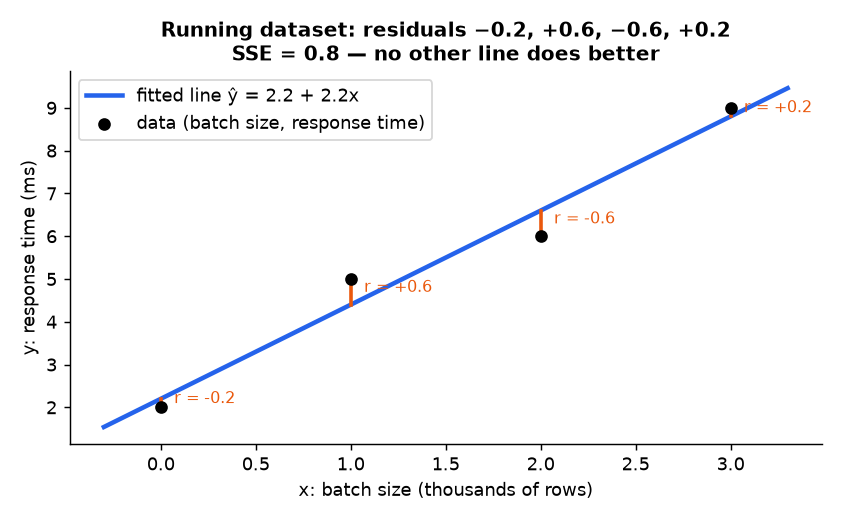
*📊 The 4A running dataset with its least-squares line 2.2 + 2.2x and every residual labelled.*

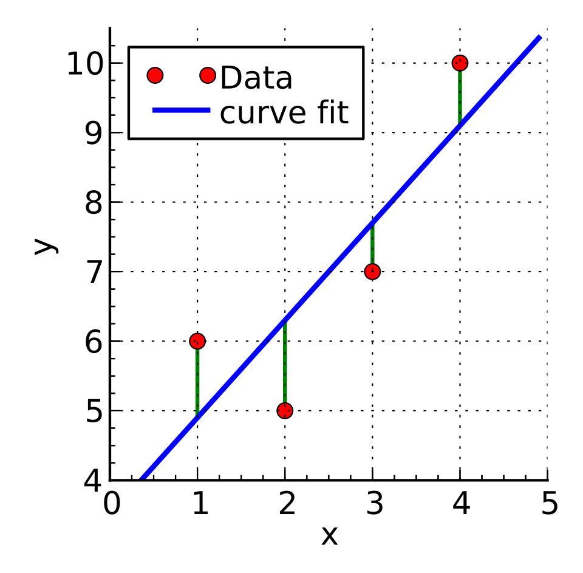
*Residuals are the vertical gaps (green) between data points and the fitted line. (Wikimedia Commons: [Linear_least_squares_example2.svg](https://commons.wikimedia.org/wiki/File:Linear_least_squares_example2.svg), CC BY-SA 3.0)*

For a candidate $\theta$ and row $i$:
$$\hat y_i = f_\theta(x_i), \qquad r_i(\theta) = y_i - \hat y_i \quad(\text{residual: keeps its sign}).$$

A **loss** $\ell(y,\hat y)$ turns one miss into a non-negative cost:

| Loss | $\ell(r)$ | Character |
|---|---|---|
| squared | $r^2$ | big errors cost a lot more (doubling the error ×4 the cost) |
| absolute | $\lvert r\rvert$ | every unit of error costs the same |
| Huber ($\delta>0$) | $\tfrac12 r^2$ if $\lvert r\rvert\le\delta$; $\ \delta(\lvert r\rvert-\tfrac12\delta)$ otherwise | quadratic near 0, linear in the tails |
| asymmetric | e.g. $a\,r$ if $r>0$, $b\lvert r\rvert$ if $r<0$ | under- and over-prediction cost differently |

(Check Huber is continuous at $\lvert r\rvert = \delta$: $\tfrac12\delta^2$ vs $\delta(\delta - \tfrac12\delta) = \tfrac12\delta^2$ ✓. The slopes also match: $\delta$ on both sides, so it's smooth.)

**From one loss to an objective:**

| Name | Formula | Can we compute it? |
|---|---|---|
| **empirical risk** | $\hat R_n(\theta) = \dfrac1n\sum_{i=1}^n \ell(y_i, f_\theta(x_i))$ | yes: training data |
| **population risk** | $R(\theta) = \mathbb E_{(X,Y)\sim P}\big[\ell(Y, f_\theta(X))\big]$ | no: needs the unknown $P$ |

**Empirical risk minimisation (ERM):** $\hat\theta \in \arg\min_\theta \hat R_n(\theta)$. We minimise what we can compute, hoping it tracks what we care about (L7–L8 is about when it doesn't).

($\in$ rather than $=$ because the argmin can be a *set*; see the flat valley, A10.)

## A4. Negative log-likelihood is a loss generator

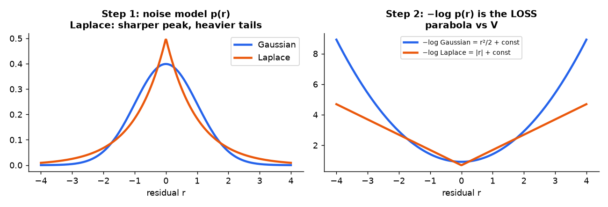
*📊 Pick a noise curve, take −log: the Gaussian gives a parabola (squared loss), the Laplace a V (absolute loss).*

L3's MLE, with an input:
$$\hat\theta_{\text{MLE}} = \arg\max_\theta \prod_{i=1}^n p(y_i\mid x_i,\theta) = \arg\min_\theta \sum_{i=1}^n \underbrace{-\log p(y_i\mid x_i,\theta)}_{\text{loss of row } i}.$$

(Allowed because $-\log$ is strictly *decreasing*: it flips max into min without moving the location.)

**The translation trick (4B slide 5).** Write $m_i = f_\theta(x_i)$ and $y_i = m_i + \varepsilon_i$. Sliding the axis by the fixed number $m_i$ doesn't change heights, so
$$p_{Y\mid X}(y_i\mid x_i,\theta) = p_\varepsilon(y_i - m_i) = p_\varepsilon(r_i(\theta)).$$
**The noise density, evaluated at the residual, is the likelihood.** So $\ell(r) = -\log p_\varepsilon(r)$:

| Noise $\varepsilon$ | Density | $-\log p_\varepsilon(r)$ | Loss |
|---|---|---|---|
| Gaussian $\mathcal N(0,\sigma^2)$ | $\dfrac{1}{\sqrt{2\pi\sigma^2}}e^{-r^2/2\sigma^2}$ | $\tfrac12\log(2\pi\sigma^2) + \dfrac{r^2}{2\sigma^2}$ | **squared** |
| Laplace$(0,b)$ | $\dfrac{1}{2b}e^{-\lvert r\rvert/b}$ | $\log(2b) + \dfrac{\lvert r\rvert}{b}$ | **absolute** |

Constants and positive scale factors don't move the argmin, so they are dropped.

Laplace has a **sharper peak and heavier tails** than the Gaussian: big errors are less surprising, so they are penalised linearly instead of quadratically.

## A5. Squared loss → mean, absolute loss → median

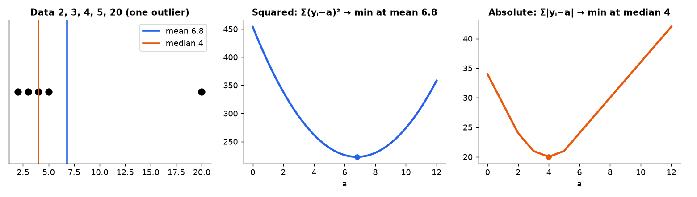
*📊 Data 2, 3, 4, 5, 20: squared loss bottoms out at the mean 6.8, absolute loss at the median 4.*

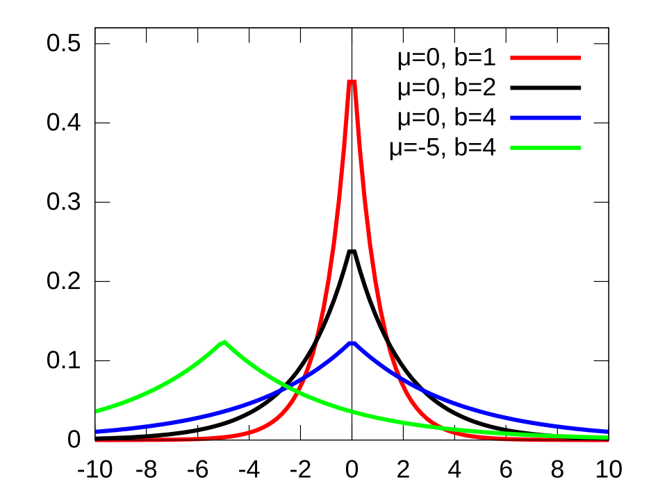
*Laplace PDF: sharp peak and heavier tails than the normal; its NLL is the absolute loss. (Wikimedia Commons: [Laplace_pdf_mod.svg](https://commons.wikimedia.org/wiki/File:Laplace_pdf_mod.svg), CC BY-SA 4.0)*

Fit one constant $a$ to data $y_1..y_n$.

**Squared:** $J_2(a) = \sum (y_i - a)^2$. $\ J_2'(a) = -2\sum(y_i - a) = 0 \Rightarrow a = \bar y$ (**mean**).

**Absolute:** $J_1(a) = \sum \lvert y_i - a\rvert$. Away from data points, $\frac{d}{da}\lvert y_i - a\rvert = -1$ if $y_i > a$ and $+1$ if $y_i < a$, so
$$J_1'(a) = \#\{y_i < a\} - \#\{y_i > a\}.$$
It's zero when as many points are below $a$ as above: $a = $ **median**.

The same holds in the population, conditionally on $x$: the minimiser of $\mathbb E[(Y-a)^2\mid x]$ is $\mathbb E[Y\mid x]$; of $\mathbb E[\lvert Y-a\rvert\mid x]$ it's the conditional median. **The loss decides which summary of $Y\mid x$ you are estimating.**

## A6. Vectors: dot product, norm, orthogonality

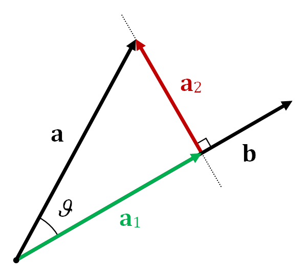
*Projection a₁ of a onto b, and the perpendicular remainder a₂ (the 'residual'). (Wikimedia Commons: [Projection_and_rejection.png](https://commons.wikimedia.org/wiki/File:Projection_and_rejection.png), CC BY-SA 3.0)*

A vector $v\in\mathbb R^n$ is a column of $n$ numbers. Stack the $n$ responses into $y\in\mathbb R^n$ and the $n$ residuals into $r\in\mathbb R^n$.

| Operation | Formula | Note |
|---|---|---|
| dot product | $u^\top v = \sum_i u_i v_i$ | a scalar; $u^\top v = v^\top u$ |
| squared length | $\lVert v\rVert_2^2 = v^\top v = \sum_i v_i^2$ | lower 2 = Euclidean; upper 2 = squared |
| orthogonal | $u\perp v \iff u^\top v = 0$ | right angle |
| expand a square | $\lVert u - v\rVert^2 = \lVert u\rVert^2 - 2u^\top v + \lVert v\rVert^2$ | the cross term vanishes if $u\perp v$ (Pythagoras) |

So **SSE is a squared length**: $\sum_i r_i^2 = \lVert r\rVert_2^2 = \lVert y - X\theta\rVert_2^2$.

## A7. Matrices: shapes, transpose rules, design matrix

$A\in\mathbb R^{m\times k}$ times $B\in\mathbb R^{k\times p}$ gives $\mathbb R^{m\times p}$. **Inner sizes must match.** Always check shapes (L2's "dimensions as a correctness check").

**Transpose rules:** $(A^\top)^\top = A$, $\ (A+B)^\top = A^\top + B^\top$, $\ (AB)^\top = B^\top A^\top$ (order flips), $\ (A^{-1})^\top = (A^\top)^{-1}$.

**A scalar equals its own transpose.** If $y^\top X\theta$ is $1\times1$, then $y^\top X\theta = (y^\top X\theta)^\top = \theta^\top X^\top y$. This merges the two middle terms when you expand $\lVert y - X\theta\rVert^2$.

**Symmetric:** $A^\top = A$. $X^\top X$ is always symmetric: $(X^\top X)^\top = X^\top X$.

### Matrix toolkit: identity, inverse, determinant, singular

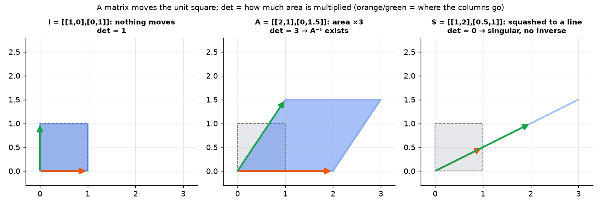
*📊 Identity leaves the square alone; det 3 triples its area; det 0 flattens it, and a flattened square can't be un-flattened.*

These four words appear in every formula from here on (normal equations, projection, eigenvalues), so build them one step at a time. Picture a 2×2 matrix as a machine that **moves every point of the plane**. Its first column says where the arrow $(1,0)$ lands; its second column says where $(0,1)$ lands.

**Step 1 — Identity $I$: the "do nothing" matrix.** $I = \begin{bmatrix}1&0\\0&1\end{bmatrix}$. Check: $I\begin{bmatrix}x\\y\end{bmatrix} = \begin{bmatrix}x\\y\end{bmatrix}$. It plays the role of the number 1: $AI = IA = A$. ($I_d$ or $I_n$ just says its size.)

**Step 2 — Inverse $A^{-1}$: the "undo" matrix.** The number 5 has the inverse $\tfrac15$ because $5\times\tfrac15 = 1$. Same idea: $A^{-1}A = AA^{-1} = I$. If $A$ moves a point, $A^{-1}$ moves it back. That's how we "divide" by a matrix: from $A\theta = c$, multiply both sides on the left by $A^{-1}$ to get $\theta = A^{-1}c$.

**Step 3 — Determinant $\det A$: the area multiplier.** Send the unit square (area 1) through $A$. It becomes a parallelogram with area $|\det A|$. For 2×2, $\det\begin{bmatrix}a&b\\c&d\end{bmatrix} = ad - bc$.

| Matrix | Where the square goes | det |
|---|---|---|
| $\begin{bmatrix}1&0\\0&1\end{bmatrix}$ | stays put | 1 |
| $\begin{bmatrix}2&1\\0&1.5\end{bmatrix}$ | parallelogram, 3× the area | $2(1.5) - 1(0) = 3$ |
| $\begin{bmatrix}1&2\\0.5&1\end{bmatrix}$ | flattened onto a line | $1(1) - 2(0.5) = 0$ |

**Step 4 — Singular means det = 0, and then no inverse exists.** If the square is squashed onto a line, many different points land on the same spot. You can't tell which one you started from, so there's nothing to "undo". Notice the singular example's second column $(2,1)$ is just $2\times$ the first $(1,0.5)$: **dependent columns ⇔ det = 0 ⇔ no inverse**. That is exactly the rank problem in A8 and slide 31.

**2×2 inverse formula:** $\begin{bmatrix}a&b\\c&d\end{bmatrix}^{-1} = \dfrac{1}{ad-bc}\begin{bmatrix}d&-b\\-c&a\end{bmatrix}$ (swap the diagonal, negate the off-diagonal, divide by det). It exists iff $ad - bc \ne 0$, and the division by det shows why.

> **Check:** $A = \begin{bmatrix}2&1\\0&1.5\end{bmatrix}$. $A^{-1} = \frac13\begin{bmatrix}1.5&-1\\0&2\end{bmatrix}$. Multiply: $AA^{-1} = \frac13\begin{bmatrix}3&0\\0&3\end{bmatrix} = I$ ✓.

**Design matrix.** Choose features $\phi(x) = [\phi_0(x),\dots,\phi_{d-1}(x)]^\top$ (e.g. $[1, x]$ or $[1, x, x^2]$). Then $\hat y_i = \phi(x_i)^\top\theta$, and stacking the rows $\phi(x_i)^\top$ gives
$$X = \begin{bmatrix}\phi(x_1)^\top\\ \vdots\\ \phi(x_n)^\top\end{bmatrix}\in\mathbb R^{n\times d},\qquad \hat y = X\theta\in\mathbb R^n,\qquad r = y - X\theta.$$
**Row** $i$ = one observation. **Column** $j$ = one feature measured across all observations. The column of 1s is what carries the intercept.

**"Linear" regression means linear in $\theta$**, not in $x$. $\theta_0 + \theta_1 x + \theta_2 x^2$ is a curve in $x$ but still linear regression: each $\theta_j$ appears to the first power, multiplying a fixed function. $\theta_1^2$, $\theta_1\theta_2$, $e^{\theta_1}$ would not be.

## A8. Span, column space and rank

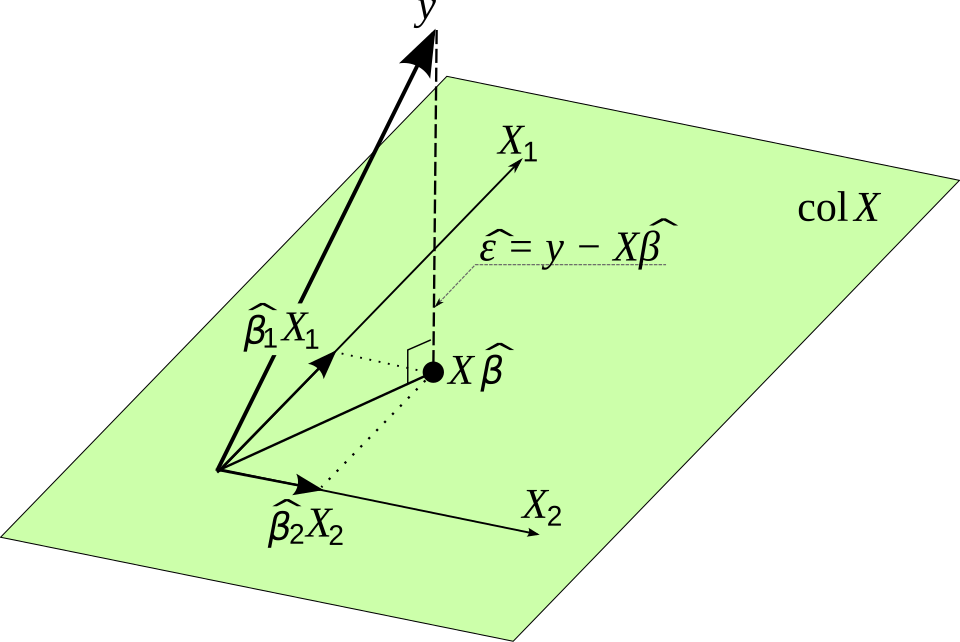
*OLS geometry: ŷ = Xβ̂ is the foot of the perpendicular from y onto the column space of X. (Wikimedia Commons: [OLS_geometric_interpretation.svg](https://commons.wikimedia.org/wiki/File:OLS_geometric_interpretation.svg), Public domain)*

Write $X = [c_0\ c_1\ \cdots]$ by columns. Then
$$X\theta = \theta_0 c_0 + \theta_1 c_1 + \cdots$$
is a **linear combination** of the columns. The columns are fixed; the coefficients vary.

- **Span** $\{c_0, c_1\}$ = every vector you can make as $a\,c_0 + b\,c_1$.
- **Column space** $\mathrm{Col}(X) = \{X\theta : \theta\in\mathbb R^d\}\subseteq\mathbb R^n$ = every prediction vector the model can produce. The observed $y$ usually isn't in it (otherwise the fit would be perfect).
- **Rank** $= \dim\mathrm{Col}(X)$ = number of genuinely independent column directions.
- **Full column rank** ($\mathrm{rank}(X) = d$): no column is a combination of the others. Equivalently, $Xv = 0 \Rightarrow v = 0$, i.e. the **null space** $\mathrm{Null}(X) = \{0\}$.
- **Rank deficient** ($\mathrm{rank}(X) < d$): some $v\ne0$ has $Xv = 0$. Then $X(\theta + tv) = X\theta$ for every $t$: different parameters, same predictions.

Example: $\begin{bmatrix}1&1\\2&2\end{bmatrix}$ has two equal columns, so rank 1, and $v = (1,-1)$ is in the null space.

## A9. Gradients of matrix expressions

For a scalar function $J(\theta)$ of a vector $\theta\in\mathbb R^d$, the **gradient** $\nabla_\theta J\in\mathbb R^d$ stacks the partial derivatives (L2 §A6). It has the **same shape as $\theta$**.

| $J(\theta)$ | $\nabla_\theta J$ | Scalar analogue |
|---|---|---|
| $b^\top\theta$ (or $\theta^\top b$) | $b$ | $\frac{d}{d\theta}b\theta = b$ |
| $\theta^\top A\theta$ | $(A + A^\top)\theta$ | $\frac{d}{d\theta}a\theta^2 = 2a\theta$ |
| $\theta^\top A\theta$, $A$ symmetric | $2A\theta$ | |
| $\tfrac12\lVert y - X\theta\rVert^2$ | $X^\top(X\theta - y) = -X^\top r$ | $\frac{d}{d\theta}\tfrac12(y - x\theta)^2 = -x(y - x\theta)$ |

**Why $(A + A^\top)\theta$** (4B slide 23): $\theta^\top A\theta = \sum_j\sum_k \theta_j A_{jk}\theta_k$. $\theta_m$ appears as the first factor ($j = m$) and as the second ($k = m$), so $\partial/\partial\theta_m = \sum_k A_{mk}\theta_k + \sum_j\theta_j A_{jm} = [(A + A^\top)\theta]_m$.

**Differentials check** (4B slide 24): $r = y - X\theta$, $dr = -X\,d\theta$, $dJ = r^\top dr = -r^\top X\,d\theta = (-X^\top r)^\top d\theta$. Since $dJ = (\nabla J)^\top d\theta$, $\nabla J = -X^\top r$ ✓.

## A10. Hessian, positive (semi)definite, convexity

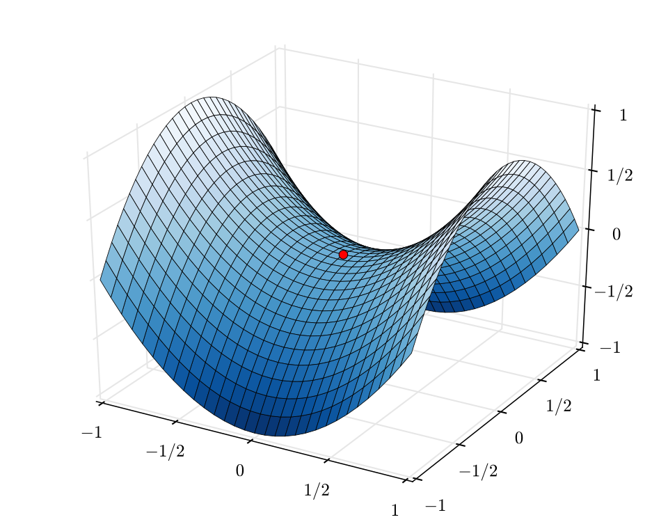
*Not convex: a saddle curves up one way and down the other (Hessian has a negative eigenvalue). (Wikimedia Commons: [Saddle_point.svg](https://commons.wikimedia.org/wiki/File:Saddle_point.svg), CC BY 3.0)*

The **Hessian** $\nabla^2 J$ is the $d\times d$ matrix of second derivatives. For least squares,
$$\nabla^2 J = \nabla_\theta\big[X^\top X\theta - X^\top y\big] = X^\top X.$$

A symmetric matrix $H$ is

| | Condition | Picture |
|---|---|---|
| **positive semidefinite** (PSD), $H\succeq0$ | $v^\top Hv \ge 0$ for all $v$ | bowl, possibly with a flat valley |
| **positive definite** (PD), $H\succ0$ | $v^\top Hv > 0$ for all $v\ne0$ | strict bowl, single bottom point |

For a twice-differentiable $J$: Hessian PSD everywhere ⇒ **convex**; PD everywhere ⇒ **strictly convex** ⇒ at most one minimiser. Convex ⇒ any point with $\nabla J = 0$ is a **global** minimum.

**The key identity:** $v^\top X^\top X v = (Xv)^\top(Xv) = \lVert Xv\rVert^2 \ge 0$. So least squares is **always convex in $\theta$**. It's strictly convex exactly when $Xv \ne 0$ for every $v\ne0$, i.e. **full column rank** (A8).

> ⚠️ Always name the variable. $J$ is convex **in $\theta$** with $X, y$ fixed. "The problem is convex" alone says nothing.

## A11. Projection matrices

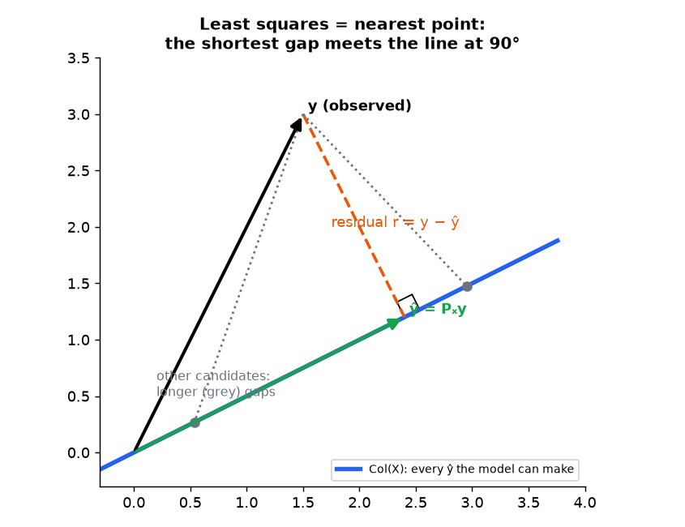
*📊 The nearest point on the line to y is where the gap is perpendicular; every other candidate is farther.*

A square matrix $P$ is an **orthogonal projection** if

1. **idempotent**: $P^2 = P$ (projecting twice changes nothing);
2. **symmetric**: $P^\top = P$ (makes the leftover perpendicular).

Then for any $y$: $Py$ is the "shadow" of $y$ on the subspace, and $(I - P)y$ is the perpendicular leftover. $(I-P)$ is also a projection, onto the orthogonal complement, and $P(I-P) = P - P^2 = 0$.

For least squares (full column rank): $P_X = X(X^\top X)^{-1}X^\top$ (an $n\times n$ matrix). Useful fact: $\mathrm{trace}(P_X) = \mathrm{rank}(X) = d$.

---

# Part B1 — Lecture 4A Page by Page (all 39 pages)

The PDF footers count 33 slides; six handwritten board pages (pp. 7–12) were inserted after slide 6. Headings below give the **slide number from the footer**, with board pages labelled separately.

**Running dataset for 4A** (batch size $x_i$ in thousands of rows, response time $y_i$ in ms):

| $i$ | 1 | 2 | 3 | 4 |
|---|---|---|---|---|
| $x_i$ | 0 | 1 | 2 | 3 |
| $y_i$ | 2 | 5 | 6 | 9 |

## Slide 1 — Title

*Lecture 4A: Linear Regression I — From likelihood to least squares, projection, and uniqueness.* Prof. Udit Bhatia, IIT Gandhinagar, Semester I 2026.

## Slide 2 — Course Roadmap: You Are Here

Still in **L3–L6 estimation and linear models**. Today's chain: conditional model → fitting objective → parameter estimate → geometric projection.

## Slide 3 — A Question From The Previous Class

**Q:** Why can a modern language model write complex software yet fail on a simple-looking number sequence?

- "Complex" isn't one mathematical quantity. Familiar code has strong patterns in the training data.
- A short sequence can support many **incompatible rules** (1, 2, 4, … could continue 8 or 7), and the prompt may not say which one generated it.

So a model still needs a **criterion**: which family of explanations is allowed, what counts as a costly error, which parameter value is preferred.

**Insight:** today makes those three choices explicit: **model family, loss, estimator**.

## Slide 4 — Vocabulary We Will Reuse Today

| Idea | Meaning here |
|---|---|
| conditional probability | a distribution for the output once the input is known: $p(y\mid x)$ |
| non-stationarity | the data-generating mechanism may change with time or context |
| weights / parameters | unknown numbers $\theta$ that pick one member of a model family |
| optimization | a rule for choosing $\theta$, usually by minimising an objective |
| convexity | a property of the objective **as a function of a named variable** |

> ⚠️ Never say "the problem is convex" without naming the variable: convex in $x$, in $\theta$, or in something else? (A10)

## Slide 5 — Learning Objectives

1. Distinguish parameter, estimator, estimate, fitted model, prediction (A2).
2. Derive squared-error fitting from a Gaussian conditional model (slides 14–16).
3. Explain why another noise model gives another loss (slide 21).
4. Derive the normal equations and the projection matrix (slides 25–26).
5. Prove the residual is orthogonal to the design space (slide 28).
6. Test whether least squares is convex in $\theta$, and state when its minimiser is unique (slides 29–32).

## Slide 6 — One Dataset For The Entire Lecture

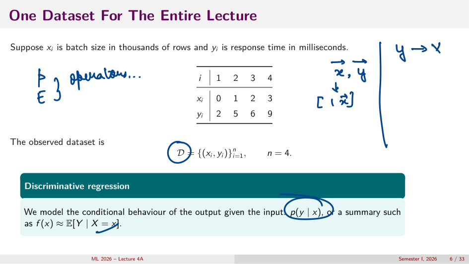
*👀 4A slide 6 — The four-point dataset used all lecture; teacher's ink marks y vs x.*

The table above: $\mathcal D = \{(x_i,y_i)\}_{i=1}^n$, $n = 4$.

**Discriminative regression:** we model the output *given* the input, $p(y\mid x)$, or a summary of it such as $f(x)\approx\mathbb E[Y\mid X=x]$. We don't model how the $x$'s themselves are distributed.

## Board pp. 7–12 — What was written in class

**p. 7 — What is $\mathbb E[y\mid x]$?** Beam with loads $F_1,F_2,F_3$ at distances $x_1,x_2,x_3$ from $A$; moment $M_A = \sum F_k x_k$. Same picture with a PDF: the masses are $p(x)$, so $\mathbb E[X] = \sum_x x\,p(x)$ is the **mean** (first moment); $\mathbb E[X^2] = \sum x^2p(x)$, …, $\mathbb E[X^n]$ are higher moments. (A1)

![Board p. 7 — Beam with loads: E[X] is a 'moment', each value weighted by its probability.](images/L04/board/b07_moments_beam.png)
*👀 Board p. 7 — Beam with loads: E[X] is a 'moment', each value weighted by its probability.*

**p. 8 — The model.** Scatter of $Y$ vs $X$ roughly along a line, so $Y_i \propto X_i$. Write

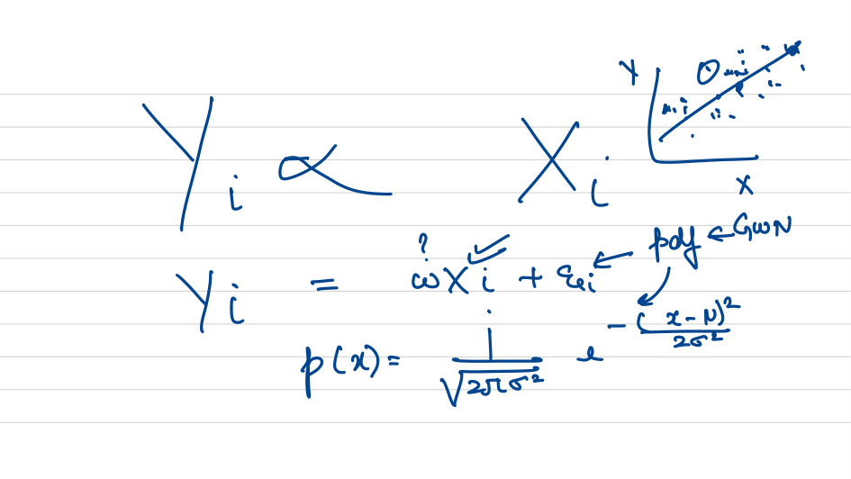
*👀 Board p. 8 — Points roughly on a line: Yᵢ = wXᵢ + εᵢ with Gaussian noise.*
$$Y_i = wX_i + \varepsilon_i,$$
with $\varepsilon_i$ having a PDF: Gaussian white noise (**GWN**), $p(\varepsilon) = \frac{1}{\sqrt{2\pi\sigma^2}}e^{-(\varepsilon-\mu)^2/2\sigma^2}$ with $\mu = 0$. $X_i$ is known; $w$ is the unknown.

**p. 9 — Conditional mean.** $Y = wX + \varepsilon$, $\varepsilon\sim\mathcal N(0,\sigma^2)$. Taking expectations given $X$: $\mathbb E[Y\mid X] = wX + \mathbb E[\varepsilon] = wX + 0 = wX$. The line is the conditional mean.

![Board p. 9 — E[Y | X] = wX because the noise averages to 0.](images/L04/board/b09_conditional_mean.png)
*👀 Board p. 9 — E[Y | X] = wX because the noise averages to 0.*

**p. 10 — Likelihood for $n = 4$.** $p(Y\mid X) = \mathcal N(wX, \sigma^2)$, so

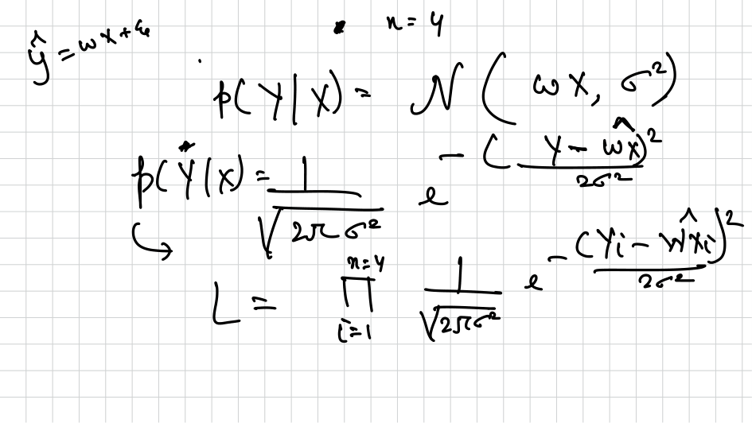
*👀 Board p. 10 — Likelihood for n = 4 as a product of four bells.*
$$p(y_i\mid x_i) = \frac{1}{\sqrt{2\pi\sigma^2}}e^{-(y_i - wx_i)^2/2\sigma^2},\qquad L = \prod_{i=1}^{4}\frac{1}{\sqrt{2\pi\sigma^2}}e^{-(y_i - wx_i)^2/2\sigma^2}.$$

**p. 11 — Max likelihood = min squared error.** With $w\equiv\theta$, $\hat y = \theta x$:

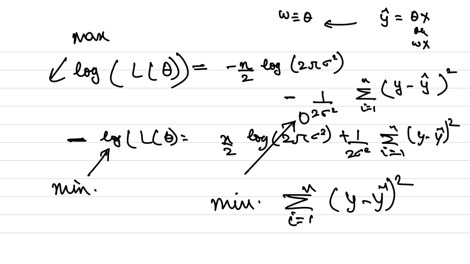
*👀 Board p. 11 — Max log L ⇔ min Σ(y − ŷ)².*
$$\log L(\theta) = -\frac n2\log(2\pi\sigma^2) - \frac{1}{2\sigma^2}\sum_{i=1}^n(y_i - \hat y_i)^2.$$
Maximise $\log L$ ⇔ minimise $-\log L = \frac n2\log(2\pi\sigma^2) + \frac{1}{2\sigma^2}\sum(y_i - \hat y_i)^2$. The first term has no $\theta$ (its derivative is 0), so: $\min_\theta \sum_{i}(y_i - \hat y_i)^2$.

**p. 12 — Which line?** Three candidate lines A, B, C through one point of the data cloud. For each, the **residuals** $r$ are the vertical gaps from data points to the line. Plotting residuals against $x$ for a good line should show a structureless band around 0 (this is how you check the noise assumption, slide 18).

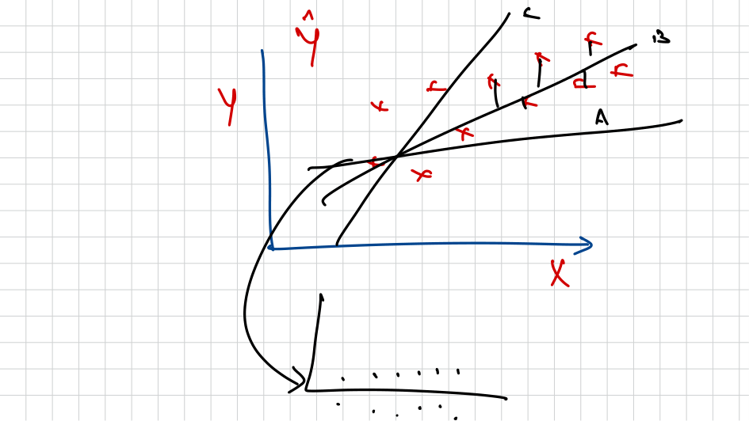
*👀 Board p. 12 — Three candidate lines A, B, C; red ticks are residuals.*

## Slide 7 — From A Fixed Mean To A Rule That Depends On x

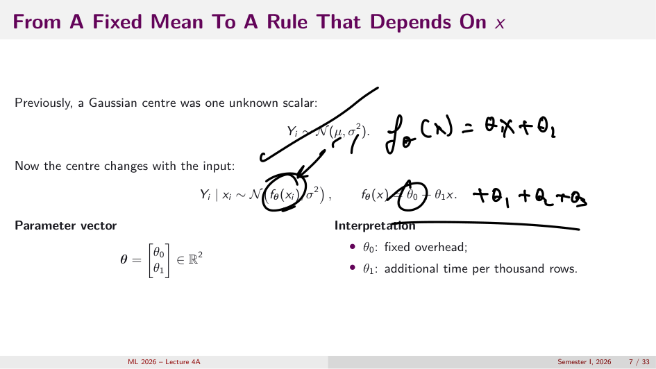
*👀 4A slide 7 — The centre now moves with x: μ becomes θ₀ + θ₁x.*

L3: one unknown centre, $Y_i\sim\mathcal N(\mu,\sigma^2)$. Now the centre moves with the input:
$$Y_i\mid x_i \sim \mathcal N\big(f_\theta(x_i),\ \sigma^2\big),\qquad f_\theta(x) = \theta_0 + \theta_1 x,\qquad \theta = \begin{bmatrix}\theta_0\\\theta_1\end{bmatrix}\in\mathbb R^2.$$

- $\theta_0$: fixed overhead (response time for an empty batch);
- $\theta_1$: extra time per thousand rows.

**Insight:** L3's $\mu$ has become a *function* $f_\theta(x)$. Set $\theta_1 = 0$ and you're back to L3 ($\hat\theta_0 = \bar y$).

## Slide 8 — Five Objects That Must Not Be Confused

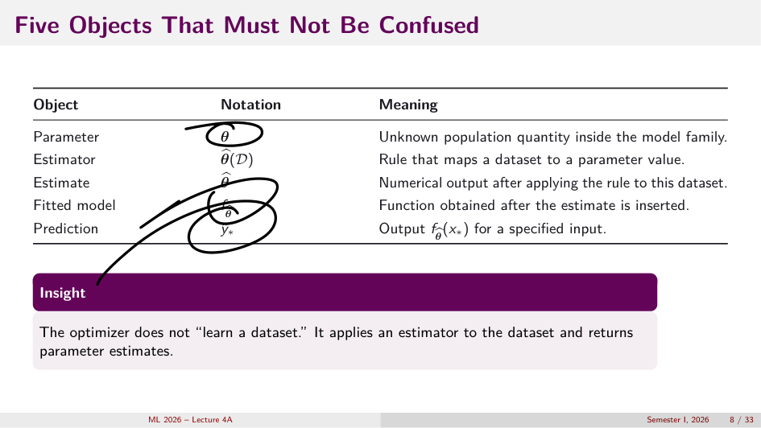
*👀 4A slide 8 — Parameter, estimator, estimate, fitted model, prediction.*

See A2. Filled in on our data (using the answer from slide 25):

| Object | Value |
|---|---|
| parameter $\theta$ | unknown |
| estimator | $\hat\theta(\mathcal D) = (X^\top X)^{-1}X^\top y$ |
| estimate | $\hat\theta = (2.2,\ 2.2)$ |
| fitted model | $f_{\hat\theta}(x) = 2.2 + 2.2x$ |
| prediction at $x_\star = 4$ | $\hat y_\star = 11.0$ ms |

**Insight:** the optimiser applies an estimator to the dataset and returns parameter estimates.

## Slide 9 — A Residual Measures One Miss

Candidate line $f_\theta(x) = 1 + 1.5x$:

| $x_i$ | 0 | 1 | 2 | 3 |
|---|---|---|---|---|
| $y_i$ | 2 | 5 | 6 | 9 |
| $\hat y_i$ | 1 | 2.5 | 4 | 5.5 |
| $r_i = y_i - \hat y_i$ | 1 | 2.5 | 2 | 3.5 |

Residuals keep their sign (here all positive: the line is too low everywhere). A **loss** turns a residual into a non-negative cost. For this line SSE $= 1 + 6.25 + 4 + 12.25 = 23.5$. (The best line, slide 25, gets SSE $= 0.8$.)

## Slide 10 — The Data Do Not Choose The Loss

| Loss | Formula | Emphasises |
|---|---|---|
| squared | $r^2$ | large errors get rapidly increasing cost |
| absolute | $\lvert r\rvert$ | each extra unit costs the same |
| Huber | quadratic then linear | smooth near 0, less sensitive in the tails |
| asymmetric | different cost by sign | under- and over-prediction needn't be equal |

**Q:** is the loss a mathematical convenience, a probabilistic assumption, or a description of real decision cost? **It can be any of the three.** A professional analysis says which one it is using. (E.g. under-predicting flood height costs lives; over-predicting costs money, so asymmetric.)

## Slide 11 — From One Loss To An Objective

$$\hat R_n(\theta) = \frac1n\sum_{i=1}^n\ell(y_i, f_\theta(x_i))\quad(\text{available}),\qquad R(\theta) = \mathbb E_{(X,Y)\sim P}\big[\ell(Y, f_\theta(X))\big]\quad(\text{desired}).$$

The first is computed from observed data; the second is performance on the generating population. (A3)

## Slide 12 — Parameter Fitting Is An Optimization Rule

**ERM:** $\hat\theta\in\arg\min_{\theta\in\Theta}\hat R_n(\theta)$.

model family $f_\theta$ → loss $\ell(y,\hat y)$ → objective $\hat R_n(\theta)$ → estimate $\hat\theta$.

> ⚠️ Model, objective, optimiser and evaluation metric are **different objects**. They may be chosen together, but they're not interchangeable. (E.g. fit by squared error, report RMSE, optimise by normal equations or gradient descent.)

## Slide 13 — Maximum Likelihood Is Also An Optimization Rule

With conditionally independent observations,
$$p(y\mid x,\theta) = \prod_{i=1}^n p(y_i\mid x_i,\theta),\qquad \hat\theta_{\text{MLE}}\in\arg\max_\theta p(y\mid x,\theta) = \arg\min_\theta\big[-\log p(y\mid x,\theta)\big],$$
because $-\log$ is strictly decreasing.

**Insight:** negative log-likelihood is a **loss-generating mechanism**. The assumed distribution decides the loss's shape. (A4)

## Slide 14 — One Gaussian Observation Contains A Square

$$p(y_i\mid x_i,\theta,\sigma^2) = \frac{1}{\sqrt{2\pi\sigma^2}}\exp\Big[-\frac{(y_i - \theta_0 - \theta_1x_i)^2}{2\sigma^2}\Big].$$
The residual $r_i(\theta) = y_i - \theta_0 - \theta_1x_i$ sits **squared in the exponent**. Logs will bring it down.

## Slide 15 — From A Product To A Sum ✍️

$$\log L(\theta) = \log\prod_i p_i(\theta) = \sum_i\log p_i(\theta) = \sum_{i=1}^n\Big[-\tfrac12\log(2\pi\sigma^2) - \frac{r_i(\theta)^2}{2\sigma^2}\Big] = -\frac n2\log(2\pi\sigma^2) - \frac{1}{2\sigma^2}\sum_{i=1}^n r_i(\theta)^2.$$

Identical to L3 slide 16 with $\mu$ replaced by $f_\theta(x_i)$.

## Slide 16 — The Gaussian MLE Becomes Least Squares ✍️

Flip to minimisation: $\arg\max\log L = \arg\min(-\log L)$. With $\sigma^2$ fixed, the terms without $\theta$ form a constant $C$:
$$-\log L(\theta) = C + \frac{1}{2\sigma^2}\sum_{i=1}^n[y_i - f_\theta(x_i)]^2.$$
Drop $C$ and the positive factor $\frac{1}{2\sigma^2}$:
$$\boxed{\hat\theta_{\text{MLE}}\in\arg\min_\theta\sum_{i=1}^n[y_i - f_\theta(x_i)]^2 = \arg\min_\theta\mathrm{SSE}(\theta).}$$

Note $\sigma^2$ doesn't affect $\hat\theta$ at all (as in L3, where $\hat\mu$ didn't depend on $\sigma$).

## Slide 17 — SSE, MSE, And RMSE Fit The Same Parameters

$$\mathrm{SSE} = \sum r_i^2,\qquad \mathrm{MSE} = \tfrac1n\mathrm{SSE},\qquad \mathrm{RMSE} = \sqrt{\mathrm{MSE}}.$$
Multiplying by $1/n > 0$ and taking $\sqrt{\cdot}$ are strictly increasing, so all three have the **same argmin**.

> ⚠️ The fitted parameters agree, but the reported numbers don't. RMSE is in the **units of $y$** (ms); MSE is in ms².

On our data at $\hat\theta$: SSE $= 0.8$, MSE $= 0.2$ ms², RMSE $= 0.447$ ms.

## Slide 18 — Noise And Residual Are Not The Same Object

$$Y_i = f_\theta(x_i) + \varepsilon_i.$$

| Object | Notation | Meaning |
|---|---|---|
| noise / error | $\varepsilon_i$ | random quantity in the data-generating model; never observed |
| residual | $r_i = y_i - f_{\hat\theta}(x_i)$ | a number computed after fitting; depends on data and estimate |

The distributional assumption is made about $\varepsilon_i$, not about residuals.

**Insight:** residual plots are **evidence** for judging whether the assumed noise model is reasonable (board p. 12).

## Slide 19 — The Loss Can Change The Fitted Answer ✍️ (solved)

Fit one constant $a$ to $2, 3, 4, 5, 20$.

- **Squared:** $J_2'(a) = -2\sum(y_i - a) = 0 \Rightarrow a = \bar y = 34/5 = \mathbf{6.8}$.
- **Absolute:** minimiser is the median (A5) $= \mathbf{4}$. Check: at $a = 4$, two points below, two above, so $J_1' = 0$. $J_1(4) = 2+1+0+1+16 = 20$; $J_1(6.8) = 4.8+3.8+2.8+1.8+13.2 = 26.4$.

The **squared** loss is pulled much farther by the outlier 20: without it, the mean would be 3.5; with it, 6.8. The median only moves from 3.5 to 4.

**Why:** in the squared loss the outlier's pull is proportional to its residual ($2r$); in absolute loss every point pulls with strength 1 regardless of distance.

## Slide 20 — Gaussian Noise Produces Squared Loss

$\varepsilon_i\sim\mathcal N(0,\sigma^2)$. Substitute $\varepsilon_i = y_i - f_\theta(x_i)$, take $-\log$, sum:
$$-\log p(y\mid x,\theta) = \frac n2\log(2\pi\sigma^2) + \frac{1}{2\sigma^2}\sum_i[y_i - f_\theta(x_i)]^2 \;\Rightarrow\; \hat\theta_{\text{MLE}}\in\arg\min_\theta\sum_i[y_i - f_\theta(x_i)]^2.$$

## Slide 21 — Laplace Noise Produces Absolute Loss

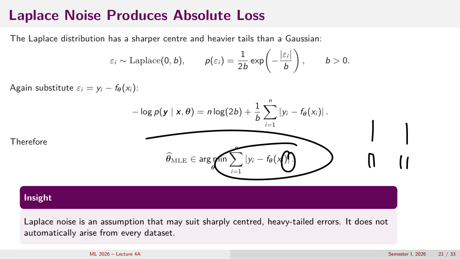
*👀 4A slide 21 — Laplace noise: −log turns |r| into the loss.*

$\varepsilon_i\sim\mathrm{Laplace}(0,b)$, $p(\varepsilon) = \frac{1}{2b}e^{-\lvert\varepsilon\rvert/b}$, $b > 0$. Sharper centre and heavier tails than a Gaussian.
$$-\log p(y\mid x,\theta) = n\log(2b) + \frac1b\sum_i\lvert y_i - f_\theta(x_i)\rvert \;\Rightarrow\; \hat\theta_{\text{MLE}}\in\arg\min_\theta\sum_i\lvert y_i - f_\theta(x_i)\rvert.$$

**Insight:** Laplace noise is an **assumption** that may suit sharply centred, heavy-tailed errors. It doesn't automatically hold for every dataset.

## Slide 22 — So Why Use Squared Error Rather Than Absolute Error?

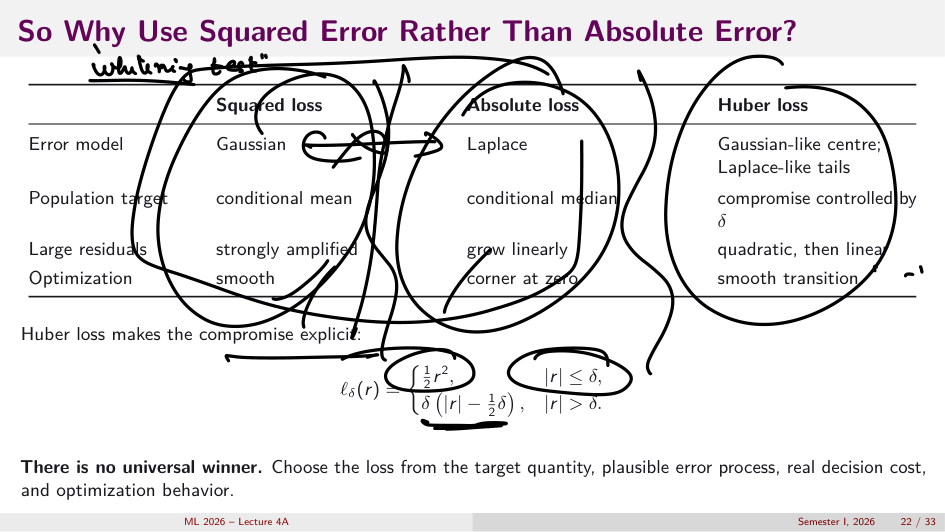
*👀 4A slide 22 — Ink sketches: parabola (squared), V (absolute), Huber (parabola then straight).*

| | Squared | Absolute | Huber |
|---|---|---|---|
| error model | Gaussian | Laplace | Gaussian-like centre, Laplace-like tails |
| population target | conditional **mean** | conditional **median** | compromise set by $\delta$ |
| large residuals | strongly amplified | grow linearly | quadratic, then linear |
| optimisation | smooth; closed form | corner at 0; no closed form | smooth transition |

$$\ell_\delta(r) = \begin{cases}\tfrac12 r^2, & \lvert r\rvert\le\delta\\ \delta\big(\lvert r\rvert - \tfrac12\delta\big), & \lvert r\rvert > \delta\end{cases}$$

**No universal winner.** Choose from: the target quantity, the plausible error process, the real decision cost, and optimisation behaviour.

## Slide 23 — Where Does The Design Matrix X Come From? ✍️ (solved)

![4A slide 23 — Ink: rows of [1 xᵢ] stacked into X; Xθ gives every ŷ at once.](images/L04/slides/4a_s23_design_matrix.png)
*👀 4A slide 23 — Ink: rows of [1 xᵢ] stacked into X; Xθ gives every ŷ at once.*

$$\hat y_i = \theta_0 + \theta_1x_i = \begin{bmatrix}1 & x_i\end{bmatrix}\begin{bmatrix}\theta_0\\\theta_1\end{bmatrix}.$$
The 1 multiplies the intercept; $x_i$ multiplies the slope. Stack the four rows:
$$\underbrace{\begin{bmatrix}1&0\\1&1\\1&2\\1&3\end{bmatrix}}_{X\in\mathbb R^{4\times2}}\underbrace{\begin{bmatrix}\theta_0\\\theta_1\end{bmatrix}}_{\theta\in\mathbb R^{2\times1}} = \underbrace{\begin{bmatrix}\theta_0\\\theta_0+\theta_1\\\theta_0+2\theta_1\\\theta_0+3\theta_1\end{bmatrix}}_{\hat y\in\mathbb R^{4\times1}},\qquad y = \begin{bmatrix}2\\5\\6\\9\end{bmatrix}.$$
Dimensions: $(4\times2)(2\times1) = 4\times1$ ✓, same shape as $y$, so $r = y - X\theta\in\mathbb R^4$ ✓.

## Slide 24 — The Objective Is A Function Of The Parameters

$$\hat y = X\theta,\quad r = y - \hat y,\quad J(\theta) = \tfrac12\lVert X\theta - y\rVert_2^2.$$
Once data are observed, $X$ and $y$ are **fixed**; the variable is $\theta$.

| Input space $x\in\mathbb R$ | Parameter space $\theta\in\mathbb R^2$ |
|---|---|
| the fitted rule is a **line** in $x$ | the objective is a **bowl-shaped surface** over $(\theta_0,\theta_1)$ |

Each *point* in parameter space is a whole *line* in input space.

> ⚠️ This objective is convex **in $\theta$**, with $X$ and $y$ held fixed.

## Slide 25 — Differentiate The Objective: The Normal Equations ✍️ (solved)

**Expand** (A7: $(X\theta)^\top = \theta^\top X^\top$, and $y^\top X\theta = \theta^\top X^\top y$ since it's a scalar):
$$J(\theta) = \tfrac12(X\theta - y)^\top(X\theta - y) = \tfrac12\theta^\top X^\top X\theta - \theta^\top X^\top y + \tfrac12y^\top y.$$

**Differentiate** (A9; $X^\top X$ symmetric): $\nabla J(\theta) = X^\top X\theta - X^\top y = X^\top(X\theta - y)$.

**Set to zero:**
$$\boxed{X^\top X\,\hat\theta = X^\top y}\qquad(\text{the normal equations}).$$
Shapes: $X^\top X$ is $2\times2$, $X^\top y$ is $2\times1$ ✓.

**Numbers:**
$$X^\top X = \begin{bmatrix}n & \sum x_i\\ \sum x_i & \sum x_i^2\end{bmatrix} = \begin{bmatrix}4&6\\6&14\end{bmatrix},\qquad X^\top y = \begin{bmatrix}\sum y_i\\ \sum x_iy_i\end{bmatrix} = \begin{bmatrix}22\\44\end{bmatrix}$$
($\sum x_iy_i = 0 + 5 + 12 + 27 = 44$.) Determinant $= 56 - 36 = 20$:
$$\hat\theta = \frac{1}{20}\begin{bmatrix}14&-6\\-6&4\end{bmatrix}\begin{bmatrix}22\\44\end{bmatrix} = \frac{1}{20}\begin{bmatrix}308 - 264\\-132 + 176\end{bmatrix} = \frac{1}{20}\begin{bmatrix}44\\44\end{bmatrix} = \begin{bmatrix}\mathbf{2.2}\\\mathbf{2.2}\end{bmatrix}.$$

Fitted line $\hat y = 2.2 + 2.2x$: overhead 2.2 ms, plus 2.2 ms per thousand rows.

| $x_i$ | 0 | 1 | 2 | 3 |
|---|---|---|---|---|
| $y_i$ | 2 | 5 | 6 | 9 |
| $\hat y_i$ | 2.2 | 4.4 | 6.6 | 8.8 |
| $r_i$ | −0.2 | 0.6 | −0.6 | 0.2 |

SSE $= 0.04 + 0.36 + 0.36 + 0.04 = 0.8$ (vs 23.5 for the slide-9 guess).

**Scalar form** (same answer): $\hat\theta_1 = \dfrac{\sum(x_i-\bar x)(y_i-\bar y)}{\sum(x_i-\bar x)^2} = \dfrac{(-1.5)(-3.5)+(-0.5)(-0.5)+(0.5)(0.5)+(1.5)(3.5)}{2.25+0.25+0.25+2.25} = \dfrac{11}{5} = 2.2$, $\ \hat\theta_0 = \bar y - \hat\theta_1\bar x = 5.5 - 3.3 = 2.2$.

## Slide 26 — From Parameter Estimate To Projection Matrix ✍️ (solved)

Columns of $X$ linearly independent ⇒ $X^\top X$ invertible:
$$\hat\theta = (X^\top X)^{-1}X^\top y,\qquad \hat y = X\hat\theta = \underbrace{X(X^\top X)^{-1}X^\top}_{P_X}\,y.$$

**Numbers.** Entry $(i,j)$ of $P_X$ is $[1\ x_i]\,(X^\top X)^{-1}[1\ x_j]^\top = \frac{1}{20}(14 - 6x_i - 6x_j + 4x_ix_j)$:
$$P_X = \begin{bmatrix}0.7&0.4&0.1&-0.2\\0.4&0.3&0.2&0.1\\0.1&0.2&0.3&0.4\\-0.2&0.1&0.4&0.7\end{bmatrix}.$$
Check: row 1 times $y$ = $1.4 + 2.0 + 0.6 - 1.8 = 2.2 = \hat y_1$ ✓. Symmetric ✓. Trace $= 0.7+0.3+0.3+0.7 = 2 = \mathrm{rank}(X)$ ✓.

$P_X$ depends only on $X$ (the inputs), not on $y$: it's a fixed machine that turns any response vector into its fitted values.

## Slide 27 — Why $P_X$ Is A Projector

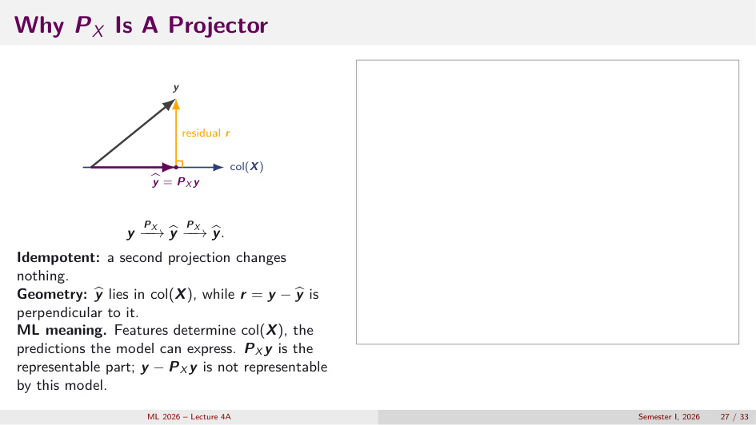
*👀 4A slide 27 — y splits into ŷ in Col(X) plus a perpendicular residual.*

$y \xrightarrow{P_X} \hat y \xrightarrow{P_X} \hat y$.

- **Idempotent:** a second projection changes nothing: $P_X^2 = X(X^\top X)^{-1}\underbrace{X^\top X(X^\top X)^{-1}}_{I}X^\top = P_X$.
- **Geometry:** $\hat y$ lies in $\mathrm{Col}(X)$; $r = y - \hat y$ is perpendicular to it.
- **ML meaning:** the features determine $\mathrm{Col}(X)$, the predictions the model can express. $P_Xy$ is the **representable** part of $y$; $y - P_Xy$ is what this model **cannot represent**.

## Slide 28 — The Geometry Behind Least Squares

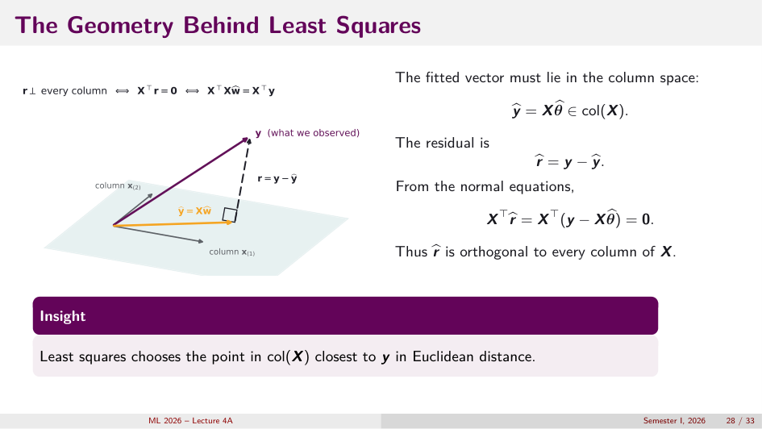
*👀 4A slide 28 — The plane is Col(X); the residual is perpendicular to it.*

$\hat y = X\hat\theta\in\mathrm{Col}(X)$ and $\hat r = y - \hat y$. From the normal equations:
$$X^\top\hat r = X^\top(y - X\hat\theta) = X^\top y - X^\top X\hat\theta = 0.$$
So $\hat r$ is orthogonal to **every column** of $X$.

**Check on our data:** column of 1s: $\sum\hat r_i = -0.2 + 0.6 - 0.6 + 0.2 = 0$ ✓. Column $x$: $\sum x_i\hat r_i = 0 + 0.6 - 1.2 + 0.6 = 0$ ✓.

(Consequence: with an intercept, **residuals always sum to zero**, and the fitted line passes through $(\bar x,\bar y) = (1.5, 5.5)$: $2.2 + 2.2\times1.5 = 5.5$ ✓.)

**Insight:** least squares picks the point in $\mathrm{Col}(X)$ **closest to $y$** in Euclidean distance.

## Slide 29 — Test Convexity In θ ✍️ (solved)

$\nabla_\theta J = X^\top(X\theta - y)$. Differentiate again: $\nabla^2_\theta J = X^\top X$ (constant: doesn't depend on $\theta$).

**Test with an arbitrary $v$:**
$$v^\top(X^\top X)v = (Xv)^\top(Xv) = \lVert Xv\rVert_2^2 \ge 0.$$
So the Hessian is PSD, and $J$ is **convex in $\theta$**, for any data. (A10)

**Our data:** $X^\top X = \begin{bmatrix}4&6\\6&14\end{bmatrix}$ has trace 18 and determinant 20, so eigenvalues $9\pm\sqrt{61}\approx 16.8,\ 1.19$: both positive ⇒ **positive definite** ⇒ strictly convex ⇒ $\hat\theta = (2.2, 2.2)$ is the **unique** minimiser.

## Slide 30 — Matrix Rank Counts Independent Column Directions ✍️ (solved)

$\mathrm{rank}(X) = \dim(\mathrm{Col}(X))$.

$$X_A = \begin{bmatrix}1&0\\1&1\\1&2\\1&3\end{bmatrix}:\ \text{rank } 2,\qquad X_B = \begin{bmatrix}1&1\\2&2\end{bmatrix}:\ \text{rank } 1.$$
- $X_A$: is $(0,1,2,3) = c\,(1,1,1,1)$ for some $c$? First entry forces $c = 0$, then the second fails. Independent ⇒ rank 2 (full column rank).
- $X_B$: second column = first column ⇒ only one direction ⇒ rank 1 $< 2$. Also $\det X_B = 2 - 2 = 0$.

## Slide 31 — A Convex Objective Can Have A Flat Valley ✍️ (solved)

$X = \begin{bmatrix}1&1\\2&2\end{bmatrix}$, $y = \begin{bmatrix}1\\2\end{bmatrix}$. With $s = \theta_1 + \theta_2$:
$$X\theta = \begin{bmatrix}\theta_1+\theta_2\\2\theta_1+2\theta_2\end{bmatrix} = \begin{bmatrix}s\\2s\end{bmatrix},\qquad J(\theta) = \tfrac12\big[(s-1)^2 + (2s-2)^2\big] = \tfrac52(s-1)^2.$$

$J$ depends on $\theta$ **only through $s$**. Minimum $J = 0$ at $s = 1$:
$$\text{every minimiser: } \{\theta : \theta_1 + \theta_2 = 1\} = \{(t,\ 1-t): t\in\mathbb R\}.$$
A whole line of minimisers: $(1,0)$, $(0,1)$, $(0.5,0.5)$, $(100,-99)$… all fit perfectly. Moving along $v = (1,-1)$ changes nothing, because $Xv = 0$.

Normal equations confirm: $X^\top X = \begin{bmatrix}5&5\\5&5\end{bmatrix}$ (singular), $X^\top y = \begin{bmatrix}5\\5\end{bmatrix}$, giving the single equation $5\theta_1 + 5\theta_2 = 5$.

**Insight:** convex ≠ unique. The bowl is a **trough**. (This is what perfectly correlated features do; ridge regression, L7, adds $\lambda\lVert\theta\rVert^2$ to pick the smallest-norm point $(0.5, 0.5)$.)

## Slide 32 — Why Matrix Rank Controls Uniqueness

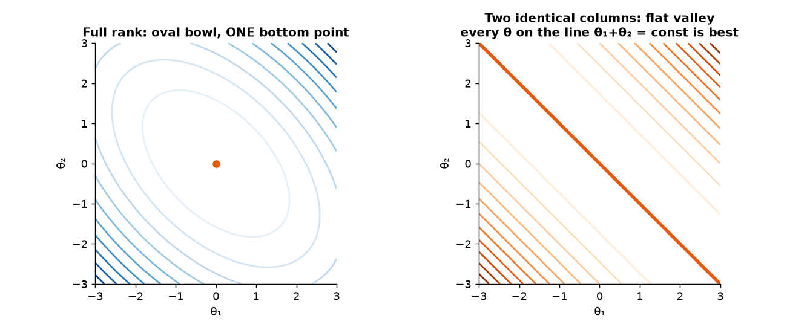
*📊 Full rank gives one lowest point; two identical columns give a whole line of equally good θ.*

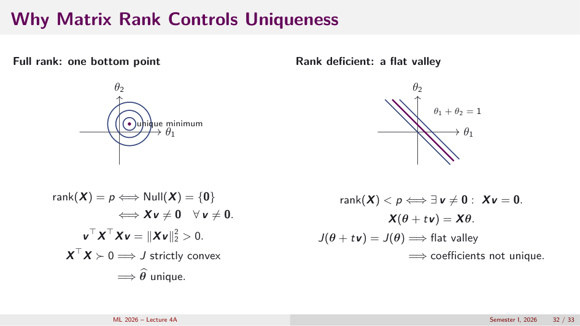
*👀 4A slide 32 — Left: rings around one point. Right: parallel lines, a flat valley.*

| Full rank: one bottom point | Rank deficient: a flat valley |
|---|---|
| $\mathrm{rank}(X) = p \iff \mathrm{Null}(X) = \{0\}$ | $\mathrm{rank}(X) < p \iff \exists v\ne0: Xv = 0$ |
| $\iff Xv \ne 0$ for all $v\ne0$ | $X(\theta + tv) = X\theta$ for all $t$ |
| $\Rightarrow v^\top X^\top Xv = \lVert Xv\rVert^2 > 0$ | $\Rightarrow J(\theta + tv) = J(\theta)$: flat valley |
| $X^\top X\succ0 \Rightarrow J$ strictly convex $\Rightarrow\hat\theta$ unique | coefficients **not** unique |

Note: even when $\hat\theta$ isn't unique, the **fitted values $\hat y$ are** (the projection of $y$ onto $\mathrm{Col}(X)$ is one point). Predictions are identifiable; individual coefficients aren't.

## Slide 33 — Linear Regression I: The Complete Chain

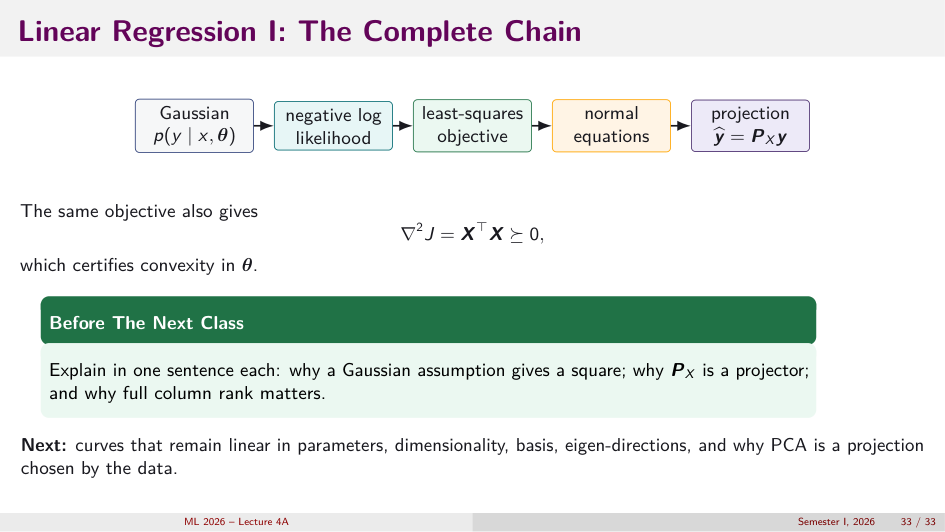
*👀 4A slide 33 — Gaussian → −log likelihood → least squares → normal equations → projection.*

Gaussian $p(y\mid x,\theta)$ → negative log-likelihood → least-squares objective → normal equations → projection $\hat y = P_Xy$.

The same objective gives $\nabla^2J = X^\top X\succeq0$, which **certifies convexity in $\theta$**.

**Before next class — one sentence each (solved):**
- **Why a Gaussian gives a square:** the Gaussian density has the residual squared in its exponent, and $-\log$ brings that exponent down as $r^2/2\sigma^2$.
- **Why $P_X$ is a projector:** $P_X^2 = P_X$ (and $P_X^\top = P_X$), so it sends $y$ to the nearest point of $\mathrm{Col}(X)$ and leaves points already there unchanged.
- **Why full column rank matters:** it makes $X^\top X$ invertible (positive definite), so the bowl has a single bottom point and $\hat\theta$ is unique.

**Next:** curves still linear in parameters, dimensionality, basis, eigen-directions, and why PCA is a projection chosen by the data.

---

# Part B2 — Lecture 4B Slide by Slide (all 24 slides)

4B is a **solved classroom copy**: it redoes the fit through the *algebraic* and *geometric* routes (probability and optimisation routes continue next class). Companion lab: `ml2026.floodresq.com/explore/linear-regression`.

**Running dataset for 4B:** $x = (0,1,2)$, $y = (1,2,2)$, $\phi(x) = [1, x]^\top$.

## Slide 1 — Title

*Lecture 4B: Solved Classroom Copy Through Projection.*

## Slide 2 — Course Roadmap

Covered: basis functions, design matrix, least squares, normal equations, perpendicular residuals, projection matrix.

## Slide 3 — Where Lecture 4A Stopped

$$\hat y_i = f_\theta(x_i),\quad r_i(\theta) = y_i - \hat y_i,\quad \hat\theta = \arg\min_\theta\sum_{i=1}^n\ell(r_i(\theta)).$$

**Question left in the room:** if the errors aren't normal, what objective should we use? Answer: the negative log of whatever the error density is (slides 5–6).

## Slide 4 — Learning Objectives

- map an error density to a loss via negative log-likelihood;
- build a design matrix from basis functions;
- write least squares as a nearest-point problem in $\mathrm{Col}(X)$;
- derive the normal equations and explain why the residual is perpendicular to the model space;
- read $P_Xy$ and $(I - P_X)y$ as the representable and unrepresentable parts of $y$.

## Slide 5 — A Translation Connects Response And Error Densities

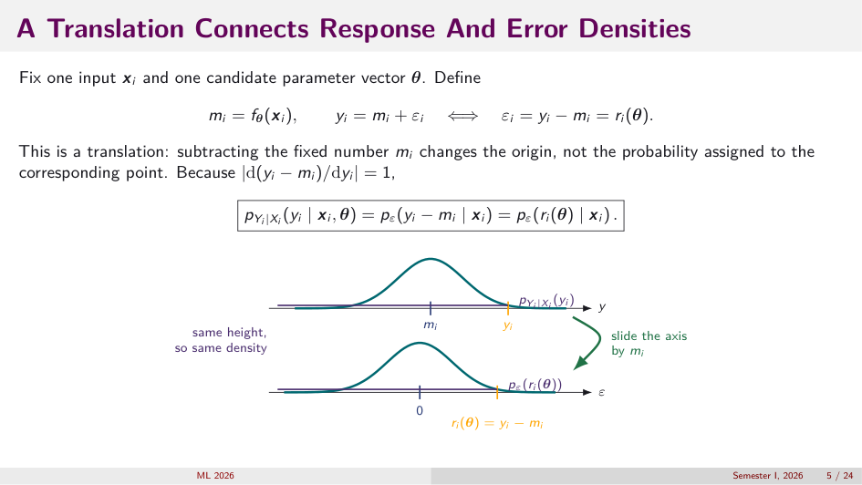
*👀 4B slide 5 — Sliding the noise bell by fθ(x) gives the density of y.*

Fix $x_i$ and a candidate $\theta$. Let $m_i = f_\theta(x_i)$. Then
$$y_i = m_i + \varepsilon_i \iff \varepsilon_i = y_i - m_i = r_i(\theta).$$
Subtracting a fixed number shifts the origin; it doesn't change heights. The Jacobian $\lvert d(y_i - m_i)/dy_i\rvert = 1$, so
$$p_{Y_i\mid X_i}(y_i\mid x_i,\theta) = p_\varepsilon(r_i(\theta)\mid x_i).$$
**Picture:** the response density centred at $m_i$, slid left by $m_i$, is the error density centred at 0. Same height at $y_i$ and at $r_i$.

## Slide 6 — From One Residual Density To A Loss

$$p(y\mid X,\theta) = \prod_{i=1}^n p_\varepsilon(r_i(\theta)\mid x_i)\;\Rightarrow\;\hat\theta_{\text{MLE}} = \arg\min_\theta\sum_{i=1}^n\underbrace{-\log p_\varepsilon(r_i(\theta)\mid x_i)}_{\ell_i(\theta)}.$$

**Summary:** the error model chooses the likelihood-shaped loss. (A4)

## Slide 7 — Three Residual Penalties, One Model

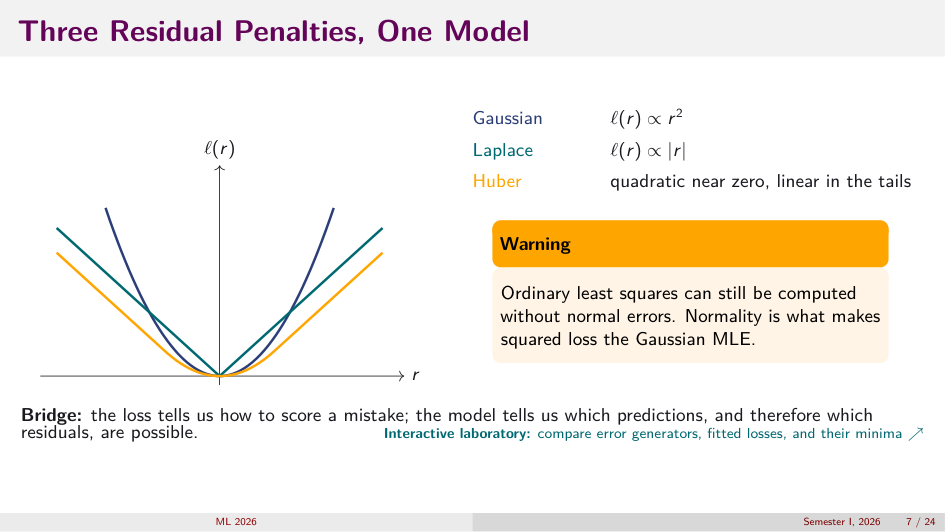
*👀 4B slide 7 — Gaussian (parabola), Laplace (V), Huber (both).*

Plot of $\ell(r)$: Gaussian $\propto r^2$ (parabola), Laplace $\propto\lvert r\rvert$ (V shape), Huber (parabola near 0, straight lines in the tails).

> ⚠️ OLS can still be **computed** without normal errors (it's just a minimisation). Normality is what makes squared loss **the Gaussian MLE**.

**Bridge:** the loss says how to score a mistake; the model says which predictions, and so which residuals, are possible.

## Slide 8 — What "Linear Model" Means Here

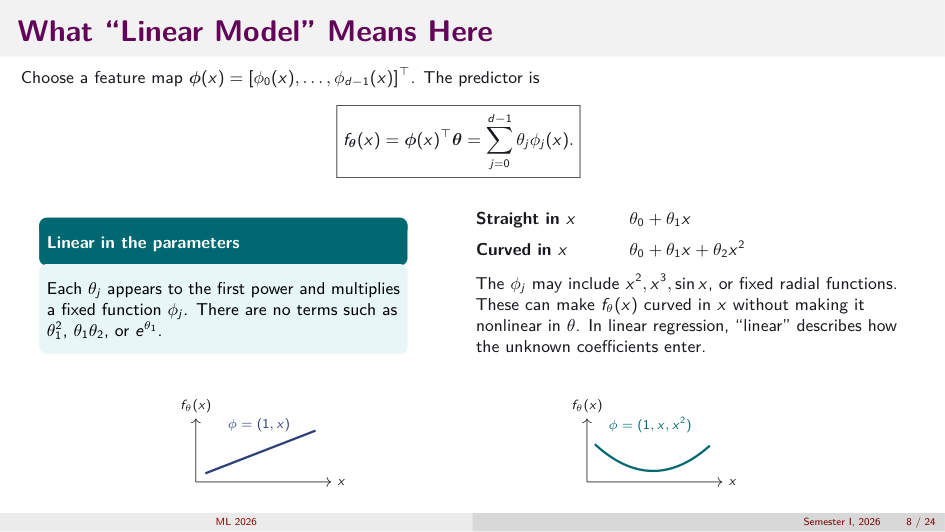
*👀 4B slide 8 — 'Linear' = linear in θ; the right plot is a curve in x yet still linear regression.*

$$f_\theta(x) = \phi(x)^\top\theta = \sum_{j=0}^{d-1}\theta_j\phi_j(x).$$

**Linear in the parameters:** each $\theta_j$ appears to the first power and multiplies a fixed function $\phi_j$. No $\theta_1^2$, $\theta_1\theta_2$, $e^{\theta_1}$.

| Features | Model | Shape in $x$ |
|---|---|---|
| $\phi = (1, x)$ | $\theta_0 + \theta_1x$ | straight |
| $\phi = (1, x, x^2)$ | $\theta_0 + \theta_1x + \theta_2x^2$ | curved |

$\phi_j$ may be $x^2$, $x^3$, $\sin x$, fixed radial bumps… "Linear" describes how the **unknown coefficients** enter.

## Slide 9 — Stack The Rows: The Design Matrix Appears

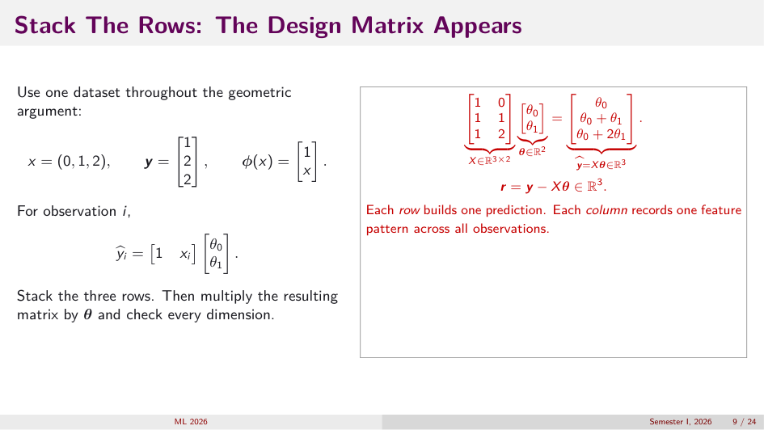
*👀 4B slide 9 — Each row is one observation; each column one feature.*

$$\underbrace{\begin{bmatrix}1&0\\1&1\\1&2\end{bmatrix}}_{X\in\mathbb R^{3\times2}}\underbrace{\begin{bmatrix}\theta_0\\\theta_1\end{bmatrix}}_{\theta\in\mathbb R^2} = \underbrace{\begin{bmatrix}\theta_0\\\theta_0+\theta_1\\\theta_0+2\theta_1\end{bmatrix}}_{\hat y = X\theta\in\mathbb R^3},\qquad r = y - X\theta\in\mathbb R^3.$$
Each **row** builds one prediction; each **column** records one feature pattern across all observations.

## Slide 10 — What Does "Span" Mean?

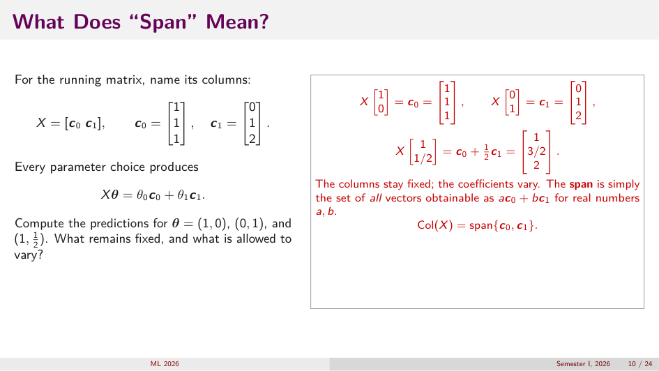
*👀 4B slide 10 — Span = everything you can build from the columns.*

$X = [c_0\ c_1]$, $c_0 = (1,1,1)$, $c_1 = (0,1,2)$, and $X\theta = \theta_0c_0 + \theta_1c_1$.

| $\theta$ | $X\theta$ |
|---|---|
| $(1, 0)$ | $c_0 = (1,1,1)$ |
| $(0, 1)$ | $c_1 = (0,1,2)$ |
| $(1, \tfrac12)$ | $c_0 + \tfrac12c_1 = (1,\ 1.5,\ 2)$ |

The columns stay fixed; the coefficients vary. **Span** = all $a\,c_0 + b\,c_1$. $\mathrm{Col}(X) = \mathrm{span}\{c_0,c_1\}$: a 2-D plane through the origin inside $\mathbb R^3$.

## Slide 11 — From Span To A Fitting Problem

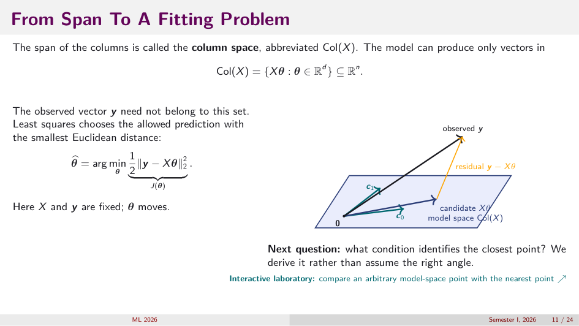
*👀 4B slide 11 — y sits off the plane; the fit is the closest point on it.*

$\mathrm{Col}(X) = \{X\theta:\theta\in\mathbb R^d\}\subseteq\mathbb R^n$. The observed $y$ needn't lie in it. (Here: is $(1,2,2) = a(1,1,1) + b(0,1,2)$? First entry: $a = 1$. Second: $b = 1$. Third: $1 + 2 = 3 \ne 2$. **No.**)

So least squares picks the allowed prediction nearest to $y$:
$$\hat\theta = \arg\min_\theta\underbrace{\tfrac12\lVert y - X\theta\rVert_2^2}_{J(\theta)},\qquad X,y\text{ fixed};\ \theta\text{ moves}.$$
Next: derive (not assume) the right angle that identifies the closest point.

## Slide 12 — What Exactly Is Least Squares Minimizing?

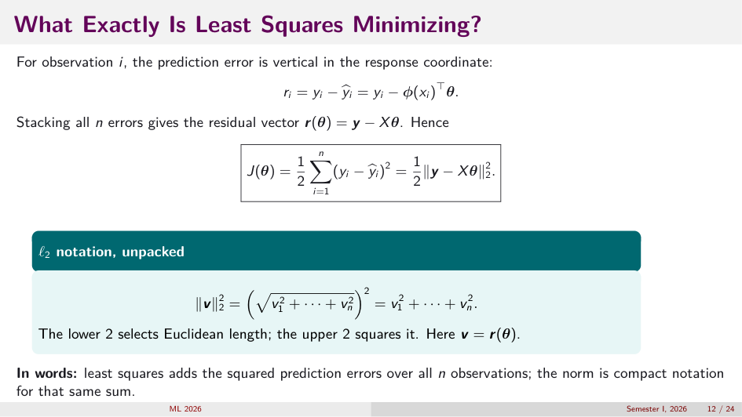
*👀 4B slide 12 — The sum of squared residuals is a squared length ‖r‖².*

$r_i = y_i - \phi(x_i)^\top\theta$ is the **vertical** error in the response coordinate. Stacked: $r(\theta) = y - X\theta$, and
$$J(\theta) = \tfrac12\sum_{i=1}^n(y_i - \hat y_i)^2 = \tfrac12\lVert y - X\theta\rVert_2^2,\qquad \lVert v\rVert_2^2 = \Big(\sqrt{v_1^2+\cdots+v_n^2}\Big)^2 = v_1^2+\cdots+v_n^2.$$
The norm is just compact notation for the sum of squared errors.

## Slide 13 — From Least Squares To A Nearest-Point Problem

Every possible fitted vector is $z = X\theta\in\mathrm{Col}(X)$, so
$$\hat y = \arg\min_{z\in\mathrm{Col}(X)}\lVert y - z\rVert_2^2.$$
Among all prediction vectors the model can produce, choose the one closest to $y$.

> ⚠️ We square the **vertical** response errors, not each point's perpendicular distance to the plotted line (that would be total least squares / PCA, L5). The "perpendicular" in least squares lives in $n$-dimensional **observation space**, not in the $x$–$y$ scatter plot.

## Slide 14 — Why Least Squares Leaves A Perpendicular Residual

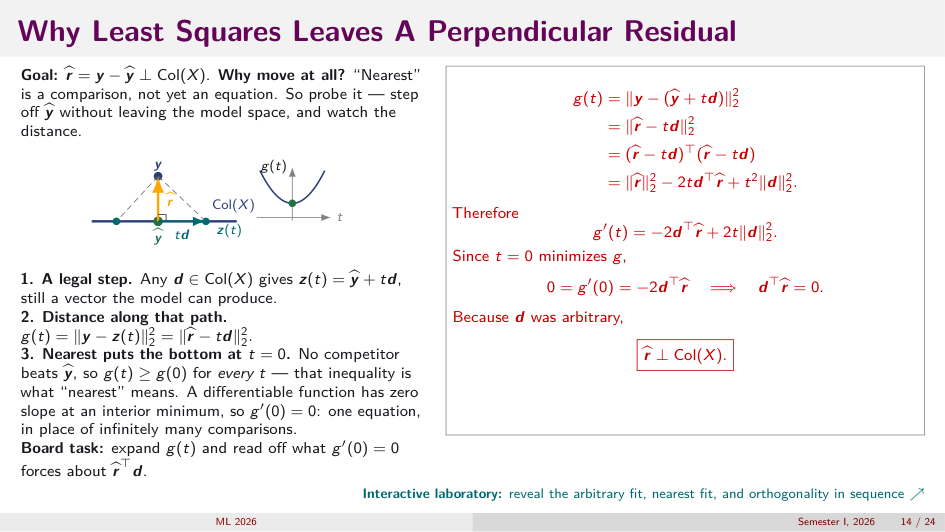
*👀 4B slide 14 — Any other point on the plane is farther (Pythagoras).*

Goal: $\hat r = y - \hat y\perp\mathrm{Col}(X)$. "Nearest" is a comparison, not yet an equation, so probe it:

1. **A legal step:** for any $d\in\mathrm{Col}(X)$, $z(t) = \hat y + td$ is still producible by the model.
2. **Distance along the path:** $g(t) = \lVert y - z(t)\rVert^2 = \lVert\hat r - td\rVert^2$.
3. **Nearest ⇒ bottom at $t = 0$:** $g(t)\ge g(0)$ for all $t$, so $g'(0) = 0$. One equation instead of infinitely many comparisons.

**Expand:**
$$g(t) = (\hat r - td)^\top(\hat r - td) = \lVert\hat r\rVert^2 - 2t\,d^\top\hat r + t^2\lVert d\rVert^2,\qquad g'(t) = -2d^\top\hat r + 2t\lVert d\rVert^2.$$
$$0 = g'(0) = -2d^\top\hat r\;\Rightarrow\;d^\top\hat r = 0.$$
Since $d$ was any vector in $\mathrm{Col}(X)$: $\hat r\perp\mathrm{Col}(X)$.

## Slide 15 — Route 1: Algebra Solves The Normal Equations

1. Expand: $J(\theta) = \tfrac12y^\top y - \theta^\top X^\top y + \tfrac12\theta^\top X^\top X\theta$.
2. Differentiate: $\nabla J(\theta) = X^\top(X\theta - y)$.
3. Set to zero: $X^\top X\hat\theta = X^\top y$.
4. Name: the **normal equations**. Gradient and both sides are in $\mathbb R^d$.

**Numbers on the 4B data** (not on the slide, worked here):
$$X^\top X = \begin{bmatrix}3&3\\3&5\end{bmatrix},\quad X^\top y = \begin{bmatrix}5\\6\end{bmatrix},\quad \det = 6,\quad \hat\theta = \frac16\begin{bmatrix}5&-3\\-3&3\end{bmatrix}\begin{bmatrix}5\\6\end{bmatrix} = \frac16\begin{bmatrix}7\\3\end{bmatrix} = \begin{bmatrix}7/6\\1/2\end{bmatrix}.$$
$\hat y = (7/6,\ 5/3,\ 13/6)$, $\hat r = (-1/6,\ 1/3,\ -1/6)$. Check $X^\top\hat r$: $-\tfrac16 + \tfrac13 - \tfrac16 = 0$ ✓ and $0 + \tfrac13 - \tfrac13 = 0$ ✓. SSE $= \lVert\hat r\rVert^2 = \tfrac{1+4+1}{36} = \tfrac16$.

## Slide 16 — Route 2: Geometry Gives The Nearest Point

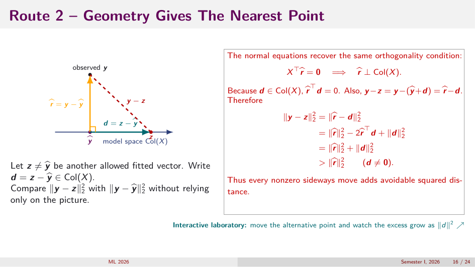
*👀 4B slide 16 — Route 2: drop a perpendicular, no calculus needed.*

Let $z\ne\hat y$ be any other allowed fit, $d = z - \hat y\in\mathrm{Col}(X)$. From the normal equations $X^\top\hat r = 0$, so $\hat r^\top d = 0$. And $y - z = \hat r - d$:
$$\lVert y - z\rVert^2 = \lVert\hat r\rVert^2 - 2\hat r^\top d + \lVert d\rVert^2 = \lVert\hat r\rVert^2 + \lVert d\rVert^2 > \lVert\hat r\rVert^2\quad(d\ne0).$$
**Every nonzero sideways move adds exactly $\lVert d\rVert^2$ of avoidable squared distance** (Pythagoras). So $\hat y$ is *the* nearest point, and it's unique.

Slide 14 showed nearest ⇒ perpendicular; this slide shows perpendicular ⇒ nearest.

## Slide 17 — From The Parameter Estimate To The Projection Matrix

$X^\top X$ invertible (independent columns):
$$\hat\theta = (X^\top X)^{-1}X^\top y,\qquad \hat y = X(X^\top X)^{-1}X^\top y = P_Xy,\qquad P_X = X(X^\top X)^{-1}X^\top.$$
$P_X$ is the orthogonal projection onto $\mathrm{Col}(X)$.

**Numbers:** entry $(i,j) = \frac16(5 - 3x_i - 3x_j + 3x_ix_j)$:
$$P_X = \frac16\begin{bmatrix}5&2&-1\\2&2&2\\-1&2&5\end{bmatrix},\qquad P_Xy = \frac16\begin{bmatrix}5+4-2\\2+4+4\\-1+4+10\end{bmatrix} = \begin{bmatrix}7/6\\5/3\\13/6\end{bmatrix} = \hat y\ ✓.$$

## Slide 18 — Why $P_X$ Is A Projector

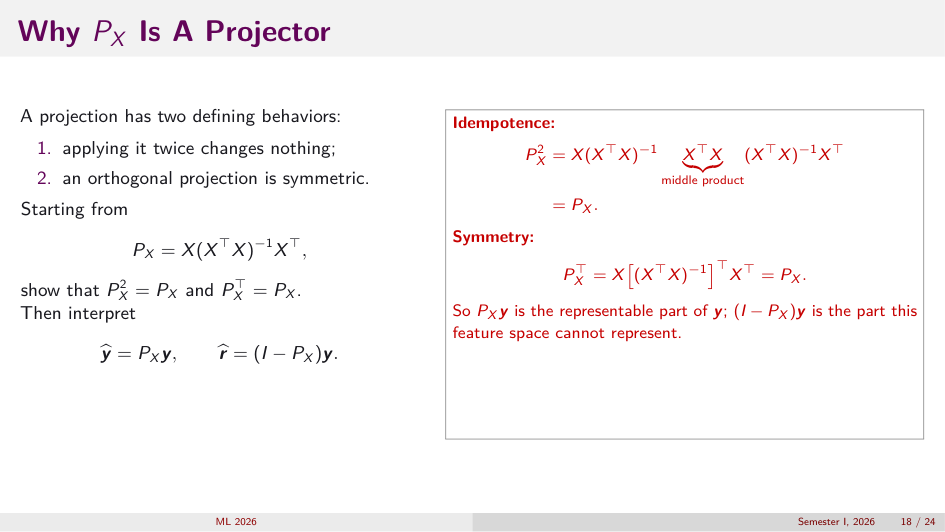
*👀 4B slide 18 — P² = P (projecting twice changes nothing) and Pᵀ = P.*

**Idempotence:**
$$P_X^2 = X(X^\top X)^{-1}\underbrace{X^\top X(X^\top X)^{-1}}_{=I}X^\top = P_X.$$
**Symmetry:** $P_X^\top = (X^\top)^\top\big[(X^\top X)^{-1}\big]^\top X^\top = X(X^\top X)^{-1}X^\top = P_X$ (the inverse of a symmetric matrix is symmetric).

$$\hat y = P_Xy\ (\text{representable part}),\qquad \hat r = (I - P_X)y\ (\text{what this feature space can't represent}).$$

**Numbers:** $I - P_X = \frac16\begin{bmatrix}1&-2&1\\-2&4&-2\\1&-2&1\end{bmatrix} = \frac16uu^\top$ with $u = (1,-2,1)$. $u$ is perpendicular to both $c_0$ ($1-2+1 = 0$) and $c_1$ ($0-2+2 = 0$): it's the one direction in $\mathbb R^3$ the model can't reach. $(I-P_X)y = \frac16(u^\top y)\,u = \frac{-1}{6}(1,-2,1) = \hat r$ ✓.

## Slide 19 — Class Question 1: Where Does d Come From?

1. Chosen fit and any competitor: $\hat y = X\hat\theta$, $z = X\theta'$. Both in $\mathrm{Col}(X)$.
2. Subtract: $d := z - \hat y = X(\theta' - \hat\theta)\in\mathrm{Col}(X)$, and $z = \hat y + d$.
3. Introduce a scalar only to move along it: $z(t) = \hat y + td$, $z(0) = \hat y$, $z(1) = z$.

$d$ is **not** a new model parameter. It's just "competitor minus chosen fit" in observation space.

## Slide 20 — Class Question 1: Which Residual Depends On d?

- Base-point residual $\hat r := y - \hat y$: fixed once $\hat y$ is chosen.
- Moving residual: $r(t;d) := y - z(t) = (y - \hat y) - td = \hat r - td$.

The moving residual depends on $t$ and $d$; at $t = 0$, $r(0;d) = \hat r$ for every direction.

## Slide 21 — Class Question 1: Differentiate Along That Direction

$$g(t) := \tfrac12\lVert\hat r - td\rVert^2 = \tfrac12\hat r^\top\hat r - t\,\hat r^\top d + \tfrac12t^2d^\top d,\qquad g'(t) = -\hat r^\top d + t\,d^\top d.$$
$$g'(0) = -\hat r^\top d = 0\quad\text{for every } d\in\mathrm{Col}(X)\;\Rightarrow\;\hat r\perp\mathrm{Col}(X).$$
$d$ is held fixed while differentiating in $t$; that's why it remains in the derivative. (Same as slide 14, with a ½.)

## Slide 22 — Class Question 2: Expand The Transpose Before Differentiating

1. Transpose: $(y - X\theta)^\top = y^\top - \theta^\top X^\top$.
2. Multiply in order: $J = \tfrac12(y^\top y - y^\top X\theta - \theta^\top X^\top y + \theta^\top X^\top X\theta)$.
3. $y^\top X\theta$ is $1\times1$, so it equals its transpose $\theta^\top X^\top y$. Combine:
$$J(\theta) = \tfrac12y^\top y - \theta^\top X^\top y + \tfrac12\theta^\top(X^\top X)\theta.$$

## Slide 23 — Class Question 2: Derive The Quadratic Rule

$A = X^\top X$, $q(\theta) = \tfrac12\theta^\top A\theta = \tfrac12\sum_j\sum_k\theta_jA_{jk}\theta_k$.
$$\frac{\partial q}{\partial\theta_m} = \tfrac12\sum_kA_{mk}\theta_k + \tfrac12\sum_j\theta_jA_{jm} = \Big[\tfrac12(A + A^\top)\theta\Big]_m\;\Rightarrow\;\nabla_\theta q = \tfrac12(A + A^\top)\theta = A\theta\ (A\text{ symmetric}).$$
With $\nabla_\theta(\theta^\top X^\top y) = X^\top y$:
$$\nabla_\theta J = -X^\top y + X^\top X\theta = X^\top(X\theta - y).$$

## Slide 24 — Class Question 2: Check The Answer With Differentials

$r = y - X\theta$, $J = \tfrac12r^\top r$, $dr = -X\,d\theta$.
$$dJ = \tfrac12\big[(dr)^\top r + r^\top dr\big] = r^\top dr = -r^\top X\,d\theta = (-X^\top r)^\top d\theta.$$
Since $dJ = (\nabla_\theta J)^\top d\theta$: $\nabla_\theta J = -X^\top r = X^\top(X\theta - y)$ ✓.

**Dimension check:** $X^\top\in\mathbb R^{d\times n}$, $r\in\mathbb R^n$ ⇒ $X^\top r\in\mathbb R^d$, matching $\theta\in\mathbb R^d$.

---

# Part C — Practice

1. For the 4A data, compute the SSE of the line $\hat y = 2 + 2x$. Is it more or less than 0.8? Why must it be?
2. A model predicts $\hat y = (3, 5, 7)$ for $y = (4, 4, 9)$. Compute SSE, MSE, RMSE. Which one is in the units of $y$?
3. Fit a constant $a$ to $1, 2, 2, 3, 12$ under squared and under absolute loss. Which is pulled by the 12?
4. Fit a constant to $2, 3, 4, 5, 20$ under Huber loss with $\delta = 1$ and with $\delta = 3$. (Hint: the minimiser solves $\sum_i\psi(y_i - a) = 0$ where $\psi(r) = r$ for $\lvert r\rvert\le\delta$ and $\pm\delta$ otherwise.)
5. Errors follow $p(\varepsilon)\propto e^{-\varepsilon^4}$. What loss does MLE give? Would it be more or less sensitive to outliers than squared loss?
6. Is each model linear regression? (a) $\theta_0 + \theta_1\sin x$ (b) $\theta_0 + e^{\theta_1x}$ (c) $\theta_0 + \theta_1x + \theta_2x\log x$ (d) $\theta_0\theta_1 x$.
7. Write $X$ for a quadratic fit $\phi = (1, x, x^2)$ at $x = (-1, 0, 1, 2)$. What's its shape? Its rank?
8. Fit a line through the origin, $\hat y = \theta x$, by least squares. Derive $\hat\theta$ in scalar form. Evaluate it on the 4A data.
9. For the 4B data, verify $P_X^2 = P_X$ by multiplying out row 1 of $P_X$ times column 1 of $P_X$.
10. Show that if $X$ has a column of ones, the least-squares residuals sum to zero.
11. $X = \begin{bmatrix}1&2\\1&2\\1&2\end{bmatrix}$. Rank? Is the least-squares $\hat\theta$ unique? Is $\hat y$ unique?
12. A colleague says "least squares is convex, so the coefficients are unique." Correct them in one sentence.
13. Why is $\mathrm{trace}(P_X) = d$? (Hint: $\mathrm{trace}(AB) = \mathrm{trace}(BA)$.)
14. Explain the difference between $\varepsilon_i$ and $\hat r_i$. Can $\sum\hat r_i = 0$ while $\sum\varepsilon_i\ne0$?

<b>Answers</b>

1. $\hat y = (2, 4, 6, 8)$, $r = (0, 1, 0, 1)$, SSE $= 2 > 0.8$. It must be ≥ 0.8 because $(2.2, 2.2)$ is the unique minimiser of SSE.
2. $r = (1, -1, 2)$. SSE $= 6$, MSE $= 2$, RMSE $= \sqrt2\approx1.41$. RMSE is in the units of $y$.
3. Squared: mean $= 20/5 = 4$. Absolute: median $= 2$. The mean is pulled by the 12 (without it, both would be 2).
4. $\delta = 1$: at $a = 4$, residuals $(-2,-1,0,1,16)$, $\psi = (-1,-1,0,1,1)$, sum 0, so $a = 4$. $\delta = 3$: try $a = 4.25$: residuals $(-2.25,-1.25,-0.25,0.75,15.75)$, $\psi = (-2.25,-1.25,-0.25,0.75,3)$, sum $= 0$, so $a = 4.25$. As $\delta$ grows Huber moves toward the mean (6.8); as $\delta\to0$ toward the median (4).
5. $-\log p = \varepsilon^4 + $ const, so loss $r^4$. **More** sensitive to outliers: a residual of 10 costs 10 000.
6. (a) yes ($\phi = (1,\sin x)$). (b) no ($\theta_1$ inside an exponential). (c) yes ($\phi = (1, x, x\log x)$). (d) no as written ($\theta_0\theta_1$ is a product of parameters); it's equivalent to the linear $\beta x$ with $\beta = \theta_0\theta_1$, but then $\theta_0,\theta_1$ themselves aren't identifiable.
7. $X = \begin{bmatrix}1&-1&1\\1&0&0\\1&1&1\\1&2&4\end{bmatrix}$, $4\times3$, rank 3 (four distinct $x$'s ≥ 3 parameters, so the columns are independent).
8. $J = \tfrac12\sum(y_i - \theta x_i)^2$, $J' = -\sum x_i(y_i - \theta x_i) = 0 \Rightarrow \hat\theta = \dfrac{\sum x_iy_i}{\sum x_i^2}$. On 4A: $44/14 = 3.14$. (Steeper than 2.2 because, without an intercept, the line must pass through the origin.)
9. Row 1 $\cdot$ column 1 $= \tfrac1{36}(5\cdot5 + 2\cdot2 + (-1)(-1)) = \tfrac{30}{36} = \tfrac56 = (P_X)_{11}$ ✓.
10. Normal equations ⇒ $X^\top\hat r = 0$. The row of $X^\top$ corresponding to the ones column gives $\mathbf 1^\top\hat r = \sum_i\hat r_i = 0$.
11. Rank 1 (column 2 = 2 × column 1). $\hat\theta$ not unique: any $\theta$ with $\theta_0 + 2\theta_1 = \bar y$ works. $\hat y$ is unique: $\hat y = \bar y\,\mathbf 1$ (projection onto the single direction $(1,1,1)$).
12. Convex only guarantees every stationary point is a global minimum; uniqueness needs **strict** convexity, i.e. full column rank of $X$ ($X^\top X\succ0$).
13. $\mathrm{trace}(X(X^\top X)^{-1}X^\top) = \mathrm{trace}((X^\top X)^{-1}X^\top X) = \mathrm{trace}(I_d) = d$.
14. $\varepsilon_i$ is the unobserved random noise in the true model; $\hat r_i$ is computed after fitting. Yes: with an intercept $\sum\hat r_i = 0$ always (by construction of the fit), while the true noise has $\mathbb E[\varepsilon_i] = 0$ but its realised sum is almost never exactly 0.

