# Lecture 5 — From the Normal Equation to PCA: Eigen-directions

> ES 335 / ES 678 Machine Learning, Sem I 2026 — Prof. Udit Bhatia, Prof. Krishna Prasad Miyapuram
> Source: `Lectures/L05_normal_equation_eigendirections_pca.pdf` (35 slides) · Previous: [`L04_linear_regression_loss_projection.md`](L04_linear_regression_loss_projection.md)

**How to use this file.** Part A builds the *new* maths Lecture 5 needs, on top of Lectures 1–4 (gradients of matrix expressions, Gram matrix $X^\top X$, PSD, rank, projection). Most of it is **eigenvalues and eigenvectors**, the **spectral theorem**, **covariance** and **Lagrange multipliers**. Part B goes through all 35 slides. The "work it out" slides are solved in this PDF; here every step is expanded and checked with numbers, and extra worked examples are added where the slide only gives symbols. Part C is practice.

**What this lecture is really about:** one matrix question, asked twice.

$$\underbrace{X^\top X\hat\theta = X^\top y}_{\text{normal equation}} \xrightarrow{\ X^\top X = Q\Lambda Q^\top\ } \underbrace{\lambda_j a_j = b_j}_{\text{one scalar equation per direction}} \qquad\Big|\qquad \underbrace{\max_{q^\top q=1} q^\top Cq}_{\text{PCA}} \xrightarrow{\ \text{Lagrange}\ } \underbrace{Cq = \lambda q}_{\text{same eigen-algebra}}$$

In **regression**, eigenvalues of $X^\top X$ say how strongly the data pin down each coefficient direction (big $\lambda$ = steep, stable; small $\lambda$ = flat, sensitive). In **PCA**, eigenvalues of the covariance $C$ say how much the data *vary* along each feature direction (big $\lambda$ = keep; small $\lambda$ = cheap to drop).

## Contents

**Part A — Maths from the ground up**
1. [Two spaces: coefficient space vs observation space](#a1-two-spaces-coefficient-space-vs-observation-space)
2. [The gradient, one coordinate at a time](#a2-the-gradient-one-coordinate-at-a-time)
3. [The Gram matrix $X^\top X$](#a3-the-gram-matrix-xx)
4. [Eigenvalues and eigenvectors](#a4-eigenvalues-and-eigenvectors)
5. [Orthonormal vectors, orthogonal matrices, change of basis](#a5-orthonormal-vectors-orthogonal-matrices-change-of-basis)
6. [The spectral theorem and quadratic forms](#a6-the-spectral-theorem-and-quadratic-forms)
7. [Condition number and sensitivity](#a7-condition-number-and-sensitivity)
8. [Centring, variance and the covariance matrix](#a8-centring-variance-and-the-covariance-matrix)
9. [Projecting onto a single unit direction](#a9-projecting-onto-a-single-unit-direction)
10. [Lagrange multipliers](#a10-lagrange-multipliers)
11. [Frobenius norm, trace and low-rank reconstruction](#a11-frobenius-norm-trace-and-low-rank-reconstruction)

**Part B — Slides** · [All 35 slides](#part-b--slide-by-slide-all-35-slides)

**Part C — Practice** · [Jump](#part-c--practice)

---

# Part A — Maths From the Ground Up

## A1. Two spaces: coefficient space vs observation space

Lecture 5's main trap is mixing up **which space a vector lives in**. Keep two spaces apart:

| Space | Dimension | What lives there | Examples |
|---|---|---|---|
| **coefficient / feature space** | $\mathbb R^d$ (one axis per predictor) | $\theta$, $\nabla J$, eigenvectors $q_j$ of $X^\top X$, PCA directions $q$ | $\theta = (2.2, 2.2)$ |
| **observation space** | $\mathbb R^n$ (one axis per data row) | $y$, $\hat y = X\theta$, $r$, PCA scores $z = X_cq$ | $y = (2,5,6,9)$ |

$X\in\mathbb R^{n\times d}$ is the bridge: $X$ maps $\mathbb R^d\to\mathbb R^n$, and $X^\top$ maps back $\mathbb R^n\to\mathbb R^d$. So:

- $X^\top r$ is a $d$-vector (one number per coefficient) → it can be a gradient.
- $X^\top X$ is $d\times d$ → it acts on coefficient moves.
- $Xq$ is an $n$-vector → it's the *prediction pattern* produced by moving coefficients along $q$.

**Shape check is a correctness check** (L2). If a formula adds an $n$-vector to a $d$-vector, it's wrong.

## A2. The gradient, one coordinate at a time

L4 A9 gave the matrix rule $\nabla_\theta\tfrac12\lVert y - X\theta\rVert^2 = X^\top(X\theta - y)$. Lecture 5 re-derives it *without matrix calculus*, using only the scalar chain rule.

Write row $i$ out: $r_i(\theta) = y_i - \sum_{k=1}^d x_{ik}\theta_k$. Only the $k = j$ term contains $\theta_j$, so
$$\frac{\partial r_i}{\partial\theta_j} = -x_{ij}.$$
Chain rule on $J = \tfrac12\sum_i r_i^2$:
$$\frac{\partial J}{\partial\theta_j} = \sum_i r_i\frac{\partial r_i}{\partial\theta_j} = -\sum_i x_{ij}r_i.$$
$\sum_i x_{ij}r_i$ is "column $j$ of $X$, dotted with $r$" $= (X^\top r)_j$. Stack $j = 1..d$: $\nabla J = -X^\top r = X^\top(X\theta - y)$.

**Why the transpose?** The sum runs over rows $i$ (the $n$ direction), and the answer must be indexed by $j$ (the $d$ direction). Summing over the *first* index of $X$ is exactly what $X^\top$ does.

## A3. The Gram matrix $X^\top X$

Write $X$ by columns, $X = [x_1\ \cdots\ x_d]$, each $x_j\in\mathbb R^n$ = predictor $j$ measured on all $n$ rows. Then entry $(j,k)$ of $X^\top X$ is a dot product of two columns:
$$(X^\top X)_{jk} = x_j^\top x_k.$$

| Entry | Meaning |
|---|---|
| diagonal $x_j^\top x_j = \lVert x_j\rVert^2$ | the squared size of predictor $j$ |
| off-diagonal $x_j^\top x_k$ | how much predictors $j$ and $k$ **overlap** (point the same way across rows) |

A matrix of pairwise dot products is called a **Gram matrix**. Properties (from L4 A10):

- **symmetric**: $x_j^\top x_k = x_k^\top x_j$;
- **PSD**: $v^\top X^\top Xv = \lVert Xv\rVert^2\ge 0$;
- **PD** iff full column rank.

If columns are centred, $X^\top X/(n-1)$ is the **covariance matrix** (A8): diagonal = variances, off-diagonal = covariances. Strongly correlated predictors ⇒ large off-diagonal entries ⇒ "coupling".

## A4. Eigenvalues and eigenvectors

![G = [[5,3],[3,5]]: (1,0) gets turned, q₁ and q₂ only stretch (×8, ×2). The unit circle becomes an ellipse along them.](images/L05/figures/eigenvectors_stretch_not_turn.png)
*📊 G = [[5,3],[3,5]]: (1,0) gets turned, q₁ and q₂ only stretch (×8, ×2). The unit circle becomes an ellipse along them.*

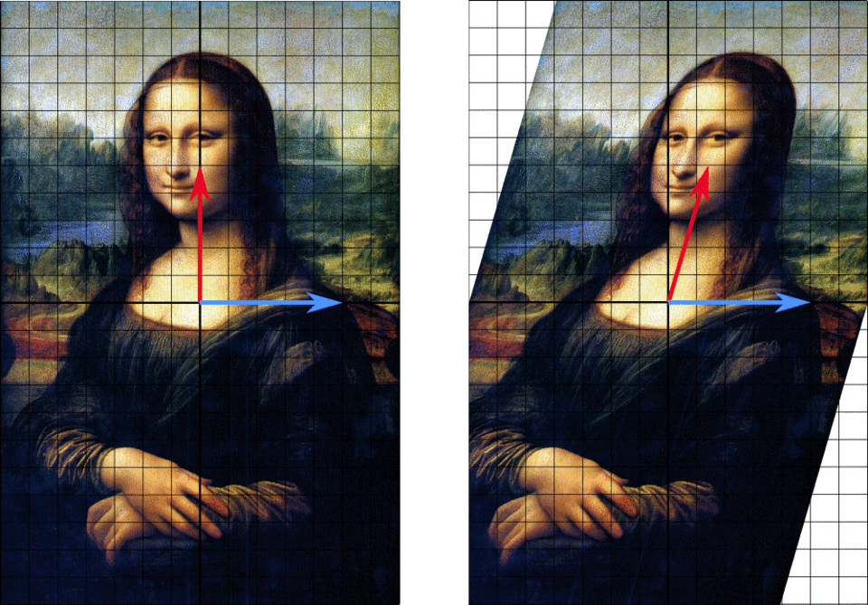
*A shear moves the red arrow off its line; the blue arrow (an eigenvector) stays on its line. (Wikimedia Commons: [Mona_Lisa_eigenvector_grid.png](https://commons.wikimedia.org/wiki/File:Mona_Lisa_eigenvector_grid.png), CC0)*

Most matrices **rotate and stretch** a vector. A few special directions only get **stretched**:
$$Gq = \lambda q,\qquad q\ne 0.$$
$q$ is an **eigenvector** (a direction the matrix keeps on the same line), $\lambda$ its **eigenvalue** (the stretch factor; negative means flipped, zero means squashed to $0$).

**How to find them.** $Gq = \lambda q \iff (G - \lambda I)q = 0$. A nonzero $q$ solving this exists only if $G - \lambda I$ is singular (det = 0, it flattens the plane; see the matrix toolkit in L04 §A7):
$$\det(G - \lambda I) = 0\qquad(\text{characteristic equation}).$$
Solve for $\lambda$, then for each $\lambda$ solve $(G - \lambda I)q = 0$ for $q$.

**2×2 shortcuts:**

| Fact | Formula |
|---|---|
| sum of eigenvalues | $\lambda_1 + \lambda_2 = \mathrm{trace}(G) = a + d$ |
| product of eigenvalues | $\lambda_1\lambda_2 = \det G = ad - bc$ |
| so | $\lambda = \tfrac{T}{2}\pm\sqrt{\tfrac{T^2}{4} - D}$ with $T$ = trace, $D$ = det |
| symmetric $\begin{bmatrix}a&b\\b&a\end{bmatrix}$ | $\lambda = a\pm b$, eigenvectors $\tfrac1{\sqrt2}(1,1)$ and $\tfrac1{\sqrt2}(1,-1)$ |

**Example.** $G = \begin{bmatrix}5&3\\3&5\end{bmatrix}$: $\lambda = 5\pm3 = 8, 2$. Check $q = (1,1)$: $Gq = (8,8) = 8q$ ✓. $q = (1,-1)$: $Gq = (2,-2) = 2q$ ✓.

**Scaling.** If $q$ is an eigenvector, so is $cq$ for any $c\ne0$. We usually pick the **unit** one: $\lVert q\rVert = 1$. (Still a sign choice: $q$ and $-q$ are both fine.)

## A5. Orthonormal vectors, orthogonal matrices, change of basis

Vectors $q_1,\dots,q_d$ are **orthonormal** if $q_j^\top q_k = 1$ when $j = k$ and $0$ otherwise (unit length, mutually perpendicular). Stack them as columns of $Q = [q_1\ \cdots\ q_d]$. Then
$$Q^\top Q = I\quad\text{and (square } Q\text{) } QQ^\top = I,\qquad\text{so } Q^{-1} = Q^\top.$$
Such a $Q$ is an **orthogonal matrix**: a rotation (possibly with a reflection). It preserves lengths: $\lVert Qa\rVert = \lVert a\rVert$.

**Change of basis.** Any $\theta\in\mathbb R^d$ can be written in the new axes $q_1..q_d$:
$$a = Q^\top\theta\quad(a_j = q_j^\top\theta,\ \text{the shadow of } \theta \text{ on } q_j),\qquad \theta = Qa = a_1q_1 + \cdots + a_dq_d.$$
**The arrow $\theta$ doesn't move.** Only the ruler you measure it with changes.

**Example.** $q_1 = \tfrac1{\sqrt2}(1,1)$, $q_2 = \tfrac1{\sqrt2}(1,-1)$, $\theta = (3,1)$. Then $a_1 = \tfrac{4}{\sqrt2} = 2\sqrt2$, $a_2 = \tfrac{2}{\sqrt2} = \sqrt2$. Rebuild: $2\sqrt2\cdot\tfrac1{\sqrt2}(1,1) + \sqrt2\cdot\tfrac1{\sqrt2}(1,-1) = (2,2) + (1,-1) = (3,1)$ ✓.

## A6. The spectral theorem and quadratic forms

**Spectral theorem.** Every **real symmetric** $G\in\mathbb R^{d\times d}$ has

1. all eigenvalues **real**;
2. a full set of $d$ **orthonormal** eigenvectors (eigenvectors for different eigenvalues are automatically perpendicular);
3. the decomposition
$$G = Q\Lambda Q^\top = \sum_{j=1}^d\lambda_j q_jq_j^\top,\qquad\Lambda = \mathrm{diag}(\lambda_1,\dots,\lambda_d).$$

Read $Gv = Q\Lambda Q^\top v$ right to left: $Q^\top$ **measures** $v$ in eigen-coordinates → $\Lambda$ **scales** each coordinate independently → $Q$ **returns** to the original axes. In the eigenbasis, $G$ is just a diagonal stretch.

If $G$ is also PSD (like $X^\top X$ or $C$), all $\lambda_j\ge0$. If PD, all $\lambda_j>0$. Number of nonzero eigenvalues $= \mathrm{rank}(G)$.

**Quadratic forms in the eigenbasis.** With $v = Qz$:
$$v^\top Gv = z^\top Q^\top Q\Lambda Q^\top Qz = z^\top\Lambda z = \sum_j\lambda_jz_j^2.$$
A tilted, coupled bowl becomes a sum of independent 1-D parabolas.

**Rayleigh bound.** For a unit vector $v$ ($\sum z_j^2 = 1$):
$$\lambda_{\min}\le v^\top Gv = \sum_j\lambda_jz_j^2\le\lambda_{\max},$$
because a weighted average of the $\lambda_j$'s (weights $z_j^2$ summing to 1) lies between the smallest and largest. **Equality at the top** when $v = q_{\max}$. This is the whole of PCA (slide 32).

## A7. Condition number and sensitivity

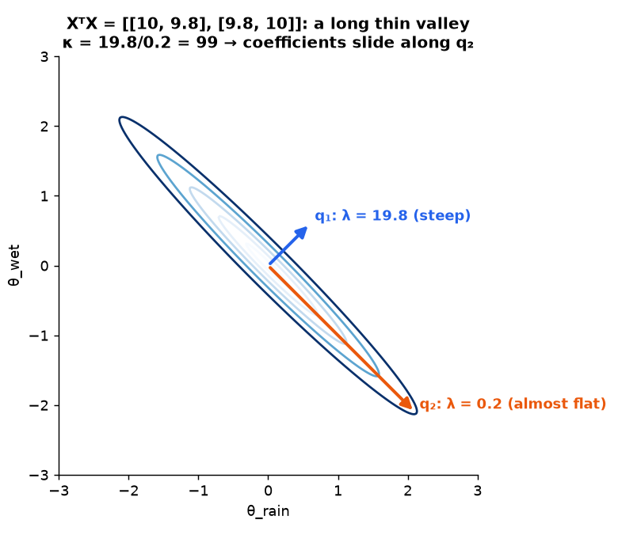
*📊 Slide 14's matrix: steep across the valley (λ = 19.8), nearly flat along it (λ = 0.2), so the data can't pin θ down along q₂.*

For a PD matrix, the **condition number** is
$$\kappa = \frac{\lambda_{\max}}{\lambda_{\min}}\ \ (\ge 1).$$
$\kappa\approx 1$: round bowl, every direction equally well determined. $\kappa\gg1$: long thin valley.

Two consequences in regression (slides 22–23):

| Small $\lambda_j$ means | Why |
|---|---|
| coefficient **sensitive** along $q_j$ | $a_j = b_j/\lambda_j$: a small change in $b_j$ gets divided by a small number |
| loss **flat** along $q_j$ | curvature along $q_j$ is $\lambda_j$ |
| gradient descent **slow** along $q_j$ | the gradient component is $\lambda_jz_j$: tiny push |
| predictions **barely change** | $\lVert Xq_j\rVert^2 = \lambda_j$: moving along $q_j$ hardly moves $\hat y$ |

**Examples.** $\begin{bmatrix}10&9.8\\9.8&10\end{bmatrix}$: $\lambda = 19.8,\ 0.2$, $\kappa = 99$. L4A's $\begin{bmatrix}4&6\\6&14\end{bmatrix}$: $\lambda = 9\pm\sqrt{61}\approx16.81,\ 1.19$, $\kappa\approx14.1$.

$\lambda_{\min} = 0$ is the extreme case: rank deficient, $\kappa = \infty$, a flat valley (L4 slide 31).

## A8. Centring, variance and the covariance matrix

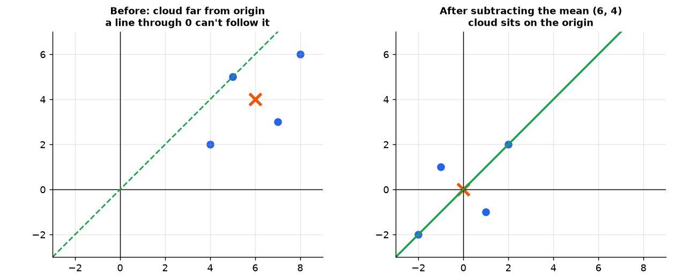
*📊 The toy storms before and after subtracting the mean; only after centring can a line through 0 follow the cloud.*

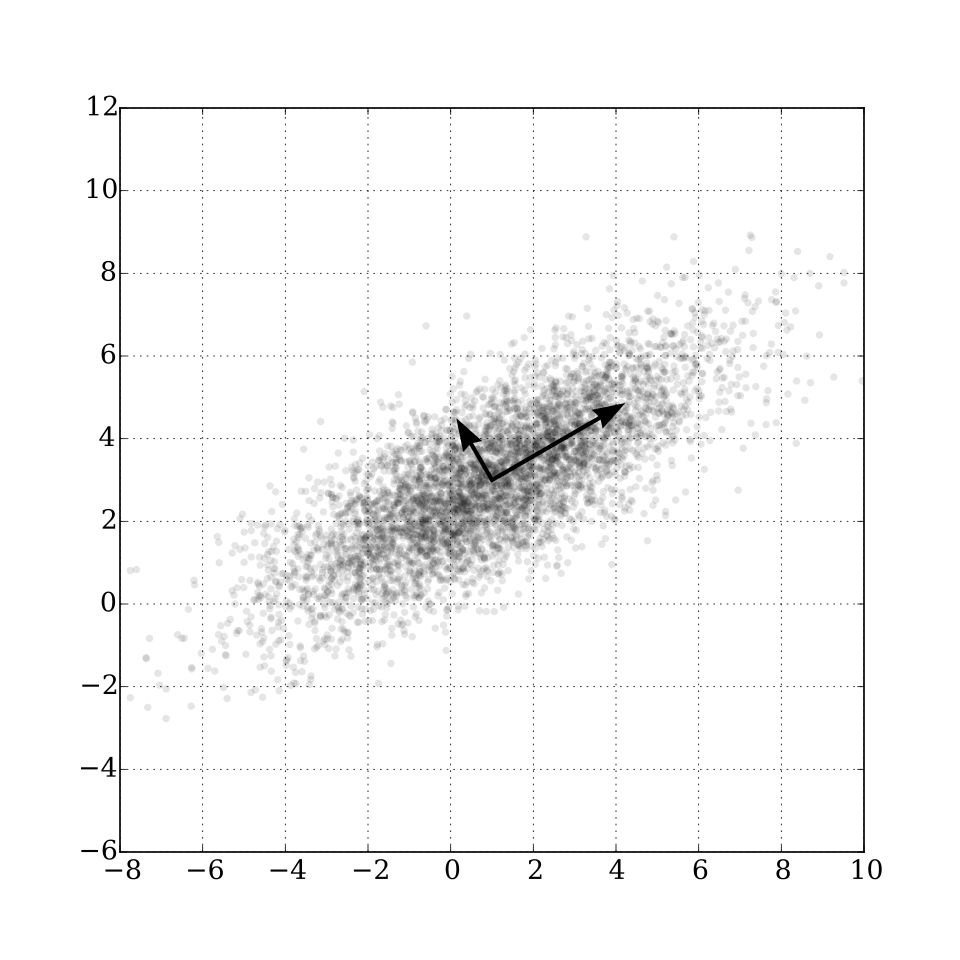
*PCA on a 2-D cloud: arrows are covariance eigenvectors, scaled by √eigenvalue. (Wikimedia Commons: [GaussianScatterPCA.svg](https://commons.wikimedia.org/wiki/File:GaussianScatterPCA.svg), CC BY 4.0)*

**Centring.** Subtract each feature's mean: $x_{i,c} = x_i - \bar x$. Afterwards every column of $X_c$ averages to 0: $\mathbf 1^\top X_c = 0^\top$.

**Sample variance** of numbers $z_1..z_n$: $\mathrm{Var}(z) = \dfrac1{n-1}\sum_i(z_i - \bar z)^2$. If $\bar z = 0$ this is $\dfrac{z^\top z}{n-1}$.

($n - 1$, not $n$: the **unbiased** version, since one degree of freedom was used up estimating the mean. The argmax in PCA doesn't care which one you use: it's a positive constant.)

**Sample covariance** between features $j$ and $k$: $\dfrac1{n-1}\sum_i x_{ij,c}\,x_{ik,c}$. All of them at once:
$$C = \frac1{n-1}X_c^\top X_c\in\mathbb R^{d\times d}.$$
$C_{jj}$ = variance of feature $j$; $C_{jk}$ = covariance of $j$ and $k$. $C$ is a scaled Gram matrix, so it's **symmetric PSD** (A3).

**Why centre?** Without it, $X^\top X/(n-1)$ measures spread around the **origin**, not around the mean. A cloud far from 0 would have a huge "variance" in the direction of its mean, even if the points barely differ.

## A9. Projecting onto a single unit direction

*Projecting a onto a direction b: the shadow a₁ and the perpendicular remainder a₂. (Wikimedia Commons: [Projection_and_rejection.png](https://commons.wikimedia.org/wiki/File:Projection_and_rejection.png), CC BY-SA 3.0)*

Given a unit vector $q$ ($q^\top q = 1$) and a point $x$, the nearest point on the line $\mathrm{span}(q)$ is $zq$ with
$$z = q^\top x\qquad(\text{signed length of the shadow}).$$
**Derivation** (same perpendicular argument as L4): the leftover $x - zq$ must be perpendicular to $q$:
$$q^\top(x - zq) = 0\ \Rightarrow\ q^\top x - z\underbrace{q^\top q}_{1} = 0\ \Rightarrow\ z = q^\top x.$$
(If $q$ weren't unit length, $z = q^\top x/q^\top q$. Fixing $q^\top q = 1$ keeps it clean.)

The projection matrix onto that line is $qq^\top$ (the 1-column case of L4's $P_X = X(X^\top X)^{-1}X^\top$ with $X = q$).

**Distinguish:** $q\in\mathbb R^d$ is a **direction** (one per dataset). $z_i\in\mathbb R$ is a **score** (one per observation). Stacked: $z = X_cq\in\mathbb R^n$.

## A10. Lagrange multipliers

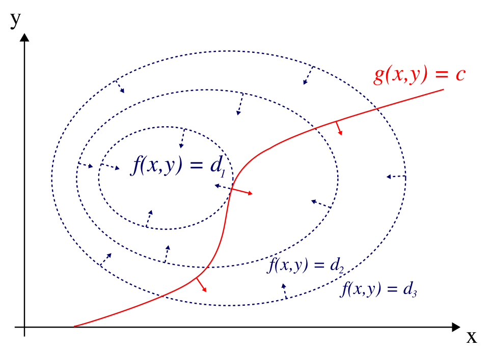
*At the constrained optimum the contour of f is tangent to the constraint g = c, so ∇f ∥ ∇g. (Wikimedia Commons: [LagrangeMultipliers2D.svg](https://commons.wikimedia.org/wiki/File:LagrangeMultipliers2D.svg), Public domain)*

**Problem:** maximise $f(x)$ subject to $g(x) = 0$ (you're only allowed to walk on the curve/surface $g = 0$).

**Idea.** At a constrained optimum you can't improve $f$ by moving *along* the constraint. So $\nabla f$ has no component along the constraint: it points straight out of the curve, i.e. along the constraint's normal $\nabla g$:
$$\nabla f = \lambda\nabla g\qquad\text{for some scalar }\lambda\ (\text{the multiplier}).$$

**Recipe.**
1. Form the **Lagrangian** $\mathcal L(x,\lambda) = f(x) - \lambda g(x)$.
2. Set **all** partial derivatives to zero: $\nabla_x\mathcal L = 0$ (gives $\nabla f = \lambda\nabla g$) and $\partial\mathcal L/\partial\lambda = -g = 0$ (gives back the constraint).
3. Solve. Split into cases when you divide by something that might be 0.
4. Evaluate $f$ at **every** candidate; the largest is the max (on a closed, bounded constraint like a circle, a max is guaranteed to exist).

**Mini-example.** Max $x + y$ on $x^2 + y^2 = 1$. $\nabla f = (1,1)$, $\nabla g = (2x, 2y)$. $1 = 2\lambda x$, $1 = 2\lambda y\Rightarrow x = y$. Constraint: $x = y = \pm\tfrac1{\sqrt2}$. Max $f = \sqrt2$ at $(\tfrac1{\sqrt2},\tfrac1{\sqrt2})$.

## A11. Frobenius norm, trace and low-rank reconstruction

**Frobenius norm** of a matrix = treat it as one long vector:
$$\lVert A\rVert_F^2 = \sum_{i,j}A_{ij}^2 = \mathrm{trace}(A^\top A) = \sum_{\text{columns}}\lVert a_j\rVert^2.$$
For data matrices, it's the **total squared error over all entries**.

**Encode / decode with orthonormal columns** $Q_k = [q_1\cdots q_k]\in\mathbb R^{d\times k}$ ($Q_k^\top Q_k = I_k$, but $Q_kQ_k^\top\ne I_d$ unless $k = d$):

| Step | Formula | Shape |
|---|---|---|
| encode (scores) | $Z_k = X_cQ_k$ | $n\times k$ |
| decode (reconstruction) | $\hat X_k = Z_kQ_k^\top = X_c\,Q_kQ_k^\top$ | $n\times d$ |

$Q_kQ_k^\top$ is the projection onto $\mathrm{span}(q_1..q_k)$. If $k = d$ it's $I$, and reconstruction is perfect.

**The error**, using the full eigenbasis $I = \sum_{j=1}^dq_jq_j^\top$:
$$X_c - \hat X_k = X_c\sum_{j>k}q_jq_j^\top,\qquad \lVert X_c - \hat X_k\rVert_F^2 = \sum_{j>k}\lVert X_cq_j\rVert^2 = (n-1)\sum_{j>k}\lambda_j.$$
(The cross terms vanish because the $q_j$ are orthonormal. And $\lVert X_cq_j\rVert^2 = (n-1)q_j^\top Cq_j = (n-1)\lambda_j$.)

So **the reconstruction error is exactly the sum of the discarded eigenvalues** (times $n - 1$).

---

# Part B — Slide by Slide (all 35 slides)

**Running examples used below:**
- **L4A regression data** (for checks): $X = \begin{bmatrix}1&0\\1&1\\1&2\\1&3\end{bmatrix}$, $y = (2,5,6,9)$, $X^\top X = \begin{bmatrix}4&6\\6&14\end{bmatrix}$, $X^\top y = (22,44)$, $\hat\theta = (2.2, 2.2)$.
- **Coupled predictors** (slide 14): $X^\top X = \begin{bmatrix}10&9.8\\9.8&10\end{bmatrix}$.
- **Toy storms for PCA** (added here; slides 25–35 are symbolic): 4 storms, already centred, (rainfall, wetness):

| storm $i$ | 1 | 2 | 3 | 4 |
|---|---|---|---|---|
| centred rainfall | 2 | 1 | −1 | −2 |
| centred wetness | 2 | −1 | 1 | −2 |

## Slide 1 — Title

*Lecture 5: From the Normal Equation to PCA.* Prof. Udit Bhatia, Civil Engineering; Computer Science and Engineering, Semester I 2026.

## Slide 2 — Course Roadmap: You Are Here

Still in **L3–L6 estimation and linear models**. Lecture 4B established least squares and projection. Today:

1. reconstruct the normal equation carefully;
2. use **spectral decomposition** to expose its coefficient directions;
3. reuse the same eigenvalue language to formulate **PCA as constrained optimisation**.

## Slide 3 — What We Actually Built On The Board Today

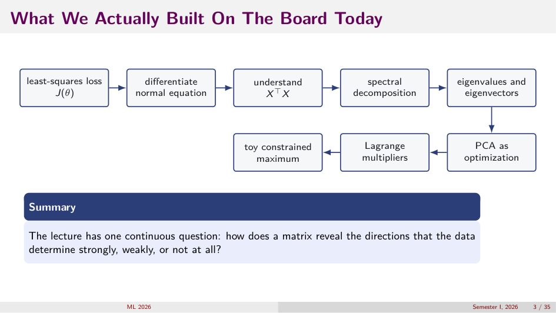
*👀 Slide 3 — Today's chain from least squares to PCA.*

least-squares loss $J(\theta)$ → differentiate → normal equation → understand $X^\top X$ → spectral decomposition → eigenvalues and eigenvectors → PCA as optimisation → Lagrange multipliers → toy constrained maximum.

**Summary:** one continuous question: *how does a matrix reveal the directions that the data determine strongly, weakly, or not at all?*

## Slide 4 — Learning Objectives

1. Derive $\nabla J(\theta) = X^\top(X\theta - y)$ without guessing the transpose (slides 8–9, A2).
2. Obtain and interpret the normal equation $X^\top X\hat\theta = X^\top y$ (slides 9–10).
3. Explain why $X^\top X$ is symmetric and PSD (slides 12–13).
4. Use the spectral theorem to describe regression direction by direction (slides 17–21).
5. Explain where $a = Q^\top\hat\theta$ and $b = Q^\top X^\top y$ come from (slides 19–20).
6. Formulate PCA by maximising projected variance (slides 27–29).
7. Derive a Lagrange-multiplier system and reuse it to obtain $Cq = \lambda q$ (slides 30–32).

## Slide 5 — Notation: Keep Track Of The Space Before The Algebra

| Object | Shape | Meaning | Space (A1) |
|---|---|---|---|
| $X$ | $n\times d$ | $n$ observations, $d$ predictors | bridge |
| $y$ | $n\times1$ | observed response | observation |
| $\theta$ | $d\times1$ | regression coefficients | coefficient |
| $X\theta$ | $n\times1$ | fitted response | observation |
| $r = y - X\theta$ | $n\times1$ | residual vector | observation |
| $X^\top X$ | $d\times d$ | predictor Gram matrix | acts on coefficient space |
| $q_j$ | $d\times1$ | one eigenvector direction (which matrix: from context) | coefficient / feature |
| $X_c$ | $n\times d$ | centred feature matrix for PCA | bridge |
| $q$ | $d\times1$ | one candidate PCA feature direction | feature |
| $z = X_cq$ | $n\times1$ | projected coordinate (score) for every observation | observation |
| $C = \frac1{n-1}X_c^\top X_c$ | $d\times d$ | sample covariance matrix | acts on feature space |

**Summary:** regression moves a coefficient vector $\theta$. PCA chooses a feature direction $q$ and produces scores $z = X_cq$. **The direction and the scores live in different spaces** ($\mathbb R^d$ vs $\mathbb R^n$).

## Slide 6 — Start From The Least-Squares Objective

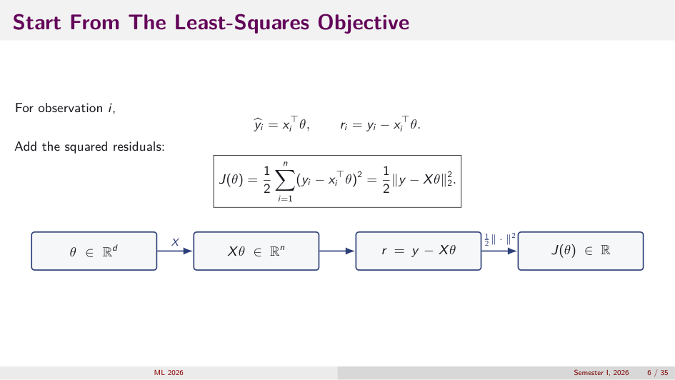
*👀 Slide 6 — θ lives in coefficient space (ℝᵈ); Xθ and r live in observation space (ℝⁿ).*

For observation $i$: $\hat y_i = x_i^\top\theta$, $r_i = y_i - x_i^\top\theta$ (here $x_i^\top$ is **row** $i$ of $X$). Add squared residuals:
$$J(\theta) = \frac12\sum_{i=1}^n(y_i - x_i^\top\theta)^2 = \frac12\lVert y - X\theta\rVert_2^2.$$

Pipeline: $\theta\in\mathbb R^d\xrightarrow{X}X\theta\in\mathbb R^n\to r = y - X\theta\xrightarrow{\frac12\lVert\cdot\rVert^2}J(\theta)\in\mathbb R$.

(The $\tfrac12$ is only there to cancel the 2 from differentiating; it doesn't move the argmin.)

## Slide 7 — Expand The Objective Before Differentiating

$$2J(\theta) = (y - X\theta)^\top(y - X\theta) = y^\top y - y^\top X\theta - \theta^\top X^\top y + \theta^\top X^\top X\theta.$$
The two middle terms are the **same scalar** ($1\times1$ equals its own transpose):
$$y^\top X\theta = (y^\top X\theta)^\top = \theta^\top X^\top y.$$
Therefore
$$J(\theta) = \tfrac12y^\top y - \theta^\top X^\top y + \tfrac12\theta^\top X^\top X\theta.$$

**Summary:** the transpose appears because the derivative must return a $d$-dimensional coefficient-space vector. ($X^\top y$ is $d\times1$; $y^\top X$ would be $1\times d$.)

**Check on L4A data** at $\theta = (2.2,2.2)$: $y^\top y = 4+25+36+81 = 146$; $\theta^\top X^\top y = 2.2(22+44) = 145.2$; $\theta^\top X^\top X\theta = 2.2^2(4+6+6+14) = 4.84\times30 = 145.2$. $J = 73 - 145.2 + 72.6 = 0.4 = \tfrac12\mathrm{SSE}$ ✓ (SSE was 0.8).

## Slide 8 — Differentiate One Coefficient At A Time ✍️

Start from
$$J(\theta) = \frac12\sum_{i=1}^n\Big(y_i - \sum_{k=1}^dx_{ik}\theta_k\Big)^2.$$
Let $r_i(\theta) = y_i - \sum_kx_{ik}\theta_k$. Only the $k = j$ term depends on $\theta_j$:
$$\frac{\partial r_i}{\partial\theta_j} = -x_{ij}.$$
Chain rule ($\frac{d}{du}\tfrac12u^2 = u$):
$$\frac{\partial J}{\partial\theta_j} = \frac12\sum_{i=1}^n2r_i\frac{\partial r_i}{\partial\theta_j} = -\sum_{i=1}^nx_{ij}r_i = \sum_{i=1}^nx_{ij}(x_i^\top\theta - y_i).$$
This is **component $j$ of $X^\top(X\theta - y)$**: column $j$ of $X$ dotted with the vector $X\theta - y$. (A2)

**Numbers (L4A, at $\theta = 0$):** $X\theta - y = (-2,-5,-6,-9)$. $\partial J/\partial\theta_0 = 1\cdot(-2-5-6-9) = -22$; $\partial J/\partial\theta_1 = 0(-2) + 1(-5) + 2(-6) + 3(-9) = -44$. So $\nabla J(0) = -X^\top y = (-22,-44)$ ✓: both coefficients should increase.

## Slide 9 — Stack The Derivatives: The Normal Equation Appears ✍️

Stack the $d$ scalar derivatives:
$$\nabla J(\theta) = X^\top(X\theta - y)\in\mathbb R^d.$$
At a stationary point $\hat\theta$:
$$X^\top(X\hat\theta - y) = 0\ \Rightarrow\ X^\top X\hat\theta - X^\top y = 0\ \Rightarrow\ \boxed{X^\top X\hat\theta = X^\top y}.$$

**Dimension check:** $X^\top X$ is $d\times d$, $\hat\theta$ is $d\times1$ → left side $d\times1$. $X^\top$ is $d\times n$, $y$ is $n\times1$ → right side $d\times1$ ✓.

**Normal equation:** one scalar stationarity equation **for each coefficient** ($d$ equations, $d$ unknowns).

Because the Hessian $X^\top X\succeq0$ (slide 13), every stationary point is a global minimum.

## Slide 10 — The Same Normal Equation Is An Orthogonality Statement

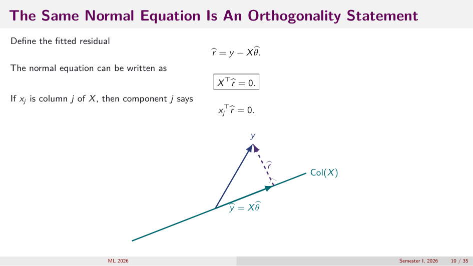
*👀 Slide 10 — The residual is perpendicular to every column of X.*

Define the fitted residual $\hat r = y - X\hat\theta$. The normal equation is
$$X^\top\hat r = 0,\qquad\text{i.e. } x_j^\top\hat r = 0\ \text{ for every column } j.$$
The residual is **perpendicular to every predictor column**, hence to all of $\mathrm{Col}(X)$. Picture: $y$ above the plane $\mathrm{Col}(X)$, $\hat y = X\hat\theta$ its foot, $\hat r$ the vertical drop. (L4 slide 28.)

**Check (L4A):** $\hat r = (-0.2, 0.6, -0.6, 0.2)$. Ones column: sum $= 0$ ✓. $x$ column: $0 + 0.6 - 1.2 + 0.6 = 0$ ✓.

**Two readings of one equation:** calculus says "gradient is zero"; geometry says "residual ⟂ model space".

## Slide 11 — When May We Write The Inverse Formula?

From $X^\top X\hat\theta = X^\top y$ we may write
$$\hat\theta = (X^\top X)^{-1}X^\top y$$
**only when $X^\top X$ is invertible.**

| Full column rank | Exact linear dependence |
|---|---|
| $\mathrm{rank}(X) = d$ | some predictor is an exact combination of others |
| no nonzero coefficient move $v$ satisfies $Xv = 0$ | $\exists v\ne0$ with $Xv = 0$ |
| $X^\top X$ PD, all $\lambda_j > 0$ | $X^\top X$ singular, some $\lambda_j = 0$ |
| least-squares coefficients **unique** | normal equation still holds (has infinitely many solutions), but the **inverse formula doesn't exist** |

> ⚠️ "Solve the normal equation" is always valid. "Invert $X^\top X$" isn't. (In code, use a solver such as `np.linalg.lstsq` / `solve`, not `inv`.)

## Slide 12 — What Information Is Stored In $X^\top X$?

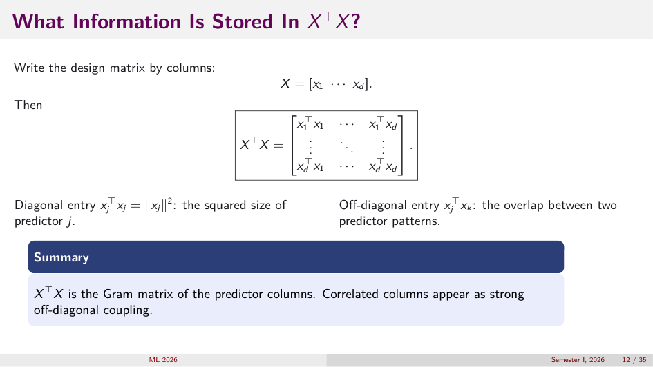
*👀 Slide 12 — Diagonal = column lengths², off-diagonal = overlaps between columns.*

Write $X = [x_1\ \cdots\ x_d]$ by columns. Then
$$X^\top X = \begin{bmatrix}x_1^\top x_1&\cdots&x_1^\top x_d\\\vdots&\ddots&\vdots\\x_d^\top x_1&\cdots&x_d^\top x_d\end{bmatrix}.$$
- **Diagonal** $x_j^\top x_j = \lVert x_j\rVert^2$: the squared size of predictor $j$.
- **Off-diagonal** $x_j^\top x_k$: the overlap between two predictor patterns.

**Summary:** $X^\top X$ is the **Gram matrix** of the predictor columns. Correlated columns appear as strong off-diagonal coupling. (A3)

**L4A:** $\begin{bmatrix}4&6\\6&14\end{bmatrix}$: $\lVert\mathbf 1\rVert^2 = 4$ (= $n$), $\lVert x\rVert^2 = 0+1+4+9 = 14$, overlap $\mathbf 1^\top x = \sum x_i = 6$.

## Slide 13 — Why $X^\top X$ Is Positive Semidefinite

Any coefficient direction $v\in\mathbb R^d$:
$$v^\top(X^\top X)v = (Xv)^\top(Xv) = \lVert Xv\rVert_2^2\ge0\quad\Rightarrow\quad X^\top X\succeq0.$$
For least squares, $\nabla^2J(\theta) = X^\top X$, so **$J$ is convex in $\theta$**.

**Summary:** equality holds exactly when $Xv = 0$: moving the coefficients along $v$ changes **no fitted value**. Strict positivity for every nonzero $v$ gives a **unique** minimiser.

**Eigen-reading (preview):** if $q$ is a unit eigenvector, $q^\top X^\top Xq = \lambda\,q^\top q = \lambda$, and that equals $\lVert Xq\rVert^2\ge0$. So **every eigenvalue of $X^\top X$ is $\ge0$**, and it measures how much moving along $q$ changes the predictions.

## Slide 14 — Why Eigenvectors Enter Regression At This Point

Rainfall and wetness predictors are strongly coupled:
$$X^\top X = \begin{bmatrix}10&9.8\\9.8&10\end{bmatrix}.$$
The original coefficient axes ($\theta_{\text{rain}}$, $\theta_{\text{wet}}$) mix the two effects: you can't tell them apart because they almost always move together.

**Question:** are there special coefficient combinations that $X^\top X$ acts on **without turning them into a different direction**? Those satisfy
$$(X^\top X)q = \lambda q.$$
- $q$: a coefficient combination, e.g. "increase both coefficients together".
- $\lambda$: how strongly the data and loss react to that combination.

**Answer here** (A4 shortcut, $a\pm b$):

| Direction | $q$ | $\lambda$ | Meaning |
|---|---|---|---|
| "both together" | $\tfrac1{\sqrt2}(1,1)$ | $10 + 9.8 = 19.8$ | strongly determined by data |
| "one up, other down" | $\tfrac1{\sqrt2}(1,-1)$ | $10 - 9.8 = 0.2$ | barely determined: the data can't separate rain from wetness |

Ratio $19.8/0.2 = 99$ (condition number, A7).

## Slide 15 — Eigenvector Means Same Line After The Matrix Acts

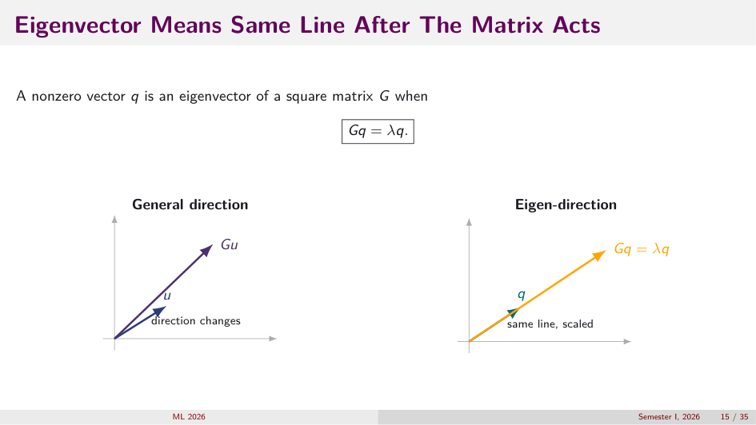
*👀 Slide 15 — Left: a general vector gets turned. Right: an eigenvector only gets scaled.*

A nonzero $q$ is an eigenvector of a square $G$ when $Gq = \lambda q$.

- **General direction** $u$: $Gu$ points somewhere else (direction changes).
- **Eigen-direction** $q$: $Gq = \lambda q$ stays on the **same line**, only scaled.

**Example** with $G = \begin{bmatrix}5&3\\3&5\end{bmatrix}$: $u = (1,0)\mapsto Gu = (5,3)$, turned. $q = (1,1)\mapsto(8,8)$, same line, ×8.

## Slide 16 — Worked Eigenpair Example ✍️

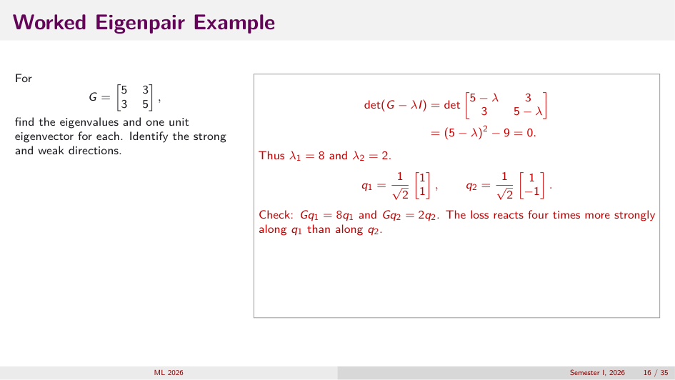
*👀 Slide 16 — Worked det(G − λI) = 0 → λ = 8, 2.*

Find the eigenvalues and unit eigenvectors of $G = \begin{bmatrix}5&3\\3&5\end{bmatrix}$; identify the strong and weak directions.

**Characteristic equation:**
$$\det(G - \lambda I) = \det\begin{bmatrix}5-\lambda&3\\3&5-\lambda\end{bmatrix} = (5-\lambda)^2 - 9 = 0\ \Rightarrow\ 5 - \lambda = \pm3\ \Rightarrow\ \lambda_1 = 8,\ \lambda_2 = 2.$$
(Check: $8 + 2 = 10 = $ trace ✓; $8\times2 = 16 = 25 - 9 = \det$ ✓.)

**Eigenvectors.** $\lambda = 8$: $(G - 8I)q = \begin{bmatrix}-3&3\\3&-3\end{bmatrix}q = 0\Rightarrow q_a = q_b$. $\lambda = 2$: $\begin{bmatrix}3&3\\3&3\end{bmatrix}q = 0\Rightarrow q_a = -q_b$. Normalise:
$$q_1 = \frac1{\sqrt2}\begin{bmatrix}1\\1\end{bmatrix},\qquad q_2 = \frac1{\sqrt2}\begin{bmatrix}1\\-1\end{bmatrix}.$$
**Check:** $Gq_1 = \tfrac1{\sqrt2}(8,8) = 8q_1$ ✓, $Gq_2 = \tfrac1{\sqrt2}(2,-2) = 2q_2$ ✓, $q_1^\top q_2 = \tfrac12(1 - 1) = 0$ ✓.

**Strong** direction $q_1$ ($\lambda = 8$), **weak** direction $q_2$ ($\lambda = 2$). The loss reacts **four times more strongly** along $q_1$ than along $q_2$.

## Slide 17 — The Spectral Theorem Gives A Complete Coordinate System

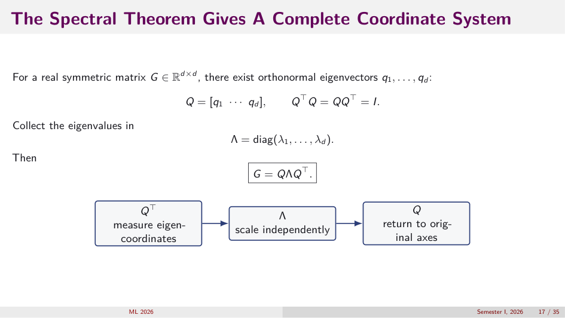
*👀 Slide 17 — Qᵀ rotates in, Λ scales each axis, Q rotates back.*

For real symmetric $G\in\mathbb R^{d\times d}$ there exist orthonormal eigenvectors $q_1..q_d$:
$$Q = [q_1\ \cdots\ q_d],\quad Q^\top Q = QQ^\top = I,\quad\Lambda = \mathrm{diag}(\lambda_1..\lambda_d),\quad G = Q\Lambda Q^\top.$$

$Q^\top$: measure eigen-coordinates → $\Lambda$: scale independently → $Q$: return to original axes. (A6)

**Check on slide 16:** $Q = \tfrac1{\sqrt2}\begin{bmatrix}1&1\\1&-1\end{bmatrix}$, $\Lambda = \mathrm{diag}(8,2)$.
$$Q\Lambda Q^\top = \tfrac12\begin{bmatrix}1&1\\1&-1\end{bmatrix}\begin{bmatrix}8&0\\0&2\end{bmatrix}\begin{bmatrix}1&1\\1&-1\end{bmatrix} = \tfrac12\begin{bmatrix}8&2\\8&-2\end{bmatrix}\begin{bmatrix}1&1\\1&-1\end{bmatrix} = \tfrac12\begin{bmatrix}10&6\\6&10\end{bmatrix} = G\ ✓.$$
Or as a sum: $8q_1q_1^\top + 2q_2q_2^\top = 4\begin{bmatrix}1&1\\1&1\end{bmatrix} + \begin{bmatrix}1&-1\\-1&1\end{bmatrix} = \begin{bmatrix}5&3\\3&5\end{bmatrix}$ ✓.

Why symmetric matters: $X^\top X$ and $C$ are symmetric, so this always works for them. (Non-symmetric matrices may have complex eigenvalues or not enough eigenvectors.)

## Slide 18 — Change Of Basis: The Vector Stays, Its Coordinates Change

$Q$ orthogonal. For a coefficient vector $\theta$, its eigenbasis coordinates are
$$a = Q^\top\theta,\qquad a_j = q_j^\top\theta\ \ (\text{signed coordinate along } q_j).$$
Because $QQ^\top = I$: $\theta = Qa = a_1q_1 + \cdots + a_dq_d$.

**Summary:** changing basis does **not** physically rotate the coefficient vector. It changes the axes used to describe it. (A5 has a worked example.)

**Interpretation for slide 14:** $a_1 = q_1^\top\theta = (\theta_{\text{rain}} + \theta_{\text{wet}})/\sqrt2$ is the "combined effect" coordinate; $a_2 = (\theta_{\text{rain}} - \theta_{\text{wet}})/\sqrt2$ is the "difference" coordinate.

## Slide 19 — Rotate The Normal Equation Without Shorthand ✍️

Substitute $X^\top X = Q\Lambda Q^\top$ and left-multiply by $Q^\top$. Don't introduce $a$, $b$ yet.

| Line | Reason |
|---|---|
| $X^\top X\hat\theta = X^\top y$ | normal equation |
| $Q\Lambda Q^\top\hat\theta = X^\top y$ | spectral decomposition |
| $Q^\top Q\Lambda Q^\top\hat\theta = Q^\top X^\top y$ | left-multiply **both sides** by $Q^\top$ |
| $\Lambda(Q^\top\hat\theta) = Q^\top X^\top y$ | $Q^\top Q = I$ |

Both sides are now written in eigenvector coordinates.

## Slide 20 — Now Define $a$ And $b$: Nothing Appears From Nowhere

The previous line is $\Lambda\underbrace{(Q^\top\hat\theta)}_{a} = \underbrace{Q^\top X^\top y}_{b}$. So
$$a := Q^\top\hat\theta,\qquad b := Q^\top X^\top y,\qquad\Lambda a = b.$$

- **Coefficient coordinate:** $a_j = q_j^\top\hat\theta$ (the fitted coefficients measured along $q_j$).
- **Response information in direction $q_j$:** $b_j = q_j^\top X^\top y = (Xq_j)^\top y$.

$b_j$ measures the **alignment between the observed response $y$ and the prediction pattern $Xq_j$** generated by moving coefficients along $q_j$. ($Xq_j\in\mathbb R^n$ is "what the predictions would do if you nudged $\theta$ along $q_j$"; dot it with $y$ to see whether the data want that.)

## Slide 21 — A Coupled Matrix Equation Becomes Independent Scalar Equations

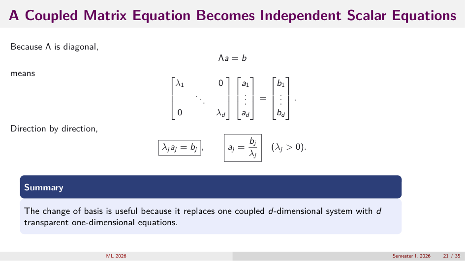
*👀 Slide 21 — A coupled 2×2 system becomes separate one-line equations.*

$\Lambda$ is diagonal, so $\Lambda a = b$ is
$$\begin{bmatrix}\lambda_1&&0\\&\ddots&\\0&&\lambda_d\end{bmatrix}\begin{bmatrix}a_1\\\vdots\\a_d\end{bmatrix} = \begin{bmatrix}b_1\\\vdots\\b_d\end{bmatrix}\quad\Longrightarrow\quad\lambda_ja_j = b_j,\qquad a_j = \frac{b_j}{\lambda_j}\ \ (\lambda_j>0).$$
Then go back: $\hat\theta = Qa = \sum_j\dfrac{b_j}{\lambda_j}q_j$.

**Summary:** one coupled $d$-dimensional system → $d$ transparent 1-D equations.

**Worked example (slide 14 matrix).** Suppose $X^\top y = (20,\ 19.8)$.
- $b_1 = q_1^\top X^\top y = \tfrac{39.8}{\sqrt2}$, $\ b_2 = q_2^\top X^\top y = \tfrac{0.2}{\sqrt2}$.
- $a_1 = \dfrac{b_1}{19.8} = \dfrac{2.0101}{\sqrt2}$, $\ a_2 = \dfrac{b_2}{0.2} = \dfrac{1}{\sqrt2}$.
- $\hat\theta = a_1q_1 + a_2q_2 = 1.00505\,(1,1) + 0.5\,(1,-1) = (1.505,\ 0.505)$.

Check: $10(1.505) + 9.8(0.505) = 15.05 + 4.95 = 20.0$ ✓; $9.8(1.505) + 10(0.505) = 14.75 + 5.05 = 19.8$ ✓.

## Slide 22 — Why A Small Eigenvalue Makes Coefficients Sensitive

Perturb $b\to b + \delta b$: $\Lambda(a + \delta a) = b + \delta b$. Subtract $\Lambda a = b$:
$$\Lambda\,\delta a = \delta b\quad\Rightarrow\quad\delta a_j = \frac{\delta b_j}{\lambda_j}.$$
- **Large $\lambda_j$:** a fixed data perturbation produces a small coefficient change.
- **Small $\lambda_j$:** dividing by a small number **amplifies** it.

**Continue the slide-21 example.** Change $X^\top y$ from $(20, 19.8)$ to $(20, 20)$ (a 1% nudge in one entry). Now $b_2 = 0$, so $a_2 = 0$, and $\hat\theta = \tfrac{40}{39.6}(1,1) = (1.010,\ 1.010)$.

| | $X^\top y$ | $\hat\theta$ |
|---|---|---|
| before | $(20,\ 19.8)$ | $(1.505,\ 0.505)$ |
| after | $(20,\ 20)$ | $(1.010,\ 1.010)$ |

A 0.2 change in the data moved each coefficient by ~0.5: $\delta b_2 = -0.2/\sqrt2$ divided by $\lambda_2 = 0.2$ gives $\delta a_2 = -1/\sqrt2$. The sum $\theta_1 + \theta_2$ (the strong direction) barely changed: $2.010 \to 2.020$.

**Summary:** predictions can remain similar, because the same weak direction also satisfies
$$\lVert Xq_j\rVert_2^2 = q_j^\top X^\top Xq_j = \lambda_j.$$
Moving along a small-$\lambda$ direction hardly changes $\hat y$. That's exactly **why** the data can't pin it down. (This is **multicollinearity**; ridge regression, L7, adds $\lambda_{\text{ridge}}$ to every $\lambda_j$ to stop the blow-up.)

## Slide 23 — Eigenvalues Are The Curvatures Of The Loss Bowl

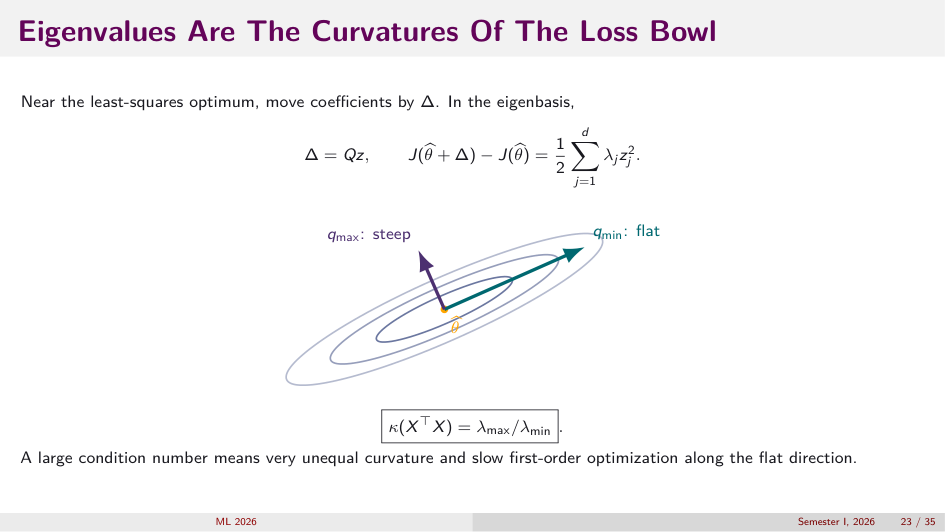
*👀 Slide 23 — The bowl is steep along the big-λ direction, flat along the small-λ one.*

Near the optimum, move by $\Delta$. Because $J$ is exactly quadratic and $\nabla J(\hat\theta) = 0$:
$$J(\hat\theta + \Delta) - J(\hat\theta) = \underbrace{\nabla J(\hat\theta)^\top\Delta}_{0} + \tfrac12\Delta^\top X^\top X\Delta.$$
In the eigenbasis, $\Delta = Qz$ (A6):
$$J(\hat\theta + \Delta) - J(\hat\theta) = \frac12\sum_{j=1}^d\lambda_jz_j^2.$$
Each $\lambda_j$ is the **curvature** along $q_j$. Contours are ellipses with axes along the $q_j$, and the half-length along $q_j$ is $\propto1/\sqrt{\lambda_j}$: $q_{\min}$ is the long **flat** axis, $q_{\max}$ the short **steep** one.

$$\kappa(X^\top X) = \frac{\lambda_{\max}}{\lambda_{\min}}.$$
A large condition number means very unequal curvature and **slow first-order optimisation** (gradient descent) along the flat direction: the step size must be small enough for the steep direction ($<2/\lambda_{\max}$), so progress along the flat one is tiny. (A7)

**Expanding the derivation.** $J(\hat\theta + \Delta) = \tfrac12\lVert\hat r - X\Delta\rVert^2 = \tfrac12\lVert\hat r\rVert^2 - \hat r^\top X\Delta + \tfrac12\lVert X\Delta\rVert^2$, and $\hat r^\top X = 0$ (slide 10).

## Slide 24 — Bridge To PCA: Same Gram Pattern, Different Question

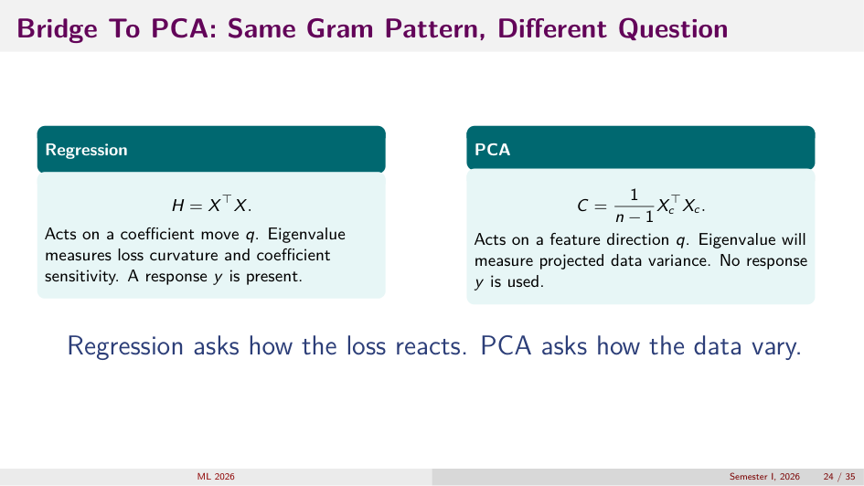
*👀 Slide 24 — Same Gram pattern: regression asks how the loss reacts; PCA asks how the data vary.*

| | Regression | PCA |
|---|---|---|
| matrix | $H = X^\top X$ | $C = \frac1{n-1}X_c^\top X_c$ |
| acts on | a coefficient move $q$ | a feature direction $q$ |
| eigenvalue measures | loss curvature, coefficient sensitivity | projected data variance |
| uses a response $y$? | yes | **no** (unsupervised) |

**Regression asks how the loss reacts. PCA asks how the data vary.**

## Slide 25 — PCA Motivation: Can Two Features Become One Useful Score?

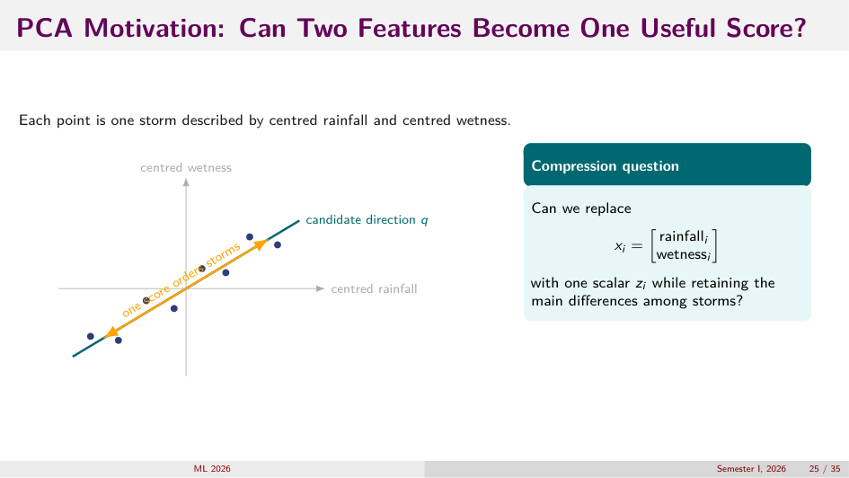
*👀 Slide 25 — The cloud is long along one diagonal; one score along it captures most differences.*

Each point is one storm described by centred rainfall and centred wetness. The cloud is elongated along a diagonal. A candidate direction $q$ through the cloud gives each storm one number (its position along $q$), and that one score **orders the storms**.

**Compression question:** can we replace $x_i = \begin{bmatrix}\text{rainfall}_i\\\text{wetness}_i\end{bmatrix}$ with one scalar $z_i$ while **retaining the main differences among storms**?

(Our toy storms: points $(2,2), (1,-1), (-1,1), (-2,-2)$, spread most along the $(1,1)$ diagonal.)

## Slide 26 — Why Centre The Data Before PCA?

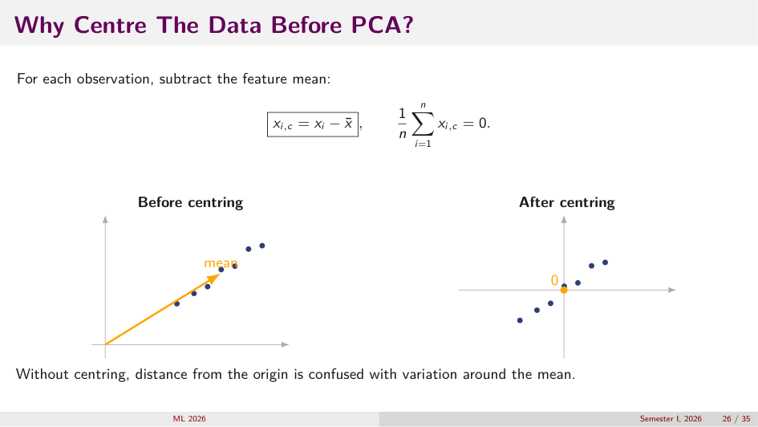
*👀 Slide 26 — Before/after centring: subtract the mean so directions pass through the cloud.*

For each observation subtract the feature mean:
$$x_{i,c} = x_i - \bar x,\qquad\frac1n\sum_{i=1}^nx_{i,c} = 0.$$
Before centring the cloud sits around the mean; after, around 0.

**Without centring, distance from the origin is confused with variation around the mean.** (A8) The direction "towards the cloud's centre" would look like a big-variance direction even if the storms were nearly identical.

**Example:** raw storms $(52, 32), (51, 29), (49, 31), (48, 28)$. Mean $(50, 30)$. Subtract → our toy table ✓.

## Slide 27 — Step 1: Choose A Direction And Fix Its Length

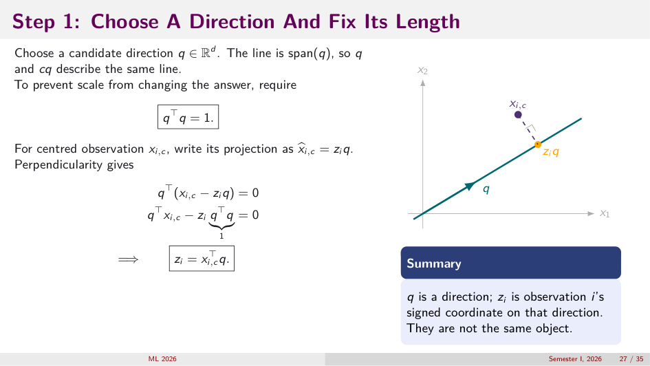
*👀 Slide 27 — A unit direction q and a point's shadow zᵢ = xᵢᵀq on it.*

Choose a candidate $q\in\mathbb R^d$. The line is $\mathrm{span}(q)$; $q$ and $cq$ describe the **same line**. To stop scale from changing the answer, require
$$q^\top q = 1.$$
Projection of $x_{i,c}$ onto the line is $\hat x_{i,c} = z_iq$. Perpendicularity (A9):
$$q^\top(x_{i,c} - z_iq) = 0\ \Rightarrow\ q^\top x_{i,c} - z_i\underbrace{q^\top q}_{1} = 0\ \Rightarrow\ z_i = x_{i,c}^\top q.$$

**Summary:** $q$ is a **direction**; $z_i$ is observation $i$'s **signed coordinate** on that direction. Not the same object.

**Toy storms**, $q = \tfrac1{\sqrt2}(1,1)$: storm 1 $z_1 = \tfrac{2 + 2}{\sqrt2} = 2\sqrt2\approx2.83$; storm 2 $z_2 = \tfrac{1 - 1}{\sqrt2} = 0$.

## Slide 28 — Step 2: Project Every Observation And Measure The Spread

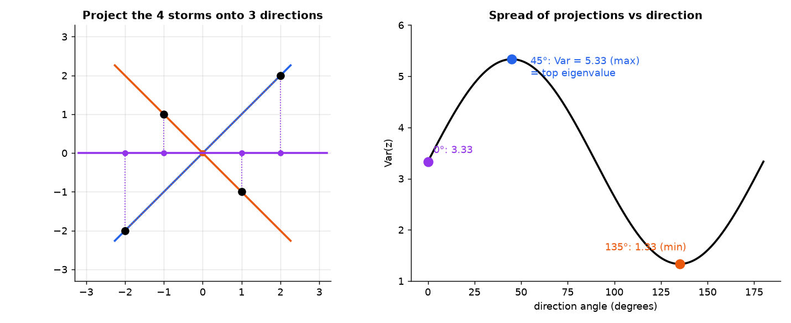
*📊 Slide 28's table as a picture: spin the direction, measure the spread; it peaks at 45° (5.33), the top eigenvalue.*

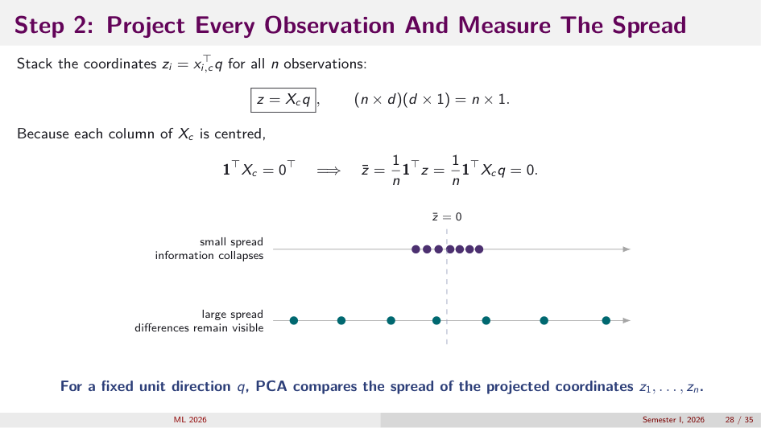
*👀 Slide 28 — Bunched shadows (small spread) vs spread-out shadows (large spread).*

Stack all coordinates:
$$z = X_cq,\qquad(n\times d)(d\times1) = n\times1.$$
Because each column of $X_c$ is centred,
$$\mathbf 1^\top X_c = 0^\top\ \Rightarrow\ \bar z = \tfrac1n\mathbf 1^\top z = \tfrac1n\mathbf 1^\top X_cq = 0.$$
(Centred data ⇒ centred scores, for **any** $q$.)

| Small spread of $z$ | Large spread of $z$ |
|---|---|
| information collapses: storms land on top of each other | differences remain visible |

For a fixed unit $q$, PCA compares the spread of $z_1..z_n$.

**Toy storms**, two candidates:

| $q$ | $z = X_cq$ | $\mathrm{Var}(z) = \frac{z^\top z}{3}$ |
|---|---|---|
| $\tfrac1{\sqrt2}(1,1)$ | $\tfrac1{\sqrt2}(4, 0, 0, -4) = (2.83, 0, 0, -2.83)$ | $\tfrac{8 + 8}{3} = 5.33$ |
| $\tfrac1{\sqrt2}(1,-1)$ | $\tfrac1{\sqrt2}(0, 2, -2, 0) = (0, 1.41, -1.41, 0)$ | $\tfrac{2 + 2}{3} = 1.33$ |
| $(1,0)$ (rainfall only) | $(2, 1, -1, -2)$ | $\tfrac{10}{3} = 3.33$ |

The diagonal $(1,1)$ keeps far more spread.

## Slide 29 — Step 3: The Objective And Constraint Now Fit Together

Since $\bar z = 0$:
$$\mathrm{Var}(z) = \frac1{n-1}\sum_iz_i^2 = \frac1{n-1}z^\top z = \frac1{n-1}(X_cq)^\top(X_cq) = q^\top\underbrace{\Big(\frac1{n-1}X_c^\top X_c\Big)}_{C}q.$$
Define the **feature covariance matrix** $C = \frac1{n-1}X_c^\top X_c$. The first PCA direction is
$$\boxed{q_1 = \arg\max_{q\in\mathbb R^d}q^\top Cq\quad\text{subject to}\quad q^\top q = 1.}$$

- **Objective** $q^\top Cq$: retain the largest projected variance.
- **Constraint** $q^\top q = 1$: prevent scale from manufacturing variance (without it, $q = 10q_1$ gives 100× the "variance", and the max is $\infty$).

**Toy storms:** $X_c^\top X_c = \begin{bmatrix}4+1+1+4&4-1-1+4\\6&4+1+1+4\end{bmatrix} = \begin{bmatrix}10&6\\6&10\end{bmatrix}$, so
$$C = \frac13\begin{bmatrix}10&6\\6&10\end{bmatrix} = \begin{bmatrix}3.33&2\\2&3.33\end{bmatrix}.$$
Each feature has variance 3.33; covariance 2 (positively correlated, correlation $2/3.33 = 0.6$). Check slide 28: $q = \tfrac1{\sqrt2}(1,1)$ gives $q^\top Cq = \tfrac12(3.33 + 2 + 2 + 3.33) = 5.33$ ✓.

## Slide 30 — Lagrange Multipliers Enforce The Constraint

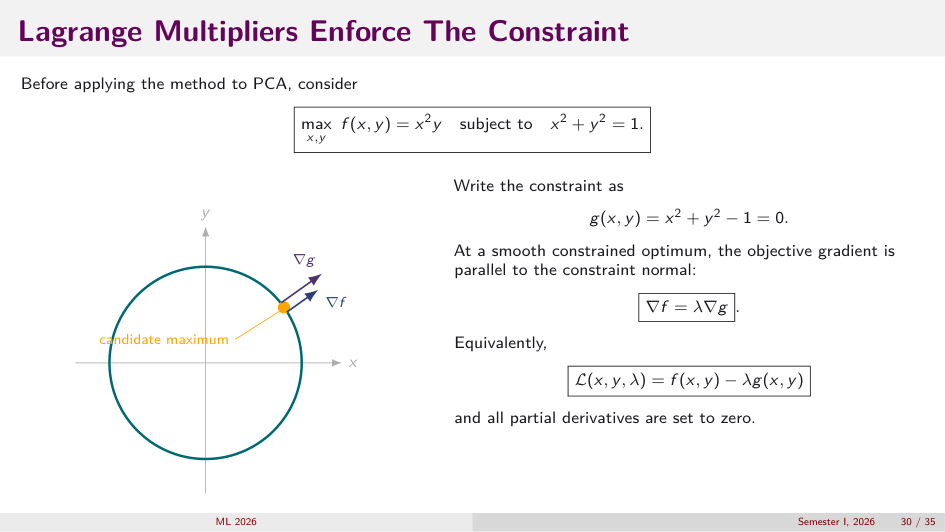
*👀 Slide 30 — On the circle, the best point is where ∇f is parallel to ∇g.*

Warm-up before PCA:
$$\max_{x,y}f(x,y) = x^2y\quad\text{subject to}\quad x^2 + y^2 = 1.$$
Constraint as $g(x,y) = x^2 + y^2 - 1 = 0$. At a smooth constrained optimum, the objective gradient is **parallel to the constraint normal**:
$$\nabla f = \lambda\nabla g.$$
Equivalently form $\mathcal L(x,y,\lambda) = f(x,y) - \lambda g(x,y)$ and set **all** partials to zero. (A10)

Picture: walking around the unit circle, at the best point $\nabla f$ points straight out of the circle (along $\nabla g$). If it had any component along the circle, you could walk that way and do better.

## Slide 31 — Solve $\max x^2y$ On The Unit Circle Step By Step ✍️

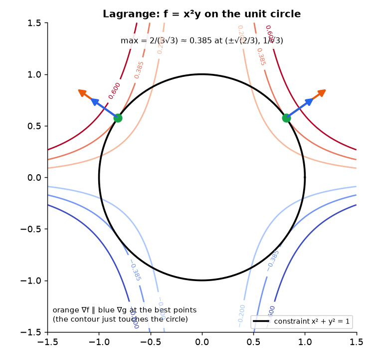
*📊 The best points are where a contour of x²y just touches the circle; there ∇f and ∇g line up.*

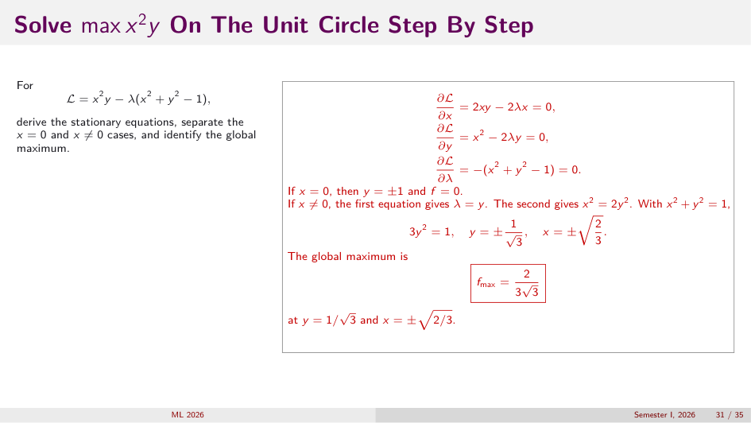
*👀 Slide 31 — The worked max of x²y on the unit circle.*

$\mathcal L = x^2y - \lambda(x^2 + y^2 - 1)$.

**Stationary equations:**
$$\frac{\partial\mathcal L}{\partial x} = 2xy - 2\lambda x = 0,\qquad\frac{\partial\mathcal L}{\partial y} = x^2 - 2\lambda y = 0,\qquad\frac{\partial\mathcal L}{\partial\lambda} = -(x^2 + y^2 - 1) = 0.$$

The first factorises: $2x(y - \lambda) = 0$, so **either $x = 0$ or $\lambda = y$**. (Don't divide by $x$ without splitting cases.)

**Case $x = 0$:** constraint ⇒ $y = \pm1$; second equation ⇒ $0 = 2\lambda y$ ⇒ $\lambda = 0$. Then $f = 0$.

**Case $x\ne0$:** $\lambda = y$. Second equation: $x^2 = 2\lambda y = 2y^2$. Constraint: $2y^2 + y^2 = 1$ ⇒ $y^2 = \tfrac13$:
$$y = \pm\frac1{\sqrt3},\qquad x = \pm\sqrt{\tfrac23}.$$

**Evaluate every candidate:**

| $x$ | $y$ | $f = x^2y$ |
|---|---|---|
| $0$ | $\pm1$ | $0$ |
| $\pm\sqrt{2/3}$ | $+1/\sqrt3$ | $\tfrac23\cdot\tfrac1{\sqrt3} = \tfrac{2}{3\sqrt3}\approx0.385$ |
| $\pm\sqrt{2/3}$ | $-1/\sqrt3$ | $-\tfrac{2}{3\sqrt3}\approx-0.385$ |

**Global maximum** $f_{\max} = \dfrac{2}{3\sqrt3}$ at $y = 1/\sqrt3$, $x = \pm\sqrt{2/3}$. (The negative ones are the global minima.)

**Check $\nabla f\parallel\nabla g$** at $(\sqrt{2/3}, 1/\sqrt3)$: $\nabla f = (2xy, x^2) = (2\sqrt2/3,\ 2/3)$; $\nabla g = (2x, 2y) = (2\sqrt{2/3},\ 2/\sqrt3)$. Ratio in both components: $\lambda = \tfrac{1}{\sqrt3} = y$ ✓.

## Slide 32 — The PCA Constraint Produces An Eigenvalue Equation

Same method on $\max_qq^\top Cq$ s.t. $q^\top q = 1$:
$$\mathcal L(q,\lambda) = q^\top Cq - \lambda(q^\top q - 1).$$
Because $C$ is symmetric, $\nabla_q(q^\top Cq) = 2Cq$ and $\nabla_q(q^\top q) = 2q$ (L4 A9):
$$\nabla_q\mathcal L = 2Cq - 2\lambda q = 0\quad\Longrightarrow\quad\boxed{Cq = \lambda q}.$$
**Every stationary direction is an eigenvector of $C$, and the multiplier is its eigenvalue.**

Which one wins? At a unit eigenvector $q_j$:
$$q_j^\top Cq_j = q_j^\top(\lambda_jq_j) = \lambda_j\,q_j^\top q_j = \lambda_j.$$
The **variance captured equals the eigenvalue**. So maximising projected variance means
$$q^* = q_1,\qquad\lambda_1 = \max_j\lambda_j.$$
(The Rayleigh bound, A6, confirms no non-eigenvector does better.)

The candidate was named $q$; after optimisation, the winning direction is the top eigenvector $q_1$.

**Toy storms:** $C = \tfrac13\begin{bmatrix}10&6\\6&10\end{bmatrix}$: eigenvalues $\tfrac{10\pm6}{3} = \tfrac{16}3,\ \tfrac43$ ($5.33$, $1.33$), eigenvectors $\tfrac1{\sqrt2}(1,1)$, $\tfrac1{\sqrt2}(1,-1)$. Exactly the two variances in the slide-28 table: PC1 = "storm intensity" (rain and wetness together), PC2 = "rain vs wetness contrast".

## Slide 33 — Keeping All $r$ Informative Directions Is Exact

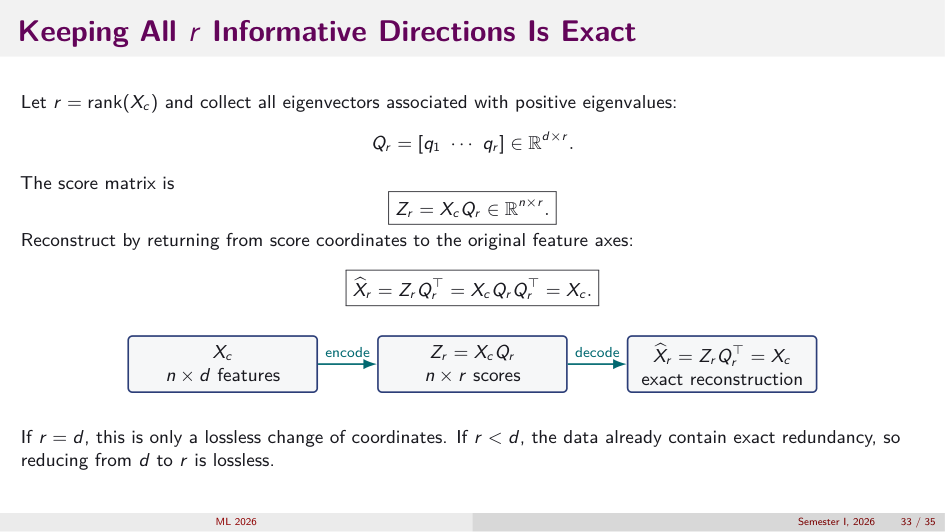
*👀 Slide 33 — Keep all r directions: exact reconstruction, just new coordinates.*

Let $r = \mathrm{rank}(X_c)$ and collect the eigenvectors with **positive** eigenvalues: $Q_r = [q_1\ \cdots\ q_r]\in\mathbb R^{d\times r}$.

- **Encode** (scores): $Z_r = X_cQ_r\in\mathbb R^{n\times r}$.
- **Decode** (back to feature axes): $\hat X_r = Z_rQ_r^\top = X_cQ_rQ_r^\top = X_c$.

Why exactly $X_c$: the dropped directions $q_{r+1}..q_d$ have $\lambda_j = 0$, so $\lVert X_cq_j\rVert^2 = (n-1)\lambda_j = 0$, i.e. $X_cq_j = 0$. Then $X_c = X_c\sum_{j=1}^dq_jq_j^\top = X_cQ_rQ_r^\top + 0$.

- If $r = d$: just a **lossless change of coordinates** (a rotation).
- If $r < d$: the data already contain **exact redundancy** (some feature is a combination of others), so going from $d$ to $r$ numbers is lossless.

**Toy storms:** $r = d = 2$ (both eigenvalues positive). $Z_2 = X_cQ$ = rows $(2.83, 0), (0, 1.41), (0, -1.41), (-2.83, 0)$: the same four storms in rotated axes.

## Slide 34 — Keeping Only $k < r$ Directions Compresses With Loss

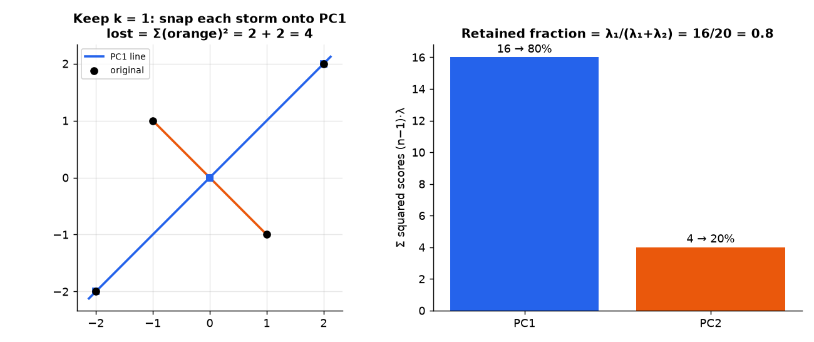
*📊 Keep 1 of 2 directions: each storm snaps onto PC1; the lost part is the orange gaps (4 of 20, so 80% kept).*

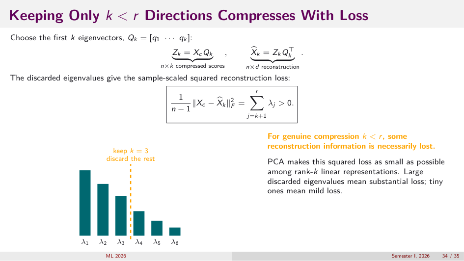
*👀 Slide 34 — Keep k < r: the bar chart shows how much each dropped λ costs.*

Choose the first $k$ eigenvectors $Q_k = [q_1\cdots q_k]$:
$$\underbrace{Z_k = X_cQ_k}_{n\times k\text{ compressed scores}},\qquad\underbrace{\hat X_k = Z_kQ_k^\top}_{n\times d\text{ reconstruction}}.$$
The discarded eigenvalues give the sample-scaled squared reconstruction loss (proof in A11):
$$\frac1{n-1}\lVert X_c - \hat X_k\rVert_F^2 = \sum_{j=k+1}^r\lambda_j > 0.$$
Bar-chart picture: $\lambda_1\ge\lambda_2\ge\cdots\ge\lambda_6$; keep $k = 3$, discard the rest; the discarded bars' total height is the loss.

- For genuine compression ($k < r$) some information is **necessarily** lost.
- PCA makes this squared loss **as small as possible** among all rank-$k$ linear representations (you drop the smallest eigenvalues, so the sum you lose is the smallest possible).
- Large discarded eigenvalues = substantial loss; tiny ones = mild loss.

**Toy storms, $k = 1$:** $z = (2.83, 0, 0, -2.83)$, $\hat X_1 = zq_1^\top$:

| storm | $x_{i,c}$ | $\hat x_i = z_iq_1$ | error |
|---|---|---|---|
| 1 | $(2,2)$ | $2.83\cdot\tfrac1{\sqrt2}(1,1) = (2,2)$ | $(0,0)$ |
| 2 | $(1,-1)$ | $(0,0)$ | $(1,-1)$ |
| 3 | $(-1,1)$ | $(0,0)$ | $(-1,1)$ |
| 4 | $(-2,-2)$ | $(-2,-2)$ | $(0,0)$ |

$\lVert X_c - \hat X_1\rVert_F^2 = 1 + 1 + 1 + 1 = 4$; divided by $n - 1 = 3$: $\tfrac43 = \lambda_2$ ✓.

## Slide 35 — What PCA Preserves, What It May Lose, And Why ML Cares

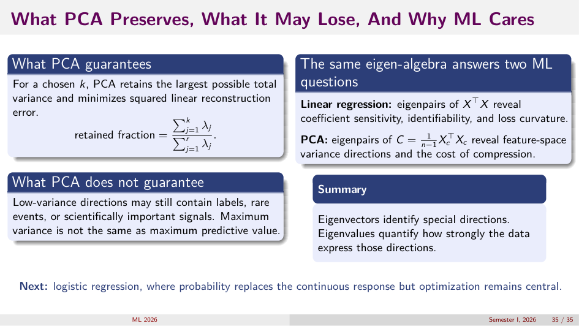
*👀 Slide 35 — What PCA guarantees, what it doesn't, and the shared eigen-algebra.*

**What PCA guarantees.** For a chosen $k$, PCA retains the **largest possible total variance** and **minimises squared linear reconstruction error**.
$$\text{retained fraction} = \frac{\sum_{j=1}^k\lambda_j}{\sum_{j=1}^r\lambda_j}.$$
(Toy storms, $k = 1$: $\tfrac{16/3}{20/3} = 80\%$. The denominator is also $\mathrm{trace}(C)$ = total variance $= 3.33 + 3.33$ ✓.)

**What PCA does not guarantee.** Low-variance directions may still contain **labels, rare events, or scientifically important signals**. Maximum variance ≠ maximum predictive value. (PCA never looks at $y$. E.g. the small "rain vs wetness contrast" might be exactly what separates flash floods from slow ones.)

> ⚠️ PCA is also **scale-sensitive**: a feature in mm has bigger variance than the same feature in m. Standardise features first if units differ.

**The same eigen-algebra answers two ML questions:**

| | Matrix | Eigenpairs reveal |
|---|---|---|
| **linear regression** | $X^\top X$ | coefficient sensitivity, identifiability, loss curvature |
| **PCA** | $C = \frac1{n-1}X_c^\top X_c$ | feature-space variance directions, the cost of compression |

**Summary:** eigenvectors identify **special directions**; eigenvalues quantify **how strongly the data express** them.

**Next:** logistic regression, where probability replaces the continuous response but optimisation remains central.

---

# Part C — Practice

1. For $X$ with columns $\mathbf 1 = (1,1,1)$ and $x = (1,2,3)$, write $X^\top X$. Interpret each entry as a Gram-matrix dot product.
2. Using the componentwise formula $\partial J/\partial\theta_j = \sum_ix_{ij}(x_i^\top\theta - y_i)$, compute $\nabla J$ at $\theta = (0,1)$ for the data of Q1 with $y = (2,2,4)$.
3. Find the eigenvalues and unit eigenvectors of $\begin{bmatrix}4&1\\1&4\end{bmatrix}$. Verify $G = Q\Lambda Q^\top$.
4. Find the eigenvalues of $\begin{bmatrix}2&1\\1&3\end{bmatrix}$ with the trace/determinant shortcut. What is the condition number?
5. Show that eigenvectors of a symmetric matrix with different eigenvalues are orthogonal. (Hint: compute $q_1^\top Gq_2$ two ways.)
6. With $q_1 = \tfrac1{\sqrt2}(1,1)$, $q_2 = \tfrac1{\sqrt2}(1,-1)$, find the eigen-coordinates $a$ of $\theta = (5, -1)$ and rebuild $\theta$ from them.
7. $X^\top X = \begin{bmatrix}5&3\\3&5\end{bmatrix}$, $X^\top y = (8, 4)$. Solve the normal equation **through the eigenbasis** ($b = Q^\top X^\top y$, $a_j = b_j/\lambda_j$, $\hat\theta = Qa$). Check by direct solve.
8. Show $\lVert Xq_j\rVert^2 = \lambda_j$ for a unit eigenvector of $X^\top X$. What does $\lambda_j = 0$ mean for predictions?
9. Why can't we write $\hat\theta = (X^\top X)^{-1}X^\top y$ if two predictor columns are identical? Does the normal equation still have a solution?
10. Maximise $f(x,y) = xy$ on $x^2 + y^2 = 1$ with Lagrange multipliers. Which $\lambda$ goes with the maximum?
11. Points $(3,1), (1,3), (-1,-3), (-3,-1)$ (already centred). Compute $C$, its eigenpairs, PC1 scores, and the retained-variance fraction for $k = 1$.
12. Why must PCA constrain $q^\top q = 1$? What happens to $\max q^\top Cq$ without it?
13. For Q11, compute the $k = 1$ reconstruction error $\tfrac1{n-1}\lVert X_c - \hat X_1\rVert_F^2$ directly and compare with $\lambda_2$.
14. A colleague drops all but the top 2 PCs before training a classifier and accuracy collapses. Give one reason that could happen.

<b>Answers</b>

1. $X^\top X = \begin{bmatrix}3&6\\6&14\end{bmatrix}$: $\mathbf 1^\top\mathbf 1 = 3 = n$, $\mathbf 1^\top x = 6 = \sum x_i$, $x^\top x = 14 = \sum x_i^2$.
2. $X\theta = (1,2,3)$, $X\theta - y = (-1, 0, -1)$. $\partial/\partial\theta_0 = -1 + 0 - 1 = -2$; $\partial/\partial\theta_1 = 1(-1) + 2(0) + 3(-1) = -4$. $\nabla J = (-2, -4)$.
3. $\lambda = 4\pm1 = 5, 3$; $q_1 = \tfrac1{\sqrt2}(1,1)$, $q_2 = \tfrac1{\sqrt2}(1,-1)$. $5q_1q_1^\top + 3q_2q_2^\top = \tfrac52\begin{bmatrix}1&1\\1&1\end{bmatrix} + \tfrac32\begin{bmatrix}1&-1\\-1&1\end{bmatrix} = \begin{bmatrix}4&1\\1&4\end{bmatrix}$ ✓.
4. $T = 5$, $D = 5$: $\lambda = 2.5\pm\sqrt{6.25 - 5} = 2.5\pm1.118 = 3.618,\ 1.382$. $\kappa = 3.618/1.382\approx2.62$.
5. $q_1^\top Gq_2 = q_1^\top(\lambda_2q_2) = \lambda_2q_1^\top q_2$. Also $q_1^\top Gq_2 = (G^\top q_1)^\top q_2 = (Gq_1)^\top q_2 = \lambda_1q_1^\top q_2$ (uses $G^\top = G$). Subtract: $(\lambda_1 - \lambda_2)q_1^\top q_2 = 0$, and $\lambda_1\ne\lambda_2$ ⇒ $q_1^\top q_2 = 0$.
6. $a_1 = \tfrac{4}{\sqrt2} = 2\sqrt2$, $a_2 = \tfrac{6}{\sqrt2} = 3\sqrt2$. $2\sqrt2q_1 + 3\sqrt2q_2 = (2,2) + (3,-3) = (5,-1)$ ✓.
7. $b_1 = \tfrac{12}{\sqrt2}$, $b_2 = \tfrac{4}{\sqrt2}$. $a_1 = \tfrac{12}{8\sqrt2} = \tfrac{1.5}{\sqrt2}$, $a_2 = \tfrac{4}{2\sqrt2} = \tfrac{2}{\sqrt2}$. $\hat\theta = 0.75(1,1) + 1(1,-1) = (1.75, -0.25)$. Direct: $5(1.75) + 3(-0.25) = 8$ ✓, $3(1.75) + 5(-0.25) = 4$ ✓.
8. $\lVert Xq_j\rVert^2 = q_j^\top X^\top Xq_j = q_j^\top\lambda_jq_j = \lambda_j$. $\lambda_j = 0$ ⇒ $Xq_j = 0$: moving coefficients along $q_j$ changes **no** prediction, so the data say nothing about that direction.
9. Identical columns ⇒ $Xv = 0$ for $v = (1,-1,0,\dots)$ ⇒ $X^\top X$ singular (eigenvalue 0) ⇒ no inverse. The normal equation still has solutions (always: $X^\top y$ lies in $\mathrm{Col}(X^\top) = \mathrm{Col}(X^\top X)$), infinitely many.
10. $\nabla f = (y, x) = \lambda(2x, 2y)$ ⇒ $y = 2\lambda x$, $x = 2\lambda y$ ⇒ $x = 4\lambda^2x$. $x = 0$ forces $y = 0$, violating the constraint, so $\lambda = \pm\tfrac12$. $\lambda = \tfrac12$: $x = y = \pm\tfrac1{\sqrt2}$, $f = \tfrac12$ (max). $\lambda = -\tfrac12$: $x = -y$, $f = -\tfrac12$ (min). The multiplier equals the optimal value here (like PCA, where $\lambda$ = variance).
11. $X_c^\top X_c = \begin{bmatrix}9+1+1+9&3+3+3+3\\12&1+9+9+1\end{bmatrix} = \begin{bmatrix}20&12\\12&20\end{bmatrix}$, $C = \tfrac13\begin{bmatrix}20&12\\12&20\end{bmatrix}$. $\lambda = \tfrac{32}{3}, \tfrac83$; $q_1 = \tfrac1{\sqrt2}(1,1)$, $q_2 = \tfrac1{\sqrt2}(1,-1)$. Scores $z = \tfrac1{\sqrt2}(4, 4, -4, -4) = (2.83, 2.83, -2.83, -2.83)$. Retained $= \tfrac{32}{40} = 80\%$.
12. $q^\top Cq$ scales as $c^2$ when $q\to cq$, so without a constraint the max is $+\infty$ (just make $q$ longer). The constraint compares directions, not lengths.
13. $\hat x_i = z_iq_1$: $(2,2), (2,2), (-2,-2), (-2,-2)$. Errors $(1,-1), (-1,1), (1,-1), (-1,1)$, each squared norm 2, total 8. $8/3 = \lambda_2$ ✓.
14. PCA ignores the labels: the class-separating signal may sit in a low-variance direction that got dropped (slide 35). Also unscaled features can let one large-unit feature dominate the top PCs.

