# Lecture 6 — From Curvature to Logistic Regression

> ES 335 / ES 678 Machine Learning, Sem I 2026 — Prof. Udit Bhatia
> Source: `Lectures/L06_logistic_regression_1.pdf` (37 slides) · Previous: [`L05_normal_equation_eigendirections_pca.md`](L05_normal_equation_eigendirections_pca.md) · Next: [`L07_regularization_ridge_lasso_elastic_net.md`](L07_regularization_ridge_lasso_elastic_net.md)

**How to use this file.** Part A builds the *new* maths Lecture 6 needs, on top of Lectures 1–5: the **Hessian** and the **curvature test** for many variables, then **probability → odds → log-odds → sigmoid**, the **Bernoulli likelihood**, the **vector chain rule** and **Newton's method**. Part B goes through all 37 slides. Every derivation is expanded line by line and checked with numbers on a tiny 6-road dataset that runs through the whole note. Part C is practice with answers.

**What this lecture is really about:** the linear-regression recipe from L3–L5, re-run for a **yes/no** outcome.

$$\underbrace{\Pr(Y=1\mid x) = \sigma(x^\top\theta)}_{\text{probability model}}\ \xrightarrow{\ -\log\text{ likelihood}\ }\ \underbrace{J(\theta) = \sum_i\big[\log(1+e^{z_i}) - y_iz_i\big]}_{\text{binary cross-entropy}}\ \xrightarrow{\ \nabla,\ \nabla^2\ }\ \underbrace{X^\top(p-y),\quad X^\top WX\succeq0}_{\text{gradient, convex Hessian}}$$

The first half of the lecture builds the tool (**curvature in many directions = eigenvalues of the Hessian**). The second half builds the model and then uses the tool to prove that its loss is **convex**: one valley, no false minima.

## Contents

**Part A — Maths from the ground up**
1. [Curvature in one variable](#a1-curvature-in-one-variable)
2. [Gradient and Hessian](#a2-gradient-and-hessian)
3. [Slicing a surface along a direction](#a3-slicing-a-surface-along-a-direction)
4. [Taylor's quadratic approximation](#a4-taylors-quadratic-approximation)
5. [The eigenvalue test for curvature](#a5-the-eigenvalue-test-for-curvature)
6. [Convex, strictly convex, unique, finite](#a6-convex-strictly-convex-unique-finite)
7. [Probability, odds, log-odds and the sigmoid](#a7-probability-odds-log-odds-and-the-sigmoid)
8. [The Bernoulli distribution and its likelihood](#a8-the-bernoulli-distribution-and-its-likelihood)
9. [Binary cross-entropy (log loss)](#a9-binary-cross-entropy-log-loss)
10. [The chain rule with a vector parameter](#a10-the-chain-rule-with-a-vector-parameter)
11. [Outer products and $X^\top WX$](#a11-outer-products-and-xwx)
12. [Gradient descent vs Newton (IRLS)](#a12-gradient-descent-vs-newton-irls)

**Part B — Slides** · [All 37 slides](#part-b--slide-by-slide-all-37-slides)

**Part C — Practice** · [Jump](#part-c--practice)

---

# Part A — Maths From the Ground Up

## A1. Curvature in one variable

For $f(t)$: the **first derivative** $f'(t)$ is the slope; the **second derivative** $f''(t)$ is how fast the slope itself changes.

| $f''(t)$ | Shape | Example |
|---|---|---|
| $> 0$ | bends **up** (a cup ∪): slope increasing | $t^2$: $f'' = 2$ |
| $= 0$ | straight line | $3t+1$: $f'' = 0$ |
| $< 0$ | bends **down** (a cap ∩) | $-t^2$: $f'' = -2$ |

For a parabola $f(t) = at^2 + bt + c$: $f' = 2at + b$, $f'' = 2a$. The sign of $a$ is the whole story.

**Curvature test (1-D).** A twice-differentiable $f$ is **convex** (every chord lies above the curve, L2 §A7) **iff** $f''(t)\ge0$ for every $t$.

Why it matters: at a convex function's flat point ($f' = 0$) you are at the **global** minimum. No other valley can exist.

## A2. Gradient and Hessian

With $\theta = (\theta_1,\dots,\theta_d)$ there are $d$ first partials and $d\times d$ second partials.

$$\nabla J(\theta) = \begin{bmatrix}\partial J/\partial\theta_1\\\vdots\\\partial J/\partial\theta_d\end{bmatrix}\ (d\times1),\qquad H(\theta) = \nabla^2J(\theta) = \begin{bmatrix}\dfrac{\partial^2J}{\partial\theta_1^2}&\cdots&\dfrac{\partial^2J}{\partial\theta_1\partial\theta_d}\\\vdots&\ddots&\vdots\\\dfrac{\partial^2J}{\partial\theta_d\partial\theta_1}&\cdots&\dfrac{\partial^2J}{\partial\theta_d^2}\end{bmatrix}\ (d\times d).$$

**Reading the Hessian.**
- **Diagonal** $H_{jj}$: ordinary 1-D curvature along axis $j$ (hold all other $\theta$'s fixed).
- **Off-diagonal** $H_{jk}$: how moving $\theta_k$ changes the slope in the $\theta_j$ direction ("coupling").
- If second partials are continuous, the order doesn't matter: $\partial^2J/\partial\theta_j\partial\theta_k = \partial^2J/\partial\theta_k\partial\theta_j$ → **$H$ is symmetric** (Schwarz/Clairaut). That's what lets us use the spectral theorem from L5.

**Worked example (slide 7).** $J(\theta_1,\theta_2) = 2\theta_1^2 + 2\theta_1\theta_2 + \theta_2^2$.

| Step | Result |
|---|---|
| $\partial J/\partial\theta_1$ | $4\theta_1 + 2\theta_2$ |
| $\partial J/\partial\theta_2$ | $2\theta_1 + 2\theta_2$ |
| $\partial^2J/\partial\theta_1^2$ (differentiate row 1 by $\theta_1$) | $4$ |
| $\partial^2J/\partial\theta_1\partial\theta_2$ (row 1 by $\theta_2$) | $2$ |
| $\partial^2J/\partial\theta_2\partial\theta_1$ (row 2 by $\theta_1$) | $2$ ✓ same |
| $\partial^2J/\partial\theta_2^2$ | $2$ |

$$H = \begin{bmatrix}4&2\\2&2\end{bmatrix}\quad(\text{constant, because } J \text{ is quadratic}).$$

**Shortcut for quadratics.** If $J(\theta) = \tfrac12\theta^\top A\theta + b^\top\theta + c$ with $A$ symmetric, then $\nabla J = A\theta + b$ and $H = A$. Here $J = \tfrac12\theta^\top\begin{bmatrix}4&2\\2&2\end{bmatrix}\theta$ ✓. Least squares $J = \tfrac12\lVert y - X\theta\rVert^2$ has $H = X^\top X$ (L5).

## A3. Slicing a surface along a direction

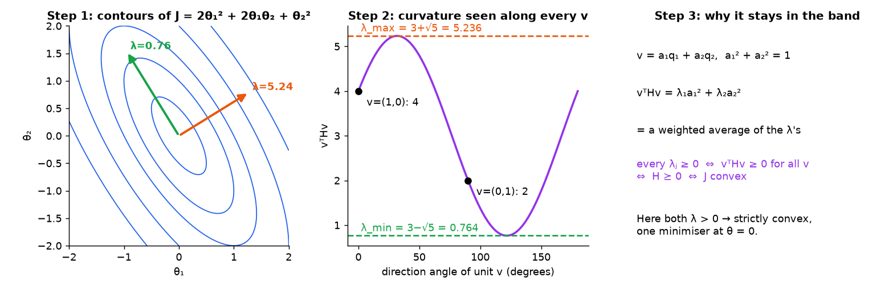
*📊 Contours of J = 2θ₁² + 2θ₁θ₂ + θ₂², the curvature vᵀHv for every unit direction, and why it is trapped between the two eigenvalues.*

A multivariable function is hard to "see". So **cut it with a line** and look at the 1-D slice:

$$\theta(t) = \theta + tv\ \ (v \text{ a fixed unit direction}),\qquad g(t) = J(\theta + tv).$$

$g$ is an ordinary function of one number $t$, so A1 applies.

**First derivative** (chain rule; each coordinate $\theta_k + tv_k$ has $t$-derivative $v_k$):
$$g'(t) = \sum_{k=1}^d\frac{\partial J}{\partial\theta_k}(\theta+tv)\,v_k = \nabla J(\theta+tv)^\top v.$$
**Second derivative** (differentiate each $\partial J/\partial\theta_k$ again, same chain rule):
$$g''(t) = \sum_{j=1}^d\sum_{k=1}^d v_j\,\frac{\partial^2J}{\partial\theta_j\partial\theta_k}(\theta+tv)\,v_k = v^\top H(\theta+tv)\,v.$$
At $t = 0$: **$g''(0) = v^\top H v$ is the curvature you feel walking through $\theta$ in direction $v$.**

**Numbers ($H$ from A2).**
- $v = (1,0)$: $v^\top Hv = H_{11} = 4$.
- $v = (0,1)$: $v^\top Hv = H_{22} = 2$.
- $v = \tfrac1{\sqrt2}(1,1)$: $\tfrac12(4 + 2 + 2 + 2) = 5$.
- $v = \tfrac1{\sqrt2}(1,-1)$: $\tfrac12(4 - 2 - 2 + 2) = 1$.

Different directions, different curvatures. Which is the biggest? Which is the smallest? → A5.

## A4. Taylor's quadratic approximation

1-D Taylor at $t = 0$: $g(t)\approx g(0) + tg'(0) + \tfrac12t^2g''(0)$. Substitute $g'(0) = \nabla J^\top v$, $g''(0) = v^\top Hv$ and write the step as $\Delta = tv$:
$$J(\theta+\Delta)\approx J(\theta) + \underbrace{\nabla J(\theta)^\top\Delta}_{\text{first order: tilt}} + \underbrace{\tfrac12\Delta^\top H(\theta)\Delta}_{\text{second order: bend}}.$$

- $\nabla J^\top\Delta$ says whether $J$ starts going up or down along $\Delta$.
- $\Delta^\top H\Delta$ is a **number** (not the vector $H\Delta$): the bend along $\Delta$.
- At a stationary point $\nabla J = 0$, only the bend is left: $J(\theta+\Delta) - J(\theta)\approx\tfrac12\Delta^\top H\Delta$. If that is $\ge 0$ for every $\Delta$, you're at a minimum.
- For a quadratic $J$, the approximation is **exact** (L5 slide 23).

## A5. The eigenvalue test for curvature

$H$ is symmetric, so (spectral theorem, L5 §A6) $H = Q\Lambda Q^\top$ with orthonormal eigenvectors $q_j$ ($Hq_j = \lambda_jq_j$).

**Step 1 — write $v$ in eigen-coordinates.** $a = Q^\top v$ ($a_j = q_j^\top v$, the shadow of $v$ on $q_j$), and $v = Qa = \sum_ja_jq_j$. Since $Q^\top Q = I$, $\lVert a\rVert = \lVert v\rVert = 1$, i.e. $\sum_ja_j^2 = 1$.

**Step 2 — substitute.**
$$v^\top Hv = (Qa)^\top(Q\Lambda Q^\top)(Qa) = a^\top\underbrace{Q^\top Q}_{I}\Lambda\underbrace{Q^\top Q}_{I}a = a^\top\Lambda a = \sum_{j=1}^d\lambda_ja_j^2.$$

**Step 3 — read it.** Weights $a_j^2\ge0$ sum to 1, so $v^\top Hv$ is a **weighted average of the eigenvalues**:
$$\lambda_{\min}\le v^\top Hv\le\lambda_{\max},\qquad\text{with equality at } v = q_{\min},\ q_{\max}.$$

**Step 4 — the test.**
$$v^\top Hv\ge0\ \text{for all } v\iff\lambda_j\ge0\ \text{for all } j\iff H\succeq0\ (\text{PSD}).$$
(⇐: an average of non-negative numbers is non-negative. ⇒: pick $v = q_j$, then $v^\top Hv = \lambda_j$, so each $\lambda_j$ must be $\ge 0$.)

**Numbers.** $H = \begin{bmatrix}4&2\\2&2\end{bmatrix}$: trace $T = 6$, det $D = 8 - 4 = 4$, so $\lambda = \tfrac T2\pm\sqrt{\tfrac{T^2}4 - D} = 3\pm\sqrt5 = 5.236,\ 0.764$. The four curvatures from A3 (4, 2, 5, 1) all lie in $[0.764,\ 5.236]$ ✓. Both $\lambda > 0$ → $J$ is strictly convex.

## A6. Convex, strictly convex, unique, finite

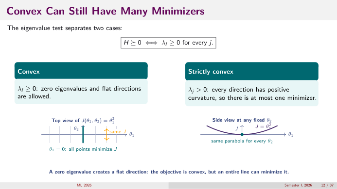
*👀 Slide 12 — J = θ₁² is convex but the whole line θ₁ = 0 minimises it: a zero eigenvalue makes a flat direction.*

Four different questions people often blur:

| Question | Condition | Example |
|---|---|---|
| **Convex?** (no false valleys) | $H\succeq0$ everywhere: all $\lambda_j\ge0$ | $J = \theta_1^2$ in 2-D: $H = \mathrm{diag}(2,0)$ |
| **Strictly convex?** (at most one minimiser) | $H\succ0$: all $\lambda_j > 0$ | $J = \theta_1^2 + \theta_2^2$ |
| **Unique minimiser?** | strictly convex *and* a minimiser exists | — |
| **Finite minimiser exists?** | not guaranteed even if strictly convex! | $J(\theta) = e^{-\theta}$: $J'' > 0$ but $\inf = 0$ only as $\theta\to\infty$ |

So: **zero eigenvalue ⇒ flat direction ⇒ possibly a whole line of minimisers** (slide 12). **Strict convexity ⇒ at most one** minimiser, but it might sit "at infinity" (logistic regression under **complete separation**, slide 33).

## A7. Probability, odds, log-odds and the sigmoid

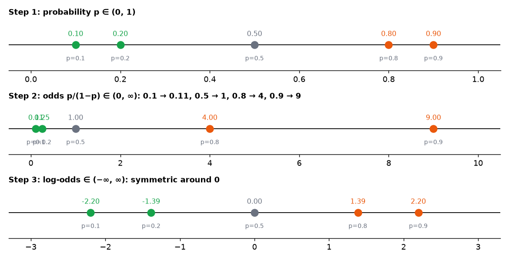
*📊 Three number lines: probabilities 0.1…0.9 → odds 0.11…9 → log-odds −2.2…2.2. Each step widens the range.*

**Problem:** a linear score $z = x^\top\theta$ can be any real number, but a probability must be in $(0,1)$. We need a map between them. Build it in three steps.

**Step 1 — odds.** Compare event to non-event:
$$\text{odds} = \frac{p}{1-p}\in(0,\infty).$$
$p = 0.8$ → odds $= 0.8/0.2 = 4$ ("4 floods for every 1 non-flood"). $p = 0.5$ → 1. $p = 0.1$ → $1/9\approx0.111$.

**Step 2 — log-odds (the "logit").**
$$\mathrm{logit}(p) = \log\frac{p}{1-p}\in(-\infty,\infty).$$
$p = 0.5\to0$; $p = 0.9\to\log9 = 2.197$; $p = 0.1\to\log(1/9) = -2.197$. **Swapping event and non-event only flips the sign** ($\log\frac{1-p}{p} = -\log\frac p{1-p}$).

**Step 3 — set logit = linear score**, then solve for $p$:

| Line | Operation |
|---|---|
| $\log\dfrac{p}{1-p} = z$ | the modelling choice |
| $\dfrac{p}{1-p} = e^z$ | exponentiate both sides |
| $p = e^z(1-p) = e^z - e^zp$ | multiply out |
| $p + e^zp = e^z\ \Rightarrow\ p(1+e^z) = e^z$ | collect $p$ |
| $p = \dfrac{e^z}{1+e^z} = \dfrac{1}{1+e^{-z}} =: \sigma(z)$ | divide top and bottom by $e^z$ |

**The sigmoid is just the inverse of the logit.** Nothing decorative.

*The logistic (sigmoid) curve σ(z) = 1/(1+e^−z). (Wikimedia Commons: [Logistic-curve.svg](https://commons.wikimedia.org/wiki/File:Logistic-curve.svg), Public domain)*

**Sigmoid facts to know cold.**

| Fact | Why |
|---|---|
| $\sigma(0) = \tfrac12$ | $1/(1+1)$ |
| $\sigma(-z) = 1 - \sigma(z)$ | $\frac1{1+e^z} = \frac{e^{-z}}{e^{-z}+1} = 1 - \frac1{1+e^{-z}}$ |
| $\sigma(3)\approx0.953$, $\sigma(-3)\approx0.047$ | $1/(1+e^{-3}) = 1/1.0498$ |
| $+1$ on $z$ ⇒ odds $\times e\approx2.718$ | odds $= e^z$, and $e^{z+1} = e\cdot e^z$ |
| $\sigma'(z) = \sigma(z)(1-\sigma(z))$ | slide 29 |
| $1 - \sigma(z) = \dfrac{1}{1+e^z}$ | used in slide 26 |

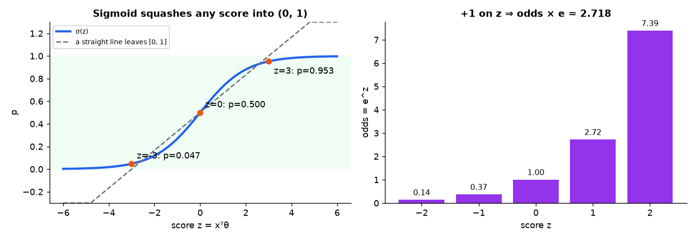
*📊 Left: sigmoid vs a straight line. Right: each extra unit of score multiplies the odds by e.*

**Coefficient interpretation.** If $z = \theta_0 + \theta_1x_1 + \dots$, raising $x_1$ by 1 adds $\theta_1$ to the log-odds, i.e. **multiplies the odds by $e^{\theta_1}$**. It does *not* add a fixed amount to $p$ (the effect on $p$ is biggest near $p = \tfrac12$).

## A8. The Bernoulli distribution and its likelihood

A **Bernoulli($p$)** variable takes value 1 with probability $p$, and 0 with probability $1-p$ (L3). One formula covers both:
$$\Pr(Y = y) = p^y(1-p)^{1-y},\qquad y\in\{0,1\}.$$
Check: $y = 1$: $p^1(1-p)^0 = p$ ✓. $y = 0$: $p^0(1-p)^1 = 1-p$ ✓. The exponent acts as a **switch**.

**Dataset likelihood.** If observations are **conditionally independent given their $x_i$**, multiply:
$$L(\theta) = \prod_{i=1}^np_i^{y_i}(1-p_i)^{1-y_i},\qquad p_i = \sigma(x_i^\top\theta).$$

**Log rules used** (L1 §10): $\log\prod a_i = \sum\log a_i$ and $\log a^b = b\log a$. So
$$\log L(\theta) = \sum_{i=1}^n\big[y_i\log p_i + (1-y_i)\log(1-p_i)\big].$$
Logs turn a product of tiny numbers (underflow risk) into a sum, and don't move the argmax (log is increasing).

> ⚠️ "Conditionally independent observations" is about **rows** (road 1's outcome doesn't affect road 2's, once you know both $x$'s). It says nothing about **columns** (rain and slope may be correlated).

## A9. Binary cross-entropy (log loss)

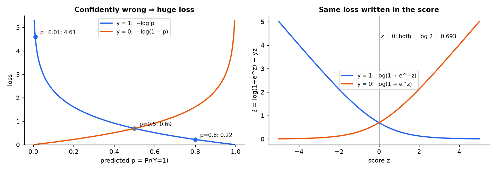
*📊 Left: −log p explodes as p→0 when y = 1 (p = 0.01 costs 4.61). Right: the same loss as a function of the score z.*

Maximising $\log L$ = minimising its negative:
$$J(\theta) = -\sum_i\big[y_i\log p_i + (1-y_i)\log(1-p_i)\big].$$
Three names, one thing: **Bernoulli negative log-likelihood = binary cross-entropy = logistic loss.**

**Per-example loss** $\ell_i$: if $y_i = 1$ it is $-\log p_i$; if $y_i = 0$ it is $-\log(1-p_i)$.

| $y$ | $p$ | loss | comment |
|---|---|---|---|
| 1 | 0.8 | $-\log0.8 = 0.223$ | fairly confident, right → small |
| 1 | 0.5 | $\log2 = 0.693$ | shrug |
| 1 | 0.01 | $-\log0.01 = 4.605$ | **confidently wrong → huge** |
| 0 | 0.01 | $-\log0.99 = 0.010$ | confidently right → ~0 |

**In terms of the score** $z_i$ (slides 26–27): $\ell_i = \log(1+e^{z_i}) - y_iz_i$. For $y = 1$ this is $\log(1+e^{-z})$; for $y = 0$ it is $\log(1+e^{z})$. Both are smooth, convex in $z$, and approach a straight line for large wrong-side scores (unlike the squared loss, which would grow quadratically).

**Why not squared error on $p$?** $(y - \sigma(z))^2$ is **not convex** in $\theta$ and its gradient vanishes when $\sigma$ saturates, so a confidently wrong model barely gets corrected. Log loss comes from the likelihood and is convex (slide 33).

## A10. The chain rule with a vector parameter

$\ell_i$ depends on $\theta$ only through the scalar $z_i = x_i^\top\theta$. So differentiate in two hops:
$$\nabla_\theta\ell_i = \underbrace{\frac{d\ell_i}{dz_i}}_{\text{scalar}}\cdot\underbrace{\nabla_\theta z_i}_{=x_i}.$$
Why $\nabla_\theta(x_i^\top\theta) = x_i$: $x_i^\top\theta = \sum_kx_{ik}\theta_k$, and $\partial/\partial\theta_k$ of that is $x_{ik}$.

**Second derivative of a product $s(\theta)\,x_i$** (a scalar function times a fixed vector): $\nabla_\theta\big[s(\theta)x_i\big] = x_i\,(\nabla_\theta s)^\top$, a $d\times d$ matrix (column $x_i$ times row $\nabla s^\top$).

## A11. Outer products and $X^\top WX$

The **outer product** $x x^\top$ of a column $x\in\mathbb R^d$ is the $d\times d$ matrix with entries $x_jx_k$. Example: $x = (1, 3)$: $xx^\top = \begin{bmatrix}1&3\\3&9\end{bmatrix}$. It is symmetric PSD: $v^\top xx^\top v = (x^\top v)^2\ge0$.

**Sum of weighted outer products = one matrix product.** With rows $x_i^\top$ stacked in $X$ and $W = \mathrm{diag}(w_1..w_n)$:
$$\sum_{i=1}^nw_ix_ix_i^\top = X^\top WX.$$
(Entry $(j,k)$ on both sides is $\sum_iw_ix_{ij}x_{ik}$.) With all $w_i = 1$ this is the Gram matrix $X^\top X$ of L5.

**PSD check:** $v^\top X^\top WXv = \sum_iw_i(x_i^\top v)^2\ge0$ whenever every $w_i\ge0$.

## A12. Gradient descent vs Newton (IRLS)

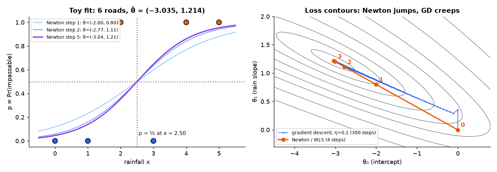
*📊 Toy 6-road data. Left: the fitted sigmoid after Newton steps 1, 2, 5. Right: on the loss contours, Newton reaches θ̂ in ~4 steps; gradient descent (η = 0.1) is still creeping after 300.*

Both solve $\nabla J(\theta) = 0$ iteratively.

| | Gradient descent | Newton's method |
|---|---|---|
| update | $\theta_{t+1} = \theta_t - \eta\nabla J(\theta_t)$ | $\theta_{t+1} = \theta_t - H_t^{-1}\nabla J(\theta_t)$ |
| uses | slope only + a step size $\eta$ you choose | slope **and** curvature |
| idea | walk downhill a little | jump to the bottom of the local Taylor parabola (A4) |
| cost per step | cheap ($O(nd)$) | solve a $d\times d$ system ($O(nd^2 + d^3)$) |
| steps needed | many, esp. in long thin valleys (L5 A7) | few (quadratic convergence near the optimum) |

**Where Newton comes from.** Minimise the Taylor model $J + \nabla J^\top\Delta + \tfrac12\Delta^\top H\Delta$ over $\Delta$: gradient $\nabla J + H\Delta = 0\Rightarrow\Delta = -H^{-1}\nabla J$.

For logistic regression Newton is also called **IRLS** (iteratively reweighted least squares): each step solves a weighted least-squares problem with weights $W_t$.

---

# Part B — Slide by Slide (all 37 slides)

**Running example used below (added here; the slides are symbolic).** Six road segments, one feature (rainfall $x$), with intercept: $x_i^\top = (1, x_i)$, $\theta = (\theta_0,\theta_1)$.

| road $i$ | 1 | 2 | 3 | 4 | 5 | 6 |
|---|---|---|---|---|---|---|
| rainfall $x_i$ | 0 | 1 | 2 | 3 | 4 | 5 |
| impassable $y_i$ | 0 | 0 | 1 | 0 | 1 | 1 |

Final fit (from Newton, slide 34): $\hat\theta = (-3.035,\ 1.214)$, fitted $p = (0.046, 0.139, 0.353, 0.647, 0.861, 0.954)$, $J(\hat\theta) = 2.478$.

## Slide 1 — Title

*Lecture 6: From Curvature to Logistic Regression.* Prof. Udit Bhatia, Civil Engineering; Computer Science and Engineering, Semester I 2026.

## Slide 2 — Course Roadmap: You Are Here

Still in **L3–L6 estimation and linear models** (last lecture of the block). L5 connected the normal equation, eigen-directions and PCA. Today: **(1)** build the Hessian and the curvature test from ordinary derivatives; **(2)** derive logistic regression from probability to loss. Next block (L7–L8): trust and evaluation.

## Slide 3 — Before Classification: One Mathematical Tool Is Missing

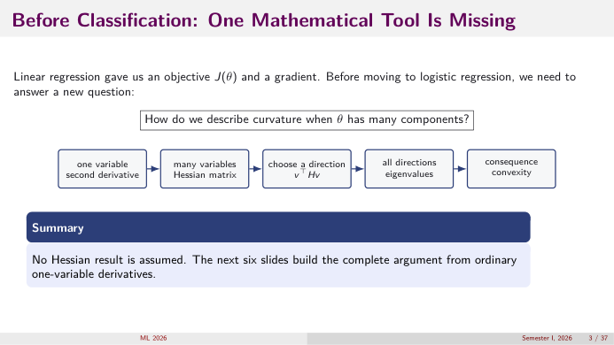
*👀 Slide 3 — The tool chain: second derivative → Hessian → choose a direction vᵀHv → all directions = eigenvalues → convexity.*

Linear regression gave us $J(\theta)$ and a gradient. New question: **how do we describe curvature when $\theta$ has many components?**

one variable → second derivative · many variables → **Hessian matrix** · choose a direction → $v^\top Hv$ · all directions → **eigenvalues** · consequence → **convexity**.

**Summary:** no Hessian result is assumed; slides 6–11 build it from 1-D derivatives (A1–A5).

## Slide 4 — Learning Objectives

1. connect directional curvature $v^\top Hv$ with the eigenvalues of $H$ (A5);
2. distinguish convexity, strict convexity, and uniqueness (A6);
3. derive $p\to$ odds $\to$ log-odds $\to$ sigmoid without a memorised jump (A7);
4. derive binary cross-entropy from the Bernoulli likelihood (A8–A9);
5. derive $\nabla J = X^\top(p-y)$ and $\nabla^2J = X^\top WX$ (A10–A11);
6. prove logistic loss is convex and state when the minimiser is unique;
7. separate **probability estimation** from the final **decision threshold**.

## Slide 5 — Notation: Observed, Chosen, And Computed Objects

| Object | Shape | Meaning | Status |
|---|---|---|---|
| $X = [x_1^\top;\dots;x_n^\top]$ | $n\times d$ | design matrix | observed |
| $y_i\in\{0,1\}$ | scalar | binary outcome | observed |
| $\theta$ | $d\times1$ | model parameters | learned |
| $z_i = x_i^\top\theta$ | scalar | unrestricted linear score | computed |
| $p_i = \Pr(Y_i = 1\mid x_i)$ | scalar in $(0,1)$ | event probability | modelled |
| $p = (p_1..p_n)^\top$ | $n\times1$ | fitted probabilities | computed |
| $W = \mathrm{diag}(p_i(1-p_i))$ | $n\times n$ | curvature weights | computed |
| $H = \nabla^2J(\theta)$ | $d\times d$ | parameter-space curvature | computed |

**Summary:** $y_i$ is the observed **label**, $z_i$ an internal **score**, $p_i$ a modelled **probability**. Three different objects. (Toy road 4: $y_4 = 0$, $z_4 = -3.035 + 1.214\cdot3 = 0.607$, $p_4 = \sigma(0.607) = 0.647$.)

## Slide 6 — Step 1: Curvature In One Variable

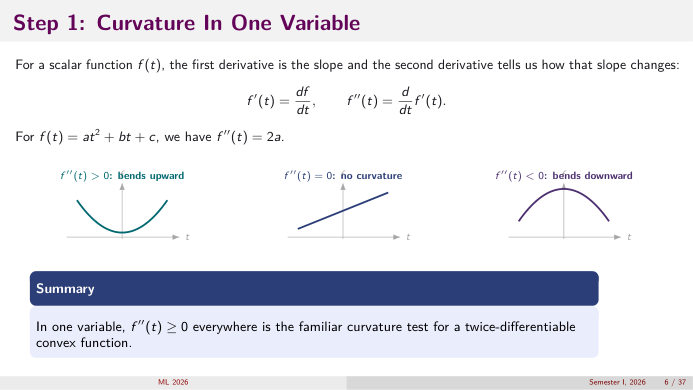
*👀 Slide 6 — f'' > 0 bends up, f'' = 0 is straight, f'' < 0 bends down.*

$f'(t) = df/dt$ (slope), $f''(t) = \frac{d}{dt}f'(t)$ (change of slope). For $f = at^2 + bt + c$: $f'' = 2a$.

**Summary:** in one variable, $f''(t)\ge0$ everywhere is the curvature test for a twice-differentiable convex function (A1).

## Slide 7 — Step 2: Build The Hessian Matrix

The gradient stores the $d$ first partials; the Hessian stores every second partial (A2). Diagonal = curvature along coordinate axes; off-diagonal = how changing one parameter alters the slope with respect to another.

**Example:** $J = 2\theta_1^2 + 2\theta_1\theta_2 + \theta_2^2$ ⇒ $\nabla J = (4\theta_1 + 2\theta_2,\ 2\theta_1 + 2\theta_2)$, $H = \begin{bmatrix}4&2\\2&2\end{bmatrix}$. Every entry is worked in the A2 table.

**Check at a point:** at $\theta = (1, -1)$: $\nabla J = (4 - 2, 2 - 2) = (2, 0)$. So at that point $J$ rises in $\theta_1$ and is flat in $\theta_2$.

## Slide 8 — Step 3: Reduce A Multivariable Move To One Variable

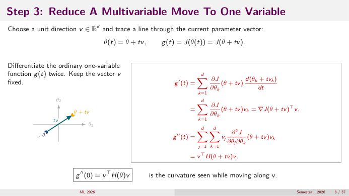
*👀 Slide 8 — Walk from θ along a fixed unit direction v; the height along the walk is a 1-D function g(t).*

$\theta(t) = \theta + tv$, $g(t) = J(\theta + tv)$. Differentiate twice, keeping $v$ fixed (A3):
$$g'(t) = \sum_k\frac{\partial J}{\partial\theta_k}(\theta+tv)\,v_k = \nabla J(\theta+tv)^\top v,\qquad g''(t) = \sum_j\sum_kv_j\frac{\partial^2J}{\partial\theta_j\partial\theta_k}(\theta+tv)v_k = v^\top H(\theta+tv)v.$$
$$\boxed{g''(0) = v^\top H(\theta)v}\ \text{ is the curvature seen while moving along } v.$$

**Numbers:** along $v = \tfrac1{\sqrt2}(1,1)$ from 0: $g(t) = J(t/\sqrt2, t/\sqrt2) = \tfrac{t^2}2(2 + 2 + 1) = 2.5t^2$, so $g'' = 5$ = $v^\top Hv$ ✓.

## Slide 9 — Step 4: Taylor's Quadratic Approximation

$g(t)\approx g(0) + tg'(0) + \tfrac12t^2g''(0)$ ⇒ with $\Delta = tv$:
$$J(\theta+\Delta)\approx J(\theta) + \nabla J(\theta)^\top\Delta + \tfrac12\Delta^\top H(\theta)\Delta.$$

| First-order information | Second-order information |
|---|---|
| $\nabla J^\top\Delta$ predicts the initial rise or fall along $\Delta$ | $\Delta^\top H\Delta$ measures how the slope changes along $\Delta$. It's a **scalar**, not the vector $H\Delta$. |

**Summary:** the Hessian appears *after* a direction turns the multivariable objective into a 1-D function (A4).

## Slide 10 — Step 5: Why Can We Write $v = Qa$?

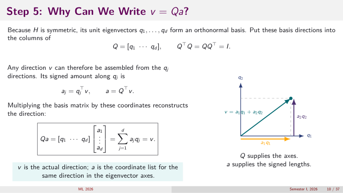
*👀 Slide 10 — Q supplies the axes (eigenvectors), a supplies the signed lengths along them.*

$H$ symmetric ⇒ its unit eigenvectors $q_1..q_d$ form an orthonormal basis, $Q = [q_1\cdots q_d]$, $Q^\top Q = QQ^\top = I$. Any direction:
$$a_j = q_j^\top v,\quad a = Q^\top v,\qquad Qa = \sum_ja_jq_j = v.$$
$v$ is the actual direction; $a$ is its coordinate list in eigen-axes. (Same "change of basis" as L5 §A5.)

**Numbers:** $H = \begin{bmatrix}4&2\\2&2\end{bmatrix}$ has $q_{\max}\approx(0.851, 0.526)$ ($\lambda = 5.236$), $q_{\min}\approx(-0.526, 0.851)$ ($\lambda = 0.764$). For $v = (1,0)$: $a = (0.851, -0.526)$, and $a_1^2 + a_2^2 = 0.724 + 0.276 = 1$ ✓.

## Slide 11 — Step 6: Eigenvalues Test Every Direction

$$v^\top Hv = (Qa)^\top(Q\Lambda Q^\top)(Qa) = a^\top\Lambda a = \sum_{j=1}^d\lambda_ja_j^2,\qquad\sum_ja_j^2 = 1.$$
Directional curvature = **weighted average of eigenvalues** with weights $a_j^2$ (A5). Therefore
$$v^\top Hv\ge0\ \forall v\iff\lambda_j\ge0\ \forall j.$$

**Check slide 10's numbers:** $v = (1,0)$: $5.236(0.724) + 0.764(0.276) = 3.791 + 0.211 = 4.00 = H_{11}$ ✓.

## Slide 12 — Convex Can Still Have Many Minimizers

*(Slide image in §A6.)* $H\succeq0\iff\lambda_j\ge0$.

| **Convex** | **Strictly convex** |
|---|---|
| $\lambda_j\ge0$: zero eigenvalues and flat directions allowed | $\lambda_j > 0$: every direction curves up ⇒ **at most one** minimiser |

**Example:** $J(\theta_1,\theta_2) = \theta_1^2$. $H = \begin{bmatrix}2&0\\0&0\end{bmatrix}$, $\lambda = 2, 0$. Every point on the line $\theta_1 = 0$ gives $J = 0$: infinitely many minimisers. Side view at any fixed $\theta_2$: the same parabola.

**Summary:** a zero eigenvalue creates a flat direction: convex, but a whole line can minimise it. (Exactly what happens with duplicate predictors in L5/L7.)

## Slide 13 — The Bridge: Reuse The Curvature Test, Do Not Restart

| | Linear regression | Logistic regression today |
|---|---|---|
| outcome | continuous $y$ | binary $y\in\{0,1\}$ |
| probability model | Gaussian | Bernoulli |
| mean model | $X\theta$ | $p = \sigma(X\theta)$ |
| loss | squared error | to be derived (slide 25) |
| gradient | $X^\top(X\theta - y)$ | to be derived (slide 30) |
| Hessian | $X^\top X$ | to be derived (slide 32) |
| curvature test | $v^\top Hv\ge0$ | **exactly the same test** (slide 33) |

**Question:** what must change when the observation is binary, and which optimisation ideas stay? → The probability model and therefore the loss change; gradient/Hessian/convexity logic stays.

## Slide 14 — Running Example: Will This Road Segment Become Impassable?

For each road segment and forecast window: $x_i = (1,\ \text{rainfall},\ \text{slope},\ \text{drainage deficit})^\top$, $y_i\in\{0,1\}$.

observed features $x_i$ → linear score $z_i = x_i^\top\theta$ → probability $p_i$ → operational action (close / monitor / open).

> ⚠️ The model estimates a **probability**. The authority chooses an **action** using a threshold and the relative costs of missed closures and false alarms (slide 35, L9).

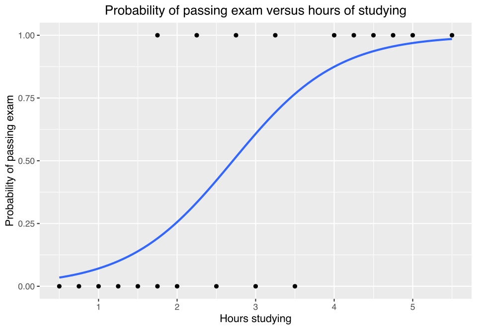
*A real-world logistic fit: probability of passing an exam vs hours studied; same shape as the road model with one feature. (Wikimedia Commons: [Exam_pass_logistic_curve.svg](https://commons.wikimedia.org/wiki/File:Exam_pass_logistic_curve.svg), CC BY-SA 4.0)*

## Slide 15 — Why The Linear Score Cannot Itself Be A Probability

![Slide 15 — A straight line leaves [0, 1]; the sigmoid stays inside (0, 1).](images/L06/slides/s15_linear_vs_sigmoid.png)
*👀 Slide 15 — A straight line leaves [0, 1]; the sigmoid stays inside (0, 1).*

$z_i = x_i^\top\theta\in(-\infty,\infty)$, but $0\le p_i\le1$. Using $z$ directly as a probability (the "linear probability model") gives impossible values: toy data with the least-squares line $\hat p = 0.0 + 0.2x$ would predict $1.2$ at $x = 6$.

**We need a principled map from an unrestricted score to a valid probability** → slides 16–20.

## Slide 16 — Start With Probability, Before Introducing Odds Or Sigmoid

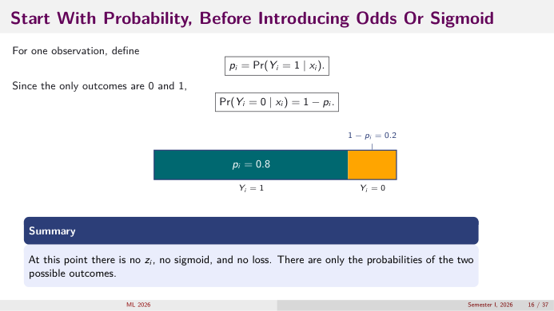
*👀 Slide 16 — Two outcomes, two probabilities that add to 1.*

$p_i = \Pr(Y_i = 1\mid x_i)$; since the only outcomes are 0 and 1, $\Pr(Y_i = 0\mid x_i) = 1 - p_i$. Example: $p_i = 0.8$, $1 - p_i = 0.2$.

**Summary:** at this point there's no $z_i$, no sigmoid, no loss. Only the probabilities of the two outcomes.

## Slide 17 — Probability To Odds: Compare Event With Non-Event ✍️

$$\text{odds}_i = \frac{\Pr(Y_i = 1\mid x_i)}{\Pr(Y_i = 0\mid x_i)} = \frac{p_i}{1-p_i}.\qquad p_i = 0.8:\ \text{odds} = \frac{0.8}{0.2} = 4.$$
Probability 0.8 = 80 events per 100 comparable cases. Odds 4 = **four events for every one non-event**.

**Back from odds:** $p = \dfrac{\text{odds}}{1+\text{odds}}$; odds 4 → $4/5 = 0.8$ ✓.

**Summary:** probability compares events with all cases; odds compare events with non-events. Same information, different scale.

## Slide 18 — Why Log-Odds? Match The Range Of A Linear Score

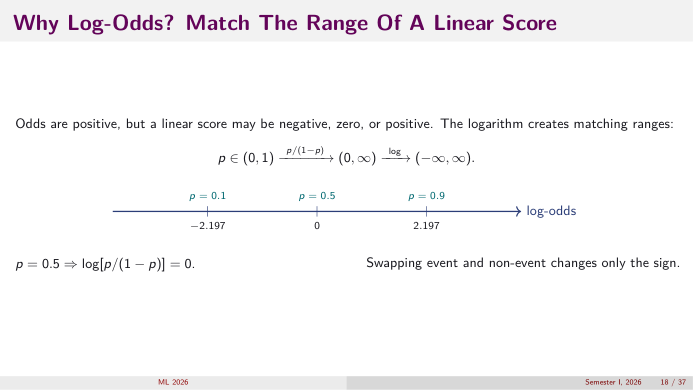
*👀 Slide 18 — log-odds of 0.1, 0.5, 0.9 are −2.197, 0, 2.197.*

$$p\in(0,1)\xrightarrow{\ p/(1-p)\ }(0,\infty)\xrightarrow{\ \log\ }(-\infty,\infty).$$
- $p = 0.5\Rightarrow\log1 = 0$.
- $p = 0.9\Rightarrow\log9 = 2.197$; $p = 0.1\Rightarrow\log\tfrac19 = -2.197$.
- Swapping event and non-event only flips the sign.

Now the log-odds and the score live on the **same range**, so we may set them equal.

## Slide 19 — Only Now Introduce The Linear Score

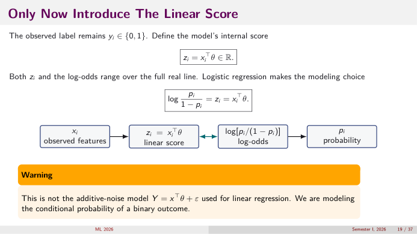
*👀 Slide 19 — features → score → log-odds → probability.*

Labels stay $y_i\in\{0,1\}$. Internal score $z_i = x_i^\top\theta\in\mathbb R$. **Modelling choice of logistic regression:**
$$\log\frac{p_i}{1-p_i} = z_i = x_i^\top\theta.$$

> ⚠️ This is **not** the additive-noise model $Y = x^\top\theta + \varepsilon$ of linear regression. We model the **conditional probability** of a binary outcome; there's no "noise term" added to $y$.

**Toy:** road 6 ($x = 5$) at $\hat\theta$: $z = -3.035 + 6.070 = 3.035$ = log-odds; odds $= e^{3.035} = 20.8$; $p = 20.8/21.8 = 0.954$.

## Slide 20 — Solve The Log-Odds Equation: The Sigmoid Appears ✍️

| Line | Step |
|---|---|
| $\log\frac{p_i}{1-p_i} = z_i$ | start |
| $\frac{p_i}{1-p_i} = e^{z_i}$ | exponentiate |
| $p_i = e^{z_i}(1-p_i)$ | multiply by $1-p_i$ |
| $p_i = e^{z_i} - e^{z_i}p_i$ | expand |
| $p_i(1+e^{z_i}) = e^{z_i}$ | collect $p_i$ |
| $p_i = \dfrac{e^{z_i}}{1+e^{z_i}} = \dfrac{1}{1+e^{-z_i}} = \sigma(z_i)$ | divide; then top and bottom by $e^{z_i}$ |

**Summary:** the sigmoid is the inverse of the logit, not an arbitrary decorative function.

## Slide 21 — Read The Sigmoid As A Probability Model

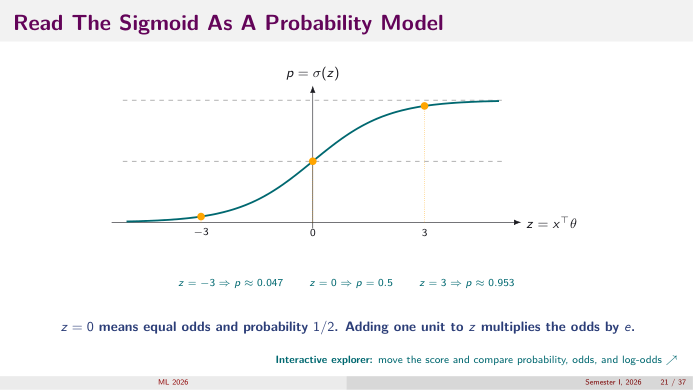
*👀 Slide 21 — z = −3, 0, 3 → p ≈ 0.047, 0.5, 0.953.*

| $z$ | $e^{-z}$ | $p = 1/(1+e^{-z})$ | odds $e^z$ |
|---|---|---|---|
| $-3$ | 20.09 | 0.047 | 0.050 |
| $0$ | 1 | 0.5 | 1 |
| $1$ | 0.368 | 0.731 | 2.718 |
| $3$ | 0.0498 | 0.953 | 20.09 |

$z = 0$ means equal odds, $p = \tfrac12$. **Adding one unit to $z$ multiplies the odds by $e$.** (Compare row $z = 0$ and $z = 1$.) The curve is symmetric about $(0, \tfrac12)$ and steepest there.

## Slide 22 — One Bernoulli Formula Covers Both Possible Labels

$$\Pr(Y_i = y_i\mid x_i,\theta) = p_i^{y_i}(1-p_i)^{1-y_i}.$$
- $y_i = 1$: $p_i^1(1-p_i)^0 = p_i$ → rewards a **large** $p_i$.
- $y_i = 0$: $p_i^0(1-p_i)^1 = 1 - p_i$ → rewards a **small** $p_i$.

**Question:** if an event occurs but the model said $p_i = 0.01$, small or large penalty? → **Large**: probability of what happened is 0.01, so $-\log0.01 = 4.6$ (A9 table).

## Slide 23 — From Individual Probabilities To The Dataset Likelihood

Assuming conditional independence given features:
$$L(\theta) = \prod_{i=1}^np_i^{y_i}(1-p_i)^{1-y_i}.$$
Each factor is "the probability the model gave to what actually happened": $y_1 = 1$ contributes $p_1$, $y_2 = 0$ contributes $1 - p_2$, …

> ⚠️ Conditional independence is **across observations** after conditioning on their inputs, not a claim that predictor columns are independent.

**Toy at $\hat\theta$:** $L = (1-0.046)(1-0.139)(0.353)(1-0.647)(0.861)(0.954) = 0.954\cdot0.861\cdot0.353\cdot0.353\cdot0.861\cdot0.954 = 0.0839$. Road 3 and road 4 (the "surprising" labels) contribute the two small factors.

## Slide 24 — Take Logs: Product Becomes A Sum ✍️

$$\log L(\theta) = \log\prod_ip_i^{y_i}(1-p_i)^{1-y_i} = \sum_i\log\big[p_i^{y_i}(1-p_i)^{1-y_i}\big] = \sum_i\big[y_i\log p_i + (1-y_i)\log(1-p_i)\big].$$
Rules used: $\log\prod a_i = \sum\log a_i$, $\log(a^b) = b\log a$, $\log(ab) = \log a + \log b$.

**Toy:** $\log0.0839 = -2.478$ ✓ (matches $J(\hat\theta) = 2.478$ on the next slide).

**Maximum likelihood** chooses $\theta$ that makes the observed labels collectively most probable.

## Slide 25 — Negate The Log-Likelihood: Binary Cross-Entropy

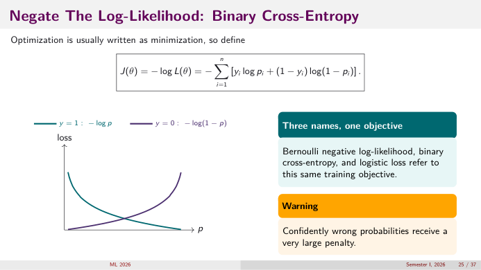
*👀 Slide 25 — −log p (y = 1) and −log(1 − p) (y = 0): confidently wrong means a very large penalty.*

$$J(\theta) = -\log L(\theta) = -\sum_{i=1}^n\big[y_i\log p_i + (1-y_i)\log(1-p_i)\big].$$
**Three names, one objective:** Bernoulli negative log-likelihood, binary cross-entropy, logistic loss.

> ⚠️ Confidently wrong probabilities receive a very large penalty ($p\to0$ when $y = 1$ ⇒ $-\log p\to\infty$).

**Toy at $\theta = 0$:** all $p_i = \tfrac12$, so $J = 6\log2 = 4.159$. At $\hat\theta$: $J = 2.478$. Training lowered it by 1.68.

## Slide 26 — Substitute The Sigmoid: Compute The Log Terms First ✍️

With $p_i = e^{z_i}/(1+e^{z_i})$:
$$1 - p_i = \frac{1+e^{z_i} - e^{z_i}}{1+e^{z_i}} = \frac{1}{1+e^{z_i}},$$
$$\log p_i = \log e^{z_i} - \log(1+e^{z_i}) = z_i - \log(1+e^{z_i}),$$
$$\log(1-p_i) = \log1 - \log(1+e^{z_i}) = -\log(1+e^{z_i}).$$

## Slide 27 — One-Observation Loss: Simplify Without Skipping A Line ✍️

$\ell_i = -y_i\log p_i - (1-y_i)\log(1-p_i)$. Insert slide 26:
$$\begin{aligned}\ell_i &= -y_i\big[z_i - \log(1+e^{z_i})\big] - (1-y_i)\big[-\log(1+e^{z_i})\big]\\&= -y_iz_i + y_i\log(1+e^{z_i}) + (1-y_i)\log(1+e^{z_i})\\&= -y_iz_i + \big[y_i + 1 - y_i\big]\log(1+e^{z_i})\\&= \boxed{\log(1+e^{z_i}) - y_iz_i},\qquad z_i = x_i^\top\theta.\end{aligned}$$

**Check (road 3, $y = 1$, $z = -0.607$):** $\log(1 + e^{-0.607}) + 0.607 = \log1.545 + 0.607 = 0.435 + 0.607 = 1.042$; and $-\log p_3 = -\log0.353 = 1.041$ ✓.

## Slide 28 — Check Both Labels: Does The Compact Formula Behave Correctly?

| $y_i = 1$ | $y_i = 0$ |
|---|---|
| $\ell_i = \log(1+e^{z_i}) - z_i = \log\frac{1+e^{z_i}}{e^{z_i}} = \log(1+e^{-z_i})$ | $\ell_i = \log(1+e^{z_i})$ |
| large **positive** score → small loss | large **negative** score → small loss |

At $z = 0$ both are $\log2 = 0.693$. **The log-odds model supplies $p_i$; the Bernoulli likelihood supplies the loss.**

## Slide 29 — Differentiate The Sigmoid Once, Then Reuse The Result ✍️

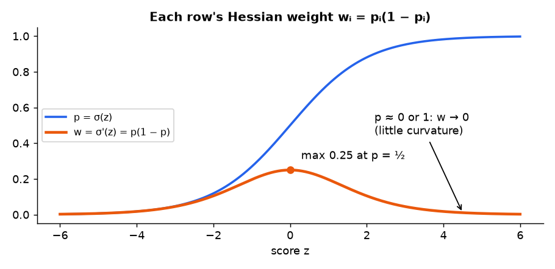
*📊 p and its slope p(1 − p): largest (0.25) at p = ½, near zero when p is close to 0 or 1.*

$\sigma(z) = (1+e^{-z})^{-1}$. Chain rule (outer: $u^{-1}\to-u^{-2}$; inner: $\frac{d}{dz}(1+e^{-z}) = -e^{-z}$):
$$\sigma'(z) = -(1+e^{-z})^{-2}\cdot(-e^{-z}) = \frac{e^{-z}}{(1+e^{-z})^2} = \underbrace{\frac{1}{1+e^{-z}}}_{\sigma(z)}\cdot\underbrace{\frac{e^{-z}}{1+e^{-z}}}_{1-\sigma(z)} = \sigma(z)\big[1-\sigma(z)\big].$$
Therefore $\dfrac{dp_i}{dz_i} = p_i(1-p_i)$. Largest ($\tfrac14$) at $p = \tfrac12$, tends to 0 near 0 or 1.

**Numbers:** $p = 0.5\to0.25$; $p = 0.861\to0.120$; $p = 0.954\to0.044$.

## Slide 30 — Derive The Gradient: Score Residual Times Features ✍️

Use $\ell_i = \log(1+e^{z_i}) - y_iz_i$, $z_i = x_i^\top\theta$ (A10).
$$\frac{d\ell_i}{dz_i} = \frac{e^{z_i}}{1+e^{z_i}} - y_i = p_i - y_i,\qquad\nabla_\theta z_i = x_i,$$
$$\nabla_\theta\ell_i = (p_i - y_i)x_i,\qquad\boxed{\nabla J(\theta) = \sum_i(p_i - y_i)x_i = X^\top(p - y)}.$$

Same shape as linear regression's $X^\top(X\theta - y)$: **(prediction − truth), weighted by features**. Only "prediction" changed from $X\theta$ to $\sigma(X\theta)$.

**Toy at $\theta = 0$:** $p - y = (0.5, 0.5, -0.5, 0.5, -0.5, -0.5)$.
- intercept component: $\sum(p_i - y_i) = 0$.
- rainfall component: $0(0.5) + 1(0.5) + 2(-0.5) + 3(0.5) + 4(-0.5) + 5(-0.5) = -3.5$.

$\nabla J(0) = (0, -3.5)$: increase $\theta_1$ (more rain ⇒ more risk) ✓.

**At the optimum:** $\nabla J = 0$ gives $\sum_ip_i = \sum_iy_i$ (intercept row): the fitted probabilities **add up to the observed number of events**. Toy: $0.046 + 0.139 + 0.353 + 0.647 + 0.861 + 0.954 = 3.000 = 3$ events ✓.

## Slide 31 — Derive The Hessian For One Observation ✍️

Differentiate $\nabla_\theta\ell_i = (p_i - y_i)x_i$ again. $y_i$ and $x_i$ are fixed data; only $p_i$ depends on $\theta$:
$$\nabla_\theta^2\ell_i = x_i(\nabla_\theta p_i)^\top,\qquad\nabla_\theta p_i = \frac{dp_i}{dz_i}\nabla_\theta z_i = p_i(1-p_i)x_i,$$
$$\boxed{\nabla_\theta^2\ell_i = p_i(1-p_i)\,x_ix_i^\top}.$$
The scalar $p_i(1-p_i)$ decides how much curvature row $i$ adds. Rows the model is **sure** about ($p\approx0$ or 1) add almost none.

## Slide 32 — Stack The Hessian: Linear Algebra Returns

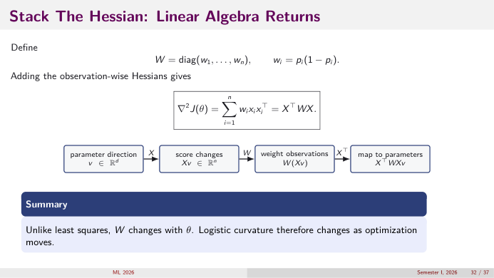
*👀 Slide 32 — v → Xv (score changes) → W(Xv) (weight each row) → XᵀWXv (back to parameter space).*

$W = \mathrm{diag}(w_1..w_n)$, $w_i = p_i(1-p_i)$. Add the per-row Hessians (A11):
$$\nabla^2J(\theta) = \sum_iw_ix_ix_i^\top = X^\top WX.$$

**Toy at $\theta = 0$:** $w_i = 0.25$ for all, so $H = 0.25X^\top X = 0.25\begin{bmatrix}6&15\\15&55\end{bmatrix} = \begin{bmatrix}1.5&3.75\\3.75&13.75\end{bmatrix}$. ($X^\top X$: $n = 6$, $\sum x = 15$, $\sum x^2 = 0+1+4+9+16+25 = 55$.)

**At $\hat\theta$:** $w = (0.044, 0.120, 0.228, 0.228, 0.120, 0.044)$, $H = \begin{bmatrix}0.784&1.960\\1.960&6.100\end{bmatrix}$: smaller, because confident rows contribute less.

**Summary:** unlike least squares, $W$ changes with $\theta$, so **logistic curvature changes as optimisation moves**.

## Slide 33 — Apply The Opening Theorem: Logistic Loss Is Convex ✍️

For any direction $v$:
$$v^\top\nabla^2J(\theta)v = v^\top X^\top WXv = (Xv)^\top W(Xv) = \sum_{i=1}^np_i(1-p_i)(x_i^\top v)^2\ \ge0.$$
Each weight is positive ($0 < p_i < 1$), each square non-negative ⇒ $\nabla^2J\succeq0$ **for every $\theta$** ⇒ $J$ is convex (A5). Any point with $\nabla J = 0$ is a global minimum.

**When is it *strictly* positive?** $v^\top Hv = 0$ needs $x_i^\top v = 0$ for every $i$, i.e. $Xv = 0$. If $X$ has **full column rank**, that forces $v = 0$ ⇒ $H\succ0$ ⇒ strictly convex ⇒ at most one minimiser.

Convexity is **not enough** for a finite, unique estimate:

| Problem | What happens |
|---|---|
| **rank deficiency** (duplicate/collinear columns) | flat direction $Xv = 0$ ⇒ a whole line of minimisers (slide 12) |
| **complete separation** (a line splits the classes perfectly) | $J$ keeps decreasing as $\lVert\theta\rVert\to\infty$ ⇒ no finite minimiser |

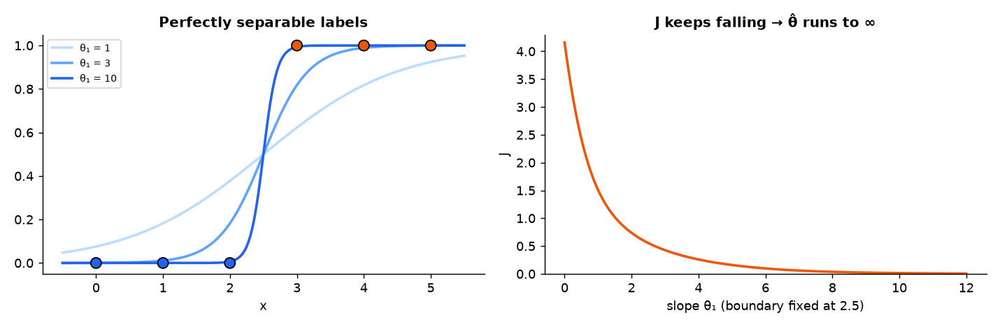
*📊 Perfectly separable toy labels: steeper and steeper sigmoids keep lowering J toward 0, so the slope θ₁ runs off to infinity.*

(With labels $0,0,0,1,1,1$ every $p_i$ can be pushed toward the right side by making the slope bigger, so no finite $\theta$ is best. Fix: regularisation, L7 slide 33. Our running toy has roads 3 and 4 "crossing", so it is not separable and $\hat\theta$ is finite.)

## Slide 34 — Why There Is Usually No Normal-Equation Formula

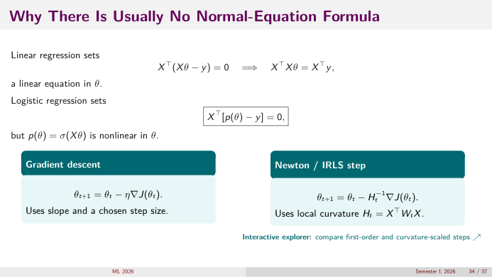
*👀 Slide 34 — Gradient descent uses slope + step size; Newton/IRLS uses local curvature Hₜ = XᵀWₜX.*

| Linear regression | Logistic regression |
|---|---|
| $X^\top(X\theta - y) = 0\Rightarrow X^\top X\theta = X^\top y$: **linear** in $\theta$ | $X^\top[p(\theta) - y] = 0$ with $p = \sigma(X\theta)$: **nonlinear** in $\theta$ |

So we iterate (A12):
- **Gradient descent:** $\theta_{t+1} = \theta_t - \eta\nabla J(\theta_t)$.
- **Newton / IRLS:** $\theta_{t+1} = \theta_t - H_t^{-1}\nabla J(\theta_t)$, $H_t = X^\top W_tX$.

**One Newton step by hand (toy, from $\theta_0 = 0$).** $g = (0, -3.5)$, $H = \begin{bmatrix}1.5&3.75\\3.75&13.75\end{bmatrix}$, $\det H = 20.625 - 14.0625 = 6.5625$.
$$H^{-1}g = \frac1{6.5625}\begin{bmatrix}13.75&-3.75\\-3.75&1.5\end{bmatrix}\begin{bmatrix}0\\-3.5\end{bmatrix} = \frac1{6.5625}\begin{bmatrix}13.125\\-5.25\end{bmatrix} = \begin{bmatrix}2\\-0.8\end{bmatrix},\qquad\theta_1 = 0 - (2, -0.8) = (-2,\ 0.8).$$

| step | $\theta$ | $J$ | $\lVert\nabla J\rVert$ |
|---|---|---|---|
| 0 | $(0, 0)$ | 4.159 | 3.5 |
| 1 | $(-2.000, 0.800)$ | 2.607 | 0.69 |
| 2 | $(-2.774, 1.110)$ | 2.485 | 0.14 |
| 3 | $(-3.015, 1.206)$ | 2.4780 | 0.0095 |
| 4 | $(-3.035, 1.214)$ | 2.4780 | 0.0001 |

The gradient shrinks ~×5, ×5, ×14, ×95: Newton's characteristic quadratic speed-up near the optimum. **Meaning of $\hat\theta$:** each extra unit of rain multiplies the odds of impassability by $e^{1.214} = 3.37$; $p = \tfrac12$ at $x = 3.035/1.214 = 2.5$.

## Slide 35 — A Probability Is Not Yet A Decision

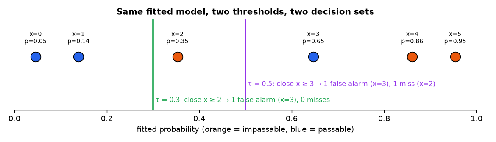
*📊 The six fitted probabilities with two thresholds: τ = 0.5 closes roads 4–6 (one false alarm, one miss); τ = 0.3 also closes road 3 (one false alarm, no miss).*

After fitting, an operational rule uses a threshold $\tau$: $\hat y_i = \mathbb I[p_i\ge\tau]$.

| Lower $\tau$ closes more roads | Higher $\tau$ closes fewer roads |
|---|---|
| fewer missed impassable segments | fewer unnecessary closures |
| more unnecessary closures | more missed impassable segments |

> ⚠️ Maximum likelihood estimates **probabilities**. The threshold expresses a **decision cost** and can be changed **without refitting** the probability model. (Full treatment: L9–L10.)

## Slide 36 — Linear And Logistic Regression: The Reusable Skeleton

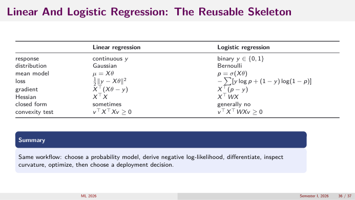
*👀 Slide 36 — The two models side by side.*

| | Linear regression | Logistic regression |
|---|---|---|
| response | continuous $y$ | binary $y\in\{0,1\}$ |
| distribution | Gaussian | Bernoulli |
| mean model | $\mu = X\theta$ | $p = \sigma(X\theta)$ |
| loss | $\tfrac12\lVert y - X\theta\rVert^2$ | $-\sum[y\log p + (1-y)\log(1-p)]$ |
| gradient | $X^\top(X\theta - y)$ | $X^\top(p - y)$ |
| Hessian | $X^\top X$ (constant) | $X^\top WX$ (changes with $\theta$) |
| closed form | sometimes | generally no |
| convexity test | $v^\top X^\top Xv\ge0$ | $v^\top X^\top WXv\ge0$ |

**Summary:** same workflow: choose a probability model → negative log-likelihood → differentiate → inspect curvature → optimise → choose a deployment decision.

## Slide 37 — What You Should Be Able To Re-Derive

1. $v^\top Hv = \sum_j\lambda_ja_j^2$ and the eigenvalue test for convexity (slides 8–11);
2. $p\to p/(1-p)\to\log[p/(1-p)] = x^\top\theta\to p = \sigma(x^\top\theta)$ (slides 16–20);
3. Bernoulli likelihood → binary cross-entropy (slides 22–25);
4. $\nabla J = X^\top(p-y)$ and $\nabla^2J = X^\top WX$ (slides 29–32);
5. $v^\top X^\top WXv\ge0$, hence convexity (slide 33);
6. why **convexity, uniqueness, finite coefficients, and a decision threshold** are four different questions (A6, slides 33, 35).

---

# Part C — Practice

1. For $J(\theta_1,\theta_2) = \theta_1^2 + 4\theta_1\theta_2 + \theta_2^2$, find $H$ and its eigenvalues. Is $J$ convex?
2. For $H = \begin{bmatrix}4&2\\2&2\end{bmatrix}$, compute $v^\top Hv$ for $v = \tfrac15(3,4)$ and check it lies between the eigenvalues.
3. Convert $p = 0.25$ to odds and to log-odds. What is the log-odds of $p = 0.75$?
4. Show $\sigma(-z) = 1 - \sigma(z)$.
5. A model has $z = -1 + 0.5x$. What is $p$ at $x = 2$? By what factor do the odds change when $x$ goes from 2 to 4?
6. Compute the binary cross-entropy for three examples: $(y, p) = (1, 0.9), (0, 0.2), (1, 0.3)$.
7. Using $\ell = \log(1+e^z) - yz$, verify that $y = 0$, $z = 2$ gives the same value as $-\log(1-\sigma(2))$.
8. Derive $\frac{d}{dz}\log(1+e^z)$ and show it equals $\sigma(z)$.
9. For the toy data at $\theta = (-2, 0.8)$ (Newton step 1), the fitted $p = (0.119, 0.231, 0.401, 0.599, 0.769, 0.881)$. Compute $\nabla J$.
10. Show $\sum_iw_ix_ix_i^\top = X^\top WX$ for $n = 2$, $d = 2$ by writing both sides out.
11. Give a dataset with one feature where logistic regression has no finite MLE. Why does the intercept-only model always have one (when both labels appear)?
12. Why can the probability threshold be changed after training, but not the loss?

<b>Answers</b>

1. $H = \begin{bmatrix}2&4\\4&2\end{bmatrix}$, $\lambda = 2\pm4 = 6, -2$. A negative eigenvalue ⇒ **not convex** (it's a saddle: along $(1,-1)$ the function curves down).
2. $Hv = \tfrac15(12 + 8,\ 6 + 8) = \tfrac15(20, 14)$; $v^\top Hv = \tfrac1{25}(3\cdot20 + 4\cdot14) = \tfrac{116}{25} = 4.64\in[0.764, 5.236]$ ✓.
3. odds $= 0.25/0.75 = 1/3$; log-odds $= \log(1/3) = -1.099$. For $p = 0.75$: $+1.099$ (sign flip).
4. $\sigma(-z) = \frac1{1+e^z} = \frac{e^{-z}}{e^{-z}+1}$ and $1 - \sigma(z) = \frac{1+e^{-z}-1}{1+e^{-z}} = \frac{e^{-z}}{1+e^{-z}}$ ✓.
5. $z = 0$ ⇒ $p = 0.5$. Odds multiply by $e^{0.5\cdot2} = e\approx2.72$.
6. $-\log0.9 = 0.105$; $-\log0.8 = 0.223$; $-\log0.3 = 1.204$. Total $1.532$.
7. $\log(1+e^2) - 0 = \log8.389 = 2.127$; $\sigma(2) = 0.8808$, $-\log0.1192 = 2.127$ ✓.
8. $\frac{e^z}{1+e^z} = \sigma(z)$ (chain rule: $\frac{1}{1+e^z}\cdot e^z$).
9. $p - y = (0.119, 0.231, -0.599, 0.599, -0.231, -0.119)$. Intercept: sum $= 0.000$. Rainfall: $0 + 0.231 - 1.198 + 1.797 - 0.924 - 0.595 = -0.689$. $\nabla J\approx(0, -0.69)$ (matches the table: $\lVert\nabla J\rVert = 0.69$).
10. LHS entry $(j,k) = w_1x_{1j}x_{1k} + w_2x_{2j}x_{2k}$. RHS: $(WX)_{ik} = w_ix_{ik}$, so $(X^\top WX)_{jk} = \sum_ix_{ij}w_ix_{ik}$: same.
11. $x = (1,2,3,4)$, $y = (0,0,1,1)$: the threshold 2.5 separates perfectly; scaling $\theta$ up keeps lowering $J$. Intercept-only: $J(\theta_0) = n\log(1+e^{\theta_0}) - k\theta_0$ with $0 < k < n$ events; it → ∞ at both ends, so a finite minimum exists at $\sigma(\theta_0) = k/n$.
12. The loss defines **what probabilities are fitted** (training). The threshold only maps fixed probabilities to actions; changing it re-labels decisions without touching $\theta$ (slide 35, L9).

**Next:** [Lecture 7](L07_regularization_ridge_lasso_elastic_net.md): when predictors are correlated, the Hessian has tiny eigenvalues; **regularisation** fixes that.
