# Lecture 7 — Why Regularization Works: Ridge, Lasso, Elastic Net

> ES 335 / ES 678 Machine Learning, Sem I 2026 — Prof. Udit Bhatia
> Sources: `Lectures/L07_student_regularization_ridge_lasso_elastic_net.pdf` (35 slides), `Lectures/L07a_student_typed_class_notes_regularization.pdf` (9 pages of typed class notes from the 1 September board derivation), `Lectures/L07b_annotated_regularization_board_notes.pdf` (4 board pages)
> Previous: [`L06_curvature_logistic_regression.md`](L06_curvature_logistic_regression.md) · Next: [`L08_ols_ridge_lasso_worked_example.md`](L08_ols_ridge_lasso_worked_example.md)

**How to use this file.** Part A builds the maths Lecture 7 needs on top of L4–L6: **bias and variance of an estimator**, **why correlated predictors create a weak eigen-direction**, **how the OLS inverse amplifies noise by $1/\mu_j$**, the **ridge** fix $\mu_j\to\mu_j+\lambda$, the **lasso** soft-threshold, the **constraint (budget) view**, **standardisation** and **validation**. Part B goes through all 35 slides; Part B′ walks the typed class notes and the board pages, so nothing written in class is missed. Part C is practice.

**What this lecture is really about:** one chain.

$$\underbrace{x_1\approx x_2}_{\text{correlated}}\Rightarrow\underbrace{Xq_j\approx0}_{\text{weak direction}}\Rightarrow\underbrace{\mu_j = \lVert Xq_j\rVert^2\approx0}_{\text{small eigenvalue}}\Rightarrow\underbrace{\hat z_j = c_j/\mu_j}_{\text{OLS amplifies}}\Rightarrow\text{high variance}\ \xrightarrow{\ \text{ridge}\ }\ \hat z_j = \frac{c_j}{\mu_j+\lambda}$$

Ridge distrusts weak directions in a **graded** way; lasso adds a kink that makes **exact zeros**; elastic net mixes both; **validation** (never training error) picks $\lambda$.

> **Notation warning.** The slides write $J = \frac1{2n}\lVert y - X\beta\rVert^2 + \frac\lambda2\lVert\beta\rVert^2$ and use $G = X^\top X/n$; the typed notes write $\lVert X\beta - y\rVert^2 + \lambda\lVert\beta\rVert^2$ and use $X^\top X$. Same ideas; the numerical value of $\lambda$ differs by the factor $n$. $\mu_j$ = eigenvalue, $\lambda$ = penalty strength (never an eigenvalue in this lecture).

## Contents

**Part A — Maths from the ground up**
1. [Estimators, bias and variance](#a1-estimators-bias-and-variance)
2. [The bias–variance decomposition of test error](#a2-the-biasvariance-decomposition-of-test-error)
3. [Collinearity and the weak direction](#a3-collinearity-and-the-weak-direction)
4. [OLS in the eigenbasis: the $1/\mu_j$ amplifier](#a4-ols-in-the-eigenbasis-the-1μj-amplifier)
5. [Ridge regression: derivation and eigen-view](#a5-ridge-regression-derivation-and-eigen-view)
6. [Norms: $\ell_2$, $\ell_1$, and their unit balls](#a6-norms-ℓ2-ℓ1-and-their-unit-balls)
7. [Lasso and soft thresholding](#a7-lasso-and-soft-thresholding)
8. [Penalty ⇔ budget (constrained view)](#a8-penalty--budget-constrained-view)
9. [Elastic net](#a9-elastic-net)
10. [Standardisation and the intercept](#a10-standardisation-and-the-intercept)
11. [Validation and cross-validation](#a11-validation-and-cross-validation)

**Part B — Slides** · [All 35 slides](#part-b--slide-by-slide-all-35-slides) · **Part B′ — Class notes & board** · [Jump](#part-b--typed-class-notes-and-board-pages)

**Part C — Practice** · [Jump](#part-c--practice)

---

# Part A — Maths From the Ground Up

## A1. Estimators, bias and variance

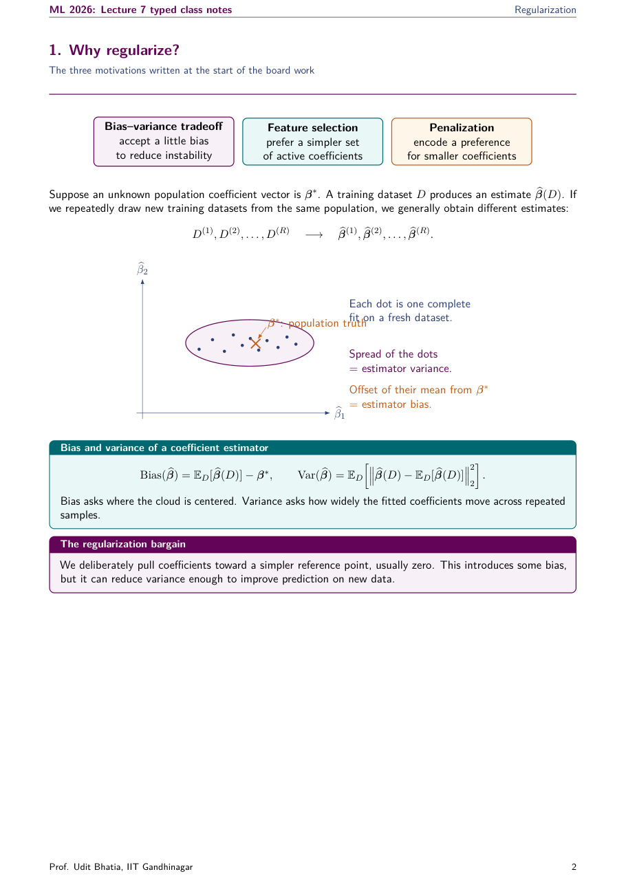
*👀 Typed notes p. 2 — Each dot is one complete fit on a fresh dataset. Spread = variance; offset of the centre from β* = bias.*

An **estimator** is a recipe that turns a training set $D$ into a number (or vector): $D\mapsto\hat\beta(D)$. OLS is one recipe, ridge another. Because $D$ is random (a different sample each time), $\hat\beta(D)$ is a **random variable**.

Imagine drawing training sets $D^{(1)},\dots,D^{(R)}$ from the same population and refitting each time: $\hat\beta^{(1)},\dots,\hat\beta^{(R)}$, a **cloud** of estimates.

$$\mathrm{Bias}(\hat\beta) = \mathbb E_D[\hat\beta(D)] - \beta^*\quad(\text{where is the cloud centred?}),$$
$$\mathrm{Var}(\hat\beta) = \mathbb E_D\big\lVert\hat\beta(D) - \mathbb E_D[\hat\beta(D)]\big\rVert^2\quad(\text{how wide is it?}).$$

**Board example (L07b p. 1).** True value 3. Estimates $1,2,3,4,5$: mean $15/5 = 3$ → **unbiased**, but spread. Estimates $2,3,3,4,12$: mean $24/5 = 4.8$ → biased (one wild value pulls it).

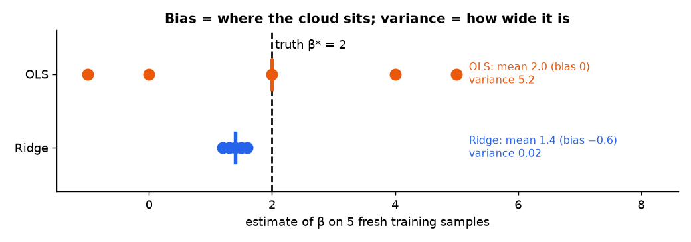
*📊 Slide 20's numbers: OLS estimates average to the truth but scatter widely; ridge estimates cluster tightly a little below it.*

**Slide 20 numbers.** Truth $\beta^* = 2$.
- OLS: $-1, 5, 0, 4, 2$. Mean $= 10/5 = 2$ → bias 0. Variance (population form) $= \frac{9 + 9 + 4 + 4 + 0}{5} = 5.2$ (sample form $/4$: 6.5).
- Ridge: $1.2, 1.6, 1.3, 1.5, 1.4$. Mean $= 7/5 = 1.4$ → bias $-0.6$. Variance $= \frac{0.04 + 0.04 + 0.01 + 0.01 + 0}{5} = 0.02$.
- Mean squared error $=$ bias² + variance: OLS $0 + 5.2 = 5.2$; ridge $0.36 + 0.02 = 0.38$. **Ridge is much closer on average**, despite being biased.

## A2. The bias–variance decomposition of test error

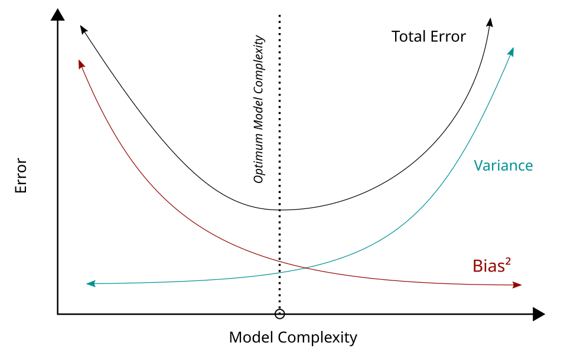
*Total error = bias² + variance (+ noise). Too simple: high bias. Too flexible: high variance. The best model sits in between. (Wikimedia Commons: [Bias_and_variance_contributing_to_total_error.svg](https://commons.wikimedia.org/wiki/File:Bias_and_variance_contributing_to_total_error.svg), CC0)*

For a new point with $y = f(x) + \varepsilon$, $\mathrm{Var}(\varepsilon) = \sigma^2$, and a prediction $\hat f(x)$ fitted on random $D$:
$$\mathbb E\big[(y - \hat f(x))^2\big] = \underbrace{\big(\mathbb E\hat f(x) - f(x)\big)^2}_{\text{bias}^2} + \underbrace{\mathrm{Var}\,\hat f(x)}_{\text{variance}} + \underbrace{\sigma^2}_{\text{irreducible noise}}.$$

**Derivation (one line at a time).** Write $\bar f = \mathbb E\hat f$. Then $y - \hat f = (f - \bar f) + (\bar f - \hat f) + \varepsilon$. Square and take expectations. The three cross terms vanish: $\varepsilon$ is independent of $D$ with mean 0, and $\mathbb E[\bar f - \hat f] = 0$. What's left is the three squares.

**The regularisation bargain:** deliberately pull estimates toward a simple reference (zero). That adds some bias² but can remove much more variance, so the **sum** drops.

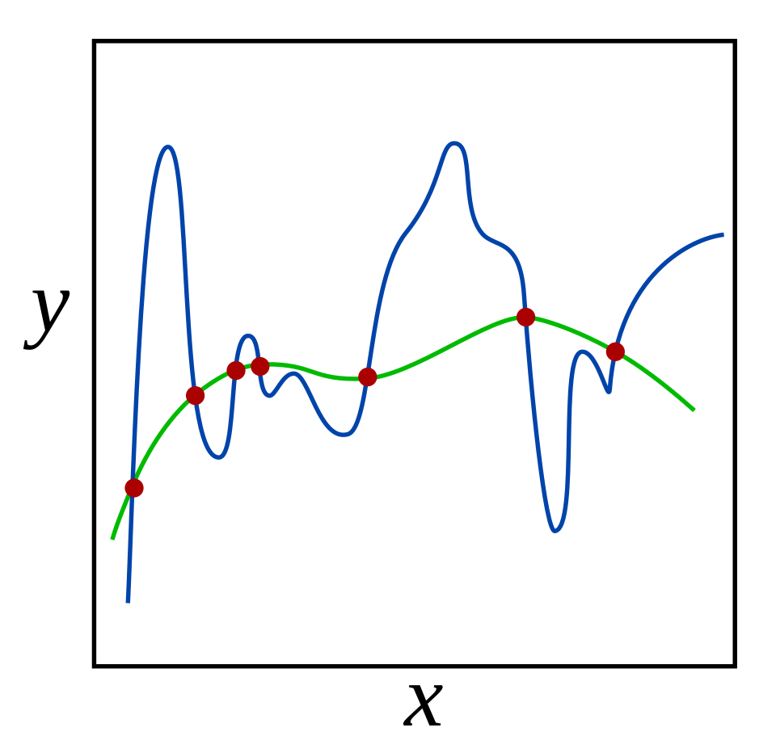
*Fitting the same points: the wiggly blue curve has low training error but high variance; the green regularised curve is smoother. (Wikimedia Commons: [Regularization.svg](https://commons.wikimedia.org/wiki/File:Regularization.svg), CC BY 4.0)*

## A3. Collinearity and the weak direction

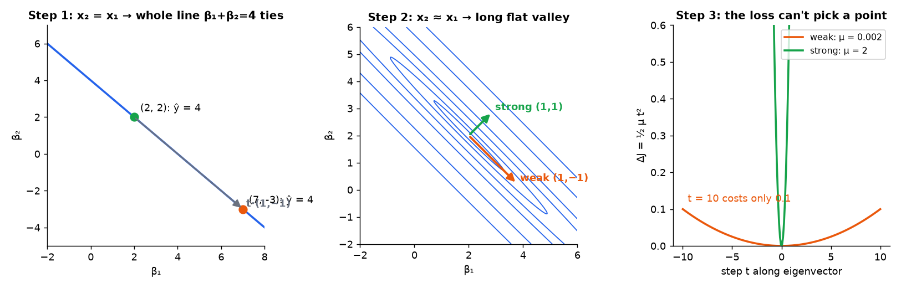
*📊 Step 1: duplicate features make a whole line of equal fits. Step 2: near-duplicates make a long flat valley. Step 3: along the weak direction the loss barely rises.*

**Step 1 — exact duplicates.** If $x_2 = x_1$, then $\hat y = \beta_1x_1 + \beta_2x_2 = (\beta_1+\beta_2)x_1$. The data pin down only the **sum** $\beta_1 + \beta_2$. Every pair on the line $\beta_1 + \beta_2 = s$ gives the same predictions and the same loss.

**Step 2 — the direction that changes nothing.** From any $\beta$, move along $v = (1,-1)$:
$$X(\beta + tv) - X\beta = tXv = t(x_1 - x_2) = 0.$$
$v$ is in the **null space** of $X$. $X^\top X$ is singular (eigenvalue 0 along $v$).

**Step 3 — near duplicates ($x_1\approx x_2$).** $Xv = x_1 - x_2\approx0$, so a large coefficient trade causes a tiny prediction change. The residual $r_{\text{new}} = r - tXv\approx r$, so the loss is almost unchanged. **Large coefficient trade + tiny fitted-value change = a long, nearly flat valley.**

**Step 4 — connect to eigenvalues.** For a unit eigenvector $q_j$ of $X^\top X$:
$$\mu_j = q_j^\top X^\top Xq_j = (Xq_j)^\top(Xq_j) = \lVert Xq_j\rVert^2.$$
So "$Xq_j\approx0$" ⇔ "$\mu_j\approx0$". **The weak direction is the eigenvector with the small eigenvalue.** Along it the loss rises as $\frac12\mu_jt^2$ (L5 slide 23, L6 A4).

## A4. OLS in the eigenbasis: the $1/\mu_j$ amplifier

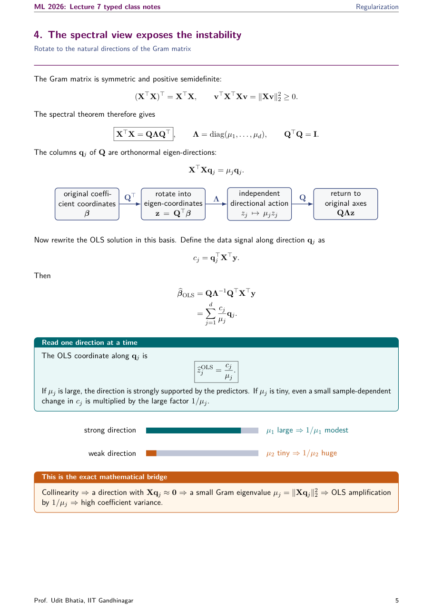
*👀 Typed notes p. 5 — Rotate into eigen-coordinates; each direction is solved on its own by dividing by μⱼ.*

$X^\top X = Q\Lambda Q^\top$, $\Lambda = \mathrm{diag}(\mu_1..\mu_d)$ (symmetric PSD, L5). Multiply the normal equation $X^\top X\hat\beta = X^\top y$ by $Q^\top$:
$$\Lambda\,\underbrace{Q^\top\hat\beta}_{\hat z} = \underbrace{Q^\top X^\top y}_{c}\quad\Rightarrow\quad\mu_j\hat z_j = c_j\quad\Rightarrow\quad\hat z_j^{\text{OLS}} = \frac{c_j}{\mu_j}.$$
$$\hat\beta_{\text{OLS}} = Q\Lambda^{-1}Q^\top X^\top y = \sum_{j=1}^d\frac{c_j}{\mu_j}q_j.$$

**Sensitivity.** A different sample changes $c$ to $c + \Delta c$. Then $\Delta\hat z_j = \Delta c_j/\mu_j$. Tiny $\mu_j$ ⇒ huge change.

| $\mu$ | $1/\mu$ (OLS amplifier) |
|---|---|
| 10 | 0.1 |
| 1 | 1 |
| 0.001 | 1000 |
| 0 | inverse doesn't exist |

**Worked example (L5's coupled predictors).** $X^\top X = \begin{bmatrix}10&9.8\\9.8&10\end{bmatrix}$, $\mu = 19.8$ along $q_1 = \tfrac1{\sqrt2}(1,1)$, $\mu = 0.2$ along $q_2 = \tfrac1{\sqrt2}(1,-1)$. With $X^\top y = (20, 19.8)$, OLS gives $\hat\beta = (1.505, 0.505)$. Nudge to $X^\top y = (20, 20)$: OLS gives $(1.010, 1.010)$. A 0.2 change in data moved each coefficient by 0.5 (L5 slide 22).

## A5. Ridge regression: derivation and eigen-view

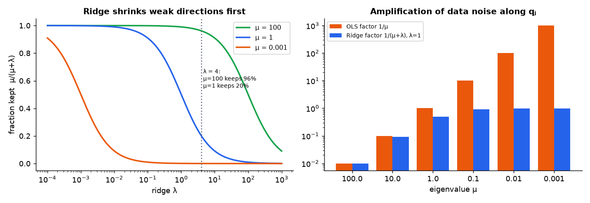
*📊 Fraction of each eigen-direction ridge keeps, μ/(μ+λ), and the noise amplifier 1/μ vs 1/(μ+λ).*

**Objective.** $J_\lambda(\beta) = \lVert X\beta - y\rVert^2 + \lambda\lVert\beta\rVert^2$, $\lambda\ge0$.

**Step 1 — gradient.** $\nabla\lVert X\beta - y\rVert^2 = 2X^\top(X\beta - y)$ (L4/L5); $\nabla\lambda\beta^\top\beta = 2\lambda\beta$. So
$$\nabla J_\lambda = 2X^\top(X\beta - y) + 2\lambda\beta.$$
**Step 2 — set to zero and collect $\beta$.** $X^\top X\beta + \lambda\beta = X^\top y$; write $\lambda\beta = \lambda I\beta$:
$$(X^\top X + \lambda I)\hat\beta_{\text{ridge}} = X^\top y,\qquad\hat\beta_{\text{ridge}} = (X^\top X + \lambda I)^{-1}X^\top y.$$
**Step 3 — eigenvalues shift by $\lambda$.** $(X^\top X + \lambda I)q_j = \mu_jq_j + \lambda q_j = (\mu_j + \lambda)q_j$. **Same eigenvectors, every eigenvalue $+\lambda$.** For $\lambda > 0$, all $\mu_j + \lambda > 0$, so the inverse **always exists**, even with duplicate columns.

**Step 4 — direction by direction.**
$$\hat z_j^{\text{ridge}} = \frac{c_j}{\mu_j + \lambda} = \underbrace{\frac{\mu_j}{\mu_j + \lambda}}_{s_j(\lambda)\in[0,1]}\hat z_j^{\text{OLS}}.$$

| direction | $\mu_j$ | $\lambda$ | $s_j = \mu_j/(\mu_j+\lambda)$ | meaning |
|---|---|---|---|---|
| strong | 100 | 4 | $100/104 = 0.962$ | kept almost fully |
| weak | 1 | 4 | $1/5 = 0.20$ | heavily shrunk |

Check $s_j$: $\lambda = 0\Rightarrow1$ (OLS). $\lambda\to\infty\Rightarrow0$ (everything to zero). $\mu_j\gg\lambda\Rightarrow\approx1$.

**Worked example continued (A4 matrix, $\lambda = 1$).** $X^\top X + I = \begin{bmatrix}11&9.8\\9.8&11\end{bmatrix}$, det $= 121 - 96.04 = 24.96$.
$$\hat\beta_{\text{ridge}} = \frac1{24.96}\begin{bmatrix}11&-9.8\\-9.8&11\end{bmatrix}\begin{bmatrix}20\\19.8\end{bmatrix} = \frac1{24.96}\begin{bmatrix}25.96\\21.80\end{bmatrix} = \begin{bmatrix}1.040\\0.873\end{bmatrix}.$$
Eigen-check: $c_1 = 39.8/\sqrt2$, $c_2 = 0.2/\sqrt2$. Ridge keeps $19.8/20.8 = 95\%$ of direction 1 but only $0.2/1.2 = 17\%$ of direction 2: $\hat\beta = \frac{39.8}{41.6}(1,1) + \frac{0.2}{2.4}(1,-1) = 0.957(1,1) + 0.083(1,-1) = (1.040, 0.873)$ ✓.

Now nudge the data to $(20, 20)$ as before: ridge gives $\frac{40}{41.6}(1,1) = (0.962, 0.962)$.

| | data $(20, 19.8)$ | data $(20, 20)$ | coefficient move |
|---|---|---|---|
| OLS | $(1.505, 0.505)$ | $(1.010, 1.010)$ | $0.70$ |
| Ridge $\lambda = 1$ | $(1.040, 0.873)$ | $(0.962, 0.962)$ | $0.12$ |

Six times more stable, by changing one number.

## A6. Norms: $\ell_2$, $\ell_1$, and their unit balls

| Norm | Formula | Unit ball in 2-D | Example $\beta = (3, -4)$ |
|---|---|---|---|
| $\ell_2$ (Euclidean) | $\lVert\beta\rVert_2 = \sqrt{\sum\beta_j^2}$ | circle | 5 |
| squared $\ell_2$ | $\lVert\beta\rVert_2^2 = \sum\beta_j^2$ | — | 25 |
| $\ell_1$ ("taxicab") | $\lVert\beta\rVert_1 = \sum\lvert\beta_j\rvert$ | **diamond** with corners on the axes | 7 |

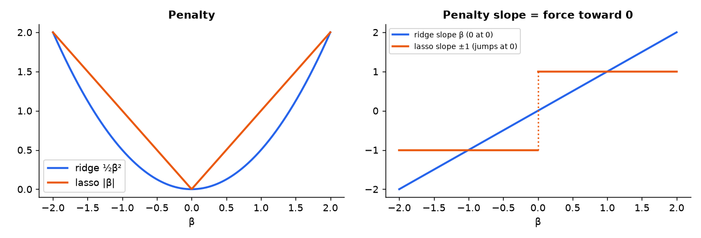
*📊 Penalties and their slopes: ridge's slope fades to 0 at the origin; lasso's slope is ±1 right up to 0.*

**The key difference is the slope near zero.** $\frac{d}{d\beta}\tfrac12\beta^2 = \beta\to0$: ridge's push toward 0 **fades away** as the coefficient gets small, so it never quite reaches 0. $\frac{d}{d\beta}\lvert\beta\rvert = \pm1$: lasso's push is **constant** all the way in, and $\lvert\beta\rvert$ has a **kink** at 0 (no derivative there).

## A7. Lasso and soft thresholding

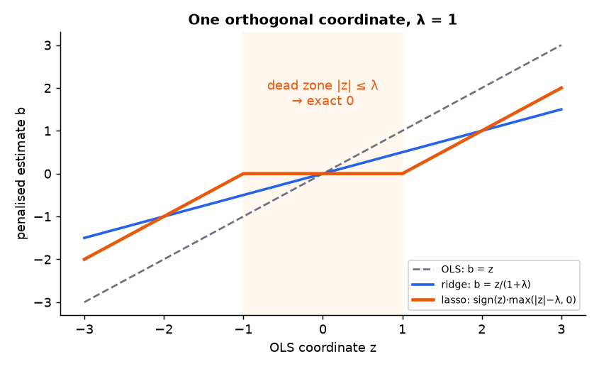
*📊 One orthogonal coordinate with λ = 1: OLS keeps z, ridge halves it, lasso subtracts λ and snaps everything in |z| ≤ λ to exactly 0.*

The simplest case: one coordinate, data-optimal value $z$ (the OLS estimate). Solve
$$\min_b\ f(b) = \tfrac12(b - z)^2 + \lambda\lvert b\rvert.$$
$\lvert b\rvert$ is not differentiable at 0, so split into cases.

| Case | $\lvert b\rvert$ | Set derivative to 0 | Solution | Valid when |
|---|---|---|---|---|
| $b > 0$ | $b$ | $(b - z) + \lambda = 0$ | $b = z - \lambda$ | $z - \lambda > 0$, i.e. $z > \lambda$ |
| $b < 0$ | $-b$ | $(b - z) - \lambda = 0$ | $b = z + \lambda$ | $z < -\lambda$ |
| neither valid | — | optimum at the kink | $b = 0$ | $\lvert z\rvert\le\lambda$ |

$$\boxed{\hat b_{\text{lasso}} = \mathrm{sign}(z)\max(\lvert z\rvert - \lambda,\ 0)}\quad(\text{soft thresholding}).$$

Compare ridge on the same problem: $\min\tfrac12(b - z)^2 + \tfrac\lambda2b^2\Rightarrow b - z + \lambda b = 0\Rightarrow b = \frac{z}{1+\lambda}$. **Never exactly 0** unless $z = 0$.

**Numbers, $\lambda = 1$.**

| $z$ (OLS) | ridge $z/2$ | lasso |
|---|---|---|
| 3 | 1.5 | 2 |
| 1.5 | 0.75 | 0.5 |
| 0.8 | 0.4 | **0** |
| −0.3 | −0.15 | **0** |
| −2 | −1 | −1 |

Ridge **rescales**, lasso **shifts toward 0 and kills small ones**.

**Why the kink wins ("subgradient" view).** At $b = 0$ the slope of $\lambda\lvert b\rvert$ can be anything in $[-\lambda, \lambda]$. The data term's slope at 0 is $-z$. If $\lvert z\rvert\le\lambda$ the penalty can balance it exactly, so $b = 0$ is optimal: friction holds the coefficient at 0 (L8 slide 42).

## A8. Penalty ⇔ budget (constrained view)

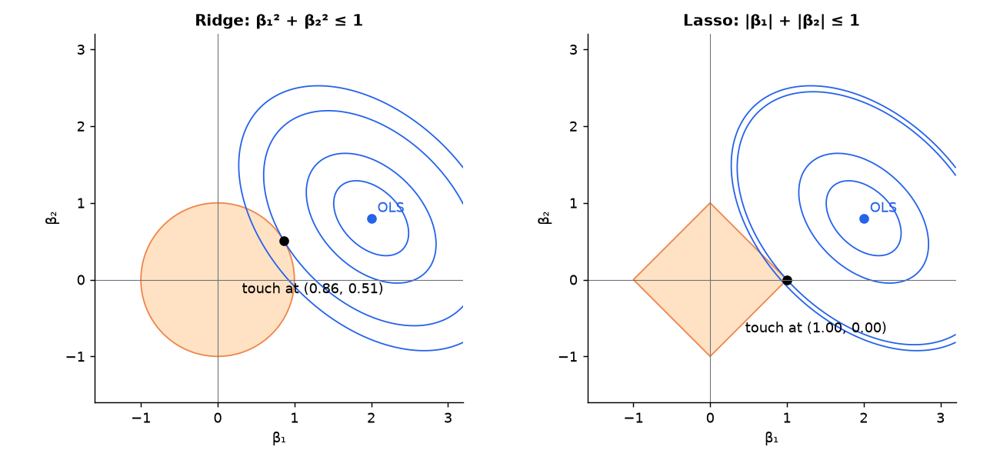
*📊 Same tilted loss ellipses, two allowed regions: the ellipse first touches the circle off the axes, but touches the diamond at its corner (1, 0), so β₂ = 0.*

Two ways to say the same thing:

| Penalised | Constrained |
|---|---|
| $\min_\beta\lVert X\beta - y\rVert^2 + \lambda\lVert\beta\rVert_2^2$ | $\min_\beta\lVert X\beta - y\rVert^2$ s.t. $\lVert\beta\rVert_2^2\le t$ |
| $\min_\beta\lVert X\beta - y\rVert^2 + \lambda\lVert\beta\rVert_1$ | $\min_\beta\lVert X\beta - y\rVert^2$ s.t. $\lVert\beta\rVert_1\le t$ |

**Why they match (Lagrange, L5 A10).** The constrained problem's Lagrangian is $\lVert X\beta - y\rVert^2 + \lambda(\lVert\beta\rVert^2 - t)$. For optimisation over $\beta$, the constant $-\lambda t$ doesn't matter, leaving the penalised objective. Each $\lambda$ corresponds to one budget $t$ (bigger $\lambda$ ⇔ smaller $t$), but **in general $\lambda\ne1/t$**.

**Picture.** Loss contours are ellipses around the OLS point. Shrink the budget until the smallest ellipse touches the allowed region.
- Circle: smooth boundary, contact is generically **off** the axes → both coefficients nonzero.
- Diamond: **corners on the axes** stick out toward the ellipses → contact often at a corner → some coefficient **exactly 0**. (Not always: the ellipse may touch an edge.)

At the contact point, $\nabla(\text{loss}) = -\lambda\nabla(\text{penalty})$: the board's "$\nabla f = \lambda\nabla g$" (L07b p. 4).

## A9. Elastic net

$$\hat\beta^{\text{EN}}_{\lambda,\alpha} = \arg\min_\beta\Big\{\tfrac1{2n}\lVert y - X\beta\rVert^2 + \lambda\Big[\alpha\lVert\beta\rVert_1 + \tfrac{1-\alpha}{2}\lVert\beta\rVert_2^2\Big]\Big\}.$$

| $\alpha$ | method |
|---|---|
| 0 | ridge |
| $0 < \alpha < 1$ | elastic net: stable sparsity for correlated groups |
| 1 | lasso |

- The $\ell_2$ part makes the objective **strictly convex** and makes correlated predictors **share** weight.
- The $\ell_1$ part keeps the corners, so **unsupported predictors can still hit 0**.
- Cost: two tuning knobs ($\lambda$, $\alpha$).

## A10. Standardisation and the intercept

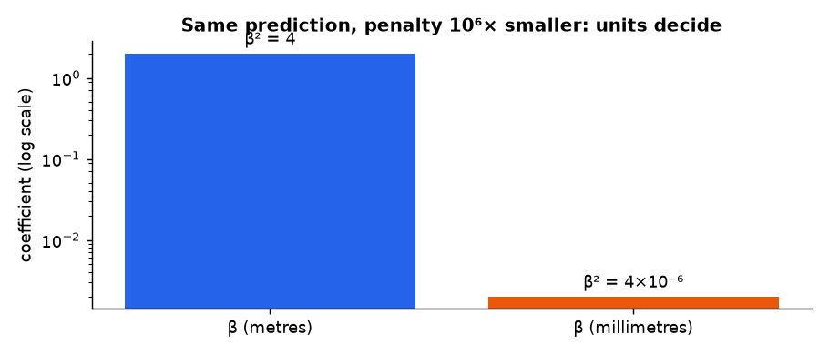
*📊 Same prediction, rainfall in metres vs millimetres: the coefficient is 1000× smaller, so its squared penalty is a million times smaller.*

OLS doesn't care about units: rescale a column by $k$, its coefficient becomes $\beta/k$, predictions identical. **A penalty does care**: $x_{\text{mm}} = 1000x_{\text{m}}\Rightarrow\beta_{\text{mm}} = \beta_{\text{m}}/1000\Rightarrow\beta_{\text{mm}}^2 = 10^{-6}\beta_{\text{m}}^2$. The penalty would barely touch the mm-coefficient. **Without standardisation, ridge/lasso penalise units, not effects.**

**Standardise** each predictor with **training** mean and sd: $\tilde x_{ij} = (x_{ij} - \bar x_j)/s_j$. Now one coefficient unit = one predictor standard deviation, and penalties compare like with like.

**Intercept:** centre $y$ (or fit the intercept separately) and **don't penalise it**. Penalising it would pull every prediction toward 0 for no reason.

## A11. Validation and cross-validation

Training error **always** prefers $\lambda = 0$ (OLS already minimises training error; any penalty can only raise it). So $\lambda$ must be chosen on data **not used to fit**.

- **Hold-out validation:** split train/validation/test; fit each $\lambda$ on train, pick the one with lowest validation error, report test error once.
- **$K$-fold cross-validation:** split training data into $K$ folds; for each fold, fit on the other $K-1$ and score on it; average the $K$ scores. Pick $\lambda$ with the best average. Refit on all training data.
- **No leakage:** standardisation statistics are computed **inside** each training fold, never on the full data (slide 34).

---

# Part B — Slide by Slide (all 35 slides)

## Slide 1 — Title

*Lecture 7: Why Regularization Works.* Prof. Udit Bhatia, Civil Engineering; Computer Science and Engineering, Semester I 2026.

## Slide 2 — Start With OLS And Name Every Object

Two measured features $x_1, x_2$ and coefficients $\beta_1, \beta_2$ produce $\hat y = \beta_1x_1 + \beta_2x_2$. Stacked over $n$ observations and $p$ features: $X\in\mathbb R^{n\times p}$, $y\in\mathbb R^n$, $\beta\in\mathbb R^p$,
$$\hat y = X\beta,\qquad J_{\text{OLS}}(\beta) = \frac1{2n}\lVert y - X\beta\rVert_2^2.$$
**Summary:** OLS picks $\hat\beta_{\text{OLS}}$ making the residual vector $y - X\beta$ as small as possible **on the training data**.

## Slide 3 — Derive The Normal Equation Once, Then Reuse It

$$J_{\text{OLS}} = \frac1{2n}(y - X\beta)^\top(y - X\beta) = \frac1{2n}\big(y^\top y - 2\beta^\top X^\top y + \beta^\top X^\top X\beta\big).$$
$$\nabla J_{\text{OLS}} = -\frac1nX^\top(y - X\beta) = 0\ \Rightarrow\ X^\top X\hat\beta = X^\top y.$$
With $\hat r = y - X\hat\beta$, the same equation reads $X^\top\hat r = 0$. **This cancellation matters for curvature** (slide 9).

## Slide 4 — What Changes When The Coefficients Move?

From $\beta$, move in direction $v$ by $t$: $\beta_{\text{new}} = \beta + tv$. Fitted values change by
$$X\beta_{\text{new}} - X\beta = X(\beta + tv) - X\beta = tXv.$$
**Insight:** $Xv$ is the prediction change caused by a one-unit coefficient move along $v$. That's the bridge from coefficients to the loss surface.

## Slide 5 — Exact Duplicate Features: The Prediction Only Sees Their Sum

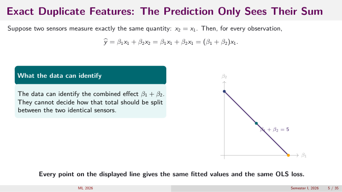
*👀 Slide 5 — Every point on β₁ + β₂ = 5 gives the same fit.*

$x_2 = x_1\Rightarrow\hat y = (\beta_1 + \beta_2)x_1$. The data identify the **combined effect** $\beta_1 + \beta_2$, not how to split it between two identical sensors (A3 Step 1).

## Slide 6 — Three Very Different Coefficients Can Make The Same Prediction

With $x_1 = x_2 = 1$:

| $(\beta_1, \beta_2)$ | prediction |
|---|---|
| $(2, 2)$ | $2 + 2 = 4$ |
| $(7, -3)$ | $7 - 3 = 4$ |
| $(100, -96)$ | $100 - 96 = 4$ |

From $(2,2)$ move along $v = (1,-1)$ by $t = 5$: $(2,2) + 5(1,-1) = (7,-3)$. One coefficient rises, the other falls equally; the sum is fixed.

> ⚠️ OLS has **no reason** to prefer $(2,2)$ over $(100,-96)$ with exact duplicates. Training fit alone can't make that choice.

## Slide 7 — Nearly Duplicate Features: A Large Trade Is Nearly Invisible

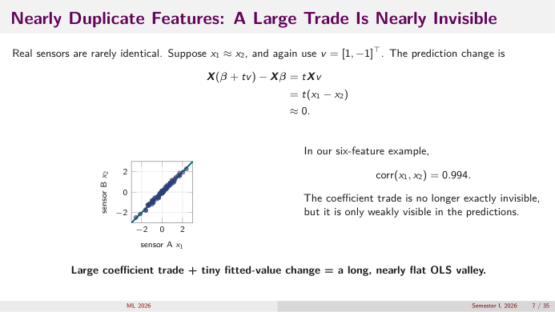
*👀 Slide 7 — Two sensors with correlation 0.994: the points hug the diagonal.*

$x_1\approx x_2$ (here $\mathrm{corr} = 0.994$). With $v = (1,-1)$: $tXv = t(x_1 - x_2)\approx0$. The trade is no longer exactly invisible, but only **weakly** visible in the predictions.

**Large coefficient trade + tiny fitted-value change = a long, nearly flat OLS valley.**

## Slide 8 — Why A Small Prediction Change Creates A Flat OLS Loss

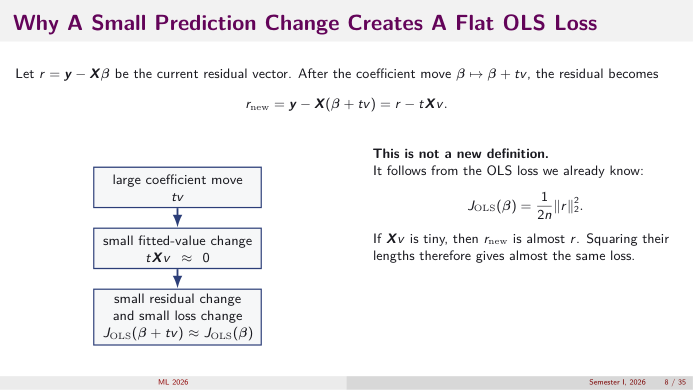
*👀 Slide 8 — large coefficient move → small fitted change → small residual change → small loss change.*

$r_{\text{new}} = y - X(\beta + tv) = r - tXv$. If $Xv$ is tiny, $r_{\text{new}}\approx r$, so $J = \frac1{2n}\lVert r\rVert^2$ barely changes. Not a new definition: it follows from the OLS loss.

## Slide 9 — At OLS, Only The Quadratic Loss Change Remains

Move from $\hat\beta$ by $\Delta\beta$. Expand ($r = \hat r - X\Delta\beta$):
$$J(\hat\beta + \Delta\beta) - J(\hat\beta) = -\frac1n\hat r^\top X\Delta\beta + \frac12\Delta\beta^\top\underbrace{\Big(\frac1nX^\top X\Big)}_{G}\Delta\beta.$$
Normal equation $X^\top\hat r = 0$ kills the first term. So **around the OLS solution**
$$\Delta J = \tfrac12\Delta\beta^\top G\Delta\beta,\qquad G = \tfrac1nX^\top X\ (\text{the OLS Hessian}).$$

## Slide 10 — Why Eigenvectors Enter: The OLS Hessian Is Symmetric

$G^\top = G$ ⇒ spectral theorem: $G = Q\Lambda Q^\top$, $\Lambda = \mathrm{diag}(\mu_1..\mu_p)$, $Gq_j = \mu_jq_j$, $q_i^\top q_j = \delta_{ij}$.

**Meaning of one eigenpair:** $q_j$ is a direction in **coefficient space**; $\mu_j$ is the OLS curvature along it. Both belong to the data matrix through $G = X^\top X/n$ (no $y$ involved).

## Slide 11 — Change Coordinates, Not The Actual Coefficient Move

$z = Q^\top\Delta\beta\iff\Delta\beta = Qz = \sum_jz_jq_j$ ($z_j$ = signed amount along $q_j$). Substitute:
$$\Delta J = \tfrac12(Qz)^\top(Q\Lambda Q^\top)(Qz) = \tfrac12z^\top\Lambda z = \tfrac12\sum_j\mu_jz_j^2.$$
**Insight:** no coefficient vector changed. We chose coordinates in which a coupled quadratic becomes a sum of independent 1-D costs (same algebra as L6 slide 11).

## Slide 12 — A Small Eigenvalue Leaves Many Nearly Equivalent Fits

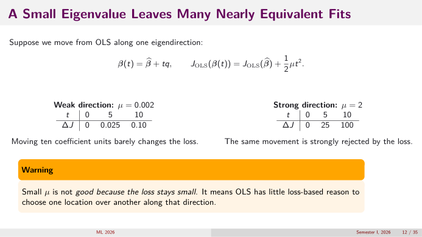
*👀 Slide 12 — Weak direction (μ = 0.002): ten units costs 0.1. Strong (μ = 2): ten units costs 100.*

$J(\hat\beta + tq) = J(\hat\beta) + \tfrac12\mu t^2$.

| $t$ | 0 | 5 | 10 |
|---|---|---|---|
| weak, $\mu = 0.002$: $\Delta J = 0.001t^2$ | 0 | 0.025 | 0.10 |
| strong, $\mu = 2$: $\Delta J = t^2$ | 0 | 25 | 100 |

> ⚠️ Small $\mu$ is **not good** because the loss stays small. It means OLS has **little loss-based reason** to choose one location over another along that direction.

## Slide 13 — A Flat Loss Makes The Estimated Coefficients Unstable ✍️

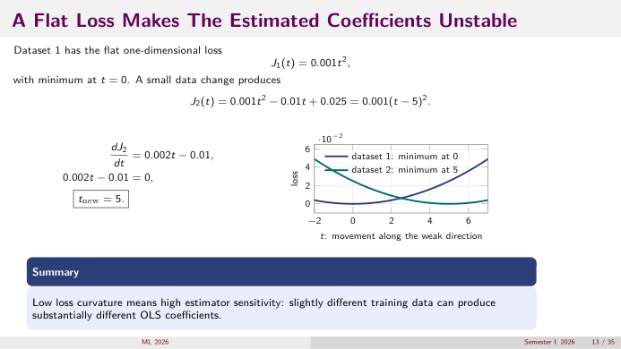
*👀 Slide 13 — Two datasets with the same flat curvature; a tiny tilt moves the minimum from 0 to 5.*

Dataset 1: $J_1(t) = 0.001t^2$, minimum at $t = 0$. A small data change gives
$$J_2(t) = 0.001t^2 - 0.01t + 0.025 = 0.001(t^2 - 10t + 25) = 0.001(t - 5)^2.$$
$dJ_2/dt = 0.002t - 0.01 = 0\Rightarrow t_{\text{new}} = 5$. The tilt $-0.01t$ is tiny, but divided by curvature $0.002$ it moves the minimum by 5.

**Summary:** low loss curvature ⇒ high estimator sensitivity.

## Slide 14 — The OLS Inverse Reveals The Same Instability

Divide the normal equation by $n$: $G\hat\beta_{\text{OLS}} = c$, $c = X^\top y/n$.
$$\hat\beta_{\text{OLS}} = G^{-1}c = Q\Lambda^{-1}Q^\top c,\qquad\Lambda^{-1} = \mathrm{diag}(1/\mu_1,\dots,1/\mu_p).$$

| eigenvalue | inverse factor |
|---|---|
| $\mu = 10$ | $0.1$ |
| $\mu = 0.001$ | $1000$ |

$c\to c + \Delta c\Rightarrow\Delta\hat\beta = G^{-1}\Delta c$: the component of $\Delta c$ along $q_j$ is multiplied by $1/\mu_j$ (A4).

> ⚠️ If any $\mu_j = 0$, the inverse doesn't exist and OLS has no unique solution.

## Slide 15 — Ridge Prefers Smaller Coefficients When Fits Are Similar

Duplicate features, both pairs predict the same ($\beta_1 + \beta_2 = 4$):
$$\beta^{(A)} = (2, 2),\ \lVert\beta^{(A)}\rVert^2 = 8;\qquad\beta^{(B)} = (10, -6),\ \lVert\beta^{(B)}\rVert^2 = 100 + 36 = 136.$$
Ridge adds a second preference:
$$J_{\text{ridge}}(\beta) = \frac1{2n}\lVert y - X\beta\rVert^2 + \frac\lambda2\lVert\beta\rVert^2.$$
**Insight:** large coefficients aren't inherently wrong. Ridge says: **among fits with similar training error, prefer the one that doesn't travel unnecessarily far along a weak direction.** On the tie-line $\beta_1 + \beta_2 = 4$, the smallest-norm point is $(2,2)$.

## Slide 16 — The Ridge Normal Equation Adds $\lambda I$ ✍️

$$\nabla J_{\text{ridge}} = -\frac1nX^\top(y - X\beta) + \lambda\beta = 0\ \Rightarrow\ \frac1nX^\top X\hat\beta_\lambda + \lambda\hat\beta_\lambda = \frac1nX^\top y\ \Rightarrow\ \Big(\frac1nX^\top X + \lambda I\Big)\hat\beta_\lambda = \frac1nX^\top y.$$
($\lambda\beta = \lambda I\beta$ because $I\beta = \beta$.) So $\hat\beta_\lambda = (G + \lambda I)^{-1}c$.

## Slide 17 — Ridge Adds $\lambda$ To Every Eigenvalue ✍️

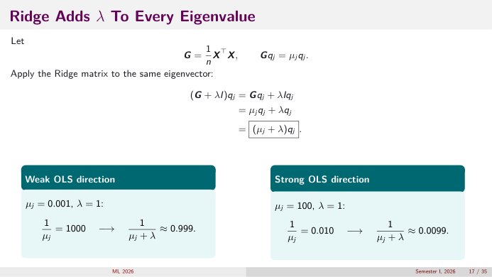
*👀 Slide 17 — Weak OLS direction: 1/μ = 1000 → 1/(μ+λ) ≈ 0.999. Strong: 0.010 → 0.0099.*

$(G + \lambda I)q_j = Gq_j + \lambda Iq_j = \mu_jq_j + \lambda q_j = (\mu_j + \lambda)q_j$.

| | $\mu_j$ | $\lambda$ | $1/\mu_j$ | $1/(\mu_j + \lambda)$ |
|---|---|---|---|---|
| weak | 0.001 | 1 | 1000 | 0.999 |
| strong | 100 | 1 | 0.010 | 0.0099 |

The weak direction's amplifier drops **1000-fold**; the strong one barely changes (1%).

## Slide 18 — Project The Normal Equations Onto One Eigenvector

Define $a_j = q_j^\top\beta$, $c_j = q_j^\top c$. Since $q_j^\top G = \mu_jq_j^\top$ (transpose of $Gq_j = \mu_jq_j$, $G$ symmetric), multiplying by $q_j^\top$:

| | project onto $q_j$ | solve |
|---|---|---|
| OLS: $G\hat\beta = c$ | $\mu_ja_j^{\text{OLS}} = c_j$ | $a_j^{\text{OLS}} = c_j/\mu_j$ |
| Ridge: $(G + \lambda I)\hat\beta = c$ | $(\mu_j + \lambda)a_j^{\text{ridge}} = c_j$ | $a_j^{\text{ridge}} = c_j/(\mu_j + \lambda)$ |

$$a_j^{\text{ridge}} = \frac{\mu_j}{\mu_j + \lambda}a_j^{\text{OLS}}.\quad\text{Large }\mu_j:\ \text{factor}\approx1.\ \ \text{Small }\mu_j:\ \text{factor}\approx0.$$

## Slide 19 — One Dot Is One Model Fitted To A Full Dataset

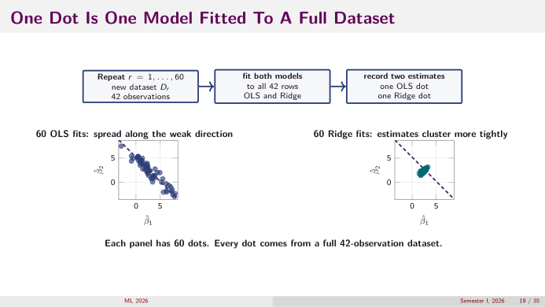
*👀 Slide 19 — 60 OLS fits spread along the weak direction; 60 ridge fits cluster tightly.*

Repeat 60 times: draw a fresh 42-row dataset, fit OLS and ridge, record two dots. OLS dots **spread along the weak direction** (the $(1,-1)$ diagonal); ridge dots cluster. Every dot = a full dataset, so the spread **is** the estimator variance (A1).

## Slide 20 — Bias And Variance Ask Two Different Questions

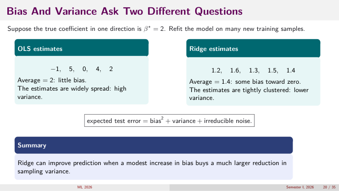
*👀 Slide 20 — Five OLS and five ridge estimates of a true β = 2.*

| OLS: $-1, 5, 0, 4, 2$ | Ridge: $1.2, 1.6, 1.3, 1.5, 1.4$ |
|---|---|
| average 2: little bias | average 1.4: some bias toward 0 |
| widely spread: high variance | tightly clustered: low variance |

$$\text{expected test error} = \text{bias}^2 + \text{variance} + \text{irreducible noise}.$$
Full arithmetic in A1: MSE 5.2 (OLS) vs 0.38 (ridge). **Ridge wins when a modest increase in bias buys a much larger reduction in variance.**

## Slide 21 — Validation Chooses The Regularization Strength

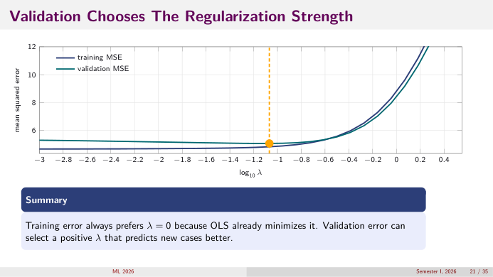
*👀 Slide 21 — Training MSE only rises with λ; validation MSE dips at a positive λ.*

**Training error always prefers $\lambda = 0$** (OLS already minimises it). Validation error can select a positive $\lambda$ that predicts new cases better (A11).

## Slide 22 — Lasso Changes Only The Penalty

| Ridge | Lasso |
|---|---|
| $\min\frac1{2n}\lVert y - X\beta\rVert^2 + \frac\lambda2\sum_j\beta_j^2$ | $\min\frac1{2n}\lVert y - X\beta\rVert^2 + \lambda\sum_j\lvert\beta_j\rvert$ |
| smooth shrinkage; coefficients usually stay nonzero | shrinkage **with the possibility of exact zeros** |

Why can $\lvert\beta_j\rvert$ create an exact zero? Two answers: the $\ell_1$ budget has **axis corners** (slide 23, A8), and the 1-D solution has a **threshold at zero** (slide 25, A7).

## Slide 23 — The Lasso Diamond Makes Exact Zeros Possible

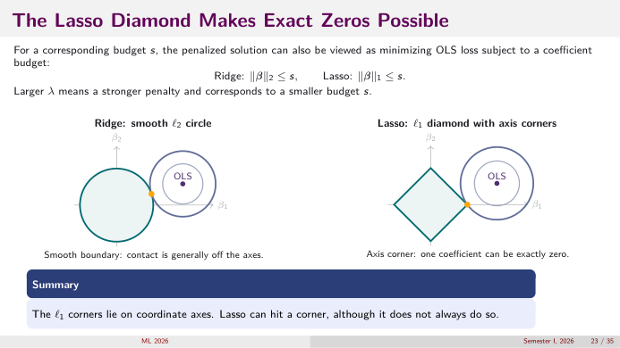
*👀 Slide 23 — Ridge circle: contact off the axes. Lasso diamond: contact at an axis corner.*

Ridge ⇔ $\min J_{\text{OLS}}$ s.t. $\lVert\beta\rVert_2\le s$. Lasso ⇔ $\min J_{\text{OLS}}$ s.t. $\lVert\beta\rVert_1\le s$. Larger $\lambda$ ⇔ smaller budget $s$.

**Summary:** the $\ell_1$ corners lie on coordinate axes. Lasso **can** hit a corner, though it doesn't always.

## Slide 24 — Where Do $b$ And $z$ In Soft Thresholding Come From? ✍️

Assume **standardised orthogonal columns**: $G = \frac1nX^\top X = I$. Let $z = \frac1nX^\top y$; then $G\hat\beta_{\text{OLS}} = z$ gives $z = \hat\beta_{\text{OLS}}$. Expand:
$$\begin{aligned}J_{\text{lasso}} &= \tfrac1{2n}\lVert y - X\beta\rVert^2 + \lambda\textstyle\sum_j\lvert\beta_j\rvert\\&= \underbrace{\tfrac1{2n}y^\top y}_{\text{const}} - \beta^\top\underbrace{\tfrac1nX^\top y}_{z} + \tfrac12\beta^\top\underbrace{\tfrac1nX^\top X}_{I}\beta + \lambda\textstyle\sum_j\lvert\beta_j\rvert\\&= \text{const} + \textstyle\sum_j\big[\tfrac12\beta_j^2 - z_j\beta_j + \lambda\lvert\beta_j\rvert\big]\\&= \text{const}' + \textstyle\sum_j\big[\tfrac12(\beta_j - z_j)^2 + \lambda\lvert\beta_j\rvert\big]\quad(\text{complete the square: add and subtract } \tfrac12z_j^2).\end{aligned}$$
**The sum separates.** For coordinate $j$, rename $b = \beta_j$, $z = z_j$: $\min_b\tfrac12(b - z)^2 + \lambda\lvert b\rvert$. One coordinate of the full lasso.

## Slide 25 — Soft Thresholding Explains Exact Zeros ✍️

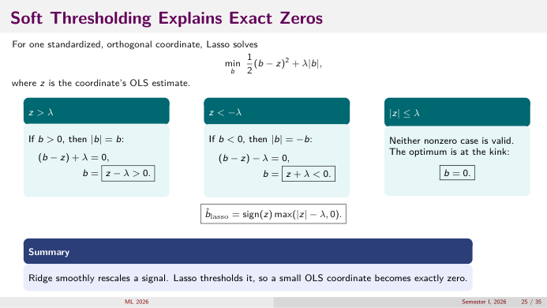
*👀 Slide 25 — Three cases: z > λ, z < −λ, |z| ≤ λ.*

| $z > \lambda$ | $z < -\lambda$ | $\lvert z\rvert\le\lambda$ |
|---|---|---|
| $b > 0$: $(b - z) + \lambda = 0\Rightarrow b = z - \lambda > 0$ | $b < 0$: $(b - z) - \lambda = 0\Rightarrow b = z + \lambda < 0$ | neither nonzero case valid ⇒ optimum at the kink $b = 0$ |

$$\hat b_{\text{lasso}} = \mathrm{sign}(z)\max(\lvert z\rvert - \lambda, 0).$$
**Ridge smoothly rescales a signal; lasso thresholds it** (table in A7). E.g. $\lambda = 1$: $z = 3\to2$, $z = 0.8\to0$.

## Slide 26 — Lasso Creates A Sequence Of Increasingly Sparse Models

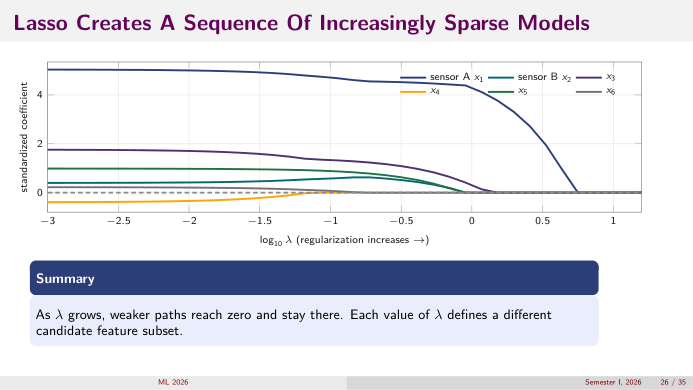
*👀 Slide 26 — Lasso paths for six standardised predictors: weaker ones hit zero first and stay there.*

As $\lambda$ grows (left → right), weaker paths reach 0 and stay. **Each $\lambda$ defines a different candidate feature subset.** Lasso = embedded feature selection.

## Slide 27 — Standardize Before Penalizing Coefficients

$x_{\text{mm}} = 1000x_{\text{m}}\Rightarrow\beta_{\text{mm}} = \beta_{\text{m}}/1000\Rightarrow\beta_{\text{mm}}^2 = 10^{-6}\beta_{\text{m}}^2$. Prediction unchanged, penalty changed by a million (A10).

> ⚠️ Without standardisation, ridge and lasso penalise **measurement units**, not comparable coefficient sizes.

$\tilde x_{ij} = (x_{ij} - \bar x_j)/s_j$ ⇒ one coefficient unit = one predictor sd. Centre the response, handle the intercept separately, **leave the intercept unpenalised**.

## Slide 28 — Lasso May Choose One Correlated Predictor

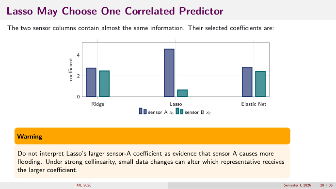
*👀 Slide 28 — Ridge and elastic net share weight between the twin sensors; lasso gives almost all of it to sensor A.*

> ⚠️ Don't read lasso's larger sensor-A coefficient as "sensor A causes more flooding". Under strong collinearity, small data changes can switch which twin gets the weight. (Seen exactly in L8 slide 47.)

**Why ridge shares:** for $x_1 = x_2$ and fixed sum $s$, $\beta_1^2 + \beta_2^2$ is minimised at $\beta_1 = \beta_2 = s/2$. **Why lasso doesn't care:** $\lvert\beta_1\rvert + \lvert\beta_2\rvert = s$ for every split with both $\ge0$, so any split (including $(s, 0)$) is equally good; small asymmetries decide.

## Slide 29 — Elastic Net Uses Two Complementary Forces

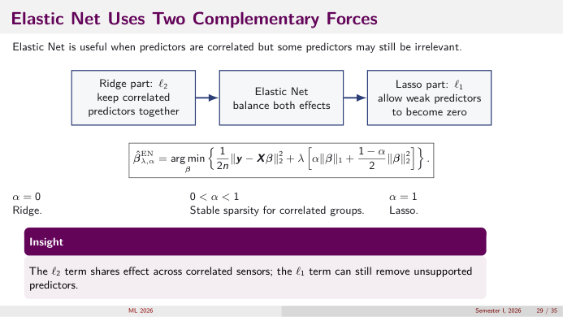
*👀 Slide 29 — ℓ2 part keeps correlated predictors together; ℓ1 part lets weak predictors become zero.*

$$\hat\beta^{\text{EN}}_{\lambda,\alpha} = \arg\min_\beta\Big\{\tfrac1{2n}\lVert y - X\beta\rVert^2 + \lambda\big[\alpha\lVert\beta\rVert_1 + \tfrac{1-\alpha}2\lVert\beta\rVert_2^2\big]\Big\}.$$
$\alpha = 0$: ridge. $0 < \alpha < 1$: stable sparsity for correlated groups. $\alpha = 1$: lasso (A9).

## Slide 30 — Elastic Net Keeps Correlated Paths Together

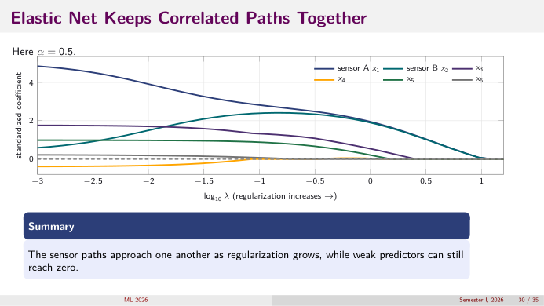
*👀 Slide 30 — With α = 0.5 the two sensor paths merge as λ grows, while weak predictors still reach zero.*

Here $\alpha = 0.5$. The sensor paths approach one another as regularisation grows; weak predictors $x_3..x_6$ can still hit 0.

## Slide 31 — Validation Chooses A Method And Its Regularization Strength

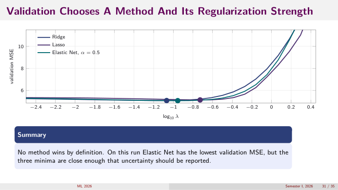
*👀 Slide 31 — Validation MSE vs λ for ridge, lasso and elastic net; the minima are close.*

No method wins by definition. On this run elastic net has the lowest validation MSE, but the three minima are close enough that **uncertainty should be reported**.

## Slide 32 — What Each Method Assumes About A Useful Model

| | Ridge | Lasso | Elastic Net |
|---|---|---|---|
| penalty | $\lVert\beta\rVert_2^2$ | $\lVert\beta\rVert_1$ | $\ell_1 + \ell_2$ |
| coefficient behaviour | smooth shrinkage; usually no zeros | some exact zeros | zeros plus group shrinkage |
| natural use case | many small or correlated effects | a genuinely sparse signal | sparse signal with correlated groups |
| main caution | all variables remain | selected variable can change under collinearity | two tuning choices, $\lambda$ and $\alpha$ |

**Summary:** the choice is a **modelling hypothesis**, not a ranking. Use validation performance, stability, and scientific purpose together.

## Slide 33 — Regularization Also Extends To Logistic Regression

Only the data-fit term changes:
$$\hat\beta = \arg\min_\beta\Big\{-\sum_i\big[y_i\log p_i + (1-y_i)\log(1-p_i)\big] + \lambda R(\beta)\Big\},\quad p_i = \sigma(x_i^\top\beta).$$
$R = \lVert\beta\rVert_2^2$: logistic ridge; $R = \lVert\beta\rVert_1$: logistic lasso.

**Bonus from L6:** the ridge term adds $2\lambda I$ to the Hessian $X^\top WX$, making it strictly PD, and it **stops the coefficients running to infinity under complete separation** (the penalty grows without bound, the log-loss gain doesn't).

## Slide 34 — A Professional Regularization Workflow

1. Split into training and final test data.
2. Within training data, centre and standardise **without** using validation-fold information.
3. Choose a grid of $\lambda$ (and for EN a small grid of $\alpha$).
4. Cross-validate to estimate future error for each setting.
5. Select, refit on all training data, evaluate **once** on the untouched test set.
6. Report predictive performance, selected variables, coefficient stability, and the full preprocessing.

> ⚠️ Never standardise the full dataset before splitting; never use the test set to tune $\lambda$.

## Slide 35 — What Students Should Now Be Able To Explain

1. Correlated predictors create weak eigen-directions in $X^\top X$ and make OLS coefficients unstable.
2. Ridge adds $\lambda$ to each eigenvalue and shrinks weak directions most.
3. Validation selects the bias–variance compromise; training error can't.
4. Lasso's $\ell_1$ kink creates soft thresholding and exact zeros.
5. Elastic net can preserve correlated groups while retaining sparsity.
6. The penalty idea applies to likelihood models like logistic regression.

**Exit check:** for two nearly identical predictors, why does ridge share their effect while lasso may choose one? → Ridge's $\beta_1^2 + \beta_2^2$ is strictly smaller for an equal split; lasso's $\lvert\beta_1\rvert + \lvert\beta_2\rvert$ is the same for every same-sign split, so the tiny difference in the data picks a winner (slide 28).

*Reference: James, Witten, Hastie, Tibshirani & Taylor, ISLR 2nd ed., Ch. 6.*

---

# Part B′ — Typed Class Notes And Board Pages

The typed notes (L07a) are the board derivation of 1 September, cleaned up. They use **unscaled** $J = \lVert X\beta - y\rVert^2 + \lambda\lVert\beta\rVert^2$, $\mu_j$ for eigenvalues of $X^\top X$.

### Notes p. 1 — The organising question

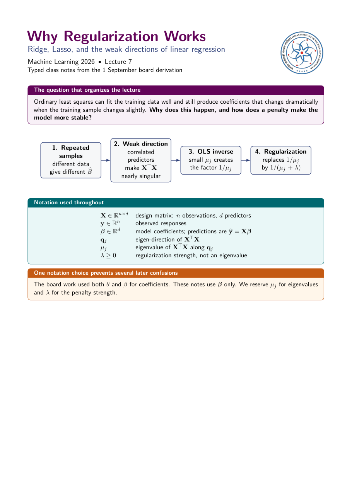
*👀 Typed notes p. 1 — Repeated samples → weak direction → OLS inverse 1/μⱼ → regularisation 1/(μⱼ+λ).*

OLS can fit training data well yet produce coefficients that change dramatically between samples. **Why, and how does a penalty stabilise it?** Four-step answer: different data → different $\hat\beta$; correlated predictors make $X^\top X$ nearly singular; small $\mu_j$ creates factor $1/\mu_j$; regularisation replaces it by $1/(\mu_j + \lambda)$.

### Notes p. 2 — Why regularise?

Three motivations written at the start: **bias–variance tradeoff** (accept a little bias to reduce instability), **feature selection** (prefer fewer active coefficients), **penalisation** (encode a preference for smaller coefficients). Bias/variance definitions and the cloud picture are in A1.

### Notes p. 3 — Begin with OLS

$J = (X\beta - y)^\top(X\beta - y) = \beta^\top X^\top X\beta - 2\beta^\top X^\top y + y^\top y$; $\nabla J = 2X^\top(X\beta - y)$; normal equation $X^\top X\hat\beta = X^\top y$; $\hat\beta = (X^\top X)^{-1}X^\top y$ **only if** columns are independent. "The inverse is exactly where instability can enter."

### Notes p. 4 — Correlated predictors create a weak direction

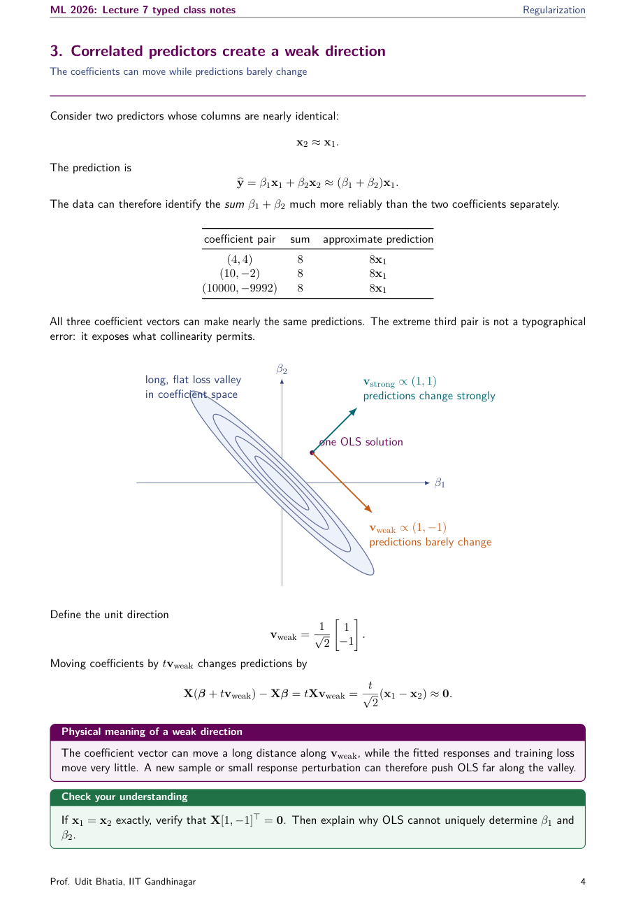
*👀 Typed notes p. 4 — (4, 4), (10, −2), (10000, −9992) all give ≈ 8x₁; v_weak ∝ (1, −1) runs along the valley.*

| coefficient pair | sum | approximate prediction |
|---|---|---|
| $(4, 4)$ | 8 | $8x_1$ |
| $(10, -2)$ | 8 | $8x_1$ |
| $(10000, -9992)$ | 8 | $8x_1$ |

"The extreme third pair is not a typo: it exposes what collinearity permits." $v_{\text{weak}} = \frac1{\sqrt2}(1,-1)$: $X(\beta + tv_{\text{weak}}) - X\beta = \frac{t}{\sqrt2}(x_1 - x_2)\approx0$.

**Check your understanding:** if $x_1 = x_2$ exactly, $X(1,-1)^\top = x_1 - x_2 = 0$ ⇒ $(1,-1)$ is in the null space ⇒ $X^\top X$ singular ⇒ OLS can't pin down $\beta_1$, $\beta_2$ separately.

### Notes p. 5 — The spectral view exposes the instability

(Image in A4.) $\hat\beta_{\text{OLS}} = Q\Lambda^{-1}Q^\top X^\top y = \sum_j\frac{c_j}{\mu_j}q_j$, $c_j = q_j^\top X^\top y$. **The exact bridge:** collinearity ⇒ $Xq_j\approx0$ ⇒ $\mu_j = \lVert Xq_j\rVert^2$ small ⇒ amplification by $1/\mu_j$ ⇒ high coefficient variance.

### Notes p. 6 — Ridge modifies the objective

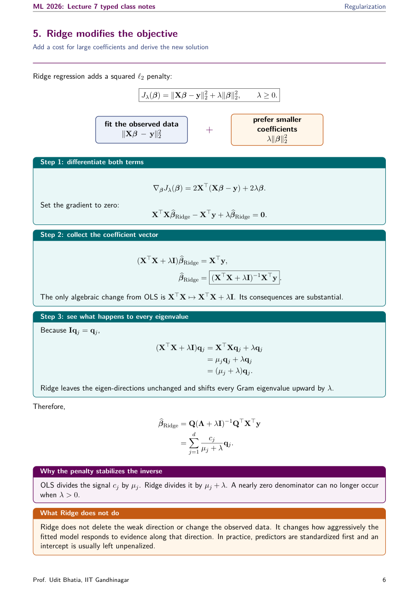
*👀 Typed notes p. 6 — Ridge derivation: gradient, collect β, and the eigenvalue shift.*

Derivation in A5. Two boxed remarks:
- **Why the penalty stabilises:** OLS divides $c_j$ by $\mu_j$; ridge divides by $\mu_j + \lambda$. A near-zero denominator can't occur when $\lambda > 0$.
- **What ridge does *not* do:** it doesn't delete the weak direction or change the data. It changes **how aggressively** the fit responds to evidence along that direction.

### Notes p. 7 — Ridge shrinks direction by direction

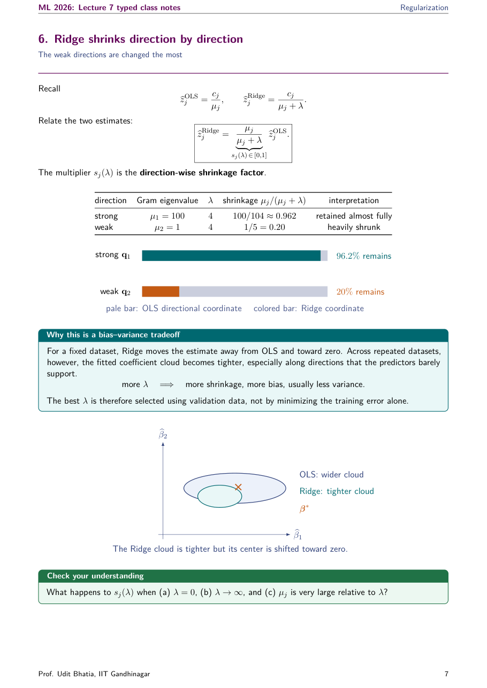
*👀 Typed notes p. 7 — μ = 100 keeps 96.2%; μ = 1 keeps 20% (λ = 4). The ridge cloud is tighter but shifted toward zero.*

$s_j(\lambda) = \mu_j/(\mu_j + \lambda)$. Table and checks in A5. More $\lambda$ ⇒ more shrinkage, more bias, usually less variance. Choose $\lambda$ by validation.

**Check your understanding:** (a) $\lambda = 0$: $s_j = 1$ (OLS). (b) $\lambda\to\infty$: $s_j\to0$ (all coefficients → 0). (c) $\mu_j\gg\lambda$: $s_j\approx1$ (strong directions untouched).

### Notes p. 8 — The constrained geometric view

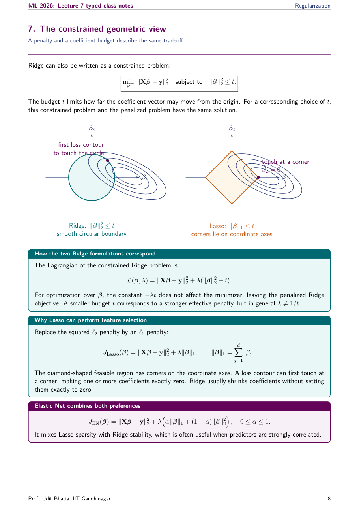
*👀 Typed notes p. 8 — Ridge circle vs lasso diamond, the Lagrangian link, and elastic net.*

$\min\lVert X\beta - y\rVert^2$ s.t. $\lVert\beta\rVert_2^2\le t$. Lagrangian $L(\beta,\lambda) = \lVert X\beta - y\rVert^2 + \lambda(\lVert\beta\rVert_2^2 - t)$; drop $-\lambda t$ (constant in $\beta$) → penalised ridge. Smaller $t$ ⇔ stronger penalty, but in general $\lambda\ne1/t$ (A8). Elastic net in this scaling: $\lVert X\beta - y\rVert^2 + \lambda\big(\alpha\lVert\beta\rVert_1 + (1-\alpha)\lVert\beta\rVert_2^2\big)$.

### Notes p. 9 — Put the entire lecture in one chain

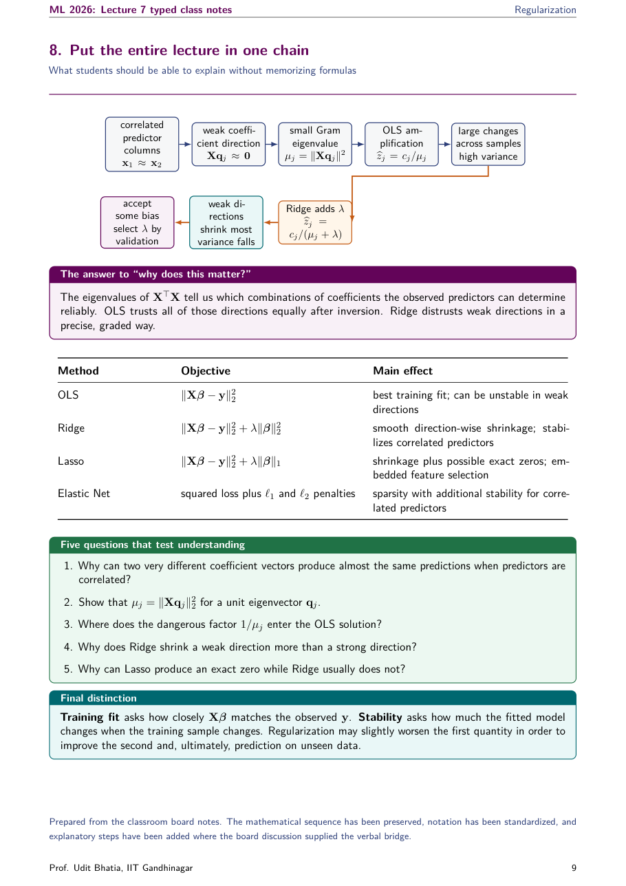
*👀 Typed notes p. 9 — The whole lecture as one chain, a method table, and five test questions.*

**Final distinction.** *Training fit* asks how closely $X\beta$ matches the observed $y$. *Stability* asks how much the fitted model changes when the sample changes. Regularisation may slightly worsen the first to improve the second and, ultimately, prediction on unseen data. (The five questions are answered in Part C, Q1–Q5.)

### Board p. 1 — Bias, variance, and the OLS objective

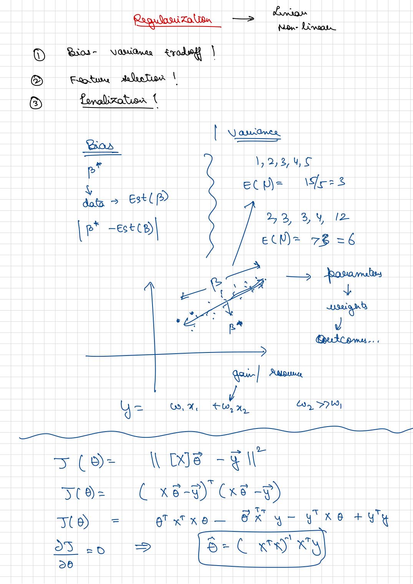
*👀 Board p. 1 — Three motivations; bias and variance with the 1,2,3,4,5 and 2,3,3,4,12 examples; the OLS derivation θ̂ = (XᵀX)⁻¹Xᵀy.*

Top: "Regularization → linear / non-linear"; ① bias–variance tradeoff, ② feature selection, ③ penalization. Left: $\beta^*$ → data → $\mathrm{Est}(\beta)$; bias $= \lvert\beta^* - \mathrm{Est}(\beta)\rvert$. Two number lists for bias/variance (A1). A sketch of coefficient estimates scattering around $\beta^*$, and "parameters → weights → outcomes". Bottom: $J(\theta) = \lVert X\theta - y\rVert^2$ expanded and set $\partial J/\partial\theta = 0\Rightarrow\hat\theta = (X^\top X)^{-1}X^\top y$.

### Board p. 2 — Collinearity and the eigen-decomposition

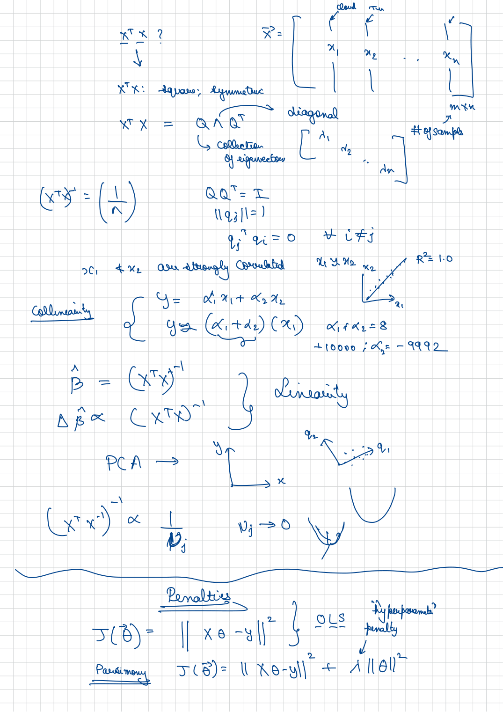
*👀 Board p. 2 — XᵀX = QΛQᵀ, the strongly correlated x₁, x₂ example with α₁ + α₂ = 8 (10000, −9992), and (XᵀX)⁻¹ ∝ 1/μⱼ.*

$X^\top X$: square, symmetric → $Q\Lambda Q^\top$, $QQ^\top = I$, $\lVert q_j\rVert = 1$, $q_i^\top q_j = 0$ ($i\ne j$). "$x_1$, $x_2$ are strongly correlated ($R^2\approx1$)": $y = \alpha_1x_1 + \alpha_2x_2\approx(\alpha_1 + \alpha_2)x_1$, $\alpha_1 + \alpha_2 = 8$, e.g. $10000$ and $-9992$. Then $\hat\beta = (X^\top X)^{-1}X^\top y$, $\Delta\hat\beta\propto(X^\top X)^{-1}$ ("linearity"), and $(X^\top X)^{-1}\propto1/\mu_j$: as $\mu_j\to0$ it blows up. A side note links to PCA (L5): the same eigen-directions. Bottom: **Penalties** — OLS $J = \lVert X\theta - y\rVert^2$ vs "parsimony" $J = \lVert X\theta - y\rVert^2 + \lambda\lVert\theta\rVert^2$.

### Board p. 3 — Ridge derivation and the ridge circle

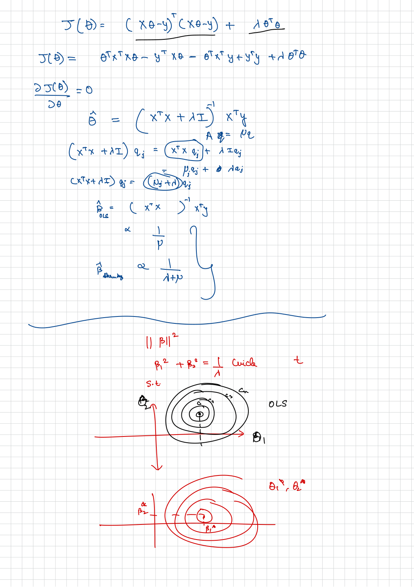
*👀 Board p. 3 — J = (Xθ − y)ᵀ(Xθ − y) + λθᵀθ → θ̂ = (XᵀX + λI)⁻¹Xᵀy; (XᵀX + λI)qⱼ = (μⱼ + λ)qⱼ; OLS ∝ 1/μ vs ridge ∝ 1/(λ + μ); contour sketches.*

Same as A5 Steps 1–3, and the two sketches: OLS contours centred at the OLS point, and the ridge objective's contours (red) pulled toward the origin, with the circle $\beta_1^2 + \beta_2^2 = 1/\lambda$ marked ("smaller budget ↔ bigger $\lambda$").

### Board p. 4 — Budget, Lagrange, and "biasing the parameter"

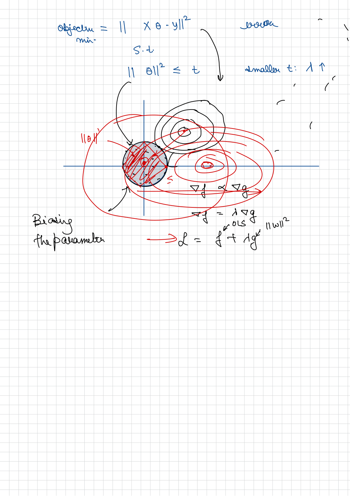
*👀 Board p. 4 — objective min ‖Xθ − y‖² s.t. ‖θ‖² ≤ t; the loss contours meet the shaded ball where ∇f = λ∇g; L = f + λg.*

"Objective: min $\lVert X\theta - y\rVert^2$ (error) s.t. $\lVert\theta\rVert^2\le t$; smaller $t$ → $\lambda\uparrow$." Contours from the OLS point grow until they touch the shaded ball; at the touch $\nabla f = \lambda\nabla g$, giving $\mathcal L = f + \lambda g$. Label: **"biasing the parameter"**: the solution is pulled from OLS toward the origin, which is exactly the bias in the bias–variance trade (A8).

---

# Part C — Practice

1. Why can two very different coefficient vectors produce almost the same predictions when predictors are correlated?
2. Show $\mu_j = \lVert Xq_j\rVert_2^2$ for a unit eigenvector $q_j$ of $X^\top X$.
3. Where does the dangerous factor $1/\mu_j$ enter the OLS solution?
4. Why does ridge shrink a weak direction more than a strong one?
5. Why can lasso produce an exact zero while ridge usually doesn't?
6. $X^\top X = \begin{bmatrix}5&3\\3&5\end{bmatrix}$, $X^\top y = (8, 4)$. Compute ridge with $\lambda = 2$ directly and via the eigenbasis.
7. Soft-threshold $z = (2.5, -0.4, 1.0, -3)$ with $\lambda = 1$. What does ridge (orthogonal design, $b = z/(1+\lambda)$) give?
8. Five estimates of $\beta^* = 1$: $0.6, 0.8, 1.0, 0.9, 0.7$. Compute bias, variance (divide by 5) and MSE.
9. You record one predictor in km instead of m. What happens to its OLS coefficient, its ridge penalty, and the ridge fit?
10. A colleague picks $\lambda$ by the lowest training MSE. What will they get, and why?
11. Show that elastic net with $\alpha = 0$ gives the ridge normal equation (slides' scaling).
12. With duplicate columns $x_1 = x_2$ and required sum $\beta_1 + \beta_2 = 6$, find the ridge-preferred split and the set of lasso-preferred splits.

<b>Answers</b>

1. With $x_1\approx x_2$, $\hat y\approx(\beta_1 + \beta_2)x_1$; moving along $(1,-1)$ changes predictions by $t(x_1 - x_2)\approx0$, so any split with the same sum fits almost equally well.
2. $\lVert Xq_j\rVert^2 = q_j^\top X^\top Xq_j = q_j^\top(\mu_jq_j) = \mu_jq_j^\top q_j = \mu_j$.
3. $\hat\beta = Q\Lambda^{-1}Q^\top X^\top y$: the diagonal inverse $\Lambda^{-1}$ divides each data component $c_j$ by $\mu_j$.
4. Shrink factor $\mu_j/(\mu_j + \lambda)$: a fixed $\lambda$ is large relative to a small $\mu_j$ (factor ≈ 0) but negligible relative to a large one (≈ 1).
5. $\lvert b\rvert$ has slope $\pm\lambda$ at 0 (a kink), so for $\lvert z\rvert\le\lambda$ the minimum sits at 0. $\tfrac\lambda2b^2$ has slope 0 at 0, so any nonzero pull moves the solution off 0.
6. Direct: $\begin{bmatrix}7&3\\3&7\end{bmatrix}^{-1}(8,4) = \tfrac1{40}\begin{bmatrix}7&-3\\-3&7\end{bmatrix}(8,4) = \tfrac1{40}(44, 4) = (1.1, 0.1)$. Eigen: $\mu = 8, 2$; $c_1 = 12/\sqrt2$, $c_2 = 4/\sqrt2$; $a_1 = \tfrac{12}{10\sqrt2}$, $a_2 = \tfrac{4}{4\sqrt2}$; $\hat\beta = 0.6(1,1) + 0.5(1,-1) = (1.1, 0.1)$ ✓. (OLS was $(1.75, -0.25)$.)
7. Lasso: $(1.5, 0, 0, -2)$. Ridge: $(1.25, -0.2, 0.5, -1.5)$.
8. Mean $= 4/5 = 0.8$, bias $= -0.2$. Variance $= (0.04 + 0 + 0.04 + 0.01 + 0.01)/5 = 0.02$. MSE $= 0.04 + 0.02 = 0.06$.
9. $x_{\text{km}} = x_{\text{m}}/1000$ ⇒ OLS coefficient ×1000 (predictions unchanged). Ridge penalty on it ×$10^6$ ⇒ ridge shrinks it far more, changing the fit. Standardise first.
10. $\lambda = 0$ (OLS), because adding a penalty can only increase the training error; training error can't see variance.
11. $J = \tfrac1{2n}\lVert y - X\beta\rVert^2 + \tfrac\lambda2\lVert\beta\rVert^2$; gradient $-\tfrac1nX^\top(y - X\beta) + \lambda\beta = 0$ ⇒ $(\tfrac1nX^\top X + \lambda I)\beta = \tfrac1nX^\top y$ (slide 16).
12. Ridge: minimise $\beta_1^2 + (6 - \beta_1)^2$ ⇒ $\beta_1 = 3$: $(3, 3)$. Lasso: $\lvert\beta_1\rvert + \lvert6 - \beta_1\rvert = 6$ for every $0\le\beta_1\le6$: **all** same-sign splits tie, including $(6, 0)$ and $(0, 6)$.

**Next:** [Lecture 8](L08_ols_ridge_lasso_worked_example.md) computes every object in this chain on one 4-row dataset.
