# Lecture 8 — OLS, Ridge, and Lasso Through One Worked Example

> ES 335 / ES 678 Machine Learning, Sem I 2026 — Prof. Udit Bhatia
> Source: `Lectures/L08_student_ols_ridge_lasso_worked_example.pdf` (54 slides, with some in-class annotations) · Previous: [`L07_regularization_ridge_lasso_elastic_net.md`](L07_regularization_ridge_lasso_elastic_net.md) · Next: [`L09_metrics_thresholds_costs.md`](L09_metrics_thresholds_costs.md)

**How to use this file.** Lecture 7 told the story *correlated predictors → flat valley → small eigenvalue → unstable OLS → ridge/lasso fix*. Lecture 8 **computes every object in that story** for one 4-row dataset and draws it. Part A collects the small amount of new maths (2×2 inverses, crossing lines, gradient-descent rates, the lasso optimality conditions). Part B goes through all 54 slides with every number recomputed. Part C is practice.

**The whole lecture in one table** (sample A vs a slightly perturbed sample B):

| | sample A | sample B | jump between samples |
|---|---|---|---|
| OLS | $(0.8,\ 1.2)$ | $(1.2,\ 0.8)$ | **0.566** |
| Ridge, $\lambda = 1$ | $(0.9713,\ 0.9801)$ | $(0.9790,\ 0.9721)$ | **0.011** |
| Lasso, $\lambda = 20$ | $(0,\ 1.0004)$ | $(0,\ 0.7994)$ | one twin dropped |

The responses moved by 0.08. OLS coefficients moved 7× that; ridge moved 1/7 of it. **Same data, same noise; the difference is the shape of the surface being minimised.**

## Contents

**Part A — Maths from the ground up**
1. [The running dataset and its two objects $X^\top X$, $X^\top y$](#a1-the-running-dataset-and-its-two-objects)
2. [A 2×2 system = two crossing lines](#a2-a-22-system--two-crossing-lines)
3. [Eigen-directions of a near-duplicate Gram matrix](#a3-eigen-directions-of-a-near-duplicate-gram-matrix)
4. [The loss around its minimum: a valley](#a4-the-loss-around-its-minimum-a-valley)
5. [Gradient descent: the $1 - \eta\mu$ factor](#a5-gradient-descent-the-1--ημ-factor)
6. [Lasso optimality: when is a coefficient exactly zero?](#a6-lasso-optimality-when-is-a-coefficient-exactly-zero)
7. [Train / validation / test](#a7-train--validation--test)

**Part B — Slides** · [All 54 slides](#part-b--slide-by-slide-all-54-slides)

**Part C — Practice** · [Jump](#part-c--practice)

---

# Part A — Maths From the Ground Up

## A1. The running dataset and its two objects

| $i$ | $x_{i1}$ | $x_{i2}$ | $y_i^{(A)}$ | $y_i^{(B)}$ |
|---|---|---|---|---|
| 1 | −3 | −3.1 | −6.12 | −6.08 |
| 2 | −1 | −0.9 | −1.88 | −1.92 |
| 3 | 1 | 1.1 | 2.12 | 2.08 |
| 4 | 3 | 2.9 | 5.88 | 5.92 |

Both columns are centred (sum 0), so no intercept is needed. Model: $\hat y = \omega_1x_1 + \omega_2x_2$ (the slides use $\omega$ for coefficients).

**Gram matrix** (dot products of columns, L5 A3):
- $x_1^\top x_1 = 9 + 1 + 1 + 9 = 20$;
- $x_1^\top x_2 = 9.3 + 0.9 + 1.1 + 8.7 = 20$;
- $x_2^\top x_2 = 9.61 + 0.81 + 1.21 + 8.41 = 20.04$.

$$X^\top X = \begin{bmatrix}20&20\\20&20.04\end{bmatrix},\qquad\det = 20(20.04) - 20^2 = 0.8.$$

**Feature–response alignment:**
- $x_1^\top y^{(A)} = 18.36 + 1.88 + 2.12 + 17.64 = 40$;
- $x_2^\top y^{(A)} = 18.972 + 1.692 + 2.332 + 17.052 = 40.048$.

$X^\top y^{(A)} = (40,\ 40.048)$, and similarly $X^\top y^{(B)} = (40,\ 40.032)$.

**Correlation of the columns:** $\frac{20}{\sqrt{20\cdot20.04}} = 0.999$. Practically the same sensor twice.

## A2. A 2×2 system = two crossing lines

**Inverse of a 2×2** (L4 §A7): $\begin{bmatrix}a&b\\c&d\end{bmatrix}^{-1} = \dfrac{1}{ad - bc}\begin{bmatrix}d&-b\\-c&a\end{bmatrix}$. Swap the diagonal, negate the off-diagonal, divide by the determinant.

The normal equation $X^\top X\omega = X^\top y$ is two equations = **two lines** in the $(\omega_1,\omega_2)$ plane; the solution is where they cross.
$$20\omega_1 + 20\omega_2 = 40,\qquad20\omega_1 + 20.04\omega_2 = 40.048.$$
Slopes: $-20/20 = -1.000$ and $-20/20.04 = -0.998$. **Nearly parallel lines cross at a point that moves a lot when either line shifts a little.** That's ill-conditioning in a picture: a small determinant (0.8, tiny next to entries of size 20) ⇒ large entries in the inverse ⇒ big amplification.

**Subtract the equations** to see it: $0.04\omega_2 = 0.048\Rightarrow\omega_2 = 1.2$, then $\omega_1 = 2 - 1.2 = 0.8$. For sample B: $0.04\omega_2 = 0.032\Rightarrow\omega_2 = 0.8$. A change of 0.016 in the right-hand side, divided by 0.04, moved $\omega_2$ by 0.4.

## A3. Eigen-directions of a near-duplicate Gram matrix

For $\begin{bmatrix}a&b\\b&d\end{bmatrix}$: $\mu = \tfrac{T}{2}\pm\sqrt{\tfrac{T^2}{4} - D}$ with $T = 40.04$, $D = 0.8$:
$$\mu = 20.02\pm\sqrt{400.8004 - 0.8} = 20.02\pm20.0000\ \Rightarrow\ \mu_{\text{strong}} = 40.02,\quad\mu_{\text{weak}} = 0.01999.$$
Check: sum $= 40.04 = T$ ✓, product $\approx0.8 = D$ ✓.

| | direction $q$ | $\mu$ | $\lVert Xq\rVert = \sqrt\mu$ | meaning |
|---|---|---|---|---|
| strong | $(0.7068,\ 0.7075)\approx\tfrac1{\sqrt2}(1,1)$ | 40.02 | 6.326 | both coefficients up together: predictions move a lot |
| weak | $(-0.7075,\ 0.7068)\approx\tfrac1{\sqrt2}(-1,1)$ | 0.01999 | 0.141 | one up, one down: predictions barely move |

**Condition number** $\kappa = 40.02/0.01999 = 2002$.

## A4. The loss around its minimum: a valley

Because $J$ is quadratic and $\nabla J(\hat\omega) = 0$ (L5 slide 23, L7 slide 9):
$$J(\hat\omega + tq_j) = J(\hat\omega) + \tfrac12\mu_jt^2.$$

| step $t$ along | weak ($\tfrac12\mu = 0.01$) | strong ($\tfrac12\mu = 20.01$) |
|---|---|---|
| 0.25 | 0.0006 | 1.25 |
| 0.5 | 0.0025 | 5.0 |
| 1 | 0.01 | 20.0 |

Contours of $J$ are ellipses with axes along $q_j$ and half-lengths $\propto1/\sqrt{\mu_j}$: ratio $\sqrt{2002} = 44.7$. **A valley 45 times longer than it is wide.**

## A5. Gradient descent: the $1 - \eta\mu$ factor

GD on a quadratic: $\omega_{t+1} = \omega_t - \eta\nabla J = \omega_t - \eta G(\omega_t - \hat\omega)$. Let $e_t = \omega_t - \hat\omega$ be the error. Then
$$e_{t+1} = (I - \eta G)e_t.$$
In eigen-coordinates each component is multiplied by $(1 - \eta\mu_j)$ **every step**:

| $\eta = 0.02$ | strong ($\mu = 40.02$) | weak OLS ($\mu = 0.02$) | weak ridge ($\mu + \lambda = 1.02$) |
|---|---|---|---|
| factor $1 - \eta\mu$ | $0.1996$ | $0.9996$ | $0.9796$ |
| after 400 steps | $\approx0$ | $0.9996^{400} = 0.85$ | $0.9796^{400} = 2.6\times10^{-4}$ |

The step size must be small enough for the **steep** direction ($\eta < 2/\mu_{\max} = 0.05$), so progress along the **flat** direction is a crawl. Ridge lifts the flat eigenvalue from 0.02 to 1.02 and turns the crawl into a walk.

## A6. Lasso optimality: when is a coefficient exactly zero?

Objective $J(\omega) = \tfrac12\lVert y - X\omega\rVert^2 + \lambda\sum_j\lvert\omega_j\rvert$. Generalising L7 A7's 1-D rule, the optimum satisfies, for each $j$:
- if $\omega_j\ne0$: $x_j^\top(y - X\omega) = \lambda\,\mathrm{sign}(\omega_j)$ (data pull = friction);
- if $\omega_j = 0$: $\lvert x_j^\top(y - X\omega)\rvert\le\lambda$ (pull too weak to overcome friction).

**Exact lasso path for sample A.**

*Phase 1, both nonzero and positive.* Stack the two equations: $X^\top X\omega = X^\top y - \lambda(1,1)$ ⇒
$$\omega = \hat\omega_{\text{OLS}} - \lambda(X^\top X)^{-1}\begin{bmatrix}1\\1\end{bmatrix} = \begin{bmatrix}0.8\\1.2\end{bmatrix} - \lambda\cdot\frac{1}{0.8}\begin{bmatrix}20.04 - 20\\-20 + 20\end{bmatrix} = \begin{bmatrix}0.8 - 0.05\lambda\\1.2\end{bmatrix}.$$
$\omega_2$ stays at 1.2 while $\omega_1$ slides down and hits 0 at $\lambda = 0.8/0.05 = 16$.

*Phase 2, only $\omega_2$ active.* $x_2^\top(y - x_2\omega_2) = \lambda$ ⇒ $\omega_2 = \frac{40.048 - \lambda}{20.04}$. At $\lambda = 20$: $\omega_2 = 20.048/20.04 = 1.0004$ ✓ (slide 46). Hits 0 at $\lambda = 40.048$.

*Check $\omega_1$ really stays 0:* $\lvert x_1^\top(y - x_2\omega_2)\rvert = 40 - 20\cdot\frac{40.048 - \lambda}{20.04} = 0.032 + 0.998\lambda\le\lambda\iff\lambda\ge16$ ✓.

**Sample B:** $\omega = (1.2 - 0.05\lambda,\ 0.8)$; $\omega_1 = 0$ from $\lambda = 24$; then $\omega_2 = (40.032 - \lambda)/20.04$. In **both** samples lasso keeps $x_2$, because its column is 0.2% longer and its alignment with $y$ is larger (slide 47).

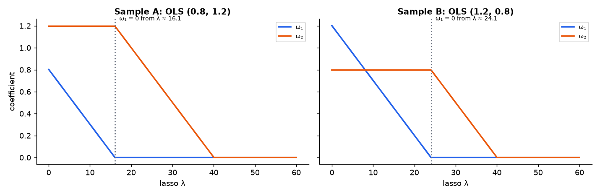
*📊 Lasso paths for both samples, computed exactly: ω₁ slides to zero (λ = 16 for A, 24 for B) while ω₂ holds, then ω₂ shrinks.*

(The slide quotes 16.8 and 25.1, read off its plotted $\lambda$ grid; the exact kinks from this algebra are 16 and 24.)

## A7. Train / validation / test

| set | used for | touched how often |
|---|---|---|
| training | fit $\omega$ for every candidate $\lambda$; compute standardisation $m_j, s_j$ | many times |
| validation | choose $\lambda^*$ (and the method) | once per candidate |
| test | report the final error | **exactly once** |

Validation error becomes optimistic once you've chosen the $\lambda$ that looked best on it. The test set must not have influenced any decision.

---

# Part B — Slide by Slide (all 54 slides)

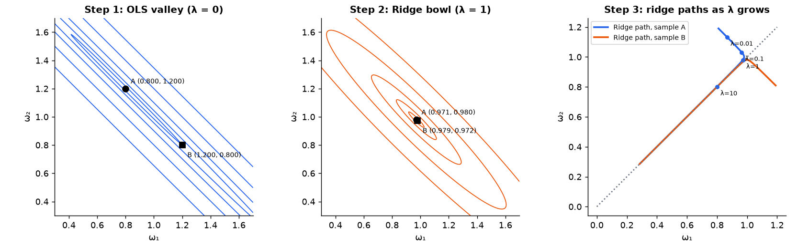
*📊 The whole lecture in three panels: OLS valley (A and B far apart), ridge bowl (A and B on top of each other), and the ridge paths sliding onto ω₁ = ω₂ then toward 0.*

## Slide 1 — Title

*Lecture 8: OLS, Ridge, and Lasso Through One Worked Example.* Prof. Udit Bhatia, Semester I 2026. (Annotation: "Assignment 1".)

## Slide 2 — What The Previous Lecture Established

correlated predictors → a flat valley in the loss → small eigenvalue of $X^\top X$ → unstable OLS coefficients.

**Summary:** today computes every object in that chain for one small dataset, draws each one (the valley, its two directions, what ridge does to it), then repeats with ridge and lasso.

## Slide 3 — The Question For Today

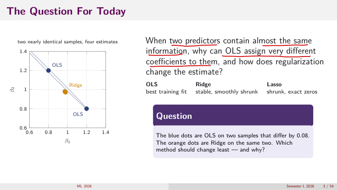
*👀 Slide 3 — Two nearly identical samples, four estimates: OLS dots far apart, ridge dots together.*

When two predictors carry almost the same information, why can OLS assign very different coefficients, and how does regularisation change that? OLS = best training fit; ridge = stable, smoothly shrunk; lasso = shrunk, exact zeros.

**Question:** the samples differ by 0.08. Which method should change least? → Ridge (slides 30–35).

## Slide 4 — One Dataset For The Entire Lecture

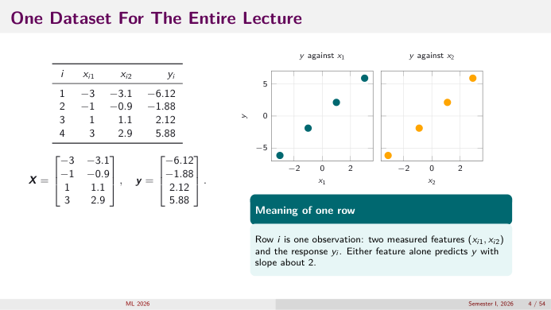
*👀 Slide 4 — Four rows; either feature alone predicts y with slope ≈ 2.*

Table in A1. Row $i$ = one observation: $(x_{i1}, x_{i2})$ and $y_i$. **Either feature alone predicts $y$ with slope about 2** (e.g. $y\approx2x_1$: $-6, -2, 2, 6$ vs observed $-6.12, -1.88, 2.12, 5.88$).

## Slide 5 — The Predictors Are Almost Duplicates

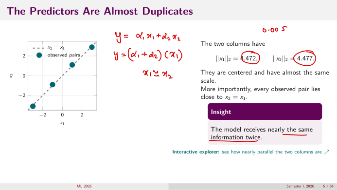
*👀 Slide 5 — Every (x₁, x₂) pair lies close to the line x₂ = x₁.*

$\lVert x_1\rVert = \sqrt{20} = 4.472$, $\lVert x_2\rVert = \sqrt{20.04} = 4.477$. Centred, almost the same scale, and every pair lies close to $x_2 = x_1$ (differences only ±0.1). **The model receives nearly the same information twice.** (Annotation: $y = \omega_1x_1 + \omega_2x_2\approx(\omega_1 + \omega_2)x_1$.)

## Slide 6 — The Prediction Rule

$\hat y_i = \omega_1x_{i1} + \omega_2x_{i2}$, $\hat y = X\omega$. Row 1 at $\omega = (0.8, 1.2)$: $-3(0.8) - 3.1(1.2) = -2.4 - 3.72 = -6.12$ ✓, the two stacked pieces of the first bar.

**Summary:** features centred ⇒ intercept omitted to keep the arithmetic visible. In practice it is fitted and **left unpenalised**.

## Slide 7 — OLS Turns Prediction Errors Into One Number

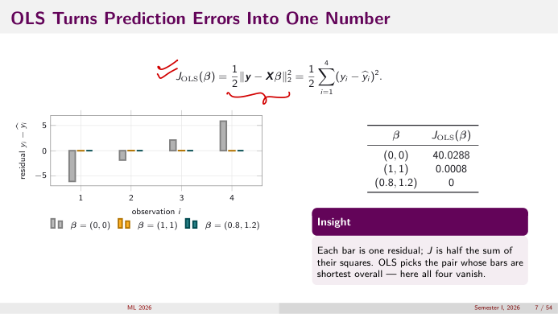
*👀 Slide 7 — Residual bars for three candidate ω.*

$J_{\text{OLS}}(\omega) = \tfrac12\lVert y - X\omega\rVert^2 = \tfrac12\sum_i(y_i - \hat y_i)^2$.

| $\omega$ | residuals $y - X\omega$ | $J$ |
|---|---|---|
| $(0, 0)$ | $y$ itself | $\tfrac12(37.45 + 3.53 + 4.49 + 34.57) = 40.0288$ |
| $(1, 1)$ | $y - (x_1 + x_2) = (-0.02, 0.02, 0.02, -0.02)$ | $\tfrac12(4\times0.0004) = 0.0008$ |
| $(0.8, 1.2)$ | $(0, 0, 0, 0)$ | $0$ |

($(0,0)$: $6.12^2 + 1.88^2 + 2.12^2 + 5.88^2 = 37.45 + 3.53 + 4.49 + 34.57 = 80.06$, half is 40.03.) OLS picks the pair whose bars are shortest overall; here all four vanish.

## Slide 8 — OLS Objective Expansion: $J$ Is A Quadratic Surface

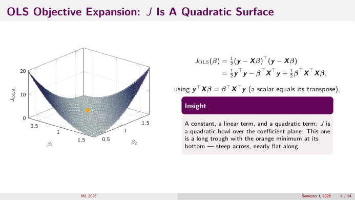
*👀 Slide 8 — A long trough with the minimum at its bottom: steep across, nearly flat along.*

$$J = \tfrac12(y - X\omega)^\top(y - X\omega) = \tfrac12y^\top y - \omega^\top X^\top y + \tfrac12\omega^\top X^\top X\omega$$
(using $y^\top X\omega = \omega^\top X^\top y$, a scalar equals its transpose). Constant + linear + quadratic = a **quadratic bowl** over the coefficient plane. This one is a long trough.

## Slide 9 — OLS Gradient: Every Arrow Points Across The Trough

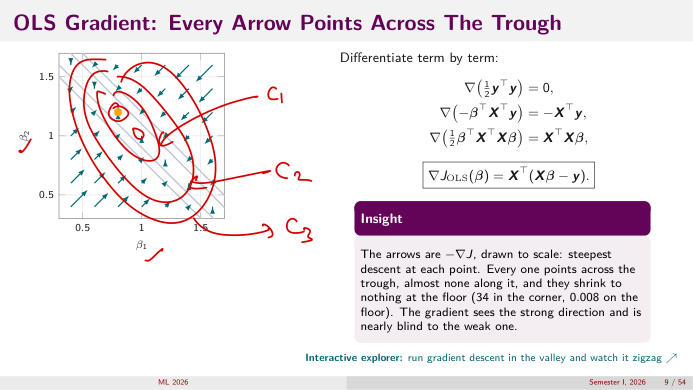
*👀 Slide 9 — −∇J arrows: all point across the trough, almost none along it.*

Term by term: $\nabla(\tfrac12y^\top y) = 0$, $\nabla(-\omega^\top X^\top y) = -X^\top y$, $\nabla(\tfrac12\omega^\top X^\top X\omega) = X^\top X\omega$. So
$$\nabla J_{\text{OLS}}(\omega) = X^\top(X\omega - y).$$
**Insight:** the arrows are $-\nabla J$ to scale. Every one points across the trough and shrinks to nothing on the floor. **The gradient sees the strong direction and is nearly blind to the weak one.** (Annotations sketch the contour ellipses.)

**Why:** $\nabla J = G(\omega - \hat\omega)$; in eigen-coordinates its components are $\mu_jz_j$, so the weak component is multiplied by 0.02 and the strong by 40.

## Slide 10 — The OLS Normal Equation: Where The Arrows Vanish

$\nabla J = 0\Rightarrow X^\top X\hat\omega_{\text{OLS}} = X^\top y$, and if invertible $\hat\omega = (X^\top X)^{-1}X^\top y$. Two objects to compute: $X^\top X$ (feature geometry) and $X^\top y$ (feature–response alignment).

**Insight:** equally far from the minimum, $\lVert\nabla J\rVert$ is 0.008 on the floor but 11.3 off it. Reason: $\nabla J = X^\top X(\omega - \hat\omega)$, so a displacement $d$ along $q_j$ gives a gradient of size $\mu_jd$: multiplied by 0.02 along the floor, by 40 across it.

## Slide 11 — The Two Numerical Objects

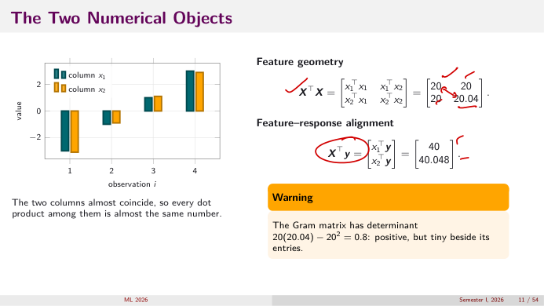
*👀 Slide 11 — The two columns almost coincide, so every dot product among them is almost the same number.*

$X^\top X = \begin{bmatrix}20&20\\20&20.04\end{bmatrix}$, $X^\top y = (40,\ 40.048)$ (all computed in A1).

> ⚠️ $\det X^\top X = 0.8$: positive, but tiny beside its entries.

## Slide 12 — The OLS Coefficients: Where Two Nearly Parallel Lines Cross ✍️

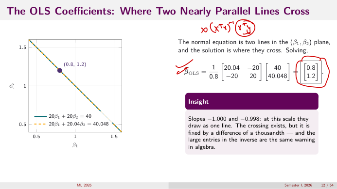
*👀 Slide 12 — 20ω₁ + 20ω₂ = 40 and 20ω₁ + 20.04ω₂ = 40.048 cross at (0.8, 1.2).*

$$\hat\omega_{\text{OLS}} = \frac1{0.8}\begin{bmatrix}20.04&-20\\-20&20\end{bmatrix}\begin{bmatrix}40\\40.048\end{bmatrix} = \frac1{0.8}\begin{bmatrix}801.6 - 800.96\\-800 + 800.96\end{bmatrix} = \frac1{0.8}\begin{bmatrix}0.64\\0.96\end{bmatrix} = \begin{bmatrix}0.8\\1.2\end{bmatrix}.$$
Slopes $-1.000$ and $-0.998$: at this scale they draw as one line. The crossing exists but is fixed by a difference of a thousandth; the large entries of the inverse (25.05, 25) are the same warning in algebra (A2).

## Slide 13 — Checking The OLS Fit

$$X\hat\omega = \begin{bmatrix}-3(0.8) - 3.1(1.2)\\-0.8 - 1.08\\0.8 + 1.32\\2.4 + 3.48\end{bmatrix} = \begin{bmatrix}-6.12\\-1.88\\2.12\\5.88\end{bmatrix} = y.$$
Zero residuals, $J = 0$. **Question:** if OLS fits perfectly, what could still be wrong? → The coefficients themselves are unreliable (slides 14–18).

## Slide 14 — A Slightly Different Training Sample

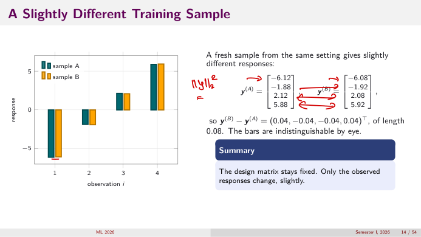
*👀 Slide 14 — Samples A and B: the bars are indistinguishable by eye.*

$y^{(B)} - y^{(A)} = (0.04, -0.04, -0.04, 0.04)$, length $\sqrt{4\times0.0016} = 0.08$. Design matrix fixed; only responses change slightly.

## Slide 15 — OLS On The Slightly Changed Responses: The Crossing Jumps ✍️

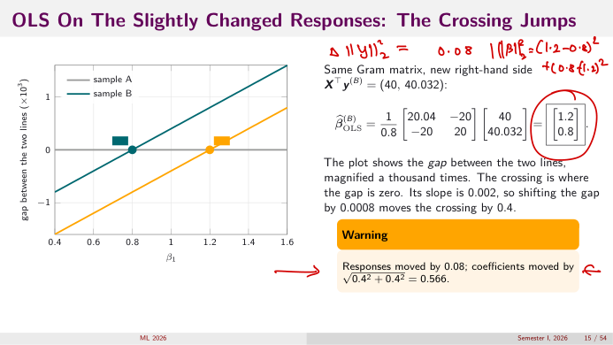
*👀 Slide 15 — Gap between the two lines (×1000); the crossing moves from 1.2 to 0.8.*

Same Gram matrix, new $X^\top y^{(B)} = (40, 40.032)$:
$$\hat\omega^{(B)} = \frac1{0.8}\begin{bmatrix}20.04(40) - 20(40.032)\\-20(40) + 20(40.032)\end{bmatrix} = \frac1{0.8}\begin{bmatrix}0.96\\0.64\end{bmatrix} = \begin{bmatrix}1.2\\0.8\end{bmatrix}.$$
The gap between the lines has slope 0.002, so shifting it by 0.0008 moves the crossing by 0.4.

> ⚠️ Responses moved by 0.08; coefficients moved by $\sqrt{0.4^2 + 0.4^2} = 0.566$. (Annotation: $\lVert\Delta y\rVert = 0.08$, $\lVert\Delta\omega\rVert = 0.566$, a factor of 7.)

## Slide 16 — The OLS Coefficient Swap

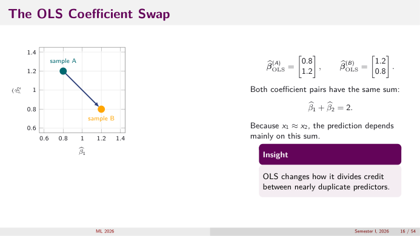
*👀 Slide 16 — (0.8, 1.2) → (1.2, 0.8): a mirror swap, same sum.*

Both pairs have $\hat\omega_1 + \hat\omega_2 = 2$. Since $x_1\approx x_2$, the prediction depends mainly on this sum. **OLS changes how it divides credit between near-duplicates.**

## Slide 17 — What Cancels When The Coefficients Swap?

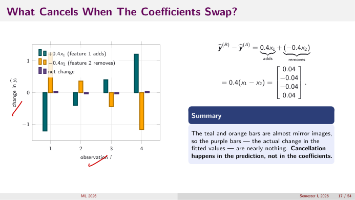
*👀 Slide 17 — +0.4x₁ and −0.4x₂ nearly cancel; the net change in ŷ is tiny.*

$$\hat y^{(B)} - \hat y^{(A)} = 0.4x_1 + (-0.4x_2) = 0.4(x_1 - x_2) = 0.4(0.1, -0.1, -0.1, 0.1) = (0.04, -0.04, -0.04, 0.04).$$
Exactly $y^{(B)} - y^{(A)}$ (both fits are perfect). **Cancellation happens in the prediction, not in the coefficients.**

## Slide 18 — Near Cancellation Makes OLS Coefficients Unstable ✍️

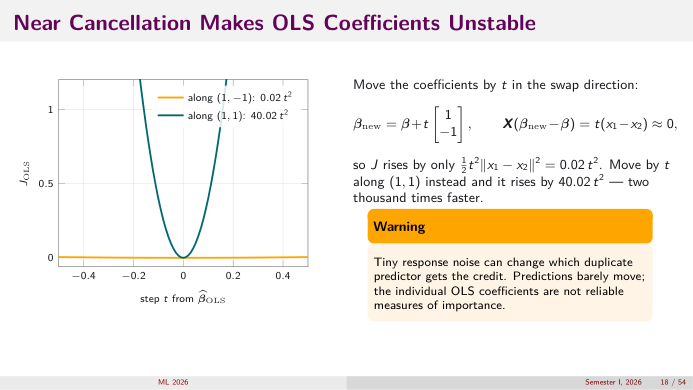
*👀 Slide 18 — Along (1, −1) the loss rises as 0.02t²; along (1, 1) as 40.02t².*

Move by $t(1,-1)$: $X(\omega_{\text{new}} - \omega) = t(x_1 - x_2)$, so $J$ rises by $\tfrac12t^2\lVert x_1 - x_2\rVert^2 = \tfrac12t^2(0.04) = 0.02t^2$. Along $(1,1)$: $\tfrac12t^2\lVert x_1 + x_2\rVert^2 = \tfrac12t^2(37.21 + 3.61 + 4.41 + 34.81) = 40.02t^2$, **two thousand times faster**.

> ⚠️ Tiny response noise can change which duplicate gets the credit. Individual OLS coefficients are **not** reliable measures of importance.

(These use unnormalised directions; with unit vectors divide by 2 and get $\tfrac12\mu t^2$ with $\mu = 0.02, 40.02$.)

## Slide 19 — The Loss Surface Is A Valley, Not A Bowl

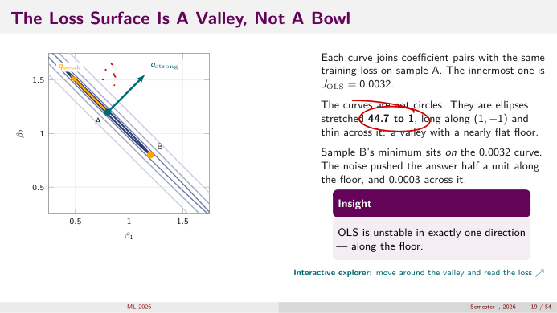
*👀 Slide 19 — Contours stretched 44.7 : 1; sample B's minimum sits on A's innermost curve, half a unit along the floor.*

Each curve joins pairs with the same training loss on sample A; innermost $J = 0.0032$. Ellipses stretched $\sqrt{2002} = 44.7$ to 1, long along $(1,-1)$. Sample B's minimum is on that 0.0032 curve: **noise pushed it 0.57 along the floor and 0.0003 across**. Check: $J_A(1.2, 0.8) = \tfrac12\lVert y^{(A)} - y^{(B)}\rVert^2 = \tfrac12(0.0064) = 0.0032$ ✓.

**OLS is unstable in exactly one direction: along the floor.**

## Slide 20 — The Same Surface As A Map: Dark Is Low

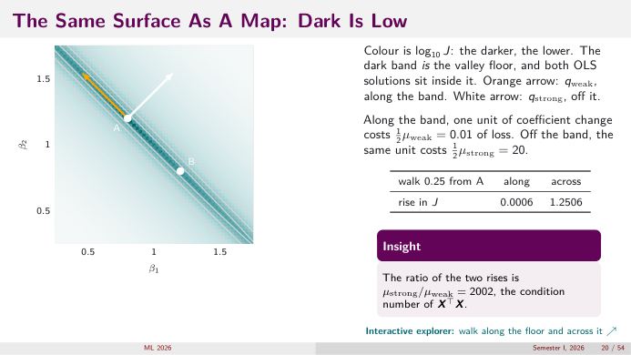
*👀 Slide 20 — Colour = log₁₀ J: a dark band with both OLS solutions inside.*

Along the band, one unit costs $\tfrac12\mu_{\text{weak}} = 0.01$; across it, $\tfrac12\mu_{\text{strong}} = 20$.

| walk 0.25 from A | along | across |
|---|---|---|
| rise in $J$ | $0.01(0.25)^2 = 0.0006$ | $20.01(0.25)^2 = 1.2506$ |

Ratio $= \mu_{\text{strong}}/\mu_{\text{weak}} = 2002$, the **condition number** of $X^\top X$.

## Slide 21 — Naming The Two Directions

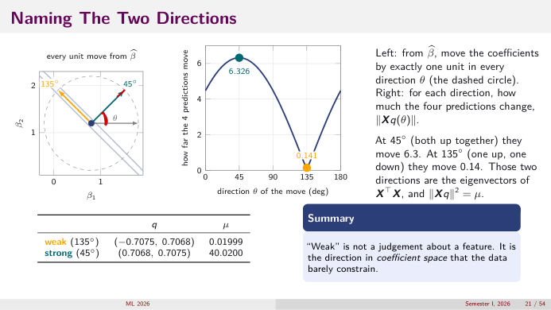
*👀 Slide 21 — Move one unit in every direction ε; predictions move 6.326 at 45° and 0.141 at 135°.*

From $\hat\omega$, move exactly one unit in direction $\varepsilon$ (dashed circle) and measure $\lVert Xq(\varepsilon)\rVert$, how far the four predictions move. Max at 45° (both up): 6.326. Min at 135° (one up, one down): 0.141. Those two are the **eigenvectors of $X^\top X$**, and $\lVert Xq\rVert^2 = \mu$ (A3 table).

**"Weak" is not a judgement about a feature.** It's the direction in coefficient space that the data barely constrain.

## Slide 22 — What A Weak Move Does To The Predictions

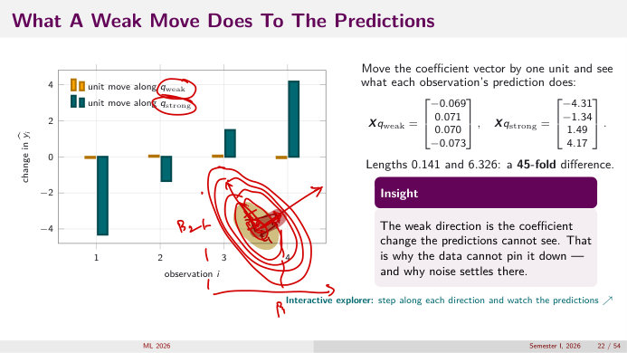
*👀 Slide 22 — Unit moves along q_weak and q_strong: prediction changes of size 0.07 vs 4.*

$$Xq_{\text{weak}} = (-0.069,\ 0.071,\ 0.070,\ -0.073),\qquad Xq_{\text{strong}} = (-4.31,\ -1.34,\ 1.49,\ 4.17).$$
Lengths 0.141 and 6.326: a 45-fold difference. **The weak direction is the coefficient change the predictions can't see**, which is why the data can't pin it down and why noise settles there.

## Slide 23 — Why The Small Eigenvalue Marks The Unstable Direction

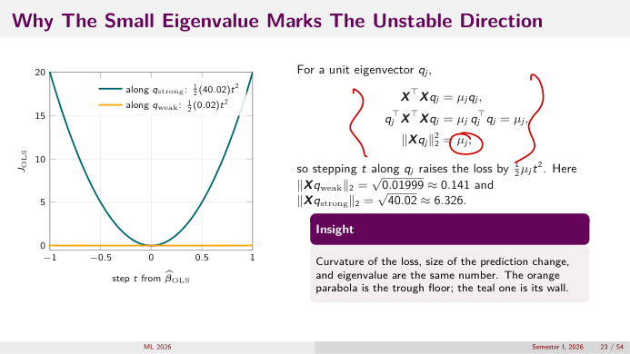
*👀 Slide 23 — Two parabolas from the minimum: ½(40.02)t² (the wall) and ½(0.02)t² (the floor).*

$X^\top Xq_j = \mu_jq_j\Rightarrow q_j^\top X^\top Xq_j = \mu_j\Rightarrow\lVert Xq_j\rVert^2 = \mu_j$. Stepping $t$ along $q_j$ raises $J$ by $\tfrac12\mu_jt^2$. $\sqrt{0.01999} = 0.141$, $\sqrt{40.02} = 6.326$.

**Curvature of the loss, size of the prediction change, and eigenvalue are the same number.**

## Slide 24 — What The Weak Direction Means In Practice

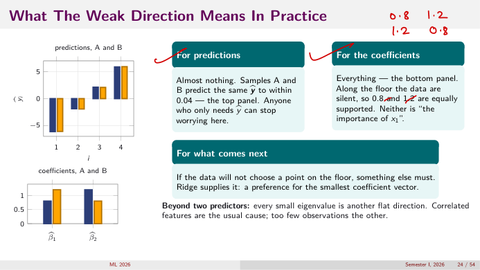
*👀 Slide 24 — Predictions from A and B agree to 0.04; coefficients swap 0.8 ↔ 1.2.*

| For predictions | For the coefficients |
|---|---|
| Almost nothing: A and B predict the same $\hat y$ to within 0.04. If you only need $\hat y$, stop worrying. | Everything: along the floor the data are silent, so 0.8 and 1.2 are equally supported. Neither is "the importance of $x_1$". |

**What comes next:** if the data won't choose a point on the floor, something else must. Ridge supplies it: a preference for the smallest coefficient vector. Beyond 2 predictors: every small eigenvalue is another flat direction; correlated features are the usual cause, too few observations the other.

## Slide 25 — Ridge Breaks The Tie Between Equivalent Fits

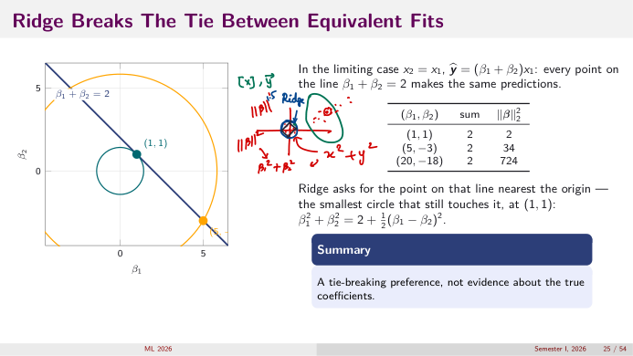
*👀 Slide 25 — On the line ω₁ + ω₂ = 2, the smallest circle that touches it does so at (1, 1).*

Limiting case $x_2 = x_1$: $\hat y = (\omega_1 + \omega_2)x_1$; every point on $\omega_1 + \omega_2 = 2$ makes the same predictions.

| $(\omega_1, \omega_2)$ | sum | $\lVert\omega\rVert^2$ |
|---|---|---|
| $(1, 1)$ | 2 | 2 |
| $(5, -3)$ | 2 | 34 |
| $(20, -18)$ | 2 | 724 |

Identity: $\omega_1^2 + \omega_2^2 = \tfrac12(\omega_1 + \omega_2)^2 + \tfrac12(\omega_1 - \omega_2)^2 = 2 + \tfrac12(\omega_1 - \omega_2)^2$ on the line. Minimised when $\omega_1 = \omega_2$, i.e. $(1, 1)$.

**A tie-breaking preference, not evidence about the true coefficients.**

## Slide 26 — The Ridge Preference In The Running Example

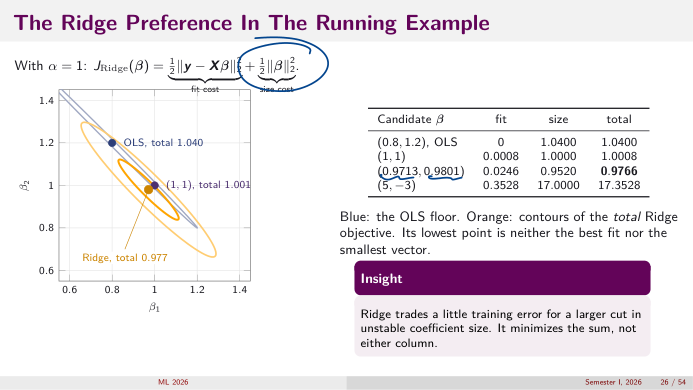
*👀 Slide 26 — Total ridge objective contours (orange) over the OLS floor (blue).*

$\lambda = 1$: $J_{\text{ridge}} = \underbrace{\tfrac12\lVert y - X\omega\rVert^2}_{\text{fit}} + \underbrace{\tfrac12\lVert\omega\rVert^2}_{\text{size}}$.

| candidate $\omega$ | fit | size | total |
|---|---|---|---|
| $(0.8, 1.2)$ OLS | 0 | $\tfrac12(0.64 + 1.44) = 1.0400$ | 1.0400 |
| $(1, 1)$ | 0.0008 | 1.0000 | 1.0008 |
| $(0.9713, 0.9801)$ ridge | 0.0246 | 0.9520 | **0.9766** |
| $(5, -3)$ | 0.3528 | 17.0000 | 17.3528 |

**The ridge minimum is neither the best fit nor the smallest vector.** It minimises the **sum**: trades a little training error for a larger cut in unstable size.

## Slide 27 — The Ridge Normal Equation: Two Pulls That Cancel

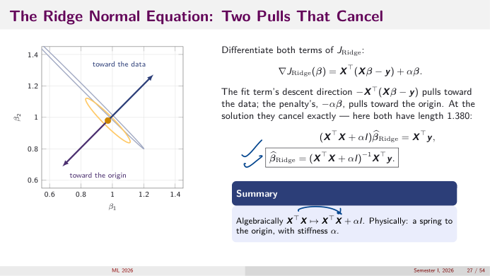
*👀 Slide 27 — At the ridge solution, the pull toward the data and the pull toward the origin have equal length (1.380) and cancel.*

$$\nabla J_{\text{ridge}} = X^\top(X\omega - y) + \lambda\omega = 0\ \Rightarrow\ (X^\top X + \lambda I)\hat\omega_{\text{ridge}} = X^\top y.$$
Descent directions: $-X^\top(X\omega - y)$ pulls toward the data; $-\lambda\omega$ pulls toward the origin. At the solution they're equal and opposite: $\lVert X^\top(y - X\hat\omega)\rVert = \lVert\lambda\hat\omega\rVert = 1.380$ ✓.

**Algebraically $X^\top X\to X^\top X + \lambda I$. Physically: a spring to the origin with stiffness $\lambda$.**

## Slide 28 — The Ridge Matrix For $\lambda = 1$: The Lines Are No Longer Parallel

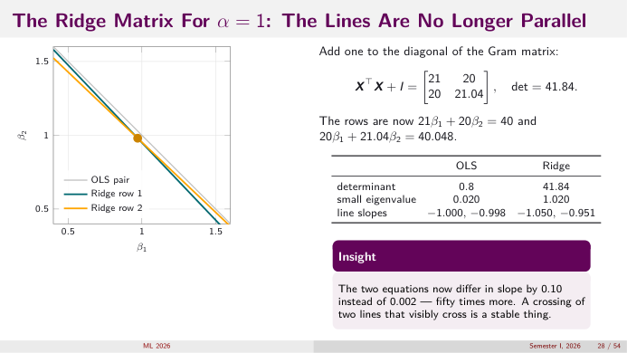
*👀 Slide 28 — Ridge rows 21ω₁ + 20ω₂ = 40 and 20ω₁ + 21.04ω₂ = 40.048 visibly cross.*

$X^\top X + I = \begin{bmatrix}21&20\\20&21.04\end{bmatrix}$, $\det = 441.84 - 400 = 41.84$.

| | OLS | Ridge |
|---|---|---|
| determinant | 0.8 | 41.84 |
| small eigenvalue | 0.020 | 1.020 |
| line slopes | $-1.000$, $-0.998$ | $-1.050$, $-0.951$ |

The slopes now differ by 0.10 instead of 0.002 (×50). **A crossing of two lines that visibly cross is a stable thing.**

## Slide 29 — Ridge Lifts The Valley Floor

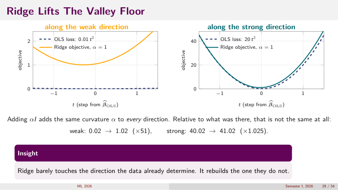
*👀 Slide 29 — Along the weak direction ridge turns 0.01t² into 0.51t²; along the strong direction 20t² barely changes.*

$\lambda I$ adds the same curvature $\lambda$ to every direction. Relative to what was there, that's very different:
$$\text{weak: }0.02\to1.02\ (\times51),\qquad\text{strong: }40.02\to41.02\ (\times1.025).$$
**Ridge barely touches the direction the data already determine. It rebuilds the one they don't.**

## Slide 30 — Ridge Fills The Valley

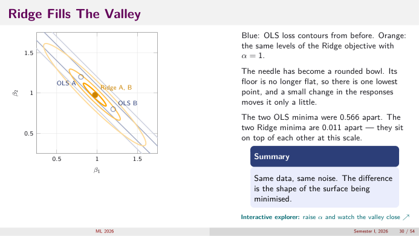
*👀 Slide 30 — Blue OLS contours vs orange ridge contours: the needle becomes a rounded bowl.*

The ridge objective's level sets are a rounded bowl with a single lowest point. The two OLS minima were 0.566 apart; the two ridge minima are **0.011** apart.

## Slide 31 — Two Maps: The OLS Valley And The Ridge Bowl

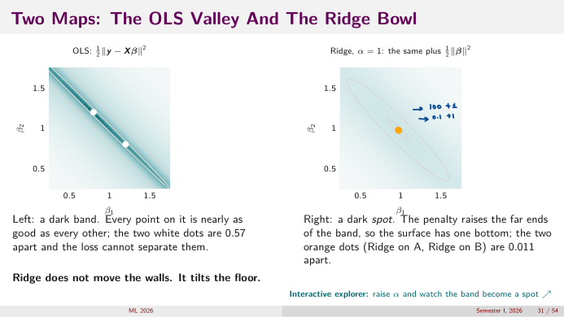
*👀 Slide 31 — Left: a dark band (OLS). Right: a dark spot (ridge).*

Left: every point on the band is nearly as good as any other; the white dots are 0.57 apart and the loss can't separate them. Right: the penalty raises the far ends of the band so there's one bottom; orange dots 0.011 apart. **Ridge does not move the walls. It tilts the floor.**

## Slide 32 — Gradient Descent On Each Map: A Crawl And A Walk

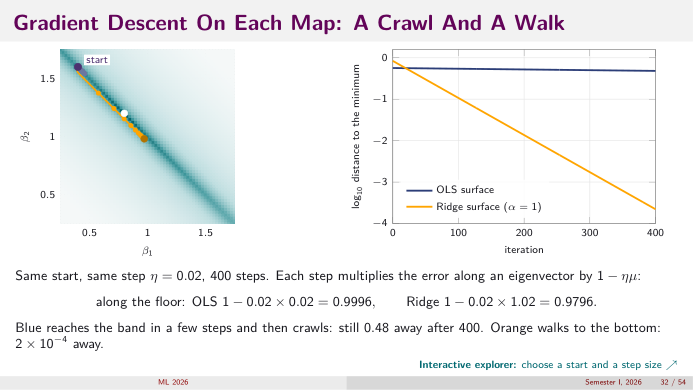
*👀 Slide 32 — Same start, η = 0.02, 400 steps: OLS still 0.48 away; ridge 2×10⁻⁴ away.*

Each step multiplies the error along an eigenvector by $1 - \eta\mu$ (A5): along the floor OLS $1 - 0.02\times0.02 = 0.9996$, ridge $1 - 0.02\times1.02 = 0.9796$. OLS reaches the band in a few steps, then crawls: still 0.48 away after 400. Ridge: $2\times10^{-4}$.

## Slide 33 — The Ridge Coefficients For Sample A ✍️

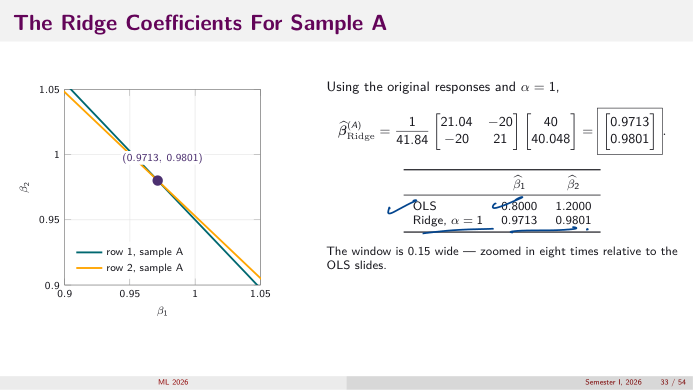
*👀 Slide 33 — Zoomed 8×: ridge rows for sample A cross at (0.9713, 0.9801).*

$$\hat\omega^{(A)}_{\text{ridge}} = \frac1{41.84}\begin{bmatrix}21.04&-20\\-20&21\end{bmatrix}\begin{bmatrix}40\\40.048\end{bmatrix} = \frac1{41.84}\begin{bmatrix}841.6 - 800.96\\-800 + 841.008\end{bmatrix} = \frac1{41.84}\begin{bmatrix}40.64\\41.008\end{bmatrix} = \begin{bmatrix}0.9713\\0.9801\end{bmatrix}.$$

## Slide 34 — The Ridge Coefficients For Sample B ✍️

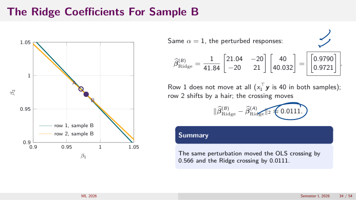
*👀 Slide 34 — Ridge rows for sample B: row 1 doesn't move; row 2 shifts by a hair.*

$$\hat\omega^{(B)}_{\text{ridge}} = \frac1{41.84}\begin{bmatrix}21.04(40) - 20(40.032)\\-20(40) + 21(40.032)\end{bmatrix} = \frac1{41.84}\begin{bmatrix}40.96\\40.672\end{bmatrix} = \begin{bmatrix}0.9790\\0.9721\end{bmatrix}.$$
Row 1 doesn't move ($x_1^\top y = 40$ in both). Jump $= \sqrt{0.0077^2 + 0.0080^2} = 0.0111$. **The same perturbation moved OLS by 0.566 and ridge by 0.0111.**

## Slide 35 — The Full OLS And Ridge Comparison

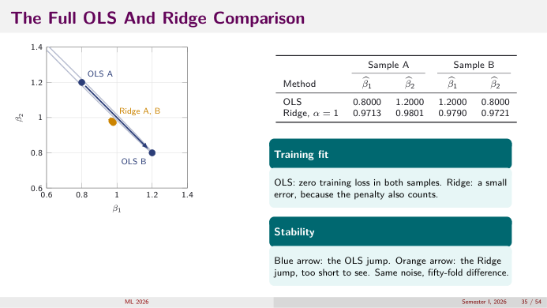
*👀 Slide 35 — Blue arrow: the OLS jump. Orange arrow: the ridge jump, too short to see.*

| method | A: $\hat\omega_1$ | A: $\hat\omega_2$ | B: $\hat\omega_1$ | B: $\hat\omega_2$ |
|---|---|---|---|---|
| OLS | 0.8000 | 1.2000 | 1.2000 | 0.8000 |
| Ridge, $\lambda = 1$ | 0.9713 | 0.9801 | 0.9790 | 0.9721 |

**Training fit:** OLS zero loss in both; ridge a small error (the penalty also counts). **Stability:** fifty-fold difference.

## Slide 36 — Ridge As The Penalty Strength Changes

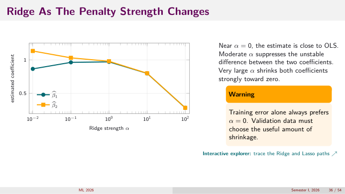
*👀 Slide 36 — Ridge path vs λ: near 0 it is OLS; moderate λ merges the two coefficients; large λ shrinks both.*

| $\lambda$ | $\hat\omega^{(A)}$ |
|---|---|
| 0 | $(0.800, 1.200)$ |
| 0.06 | $(0.948, 1.049)$ |
| 0.1 | $(0.964, 1.031)$ |
| 1 | $(0.971, 0.980)$ |
| 10 | $(0.799, 0.801)$ |

> ⚠️ Training error alone always prefers $\lambda = 0$. Validation must choose the useful amount (slide 52).

## Slide 37 — OLS And Ridge In The Eigenvector Basis

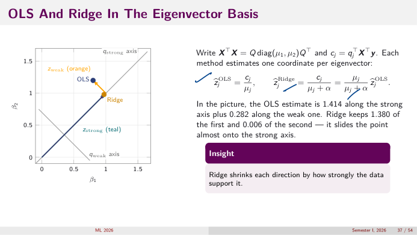
*👀 Slide 37 — OLS = 1.414 along strong + 0.282 along weak; ridge keeps 1.380 and 0.006.*

$c_j = q_j^\top X^\top y$; $\hat z_j^{\text{OLS}} = c_j/\mu_j$, $\hat z_j^{\text{ridge}} = c_j/(\mu_j + \lambda) = \frac{\mu_j}{\mu_j + \lambda}\hat z_j^{\text{OLS}}$.

$c_{\text{strong}} = 56.60$, $c_{\text{weak}} = 0.0056$. OLS: $56.60/40.02 = 1.414$ and $0.0056/0.01999 = 0.282$. Ridge: $56.60/41.02 = 1.380$ and $0.0056/1.01999 = 0.0055$. **It slides the point almost onto the strong axis**, i.e. onto $\omega_1\approx\omega_2$.

## Slide 38 — Directional Shrinkage In The Numerical Example

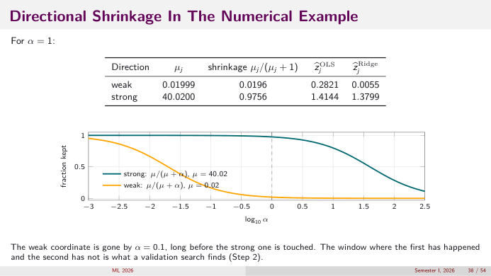
*👀 Slide 38 — Fraction kept vs log λ: the weak coordinate is gone by λ = 0.1, long before the strong one is touched.*

$\lambda = 1$:

| direction | $\mu_j$ | shrinkage $\mu_j/(\mu_j + 1)$ | $\hat z^{\text{OLS}}$ | $\hat z^{\text{ridge}}$ |
|---|---|---|---|---|
| weak | 0.01999 | 0.0196 | 0.2821 | 0.0055 |
| strong | 40.02 | 0.9756 | 1.4144 | 1.3799 |

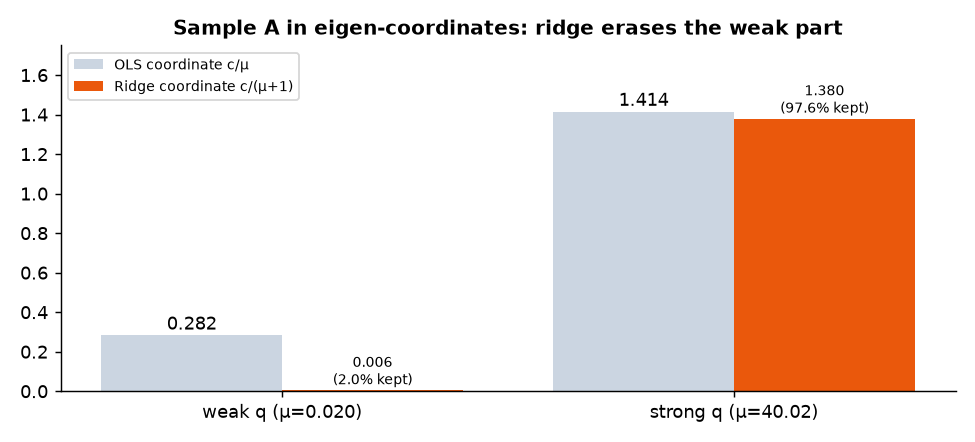
*📊 Sample A in eigen-coordinates: ridge keeps 97.6% of the strong part and 2% of the weak part.*

The window where the weak coordinate is gone and the strong one untouched (roughly $0.1\lesssim\lambda\lesssim1$ here) is what validation finds.

## Slide 39 — Three Hundred Training Samples, Two Estimators

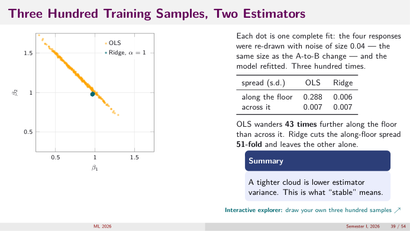
*👀 Slide 39 — 300 refits with noise 0.04: the OLS cloud is a long streak along the floor; the ridge cloud is a dot.*

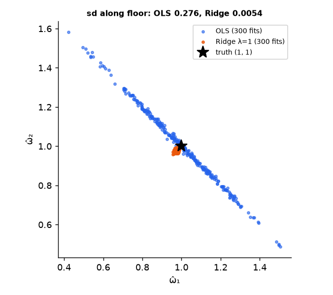
*📊 My own 300-sample run (truth (1, 1), noise sd 0.04): same picture, sd along the floor 0.28 for OLS vs 0.005 for ridge.*

| spread (sd) | OLS | Ridge |
|---|---|---|
| along the floor | $\sigma/\sqrt{\mu_w} = 0.04/0.141 = 0.283$ | $\sigma\sqrt{\mu_w}/(\mu_w + 1) = 0.0055$ |
| across it | $0.04/6.326 = 0.0063$ | $0.04(6.326)/41.02 = 0.0062$ |

OLS wanders ~45× further along the floor than across. Ridge cuts the along-floor spread **51-fold** and leaves the other alone. **A tighter cloud is lower estimator variance. That's what "stable" means.**

(Derivation: $\hat z_j = c_j/\mu_j$, and $c_j = q_j^\top X^\top y$ has noise sd $\sigma\lVert Xq_j\rVert = \sigma\sqrt{\mu_j}$; divide by $\mu_j$ or by $\mu_j + \lambda$.)

## Slide 40 — How Much Ridge Narrows The Cloud, And What It Charges

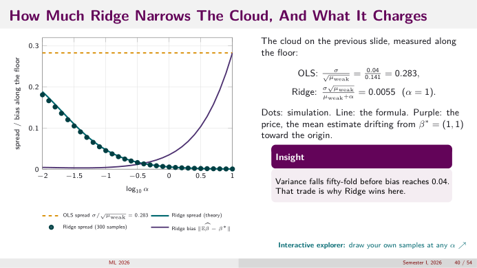
*👀 Slide 40 — Spread falls fifty-fold before the bias (purple) reaches 0.04.*

OLS along-floor spread 0.283; ridge 0.0055 at $\lambda = 1$. Purple curve = the price: the mean estimate drifting from $\omega^* = (1,1)$ toward 0, i.e. bias $= \lambda/(\mu_s + \lambda)\times$ the strong coordinate $\approx\frac{1}{41}\cdot1.414 = 0.034$. **Variance falls fifty-fold before bias reaches 0.04. That trade is why ridge wins here.**

## Slide 41 — Lasso Changes The Penalty

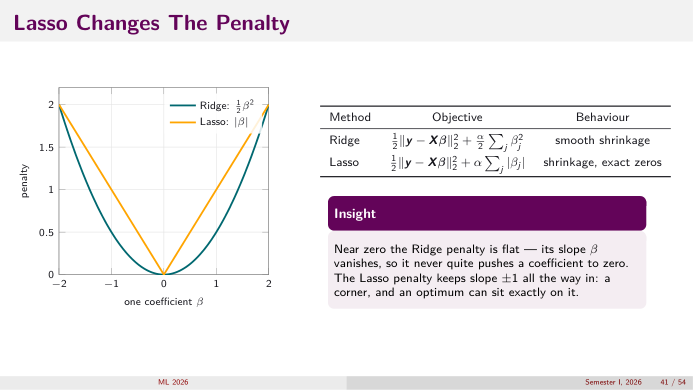
*👀 Slide 41 — Ridge ½ω² is flat at 0; lasso |ω| has a corner.*

| method | objective | behaviour |
|---|---|---|
| Ridge | $\tfrac12\lVert y - X\omega\rVert^2 + \tfrac\lambda2\sum\omega_j^2$ | smooth shrinkage |
| Lasso | $\tfrac12\lVert y - X\omega\rVert^2 + \lambda\sum\lvert\omega_j\rvert$ | shrinkage, exact zeros |

Near 0 the ridge penalty's slope $\lambda\omega$ vanishes, so it never quite pushes to 0. Lasso keeps slope $\pm\lambda$ all the way in: a **corner**, and an optimum can sit exactly on it.

## Slide 42 — Lasso Is Friction, Ridge Is A Spring

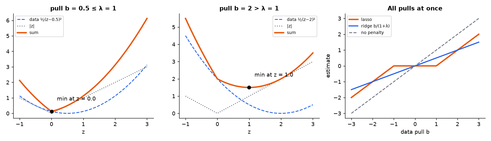
*📊 Three steps on one coefficient (λ = 1): a weak pull b = 0.5 leaves the minimum at the corner z = 0; a strong pull b = 2 moves it to z = 1; the full input–output rule.*

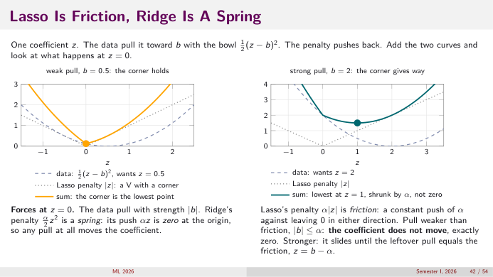
*👀 Slide 42 — Data bowl ½(z − b)² + lasso V: sum's lowest point.*

One coefficient $z$; data pull it toward $b$ via $\tfrac12(z - b)^2$. **Forces at $z = 0$:** data pull with strength $\lvert b\rvert$.
- Ridge $\tfrac\lambda2z^2$ is a **spring**: push $\lambda z$ is zero at the origin, so any pull moves the coefficient.
- Lasso $\lambda\lvert z\rvert$ is **friction**: a constant push $\lambda$ against leaving 0. If $\lvert b\rvert\le\lambda$: doesn't move, exactly 0. Stronger: slides until leftover pull equals friction, $z = b - \lambda$.

$b = 0.5$, $\lambda = 1$: corner holds, $z = 0$. $b = 2$: $z = 1$.

## Slide 43 — The Same Thing In Slopes: Where Does $f'$ Cross Zero?

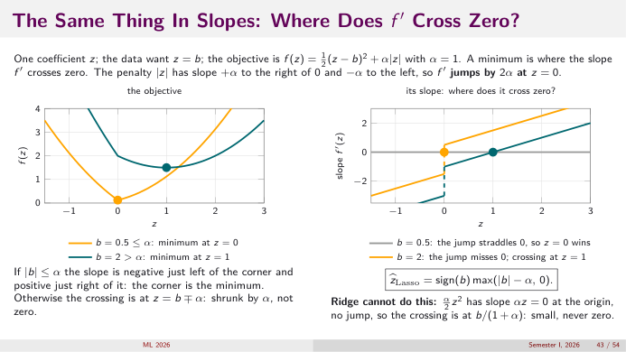
*👀 Slide 43 — The slope f′ jumps by 2λ at z = 0; if the jump straddles 0, the corner is the minimum.*

$f(z) = \tfrac12(z - b)^2 + \lambda\lvert z\rvert$. Right of 0: $f'(z) = z - b + \lambda$; left of 0: $f'(z) = z - b - \lambda$. At $z = 0$ the slope jumps from $-b - \lambda$ to $-b + \lambda$ (a jump of $2\lambda$).
- If $\lvert b\rvert\le\lambda$: left slope $\le0$, right slope $\ge0$ → the corner is the minimum.
- Otherwise the crossing is at $z = b\mp\lambda$.

$$\hat z_{\text{lasso}} = \mathrm{sign}(b)\max(\lvert b\rvert - \lambda, 0).$$
Ridge can't do this: $\tfrac\lambda2z^2$ has slope 0 at the origin, no jump, so the crossing is $b/(1+\lambda)$: small, never 0.

## Slide 44 — Where The Ellipses And Coefficient Constraints Come From

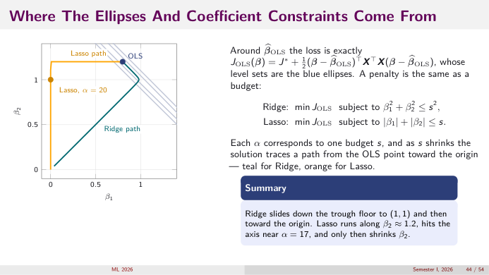
*👀 Slide 44 — Ridge path slides down the floor to (1, 1) then toward 0; lasso path runs along ω₂ ≈ 1.2, hits the axis, then shrinks ω₂.*

Around $\hat\omega_{\text{OLS}}$ the loss is exactly $J^* + \tfrac12(\omega - \hat\omega)^\top X^\top X(\omega - \hat\omega)$: the blue ellipses. Penalty ⇔ budget:
$$\text{Ridge: }\min J\ \text{s.t.}\ \omega_1^2 + \omega_2^2\le s^2,\qquad\text{Lasso: }\min J\ \text{s.t.}\ \lvert\omega_1\rvert + \lvert\omega_2\rvert\le s.$$
As $s$ shrinks, the solution traces a path to the origin. Lasso runs along $\omega_2 = 1.2$ (exactly, A6 Phase 1), hits the axis at $\lambda = 16$, then shrinks $\omega_2$.

## Slide 45 — Loss Ellipses Meet The Ridge Circle And Lasso Diamond

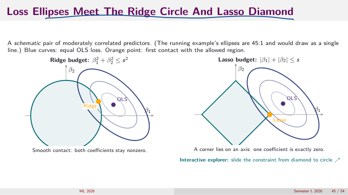
*👀 Slide 45 — Schematic, moderately correlated: smooth contact with the circle, corner contact with the diamond.*

(Schematic, since the running example's 45:1 ellipses would draw as a line.) First contact of the loss ellipses with the circle is smooth → both nonzero. With the diamond it's at a corner on an axis → one coefficient exactly 0 (L7 A8).

## Slide 46 — Lasso On The Same Numerical Example

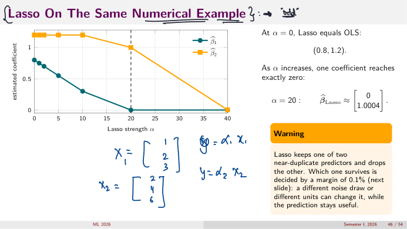
*👀 Slide 46 — Lasso path vs λ: at λ = 20, ω̂ ≈ (0, 1.0004).*

$\lambda = 0$: OLS $(0.8, 1.2)$. As $\lambda$ grows, $\omega_1$ reaches exactly 0. At $\lambda = 20$: $\hat\omega_{\text{lasso}} = (0,\ 1.0004)$ (A6 Phase 2: $(40.048 - 20)/20.04$).

> ⚠️ Lasso keeps one twin and drops the other; which one survives is decided by a margin of 0.1%. A different noise draw or different units can change it, while the prediction stays useful. (Annotation: $\hat y = \omega_2x_2$ with $\omega_2\approx1$; that's half the true combined effect of 2, because the penalty also shrinks it.)

## Slide 47 — Lasso Keeps One Twin. Which One Is Decided By 0.03

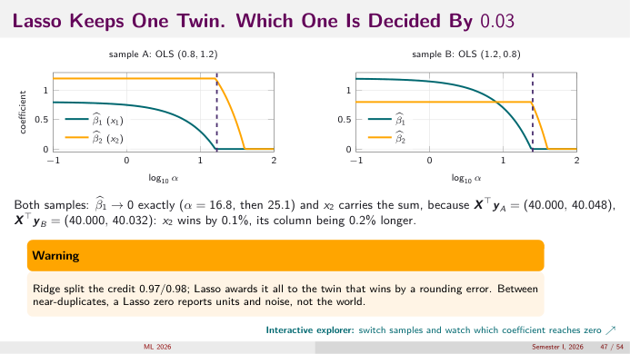
*👀 Slide 47 — In both samples ω₁ hits zero first and x₂ carries the sum.*

Both samples: $\hat\omega_1 = 0$ first (exact kinks $\lambda = 16$ for A, $24$ for B; the slide reads 16.8, 25.1 off its grid), and $x_2$ carries the sum. Because $X^\top y_A = (40.000, 40.048)$ and $X^\top y_B = (40.000, 40.032)$: $x_2$ wins by 0.1%, its column being 0.2% longer.

> ⚠️ Ridge split the credit 0.97/0.98; lasso awards it all to the twin that wins by a rounding error. **Between near-duplicates, a lasso zero reports units and noise, not the world.**

## Slide 48 — OLS, Ridge, Lasso, And Elastic Net

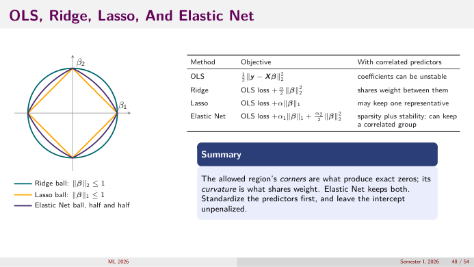
*👀 Slide 48 — Unit balls: ℓ2 circle, ℓ1 diamond, elastic net (half-and-half) rounded diamond.*

| method | objective | with correlated predictors |
|---|---|---|
| OLS | $\tfrac12\lVert y - X\omega\rVert^2$ | coefficients can be unstable |
| Ridge | OLS loss + $\tfrac\lambda2\lVert\omega\rVert^2$ | shares weight between them |
| Lasso | OLS loss + $\lambda\lVert\omega\rVert_1$ | may keep one representative |
| Elastic net | OLS loss + $\lambda_1\lVert\omega\rVert_1 + \tfrac{\lambda_2}2\lVert\omega\rVert^2$ | sparsity plus stability; can keep a correlated group |

**The allowed region's corners produce exact zeros; its curvature shares weight. Elastic net keeps both.** Standardise first; leave the intercept unpenalised.

## Slide 49 — Step 0: Why The Units Of A Feature Change The Answer

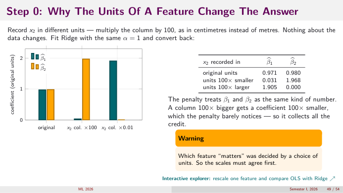
*👀 Slide 49 — Recording x₂ ×100 or ×0.01 hands all the ridge credit to one feature.*

Ridge $\lambda = 1$, converted back to original units:

| $x_2$ recorded in | $\hat\omega_1$ | $\hat\omega_2$ |
|---|---|---|
| original units | 0.971 | 0.980 |
| ×100 (units 100× smaller) | 0.031 | 1.968 |
| ×0.01 (units 100× larger) | 1.905 | 0.0002 |

The penalty treats $\omega_1$, $\omega_2$ as the same kind of number. A column 100× bigger needs a coefficient 100× smaller, which the penalty barely notices, so it **collects all the credit**.

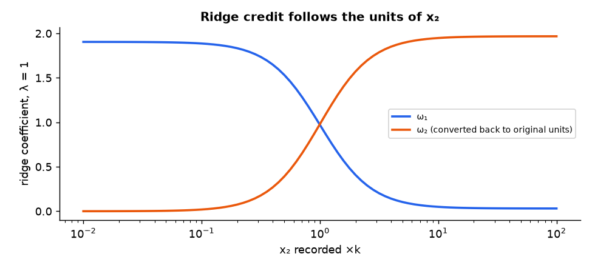
*📊 Sweeping the scale k of x₂: ridge credit flips from x₁ to x₂ purely because of units.*

## Slide 50 — Rescale One Feature: OLS Does Not Notice, Ridge Does

*👀 Slide 50 — Largest change in a fitted value vs k: zero for OLS, up to 0.24 for ridge.*

Multiply column 2 by $k$ and refit. OLS returns $\hat\omega_2/k$; every fitted value identical (machine precision). Ridge's fitted values move by up to 0.24, because the penalty charges $\omega_2^2$ and $\omega_2$ has changed size while the data have not.

> ⚠️ A penalty means nothing until every coefficient is measured in the same unit.

## Slide 51 — Step 1: Standardize — Using Training Statistics Only

*👀 Slide 51 — After scaling, column sds agree and ridge gives equal credit.*

$z_{ij} = (x_{ij} - m_j)/s_j$ with $m_j, s_j$ from **training rows only**. Running example ($m_j = 0$): $s_1 = \sqrt{20/3} = 2.582$, $s_2 = \sqrt{20.04/3} = 2.585$. After scaling, $\hat\omega_{\text{ridge}} = (2.213, 2.216)$: equal credit, whatever the units were. (In standardised units, so ≈ 2.58× the raw coefficients.)

**Store $m_j, s_j$ as part of the model**; scale new observations with them.

> ⚠️ Computing $m_j, s_j$ on all rows (test included) leaks information.

## Slide 52 — Step 2: Choose $\lambda$ By Validation Error, Never By Training Error

*👀 Slide 52 — Training MSE rises with λ; validation MSE on 900 fresh rows dips to ≈0.0018 at λ ≈ 0.06.*

Sample A's four rows = training; 900 fresh rows drawn the same way ($x_2\approx x_1$, noise 0.04) = validation. Ridge fitted on the 4 rows for each $\lambda$, scored on the 900.
- Training error only rises with $\lambda$ → always votes for 0.
- Validation error: 0.0022 (OLS) → **0.0018 at $\lambda\approx0.06$** (near the noise floor $\sigma^2 = 0.0016$) → climbs.

> ⚠️ $\lambda = 1$ was chosen to make pictures legible. On new rows it costs 0.013: it kills the weak direction (helps) but shrinks the strong one by 2.4% (hurts). Validation finds the value that does the first without the second.

## Slide 53 — Step 3: Evaluate Once On Test Data, Then Stop

*👀 Slide 53 — training rows (fit every λ; compute m, s) → validation (choose λ*) → test (one number).*

Validation error is now optimistic (you picked the value it liked). The test rows never influenced a decision, so their error is honest. **"Once" is literal**: peek, adjust, look again, and the test set has become a second validation set.

**What you ship:** $(m_j, s_j)$ from training, $\lambda^*$ from validation, $\hat\omega$ refitted on train + validation, $\mathrm{err}_{\text{test}}$ reported once, plus the intercept (fitted, never penalised).

## Slide 54 — The Complete Modeling Procedure

*👀 Slide 54 — Split → standardise → fit a grid → choose λ → test once.*

1. **Split** train / validation / test before looking at anything.
2. **Standardise** with training $m_j, s_j$; apply to all three.
3. **Fit a grid**: one ridge (or lasso) per $\lambda$, training rows only.
4. **Choose $\lambda$**: lowest validation error; refit on train + validation.
5. **Test once**: report that error; no further changes.

> ⚠️ **Four ways it goes wrong:** scaling with all rows (leak); choosing $\lambda$ by training error (always 0); penalising the intercept (shifts every prediction); reading the test error more than once.

**Summary:** regularisation sacrifices a little training fit for a model whose coefficients and predictions depend less on the particular sample; the procedure above makes that trade honestly.

---

# Part C — Practice

1. Verify $X^\top X$ and $X^\top y^{(A)}$ for the running dataset entry by entry.
2. Solve the OLS normal equation for sample B by subtracting the two equations (A2 method).
3. Compute the eigenvalues of $\begin{bmatrix}20&20\\20&20.04\end{bmatrix}$ with the trace/determinant shortcut. What is the condition number?
4. Show $J_A(1.2, 0.8) = 0.0032$. Why is this exactly $\tfrac12\lVert y^{(A)} - y^{(B)}\rVert^2$?
5. Compute ridge for sample A with $\lambda = 10$. Compare with the slide-36 table.
6. Show that in the eigenbasis, ridge's coefficient-jump between samples along the weak direction is $\frac{\mu_w}{\mu_w + \lambda}$ times OLS's. Evaluate for $\lambda = 1$.
7. Gradient descent with $\eta = 0.04$ on the OLS surface: what are the per-step factors along both eigenvectors? Is it stable? What about $\eta = 0.06$?
8. Lasso, sample A: give $\hat\omega$ at $\lambda = 10$ and at $\lambda = 30$ using A6.
9. For $\lambda = 1$ and one coefficient, give ridge and lasso estimates for $b = 0.7$ and $b = 3$.
10. If $x_1$ were recorded in units 10× larger (column ×0.1), what would OLS return? What would ridge tend to do?
11. Why must $m_j, s_j$ be stored with the model?
12. Name the four procedural mistakes from slide 54 and the symptom each causes.

<b>Answers</b>

1. See A1 (20, 20, 20.04; 40, 40.048).
2. $20\omega_1 + 20\omega_2 = 40$, $20\omega_1 + 20.04\omega_2 = 40.032$ ⇒ $0.04\omega_2 = 0.032$ ⇒ $\omega_2 = 0.8$, $\omega_1 = 1.2$.
3. $T = 40.04$, $D = 0.8$: $\mu = 20.02\pm\sqrt{400.8004 - 0.8} = 20.02\pm20.0000$ ⇒ $40.02$, $0.02$ (more precisely 0.01999). $\kappa\approx2002$.
4. $X(1.2, 0.8) = y^{(B)}$ (perfect fit for B), so residual on A is $y^{(A)} - y^{(B)} = (-0.04, 0.04, 0.04, -0.04)$; $\tfrac12(4\times0.0016) = 0.0032$.
5. $\begin{bmatrix}30&20\\20&30.04\end{bmatrix}^{-1}(40, 40.048)$: det $= 901.2 - 400 = 501.2$; $\tfrac1{501.2}(30.04\cdot40 - 20\cdot40.048,\ -800 + 30\cdot40.048) = \tfrac1{501.2}(400.64, 401.44) = (0.7994, 0.8010)$ ✓.
6. $\hat z_w = c_w/(\mu_w + \lambda)$, and $c_w$ is the only thing that changes between samples, so $\Delta\hat z_w^{\text{ridge}} = \Delta c_w/(\mu_w + \lambda) = \frac{\mu_w}{\mu_w + \lambda}\Delta\hat z_w^{\text{OLS}}$. $\lambda = 1$: $0.02/1.02 = 0.0196$, i.e. ~51× smaller ($0.566\to0.011$).
7. $\eta = 0.04$: strong $1 - 1.6008 = -0.6008$ (|·| < 1, stable, oscillating), weak $1 - 0.0008 = 0.9992$. $\eta = 0.06$: strong $1 - 2.401 = -1.401$, |·| > 1 ⇒ **diverges** ($\eta$ must be $< 2/40.02 = 0.05$).
8. $\lambda = 10$: Phase 1 ⇒ $(0.8 - 0.5, 1.2) = (0.3, 1.2)$. $\lambda = 30$: Phase 2 ⇒ $(0, (40.048 - 30)/20.04) = (0, 0.5014)$.
9. Ridge $b/2$: 0.35, 1.5. Lasso $\max(\lvert b\rvert - 1, 0)$: 0, 2.
10. OLS: $\hat\omega_1$ becomes ×10 (0.8 → 8 in new units); same predictions. Ridge: a large coefficient is penalised heavily, so ridge shifts credit toward $x_2$ (the cheaper coefficient), changing the fit.
11. New observations must be transformed with the **same** numbers used in training; otherwise the coefficients are applied to differently-scaled inputs.
12. Scaling with all rows → leakage, optimistic error. Choosing $\lambda$ by training error → always $\lambda = 0$. Penalising the intercept → every prediction pulled toward 0. Reading the test error repeatedly → test error becomes optimistic (a second validation set).

**Next:** [Lecture 9](L09_metrics_thresholds_costs.md): back to classification. Given fitted probabilities, how do we choose a threshold and judge the decisions?
