# Lecture 9 — Metrics, Thresholds, and Asymmetric Costs

> ES 335 / ES 678 Machine Learning, Sem I 2026 — Prof. Udit Bhatia
> Source: `Lectures/L09_student_metrics_thresholds_costs.pdf` (39 slides: 31 main + 8 appendix) · Previous: [`L08_ols_ridge_lasso_worked_example.md`](L08_ols_ridge_lasso_worked_example.md) · Next: [`L10_precision_recall_roc_auc.md`](L10_precision_recall_roc_auc.md)

**How to use this file.** Part A builds every evaluation tool from scratch: the **confusion matrix**, the **rates** and which denominator each uses, **accuracy and prevalence**, **precision / recall / F1**, the **ROC curve and AUC** (and why AUC is a probability about pairs), the **PR curve**, **calibration**, and **cost-based decisions** with the threshold $\tau^* = c_{FP}/(c_{FP} + c_{FN})$. Part B goes through all 39 slides with the 400-road numbers checked. Part C is practice.

**What this lecture is really about:** a classifier is **two separate things**.

$$\underbrace{x\mapsto p}_{\text{scorer: learned from data (L6)}}\qquad+\qquad\underbrace{p\ge\tau\ \Rightarrow\ \text{act}}_{\text{decision rule: chosen from costs}}$$

Every metric is arithmetic on four counts (TP, FP, FN, TN) at one $\tau$. Curves (ROC, PR) sweep $\tau$. Calibration asks whether $p$ means what it says. Costs pick the $\tau$.

**The story.** A district road controller has 400 segments and a heavy-rain forecast. Close or leave open? A needless closure costs ≈ 1 unit; a missed flood (stranded people, rescue) ≈ 5 units. Four people will question her: **supervisor** (how many right? → accuracy), **finance officer** (how many closures were needless? → precision), **engineer** (is the model any good regardless of threshold? → ROC/AUC), **auditor** (does 0.3 mean three in ten? → calibration).

## Contents

**Part A — Maths from the ground up**
1. [The confusion matrix](#a1-the-confusion-matrix)
2. [Rates: which denominator?](#a2-rates-which-denominator)
3. [Accuracy and prevalence](#a3-accuracy-and-prevalence)
4. [Precision, recall, and F1 (the harmonic mean)](#a4-precision-recall-and-f1-the-harmonic-mean)
5. [Sweeping the threshold: the ROC curve](#a5-sweeping-the-threshold-the-roc-curve)
6. [AUC as a probability about pairs](#a6-auc-as-a-probability-about-pairs)
7. [The precision–recall curve and average precision](#a7-the-precisionrecall-curve-and-average-precision)
8. [Calibration and reliability diagrams](#a8-calibration-and-reliability-diagrams)
9. [Expected cost and the optimal threshold](#a9-expected-cost-and-the-optimal-threshold)
10. [Iso-cost lines on the ROC plane](#a10-iso-cost-lines-on-the-roc-plane)

**Part B — Slides** · [All 39 slides](#part-b--slide-by-slide-all-39-slides)

**Part C — Practice** · [Jump](#part-c--practice)

---

# Part A — Maths From the Ground Up

## A1. The confusion matrix

Fix a threshold $\tau$. Each segment gets a decision $\hat y_i = \mathbb I[p_i\ge\tau]$ (1 = close) and has a true outcome $y_i$ (1 = became impassable). Four combinations:

| | actually impassable ($y = 1$) | actually passable ($y = 0$) |
|---|---|---|
| **predict close** ($\hat y = 1$) | **TP** true positive: closed, flooded | **FP** false positive: closed, stayed fine (false alarm) |
| **predict open** ($\hat y = 0$) | **FN** false negative: open, flooded (miss) | **TN** true negative: open, stayed fine |

**Naming trick:** the second word (positive/negative) is **what we predicted**; the first (true/false) is **whether that was right**.

**Fixed totals.** Columns are fixed by the data: $TP + FN = n_+$ (all actual positives, 43), $FP + TN = n_-$ (all actual negatives, 357). Moving $\tau$ only moves counts **within** a column.

At $\tau = 0.5$ for the 400 roads: TP = 15, FP = 5, FN = 28, TN = 352. Check: $15 + 28 = 43$ ✓, $5 + 352 = 357$ ✓.

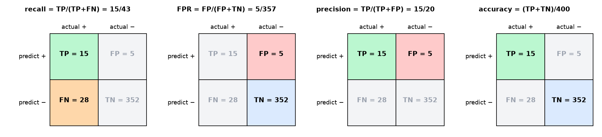
*📊 Which cells each metric reads (τ = 0.5): recall uses the left column, FPR the right column, precision the top row, accuracy the diagonal.*

## A2. Rates: which denominator?

**Every rate = (count of one cell) / (a total).** The total decides the question being answered.

| Rate | Formula | Denominator = | Question | τ = 0.5 |
|---|---|---|---|---|
| **recall** = TPR = sensitivity | $\frac{TP}{TP+FN}$ | actual positives (column) | of the dangerous roads, how many did we catch? | $15/43 = 0.349$ |
| miss rate = FNR | $\frac{FN}{TP+FN} = 1 - TPR$ | actual positives | how many did we miss? | $0.651$ |
| **FPR** = fall-out | $\frac{FP}{FP+TN}$ | actual negatives (column) | of the safe roads, how many did we alarm? | $5/357 = 0.014$ |
| specificity = TNR | $\frac{TN}{FP+TN} = 1 - FPR$ | actual negatives | how many safe roads did we leave open? | $0.986$ |
| **precision** = PPV | $\frac{TP}{TP+FP}$ | predicted positives (row) | of the roads we closed, how many needed it? | $15/20 = 0.750$ |
| accuracy | $\frac{TP+TN}{n}$ | everything | how many decisions were right? | $367/400 = 0.9175$ |

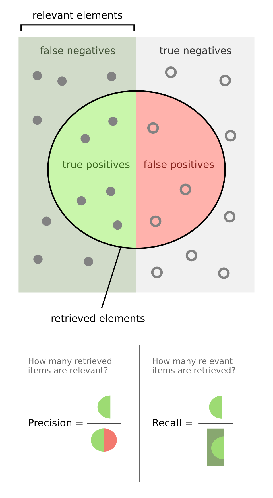
*Precision vs recall as a picture: the circle is what we selected (closed), the left half is what is actually positive. (Wikimedia Commons: [Precisionrecall.svg](https://commons.wikimedia.org/wiki/File:Precisionrecall.svg), CC BY-SA 4.0)*

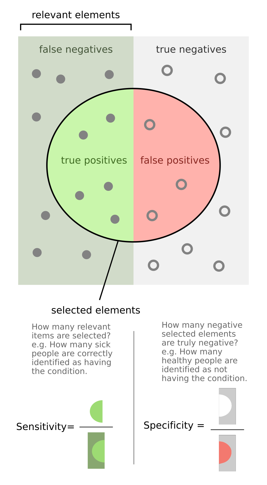
*Sensitivity (= recall) and specificity (= 1 − FPR) drawn the same way. (Wikimedia Commons: [Sensitivity_and_specificity_1.01.svg](https://commons.wikimedia.org/wiki/File:Sensitivity_and_specificity_1.01.svg), CC BY-SA 4.0)*

**Key distinction.** Recall and FPR divide by **actual** classes, so they don't depend on how common positives are (prevalence). Precision divides by **predicted** positives, which mixes both classes, so it **does** depend on prevalence (A7, L10 slide 18).

## A3. Accuracy and prevalence

**Prevalence** $\pi = n_+/n = 43/400 = 0.1075$.

**Accuracy is a prevalence-weighted average** of the two class-wise rates:
$$\text{accuracy} = \frac{TP + TN}{n} = \pi\cdot TPR + (1-\pi)\cdot TNR.$$
At $\tau = 0.5$: $0.1075(0.349) + 0.8925(0.986) = 0.0375 + 0.880 = 0.9175$ ✓. The majority class has 89% of the weight.

**The "do nothing" baseline.** Never close ($\hat y\equiv0$): TP = 0, TN = 357, accuracy $= 357/400 = 0.8925 = 1 - \pi$. Any model must be compared with this, not with 0.5.

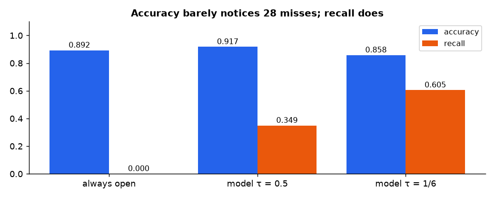
*📊 Accuracy vs recall for "always open", τ = 0.5 and τ = 1/6: accuracy barely changes while recall goes 0 → 0.35 → 0.61.*

## A4. Precision, recall, and F1 (the harmonic mean)

Precision and recall share the numerator TP but divide by different totals. Lowering $\tau$ closes more roads:
- recall can only **rise** (more of the 43 get caught; never fewer);
- precision **usually falls** (newly closed roads are less risky, so more of them are false alarms), but it can rise at some steps (L10 slide 14).

**F1** combines them with the **harmonic mean**:
$$F_1 = \frac{2}{\frac1P + \frac1R} = \frac{2PR}{P + R} = \frac{2TP}{2TP + FP + FN}.$$
(Last form: substitute $P = TP/(TP+FP)$, $R = TP/(TP+FN)$ and simplify. TN never appears.)

**Why harmonic?** A small value has a big reciprocal, so the harmonic mean is dragged toward the **smaller** of the two. $P = 0.75$, $R = 0.349$: arithmetic mean 0.55, $F_1 = \frac{2(0.75)(0.349)}{1.099} = 0.476$. For fixed $R$, $F_1 = \frac{2PR}{P+R}$ grows with $P$, so even a perfect precision $P = 1$ only gives $F_1 = \frac{2R}{1+R} = \frac{0.698}{1.349} = 0.517$. **A low recall caps $F_1$ no matter how good precision is.**

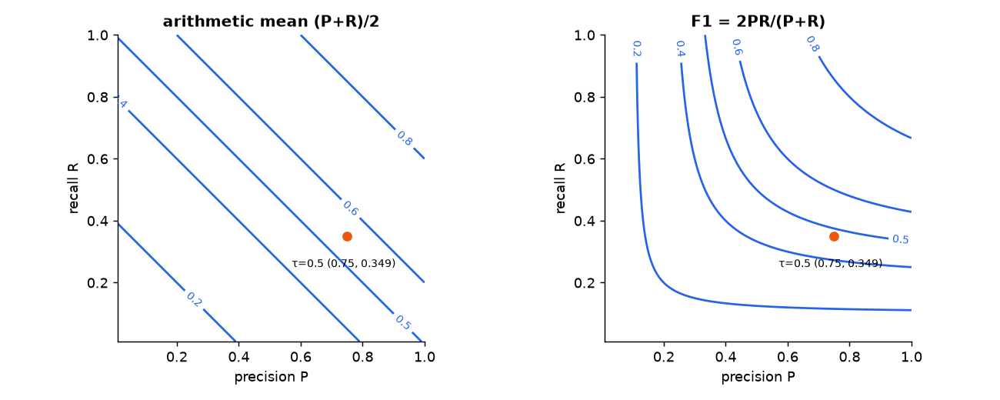
*📊 Contours of the arithmetic mean are straight lines; F1 contours hug the axes, so a lopsided pair scores low.*

> ⚠️ $F_1$ weighs a false alarm and a miss **equally** (both appear once in $FP + FN$). Use it to compare models without cost information; **don't** use it to pick a threshold when costs are known.

## A5. Sweeping the threshold: the ROC curve

**ROC** = receiver operating characteristic = the set of points $(\text{FPR}(\tau),\ \text{TPR}(\tau))$ for every $\tau$.

**Building it by hand.** Sort examples by score, highest first. Start with $\tau$ above every score: nothing closed, point $(0, 0)$. Lower $\tau$ past one score at a time:
- pass a **positive** → TP + 1 → TPR rises by $1/n_+$ → step **up**;
- pass a **negative** → FP + 1 → FPR rises by $1/n_-$ → step **right**.

End with $\tau$ below every score: everything closed, point $(1, 1)$. For finite data the ROC is a **staircase**.

| Landmark | Meaning |
|---|---|
| $(0, 0)$ | close nothing |
| $(1, 1)$ | close everything |
| $(0, 1)$ | perfect: all positives before any negative |
| diagonal TPR = FPR | random scoring |
| below the diagonal | worse than random (flip the scores!) |

**Moving $\tau$ slides along the curve; only a different model changes the curve.**

## A6. AUC as a probability about pairs

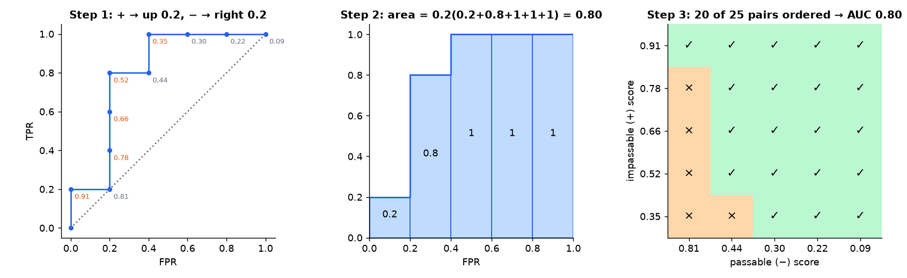
*📊 The ten-score example step by step: walk the staircase, add the column areas, and count correctly ordered pairs; both give 0.80.*

**AUC** = area under the ROC curve. **The key fact:**
$$\text{AUC} = \Pr(s_+ > s_-) + \tfrac12\Pr(s_+ = s_-),$$
the probability that a randomly chosen positive gets a higher score than a randomly chosen negative (ties count half).

**Why area = pair count.** The staircase has $n_-$ columns of width $1/n_-$, one per negative. The height of the column for negative $k$ is TPR at the moment we pass it = (number of positives scored **above** that negative) $/n_+$. So
$$\text{area} = \sum_{\text{negatives }k}\frac1{n_-}\cdot\frac{\#\{\text{positives above }k\}}{n_+} = \frac{\#\{\text{correctly ordered pairs}\}}{n_+n_-}.$$

**Ten-score example.** Scores (sorted) $.91^+, .81^-, .78^+, .66^+, .52^+, .44^-, .35^+, .30^-, .22^-, .09^-$. Path ↑→↑↑↑→↑→→→. Column heights at each negative: $.81\to1/5$, $.44\to4/5$, $.30, .22, .09\to5/5$. Area $= 0.2(0.2 + 0.8 + 1 + 1 + 1) = 0.80$. Pairs: 20 of 25 correct ⇒ $0.80$ ✓.

**What AUC does *not* tell you:** which threshold to use, the costs, the prevalence, or whether $p$ is calibrated (slide 33). Any **monotone** transform of the scores keeps the order, so keeps the AUC (slide 36).

## A7. The precision–recall curve and average precision

**PR curve** = points $(\text{recall}(\tau),\ \text{precision}(\tau))$. Same confusion matrices as ROC, different axes.

**Baseline = prevalence.** Close everything: precision $= n_+/n = \pi = 0.1075$, recall = 1. A random scorer hovers around precision $\pi$.

**Why PR "feels" rare positives and ROC doesn't.** Precision in terms of rates:
$$\text{precision} = \frac{TP}{TP + FP} = \frac{\pi\,TPR}{\pi\,TPR + (1-\pi)FPR}.$$
With $\pi$ small, even a small FPR is multiplied by the big $(1-\pi)$. At $\tau = 1/6$: FPR $= 40/357 = 0.11$ sounds small; precision $= 26/66 = 0.39$ says 61% of closures were needless.

**Average precision (AP)** ≈ area under the PR curve (precision averaged over recall levels). Here AP = 0.607 vs baseline 0.1075.

## A8. Calibration and reliability diagrams

A model is **calibrated** if, among all cases where it says $p\approx0.3$, about 30% are actually positive.

**Reliability diagram:** bin cases by predicted $p$ (e.g. width 0.1); for each bin plot (mean predicted $p$, observed fraction positive). Calibrated ⇒ points on the diagonal.
- Point **above** diagonal: reality is riskier than the model says (under-confident/under-stating risk).
- Point **below**: the model over-states risk.
- Bins with few cases are noisy: with 7 cases a rate has sd ≈ $\sqrt{0.15\cdot0.85/7}\approx0.13$.

**Discrimination ≠ calibration.** Ranking (ROC/AUC) asks "who is riskier?"; calibration asks "what does the number mean?". A model can have one without the other.

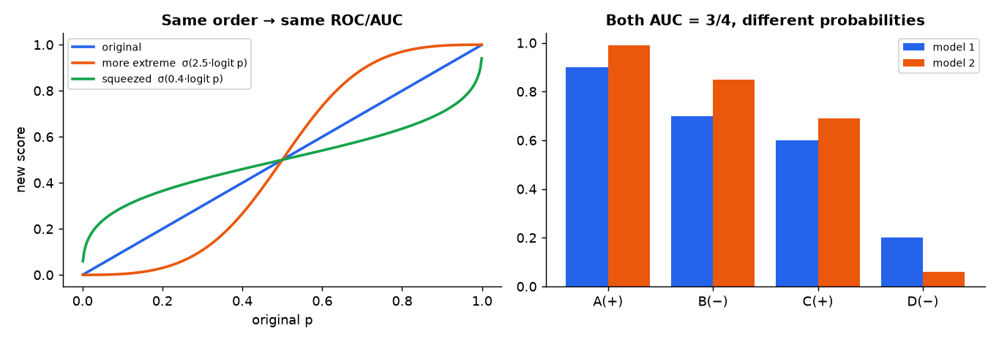
*📊 Left: three monotone transforms of p keep the same ranking and AUC but give different numbers. Right: slide 35's two models, both AUC 3/4.*

## A9. Expected cost and the optimal threshold

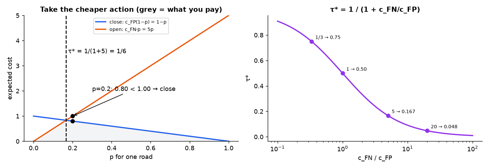
*📊 Left: for one road the expected cost of closing is 1 − p and of leaving open is 5p; take the lower line. Right: the optimal threshold as a function of how much worse a miss is.*

**Cost table** (correct decisions cost 0):

| | road floods ($y = 1$) | road stays fine ($y = 0$) |
|---|---|---|
| close | 0 | $c_{FP} = 1$ |
| leave open | $c_{FN} = 5$ | 0 |

For one road with (calibrated) risk $p$:
- **close:** pay $c_{FP}$ only if it stays fine: $R(\text{close}) = c_{FP}(1-p)$;
- **open:** pay $c_{FN}$ only if it floods: $R(\text{open}) = c_{FN}\,p$.

Close iff $c_{FP}(1-p)\le c_{FN}p\iff c_{FP}\le(c_{FP} + c_{FN})p\iff$
$$\boxed{p\ge\tau^* = \frac{c_{FP}}{c_{FP} + c_{FN}} = \frac{1}{1 + c_{FN}/c_{FP}}}.$$
$c_{FP} = 1$, $c_{FN} = 5$: $\tau^* = 1/6\approx0.167$. Only the **ratio** matters. Equal costs ⇒ $\tau^* = 0.5$: **the default 0.5 silently assumes a miss costs the same as a false alarm.**

**Total cost on a dataset:** $\text{cost}(\tau) = c_{FP}FP(\tau) + c_{FN}FN(\tau)$.

The rule "pick the cheaper action for each case" achieves the lowest possible expected cost, the **Bayes risk**, if $p$ is the true probability. That requires calibration (A8).

## A10. Iso-cost lines on the ROC plane

Write cost in rates: $FP = n_-\text{FPR}$, $FN = n_+(1 - \text{TPR})$:
$$\text{cost} = c_{FP}n_-\,\text{FPR} + c_{FN}n_+(1 - \text{TPR}).$$
Fix cost $= C$ and solve for TPR: $\text{TPR} = 1 - \frac{C}{c_{FN}n_+} + \frac{c_{FP}n_-}{c_{FN}n_+}\text{FPR}$. Straight lines with
$$\text{slope} = \frac{c_{FP}\,n_-}{c_{FN}\,n_+} = \frac{1\cdot357}{5\cdot43} = 1.66.$$
Lines further **up-left** have lower cost. Slide a line of this slope toward the upper left until it last touches the ROC curve: that point is the cheapest threshold on this data.

---

# Part B — Slide by Slide (all 39 slides)

## Slide 1 — Title

*Lecture 9: Metrics, Thresholds, and Asymmetric Costs.* Prof. Udit Bhatia, Semester I 2026.

## Slide 2 — Course Flowchart: What Each Step Added

learning problem → probability & MLE → linear regression → eigenvalues & PCA → logistic regression → ridge & lasso → **today: evaluation (thresholds, errors, costs)** → next: validation (honest model comparison).

**Summary:** earlier lectures produced fitted probabilities. Today: turn them into decisions and judge the consequences.

## Slide 3 — Where The Probability Model Left Us

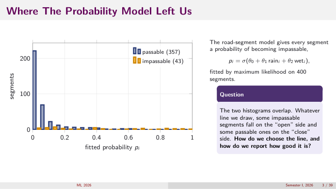
*👀 Slide 3 — Histograms of fitted pᵢ for 357 passable and 43 impassable segments: they overlap.*

$p_i = \sigma(\theta_0 + \theta_1\,\text{rain}_i + \theta_2\,\text{wet}_i)$, fitted by MLE on 400 segments (L6). **Question:** the histograms overlap, so any line puts some impassable roads on the "open" side and some passable ones on "close". How to choose the line, and how to report quality?

## Slide 4 — The Procedure This Lecture Fills In

1. **Fitted model:** risk $p_i$ for every segment. 2. **Decision rule:** choose $\tau$, close if $p_i\ge\tau$. 3. **Evaluation:** compare with outcomes; count errors and cost.

$p_i$ is a probability (the model made it); $\hat y_i = \mathbb I[p_i\ge\tau]$ is a decision (we make it). Three questions in order: one threshold (confusion matrix) → all thresholds (ROC, PR) → which threshold (costs).

**The threshold is not part of the model. Refitting is never required to change it.**

## Slide 5 — The Dataset: 400 Road Segments

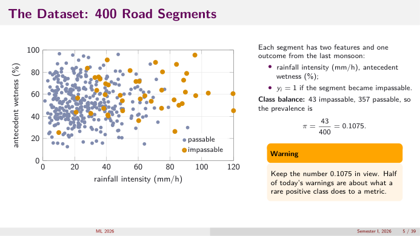
*👀 Slide 5 — Rainfall vs antecedent wetness; orange = impassable.*

Two features (rainfall mm/h, antecedent wetness %), outcome $y_i = 1$ if impassable last monsoon. 43 impassable, 357 passable ⇒ **prevalence $\pi = 43/400 = 0.1075$**.

> ⚠️ Keep 0.1075 in view: half of today's warnings are about what a rare positive class does to a metric.

## Slide 6 — Road-Closure Decision Problem

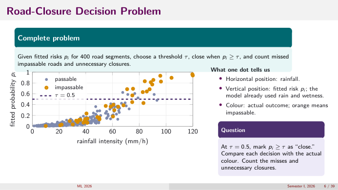
*👀 Slide 6 — Each dot: rainfall (x), fitted risk (y), colour = outcome; τ = 0.5 drawn.*

Given fitted risks, choose $\tau$, close when $p_i\ge\tau$, count missed impassable roads and unnecessary closures. Horizontal = rainfall; vertical = fitted risk (already uses rain and wetness); colour = actual outcome.

**Exercise:** at $\tau = 0.5$, count misses (orange below the line) and needless closures (blue above). Answer next slides: 28 misses, 5 needless.

## Slide 7 — The Story: The Night Before The Storm

One crew, one decision per segment: close or leave open. Needless closure ≈ 1 unit (diversions, complaints); missed flood ≈ **5 units** (stranded people, rescue). Tomorrow four people ask four different questions (see intro): supervisor → accuracy, finance → precision, engineer → ROC/AUC, auditor → calibration. Then the lecture **prices** the decision.

## Slide 8 — Where The Four Counts Come From: A Line On The Histogram

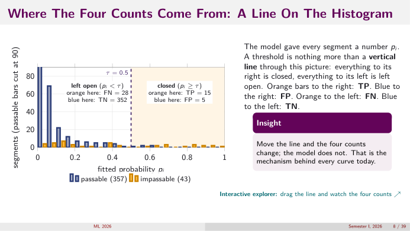
*👀 Slide 8 — A vertical line at τ = 0.5: orange right = TP 15, blue right = FP 5, orange left = FN 28, blue left = TN 352.*

A threshold is a vertical line through the histogram. Right of it = closed; left = open. Orange right: TP. Blue right: FP. Orange left: FN. Blue left: TN.

**Move the line and the four counts change; the model doesn't.** That's the mechanism behind every curve today.

## Slide 9 — One Threshold, Four Outcomes

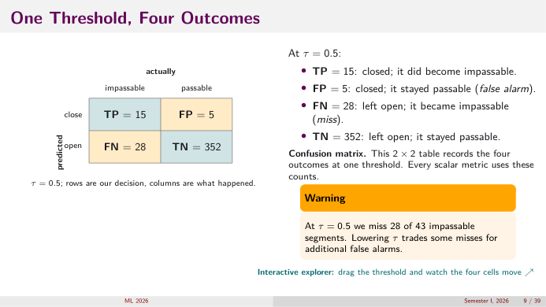
*👀 Slide 9 — The confusion matrix at τ = 0.5.*

| τ = 0.5 | actually impassable | actually passable |
|---|---|---|
| close | TP = 15 | FP = 5 |
| open | FN = 28 | TN = 352 |

Rows = our decision, columns = what happened (A1). Every scalar metric uses these counts.

> ⚠️ At 0.5 we miss **28 of 43** impassable segments. Lowering $\tau$ trades misses for false alarms.

## Slide 10 — Question 1: Of The Dangerous Roads, How Many Did We Catch?

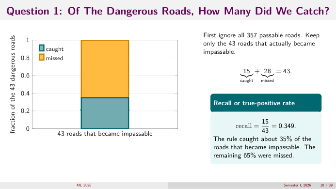
*👀 Slide 10 — Of the 43 dangerous roads: 15 caught (35%), 28 missed (65%).*

Ignore all 357 passable roads. Keep the 43 that flooded: $15$ caught $+ 28$ missed $= 43$.
$$\text{recall} = \text{TPR} = \frac{15}{43} = 0.349.$$

## Slide 11 — Question 2: Of The Passable Roads, How Many Did We Alarm?

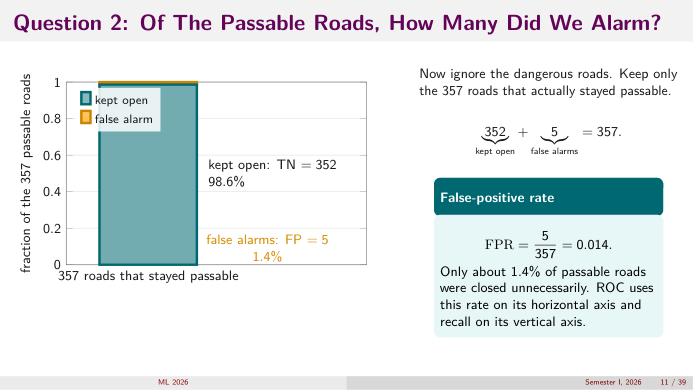
*👀 Slide 11 — Of the 357 passable roads: 352 kept open (98.6%), 5 false alarms (1.4%).*

Ignore the dangerous roads. Keep the 357 passable: $352 + 5 = 357$.
$$\text{FPR} = \frac{5}{357} = 0.014.$$
ROC uses FPR on its horizontal axis and recall on its vertical axis.

## Slide 12 — Accuracy, And Why It Lies Here

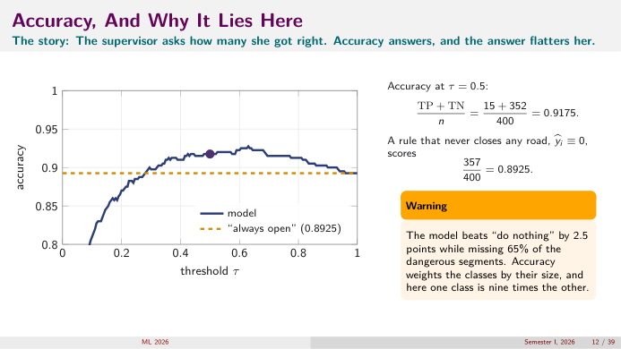
*👀 Slide 12 — Accuracy vs τ: the model barely clears the "always open" line at 0.8925.*

Supervisor's question. $\frac{TP + TN}{n} = \frac{15 + 352}{400} = 0.9175$. Never closing scores $357/400 = 0.8925$.

> ⚠️ The model beats "do nothing" by 2.5 points **while missing 65% of dangerous segments**. Accuracy weights classes by size, and one class is nine times the other (A3).

## Slide 13 — Precision And Recall Look At The Same Cell Two Ways

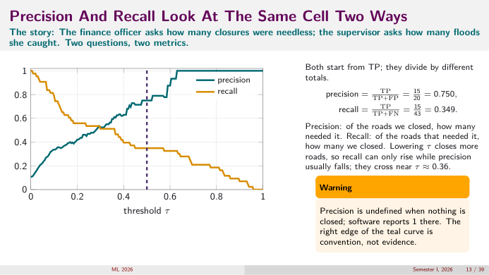
*👀 Slide 13 — Precision and recall vs τ; they cross near τ ≈ 0.36.*

Finance officer vs supervisor. Both start from TP:
$$\text{precision} = \frac{TP}{TP + FP} = \frac{15}{20} = 0.750,\qquad\text{recall} = \frac{TP}{TP + FN} = \frac{15}{43} = 0.349.$$
Lowering $\tau$: recall can only rise, precision usually falls. They cross near $\tau\approx0.36$.

> ⚠️ Precision is undefined (0/0) when nothing is closed; software reports 1 there. The right edge of the precision curve is convention, not evidence.

## Slide 14 — $F_1$: One Number From Two, And What It Hides

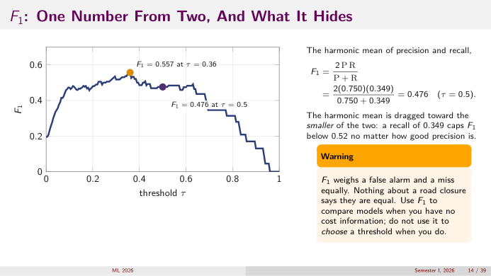
*👀 Slide 14 — F1 vs τ: 0.476 at 0.5, max 0.557 at 0.36.*

$$F_1 = \frac{2PR}{P + R} = \frac{2(0.750)(0.349)}{0.750 + 0.349} = \frac{0.5235}{1.099} = 0.476\quad(\tau = 0.5).$$
Harmonic mean is dragged toward the smaller value: recall 0.349 caps $F_1$ below 0.52 however good precision is (A4). Max $F_1 = 0.557$ at $\tau = 0.36$.

> ⚠️ $F_1$ weighs a false alarm and a miss equally. Nothing about road closures says they're equal. Use $F_1$ to compare models without cost information; not to choose a threshold when you have it.

## Slide 15 — Every Cell Moves When $\tau$ Moves

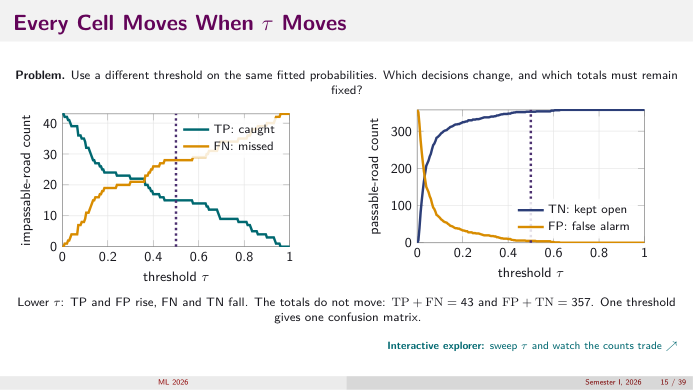
*👀 Slide 15 — Left: TP rises and FN falls as τ drops (sum 43). Right: FP rises and TN falls (sum 357).*

Lower $\tau$: TP, FP rise; FN, TN fall. Totals don't move: $TP + FN = 43$, $FP + TN = 357$. **One threshold gives one confusion matrix.**

## Slide 16 — How A Curve Is Built: One Row Per Threshold

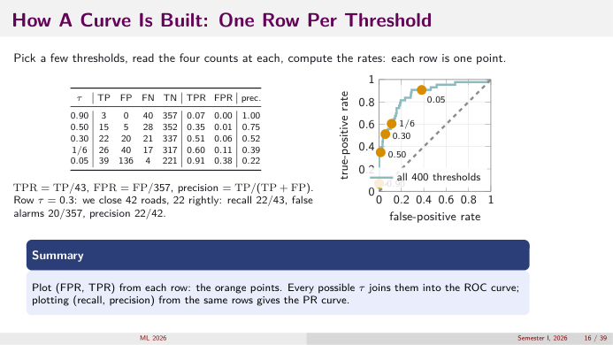
*👀 Slide 16 — Five thresholds → five ROC points; all 400 thresholds → the curve.*

| τ | TP | FP | FN | TN | TPR = TP/43 | FPR = FP/357 | precision |
|---|---|---|---|---|---|---|---|
| 0.90 | 3 | 0 | 40 | 357 | 0.07 | 0.00 | 1.00 |
| 0.50 | 15 | 5 | 28 | 352 | 0.35 | 0.01 | 0.75 |
| 0.30 | 22 | 20 | 21 | 337 | 0.51 | 0.06 | 0.52 |
| 1/6 | 26 | 40 | 17 | 317 | 0.60 | 0.11 | 0.39 |
| 0.05 | 39 | 136 | 4 | 221 | 0.91 | 0.38 | 0.22 |

Row $\tau = 0.3$: close 42 roads, 22 rightly: recall $22/43$, false alarms $20/357$, precision $22/42$. Plot (FPR, TPR) from each row → ROC; (recall, precision) from the same rows → PR.

## Slide 17 — ROC By Hand: Ten Scores

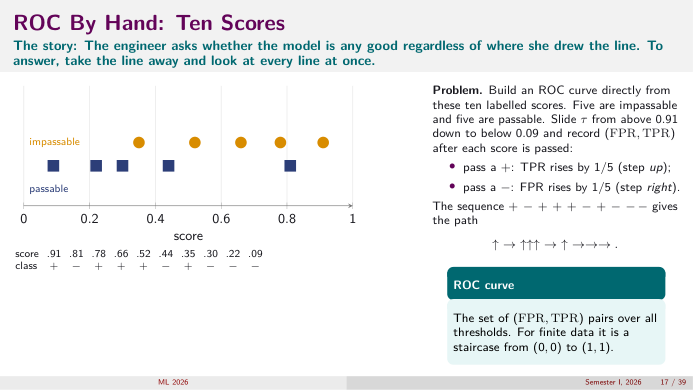
*👀 Slide 17 — Ten labelled scores on a line.*

Engineer's question: take the line away and look at every line at once. Scores $.91, .81, .78, .66, .52, .44, .35, .30, .22, .09$ with classes $+ - + + + - + - - -$ (5 and 5). Slide $\tau$ from above .91 to below .09: pass a $+$ → up $1/5$; pass a $-$ → right $1/5$. Path: ↑→↑↑↑→↑→→→. The ROC is a staircase from (0, 0) to (1, 1) (A5).

## Slide 18 — The Staircase, And Its Area

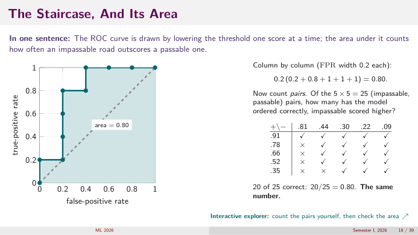
*👀 Slide 18 — The staircase with area 0.80 and the 5×5 pair table: 20 of 25 ✓.*

Column by column (width 0.2): $0.2(0.2 + 0.8 + 1 + 1 + 1) = 0.80$.

Pairs: positives $.91, .78, .66, .52, .35$ vs negatives $.81, .44, .30, .22, .09$. $.91$ beats all 5; $.78, .66, .52$ beat 4 each (lose to .81); $.35$ beats 3 (loses to .81, .44). Total $5 + 4 + 4 + 4 + 3 = 20$ of 25 ⇒ $0.80$. **Same number** (A6 proves why).

## Slide 19 — AUC Is A Probability About Pairs

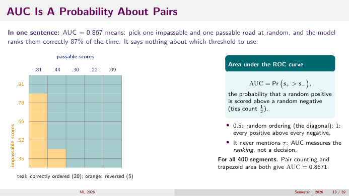
*👀 Slide 19 — The 5×5 grid: teal = correctly ordered (20), orange = reversed (5).*

$$\text{AUC} = \Pr(s_+ > s_-)\quad(\text{ties count }\tfrac12).$$
0.5: random ordering (the diagonal). 1: every positive above every negative. **It never mentions $\tau$**: AUC measures the ranking, not a decision.

For all 400 segments: AUC = 0.867: pick one impassable and one passable road at random; the model ranks them correctly 87% of the time. Says nothing about which threshold to use.

## Slide 20 — The ROC Curve For The 400 Segments

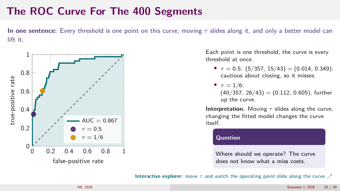
*👀 Slide 20 — ROC with AUC 0.867; τ = 0.5 at (0.014, 0.349) and τ = 1/6 at (0.112, 0.605).*

- $\tau = 0.5$: $(5/357, 15/43) = (0.014, 0.349)$: cautious, misses a lot.
- $\tau = 1/6$: $(40/357, 26/43) = (0.112, 0.605)$: further up the curve.

Moving $\tau$ slides along the curve; changing the model changes the curve. **Question:** where to operate? The curve doesn't know what a miss costs → slides 23–27.

## Slide 21 — Precision–Recall: The Curve That Feels The Prevalence

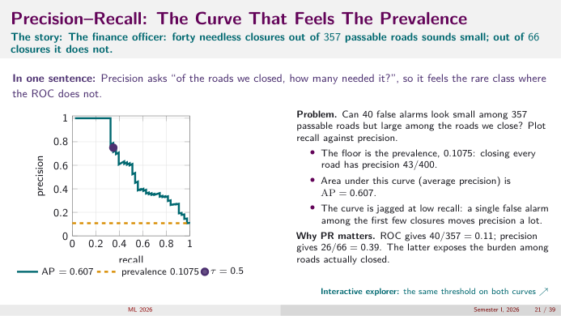
*👀 Slide 21 — PR curve with AP 0.607 and the prevalence floor 0.1075.*

Finance officer: 40 needless closures out of 357 passable roads sounds small; out of 66 closures it doesn't.
- The floor is the prevalence: closing everything has precision $43/400 = 0.1075$.
- AP = 0.607.
- Jagged at low recall: one false alarm among the first few closures moves precision a lot.

**ROC says** FPR $= 40/357 = 0.11$; **precision says** $26/66 = 0.39$. The latter exposes the burden among roads actually closed (A7).

## Slide 22 — Calibration: Does $p = 0.3$ Mean Thirty Percent?

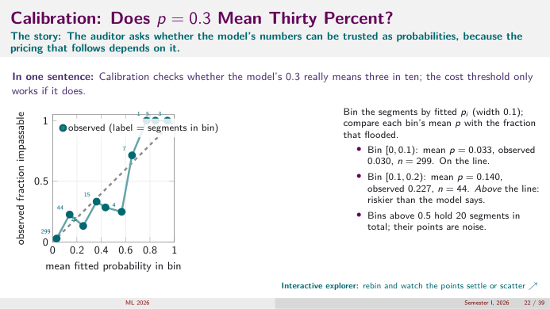
*👀 Slide 22 — Reliability diagram: bins of width 0.1 with their counts.*

Auditor's question; the cost threshold only works if $p$ is a real frequency.
- Bin $[0, 0.1)$: mean $p = 0.033$, observed 0.030, $n = 299$. **On the line.**
- Bin $[0.1, 0.2)$: mean $p = 0.140$, observed 0.227, $n = 44$. **Above the line**: riskier than the model says (10 floods vs ~6 expected).
- Bins above 0.5 hold only 20 segments in total; their points are noise (A8).

## Slide 23 — One Road, Two Possible Decisions ✍️

One road, $p = 0.20$; $c_{FP} = 1$, $c_{FN} = 5$.

| Decision A: close | Decision B: leave open |
|---|---|
| needless only if it stays passable (prob. 0.80) | costly only if it floods (prob. 0.20) |
| expected cost $= 0.80\times1 = 0.80$ | expected cost $= 0.20\times5 = 1.00$ |

**Close** ($0.80 < 1.00$). A 20% risk is enough because a miss costs five times a false alarm.

## Slide 24 — From One Road To The Cost-Based Threshold ✍️

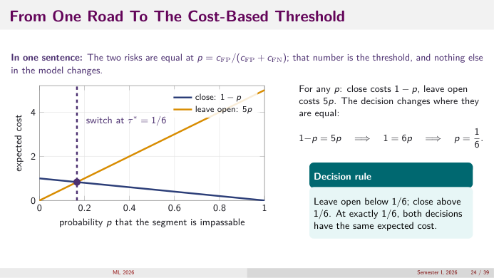
*👀 Slide 24 — close costs 1 − p, leave open costs 5p; they cross at p = 1/6.*

$$1 - p = 5p\ \Rightarrow\ 1 = 6p\ \Rightarrow\ p = \tfrac16.$$
Leave open below 1/6; close above. At exactly 1/6 both have the same expected cost. General formula $\tau^* = c_{FP}/(c_{FP} + c_{FN})$ (A9).

## Slide 25 — Total Cost Across Thresholds

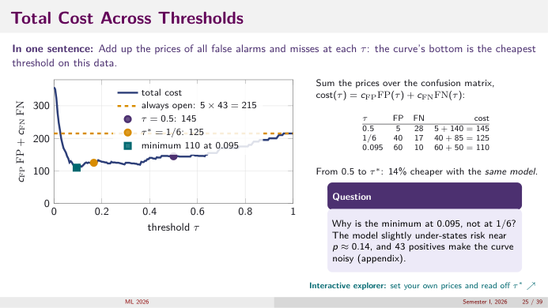
*👀 Slide 25 — cost(τ) = FP + 5FN: 215 always open, 145 at 0.5, 125 at 1/6, minimum 110 at 0.095.*

| τ | FP | FN | cost = FP + 5FN |
|---|---|---|---|
| never close | 0 | 43 | 215 |
| 0.5 | 5 | 28 | $5 + 140 = 145$ |
| 1/6 | 40 | 17 | $40 + 85 = 125$ |
| 0.095 | 60 | 10 | $60 + 50 = 110$ |

From 0.5 to $\tau^*$: $(145 - 125)/145 = 14\%$ cheaper **with the same model**.

**Why is the minimum at 0.095, not 1/6?** The model under-states risk near $p\approx0.14$ (slide 22), and 43 positives make the curve noisy (slide 37).

## Slide 26 — The Confusion Matrix At $\tau^*$

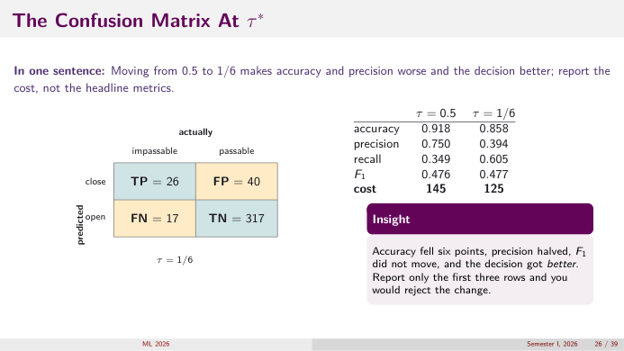
*👀 Slide 26 — At τ = 1/6: TP 26, FP 40, FN 17, TN 317.*

| | τ = 0.5 | τ = 1/6 |
|---|---|---|
| accuracy | $367/400 = 0.918$ | $343/400 = 0.858$ |
| precision | 0.750 | $26/66 = 0.394$ |
| recall | 0.349 | $26/43 = 0.605$ |
| $F_1$ | 0.476 | 0.477 |
| cost | 145 | **125** |

**Accuracy fell six points, precision halved, $F_1$ didn't move, and the decision got better.** Report only the first three rows and you'd reject the change. **Report the cost.**

## Slide 27 — Three Ways To Choose $\tau$, And What Each Assumes

| rule | what it assumes | on our data | total cost |
|---|---|---|---|
| default $\tau = 0.5$ | a miss and a false alarm cost the same; nobody checked | (15, 5, 28, 352) | 145 |
| best $F_1$ | no price info; balance precision and recall | $\tau = 0.36$ | ≈ 135 |
| price ratio $\tau^* = c_{FP}/(c_{FP} + c_{FN})$ | prices agreed; $p$ calibrated | 1/6: (26, 40, 17, 317) | 125 |
| minimum of the cost curve | the training set is the world | $\tau = 0.095$ | 110 (optimistic) |

**Recipe:** agree the prices → compute $\tau^*$ → check calibration near it → report the confusion matrix and the cost at that threshold.

> ⚠️ The training-set minimum's extra saving over $\tau^*$ is partly noise from 43 positives and won't all survive on new segments (next lecture).

## Slide 28 — Which Metric, When

| question | metric | fails when |
|---|---|---|
| does the model rank positives above negatives? | AUC | you already know where you'll operate |
| how good is one operating point? | confusion matrix and its rates | reported without the threshold that produced it |
| how many closures were wasted? | precision | the class is balanced (then FPR says the same) |
| how many dangers were caught? | recall / TPR | reported alone (recall 1 is free: close everything) |
| can I act on $p$ as a frequency? | reliability diagram | fewer than a few dozen positives per bin |
| what does the decision cost? | $c_{FP}FP + c_{FN}FN$ | prices not agreed, or $p$ not calibrated |
| which model, no cost info? | $F_1$, AP | used to set a threshold instead of compare models |

Accuracy is absent on purpose: report it only next to the prevalence, never as the headline for a rare event.

## Slide 29 — The ML Perspective: What Generalises Beyond Roads

- **A classifier is two things:** a scorer $x\mapsto p$ (learned) and a decision rule $p\ge\tau$ (chosen from costs, changeable without retraining).
- **Every metric is a function of four counts.** Change $\tau$ and they all move together.
- **Ranking and probability are separate qualities.** ROC/AUC judge order; calibration judges whether numbers are frequencies.
- **Decisions are risk minimisation.** Calibrated $p$ + prices ⇒ $\tau^*$ and a floor, the **Bayes risk**, no threshold can beat. Overlapping scores are the visible sign that features don't determine the label.
- **Imbalance is a price in disguise.** With rare positives, equal prices make the risk-minimising rule ignore them; reweighting, oversampling and threshold moving are all ways of saying a miss costs more.
- All measured on **training** data; whether it survives on new examples is next lecture.

## Slide 30 — Summary

1. Model + threshold = confusion matrix; every scalar metric is a function of its four cells.
2. Accuracy is owned by the majority class; at $\pi = 0.1075$ it can't see 28 misses.
3. ROC/AUC describe the ranking over all thresholds; AUC $= \Pr(s_+ > s_-)$.
4. PR divides by closures, so it feels a rare class; ROC doesn't. Calibration asks whether $p$ is a frequency; neither curve can tell.
5. Prices give $\tau^* = c_{FP}/(c_{FP} + c_{FN})$; iso-cost lines on the ROC plane have slope $c_{FP}n_-/(c_{FN}n_+)$.

## Slide 31 — Before Friday's Tutorial

NumPy only, on the 400 segments:
- build logistic loss, gradient $X^\top(p - y)$ and Hessian $X^\top WX$; check the gradient numerically (L6);
- fit by gradient descent and by Newton; reproduce the slides' probabilities to 3 decimals;
- add an L2 penalty, trace the shrinkage path; break the fit with a near-duplicate feature, repair it with ridge (L7–L8);
- confusion matrix, AUC by pair counting, cost at $\tau = 0.5$ vs $1/6$, on your own $\hat p$.

**Gradient check** = compare $\nabla J$ with finite differences $\frac{J(\theta + he_j) - J(\theta - he_j)}{2h}$ for small $h$ (e.g. $10^{-5}$).

## Slide 32 — Appendix: if time

Seven slides that sharpen the main path: what AUC ignores, ROC vs PR at one threshold, ranking vs probability values, why the empirical minimum drifts from $\tau^*$, iso-cost lines, the price-ratio curve.

## Slide 33 — What AUC Does Not Tell You

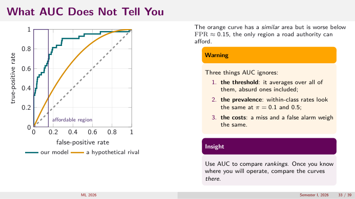
*👀 Slide 33 — Two curves with similar area; the orange one is worse in the only affordable region (FPR < 0.15).*

Three things AUC ignores: (1) the **threshold**: it averages over all of them, absurd ones included; (2) the **prevalence**: within-class rates look the same at $\pi = 0.1$ and 0.5; (3) the **costs**: a miss and a false alarm weigh the same.

**Use AUC to compare rankings. Once you know where you'll operate, compare the curves there.**

## Slide 34 — ROC And PR Side By Side At One Threshold

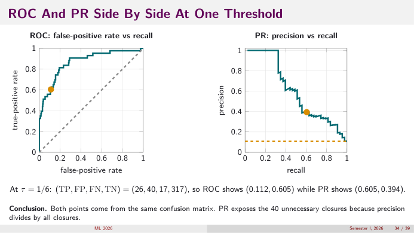
*👀 Slide 34 — τ = 1/6 on both curves: ROC (0.112, 0.605), PR (0.605, 0.394).*

Same confusion matrix (26, 40, 17, 317). ROC shows (FPR, TPR) = (0.112, 0.605); PR shows (recall, precision) = (0.605, 0.394). PR exposes the 40 unnecessary closures because precision divides by all closures.

## Slide 35 — AUC Sees Order; Calibration Sees Probability Values

| road | A | B | C | D |
|---|---|---|---|---|
| actual | impassable | passable | impassable | passable |
| model 1 | 0.90 | 0.70 | 0.60 | 0.20 |
| model 2 | 0.99 | 0.85 | 0.69 | 0.06 |
| rank (both) | 1st | 2nd | 3rd | 4th |

**Ranking question:** pairs (A,B) ✓, (A,D) ✓, (C,B) ✗, (C,D) ✓ in both ⇒ both AUC $= 3/4$. **Probability question:** does 0.70 mean ~70%? The two models can't both be calibrated because their values differ.

## Slide 36 — Discrimination And Calibration Are Different Questions

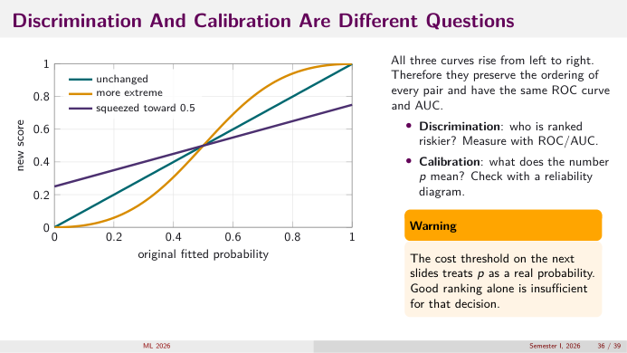
*👀 Slide 36 — Unchanged, more extreme, and squeezed-to-0.5 versions of p: all increasing, so same ROC and AUC.*

All three curves rise left to right, so they preserve the ordering of every pair: same ROC, same AUC. **Discrimination** (who is riskier?) → ROC/AUC. **Calibration** (what does $p$ mean?) → reliability diagram.

> ⚠️ The cost threshold treats $p$ as a real probability. Good ranking alone isn't enough for that decision.

## Slide 37 — Why The Empirical Minimum Drifts From $\tau^*$

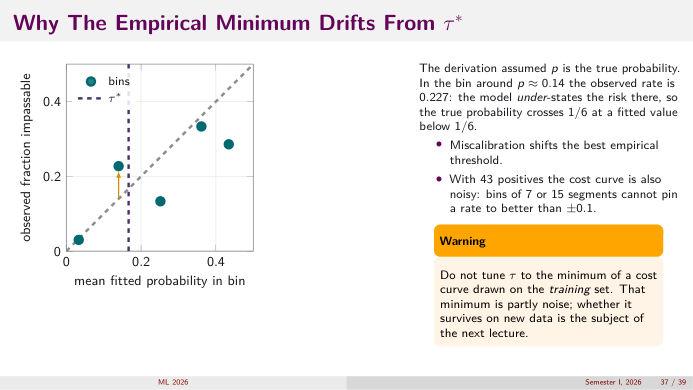
*👀 Slide 37 — Zoomed reliability diagram: around p ≈ 0.14 the observed rate is 0.227, above the line.*

$\tau^*$ assumed $p$ is the true probability. Around $p\approx0.14$ the observed rate is 0.227: the model under-states risk, so the **true** probability crosses 1/6 at a fitted value **below** 1/6. Hence the empirical best threshold (0.095) is lower.
- Miscalibration shifts the best empirical threshold.
- With 43 positives the cost curve is noisy: bins of 7 or 15 segments can't pin a rate better than ±0.1.

> ⚠️ Don't tune $\tau$ to the minimum of a training-set cost curve; that minimum is partly noise.

## Slide 38 — Iso-Cost Lines: Slide Up-Left Until The Line Touches

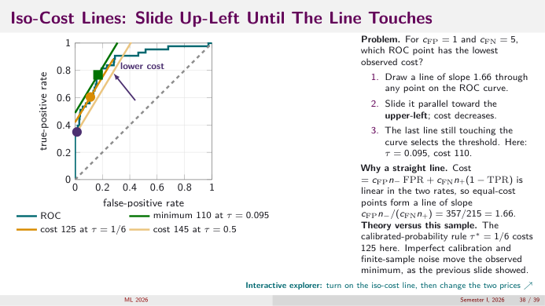
*👀 Slide 38 — Iso-cost lines of slope 1.66; the last one touching the ROC picks τ = 0.095 (cost 110).*

Cost $= c_{FP}n_-\text{FPR} + c_{FN}n_+(1 - \text{TPR})$ is **linear** in the two rates, so equal-cost points form a line with slope $c_{FP}n_-/(c_{FN}n_+) = 357/215 = 1.66$ (A10).
1. Draw a line of slope 1.66 through any ROC point.
2. Slide it parallel toward the upper-left: cost decreases.
3. The last line still touching the curve selects the threshold: $\tau = 0.095$, cost 110.

The calibrated rule $\tau^* = 1/6$ costs 125 here; imperfect calibration and finite-sample noise move the observed minimum (slide 37).

**Check at the 0.5 point:** cost $= 357(0.014) + 215(1 - 0.349) = 5 + 140 = 145$ ✓.

## Slide 39 — The Threshold Is A Function Of The Price Ratio

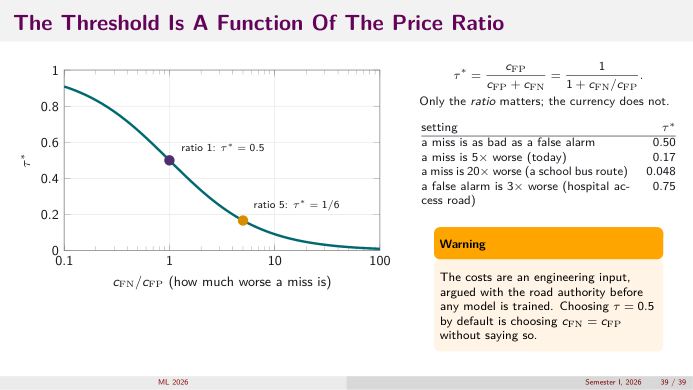
*👀 Slide 39 — τ* vs c_FN/c_FP on a log axis: ratio 1 → 0.5, ratio 5 → 1/6.*

$$\tau^* = \frac{c_{FP}}{c_{FP} + c_{FN}} = \frac{1}{1 + c_{FN}/c_{FP}}.$$
Only the ratio matters; the currency doesn't.

| setting | $c_{FN}/c_{FP}$ | $\tau^*$ |
|---|---|---|
| a miss as bad as a false alarm | 1 | 0.50 |
| a miss 5× worse (today) | 5 | 0.17 |
| a miss 20× worse (school-bus route) | 20 | $1/21 = 0.048$ |
| a false alarm 3× worse (hospital access road) | 1/3 | $1/(4/3) = 0.75$ |

> ⚠️ Costs are an engineering input, argued with the road authority **before** any model is trained. Choosing $\tau = 0.5$ by default is choosing $c_{FN} = c_{FP}$ without saying so.

---

# Part C — Practice

1. At $\tau = 0.3$ (TP 22, FP 20, FN 21, TN 337) compute accuracy, precision, recall, FPR, $F_1$ and cost ($c_{FP} = 1$, $c_{FN} = 5$).
2. Show that accuracy $= \pi\,TPR + (1-\pi)\,TNR$.
3. Derive $F_1 = \frac{2TP}{2TP + FP + FN}$ from $\frac{2PR}{P + R}$.
4. Scores $0.9^+, 0.8^+, 0.7^-, 0.6^+, 0.4^-, 0.3^-$. Draw the ROC staircase and compute AUC by area and by pairs.
5. Square every score in Q4. What happens to the AUC? To decisions at $\tau = 0.5$?
6. TPR = 0.8, FPR = 0.05. Compute precision at prevalence 0.5, 0.1 and 0.01.
7. $c_{FP} = 2$, $c_{FN} = 8$. What is $\tau^*$? A road has $p = 0.15$: close or not? Show both expected costs.
8. For the 400 roads, what is the iso-cost slope if $c_{FN}/c_{FP} = 10$? Would the best operating point move left or right along the ROC?
9. A reliability bin has mean $p = 0.4$ and 20 cases, 4 of them positive. Is the model over- or under-stating risk there? How much should you trust this?
10. Why can't recall be reported alone? Give the trivial rule that maximises it.
11. Your model has the highest AUC but the worst cost at your operating point. How is that possible?
12. Why is "always open" accuracy equal to $1 - \pi$?

<b>Answers</b>

1. Accuracy $(22 + 337)/400 = 0.8975$; precision $22/42 = 0.524$; recall $22/43 = 0.512$; FPR $20/357 = 0.056$; $F_1 = 44/(44 + 20 + 21) = 44/85 = 0.518$; cost $20 + 5(21) = 125$.
2. $\pi\,TPR = \frac{n_+}{n}\frac{TP}{n_+} = \frac{TP}{n}$, $(1-\pi)TNR = \frac{n_-}{n}\frac{TN}{n_-} = \frac{TN}{n}$; add.
3. $\frac{2PR}{P+R}$: numerator $2\frac{TP^2}{(TP+FP)(TP+FN)}$, denominator $\frac{TP(TP+FN) + TP(TP+FP)}{(TP+FP)(TP+FN)}$. Divide: $\frac{2TP}{2TP + FP + FN}$.
4. $n_+ = n_- = 3$. Path ↑↑→↑→→. Column heights at negatives 0.7, 0.4, 0.3: $2/3, 1, 1$ ⇒ area $\tfrac13(\tfrac23 + 1 + 1) = 0.889$. Pairs: $0.9$ beats 3, $0.8$ beats 3, $0.6$ beats 2 ⇒ $8/9 = 0.889$ ✓.
5. AUC unchanged (squaring is increasing on [0,1]). At $\tau = 0.5$: before, 0.9, 0.8, 0.7, 0.6 are positive predictions; after squaring (0.81, 0.64, 0.49, 0.36, 0.16, 0.09) only the first two are. Decisions change.
6. $\frac{0.8\pi}{0.8\pi + 0.05(1-\pi)}$: $\pi = 0.5$: $0.4/0.425 = 0.94$; $0.1$: $0.08/0.125 = 0.64$; $0.01$: $0.008/0.0575 = 0.14$.
7. $\tau^* = 2/10 = 0.2$. $p = 0.15$: close costs $2(0.85) = 1.7$, open costs $8(0.15) = 1.2$ ⇒ leave open.
8. Slope $357/(10\cdot43) = 0.83$: flatter, so the tangent point moves **right/up** (higher TPR, more false alarms, lower $\tau$; $\tau^* = 1/11$).
9. Observed 0.2 < 0.4: over-stating risk. But with 20 cases the sd of the observed rate is $\sqrt{0.4\cdot0.6/20}\approx0.11$, so 0.2 is less than 2 sd away; weak evidence.
10. Closing every road gives recall 1. Recall must be paired with precision or FPR.
11. AUC averages over all thresholds; another model can be better in the region you'll actually operate (slide 33), or your $p$ may be miscalibrated so $\tau^*$ lands badly.
12. It gets every negative right (TN $= n_-$) and every positive wrong: accuracy $= n_-/n = 1 - \pi$.

**Next:** [Lecture 10](L10_precision_recall_roc_auc.md) redoes precision, recall, ROC, AUC and costs step by step on 8 observations, and adds prevalence-dependent cost.
