# Lecture 10 — Precision, Recall, ROC and Cost-Based Decisions

> ES 335 / ES 678 Machine Learning, Sem I 2026 — Prof. Udit Bhatia (15 September 2026)
> Source: `Lectures/L10_student_precision_recall_roc_auc.pdf` (50 slides) · Previous: [`L09_metrics_thresholds_costs.md`](L09_metrics_thresholds_costs.md) · Next: [`L11_support_vector_machines.md`](L11_support_vector_machines.md)

**How to use this file.** Lecture 9 introduced the metrics on 400 roads. Lecture 10 rebuilds them **slowly, one observation at a time**, on **8 roads** you can count on your fingers, and adds three new ideas: **precision depends on prevalence**, **why F1 uses the harmonic mean** (with a proof), and **expected cost per observation as prevalence changes** (with iso-cost lines that depend on $\pi$). Part A collects the maths; Part B walks all 50 slides; Part C is practice. If something here feels fast, the matching section of [L09 Part A](L09_metrics_thresholds_costs.md#part-a--maths-from-the-ground-up) has the long version.

**The one dataset for the whole lecture** (sorted by score):

| obs | A | B | C | D | E | F | G | H |
|---|---|---|---|---|---|---|---|---|
| true $y$ | 1 | 0 | 1 | 1 | 0 | 1 | 0 | 0 |
| score $s$ | .95 | .85 | .75 | .65 | .55 | .45 | .25 | .15 |

Positives: A, C, D, F. Negatives: B, E, G, H. Note **B**: a negative with a high score.

**What this lecture is really about:**
$$\underbrace{\text{count errors}}_{\text{confusion matrix}}\ \to\ \underbrace{\text{assess ranking}}_{\text{ROC, AUC}}\ \to\ \underbrace{\text{choose actions using consequences}}_{\tau^* = C_{FP}/(C_{FP}+C_{FN}),\ \ R = C_{FP}(1-\pi)\text{FPR} + C_{FN}\pi(1-\text{TPR})}$$

## Contents

**Part A — Maths from the ground up**
1. [Threshold → confusion matrix, by counting](#a1-threshold--confusion-matrix-by-counting)
2. [Recall vs precision: same numerator, different denominator](#a2-recall-vs-precision-same-numerator-different-denominator)
3. [Precision depends on prevalence (Bayes' rule)](#a3-precision-depends-on-prevalence-bayes-rule)
4. [Arithmetic vs harmonic mean, and F1](#a4-arithmetic-vs-harmonic-mean-and-f1)
5. [ROC by walking the sorted list; AUC with ties](#a5-roc-by-walking-the-sorted-list-auc-with-ties)
6. [Expected cost of an action and the threshold](#a6-expected-cost-of-an-action-and-the-threshold)
7. [Cost per observation in a population](#a7-cost-per-observation-in-a-population)
8. [Class weights vs thresholds](#a8-class-weights-vs-thresholds)

**Part B — Slides** · [All 50 slides](#part-b--slide-by-slide-all-50-slides)

**Part C — Practice** · [Jump](#part-c--practice)

---

# Part A — Maths From the Ground Up

## A1. Threshold → confusion matrix, by counting

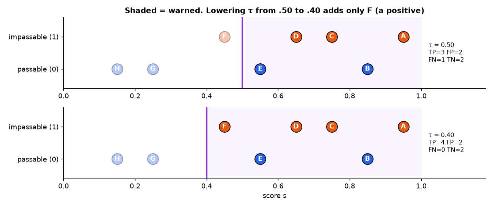
*📊 The 8 roads on a score line. Shaded = warned. τ = 0.50 warns A–E; τ = 0.40 also warns F, a positive, so TP goes 3 → 4 and nothing else changes.*

Decision rule: $\hat y_i = 1$ (warn) if $s_i\ge\tau$, else 0.

**Recipe:** list who is warned → split them into actual 1 (TP) and actual 0 (FP) → the unwarned split into actual 1 (FN) and actual 0 (TN).

**Full table for every threshold** (lower $\tau$ just past each score):

| τ | warned | TP | FP | FN | TN | accuracy | recall = TPR | FPR | precision | cost $2FP + 6FN$ |
|---|---|---|---|---|---|---|---|---|---|---|
| > .95 | — | 0 | 0 | 4 | 4 | 4/8 | 0 | 0 | undefined | 24 |
| .95 | A | 1 | 0 | 3 | 4 | 5/8 | 1/4 | 0 | 1 | 18 |
| .85 | A B | 1 | 1 | 3 | 3 | 4/8 | 1/4 | 1/4 | 1/2 | 20 |
| .75 | A–C | 2 | 1 | 2 | 3 | 5/8 | 2/4 | 1/4 | 2/3 | 14 |
| .65 | A–D | 3 | 1 | 1 | 3 | 6/8 | 3/4 | 1/4 | 3/4 | 8 |
| .55 | A–E | 3 | 2 | 1 | 2 | 5/8 | 3/4 | 2/4 | 3/5 | 10 |
| .45 | A–F | 4 | 2 | 0 | 2 | 6/8 | 1 | 2/4 | 2/3 | **4** |
| .25 | A–G | 4 | 3 | 0 | 1 | 5/8 | 1 | 3/4 | 4/7 | 6 |
| .15 | all | 4 | 4 | 0 | 0 | 4/8 | 1 | 1 | 1/2 | 8 |

($\tau = 0.50$ gives the same decisions as $0.55$; $\tau = 0.40$ the same as $0.45$; $\tau = 0.60$ the same as $0.65$.)

**Monotonicity.** Lowering $\tau$ can only **add** warnings, so TP and FP can only go up, FN and TN only down (slide 7). Recall never decreases. Precision can go either way.

## A2. Recall vs precision: same numerator, different denominator

| | Recall | Precision |
|---|---|---|
| start from | **actual** positives: A, C, D, F | **predicted** positives (warnings): A, B, C, D, E |
| count successes | A, C, D (warned and positive) | A, C, D (warned and positive) |
| at τ = .50 | $3/4 = 75\%$ | $3/5 = 60\%$ |
| asks | did we find the impassable roads? | were our warnings usually correct? |
| hurt by | a **missed** event (FN) | a **false** warning (FP) |

**What moves them as $\tau$ drops** (from the A1 table):
- cross a **negative** (B at .85): recall unchanged, precision falls ($1\to1/2$);
- cross a **positive** (C, D at .75, .65): recall rises **and precision can rise** ($1/2\to3/4$).

## A3. Precision depends on prevalence (Bayes' rule)

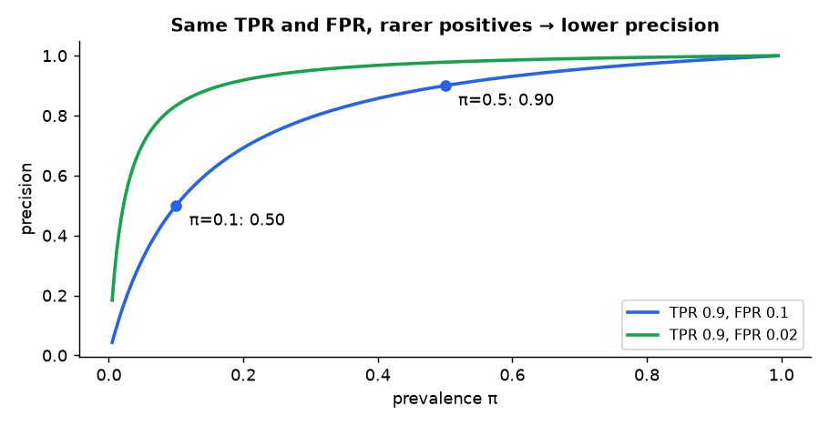
*📊 Precision vs prevalence for TPR 0.9 and FPR 0.1 (blue) or 0.02 (green): at π = 0.5 precision is 0.90; at π = 0.1 it falls to 0.50.*

Let $\pi = \Pr(Y = 1)$. In a population of $N$:
- expected TP $= N\pi\cdot\text{TPR}$ (positives × fraction caught);
- expected FP $= N(1-\pi)\cdot\text{FPR}$ (negatives × fraction falsely warned).

$$\text{precision} = \frac{TP}{TP + FP} = \frac{\pi\,\text{TPR}}{\pi\,\text{TPR} + (1-\pi)\,\text{FPR}}.$$
This is exactly **Bayes' rule** (L1, L3): $\Pr(Y = 1\mid\text{warn}) = \frac{\Pr(\text{warn}\mid Y=1)\Pr(Y=1)}{\Pr(\text{warn})}$.

| $\pi$ | numerator $0.9\pi$ | $+\ 0.1(1-\pi)$ | precision |
|---|---|---|---|
| 0.50 | 0.45 | 0.05 | $0.45/0.50 = 0.90$ |
| 0.10 | 0.09 | 0.09 | $0.09/0.18 = 0.50$ |
| 0.01 | 0.009 | 0.099 | $0.009/0.108 = 0.083$ |

**Same detector (same TPR, FPR), rarer positives ⇒ more of the warnings are false.** TPR and FPR don't change with $\pi$ because they divide by actual-class counts; precision does.

**Baseline.** If you warn regardless of the label (e.g. warn everyone, or warn at random), precision $= \pi$, not 0.5.

## A4. Arithmetic vs harmonic mean, and F1

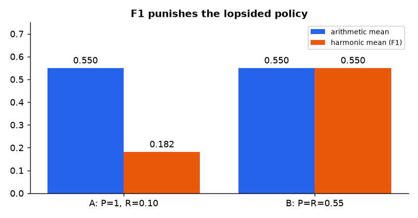
*📊 Policy A (P = 1, R = 0.10) and policy B (P = R = 0.55) have the same arithmetic mean 0.55; the harmonic mean scores A at 0.18.*

**Harmonic mean** of $P, R > 0$: the reciprocal of the average reciprocal:
$$\text{HM} = \frac{2}{\frac1P + \frac1R} = \frac{2PR}{P + R}.$$

**AM ≥ HM, with the gap measured exactly.**
$$\text{AM} - \text{HM} = \frac{P+R}{2} - \frac{2PR}{P+R} = \frac{(P+R)^2 - 4PR}{2(P+R)} = \frac{P^2 - 2PR + R^2}{2(P+R)} = \frac{(P-R)^2}{2(P+R)}\ \ge0.$$
Zero iff $P = R$. The more lopsided the pair, the bigger the penalty.

**Example.** $P = 1$, $R = 0.10$: AM $= 0.55$, HM $= \frac{0.20}{1.10} = 0.182$. Gap $= \frac{0.81}{2.2} = 0.368$ ✓ ($0.55 - 0.182$).

**F1 in counts:** $F_1 = \frac{2TP}{2TP + FP + FN}$. At $\tau = .50$: $\frac{6}{6 + 2 + 1} = \frac23$. F1 **ignores TN** and **weighs FP and FN equally**. It's a design choice; when error costs are known, use them (A6).

## A5. ROC by walking the sorted list; AUC with ties

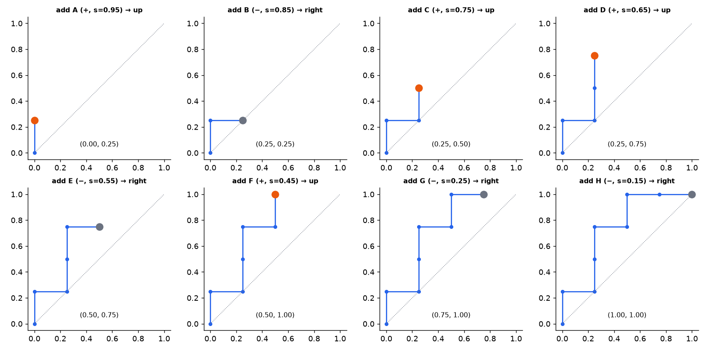
*📊 ROC built one observation at a time: a positive moves up ¼, a negative moves right ¼.*

$$\text{TPR} = \frac{TP}{TP + FN}\ (\text{of actual positives}),\qquad\text{FPR} = \frac{FP}{FP + TN}\ (\text{of actual negatives}),\qquad\text{specificity} = 1 - \text{FPR}.$$

Walk the sorted list A→H: A(+) up, B(−) right, C(+) up, D(+) up, E(−) right, F(+) up, G(−) right, H(−) right. Points: $(0,0), (0,\tfrac14), (\tfrac14,\tfrac14), (\tfrac14,\tfrac12), (\tfrac14,\tfrac34), (\tfrac12,\tfrac34), (\tfrac12,1), (\tfrac34,1), (1,1)$.

**AUC two ways.**
- **Area:** four columns of width ¼ with heights ¼, ¾, 1, 1 ⇒ $\tfrac14(\tfrac14 + \tfrac34 + 1 + 1) = \tfrac{12}{16} = 0.75$. (Vertical segments add no area.)
- **Pairs:** 4 × 4 = 16 (positive, negative) pairs; positive scored higher in 12 ⇒ $12/16 = 0.75$.

**With ties:**
$$\text{AUC} = \Pr(s_+ > s_-) + \tfrac12\Pr(s_+ = s_-) = \frac{\text{wins} + \tfrac12\text{ties}}{n_+n_-}.$$
(A tie makes the staircase take a diagonal step; the triangle under it is half a cell.) **AUC measures ranking. It is not the fraction of correct classifications.**

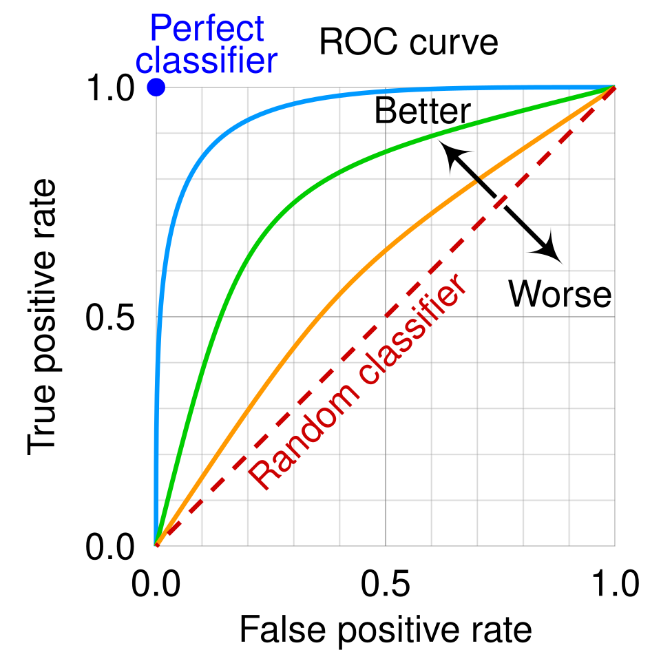
*A generic ROC picture: the perfect classifier sits at (0, 1), random guessing on the diagonal, better curves bow toward the top-left. (Wikimedia Commons: [Roc_curve.svg](https://commons.wikimedia.org/wiki/File:Roc_curve.svg), CC BY-SA 4.0)*

## A6. Expected cost of an action and the threshold

**Cost table** (agreed decision units; illustrative, not measured safety values):

| action | actually impassable | actually passable |
|---|---|---|
| issue warning | 0 | $C_{FP} = 2$ |
| don't warn | $C_{FN} = 6$ | 0 |

For a road with calibrated $p = \Pr(Y = 1\mid x)$:
$$R(1\mid x) = 0\cdot p + C_{FP}(1-p) = C_{FP}(1-p),\qquad R(0\mid x) = C_{FN}\,p + 0\cdot(1-p) = C_{FN}\,p.$$
Warn iff $R(1)\le R(0)$:
$$C_{FP}(1-p)\le C_{FN}p\iff C_{FP}\le(C_{FP} + C_{FN})p\iff p\ge\tau^* = \frac{C_{FP}}{C_{FP} + C_{FN}} = \frac{2}{8} = \frac14.$$
Equal costs ⇒ 0.5. **A bigger missed-event cost lowers the threshold.** (At equality either action is fine; the rule picks "warn".)

## A7. Cost per observation in a population

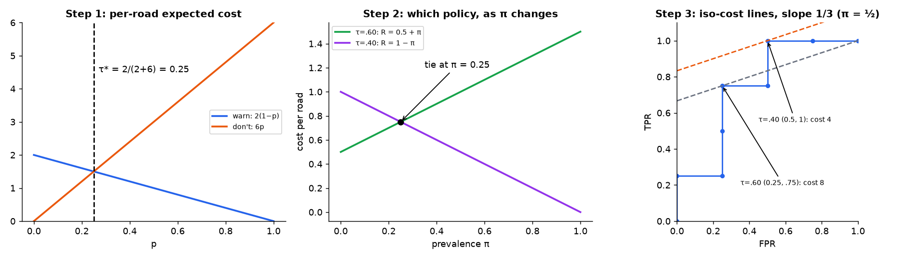
*📊 Step 1: per-road costs cross at p = 0.25. Step 2: policies τ = .60 and τ = .40 as prevalence changes: they tie at π = 0.25. Step 3: iso-cost lines of slope 1/3 on the 8-road ROC.*

Population of $N$ with prevalence $\pi$. Assume the **class-conditional** TPR and FPR carry over.

| quantity | expected value |
|---|---|
| actual negatives | $N(1-\pi)$ |
| false positives | $N(1-\pi)\,\text{FPR}$ |
| actual positives | $N\pi$ |
| false negatives | $N\pi(1 - \text{TPR})$ |

Multiply by costs, add, divide by $N$:
$$\boxed{R = C_{FP}(1-\pi)\,\text{FPR} + C_{FN}\,\pi\,(1 - \text{TPR})}\quad(\text{expected cost per observation}).$$
**Same TPR and FPR, different $\pi$ ⇒ different cost.** That's why a policy validated in one district may be wrong in another.

**Iso-cost lines.** Fix $R = r$, write $u = $ FPR, $v = $ TPR, solve for $v$:
$$v = 1 - \frac{r}{C_{FN}\pi} + \frac{C_{FP}(1-\pi)}{C_{FN}\pi}\,u.$$
Slope $= \dfrac{C_{FP}(1-\pi)}{C_{FN}\pi}$. With 2, 6 and $\pi = \tfrac12$: slope $\tfrac13$. (L9's slope $\frac{c_{FP}n_-}{c_{FN}n_+}$ is the same thing with $n_-/n_+ = (1-\pi)/\pi$.) For a fixed FPR, higher TPR = lower cost. For an empirical (staircase) ROC, just compare the achievable points; no smooth tangency needed.

## A8. Class weights vs thresholds

Two different knobs that people often confuse:

| | Weighted training | Threshold selection |
|---|---|---|
| what changes | the **objective** used to fit $\theta$: $-\sum_i[w_1y_i\log p_i + w_0(1-y_i)\log(1-p_i)]$ | the **action rule** for an already-fitted model |
| when | before/during fitting | after fitting |
| outputs | $p$ no longer estimates $\Pr(Y=1\mid x)$ for the deployment population (it's tilted toward the up-weighted class) | $p$ unchanged; only decisions move |

> ⚠️ Don't assume weighting and lowering the threshold are interchangeable, especially in a fitted, **regularised** model. If you use cost-based $\tau^*$, it needs calibrated $p$, which weighting breaks.

---

# Part B — Slide by Slide (all 50 slides)

## Slide 1 — Title

*Precision, Recall, ROC and Cost-Based Decisions.* Prof. Udit Bhatia, 15 September 2026.

## Slide 2 — Where this fits in our course

1. Likelihood and logistic regression: estimate parameters (L6).
2. Regularisation: control the coefficients (L7–L8).
3. Confusion matrix and accuracy: count consequences (L9).
4. **Today:** vary the threshold, assess ranking, include error costs.

**Summary:** the fitted model stays **fixed** throughout the worked example.

## Slide 3 — The decision problem

A road team decides whether to issue an impassability warning. $y = 1$: actually impassable; $y = 0$: passable. $s$: model score (higher = stronger evidence for 1). $\hat y = 1$: warn.

Eight held-out observations are a **teaching** dataset, not deployment evidence. **A score can be used for ranking without being a reliable probability.**

## Slide 4 — One dataset for the whole lecture

Table at the top of this note. Four positives (A, C, D, F), four negatives (B, E, G, H), already sorted by decreasing score. **Notice B**: a negative can score high (0.85).

## Slide 5 — A threshold turns scores into actions

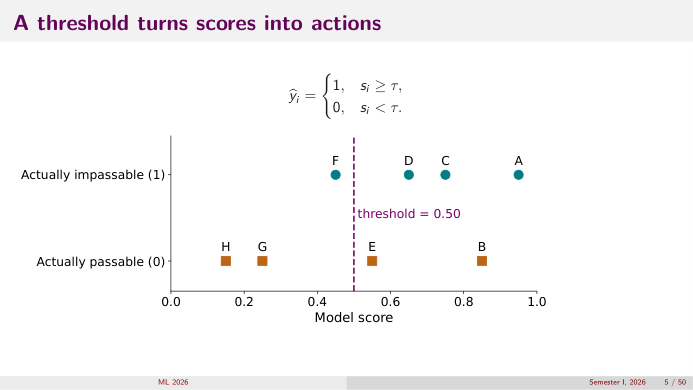
*👀 Slide 5 — Scores on a line, split by true class, with τ = 0.50.*

$$\hat y_i = \begin{cases}1, & s_i\ge\tau\\0, & s_i < \tau\end{cases}$$
At $\tau = 0.50$, everything right of the line is warned: A, B, C, D, E.

## Slide 6 — Threshold 0.50: count before using formulas

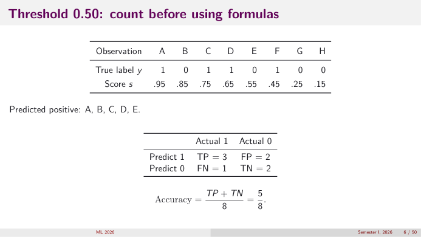
*👀 Slide 6 — The confusion matrix at τ = 0.50.*

Predicted positive: A, B, C, D, E.

| | actual 1 | actual 0 |
|---|---|---|
| predict 1 | TP = 3 (A, C, D) | FP = 2 (B, E) |
| predict 0 | FN = 1 (F) | TN = 2 (G, H) |

Accuracy $= (TP + TN)/8 = 5/8$.

## Slide 7 — Threshold 0.40: what changed?

F (score 0.45) now gets a warning; no other observation changes.

| | actual 1 | actual 0 |
|---|---|---|
| predict 1 | TP = 4 | FP = 2 |
| predict 0 | FN = 0 | TN = 2 |

**Insight:** lowering the threshold **cannot decrease** TP or FP on a fixed dataset (A1).

## Slide 8 — Recall step 1: start with actual positives

Keep $\tau = .50$. Look **only** at the four actually impassable roads A, C, D, F. A, C, D were warned; F was missed. Of these four, how many did we catch? → 3.

## Slide 9 — Recall step 2: turn that count into a rate

Actual positives $= \underbrace{A, C, D}_{TP = 3} + \underbrace{F}_{FN = 1}$; $TP + FN = 4$.
$$\text{Recall} = \frac{\text{positives caught}}{\text{all actual positives}} = \frac{TP}{TP + FN} = \frac34 = 75\%.$$
**Recall asks how much of the real problem we detected.**

## Slide 10 — Precision step 1: start with issued warnings

Still $\tau = .50$. Look **only** at the five warned roads A, B, C, D, E. A, C, D correct; B, E false warnings. Of the five warnings, how many were correct? → 3.

## Slide 11 — Precision step 2: turn that count into a rate

Warnings $= \underbrace{A, C, D}_{TP = 3} + \underbrace{B, E}_{FP = 2}$; $TP + FP = 5$.
$$\text{Precision} = \frac{\text{correct warnings}}{\text{all warnings}} = \frac{TP}{TP + FP} = \frac35 = 60\%.$$
**Precision asks how trustworthy the issued warnings were.**

## Slide 12 — The numerator is the same; the denominator changes

Comparison table in A2. **A missed event affects recall. A false warning affects precision.**

## Slide 13 — Threshold step 1: a false warning lowers precision

| τ | warned | recall | precision |
|---|---|---|---|
| .95 | A | 1/4 | 1/1 = 1 |
| .85 | A, B | 1/4 | 1/2 |

B is negative: we added no detected positive, only a false warning. **Recall fixed, precision falls.**

## Slide 14 — Threshold step 2: correct warnings raise precision

| τ | warned | recall | precision |
|---|---|---|---|
| .85 | A, B | 1/4 | 1/2 |
| .65 | A, B, C, D | 3/4 | 3/4 |

C and D are positives: **both** recall and precision rose. **Lowering a threshold does not force precision down at every step.**

## Slide 15 — Threshold step 3: recover the last missed positive

| τ | TP | FP | recall | precision |
|---|---|---|---|---|
| .50 | 3 | 2 | 3/4 | 3/5 |
| .40 | 4 | 2 | 4/4 = 1 | 4/6 = 2/3 |

Recall is now 100%, but B and E are still false warnings. Warn all eight: recall stays 1, precision falls to $4/8$ (the prevalence).

## Slide 16 — Build a precision-recall plot

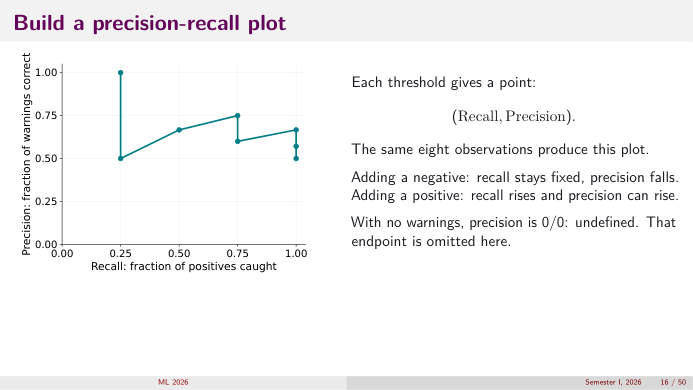
*👀 Slide 16 — Each threshold gives one (recall, precision) point.*

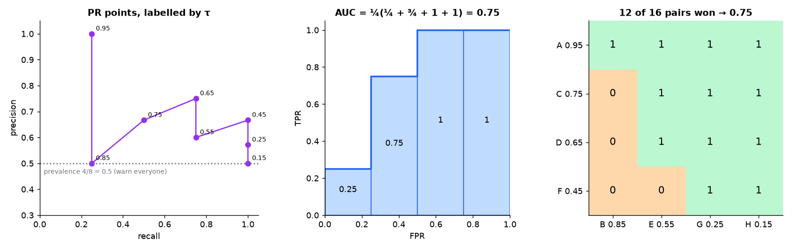
*📊 The same PR points, each labelled by its threshold, with the prevalence line; plus the AUC strips and the 4×4 pair table.*

Points (recall, precision) by $\tau$: .95 → (¼, 1); .85 → (¼, ½); .75 → (½, ⅔); .65 → (¾, ¾); .55 → (¾, ⅗); .45 → (1, ⅔); .25 → (1, 4/7); .15 → (1, ½).
- Adding a negative: recall fixed, precision falls (straight down).
- Adding a positive: recall rises and precision can rise (up-right).
- No warnings: precision 0/0, undefined; that endpoint is omitted.

## Slide 17 — Does a PR curve tell us how good a model is?

Two models on the same population, both catch 80 of 100 positives (recall 0.80).

| | Model A | Model B |
|---|---|---|
| precision | 0.80 | 0.50 |
| total warnings = TP/precision | $80/0.8 = 100$ | $80/0.5 = 160$ |
| false warnings | 20 | 80 |

**At the same recall, higher precision means fewer false warnings for the same number of positives found.**

## Slide 18 — Why precision changes with prevalence

$$\text{Precision} = \frac{\pi\,\text{TPR}}{\pi\,\text{TPR} + (1-\pi)\,\text{FPR}}.$$
TPR = .90, FPR = .10: $\pi = .50$ → $.45/(.45 + .05) = .90$; $\pi = .10$ → $.09/(.09 + .09) = .50$ (A3).

**Fewer actual positives can mean a larger fraction of warnings are false, even when TPR and FPR are unchanged.**

## Slide 19 — Reading a PR curve responsibly

- Higher precision at a given recall is better; higher recall at a given precision is better.
- If curves cross, the better model depends on the operating region and consequences.
- For selection independent of the label, population precision = prevalence $\pi$, **not always .50**.
- A high PR curve doesn't establish calibrated probabilities or choose a cost-optimal threshold.

Warning everyone gives recall 1 and precision $\pi$. Finite-sample random rankings fluctuate around that reference.

## Slide 20 — Why not use the arithmetic mean?

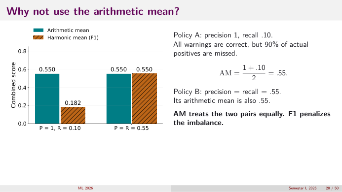
*👀 Slide 20 — Policy A (P = 1, R = .10) and policy B (P = R = .55): AM 0.55 for both, HM 0.182 vs 0.55.*

Policy A: precision 1, recall .10: all warnings correct, but 90% of positives missed. AM $= (1 + .10)/2 = .55$. Policy B: P = R = .55, AM .55. **AM treats them equally; F1 penalises the imbalance.**

## Slide 21 — Why the harmonic mean penalizes imbalance

$\text{HM} = \frac{2}{1/P + 1/R} = \frac{2PR}{P + R}$. A small value has a large reciprocal, pulling the mean down. $P = 1$, $R = .10$: HM $= .20/1.10\approx.182$. Balanced $P = R = .55$: HM = AM = .55.
$$\text{AM} - \text{HM} = \frac{(P - R)^2}{2(P + R)}\ge0\quad(\text{derived step by step in A4}).$$
**HM is a design choice, not a requirement.** F1 treats P and R symmetrically; use explicit costs when error consequences are known.

## Slide 22 — F1 combines precision and recall ✍️

$$F_1 = \frac{2\,\text{Precision}\cdot\text{Recall}}{\text{Precision} + \text{Recall}}.$$
Substitute $\frac{TP}{TP+FP}$ and $\frac{TP}{TP+FN}$ and cancel: numerator $\frac{2TP^2}{(TP+FP)(TP+FN)}$; denominator $\frac{TP[(TP+FN) + (TP+FP)]}{(TP+FP)(TP+FN)}$. Divide:
$$F_1 = \frac{2TP}{2TP + FP + FN}.\qquad\tau = .50:\ \frac{2(3)}{2(3) + 2 + 1} = \frac69 = \frac23.$$
Check: $\frac{2(0.6)(0.75)}{1.35} = \frac{0.9}{1.35} = \frac23$ ✓. F1 **excludes TN** and doesn't encode costs.

## Slide 23 — Rates use different reference groups

$$\text{TPR} = \text{Recall} = \frac{TP}{TP + FN}\ \text{(of all actually impassable roads, what fraction got a warning?)}$$
$$\text{FPR} = \frac{FP}{FP + TN}\ \text{(of all actually passable roads, what fraction got a warning?)},\qquad\text{Specificity} = \frac{TN}{FP + TN} = 1 - \text{FPR}.$$
**These denominators count actual classes, not predicted classes** (so they don't depend on prevalence; precision does).

## Slide 24 — Each threshold gives one ROC point

| τ | TP | FP | FPR | TPR |
|---|---|---|---|---|
| .50 | 3 | 2 | 2/4 = .50 | 3/4 = .75 |
| .40 | 4 | 2 | .50 | 1.00 |

Horizontal = FPR, vertical = TPR. An ROC curve collects these as $\tau$ varies. **ROC = receiver operating characteristic** (from WWII radar operators tuning a receiver's threshold).

## Slide 25 — ROC step 0: warn nobody

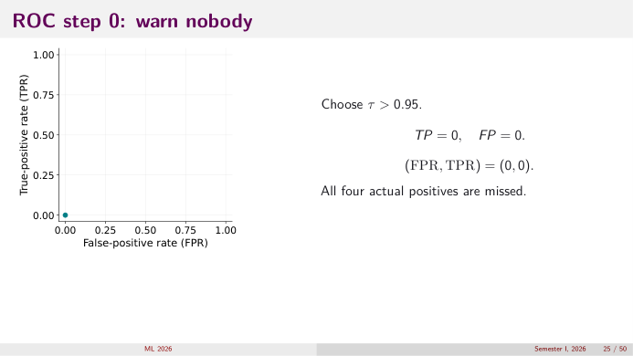
*👀 Slide 25 — τ > 0.95: the point (0, 0).*

$\tau > 0.95$: TP = 0, FP = 0 ⇒ (FPR, TPR) = (0, 0). All four positives missed.

## Slide 26 — ROC step 1: include A

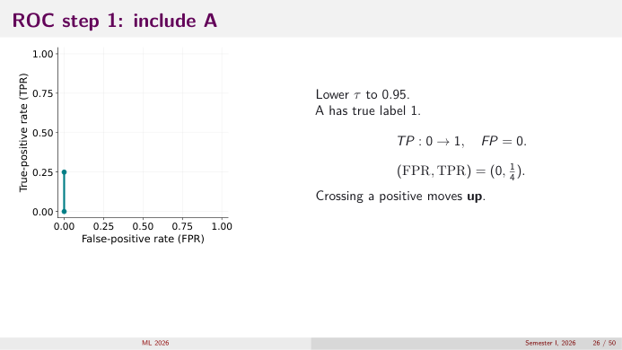
*👀 Slide 26 — A is positive: move up to (0, ¼).*

Lower $\tau$ to .95. A has label 1: TP 0 → 1, FP = 0 ⇒ $(0, \tfrac14)$. **Crossing a positive moves up.**

## Slide 27 — ROC step 2: include B

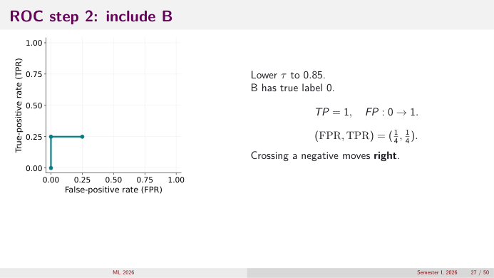
*👀 Slide 27 — B is negative: move right to (¼, ¼).*

$\tau = .85$. B has label 0: TP = 1, FP 0 → 1 ⇒ $(\tfrac14, \tfrac14)$. **Crossing a negative moves right.**

## Slide 28 — ROC steps 3 and 4: include C and D

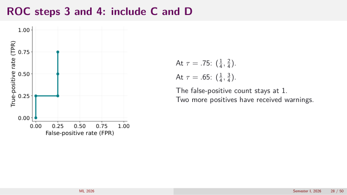
*👀 Slide 28 — C and D are positives: up to (¼, ½) then (¼, ¾).*

$\tau = .75$: $(\tfrac14, \tfrac24)$. $\tau = .65$: $(\tfrac14, \tfrac34)$. FP stays 1; two more positives warned.

## Slide 29 — ROC steps 5 and 6: include E and F

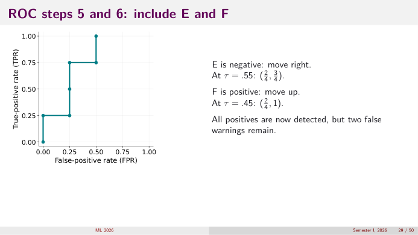
*👀 Slide 29 — E (negative) right to (½, ¾); F (positive) up to (½, 1).*

E negative → right: $\tau = .55$: $(\tfrac24, \tfrac34)$. F positive → up: $\tau = .45$: $(\tfrac24, 1)$. All positives detected, two false warnings remain.

## Slide 30 — The complete ROC curve

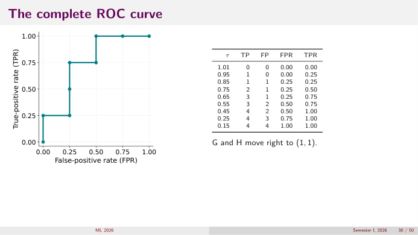
*👀 Slide 30 — The complete staircase and its table.*

| τ | 1.01 | .95 | .85 | .75 | .65 | .55 | .45 | .25 | .15 |
|---|---|---|---|---|---|---|---|---|---|
| TP | 0 | 1 | 1 | 2 | 3 | 3 | 4 | 4 | 4 |
| FP | 0 | 0 | 1 | 1 | 1 | 2 | 2 | 3 | 4 |
| FPR | 0 | 0 | .25 | .25 | .25 | .50 | .50 | .75 | 1 |
| TPR | 0 | .25 | .25 | .50 | .75 | .75 | 1 | 1 | 1 |

G and H move right to (1, 1).

## Slide 31 — AUC: area under the ROC curve ✍️

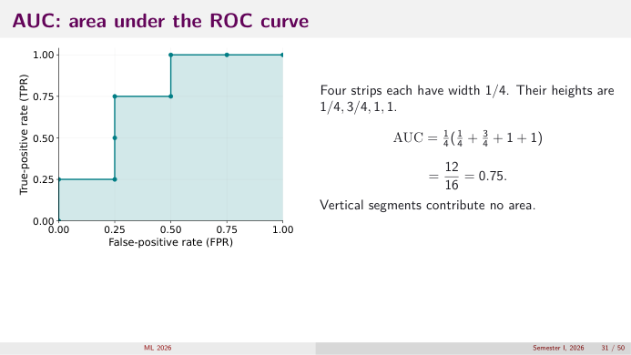
*👀 Slide 31 — Four strips of width ¼ with heights ¼, ¾, 1, 1.*

$$\text{AUC} = \tfrac14\big(\tfrac14 + \tfrac34 + 1 + 1\big) = \tfrac14\cdot3 = \tfrac{12}{16} = 0.75.$$
Each strip is under one rightward step (one negative); its height is the TPR reached before that negative. Vertical segments contribute no area.

## Slide 32 — AUC: compare a positive with a negative

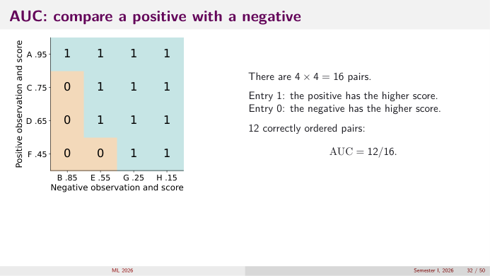
*👀 Slide 32 — 4×4 grid of (positive, negative) pairs: 1 if the positive scores higher.*

| positive \ negative | B .85 | E .55 | G .25 | H .15 | wins |
|---|---|---|---|---|---|
| A .95 | 1 | 1 | 1 | 1 | 4 |
| C .75 | 0 | 1 | 1 | 1 | 3 |
| D .65 | 0 | 1 | 1 | 1 | 3 |
| F .45 | 0 | 0 | 1 | 1 | 2 |

12 of 16 ⇒ AUC $= 12/16 = 0.75$, the same as the area (L9 A6 explains why). B (.85) beats three positives: it alone costs 3 of the 4 lost pairs.

## Slide 33 — The general AUC formula

$$\text{AUC} = P(s_+ > s_-) + \tfrac12P(s_+ = s_-),\qquad\text{finite sample: }\ \text{AUC} = \frac{\text{wins} + \tfrac12\text{ties}}{n_+n_-}.$$
**AUC measures ranking. It is not the fraction of correct classifications.** (Accuracy at τ = .5 is 5/8 = 0.625; AUC is 0.75; different questions.)

## Slide 34 — What AUC does not tell us

- **Which threshold?** AUC doesn't select one.
- **How costly are errors?** Not specified.
- **Is a score of .80 really 80%?** Not checked.

If every score becomes $s^2$, the ranking and AUC stay the same, but the **same numerical threshold** can change decisions: at $\tau = .5$, squared scores $.9025, .7225, .5625, .4225, …$ warn only A, B, C (instead of A–E).

**Ranking, probability calibration, and decision quality are different.**

## Slide 35 — State the costs before choosing a threshold

| action | actually impassable | actually passable |
|---|---|---|
| issue warning | 0 | $C_{FP} = 2$ |
| do not warn | $C_{FN} = 6$ | 0 |

A missed impassable road costs **three times** a false warning. Illustrative assumptions, not measured safety valuations.

## Slide 36 — Compare the costs of two policies

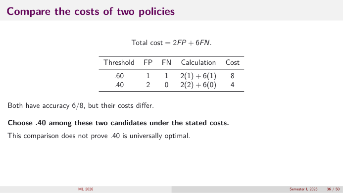
*👀 Slide 36 — Total cost 2FP + 6FN at τ = .60 and .40.*

| τ | FP | FN | calculation | cost |
|---|---|---|---|---|
| .60 | 1 (B) | 1 (F) | $2(1) + 6(1)$ | 8 |
| .40 | 2 (B, E) | 0 | $2(2) + 6(0)$ | 4 |

**Both have accuracy 6/8, but costs differ.** Among these two, choose .40. This doesn't prove .40 is universally optimal (the A1 table confirms 4 is the minimum on these 8 roads).

## Slide 37 — A probability lets us compare actions directly

For a new road with features $x$, suppose $p = P(Y = 1\mid x)$ is **reliable for the deployment population**. We don't know the road's true state, so compare the **expected cost** of each action. Correct decisions cost 0, false warning 2, missed event 6.

## Slide 38 — Expected cost of issuing a warning

If we predict 1: with probability $p$ impassable, cost 0; with probability $1-p$ passable, cost $C_{FP}$.
$$R(1\mid x) = 0\cdot p + C_{FP}(1-p) = C_{FP}(1-p).$$
($R(1\mid x)$ = expected cost of action 1 for this road.)

## Slide 39 — Expected cost of not issuing a warning

If we predict 0: with probability $p$ impassable, cost $C_{FN}$; with probability $1-p$, cost 0.
$$R(0\mid x) = C_{FN}\,p.$$
Choose the action with the smaller expected cost.

## Slide 40 — Derive the probability threshold ✍️

Warn when $R(1\mid x)\le R(0\mid x)$:
$$C_{FP}(1-p)\le C_{FN}p\ \Rightarrow\ C_{FP}\le(C_{FP} + C_{FN})p\ \Rightarrow\ p\ge\frac{C_{FP}}{C_{FP} + C_{FN}}.$$
$$\tau^* = \frac{2}{2 + 6} = \frac14.$$
At equality both actions cost the same; the rule chooses 1.

**Check at $p = 0.3$:** warn costs $2(0.7) = 1.4$; don't warn costs $6(0.3) = 1.8$ ⇒ warn ✓ (0.3 ≥ 0.25).

## Slide 41 — The threshold is where the two costs cross

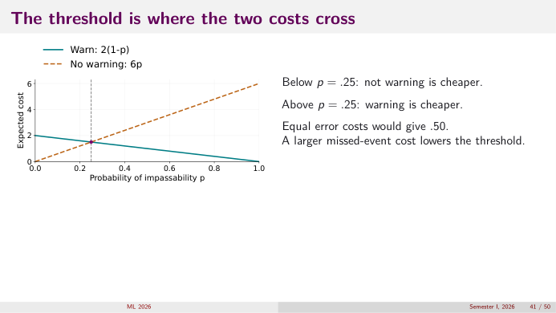
*👀 Slide 41 — Warn: 2(1 − p); no warning: 6p; they cross at p = .25.*

Below $p = .25$ not warning is cheaper; above it warning is cheaper. Equal costs would give .50. **A larger missed-event cost lowers the threshold.**

## Slide 42 — Why not just pick the best sample threshold?

The analytic rule .25 minimises **expected** cost under the probability assumptions. On our 8 observations, $\tau = .25$ warns A–G: FP = 3, FN = 0, cost 6; $\tau = .40$ gives cost 4. No contradiction:
- eight realised outcomes are a **noisy sample**, not expected costs;
- the toy scores have **not been shown to be calibrated** probabilities.

Use validation data to choose a practical policy; reserve test data for evaluation.

## Slide 43 — Population composition changes total cost

$\pi = P(Y = 1)$, population $N$. Expected negatives $N(1-\pi)$, expected FP $N(1-\pi)\text{FPR}$; expected positives $N\pi$, expected FN $N\pi(1 - \text{TPR})$. Assumes the same class-conditional TPR and FPR apply (A7).

## Slide 44 — Derive cost per observation

$$\text{Expected total cost} = C_{FP}N(1-\pi)\text{FPR} + C_{FN}N\pi(1 - \text{TPR}).$$
Divide by $N$:
$$R = C_{FP}(1-\pi)\text{FPR} + C_{FN}\pi(1 - \text{TPR}).$$
Averages over both classes; explains why the same TPR/FPR can have different consequences in different populations.

**Check on the 8 roads ($\pi = \tfrac12$), τ = .40:** $R = 2(\tfrac12)(\tfrac12) + 6(\tfrac12)(0) = 0.5$; ×8 = 4 ✓.

## Slide 45 — Compare policies as prevalence changes ✍️

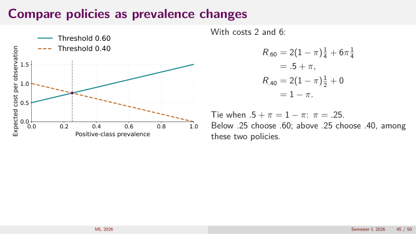
*👀 Slide 45 — Expected cost per observation vs prevalence for τ = .60 and τ = .40.*

τ = .60: FPR = ¼, TPR = ¾. τ = .40: FPR = ½, TPR = 1.
$$R_{.60} = 2(1-\pi)\tfrac14 + 6\pi\tfrac14 = 0.5 - 0.5\pi + 1.5\pi = 0.5 + \pi,$$
$$R_{.40} = 2(1-\pi)\tfrac12 + 6\pi\cdot0 = 1 - \pi.$$
Tie: $0.5 + \pi = 1 - \pi\Rightarrow\pi = 0.25$. **Below 0.25 choose .60** (fewer false alarms matter more when positives are rare); **above 0.25 choose .40**.

## Slide 46 — Extension: equal-cost lines on the ROC plot

$u = $ FPR, $v = $ TPR, fixed cost $r$: $r = C_{FP}(1-\pi)u + C_{FN}\pi(1 - v)$. Rearranged (positive costs, $0 < \pi < 1$):
$$v = 1 - \frac{r}{C_{FN}\pi} + \frac{C_{FP}(1-\pi)}{C_{FN}\pi}u.$$
**Slope $= C_{FP}(1-\pi)/(C_{FN}\pi)$.** For a fixed FPR, higher TPR means lower cost. For an empirical ROC, compare achievable points; a smooth tangency isn't required. (8 roads: slope $\tfrac{2\cdot0.5}{6\cdot0.5} = \tfrac13$; the best point is $(\tfrac12, 1)$, i.e. τ = .40 — see the Step 3 panel in A7.)

## Slide 47 — Training weights and decision thresholds differ

Weighted training changes the fitting objective:
$$-\sum_i\big[w_1y_i\log p_i + w_0(1-y_i)\log(1-p_i)\big],\quad w_1, w_0 > 0.$$
Threshold selection changes the action rule for an already-fitted model. **Class weights don't automatically turn outputs into deployment probabilities.** Don't assume weighting and lowering the threshold are interchangeable in a fitted, regularised model (A8).

## Slide 48 — A practical evaluation protocol

1. Fit preprocessing and the model on **training** data.
2. Use **validation** data to compare models and choose a threshold; assess calibration if probabilities drive costs.
3. **Freeze** the model, preprocessing, and decision rule.
4. Report **test-set** confusion counts, TPR, FPR, AUC and the stated cost.

Report sample size, class prevalence, and the positive-class definition. An 8-observation teaching example can't establish deployment reliability.

## Slide 49 — Check the reasoning, not just the formula

1. *Does lowering a threshold retrain the model?* No: the scores are fixed; only the decisions change.
2. *Why does a negative observation move ROC rightward?* Passing it adds one FP, raising FPR by $1/n_-$; TP (hence TPR) is unchanged.
3. *Can two thresholds have equal accuracy but different costs?* Yes: τ = .60 and .40 both have accuracy 6/8, costs 8 vs 4 (slide 36).
4. *Does a high AUC guarantee good probability estimates?* No: AUC depends only on order; any monotone distortion keeps it (slide 34).
5. *If missed positives become more costly, which way should the threshold move?* **Down**: $\tau^* = C_{FP}/(C_{FP} + C_{FN})$ falls as $C_{FN}$ grows.

## Slide 50 — The formulas and what they answer

| formula | answers |
|---|---|
| $\text{TPR} = \frac{TP}{TP + FN}$, $\text{FPR} = \frac{FP}{FP + TN}$ | how each actual class is treated |
| $\text{AUC} = \frac{\text{wins} + \frac12\text{ties}}{n_+n_-}$ | how well the scores rank |
| observed cost $= C_{FP}FP + C_{FN}FN$ | what this sample's decisions cost |
| $\tau^* = \frac{C_{FP}}{C_{FP} + C_{FN}}$ | best threshold for calibrated $p$, zero cost for correct decisions |
| $R = C_{FP}(1-\pi)\text{FPR} + C_{FN}\pi(1 - \text{TPR})$ | expected cost per observation in a population with prevalence $\pi$ |

**Count errors; assess ranking; choose actions using consequences.**

---

# Part C — Practice

1. Using the 8 roads, give the confusion matrix, precision, recall and F1 at $\tau = 0.70$.
2. Swap the labels of B and C (B becomes positive, C negative). Recompute AUC by pair counting.
3. Add a ninth road I: $y = 1$, $s = 0.55$ (tied with E). Compute AUC using the ties formula.
4. TPR = 0.95, FPR = 0.05. At what prevalence does precision drop to 0.5?
5. Show that if $C_{FN} = kC_{FP}$, then $\tau^* = 1/(1+k)$. What is $\tau^*$ for $k = 9$?
6. With $C_{FP} = 2$, $C_{FN} = 6$, compute the expected cost per observation of "warn everyone" and "warn no one" as functions of $\pi$. Where do they cross?
7. For the 8 roads with $C_{FP} = 1$, $C_{FN} = 1$, which threshold(s) minimise total cost? What metric are you then minimising?
8. Compute AM, HM and AM − HM for $P = 0.8$, $R = 0.4$, and check the formula $(P-R)^2/(2(P+R))$.
9. Two models give recall 0.6 on 50 positives; precisions 0.75 and 0.5. How many false warnings does each issue?
10. Why can the PR baseline never be read as 0.5 in general?
11. A colleague trains with $w_1 = 3$, $w_0 = 1$ and then also applies $\tau^* = 0.25$. What might go wrong?
12. Iso-cost slope for $C_{FP} = 2$, $C_{FN} = 6$ at $\pi = 0.1$? Does the preferred operating point move toward lower or higher FPR compared with $\pi = 0.5$?

<b>Answers</b>

1. Warned: A (.95), B (.85), C (.75). TP 2 (A, C), FP 1 (B), FN 2 (D, F), TN 3. Precision $2/3$, recall $2/4$, $F_1 = 4/(4 + 1 + 2) = 4/7\approx0.571$.
2. New positives A(.95), B(.85), D(.65), F(.45); negatives C(.75), E(.55), G, H. Wins: A 4, B 4, D 3 (loses to C), F 2 (loses to C, E). $13/16 = 0.8125$.
3. Positives A, C, D, F, I(.55); negatives B, E, G, H. Wins: A 4, C 3, D 3, F 2, I: beats G, H (2 wins), ties E (½), loses to B. Total $14 + 0.5 = 14.5$ of $5\times4 = 20$ ⇒ $0.725$.
4. $\frac{0.95\pi}{0.95\pi + 0.05(1-\pi)} = 0.5\iff0.95\pi = 0.05(1-\pi)\iff\pi = 0.05/1.0 = 0.05$.
5. $\tau^* = \frac{C_{FP}}{C_{FP} + kC_{FP}} = \frac1{1+k}$. $k = 9$: 0.1.
6. Warn everyone: FPR = 1, TPR = 1 ⇒ $R = 2(1-\pi)$. Warn no one: FPR = 0, TPR = 0 ⇒ $R = 6\pi$. Cross at $2 - 2\pi = 6\pi\Rightarrow\pi = 0.25$ (= $\tau^*$, not a coincidence).
7. Cost = FP + FN = number of errors: minimised where accuracy is max, 6/8, at τ = .65 (or .60) and τ = .45 (or .40). You're minimising the error rate (= 1 − accuracy).
8. AM 0.6; HM $0.64/1.2 = 0.533$; gap $0.0667$; formula $0.16/2.4 = 0.0667$ ✓.
9. TP $= 30$. Warnings $= 30/0.75 = 40$ and $30/0.5 = 60$ ⇒ 10 and 30 false warnings.
10. A label-independent rule has precision equal to the prevalence $\pi$; it's 0.5 only for balanced classes.
11. Weighting already shifts $p$ upward for positives (the model is no longer calibrated for the deployment population), so applying the cost threshold on top double-counts the cost asymmetry: too many warnings.
12. Slope $\frac{2(0.9)}{6(0.1)} = 3$ (vs $1/3$ at $\pi = 0.5$): much steeper ⇒ the touching point moves toward **lower FPR** (fewer warnings), because false alarms now come from a much larger negative pool.

**Previous lectures:** [L06](L06_curvature_logistic_regression.md) (how $p$ is produced) · [L09](L09_metrics_thresholds_costs.md) (the same metrics on 400 roads).
