# Lecture 11 — Support Vector Machines: Margins, Duality, Kernels and Solvers

> ES 335 / ES 678 Machine Learning, Sem I 2026 — Prof. Udit Bhatia (17 September 2026)
> Sources: `Lectures/L11_student_support_vector_machines.pdf` (50 slides), `Lectures/L11a_reading_svm_step_by_step.pdf` (7-page reading), `Lectures/L11b_svm_numerical_supplement.pdf` (1-page supplement), `Lectures/L11c_annotated_support_vectors_with_example.pdf` and `Lectures/L11d_annotated_support_vectors_ii.pdf` (board pages) · Previous: [`L10_precision_recall_roc_auc.md`](L10_precision_recall_roc_auc.md)

**How to use this file.** Until now every classifier was logistic regression. Lecture 11 builds a **second classifier slowly**, because the way it is built is a template: (1) say in words what a good line is, (2) turn that into an optimisation problem, (3) solve it and find that **only a few points matter** (the support vectors), (4) notice the data enter **only through inner products**, (5) swap the inner product for a **kernel** to get curved boundaries, (6) ask what it **costs** to solve. Part A is the maths, built one step at a time on **8 emails** you can check by hand. Part B walks all 50 slides. Part B′ covers the reading, the supplement and the board pages. Part C is practice with answers.

**The one dataset for the whole lecture** (8 emails; $x_1$ = number of links, $x_2$ = number of words in CAPITALS):

| $i$ | 1 | 2 | 3 | 4 | 5 | 6 | 7 | 8 |
|---|---|---|---|---|---|---|---|---|
| $x_1$ | 3 | 4 | 3 | 4 | 1 | 0 | 1 | 0 |
| $x_2$ | 3 | 3 | 4 | 4 | 1 | 1 | 0 | 0 |
| $y$ | +1 | +1 | +1 | +1 | −1 | −1 | −1 | −1 |

+1 = spam, −1 = not spam. **The answer we will reach:** $w = (\tfrac12,\tfrac12)$, $b = -2$, i.e. the line $x_1 + x_2 = 4$; margin $1.414$; support vectors $(3,3)$ and $(1,1)$ with $\alpha = \tfrac14$ each.

**What this lecture is really about:**
$$\underbrace{\max_{w,b}\ \min_i\ \frac{y_i(w^\top x_i+b)}{\lVert w\rVert}}_{\text{the idea: widest corridor}}\ \to\ \underbrace{\min\tfrac12\lVert w\rVert^2\ \text{s.t.}\ y_i(w^\top x_i+b)\ge1}_{\text{primal: a convex QP}}\ \to\ \underbrace{\max_\alpha\sum\alpha_i-\tfrac12\sum\alpha_i\alpha_jy_iy_j\,x_i^\top x_j}_{\text{dual: only inner products}}\ \to\ \underbrace{K(x_i,x_j)}_{\text{kernel}}$$

## Contents

**Part A — Maths from the ground up**
1. [Why labels ±1, and a line as (w, b)](#a1-why-labels-1-and-a-line-as-w-b)
2. [Distance from a point to a line](#a2-distance-from-a-point-to-a-line)
3. [The margin, and the goal as max–min](#a3-the-margin-and-the-goal-as-maxmin)
4. [Clean-up 1: fix the scale (margin = 1 over length of w)](#a4-clean-up-1-fix-the-scale-margin--1-over-length-of-w)
5. [Clean-up 2: the hard-margin primal, solved by hand](#a5-clean-up-2-the-hard-margin-primal-solved-by-hand)
6. [Games: max–min vs min–max, weak and strong duality](#a6-games-maxmin-vs-minmax-weak-and-strong-duality)
7. [Lagrangian and duality on a one-variable toy](#a7-lagrangian-and-duality-on-a-one-variable-toy)
8. [The SVM Lagrangian, KKT and the dual](#a8-the-svm-lagrangian-kkt-and-the-dual)
9. [Solving the dual by hand; support vectors](#a9-solving-the-dual-by-hand-support-vectors)
10. [Lifting features, and the kernel trick](#a10-lifting-features-and-the-kernel-trick)
11. [Gaussian kernel, γ, Gram matrix, Mercer](#a11-gaussian-kernel-γ-gram-matrix-mercer)
12. [Soft margin: slack and the price C](#a12-soft-margin-slack-and-the-price-c)
13. [Hinge loss + ridge penalty; four losses](#a13-hinge-loss--ridge-penalty-four-losses)
14. [Soft-margin dual: three kinds of point](#a14-soft-margin-dual-three-kinds-of-point)
15. [Solvers: SMO and Pegasos](#a15-solvers-smo-and-pegasos)
16. [Using an SVM: scores, calibration, scaling, procedure](#a16-using-an-svm-scores-calibration-scaling-procedure)

**Part B — Slides** · [All 50 slides](#part-b--slide-by-slide-all-50-slides) · **Part B′ — Reading, supplement & board** · [Jump](#part-b--reading-supplement-and-board-pages)

**Part C — Practice** · [Jump](#part-c--practice)

---

# Part A — Maths From the Ground Up

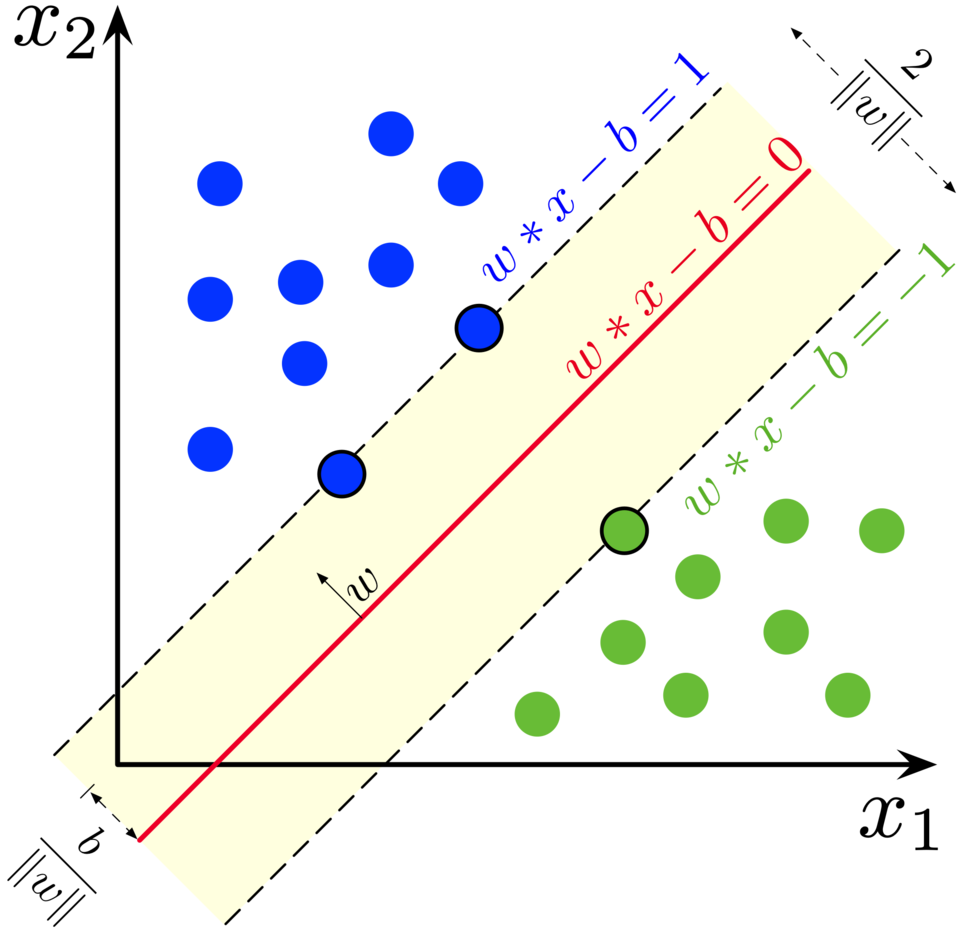
*The whole lecture in one picture: the maximum-margin line $w^\top x - b = 0$, the two corridor edges $w^\top x - b = \pm1$ through the support vectors, and corridor width $2/\lVert w\rVert$. (Note: this figure writes $-b$; the lecture writes $+b$, same thing with the sign of $b$ flipped.) (Wikimedia Commons: [SVM_margin.png](https://commons.wikimedia.org/wiki/File:SVM_margin.png), Larhmam, CC BY-SA 4.0)*

## A1. Why labels ±1, and a line as (w, b)

**Step 1 — Many lines separate the data.** Four lines all classify the 8 emails perfectly, so "fewest training errors" cannot choose. Logistic regression can't choose either: on separable data its likelihood keeps improving as the coefficients grow, so its line depends on how long you run the optimiser.

| line | distance to nearest point |
|---|---|
| steep $2x_1 + x_2 = 5.5$ | 1.118 |
| flat $x_1 + 2x_2 = 5.5$ | 1.118 |
| logistic-like $x_1 + x_2 = 4.4$ | 1.131 |
| $x_1 + x_2 = 4$ | **1.414 (largest)** |

**The rule:** among all separating lines, choose the one whose **nearest point is farthest away**. A line that grazes a point is one nudge from an error; a wide empty corridor tolerates noise and new data.

**Step 2 — Labels ±1.** With a score $s(x)$ that is positive for spam and negative otherwise,
$$\text{point } i \text{ is correct}\iff y_i\,s(x_i) > 0.$$
One inequality covers both classes. This trick is used everywhere below.

**Step 3 — A line is a direction $w$ and an offset $b$.** The line is the set $\{x: w^\top x + b = 0\}$. For $x_1 + x_2 = 4$: $w = (1,1)$, $b = -4$.
- From school form (board): $y = mx + c \iff mx - y + c = 0 \iff \begin{bmatrix}m\\-1\end{bmatrix}^\top\begin{bmatrix}x\\y\end{bmatrix} + c = 0$, so $w = (m, -1)$, $b = c$. E.g. $y = x$ gives $w = (1, -1)$, $b = 0$.

**Step 4 — $w$ is perpendicular to the line.** Take two points on the line, $p = (0.5, 3.5)$, $q = (3.5, 0.5)$. Both satisfy $w^\top x + b = 0$; subtract:
$$w^\top q + b - (w^\top p + b) = w^\top(q - p) = (1,1)\cdot(3,-3) = 0.$$
$q - p$ is a step *along* the line; zero dot product ⇒ $w$ is at right angles to it. **$w$ points across the line**, toward the side where $w^\top x + b > 0$.

**Step 5 — The score.** $s(x) = w^\top x + b$: zero on the line, positive on the side $w$ points to, negative on the other. $(3,3)\mapsto+2$, $(1,1)\mapsto-2$, $(2,2)\mapsto0$.

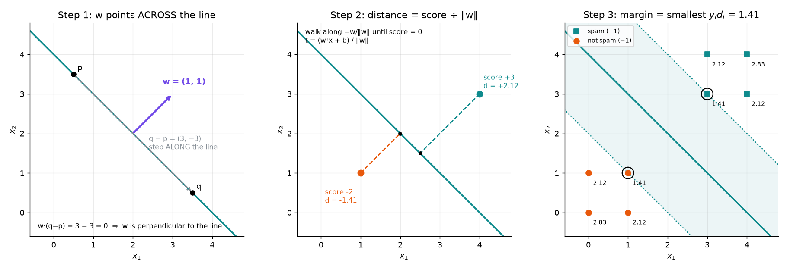
*📊 Step 1: $w$ is perpendicular to the line. Step 2: walk from a point along $-w/\lVert w\rVert$ until the score is 0; the length walked is the distance. Step 3: every point's $y_id_i$; the smallest (1.41) is the margin.*

## A2. Distance from a point to a line

**Step 1 — The unit step across the line** is $w/\lVert w\rVert$ (length 1, perpendicular to the line).

**Step 2 — Walk.** Start at $x$ and walk a distance $t$ toward the line: you are at $x - t\,\frac{w}{\lVert w\rVert}$.

**Step 3 — Stop when the score is zero:**
$$w^\top\!\Big(x - t\frac{w}{\lVert w\rVert}\Big) + b = 0\ \Rightarrow\ w^\top x + b - t\frac{w^\top w}{\lVert w\rVert} = 0\ \Rightarrow\ t\lVert w\rVert = w^\top x + b$$
(using $w^\top w = \lVert w\rVert^2$). So
$$\boxed{d(x) = \frac{w^\top x + b}{\lVert w\rVert}}\qquad\text{distance = score ÷ length of } w;\ \text{the sign says which side.}$$

**Worked.** $x = (4,3)$, line $x_1 + x_2 = 4$: score $= 4 + 3 - 4 = 3$, $\lVert w\rVert = \sqrt2 = 1.414$, $d = 3/1.414 = 2.12$. Foot of the perpendicular: $(4,3) - 2.12\,(0.707, 0.707) = (2.5, 1.5)$; check $2.5 + 1.5 = 4$ ✓. For $(1,1)$: score $-2$, $d = -1.41$ (other side).

**Key fact: scaling doesn't change distance.** Multiply $(w,b)$ by 3: score $9$, $\lVert w\rVert = 4.24$, ratio still $2.12$. **Distance belongs to the line, not to the pair $(w,b)$.**

## A3. The margin, and the goal as max–min

**Step 1 — Make "correct side" positive.** Spam should have $d>0$, non-spam $d<0$. Multiply by the label: $y_i d(x_i) > 0$ exactly when point $i$ is on its correct side.

| $i$ | 1 | 2 | 3 | 4 | 5 | 6 | 7 | 8 |
|---|---|---|---|---|---|---|---|---|
| score $x_1 + x_2 - 4$ | 2 | 3 | 3 | 4 | −2 | −3 | −3 | −4 |
| $d = $ score$/1.414$ | 1.41 | 2.12 | 2.12 | 2.83 | −1.41 | −2.12 | −2.12 | −2.83 |
| $y_i d(x_i)$ | **1.41** | 2.12 | 2.12 | 2.83 | **1.41** | 2.12 | 2.12 | 2.83 |

**Step 2 — Margin = the smallest of these.**
$$\text{margin}(w,b) = \min_i\ y_i\frac{w^\top x_i + b}{\lVert w\rVert}.$$
For $x_1 + x_2 = 4$: $1.414$, attained by points 1 and 5.

**Step 3 — The goal as one formula.**
$$\max_{w,b}\ \underbrace{\min_i\ y_i\frac{w^\top x_i + b}{\lVert w\rVert}}_{\text{inner: this line's nearest point}}\qquad\text{outer: over all lines, pick the one whose nearest point is farthest.}$$
If the min is negative some point is on the wrong side; a positive max means the data are separable.

**Step 4 — Why not solve it directly?** Three problems:
1. **A min inside a max** ⇒ kinks wherever the nearest point changes (picture below).
2. **The ratio** makes it non-linear in $(w,b)$.
3. **Many $(w,b)$ describe the same line** ⇒ the maximiser isn't unique.

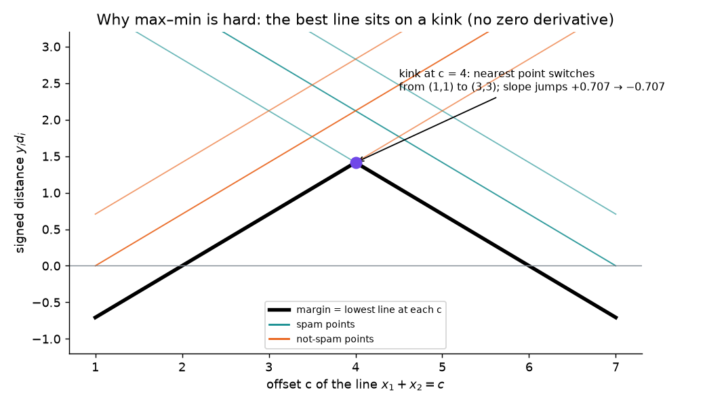
*📊 Slide the line $x_1 + x_2 = c$. Each point's distance is a straight line in $c$; the margin is the lowest one (black). The best line, $c = 4$, sits exactly on a **kink** where $(1,1)$ and $(3,3)$ tie: the slope jumps from $+0.707$ to $-0.707$ and is never zero, so "set derivative = 0" finds nothing.*

Two clean-up steps fix all three problems without changing the answer.

## A4. Clean-up 1: fix the scale (margin = 1 over length of w)

**Step 1 — One line, infinitely many equations.** $(w,b)$, $(3w,3b)$, $(\tfrac12w,\tfrac12b)$ all give the same line, and A2 showed distance doesn't care. So **we may pick the most convenient scale.**

**Step 2 — The choice:** scale $(w,b)$ so that the **nearest point scores exactly 1**:
$$\min_i\ y_i(w^\top x_i + b) = 1\quad\Rightarrow\quad\text{margin} = \frac{\text{nearest score}}{\lVert w\rVert} = \frac{1}{\lVert w\rVert}.$$

| $(w, b)$ | $\lVert w\rVert$ | nearest score | margin |
|---|---|---|---|
| $(1,1), -4$ | 1.414 | 2 | $2/1.414 = 1.414$ |
| $(\tfrac12,\tfrac12), -2$ | 0.707 | **1** | $1/0.707 = 1.414$ |
| $(\tfrac14,\tfrac14), -1$ | 0.354 | 0.5 | $0.5/0.354 = 1.414$ |

Same line, same margin; only the middle row obeys the rule.

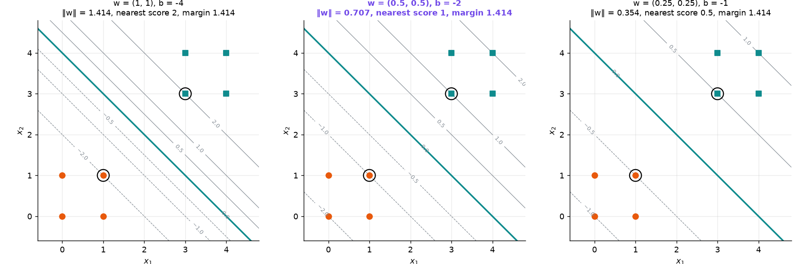
*📊 One line, three scalings. The grey score contours change spacing; the line and its margin don't. The middle panel (purple title) is the one with nearest score 1, so its margin is $1/\lVert w\rVert$.*

**Step 3 — Compare lines by $\lVert w\rVert$.** Second line $2x_1 + x_2 = 5.5$: nearest score is 2.5 (point 5), divide by 2.5 → $(0.8, 0.4), -2.2$, $\lVert w\rVert = 0.894$, margin $1/0.894 = 1.118$. Since $0.707 < 0.894$, $x_1 + x_2 = 4$ wins. **Wide margin ⇔ short $w$.**

## A5. Clean-up 2: the hard-margin primal, solved by hand

**Step 1 — Max $1/\lVert w\rVert$ = min $\lVert w\rVert$ = min $\tfrac12\lVert w\rVert^2$** (same minimiser; no square root; the ½ cancels a 2 when differentiating).

**Step 2 — "Nearest score = 1" → "every score ≥ 1".** Nothing is lost: if all scores were above 1 (say the smallest were 1.3), dividing $(w,b)$ by 1.3 keeps every score ≥ 1 *and* shortens $w$. So the minimiser always has some point at exactly 1.

> **The primal problem (hard margin)**
> $$\min_{w,b}\ \tfrac12\lVert w\rVert^2\quad\text{subject to}\quad y_i(w^\top x_i + b)\ge1\quad\text{for every } i.$$

- **Objective**: make the corridor (half-width $1/\lVert w\rVert$) wide.
- **Constraint $i$**: point $i$ on its correct side, at distance ≥ $1/\lVert w\rVert$, i.e. outside the corridor.
- **Unknowns**: $w, b$ only; $x_i, y_i$ are fixed numbers.
- **"Primal"** = written in the line's own unknowns. **"Hard"** = no point may be inside the corridor.
- **Shape**: a strictly convex bowl over a region cut by $n$ half-spaces ⇒ the best $w$ is **unique**; the active constraints then fix $b$. Quadratic objective + linear constraints = a **quadratic program (QP)**.

**Step 3 — Write out the 8 constraints** ($y = +1$ keeps the sign, $y = -1$ flips it):

| point | constraint | point | constraint |
|---|---|---|---|
| (3,3) | $3w_1 + 3w_2 + b\ge1$ | (1,1) | $-(w_1 + w_2 + b)\ge1$ |
| (4,3) | $4w_1 + 3w_2 + b\ge1$ | (0,1) | $-(w_2 + b)\ge1$ |
| (3,4) | $3w_1 + 4w_2 + b\ge1$ | (1,0) | $-(w_1 + b)\ge1$ |
| (4,4) | $4w_1 + 4w_2 + b\ge1$ | (0,0) | $-b\ge1$ |

**Step 4 — Solve by hand.**
1. Add the (3,3) and (1,1) constraints: $3w_1 + 3w_2 + b - w_1 - w_2 - b\ge2\Rightarrow 2w_1 + 2w_2\ge2\Rightarrow w_1 + w_2\ge1$.
2. The shortest $w$ with $w_1 + w_2\ge1$ is on the line $w_1 + w_2 = 1$ closest to the origin: $w = (\tfrac12,\tfrac12)$, $\lVert w\rVert = 0.707$.
3. With this $w$: (1,1) gives $-(1 + b)\ge1\Rightarrow b\le-2$; (3,3) gives $3 + b\ge1\Rightarrow b\ge-2$. So $b = -2$.
4. Check all eight scores $y_i(w^\top x_i + b)$: $1, 1.5, 1.5, 2, 1, 1.5, 1.5, 2$, all ≥ 1 ✓. Margin $1/0.707 = 1.414$.

**Two of eight constraints decided everything** (active = hold with equality); the other six are slack.

**Why this is optimal (supplement's argument).** $(3,3)$ and $(1,1)$ are $\sqrt{2^2 + 2^2} = 2\sqrt2$ apart and on opposite sides. A line with margin $\rho$ must keep each at least $\rho$ away ⇒ $2\rho\le2\sqrt2$ ⇒ $\rho\le\sqrt2$. Our line attains $\sqrt2$, so nothing beats it. Full corridor width $= 2\rho = 2\sqrt2$.

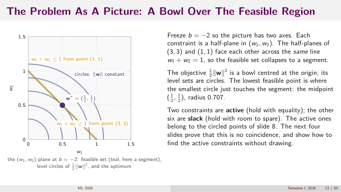
*👀 Slide 13 — Freeze $b = -2$. The half-planes from (3,3) and (1,1) face each other across $w_1 + w_2 = 1$, so the feasible set is a segment. The bowl $\tfrac12\lVert w\rVert^2$ has circular level sets; the smallest circle touching the segment touches at $(\tfrac12,\tfrac12)$, radius 0.707.*

**Why go further?** With $n$ points in $d$ dimensions we can't "add the first and fifth". We need (1) a systematic way to find the active constraints, (2) to see *which points matter*, and (3) a form where data appear only via inner products (for kernels). The tool is the **Lagrangian** and the **dual**.

## A6. Games: max–min vs min–max, weak and strong duality

Before the dual, one idea: **when two players choose in turn, the order can change the result.**

**Step 1 — The table.** You pick a model (row); a tester picks a test condition (column). Entries are your accuracy (%). You want it high, the tester low.

| | clean | noisy | row min |
|---|---|---|---|
| model A (simple) | 80 | **75** | 75 |
| model B (complex) | 95 | 60 | 60 |
| **column max** | 95 | 75 | |

**Step 2 — You move first ($\max_{\text{row}}\min_{\text{col}}$).** For each row, the tester answers with the column that hurts most (the row min): A → 75, B → 60. You pick A: $\max(75, 60) = 75$.

**Step 3 — Tester moves first ($\min_{\text{col}}\max_{\text{row}}$).** For each column, you answer with your best row (the column max): clean → 95, noisy → 75. Tester picks noisy: $\min(95, 75) = 75$.

Both give 75 at (A, noisy): smallest in its row **and** largest in its column = a **saddle point**.

**Step 4 — Why compute the inside first?** The outside player moves first but **thinks ahead**: "if I pick this row, what will the tester do?" That look-ahead *is* the inner min. Like chess: you move first but judge each move by the opponent's best reply. **Order of moving: outside first. Order of computing: inside first.** The tempting slip: grab model B for its 95 without looking ahead → tester says "noisy" → you get 60 < 75.

**Step 5 — When order matters.**

| | clean | shifted | row min |
|---|---|---|---|
| model A | 90 | 60 | 60 |
| model B | 70 | 80 | 70 |
| column max | 90 | 80 | |

$\max\min = 70 < 80 = \min\max$. No saddle point.

**Step 6 — Weak duality: moving second never hurts.** For any row $r$ and column $c$:
$$\min_{c'}a(r,c')\ \le\ a(r,c)\ \le\ \max_{r'}a(r',c).$$
The left end depends only on $r$, the right only on $c$; so the largest left end ≤ the smallest right end:
$$\max_{\text{row}}\min_{\text{col}}a\ \le\ \min_{\text{col}}\max_{\text{row}}a\qquad(\textbf{weak duality}).$$
Equality = **strong duality**.

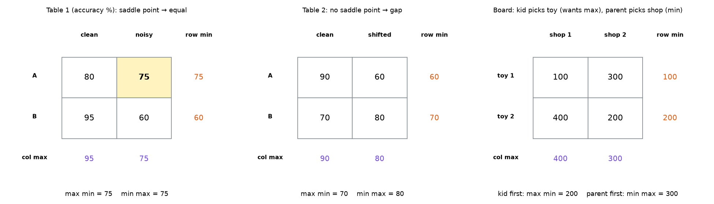
*📊 Left: saddle point, both orders give 75. Middle: no saddle, gap $80 - 70 = 10$. Right: the **board's toy-shop game** — the kid wants the most expensive toy, the parent wants to save money. Kid chooses first (max over toys of the cheapest shop): $\max(100, 200) = 200$. Parent chooses the shop first (min over shops of the dearest toy): $\min(400, 300) = 300$. $200\le300$: whoever moves second does better.*

## A7. Lagrangian and duality on a one-variable toy

The reading builds the dual on the **smallest problem of the same kind** first:
$$\textbf{(E)}\quad\min_w\ \tfrac12w^2\quad\text{s.t.}\quad w\ge1.\qquad\text{Answer } w = 1,\ p^* = \tfrac12.$$

**Step 1 — Trade the constraint for a penalty at a fixed rate $\alpha\ge0$.**
$$L(w,\alpha) = \tfrac12w^2 - \alpha(w - 1).$$
No constraint anymore. The term $-\alpha(w-1)$ **charges** $\alpha$ per unit that $w$ falls short of 1 and **refunds** $\alpha$ per unit above 1.

**Step 2 — Minimise by calculus.** $\partial L/\partial w = w - \alpha = 0\Rightarrow w = \alpha$. Plug in:
$$D(\alpha) = \min_wL(w,\alpha) = \tfrac12\alpha^2 - \alpha(\alpha - 1) = \alpha - \tfrac12\alpha^2\qquad(\text{the dual function}).$$

**Step 3 — $D(\alpha)$ never exceeds the true answer.** $D(\alpha)$ is the smallest of $L(w,\alpha)$ over all $w$; $w = 1$ is one candidate, and there the penalty is 0 so $L(1,\alpha) = \tfrac12 = p^*$. The smallest entry ≤ any entry ⇒ $D(\alpha)\le p^*$ for every $\alpha\ge0$.
E.g. $\alpha = 0.5$: $L(0) = 0.5$, $L(0.5) = 0.375$, $L(1) = 0.5$, $L(1.5) = 0.625$, $L(2) = 1$ → smallest $0.375\le0.5$ ✓.

**Step 4 — Different rates, different bounds.**

| rate $\alpha$ | minimiser $w = \alpha$ | $D(\alpha)$ | is that $w$ allowed? | gap $p^* - D$ |
|---|---|---|---|---|
| 0.5 | 0.5 | 0.375 | no: $0.5 < 1$ (rate too small, it cheats) | 0.125 |
| **1** | **1** | **0.5** | **yes, and it is the answer** | **0** |
| 1.5 | 1.5 | 0.375 | yes, but not the shortest (rate too big) | 0.125 |
| 2 | 2 | 0 | yes, worse still | 0.5 |

**Step 5 — Choose the largest bound.** $\max_\alpha D$: $1 - \alpha = 0\Rightarrow\alpha = 1$, $D = \tfrac12 = p^*$. This is the **dual problem** $d^* = \max_{\alpha\ge0}D(\alpha)$. It's a *max* because we're choosing the largest of a family of lower bounds.

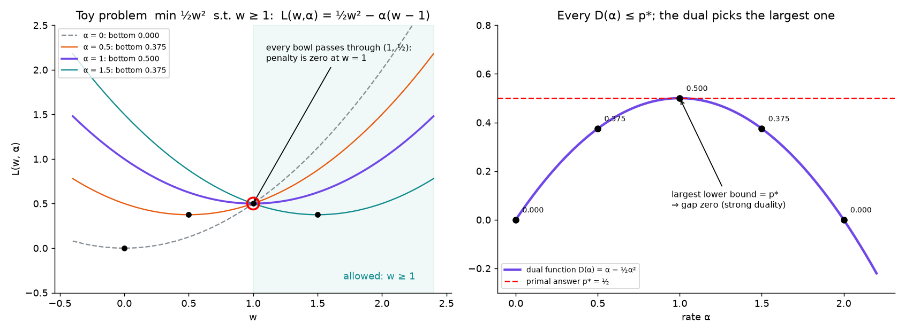
*📊 Left: every bowl $L(w,\alpha)$ passes through $(1,\tfrac12)$ because the penalty vanishes at $w = 1$. Bowl bottoms (black dots) are $D(\alpha)$. Right: $D(\alpha)$ is always ≤ ½ and touches it at $\alpha = 1$: **zero duality gap**.*

**Step 6 — Read the picture two ways.**
- **Bowl by bowl (dual, $\max_\alpha\min_wL$):** bottom of each bowl, then the largest bottom: $0.5$.
- **Position by position (primal, $\min_w\max_\alpha L$):** at each $w$, the highest curve. Right of $w = 1$ it is the $\alpha = 0$ curve, $\tfrac12w^2$; left of $w = 1$ the curves climb without limit as $\alpha$ grows ⇒ $+\infty$. The lowest such height is $0.5$ at $w = 1$. This **is** the constrained problem: $\tfrac12w^2$ where allowed, $+\infty$ where forbidden.
- **Weak duality in one line:** any bowl's bottom ≤ that bowl at any $w$ ≤ the highest curve at that $w$. So every bottom ≤ every top: $d^*\le p^*$.
- **Strong duality geometrically:** one bowl's bottom sits exactly on the crossing point.

**Step 7 — When is the gap zero?** Convex objective + linear constraints + a strictly feasible point ⇒ always. (E) qualifies, and so does the SVM. **Counter-example:** $\min -w^2$ s.t. $-1\le w\le1$ has $p^* = -1$, but every $L$ is an upside-down parabola with no bottom ⇒ $d^* = -\infty$. The bound is true but useless. **Convexity is what guarantees a bowl whose bottom touches the crossing.**

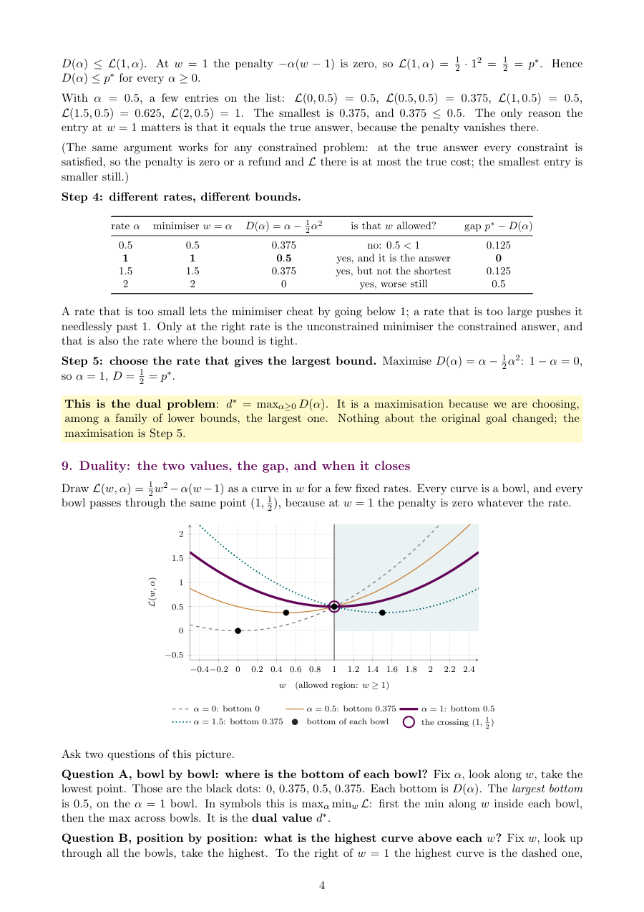
*👀 Reading p. 4 — The original bowls figure with Questions A (bowl by bowl) and B (position by position).*

## A8. The SVM Lagrangian, KKT and the dual

The same five steps, now on the SVM.

**Step 1 — One rate per constraint**, $\alpha_i\ge0$:
$$L(w,b,\alpha) = \tfrac12\lVert w\rVert^2 - \sum_{i=1}^n\alpha_i\big[y_i(w^\top x_i + b) - 1\big].$$
The bracket is the **slack** of constraint $i$: positive = safely outside the corridor (refund), zero = on its edge, negative = inside (pays). Read $\alpha_i$ as the **price of point $i$**: how much $\tfrac12\lVert w\rVert^2$ would drop if its constraint were loosened by one unit. A point far from the corridor has price 0.

**Step 2 — The game view.**
- **Line moves first (primal), $\min_{w,b}\max_{\alpha\ge0}L$.** For a fixed line: if some point breaks its constraint, its bracket is negative and a huge $\alpha_i$ sends $L\to+\infty$. If every constraint holds, the best reply is $\alpha = 0$, giving $L = \tfrac12\lVert w\rVert^2$. So the line must obey all constraints and then make $\tfrac12\lVert w\rVert^2$ small: exactly our problem.
- **Prices move first (dual), $\max_{\alpha\ge0}\min_{w,b}L$.** The inside is an *unconstrained* minimisation: set derivatives to zero.
- For the SVM both orders agree (convex bowl, linear constraints) ⇒ solve whichever is easier.

**Step 3 — Stationarity** (minimise over $w, b$ with $\alpha$ fixed):
$$\frac{\partial L}{\partial w} = w - \sum_i\alpha_iy_ix_i = 0\ \Rightarrow\ \boxed{w = \sum_i\alpha_iy_ix_i}\qquad\frac{\partial L}{\partial b} = -\sum_i\alpha_iy_i = 0\ \Rightarrow\ \boxed{\sum_i\alpha_iy_i = 0}$$
The first is a **recipe** for $w$ from the prices. The second is a **condition** on the prices (if it fails, $L$ is linear in $b$ with no bottom ⇒ $-\infty$ ⇒ useless bound, so the dual carries it as a constraint).

**Step 4 — Substitute back (piece by piece).** Write $L = A - B - C + D$ with
$A = \tfrac12\lVert w\rVert^2$, $B = \sum_i\alpha_iy_iw^\top x_i$, $C = b\sum_i\alpha_iy_i$, $D = \sum_i\alpha_i$.
- Second box ⇒ $C = 0$.
- First box ⇒ $B = w^\top\sum_i\alpha_iy_ix_i = w^\top w = 2A$.
- So $L = A - 2A + D = D - A$:
$$D(\alpha) = \sum_i\alpha_i - \tfrac12\Big\lVert\sum_i\alpha_iy_ix_i\Big\rVert^2 = \sum_i\alpha_i - \tfrac12\sum_i\sum_j\alpha_i\alpha_jy_iy_j\,x_i^\top x_j.$$

> **The dual problem (hard margin)**
> $$\max_\alpha\ \sum_{i=1}^n\alpha_i - \tfrac12\sum_{i=1}^n\sum_{j=1}^n\alpha_i\alpha_jy_iy_j\,x_i^\top x_j\quad\text{s.t.}\quad\alpha_i\ge0,\ \ \sum_i\alpha_iy_i = 0.$$

- $n$ unknowns (one price per **point**) instead of $d + 1$ (one weight per **feature**); still a QP, concave in $\alpha$.
- **Strong duality** holds ⇒ primal and dual optimal values are equal.
- Recover the line: $w = \sum\alpha_iy_ix_i$; $b$ from any point with $\alpha_i > 0$.
- ⚠️ **The data enter only through inner products $x_i^\top x_j$.** This is the door the kernel walks through.

**Step 5 — Complementary slackness** (the key condition):
$$\alpha_i\big[y_i(w^\top x_i + b) - 1\big] = 0\quad\text{for every } i.$$
Either the constraint is **active** (score exactly 1: on the corridor edge) or its price is **zero**. A point with room to spare costs nothing and contributes nothing to $w$.

**All KKT conditions together** (for the hard margin):

| condition | formula | meaning |
|---|---|---|
| primal feasibility | $y_i(w^\top x_i + b)\ge1$ | every point outside the corridor |
| dual feasibility | $\alpha_i\ge0$ | prices are non-negative |
| stationarity | $w = \sum\alpha_iy_ix_i$, $\sum\alpha_iy_i = 0$ | bottom of the bowl in $w, b$ |
| complementary slackness | $\alpha_i[y_i(w^\top x_i + b) - 1] = 0$ | price > 0 only on the edge |

## A9. Solving the dual by hand; support vectors

**Step 1 — Guess** only points 1 $(3,3)$ and 5 $(1,1)$ have prices: $\alpha_1 = \alpha_5 = \alpha$, rest 0. Check $\sum\alpha_iy_i = \alpha - \alpha = 0$ ✓.

**Step 2 — Recipe:** $w = \alpha(+1)(3,3) + \alpha(-1)(1,1) = (2\alpha, 2\alpha)$.

**Step 3a — Route 1 (touch the corridor).** Both points are on the edges: $w^\top x_1 + b = 1$ and $w^\top x_5 + b = -1$. Subtract: $w^\top(x_1 - x_5) = 2\Rightarrow\alpha(2,2)\cdot(2,2) = 8\alpha = 2\Rightarrow\alpha = \tfrac14$.

**Step 3b — Route 2 (maximise the bound).** $D = 2\alpha - \tfrac12\lVert(2\alpha,2\alpha)\rVert^2 = 2\alpha - 4\alpha^2$. $D'(\alpha) = 2 - 8\alpha = 0\Rightarrow\alpha = \tfrac14$, $D = \tfrac14$.

| $\alpha$ | recipe $w$ | $D = 2\alpha - 4\alpha^2$ | gap ($p^* = 0.25$) |
|---|---|---|---|
| 0.1 | (0.2, 0.2) | 0.16 | 0.09 |
| 0.2 | (0.4, 0.4) | 0.24 | 0.01 |
| **0.25** | **(0.5, 0.5)** | **0.25** | **0** |
| 0.3 | (0.6, 0.6) | 0.24 | 0.01 |

**Step 4 — Recover:** $w = (\tfrac12,\tfrac12)$, $b = 1 - w^\top x_1 = 1 - 3 = -2$. **Duality check:** primal $\tfrac12\lVert w\rVert^2 = \tfrac12\cdot\tfrac12 = \tfrac14$; dual $\tfrac12 - \tfrac14 = \tfrac14$. Equal ✓.

**General formula.** Two support vectors $x_+, x_-$: $\alpha = 2/\lVert x_+ - x_-\rVert^2$ (here $2/8 = \tfrac14$), and margin $= \lVert x_+ - x_-\rVert/2$.

**Step 5 — Why no price on the other six?** Point 2 $(4,3)$ has score 1.5, slack 0.5. Raising $\alpha_2$ from 0 subtracts $\alpha_2\times0.5$ from $L$, lowering the bound; the largest bound keeps $\alpha_2 = 0$. That is complementary slackness.

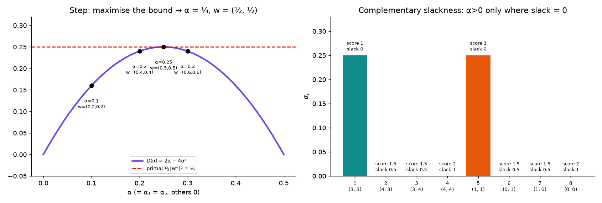
*📊 Left: maximise the bound → $\alpha = \tfrac14$, $w = (\tfrac12,\tfrac12)$. Right: the prices of all eight points with their scores and slacks: $\alpha > 0$ only where slack = 0.*

**Support vectors.** $w = \sum\alpha_iy_ix_i$ with $\alpha_i > 0$ only for points on the corridor's edge. **Remove any other point and nothing moves; nudge a support vector and the line turns** (moving (3,3) → (3, 2.5) gives $w = (0.64, 0.48)$, $b = -2.12$). Compare logistic regression, where every point pulls. This is **sparsity in the data, not in the features.**

**Why the dual rather than guessing?** With $n$ points there are $2^n$ patterns of "which constraints are tight". The dual is one concave QP; a solver finds the pattern itself.

**Classifying a new point.** With $w = \sum\alpha_iy_ix_i$:
$$f(x) = w^\top x + b = \sum_{i\in SV}\alpha_iy_i\,x_i^\top x + b,\qquad\hat y = \operatorname{sign}f(x).$$
New email $x = (2,3)$: $f = \tfrac14(3,3)\cdot(2,3) - \tfrac14(1,1)\cdot(2,3) - 2 = \tfrac{15}4 - \tfrac54 - 2 = 0.5 > 0$ ⇒ spam. Distance $0.5/0.707\approx0.71$, halfway to the corridor edge (1.41).
- $f$ is a **signed distance × $\lVert w\rVert$, not a probability.**
- $f$ touches $x$ **only through $x_i^\top x$**.

**In scikit-learn:**
```python
from sklearn.svm import SVC
svm = SVC(kernel="linear", C=1e6)   # huge C ≈ hard margin
svm.fit(X, y)
svm.support_vectors_     # [[1, 1], [3, 3]]
svm.dual_coef_           # [[-0.25, 0.25]]   = alpha_i * y_i  (sign = label!)
svm.intercept_           # [-2.]             = b
svm.decision_function([[2, 3]])   # [0.5]    = f(x)
```
⚠️ `dual_coef_` stores $\alpha_iy_i$, not $\alpha_i$; the prices are its absolute values.

## A10. Lifting features, and the kernel trick

**Step 1 — When no line works (1-D).** Seven sensor readings $x$: anomalies at $\pm2, \pm3$, normal at $0, \pm1$. An anomaly can be on either side ⇒ no single threshold separates them.

**Step 2 — Add a computed coordinate.** $\phi(x) = (x, x^2)$. In the $(x, x^2)$ plane anomalies sit high, normals low; the horizontal line $x^2 = 2.5$ separates them. Support vectors: $x = \pm1, \pm2$. Read back: $x^2 = 2.5\iff|x| = 1.58$, i.e. **two thresholds**. **A line in the lifted space is a curve in the original one.** The algorithm didn't change; what we handed it did.

**Step 3 — 2-D rings.** 30 normals inside radius 1, 40 anomalies in a ring beyond 1.8. Lift $\phi(x) = (x_1^2, x_2^2, \sqrt2x_1x_2)$; the plane $z_1 + z_2 = 2.2$ separates them, which in original coordinates is the circle $x_1^2 + x_2^2 = 2.2$. Squares and cross-terms turn every conic into a hyperplane.

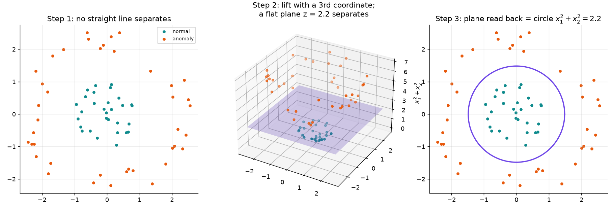
*📊 The lift in three steps: rings (no line works) → add $z = x_1^2 + x_2^2$ (a flat plane at $z = 2.2$ works) → read the plane back as a circle.*

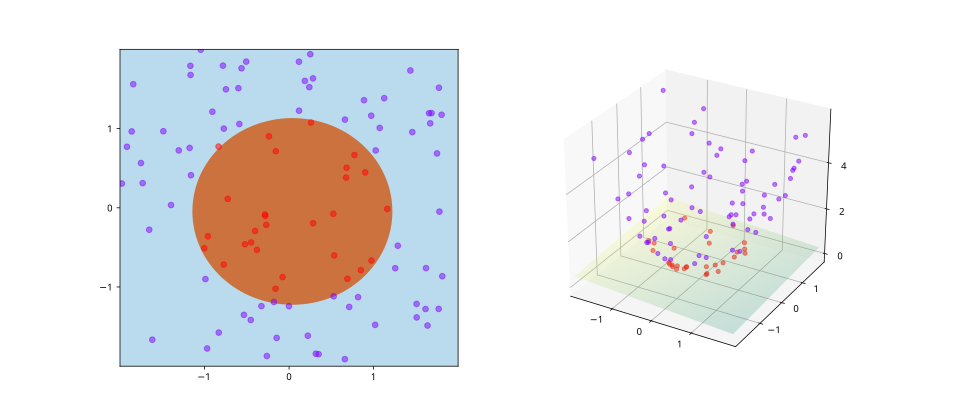
*Another view of the same idea: map $\phi$ from the input space to a feature space where a plane separates the classes. (Wikimedia Commons: [Kernel_trick_idea.svg](https://commons.wikimedia.org/wiki/File:Kernel_trick_idea.svg), Shiyu Ji, CC BY-SA 4.0)*

**Step 4 — Explicit lifting is expensive.** All monomials up to degree $d$ in $D$ features number $\binom{D+d}{d}$:

| inputs $D$ | degree 2 | degree 3 |
|---|---|---|
| 2 | 6 | 10 |
| 10 | 66 | 286 |
| 100 | 5,151 | 176,851 |
| 1,000 | 501,501 | 167,668,501 |

1000 features, cubic: $1.7\times10^8$ coordinates per point. Storing $\phi(x_i)$ and every $\phi(x_i)^\top\phi(x_j)$ costs that much. **But the dual and $f$ only ever ask for $\phi(x_i)^\top\phi(x_j)$.** Do we need $\phi$ itself?

**Step 5 — The kernel trick.** A **kernel** is a function $K(x,z)$ that equals $\phi(x)^\top\phi(z)$ for some lift $\phi$, but costs about one ordinary inner product. For $\phi(x) = (1, \sqrt2x_1, \sqrt2x_2, x_1^2, x_2^2, \sqrt2x_1x_2)$, expand:
$$(1 + x^\top z)^2 = (1 + x_1z_1 + x_2z_2)^2 = 1 + 2x_1z_1 + 2x_2z_2 + x_1^2z_1^2 + x_2^2z_2^2 + 2x_1x_2z_1z_2 = \phi(x)^\top\phi(z).$$
A six-dimensional inner product from two multiplications and a square. Check: $x = (1,2)$, $z = (0.5,-1)$: $x^\top z = 0.5 - 2 = -1.5$, $(1 - 1.5)^2 = 0.25$ ✓.

| kernel | formula | lifts to |
|---|---|---|
| linear | $x^\top z$ | nothing |
| polynomial | $(1 + x^\top z)^d$ | all monomials up to degree $d$ |
| Gaussian (RBF) | $\exp(-\gamma\lVert x - z\rVert^2)$ | infinitely many |

**Step 6 — Swap.** Replace every $x_i^\top x_j$ in the dual by $K(x_i,x_j)$ and every $x_i^\top x$ in $f$ by $K(x_i,x)$:
$$f(x) = \sum_{i\in SV}\alpha_iy_iK(x_i,x) + b.$$
**$w$ is never formed** — it may live in a space we can't even write down.

**Why only the dual can be kernelised:** the primal's unknown is $w$ itself, which lives in the lifted space; the dual's unknowns are $n$ prices and the data appear only through $K$.

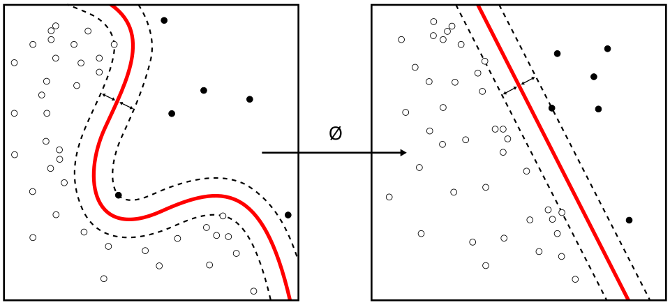
*A kernel machine: the curved boundary on the left is a straight one in the feature space on the right. (Wikimedia Commons: [Kernel_Machine.svg](https://commons.wikimedia.org/wiki/File:Kernel_Machine.svg), Alisneaky / Zirguezi, CC BY-SA 4.0)*

**Three kernels on the rings** (same solver, $C = 10$): linear → 70/70 SVs, 57% correct (gives up); $(1 + x^\top z)^2$ → 7 SVs, all correct; Gaussian $\gamma = 0.5$ → 12 SVs, all correct.

## A11. Gaussian kernel, γ, Gram matrix, Mercer

**Step 1 — A similarity.** $K(x,z) = \exp(-\gamma\lVert x - z\rVert^2)$ is 1 when $z = x$ and decays with distance. (Board writes it as $e^{-\lVert x_i - x_j\rVert^2/2\sigma^2}$, i.e. $\gamma = 1/(2\sigma^2)$.)

**Step 2 — $f$ is a sum of bumps.** $f(x) = \sum\alpha_iy_iK(x_i,x) + b$: a bump of height $\alpha_iy_i$ centred on each support vector, with width set by $\gamma$.

**Step 3 — $\gamma$ sets the reach.**
- small $\gamma$ (0.05): wide bumps → boundary too smooth (17 SVs on the rings);
- moderate (0.5): 12 SVs;
- large (5): narrow bumps → boundary hugs individual points, "islands", 47 SVs → **overfitting**.

Choose $\gamma$ (like $C$) on **validation** data, never training data.

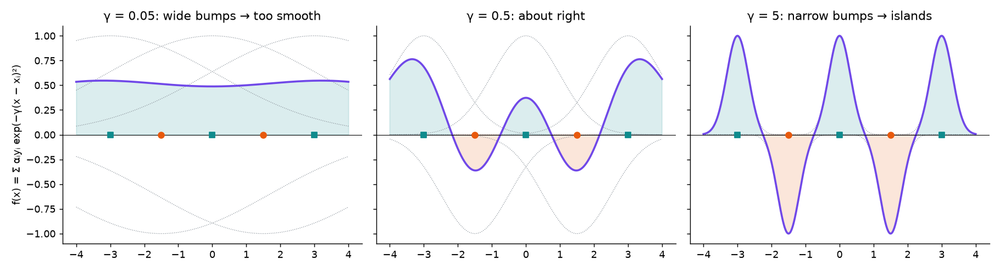
*📊 $f(x)$ as a sum of bumps (grey dotted = individual bumps) for five alternating points. Teal shading = predicted +, orange = predicted −. Small $\gamma$: one smooth blob, can't separate. Large $\gamma$: each point gets its own island. (Same picture as the board's "kernel trick!" wave, L11d p. 4.)*

**Step 4 — Gram matrix.** The dual only needs the $n\times n$ table $K_{ij} = K(x_i,x_j)$. For the 8 emails under the Gaussian, it is block-like: within a class similar (dark), across classes nearly 0. E.g. $\gamma = 0.5$: $K((3,3),(4,3)) = e^{-0.5} = 0.61$; $K((3,3),(1,1)) = e^{-4} = 0.018$.

**Step 5 — What makes a function a kernel (Mercer).** For the dual to be a well-posed maximisation, $\sum_{ij}\alpha_i\alpha_jy_iy_jK_{ij}\ge0$ for every $\alpha$, i.e. $K$ must be **positive semidefinite**. Mercer's theorem: exactly those functions are inner products in some lifted space. So **any PSD similarity is a legal kernel**, whether or not you can write its $\phi$.

**Step 6 — The cost.** $n^2$ entries. $n = 10^5$ ⇒ $10^{10}$ numbers. Kernel SVMs are a **mid-size-data** tool; linear SVMs are the **large-data** tool.

## A12. Soft margin: slack and the price C

**Step 1 — Intruders.** Add a normal email at (3.2, 2) and a spam email at (0.8, 2). No line puts all ten points outside a corridor; the hard-margin problem is infeasible, and no honest lift fixes it.

**Step 2 — Let each point buy its way out with a slack $\xi_i\ge0$:**
$$y_i(w^\top x_i + b)\ge1 - \xi_i.$$

| $\xi_i$ | where the point is |
|---|---|
| $0$ | on or outside the corridor's edge — fine |
| $0 < \xi_i < 1$ | inside the corridor, correct side |
| $= 1$ | exactly on the line |
| $> 1$ | wrong side (misclassified) |

On the old line both intruders have $\xi = 1.6$.

**Step 3 — Charge $C$ per unit of slack.**

> **Soft-margin SVM**
> $$\min_{w,b,\xi}\ \tfrac12\lVert w\rVert^2 + C\sum_{i=1}^n\xi_i\quad\text{s.t.}\quad y_i(w^\top x_i + b)\ge1 - \xi_i,\ \ \xi_i\ge0.$$

- Still a convex QP; **always feasible** (big enough $\xi$ satisfies anything).
- $C$ = exchange rate between corridor width and violations. $C\to\infty$: hard margin. $C\to0$: $w\to0$.
- Slacks aren't tuned; at the optimum each is the point's shortfall $\xi_i = \max(0, 1 - y_i(w^\top x_i + b))$.

**Step 4 — Slack in numbers (one feature, six emails).** Not spam at $x = 0, 1, 2.5$; spam at $3, 5, 6$. Two candidate lines: wide $f_A = 0.5x - 1.5$ (boundary 3, corridor [1, 5]) and narrow $f_B = 4x - 11$ (boundary 2.75, corridor [2.5, 3]).

| $x_i$ | $y_i$ | $f_A$ | $y_if_A$ | $\xi$ (wide) | $f_B$ | $y_if_B$ | $\xi$ (narrow) |
|---|---|---|---|---|---|---|---|
| 0 | −1 | −1.5 | 1.5 | 0 | −11 | 11 | 0 |
| 1 | −1 | −1 | 1 | 0 | −7 | 7 | 0 |
| 2.5 | −1 | −0.25 | 0.25 | **0.75** | −1 | 1 | 0 |
| 3 | +1 | 0 | 0 | **1** | 1 | 1 | 0 |
| 5 | +1 | 1 | 1 | 0 | 9 | 9 | 0 |
| 6 | +1 | 1.5 | 1.5 | 0 | 13 | 13 | 0 |
| **total** | | | | **1.75** | | | **0** |

**Step 5 — Which wins depends on $C$.**

| | width $2/\lvert w\rvert$ | $\tfrac12w^2$ | $\sum\xi$ | objective |
|---|---|---|---|---|
| wide, $w = 0.5$ | 4 | 0.125 | 1.75 | $0.125 + 1.75C$ |
| narrow, $w = 4$ | 0.5 | 8 | 0 | 8 |

$C = 0.1$: wide $0.300$ vs narrow $8$ → **wide** wins. $C = 10$: wide $17.625$ vs $8$ → **narrow** wins. Switch: $0.125 + 1.75C = 8\Rightarrow C = 7.875/1.75 = 4.5$.

![Wide line (corridor [1,5]) with slacks 0.75 and 1; narrow line (corridor [2.5,3]) with zero slack; objective vs C: the lines cross at C = 4.5.](images/L11/figures/slack_two_lines_C.png)
*📊 Left two: the slack of every email under each line. Right: the soft-margin objective of each line as $C$ grows. Below 4.5 the wide line is cheaper; above, the narrow one. (These are two candidates to show the trade-off; the solver searches all lines but weighs width vs slack the same way.)*

**Step 6 — On the 10 emails:** $C = 0.1$: margin 2.05, 4 violators (keeps the wide diagonal corridor). $C = 1$: margin 0.86, 2 violators. $C = 10$: margin 0.36, 0 violators (twists the line to get every point right, corridor ~6× narrower) — and probably the **worst** on new emails. **Choose $C$ by validation error, as for ridge.**

## A13. Hinge loss + ridge penalty; four losses

**Step 1 — Eliminate the slacks.** The smallest allowed $\xi_i$ is $\max(0, 1 - y_if(x_i))$. Substitute:
$$\min_{w,b}\ \sum_{i=1}^n\underbrace{\max\big(0, 1 - y_i(w^\top x_i + b)\big)}_{\text{hinge loss}} + \underbrace{\frac1{2C}\lVert w\rVert^2}_{\text{ridge, }\lambda = 1/C}.$$
(Divide the soft-margin objective by $C$.) **Logistic regression and the SVM are one recipe — loss + penalty — with two different losses.**

**Step 2 — Four losses on the margin axis** $m = yf(x)$ ($m > 0$: correct side; $m > 1$: beyond the corridor):

| loss | formula | behaviour |
|---|---|---|
| 0–1 | $\mathbb 1[m\le0]$ | counts mistakes; not convex, can't be optimised directly |
| hinge | $\max(0, 1 - m)$ | **exactly 0 for $m\ge1$** ⇒ those points drop out ⇒ support vectors |
| logistic | $\log_2(1 + e^{-m})$ | never 0 ⇒ every point keeps pulling ⇒ no support vectors |
| squared | $(1 - m)^2/2$ | punishes being *too right* ($m > 1$) ⇒ poor classifier |

Hinge and logistic are both **convex upper bounds on the 0–1 loss**.

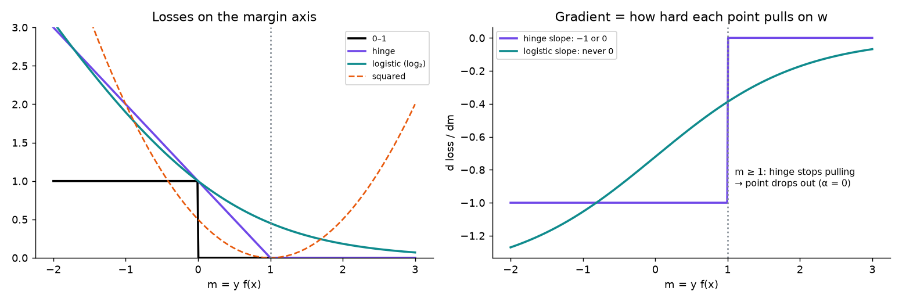
*📊 Left: the four losses. Right: the slope of each = how hard a point pulls on $w$. Hinge stops pulling at $m = 1$; logistic always pulls a little. That one difference is why the SVM has support vectors and logistic regression doesn't.*

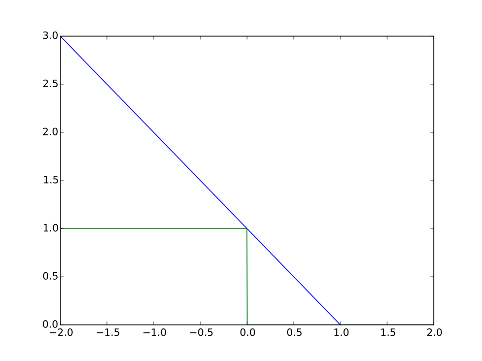
*The hinge loss (blue) as a convex upper bound on the 0–1 loss (green). (Wikimedia Commons: [Hinge_loss_vs_zero_one_loss.svg](https://commons.wikimedia.org/wiki/File:Hinge_loss_vs_zero_one_loss.svg), Qwertyus, CC BY-SA 4.0)*

## A14. Soft-margin dual: three kinds of point

**Step 1 — Lagrangian with two sets of prices:** $\alpha_i\ge0$ for $y_if(x_i)\ge1 - \xi_i$ and $\mu_i\ge0$ for $\xi_i\ge0$.

**Step 2 — Stationarity in $\xi_i$:** $C - \alpha_i - \mu_i = 0$. Since $\mu_i\ge0$ ⇒ $\alpha_i\le C$. The $\xi$ terms then cancel out of the objective.

> **Soft-margin SVM (dual)**
> $$\max_\alpha\ \sum_i\alpha_i - \tfrac12\sum_{i,j}\alpha_i\alpha_jy_iy_jK(x_i,x_j)\quad\text{s.t.}\quad0\le\alpha_i\le C,\ \ \sum_i\alpha_iy_i = 0.$$

The **only** difference from the hard margin is the wall $\alpha_i\le C$: **no single point can buy unlimited influence.**

**Step 3 — Read each point's role off $\alpha_i$:**

| $\alpha_i$ | $y_if(x_i)$ | where |
|---|---|---|
| $0$ | $\ge1$ | outside the corridor, no influence |
| $0 < \alpha_i < C$ | $= 1$ | exactly on the corridor's edge |
| $= C$ | $\le1$ | inside the corridor or wrong side; capped |

**Step 4 — Computing $b$.** Use a point with $0 < \alpha_i < C$ (it sits exactly on the edge, $y_if(x_i) = 1$):
$$b = y_i - \sum_j\alpha_jy_jK(x_j,x_i).$$
A point with $\alpha_i = C$ may be inside the corridor and would give the wrong $b$.

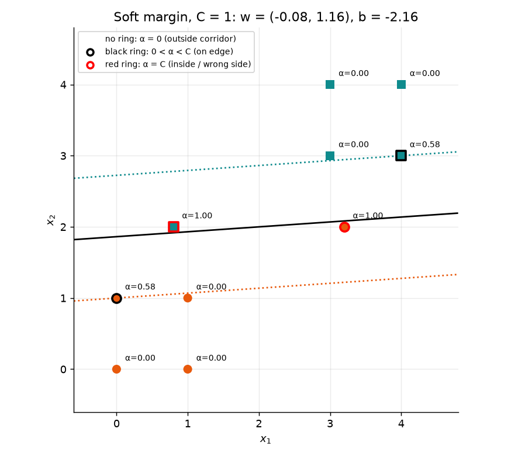
*📊 $C = 1$ on the 10 emails (computed with scikit-learn). Black rings: $0 < \alpha < C$, exactly on a dotted edge, use these for $b$. Red rings: the two intruders, capped at $\alpha = C = 1$. No ring: $\alpha = 0$. At $C = 0.1$ every intruder is stuck at $\alpha = 0.1$ and can only tilt the line slightly.*

## A15. Solvers: SMO and Pegasos

One problem, several algorithms. Which to use depends on $n$, $d$, and whether there is a kernel.

| solver | unknowns | per step | memory | use when |
|---|---|---|---|---|
| generic QP, primal | $d + 1$ | interior point $O((d+n)^3)$ | $O(nd)$ | small $n$, no kernel |
| generic QP, dual | $n$ | $O(n^3)$ | $O(n^2)$ Gram | tiny $n$; for understanding |
| **SMO**, dual | $n$, two at a time | $O(n)$ per pair | $O(n^2)$ Gram or recompute rows | kernels, $n\lesssim10^5$ (**libsvm**) |
| **subgradient, primal (Pegasos)** | $d + 1$ | $O(d)$ per sample | $O(d)$ | linear, huge $n$ (SGD) |
| coordinate descent, dual | $n$ | $O(d)$ per coordinate | $O(nd)$ | linear, large $n$ (**liblinear**) |

**What each exploits:** SMO — the $\alpha$s are coupled only through one equality; Pegasos — the primal is a sum over samples ⇒ one sample gives an unbiased step; coordinate descent — with a linear kernel, one $\alpha_i$ changes $w$ by a rank-one update in $O(d)$; all three — sparsity (most $\alpha_i = 0$). **The Gram matrix is the wall**: at a million points go linear, approximate the kernel with random features, or subsample.

### SMO (Sequential Minimal Optimisation)

**Step 1 — Why not one at a time?** $\sum\alpha_iy_i = 0$ fixes $\alpha_i$ once all others are fixed. So **take two**.

**Step 2 — The segment.** Freezing all but $\alpha_i, \alpha_j$: $\alpha_iy_i + \alpha_jy_j = \text{const}$ — a line segment in the $(\alpha_i,\alpha_j)$ plane, clipped to $[0,C]^2$. Along it the dual is a one-variable quadratic.

**Step 3 — Closed-form maximum:**
$$\alpha_j^{\text{new}} = \alpha_j - \frac{y_j(E_i - E_j)}{\eta},\qquad\eta = 2K_{ij} - K_{ii} - K_{jj}\le0,\qquad E_i = f(x_i) - y_i.$$
Then clip to the segment and set $\alpha_i$ from the equality.

**Step 4 — Repeat:** pick a pair violating KKT, solve exactly, repeat. No matrix factorisation, no line search, only kernel evaluations. Every step stays feasible and never decreases the dual. On the running example the weight drains into (3,3) and (1,1) and settles at exactly ¼ each. Same code with a Gaussian Gram matrix solved the rings: **one solver for every lift.**

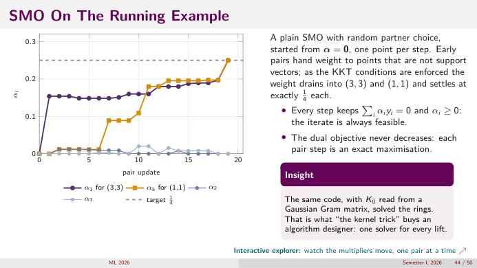
*👀 Slide 44 — SMO on the 8 emails, started from $\alpha = 0$: the multipliers settle at $\alpha_1 = \alpha_5 = \tfrac14$.*

### Pegasos (stochastic subgradient on the primal)

**Step 1 — Averaged objective:** $\frac\lambda2\lVert w\rVert^2 + \frac1n\sum_i\max(0, 1 - y_i(w^\top x_i + b))$, with $\lambda = 1/(nC)$.

**Step 2 — Subgradient.** At the hinge's kink ($m = 1$) any slope in $[-1, 0]$ is allowed.

**Step 3 — Update** with one random sample $i_t$, $\eta_t = 1/(\lambda t)$, $I_t = \mathbb 1[y_{i_t}f(x_{i_t}) < 1]$:
$$w\leftarrow(1 - \eta_t\lambda)w + \eta_t\,y_{i_t}x_{i_t}I_t,\qquad b\leftarrow b + \eta_t\,y_{i_t}I_t.$$
Shrink $w$ (penalty; no shrink on $b$), then if the sample is inside the corridor, push toward it.

**Step 4 — Example:** $n = 8$, $C = 1.25$ ⇒ $\lambda = 0.1$. 400 single-sample steps bring $w$'s direction to $45.6°$ (exact $45°$), each $O(d)$. ⚠️ **No kernel** (needs $w$ explicitly): this is the algorithm for linear SVMs on millions of samples.

## A16. Using an SVM: scores, calibration, scaling, procedure

- **A score, not a probability.** $f(x)$ is a signed, distance-like score: it **ranks**. Threshold at 0 for the max-margin decision, or elsewhere; sweeping the threshold gives the **ROC** and **AUC** exactly as in L10.
- **Costs need a probability.** To use $\tau^* = c_{FP}/(c_{FP} + c_{FN})$ (L10), fit a 1-D logistic regression from $f$ to $y$ on validation data (**Platt scaling**), then threshold that.
- **Scale features first.** Margins, distances and Gaussian kernels are in the units of $x$; a feature in millimetres dominates one in metres.
- **Multi-class.** One machine per class vs the rest (or per pair); take the largest score.

**The procedure:**
1. Standardise features on **training** statistics; apply the same numbers everywhere.
2. Choose kernel, $C$ and $\gamma$ by **validation** error over a grid.
3. Refit on training + validation with the chosen settings.
4. If a probability is needed, calibrate $f$ on held-out data; choose the threshold from the costs.
5. Report test confusion matrix, AUC and cost — **once**.

Steps 1, 2, 5 are the same as for ridge and logistic regression. **The SVM changes the model, not the discipline.**

**The template worth copying:** (1) say what "best" means in words, then as objective + constraints; (2) check convexity ⇒ unique answer; (3) write the Lagrangian — the multipliers tell you which data matter; (4) if data enter only via inner products, you get a kernel method for free; (5) only then choose an algorithm by cost per step and memory. Seen again in kernel ridge regression and Gaussian processes (same trick on least squares), and in boosting / neural networks (lifts that are *learned*, not fixed).

---

# Part B — Slide by Slide (all 50 slides)

## Slide 1 — Title

*Lecture 11: Support Vector Machines — Margins, Duality, Kernels, and Solvers.* Prof. Udit Bhatia, Semester I 2026.

## Slide 2 — What this lecture builds, and why it is built slowly

Course path: regression (least squares, ridge, lasso) → logistic regression (probability, then threshold) → evaluation (confusion matrix, ROC, costs) → **today: a new model, the SVM** → after: trees, ensembles. The five-step template: words → optimisation; solve → few points matter; solution touches data only via inner products; replace them by a kernel; ask what the algorithm costs.

## Slide 3 — One dataset for the whole lecture

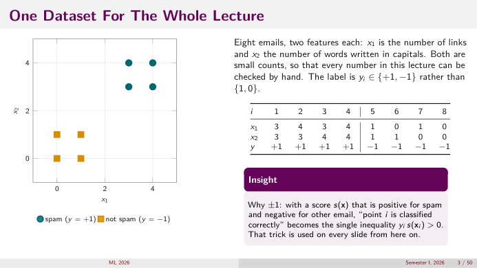
*👀 Slide 3 — The eight emails.*

Labels $\pm1$ so that "correct" is the single inequality $y_is(x_i) > 0$ (A1 Step 2).

## Slide 4 — Many lines separate the data. Which one should we pick?

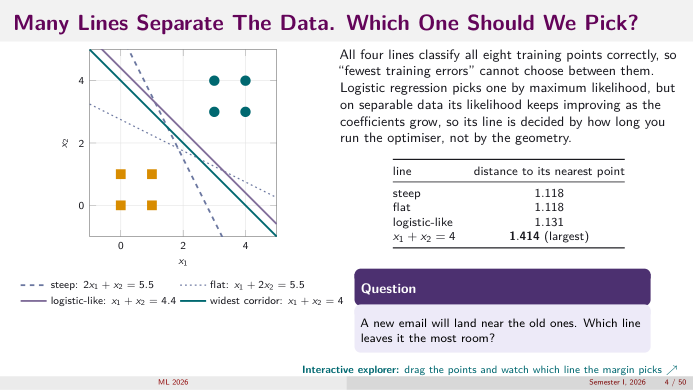
*👀 Slide 4 — Four lines, all perfect on training data; nearest distances 1.118, 1.118, 1.131, **1.414**.*

Logistic regression on separable data: likelihood keeps improving as coefficients grow ⇒ its line is decided by optimiser run-time, not geometry. *Question:* a new email lands near the old ones — which line leaves it the most room?

## Slide 5 — The rule: stay as far as possible from the nearest point

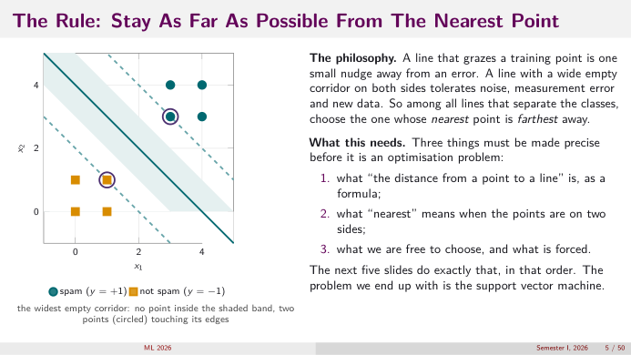
*👀 Slide 5 — The widest empty corridor; two points touch its edges.*

To make this an optimisation problem we need: (1) distance from a point to a line as a formula, (2) "nearest" when points are on two sides, (3) what we're free to choose. Slides 6–11 do exactly that.

## Slide 6 — A line is a direction $w$ and an offset $b$; $w$ points across the line

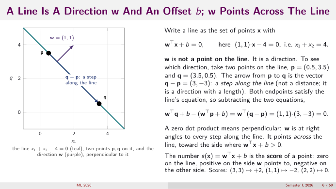
*👀 Slide 6 — $w^\top(q - p) = (1,1)\cdot(3,-3) = 0$: $w$ is perpendicular to every step along the line.*

Score $s(x) = w^\top x + b$: $(3,3)\mapsto+2$, $(1,1)\mapsto-2$, $(2,2)\mapsto0$. Details: A1 Steps 3–5.

## Slide 7 — How far is a point from the line? Walk along $w$ until you hit it

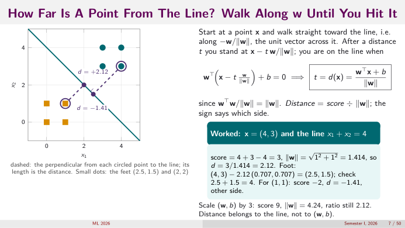
*👀 Slide 7 — $d(x) = (w^\top x + b)/\lVert w\rVert$; feet of the perpendiculars at (2.5, 1.5) and (2, 2).*

Derivation in A2. Scaling $(w,b)$ by 3 leaves the distance at 2.12: **distance belongs to the line**.

## Slide 8 — The margin of a line is its distance to the nearest point

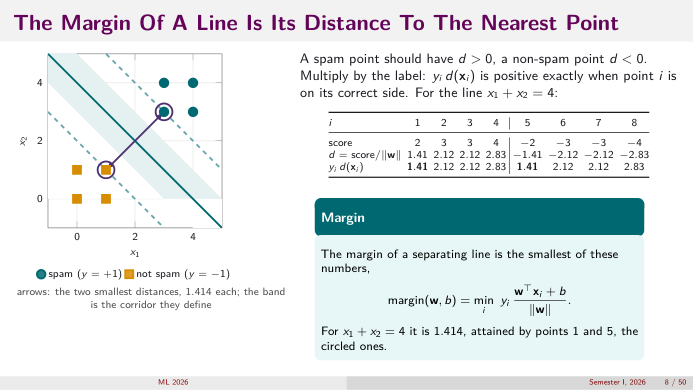
*👀 Slide 8 — $y_id(x_i)$ for all eight; the smallest, 1.414, at points 1 and 5.*

$\text{margin}(w,b) = \min_iy_i(w^\top x_i + b)/\lVert w\rVert$ (table in A3).

## Slide 9 — The goal as a formula: the line with the largest margin

$\max_{w,b}\min_iy_i(w^\top x_i + b)/\lVert w\rVert$. Outer: over lines; inner: nearest point. Every later formula is a rewriting of this one. Not solvable as is: kinks from the min, non-linear ratio, non-unique $(w,b)$ (A3 Step 4).

## Slide 10 — Clean-up step 1: one line, many $(w, b)$; we choose the scale

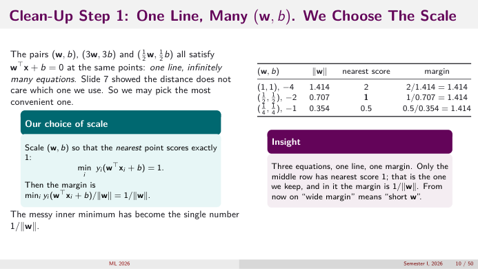
*👀 Slide 10 — Scale so the nearest score is 1; then margin $= 1/\lVert w\rVert$. "Wide margin" now means "short $w$".*

## Slide 11 — Clean-up step 2: shortest $w$, every point at least one unit away

$\min\tfrac12\lVert w\rVert^2$ s.t. $y_i(w^\top x_i + b)\ge1$. Primal, hard margin; strictly convex bowl over $n$ half-spaces ⇒ unique $w$ (A5).

## Slide 12 — The same problem with the numbers filled in

Eight constraints in $w_1, w_2, b$; add first and fifth ⇒ $w_1 + w_2\ge1$ ⇒ $w = (\tfrac12,\tfrac12)$, $b = -2$; scores $1, 1.5, 1.5, 2, 1, 1.5, 1.5, 2$. **Two of eight constraints decided everything** (A5 Step 4).

## Slide 13 — The problem as a picture: a bowl over the feasible region

Shown in A5. Two constraints active, six slack; the active ones belong to the circled points of slide 8 — "no coincidence", as the next slides prove.

## Slide 14 — Why go further? What pricing the constraints buys us

(1) Solve in general (find active constraints systematically). (2) See which points matter: $\alpha_i > 0$ exactly for points touching the corridor. (3) Open the door to kernels: the dual sees data only via $x_i^\top x_j$. **Primal**: minimise over $(w,b)$ subject to $n$ constraints. **Dual**: maximise over $n$ prices subject to sign and sum conditions. $\alpha_i$ = price of point $i$.

## Slide 15 — The Lagrangian: a price on every constraint

$L = \tfrac12\lVert w\rVert^2 - \sum\alpha_i[y_i(w^\top x_i + b) - 1]$. Stationarity ⇒ $w = \sum\alpha_iy_ix_i$, $\sum\alpha_iy_i = 0$. Complementary slackness $\alpha_i[\ldots] = 0$. **$w$ is a weighted sum of data points; only edge points get non-zero weight** (A8).

## Slide 16 — Two players, one table: who moves first matters

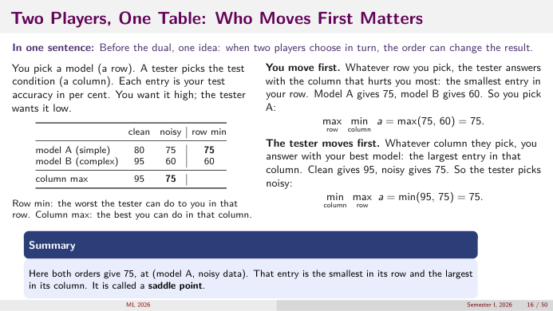
*👀 Slide 16 — Both orders give 75 at (model A, noisy): a saddle point.*

Worked in A6 Steps 1–3.

## Slide 17 — Why the inside is computed first

The first mover thinks ahead: the inner min is the reply each row will get. Compute inside first (A: 75, B: 60), then decide outside (max = 75). Chess analogy. **Warning:** grabbing B for its 95 gets you 60.

## Slide 18 — When the order changes the answer

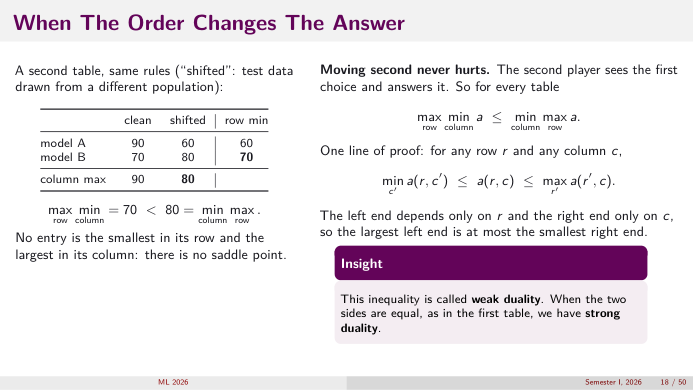
*👀 Slide 18 — No saddle point: $70 < 80$. Moving second never hurts ⇒ weak duality.*

## Slide 19 — The same game in the SVM: the line against the prices

Line first = primal ($\min_{w,b}\max_\alpha L$: any violated constraint ⇒ $+\infty$; all satisfied ⇒ $\alpha = 0$, $L = \tfrac12\lVert w\rVert^2$). Prices first = dual ($\max_\alpha\min_{w,b}L$: inside is unconstrained). Both orders agree for the SVM (convex bowl, straight-line constraints) — like the first table (A8 Step 2).

## Slide 20 — The same example in Hindi

The model/tester game of slide 16 retold in Hindi: you pick a row (model), the tester picks a column; before choosing, ask "if I pick this row, what will the tester do?" — that look-ahead is the inner min. Both orders give 75 at (model A, noisy data): smallest in its row, largest in its column — a saddle point. "In the SVM too both orders give the same value; that is why we can solve the dual."

## Slide 21 — The dual problem: optimise the prices instead of the line

$\max_\alpha\sum\alpha_i - \tfrac12\sum\sum\alpha_i\alpha_jy_iy_jx_i^\top x_j$ s.t. $\alpha_i\ge0$, $\sum\alpha_iy_i = 0$. $n$ unknowns; concave; strong duality; recover $w$ and $b$. ⚠️ Data only through $x_i^\top x_j$ (A8 Step 4).

## Slide 22 — Solving the dual by hand on the running example

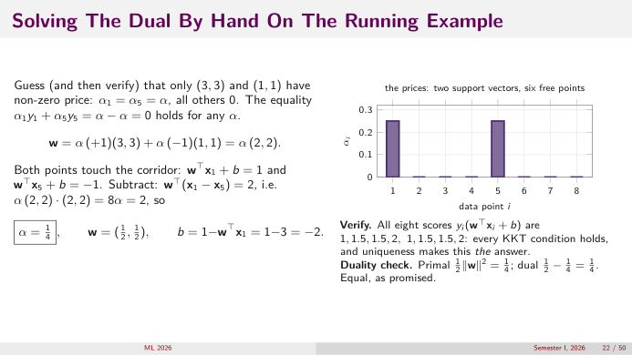
*👀 Slide 22 — Guess $\alpha_1 = \alpha_5 = \alpha$; $8\alpha = 2$ ⇒ $\alpha = \tfrac14$; $w = (\tfrac12,\tfrac12)$, $b = -2$. Primal = dual = ¼.*

## Slide 23 — Only the support vectors matter

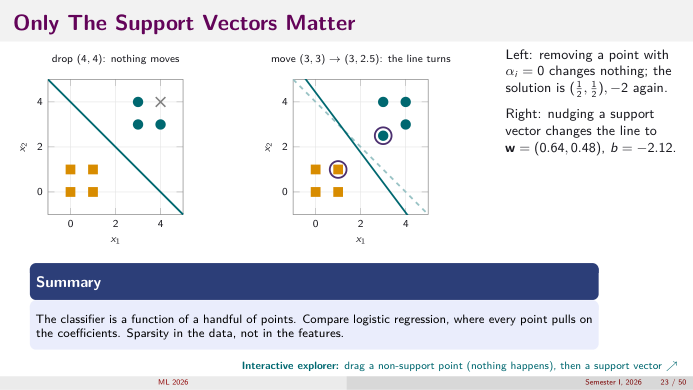
*👀 Slide 23 — Remove a non-support point: nothing moves. Nudge a support vector: the line turns.*

Sparsity in the **data**, not the features (contrast logistic regression, where every point pulls).

## Slide 24 — Classifying a new point: a sum over support vectors

$f(x) = \sum_{SV}\alpha_iy_ix_i^\top x + b$; for $(2,3)$: $f = 0.5$ ⇒ spam, distance 0.71. $f$ is a signed distance (× $\lVert w\rVert$), not a probability; touches $x$ only via inner products (A9).

## Slide 25 — The same numbers in scikit-learn

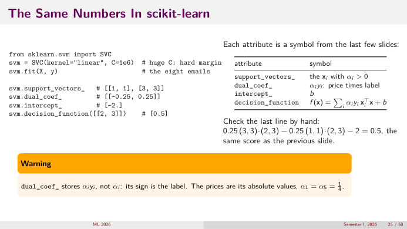
*👀 Slide 25 — Each attribute is a symbol from the derivation. `dual_coef_` = $\alpha_iy_i$ (sign = label).*

## Slide 26 — When no line works: one dimension

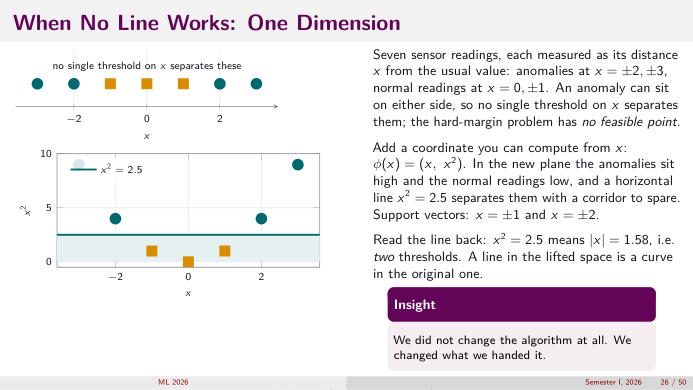
*👀 Slide 26 — Lift $\phi(x) = (x, x^2)$; the line $x^2 = 2.5$ becomes two thresholds $|x| = 1.58$.*

"We did not change the algorithm at all. We changed what we handed it."

## Slide 27 — When no line works: two dimensions

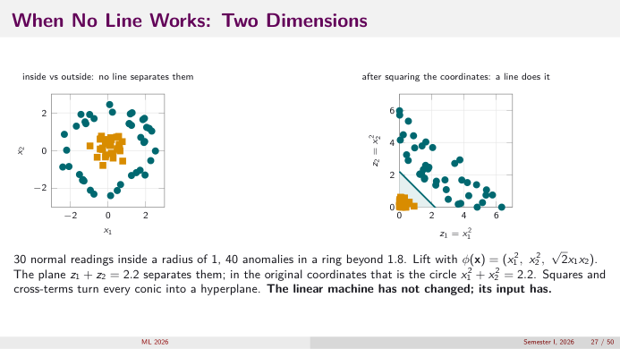
*👀 Slide 27 — $\phi(x) = (x_1^2, x_2^2, \sqrt2x_1x_2)$; plane $z_1 + z_2 = 2.2$ = circle $x_1^2 + x_2^2 = 2.2$.*

## Slide 28 — The cost of lifting explicitly

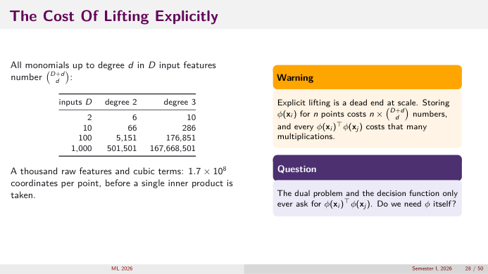
*👀 Slide 28 — $\binom{D+d}{d}$ coordinates per point. Explicit lifting is a dead end at scale.*

*Question:* the dual and $f$ only ask for $\phi(x_i)^\top\phi(x_j)$ — do we need $\phi$?

## Slide 29 — The kernel trick: the inner product without the lift

$(1 + x^\top z)^2 = \phi(x)^\top\phi(z)$ for the 6-D quadratic lift; check $x = (1,2)$, $z = (0.5,-1)$ ⇒ 0.25. Kernels table (linear, polynomial, Gaussian). $f(x) = \sum\alpha_iy_iK(x_i,x) + b$; $w$ never formed (A10 Steps 5–6).

## Slide 30 — Three kernels, one dataset

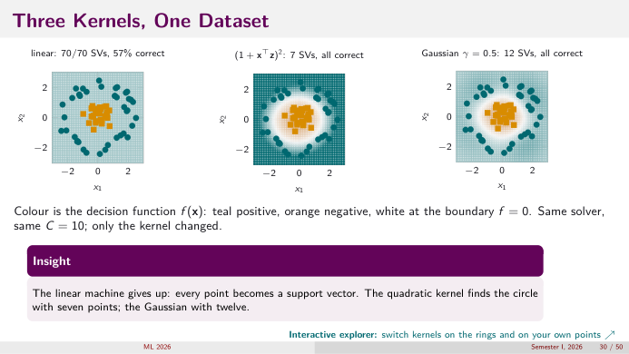
*👀 Slide 30 — Same solver, same $C = 10$; only the kernel changed. Colour = $f(x)$: teal positive, orange negative, white at $f = 0$.*

## Slide 31 — The Gaussian kernel is a similarity, and γ sets its reach

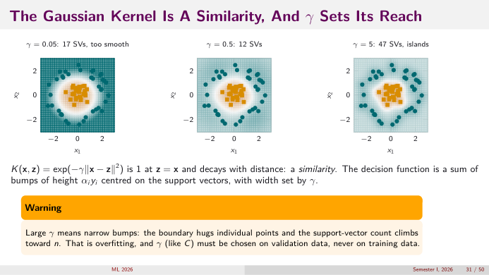
*👀 Slide 31 — Large $\gamma$ = narrow bumps = overfitting; SV count climbs toward $n$. Choose $\gamma$ on validation data.*

## Slide 32 — What makes a function a kernel: the Gram matrix

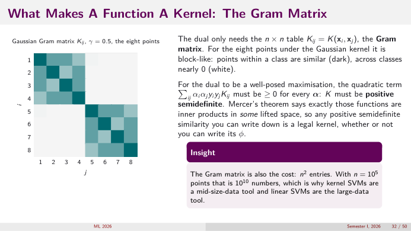
*👀 Slide 32 — $K_{ij}$ for the 8 emails, $\gamma = 0.5$: block structure by class.*

PSD ⇔ legal kernel (Mercer). $n^2$ entries: kernel SVMs for mid-size data, linear SVMs for large data (A11).

## Slide 33 — Two intruders, and no line that separates everything

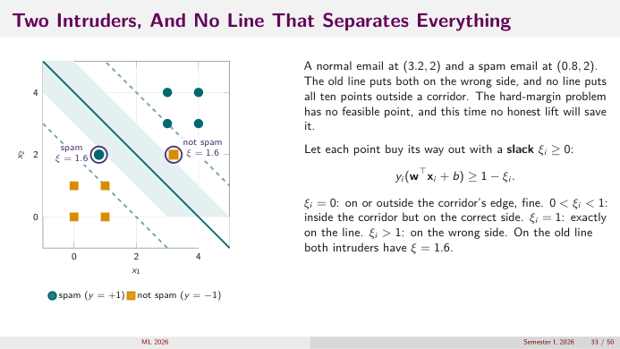
*👀 Slide 33 — Hard margin infeasible; each point may buy slack $\xi_i$: $y_i(w^\top x_i + b)\ge1 - \xi_i$.*

## Slide 34 — Soft margin: pay for every point in the wrong place

$\min\tfrac12\lVert w\rVert^2 + C\sum\xi_i$ s.t. $y_i(w^\top x_i + b)\ge1 - \xi_i$, $\xi_i\ge0$. Convex, always feasible; $C$ = exchange rate; $\xi_i = \max(0, 1 - y_if(x_i))$ at the optimum. "Two prices in one problem" (A12 Step 3).

## Slide 35 — Slack in numbers: six emails, one feature, two candidate lines

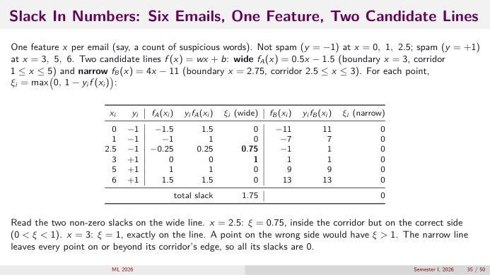
*👀 Slide 35 — Wide line: $\xi = 0.75$ at $x = 2.5$ (inside, correct side), $\xi = 1$ at $x = 3$ (on the line).*

## Slide 36 — Which line wins depends on the price $C$

Wide $0.125 + 1.75C$ vs narrow $8$; $C = 0.1$ → wide; $C = 10$ → narrow; switch at $C = 4.5$ (A12 Step 5 and figure).

## Slide 37 — $C$ sets the price of a violation

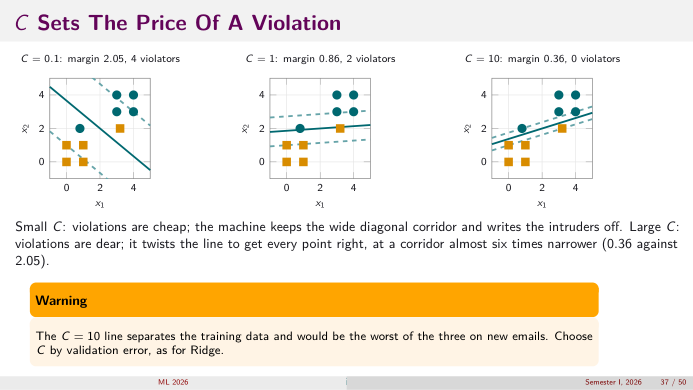
*👀 Slide 37 — Small $C$ writes intruders off and keeps a wide corridor; large $C$ twists the line to fit every point. The $C = 10$ line would be the worst on new emails.*

## Slide 38 — The same problem as a loss plus a penalty

$\min\sum\max(0, 1 - y_i(w^\top x_i + b)) + \frac1{2C}\lVert w\rVert^2$: **hinge + ridge with $\lambda = 1/C$**. "The corridor picture and the loss picture are one object seen from two sides" (A13).

## Slide 39 — Four losses on the margin axis

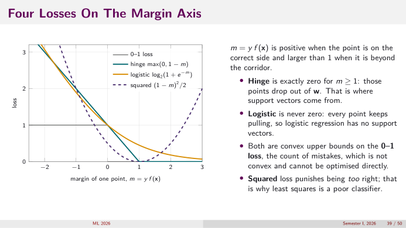
*👀 Slide 39 — Hinge is exactly 0 for $m\ge1$ (support vectors); logistic never 0 (no support vectors); squared punishes being too right.*

## Slide 40 — The soft-margin dual: one extra wall

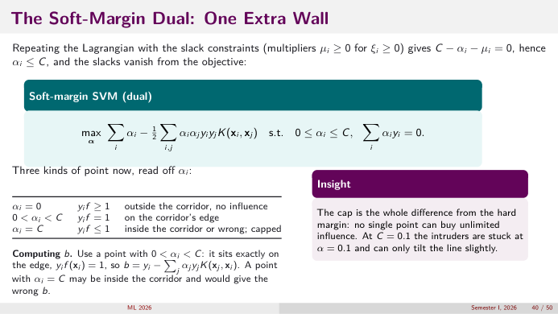
*👀 Slide 40 — $C - \alpha_i - \mu_i = 0$ ⇒ $\alpha_i\le C$. Compute $b$ from a point with $0 < \alpha_i < C$.*

## Slide 41 — Algorithmic thinking: what does it cost to solve?

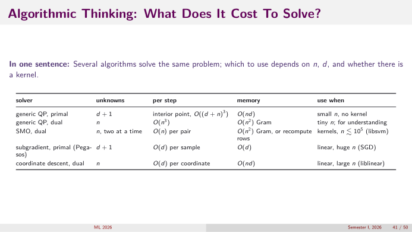
*👀 Slide 41 — Solver choice depends on $n$, $d$ and kernel (A15 table).*

## Slide 42 — What each solver exploits

SMO: one equality couples the $\alpha$s ⇒ pairs solvable exactly. SGD: primal is a sum ⇒ unbiased one-sample steps. Coordinate descent: rank-one $O(d)$ updates with a linear kernel. All exploit sparsity. **The Gram matrix is the wall.** libsvm = SMO on the dual with kernels; liblinear = coordinate descent / Newton on the primal without them. "The choice of solver is the choice of what you are willing to pay for."

## Slide 43 — SMO: why two multipliers at a time

![Slide 43 — The segment αᵢyᵢ + αⱼyⱼ = const in the (αᵢ, αⱼ) plane, clipped to [0, C]², with the optimum on it.](images/L11/slides/s43_smo_segment.png)
*👀 Slide 43 — Two at a time: a segment, a 1-D quadratic, a closed-form maximum, then clip.*

## Slide 44 — SMO on the running example

Shown in A15. Random partner choice from $\alpha = 0$; early pairs give weight to non-SVs, then it drains into (3,3), (1,1) and settles at ¼ each. Always feasible; dual never decreases.

## Slide 45 — Pegasos: stochastic subgradient on the primal

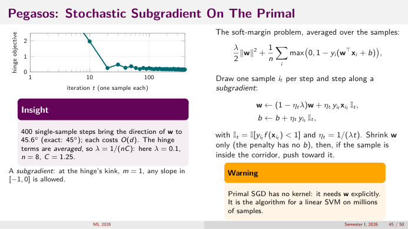
*👀 Slide 45 — 400 steps bring $w$'s direction to 45.6° (exact 45°); $\lambda = 1/(nC) = 0.1$.*

Update rule in A15. ⚠️ No kernel: the algorithm for linear SVMs on millions of samples.

## Slide 46 — An SVM outputs a score, not a probability

Threshold, ROC, AUC as in L10; Platt scaling for probabilities and cost thresholds; scale features first; multi-class via one-vs-rest or one-vs-one (A16).

## Slide 47 — The procedure

Standardise → choose kernel, $C$, $\gamma$ by validation → refit on train + val → calibrate & threshold from costs → report test once. "The SVM changes the model, not the discipline."

## Slide 48 — Why this construction is worth copying

The five-step template (A16, last paragraph). Meet it again in kernel ridge regression, Gaussian processes, boosting and neural networks. "An SVM is not a black box with a kernel knob."

## Slide 49 — Summary

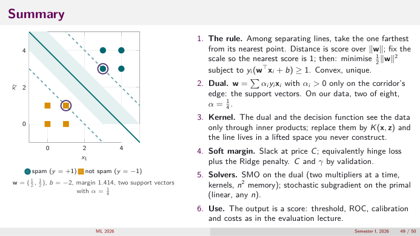
*👀 Slide 49 — Rule → dual → kernel → soft margin → solvers → use.*

1. **Rule:** farthest from nearest point; distance = score/$\lVert w\rVert$; fix scale; $\min\tfrac12\lVert w\rVert^2$ s.t. $y_i(w^\top x_i + b)\ge1$. Convex, unique.
2. **Dual:** $w = \sum\alpha_iy_ix_i$ with $\alpha_i > 0$ only on the edge; here two of eight, $\alpha = \tfrac14$.
3. **Kernel:** inner products → $K(x,z)$.
4. **Soft margin:** slack at price $C$ = hinge + ridge. $C, \gamma$ by validation.
5. **Solvers:** SMO (dual, kernels, $n^2$ memory); stochastic subgradient (primal, linear, any $n$).
6. **Use:** a score → threshold, ROC, calibration, costs.

## Slide 50 — Check the reasoning, not just the formula

Seven questions; answered as Part C Q1–Q7.

---

# Part B′ — Reading, Supplement and Board Pages

### Reading (L11a), §1–4 — question, line, distance, margin

Same eight points and numbers as A1–A3. Key sentence: "Everything that follows turns this sentence into mathematics and then solves it."

### Reading §5 — why max–min can't be attacked directly

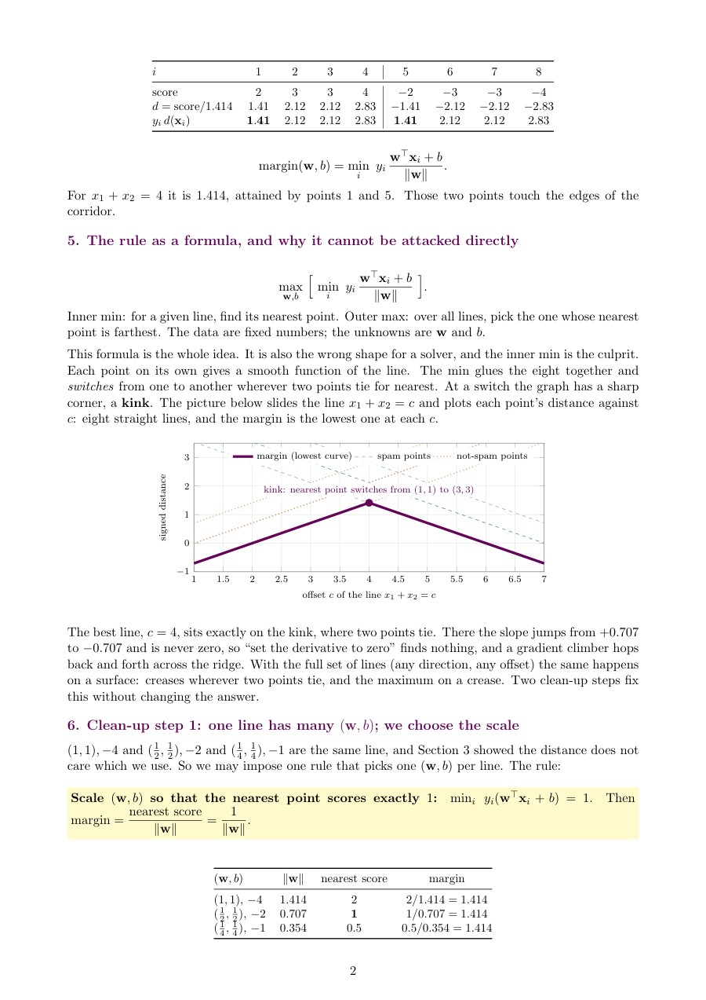
*👀 Reading p. 2 — The kink figure (redrawn in A3).*

Each point alone gives a smooth function of the line; the min glues eight together and switches between them where two tie ⇒ a **kink**. The best line ($c = 4$) sits exactly on it; slope jumps $+0.707\to-0.707$, never zero, and a gradient climber hops back and forth across the ridge.

### Reading §6–7 — the two clean-ups and the primal

As A4–A5, plus the second line $2x_1 + x_2 = 5.5$ rescaled by its nearest score 2.5 (margin 1.118) and the argument that "every score ≥ 1" loses nothing (divide by 1.3).

### Reading §8–9 — penalties at a fixed rate; duality picture

As A7 (the toy (E), the table of rates, the bowls figure, weak duality "one shared point on one curve is the whole proof", the $-w^2$ counter-example).

### Reading §9′–10 — the five steps on the SVM; solving the dual

As A8–A9 (the $A - B - C + D$ substitution, the table of $\alpha$ = 0.1…0.3, $\alpha = 2/\lVert x_+ - x_-\rVert^2$).

### Reading §11–12 — using the line, and the chain in one paragraph

**Rule:** farthest from the nearest point. **Distance:** score over $\lVert w\rVert$. **Margin:** smallest $y_id(x_i)$. **Goal:** max of a min, kinked. **Scale:** nearest score = 1 ⇒ margin $1/\lVert w\rVert$. **Primal:** shortest $w$ with every score ≥ 1. **Rates:** each constraint a penalty; minimise by calculus ⇒ a lower bound. **Dual:** choose rates giving the largest bound; gap zero. **Solution:** $\alpha = \tfrac14$ on the two touching points, $w = (\tfrac12,\tfrac12)$, $b = -2$, margin 1.414, value ¼ on both sides.

### Supplement (L11b) — one boundary, two scalings, the same margin

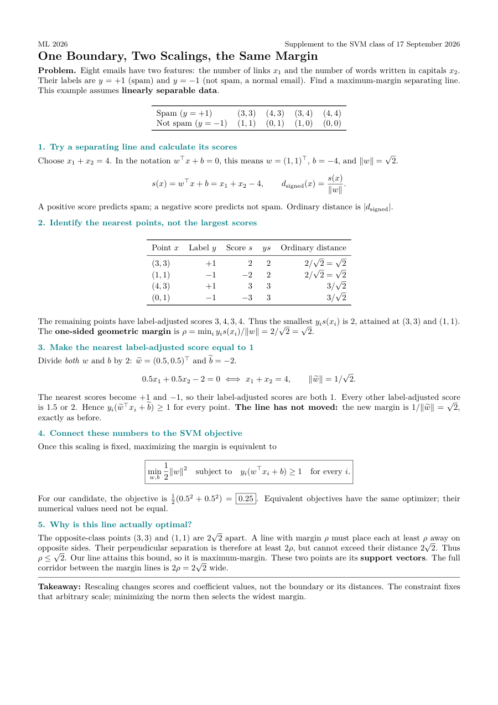
*👀 Supplement — The whole hand calculation on one page.*

1. Try $x_1 + x_2 = 4$: $w = (1,1)$, $b = -4$, $\lVert w\rVert = \sqrt2$.
2. Nearest points by **label-adjusted score** $y_is_i$ (not largest scores): (3,3) and (1,1) with $y s = 2$; margin $\rho = 2/\sqrt2 = \sqrt2$.
3. Divide by 2: $\tilde w = (0.5, 0.5)$, $\tilde b = -2$; nearest $ys = 1$, others 1.5 or 2; margin $1/\lVert\tilde w\rVert = \sqrt2$ — same line.
4. Objective value $\tfrac12(0.5^2 + 0.5^2) = 0.25$. "Equivalent objectives have the same optimiser; their numerical values need not be equal."
5. Optimality: the two opposite-class points are $2\sqrt2$ apart ⇒ $2\rho\le2\sqrt2$ ⇒ $\rho\le\sqrt2$; attained ⇒ maximum margin; full corridor $2\sqrt2$.

(The annotated copy, L11c p. 5, is the same sheet re-worded for flood data: rainfall index $x_1$, wetness index $x_2$, flooded vs passable — same numbers.)

### Board L11c p. 2 — line as $w^\top x + b$, distance, max–min

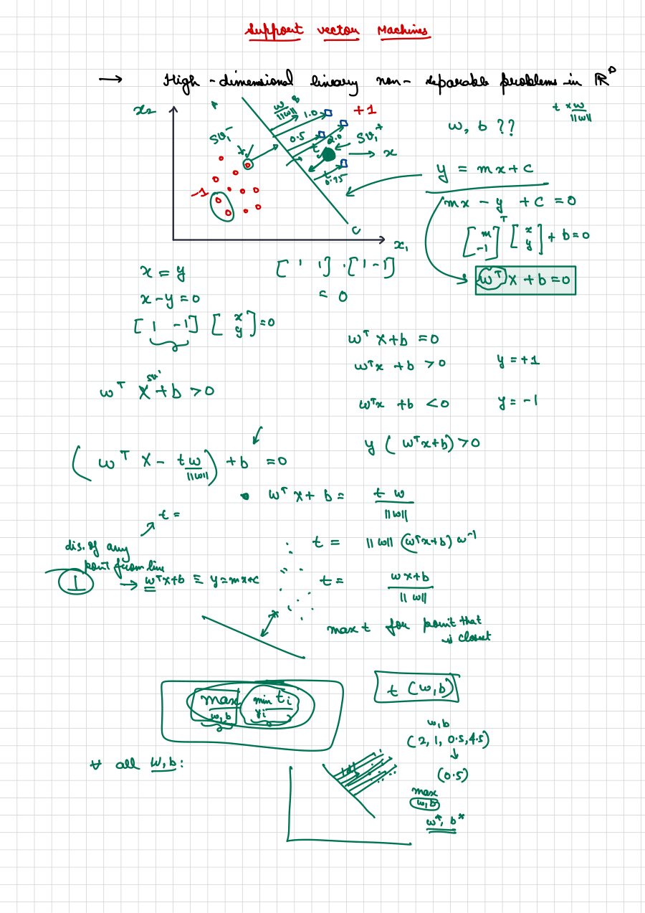
*👀 Board — "High-dimensional linearly non-separable problems in $\mathbb R^D$".*

Sketch: −1 class (red) and +1 class with $SV_+$, $SV_-$ circled; arrows of length $t$ along $w/\lVert w\rVert$. $y = mx + c\to mx - y + c = 0\to[m, -1]^\top[x, y] + b = 0\to$ **$w^\top x + b = 0$**. Example $x = y\Rightarrow[1, -1][x, y]^\top = 0$. Signs: $w^\top x + b > 0\Rightarrow y = +1$, $< 0\Rightarrow y = -1$, combined $y(w^\top x + b) > 0$. Distance: $w^\top(x - t\frac{w}{\lVert w\rVert}) + b = 0\Rightarrow t = \frac{w^\top x + b}{\lVert w\rVert}$ ("distance of any point from the line"). Then "max $t$ for the point that is closest" ⇒ boxed $\max_{w,b}\min_i t_i$ "for all $w, b$" (A1–A3).

### Board L11c p. 3 — the kink and the primal

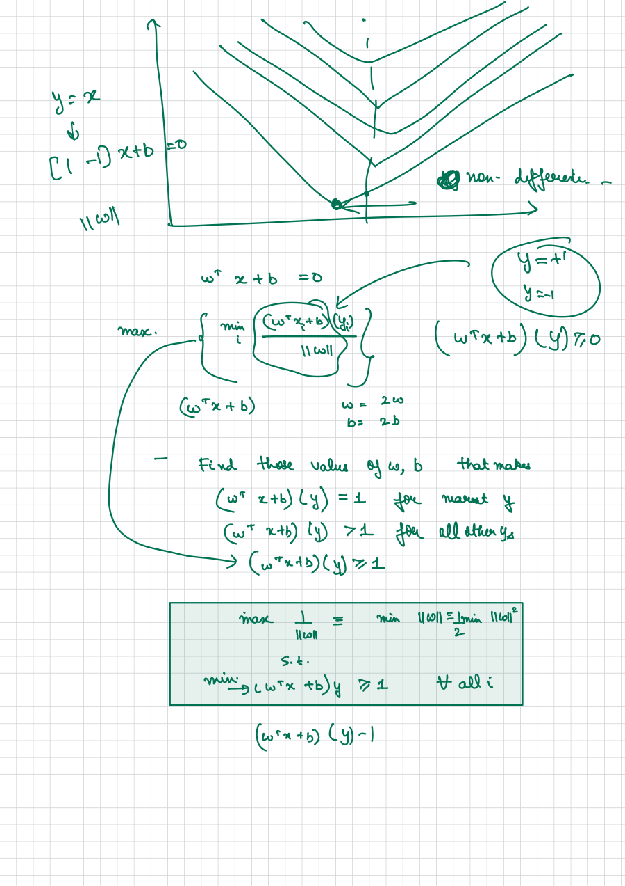
*👀 Board — "non-differentiable" kinks, and the clean-up to the primal.*

Top: a family of V-shaped curves with the optimum at a corner, labelled **non-differentiable** (A3 figure). Then $\max\{\min_i(w^\top x_i + b)y_i/\lVert w\rVert\}$ with the note $w\to2w$, $b\to2b$ (scaling freedom). "Find those values of $w, b$ that make $(w^\top x + b)y = 1$ for the nearest $y$, $> 1$ for all other $y$s" ⇒ $(w^\top x + b)y\ge1$. Boxed: $\max\frac1{\lVert w\rVert} = \min\lVert w\rVert\equiv\min\tfrac12\lVert w\rVert^2$ s.t. $(w^\top x + b)y\ge1\ \forall i$ (A4–A5).

### Board L11c p. 4 — Lagrangian, and the game

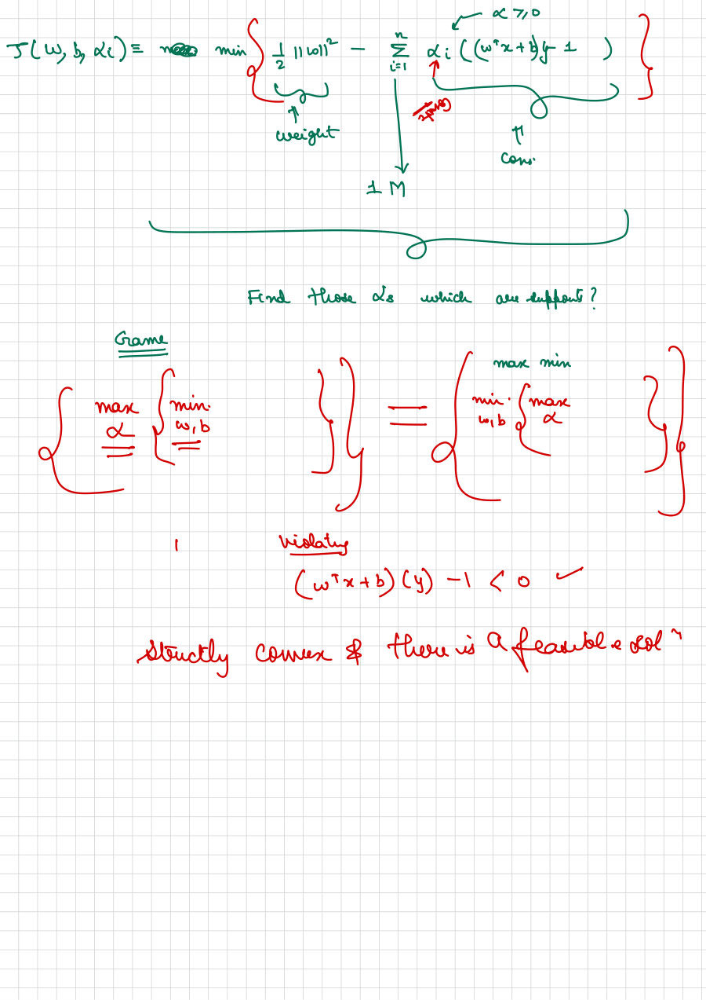
*👀 Board — $J(w,b,\alpha) = \tfrac12\lVert w\rVert^2 - \sum\alpha_i((w^\top x + b)y - 1)$; "Find those $\alpha$s which are support?"*

Labels: $\tfrac12\lVert w\rVert^2$ = "weight", the bracket = "constraint", $\alpha\ge0$, "$n$ could be 1M". **Game:** $\max_\alpha\min_{w,b} = \min_{w,b}\max_\alpha$. "Violating: $(w^\top x + b)y - 1 < 0$" (then $\alpha\to\infty$ punishes). Condition for equality, in red: **"strictly convex & there is a feasible solution"** (A7 Step 7, A8 Step 2).

### Board L11d p. 2 — primal → dual, and the toy-shop game

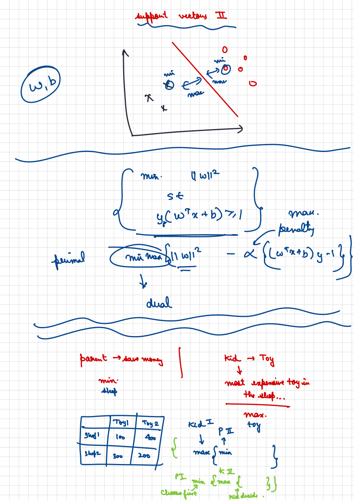
*👀 Board — "Support vectors II": primal as $\min\max$ with a penalty, and the parent/kid toy-shop game.*

Top: nearest points with "min" distance, "max" over lines. **Primal** $\min\lVert w\rVert^2$ s.t. $y(w^\top x + b)\ge1$ written as $\min\max\{\lVert w\rVert^2 - \alpha[(w^\top x + b)y - 1]\}$ with $\alpha$ = **penalty** ⇒ swap to the **dual**. **Toy-shop game:** parent wants to save money (min, picks the shop), kid wants the most expensive toy (max).

| | toy 1 | toy 2 |
|---|---|---|
| shop 1 | 100 | 400 |
| shop 2 | 300 | 200 |

Kid I chooses first, parent II answers: $\max_{\text{toy}}\min_{\text{shop}}$ = $\max(\min(100,300), \min(400,200)) = \max(100, 200) = 200$. Parent I chooses first ("chooses first"), kid answers ("kid decides"): $\min_{\text{shop}}\max_{\text{toy}} = \min(400, 300) = 300$. $200\le300$: weak duality; no saddle point here (figure in A6).

### Board L11d p. 3 — the dual, dot products, and the kernel


*👀 Board — From the Lagrangian to $W(\alpha)$, and "dot product → computed with some equivalent function".*

$\partial L/\partial w = 0$, $\partial L/\partial b = 0$ (with $\alpha$ held constant) ⇒ $w^* = \sum\alpha_iy_ix_i$, $\sum\alpha_iy_i = 0$ ⇒ $\max W(\alpha) = \sum\alpha_i - \tfrac12\sum\sum\alpha_i\alpha_jy_iy_j(x_i\cdot x_j)$. The $x_i\cdot x_j$ is circled: "**dot product** → computed with some equivalent function", replaced by $K(\phi(x_i),\phi(x_j))$, "**a scalar**". Bottom: ring data (inner green, outer blue) — no line; $\phi(\cdot) = x^2$; $K(x_1,x_2)\equiv\phi(x_1)\cdot\phi(x_2)$ → **Gaussian kernel** (A8, A10–A11).

### Board L11d p. 4 — kernel bumps, and the soft margin

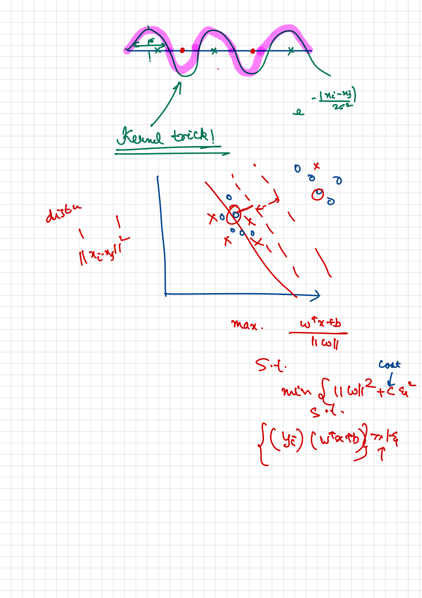
*👀 Board — Gaussian bumps make a wave through alternating points; then overlapping classes → soft margin.*

Top: points alternating along a line; a wavy $f$ (highlighted) built from Gaussians $e^{-\lVert x_i - x_j\rVert^2/2\sigma^2}$ separates them — "**Kernel trick!**" (redrawn as the γ figure in A11). Bottom: classes overlap (x's among o's), corridor drawn dashed; "distance $\lVert x_i - x_j\rVert^2$"; $\max\frac{w^\top x + b}{\lVert w\rVert}$ → $\min\{\lVert w\rVert^2 + C\xi_i\}$ s.t. $y_i(w^\top x + b)\ge1 - \xi_i$, with **$C$ = cost** (A12).

---

# Part C — Practice

**Slide 50's questions**

1. Two support vectors at distance $D$ apart, one per class. What is $\alpha$? What is the margin?
2. A point far from the boundary is removed from the training set. What happens to the SVM? To a logistic regression?
3. Why can the dual, but not the primal, be kernelised?
4. You double every feature's units. What happens to a linear SVM's decisions? To a Gaussian-kernel SVM with fixed $\gamma$?
5. As $C\to\infty$, what does the soft-margin machine become? As $C\to0$?
6. Hinge loss is zero for a point with margin 1.5; logistic loss is not. What does that imply for which points influence each model?
7. Why does SMO update two multipliers rather than one?

**More practice**

8. Compute the margin of the line $x_1 + 2x_2 = 5.5$ on the 8 emails.
9. With $w = (\tfrac12,\tfrac12)$, $b = -2$, classify $x = (0, 3)$ and give its signed distance.
10. Verify $(1 + x^\top z)^2 = \phi(x)^\top\phi(z)$ for $x = (1,1)$, $z = (2,0)$.
11. Solve the toy $\min\tfrac12w^2$ s.t. $w\ge2$ by the dual. Check $d^* = p^*$.
12. With the linear kernel, compute $\eta = 2K_{15} - K_{11} - K_{55}$ for points 1 (3,3) and 5 (1,1).
13. A point has $y_if(x_i) = 0.4$ in a soft-margin solution. What are its $\xi_i$ and its possible $\alpha_i$? Can you use it to compute $b$?
14. Gaussian kernel, $\gamma = 0.5$: compute $K((3,3),(4,3))$ and $K((3,3),(1,1))$. Why is the Gram matrix "block-like"?
15. How many monomials up to degree 2 in $D = 10$ features? Up to degree 3 in $D = 2$?
16. Write the hinge loss of the six one-feature emails under $f_A = 0.5x - 1.5$. What is the total? Why is it equal to the total slack?

<details>
<summary><b>Answers</b></summary>

1. With $w = \alpha(x_+ - x_-)$ and $w^\top(x_+ - x_-) = 2$: $\alpha D^2 = 2\Rightarrow\alpha = 2/D^2$. $\lVert w\rVert = \alpha D = 2/D$ ⇒ margin $1/\lVert w\rVert = D/2$ (corridor width $D$). Here $D = 2\sqrt2$ ⇒ $\alpha = \tfrac14$, margin $\sqrt2$ ✓.
2. SVM: if it's not a support vector ($\alpha_i = 0$), **nothing changes**. Logistic regression: every point contributes to the likelihood gradient, so the coefficients shift (slightly).
3. The primal's unknown is $w$, which lives in the lifted space (possibly infinite-dimensional). The dual's unknowns are $n$ prices and the data enter only through $x_i^\top x_j$, which a kernel can replace.
4. Linear, hard margin: decisions unchanged ($w$ halves, $b$ stays — same line in new units). Linear, soft margin with fixed $C$: the balance between $\tfrac12\lVert w\rVert^2$ and $C\sum\xi$ shifts, so decisions **can change**. Gaussian with fixed $\gamma$: all squared distances ×4 ⇒ effectively $\gamma\times4$ ⇒ narrower bumps, different (more wiggly) boundary. Hence: standardise first.
5. $C\to\infty$: violations infinitely expensive ⇒ hard margin (if separable). $C\to0$: width is all that matters ⇒ $w\to0$; all $\alpha_i$ capped near 0; the classifier ≈ a constant (sign of $b$).
6. Under hinge, points with $m\ge1$ have zero loss and zero gradient ⇒ no influence (they are not support vectors). Under logistic loss **every** point keeps a small pull ⇒ every point influences the fit.
7. The equality $\sum\alpha_iy_i = 0$ determines any one $\alpha_i$ from the others, so changing one alone would break feasibility. Two can move together along $\alpha_iy_i + \alpha_jy_j = \text{const}$.
8. Scores $x_1 + 2x_2 - 5.5$: positives (3,3) 3.5, (4,3) 4.5, (3,4) 5.5, (4,4) 6.5; negatives (1,1) −2.5, (0,1) −3.5, (1,0) −4.5, (0,0) −5.5. Nearest $|$score$|$ = 2.5. $\lVert w\rVert = \sqrt5 = 2.236$ ⇒ margin $2.5/2.236 = 1.118$ ✓ (slide 4).
9. $f = 0 + 1.5 - 2 = -0.5$ ⇒ not spam. Distance $-0.5/0.707 = -0.71$. Check by kernel form: $\tfrac14(3,3)\cdot(0,3) - \tfrac14(1,1)\cdot(0,3) - 2 = 2.25 - 0.75 - 2 = -0.5$ ✓.
10. $x^\top z = 2$, $(1 + 2)^2 = 9$. $\phi(x) = (1, \sqrt2, \sqrt2, 1, 1, \sqrt2)$, $\phi(z) = (1, 2\sqrt2, 0, 4, 0, 0)$: $1 + 4 + 0 + 4 + 0 + 0 = 9$ ✓.
11. $L = \tfrac12w^2 - \alpha(w - 2)$; $w = \alpha$; $D(\alpha) = \tfrac12\alpha^2 - \alpha^2 + 2\alpha = 2\alpha - \tfrac12\alpha^2$. Max at $\alpha = 2$, $D = 2$. Primal: $w = 2$, $p^* = 2$ ✓.
12. $K_{11} = 18$, $K_{55} = 2$, $K_{15} = 6$ ⇒ $\eta = 12 - 18 - 2 = -8\le0$ ✓.
13. $\xi_i = 1 - 0.4 = 0.6$ (inside the corridor, correct side). Since $y_if < 1$, $\alpha_i = C$. **No**: it isn't on the edge, so $b$ from it would be wrong; use a point with $0 < \alpha_i < C$.
14. $\lVert(3,3) - (4,3)\rVert^2 = 1$ ⇒ $e^{-0.5} = 0.61$. $\lVert(3,3) - (1,1)\rVert^2 = 8$ ⇒ $e^{-4} = 0.018$. Points within a class are close (large $K$), across classes far (≈0), so sorting by class gives two dark blocks.
15. $\binom{12}{2} = 66$; $\binom{5}{3} = 10$.
16. Hinge $= \max(0, 1 - y_if_A)$: $0, 0, 0.75, 1, 0, 0$; total 1.75. At the optimum (and for any fixed line) the smallest feasible slack is exactly the hinge value, so total slack = total hinge loss.

</details>

**Previous lectures:** [L06](L06_curvature_logistic_regression.md) (logistic regression: the other loss) · [L07](L07_regularization_ridge_lasso_elastic_net.md) (ridge penalty, $\lambda = 1/C$; Lagrange multipliers) · [L10](L10_precision_recall_roc_auc.md) (thresholds, ROC, costs for the SVM score).
