# Lecture 12a — Decision Trees: Entropy, Gain, Growing, Predicting and Pruning

> ES 335 / ES 678 Machine Learning, Sem I 2026 — Prof. Udit Bhatia
> Sources: `Lectures/L12_student_trees_bagging_boosting_worked_deck.pdf` (Part 1, slides 1–21), `Lectures/L12g_student_practice_trees_bagging_forests.pdf` (Part A of the practice sheet) · Previous: [`L11_support_vector_machines.md`](L11_support_vector_machines.md) · Next: [`L12b_bagging_random_forests.md`](L12b_bagging_random_forests.md)

**Lecture 12 is split into five files** because it is long:
**[L12a Trees](L12a_decision_trees.md)** → [L12b Bagging & random forests](L12b_bagging_random_forests.md) → [L12c Gradient boosting](L12c_gradient_boosting.md) → [L12d AdaBoost](L12d_adaboost.md) → [L12e XGBoost & comparison](L12e_xgboost_and_comparison.md)

**How to use this file.** Everything in Lecture 12 runs on **one tiny dataset of twelve past training runs**, and every number is computed by hand. This file builds the **single decision tree**: how to measure how mixed a group is (entropy), how to score a question (gain), how the tree grows step by step, how it predicts, and how to stop it from growing too much (pruning). The tree is the base learner for everything that follows: bagging averages many deep trees (L12b); boosting adds up many tiny trees (L12c–e). Part A is the maths step by step. Part B walks through slides 1–21. Part C is practice with answers.

**The one dataset for the whole lecture** (twelve runs of mini-batch gradient descent; D = diverged, the loss blew up; C = converged):

| run | rate | batch | warm-up | out | | run | rate | batch | warm-up | out |
|---|---|---|---|---|---|---|---|---|---|---|
| 1 | 0.3 | 256 | yes | **D** | | 7 | 0.03 | 256 | no | **C** |
| 2 | 0.3 | 32 | no | **D** | | 8 | 0.03 | 64 | yes | **C** |
| 3 | 0.1 | 128 | yes | **D** | | 9 | 0.01 | 128 | yes | **C** |
| 4 | 0.1 | 64 | no | **D** | | 10 | 0.01 | 32 | yes | **C** |
| 5 | 0.03 | 32 | no | **D** | | 11 | 0.001 | 64 | no | **C** |
| 6 | 0.01 | 32 | no | **D** | | 12 | 0.001 | 256 | yes | **C** |

Six D, six C. **Two new runs** are predicted by every method in Lecture 12: **run A** (rate 0.05, batch 32, no warm-up) and **run B** (rate 0.2, batch 64, warm-up).

**The answer we will reach:**
$$\text{rate}\le0.065?\ \xrightarrow{\text{no}}\ \textbf{D}\quad\Big|\quad\xrightarrow{\text{yes}}\ \text{batch}\le48?\ \xrightarrow{\text{no}}\ \textbf{C}\quad\Big|\quad\xrightarrow{\text{yes}}\ \text{warm-up = no?}\ \xrightarrow{\text{yes}}\textbf{D},\ \xrightarrow{\text{no}}\textbf{C}$$
In words: *a high learning rate diverges; otherwise a small batch without warm-up diverges; everything else converges.*

## Contents

**Part A — Maths from the ground up**
1. [The data as a picture, and what a tree does](#a1-the-data-as-a-picture-and-what-a-tree-does)
2. [Entropy: how mixed is a group?](#a2-entropy-how-mixed-is-a-group)
3. [Three impurity measures, and why concavity matters](#a3-three-impurity-measures-and-why-concavity-matters)
4. [The gain of a question, and which thresholds to try](#a4-the-gain-of-a-question-and-which-thresholds-to-try)
5. [Growing the tree, step 1: the root](#a5-growing-the-tree-step-1-the-root)
6. [Step 2: inside the 8-run group — and why error rate fails](#a6-step-2-inside-the-8-run-group--and-why-error-rate-fails)
7. [Step 3: the last question, and the algorithm](#a7-step-3-the-last-question-and-the-algorithm)
8. [Predicting with the tree](#a8-predicting-with-the-tree)
9. [Depth, overfitting and pruning](#a9-depth-overfitting-and-pruning)
10. [Instability: why one tree is not enough](#a10-instability-why-one-tree-is-not-enough)

**Part B — Slides 1–21** · [Jump](#part-b--slide-by-slide-slides-121) · **Part C — Practice** · [Jump](#part-c--practice)

---

# Part A — Maths From the Ground Up

## A1. The data as a picture, and what a tree does

**Step 1 — Put the runs on a map.** Two of the three features are numbers (rate, batch) so we can draw them; the third (warm-up) we show as filled (no warm-up) vs hollow (warm-up).

**Step 2 — A tree asks yes/no questions, one feature at a time.** Each question is a straight cut parallel to an axis ("rate ≤ 0.065?" is a vertical line). Each answer sends the runs to one side. The tree keeps cutting each side until every piece is **pure** (all D or all C) or no question can separate the runs.

**Step 3 — Three cuts are enough here.** Watch them happen:

*📊 Step 0 → Step 3. Red = D, blue = C; filled = no warm-up, hollow = warm-up. Cut 1 (purple, rate) makes the right side pure D. Cut 2 (orange, batch) makes the upper-left pure C. The bottom-left corner holds runs 5, 6 (D, no warm-up) and 10 (C, warm-up): warm-up finishes the job.*

**Key question:** *why* these three cuts, in this order? The rest of Part A answers it with one number: the **gain**.

## A2. Entropy: how mixed is a group?

**Step 1 — Describe a group by one number $p$.** $p$ = fraction of the runs in the group that diverged.

**Step 2 — Entropy.**
$$H(p) = -p\log_2p - (1-p)\log_2(1-p)$$
- $H = 0$ for a pure group ($p = 0$ or $1$; use $0\log 0 = 0$).
- $H = 1$ for a 50/50 group (the most mixed).

**Step 3 — Worked example, $H(\tfrac14)$.** $\log_2\tfrac14 = -2$, $\log_2\tfrac34 = -0.4150$:
$$H(\tfrac14) = \tfrac14(2) + \tfrac34(0.4150) = 0.5 + 0.3113 = 0.8113.$$

**Step 4 — The values used in this lecture** (memorise none of them; just read them off):

| group has | 0 of 6 D | 1 of 7 | 1 of 5 | 1 of 4 | 1 of 3 | 2 of 3 | 5 of 7 | 6 of 12 |
|---|---|---|---|---|---|---|---|---|
| $p$ | 0 | 1/7 | 1/5 | 1/4 | 1/3 | 2/3 | 5/7 | 1/2 |
| $H(p)$ | 0 | 0.5917 | 0.7219 | 0.8113 | 0.9183 | 0.9183 | 0.8631 | 1 |

Note $H(p) = H(1-p)$: entropy only cares about how mixed, not which class is the majority ($H(\tfrac13) = H(\tfrac23)$).

## A3. Three impurity measures, and why concavity matters

**Step 1 — Three choices** (all 0 when pure, largest at $p = \tfrac12$):

| name | formula | max |
|---|---|---|
| entropy | $H(p) = -p\log_2p - (1-p)\log_2(1-p)$ | 1 |
| Gini | $G(p) = 2p(1-p)$ | 0.5 |
| error rate | $E(p) = \min(p, 1-p)$ | 0.5 |

**Step 2 — A split's impurity is a point on a chord.** If a split sends a fraction $w$ of the runs to a group with $p_Y$ and $1-w$ to a group with $p_N$, the parent's $p$ is $w\,p_Y + (1-w)\,p_N$ (the children's $p$'s average to the parent's). The children's weighted impurity is $w\,I(p_Y) + (1-w)\,I(p_N)$: the point on the **straight line (chord)** between the two children, above the parent's $p$.

**Step 3 — Concave curve ⇒ chord below ⇒ gain ≥ 0.** Entropy and Gini are **strictly concave** (bowl upside down): every chord lies strictly below the curve, so any split that changes the class mix lowers impurity. The error rate is a **tent of straight lines**: a chord lying on one side of the tent sits *on* the curve, so the gain is **exactly 0** even when one group became pure.

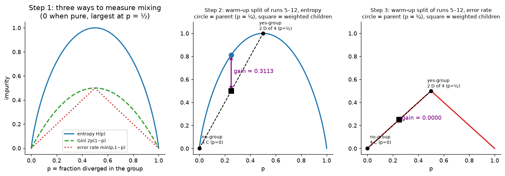
*📊 Step 1: the three curves. Step 2 (entropy): the warm-up question inside runs 5–12 (parent $p = \tfrac14$) gives children $p = \tfrac12$ and $p = 0$; the chord point (square) is 0.5, below the parent's 0.811 ⇒ gain **0.3113**. Step 3 (error rate): the chord lies **on** the tent ⇒ gain **0**, although one child is now pure.*

## A4. The gain of a question, and which thresholds to try

**Step 1 — Gain = impurity before − weighted impurity after.** A question splits $n$ runs into a yes-group ($n_Y$) and a no-group ($n_N$):
$$\text{gain} = H(\text{parent}) - \Big(\frac{n_Y}{n}H(\text{yes}) + \frac{n_N}{n}H(\text{no})\Big)$$

**Step 2 — Why the weights $n_Y/n$, $n_N/n$?** Without them, a question that peels off **one** run into a pure group would look as good as one that makes a large group pure. Weighting by size says: purity counts in proportion to how many runs enjoy it.

**Step 3 — Which thresholds?** Sort the distinct values of a feature; cut at the midpoints between neighbours (any cut between two neighbours gives the same groups).

| feature | distinct values | thresholds tried |
|---|---|---|
| rate | 0.001, 0.01, 0.03, 0.1, 0.3 | 0.0055, 0.02, 0.065, 0.2 |
| batch size | 32, 64, 128, 256 | 48, 96, 192 |
| warm-up | no, yes | one question: warm-up = no |

**Step 4 — Count.** $4 + 3 + 1 = 8$ candidate questions at the root.

**Warm-up example ("your turn", slides 9–10).** Eight runs, rate high/low and warm-up yes/no:

| run | 1 | 2 | 3 | 4 | 5 | 6 | 7 | 8 |
|---|---|---|---|---|---|---|---|---|
| rate | high | high | high | high | low | low | low | low |
| warm-up | no | no | yes | yes | no | no | yes | yes |
| out | D | D | D | D | D | C | C | C |

1. Whole group: 5 D of 8 ⇒ $H(\tfrac58) = 0.9544$.
2. *rate = high?* Yes-group 1–4 (all D, $H = 0$); no-group 5–8 (1 D of 4, $H = 0.8113$):
   $\text{gain} = 0.9544 - (\tfrac48\cdot0 + \tfrac48\cdot0.8113) = \mathbf{0.5488}$.
3. *warm-up = no?* Yes-group 1, 2, 5, 6 (3 D, $H = 0.8113$); no-group 3, 4, 7, 8 (2 D, $H = 1$):
   $\text{gain} = 0.9544 - (\tfrac48\cdot0.8113 + \tfrac48\cdot1) = \mathbf{0.0488}$.
4. Ask **rate = high?** first: one group pure, gain more than ten times larger.

*Follow-up:* inside runs 5–8 warm-up has gain $0.8113 - \tfrac24(1) = 0.3113$, but runs 5 and 6 have **identical features and different outcomes**. No question can separate them, so the tree stops with a leaf whose fraction of D is $\tfrac12$.

## A5. Growing the tree, step 1: the root

**Step 1 — Parent:** all 12 runs, 6 D ⇒ $H = 1$.

**Step 2 — Score all eight questions.**

| question | yes-group | no-group | gain |
|---|---|---|---|
| rate ≤ 0.0055 | 2 runs, 0 D | 10 runs, 6 D | 0.1909 |
| rate ≤ 0.02 | 5 runs, 1 D | 7 runs, 5 D | 0.1957 |
| **rate ≤ 0.065** | **8 runs, 2 D** | **4 runs, 4 D** | **0.4591** |
| rate ≤ 0.2 | 10 runs, 4 D | 2 runs, 2 D | 0.1909 |
| batch ≤ 48 | 4 runs, 3 D | 8 runs, 3 D | 0.0933 |
| batch ≤ 96 | 7 runs, 4 D | 5 runs, 2 D | 0.0207 |
| batch ≤ 192 | 9 runs, 5 D | 3 runs, 1 D | 0.0271 |
| warm-up = no | 6 runs, 4 D | 6 runs, 2 D | 0.0817 |

**Step 3 — The winner, computed in full.** rate ≤ 0.065: yes = runs 5–12 (8 runs, 2 D, $p = \tfrac14$); no = runs 1–4 (4 runs, all D, $H = 0$):
$$\text{gain} = 1 - \Big(\tfrac{8}{12}\times0.8113 + \tfrac{4}{12}\times0\Big) = 1 - 0.5409 = 0.4591.$$

**Runner-up check**, rate ≤ 0.02: yes = runs 6, 9, 10, 11, 12 (1 D), no = 1–5, 7, 8 (5 D):
$$\text{gain} = 1 - \tfrac{5}{12}(0.7219) - \tfrac{7}{12}(0.8631) = 1 - 0.3008 - 0.5035 = 0.1957.$$

**Step 4 — Result.** The 4-run group is pure ⇒ **leaf D**. The 8-run group continues.

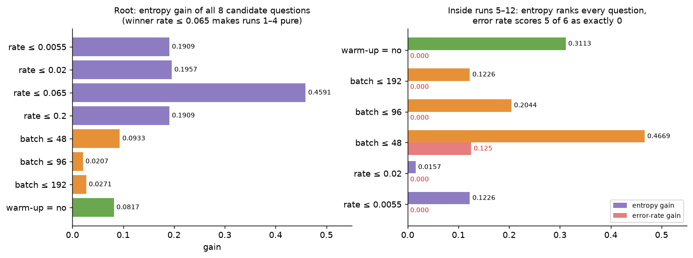
*📊 Left: the root decision. Right: the step-2 decision inside runs 5–12 — entropy gains (coloured by feature) vs error-rate gains (red).*

## A6. Step 2: inside the 8-run group — and why error rate fails

**Step 1 — New parent:** runs 5–12, 2 D ⇒ $H = 0.8113$. Only these 8 runs matter now.

**Step 2 — Score the six questions that still split this group** (rate ≤ 0.065 and rate ≤ 0.2 put all 8 on one side, so they are skipped):

| question | yes-group | no-group | entropy gain | error-rate gain |
|---|---|---|---|---|
| rate ≤ 0.0055 | 2 runs, 0 D | 6 runs, 2 D | 0.1226 | 0 |
| rate ≤ 0.02 | 5 runs, 1 D | 3 runs, 1 D | 0.0157 | 0 |
| **batch ≤ 48** | **3 runs, 2 D** | **5 runs, 0 D** | **0.4669** | 0.125 |
| batch ≤ 96 | 5 runs, 2 D | 3 runs, 0 D | 0.2044 | 0 |
| batch ≤ 192 | 6 runs, 2 D | 2 runs, 0 D | 0.1226 | 0 |
| warm-up = no | 4 runs, 2 D | 4 runs, 0 D | 0.3113 | 0 |

**Step 3 — The winner in full:**
$$\text{gain(batch}\le48) = 0.8113 - \Big(\tfrac38\times0.9183 + \tfrac58\times0\Big) = 0.8113 - 0.3444 = 0.4669.$$

**Step 4 — Why error rate is a poor splitting criterion.** Error rate = fraction a majority vote gets wrong. The parent (2 D of 8) has error $\tfrac28 = 0.25$. In five of the six splits, **both** child groups still have a C majority, so a majority vote still gets runs 5 and 6 wrong: error still $0.25$, gain **0**. That includes *warm-up*, which isolates **four pure C runs**. Entropy notices that the groups became purer; error rate does not (this is the straight-line part of the tent in A3).

> **Rule:** grow with entropy (or Gini). Error rate is fine for *measuring* a finished tree, bad for *choosing* splits.

## A7. Step 3: the last question, and the algorithm

**Step 1 — Group:** runs 5, 6, 10 (2 D) ⇒ $H(\tfrac23) = 0.9183$. All have batch 32, so **no batch question exists**.

| question | yes | no | gain |
|---|---|---|---|
| rate ≤ 0.02 | runs 6, 10 | run 5 | 0.2516 |
| **warm-up = no** | **runs 5, 6** | **run 10** | **0.9183** |

$\text{gain} = 0.9183 - (\tfrac23\cdot0 + \tfrac13\cdot0) = 0.9183$: every leaf is pure ⇒ **stop**.

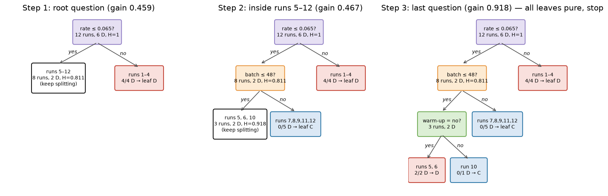
*📊 The tree grows one question at a time; each white box is a group that is still mixed and gets its own question next.*

**Step 2 — The algorithm (recursive partitioning).**
1. Put all runs in one group.
2. Group pure (or no valid question)? ⇒ make a **leaf** predicting the majority.
3. Else ask the question of **largest gain**.
4. Send runs yes/no; repeat inside each group.

**Step 3 — Two side facts.**
- **Order doesn't matter.** Each group uses only its own runs, so depth-first and breadth-first build the same tree. Order matters only under a budget on the number of leaves.
- **Gini gives the same tree here** (gains 0.250, 0.208, 0.444 for the three chosen questions).

## A8. Predicting with the tree

**Step 1 — The number read from a leaf.** A tree reports the **fraction of D among the training runs in the leaf** it reaches (here 0 or 1 because the leaves are pure). Predict D if that fraction > ½.

**Step 2 — Follow the path** (yes goes left, no goes right):
- **Run A** (0.05, 32, no): rate ≤ 0.065 yes → batch ≤ 48 yes → warm-up = no yes → leaf {5, 6}: **2/2 D ⇒ D**.
- **Run B** (0.2, 64, yes): rate ≤ 0.065 **no** → leaf {1–4}: **4/4 D ⇒ D**.

**Step 3 — "Your turn" (slides 17–18): P, Q, R.**

| new run | rate | batch | warm-up | path | prediction |
|---|---|---|---|---|---|
| P | 0.05 | 128 | no | rate yes; batch 128 > 48, no | leaf {7, 8, 9, 11, 12}: 0/5 D → **C** |
| Q | 0.01 | 32 | yes | rate yes; batch yes; "warm-up = no" is **no** | leaf {10}: 0/1 D → **C** |
| R | 0.5 | 16 | no | rate 0.5 > 0.065, no | leaf {1–4}: 4/4 D → **D** |

**Least trusted: Q.** Its leaf holds **one** training run; P and R rest on 5 and 4. Yet the tree reports the same kind of answer (0 or 1) for all three: **a tree does not say how few runs support it**. (R is also outside the training range — batch 16, rate 0.5 — but the tree has no way to signal that either.)

## A9. Depth, overfitting and pruning

**Step 1 — Depth is the complexity knob.** On a simulated problem (200 training runs, 2000 validation runs, two features), training error only falls with depth; validation error bottoms out near depth 3–4 (best possible error 0.090), then rises. A deep tree **memorises noise**.

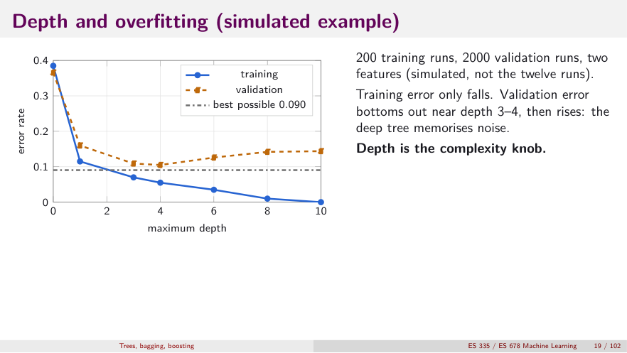
*👀 Slide 19 — The classic overfitting picture, with depth on the x-axis.*

**Step 2 — Pruning: charge a price per leaf.** Keep the tree that minimises
$$\text{cost}_\alpha(T) = R(T) + \alpha\,|T|,\qquad R = \text{training error rate},\quad |T| = \text{number of leaves}.$$

**Step 3 — On the twelve runs:**

| tree | $\lvert T\rvert$ | $R(T)$ | α = 0.05 | 0.1 | 0.2 | 0.4 |
|---|---|---|---|---|---|---|
| full tree | 4 | 0 | **0.200** | 0.400 | 0.800 | 1.600 |
| warm-up merged | 3 | 1/12 | 0.233 | 0.383 | 0.683 | 1.283 |
| rate only | 2 | 2/12 | 0.267 | **0.367** | **0.567** | 0.967 |
| no question | 1 | 6/12 | 0.550 | 0.600 | 0.700 | **0.900** |

**Step 4 — Crossing points.** Full beats rate-only when $4\alpha < \tfrac{2}{12} + 2\alpha$, i.e. $\alpha < \tfrac{1}{12}$. Rate-only beats no question when $\tfrac{2}{12} + 2\alpha < \tfrac12 + \alpha$, i.e. $\alpha < \tfrac13$. (At exactly $\alpha = \tfrac1{12}$ the first three trees all cost $\tfrac4{12}$, so "warm-up merged" never wins alone.)

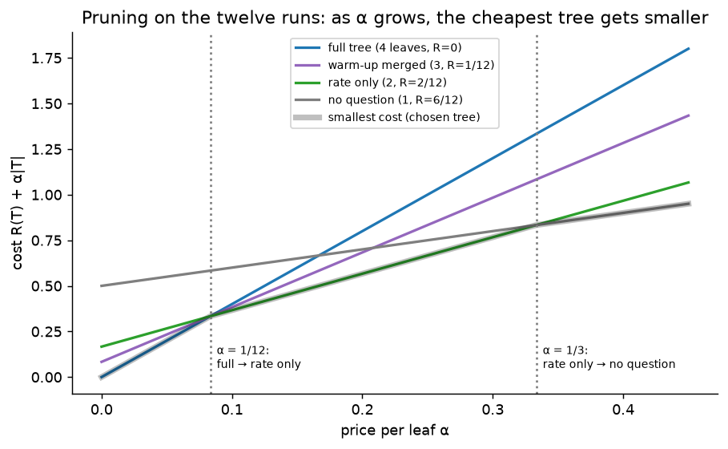
*📊 Larger price per leaf ⇒ smaller chosen tree. **Choose α (or the depth) by cross-validation**, never by training error (which always prefers the full tree, α = 0).*

## A10. Instability: why one tree is not enough

**Step 1 — Resample and regrow.** Draw the twelve runs again **with replacement** (a bootstrap sample) and grow a tree. In one such sample the first question is **warm-up, not rate** (gain 0.6175): the sample happened to miss runs 1 and 3, the two D runs that used warm-up, so warm-up looks like the cause.

**Step 2 — Consequence.** A small change in the data changes the **whole** tree (a different root changes everything below it): **high variance**.

**Step 3 — Two cures, two opposite weaknesses:**
- **Bagging** (L12b) averages many deep trees ⇒ cuts **variance**.
- **Boosting** (L12c–e) adds up many tiny trees ⇒ cuts **bias** (a small tree alone is too simple).

---

# Part B — Slide by Slide (slides 1–21)

## Slide 1 — Title
Decision trees, bagging and boosting; gradient boosting, AdaBoost and XGBoost on twelve training runs; colours show where each number comes from.

## Slide 2 — Notation and colour code
One dataset, every number by hand. Colour code: Part 1 shades questions by feature (**rate**, **batch size**, **warm-up**) and gain numbers by group (**parent**, **yes**, **no**); Part 2 shades by tree; Part 3 by stump question; Part 4 adds run weights and mistakes; Part 5 uses parent/yes/no plus settings (orange) and leaf weights (teal); Part 6 compares. On tree figures the **yellow path with thick arrows** is the route a new run follows.

## Slide 3 — Part 1: Decision trees (divider)

## Slide 4 — The twelve runs

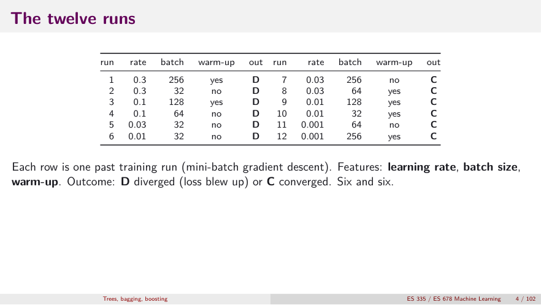
*👀 Slide 4 — Features: learning rate, batch size, warm-up. Outcome D (loss blew up) or C. Six and six.*

## Slide 5 — The decision tree grown from the twelve runs

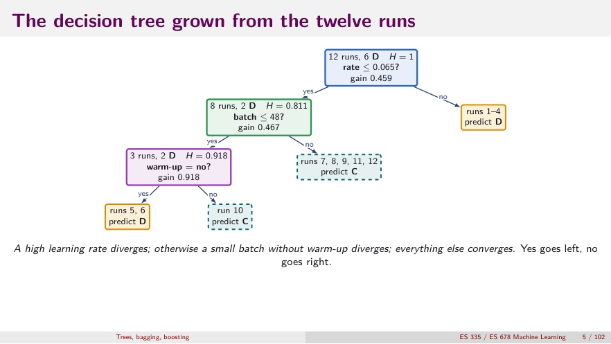
*👀 Slide 5 — The destination. Each node shows its runs, D-count and entropy; yes goes left, no goes right.*

## Slide 6 — Entropy: how mixed is a group?

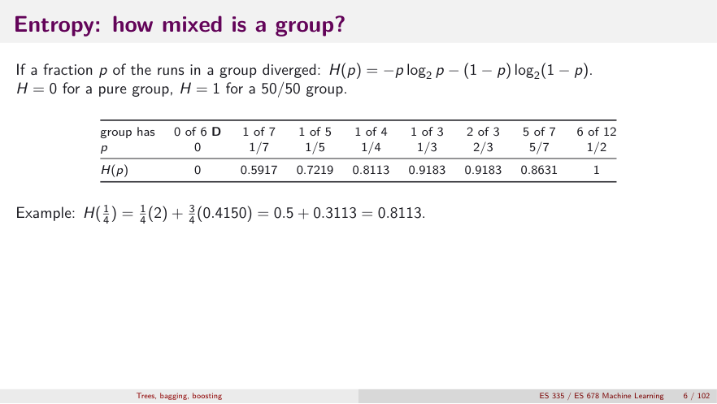
*👀 Slide 6 — $H(\tfrac14) = \tfrac14(2) + \tfrac34(0.4150) = 0.8113$. Details: A2.*

## Slide 7 — Three ways to measure mixing

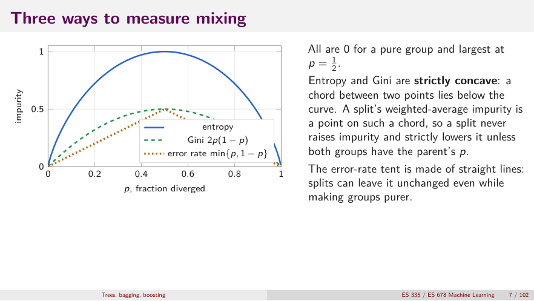
*👀 Slide 7 — Concave ⇒ a split never raises impurity; the error-rate tent can leave it unchanged even while groups get purer (A3).*

## Slide 8 — Scoring a question: the gain

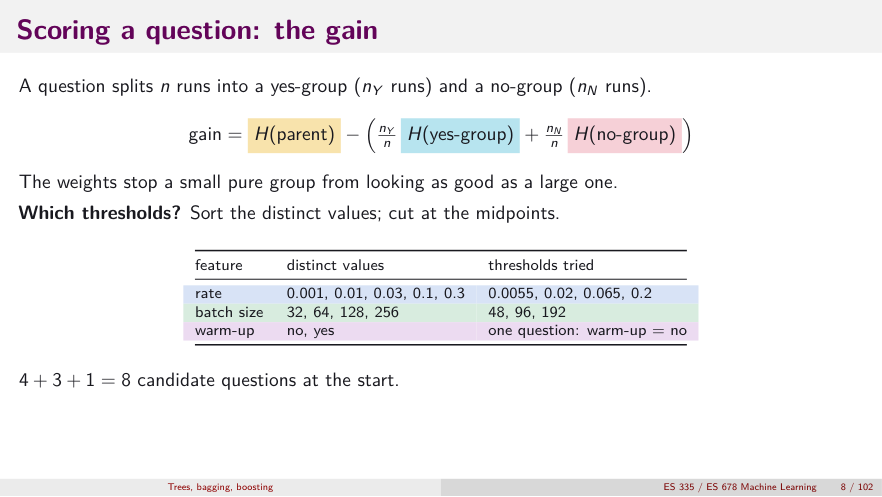
*👀 Slide 8 — Weights stop a small pure group from looking as good as a large one; thresholds at midpoints; 8 candidate questions (A4).*

## Slides 9–10 — Your turn: choose the first question (and answer)

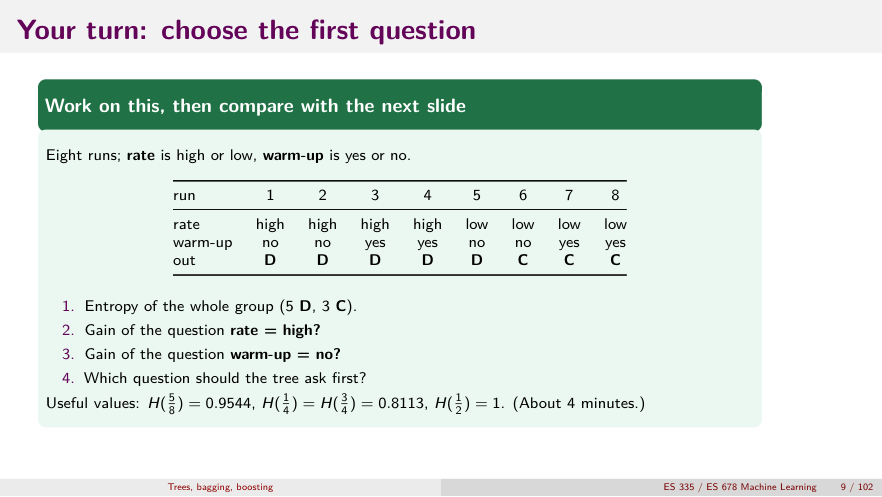
*👀 Slide 9 — Answer: gains 0.5488 (rate) vs 0.0488 (warm-up); ask rate first. Runs 5 and 6 identical ⇒ leaf with D-fraction ½. Full working in A4.*

## Slide 11 — Step 1: all eight candidate questions

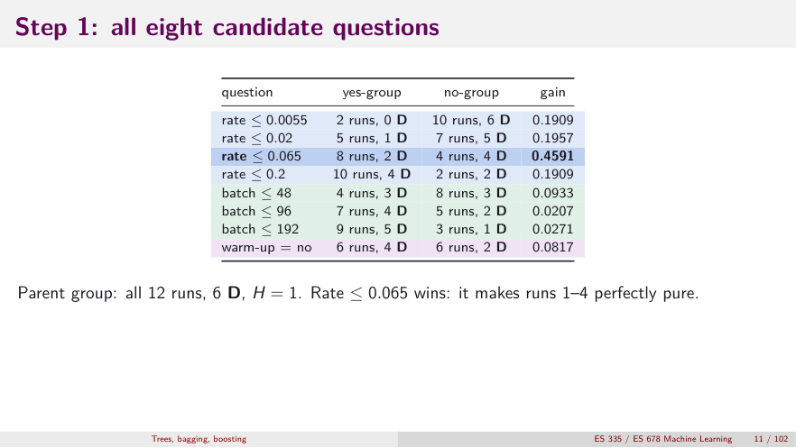
*👀 Slide 11 — Rate ≤ 0.065 wins: it makes runs 1–4 perfectly pure.*

## Slide 12 — Step 1: gain of the best question
$1 - (\tfrac8{12}\times0.8113 + \tfrac4{12}\times0) = 0.4591$; runner-up rate ≤ 0.02 gives 0.1957. The 4-run group is a leaf; the 8-run group continues (A5).

## Slide 13 — Step 2: inside the 8-run group

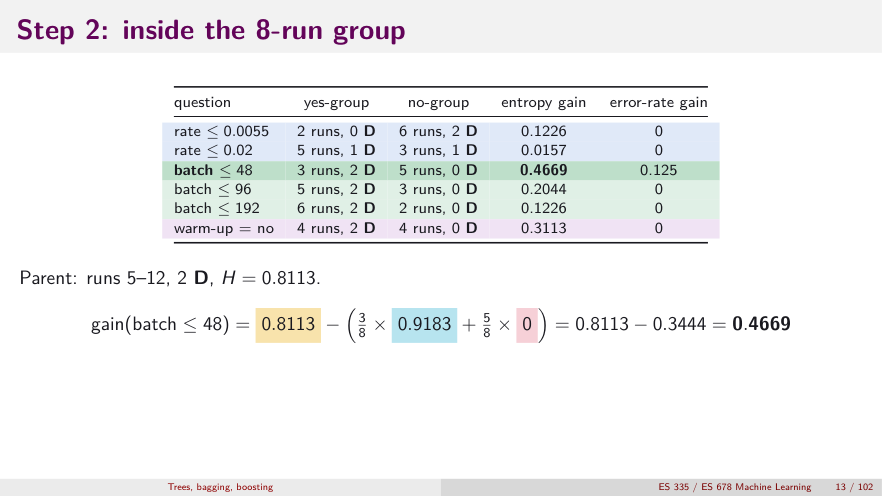
*👀 Slide 13 — $0.8113 - (\tfrac38\times0.9183 + \tfrac58\times0) = 0.4669$.*

## Slide 14 — Why error rate is a poor splitting criterion

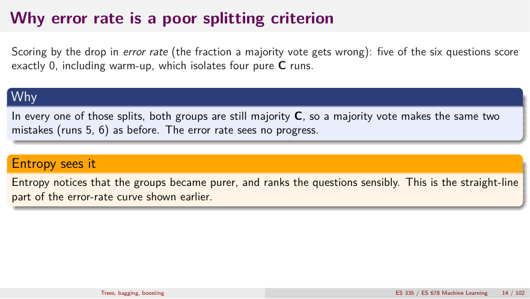
*👀 Slide 14 — Majority vote makes the same two mistakes (runs 5, 6) before and after; entropy sees the purification (A6 Step 4).*

## Slide 15 — Step 3: the last question, and when to stop

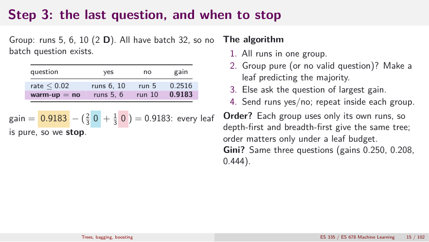
*👀 Slide 15 — The algorithm, plus: order doesn't matter (except under a leaf budget); Gini picks the same three questions (A7).*

## Slide 16 — Predicting: the number read from the leaf

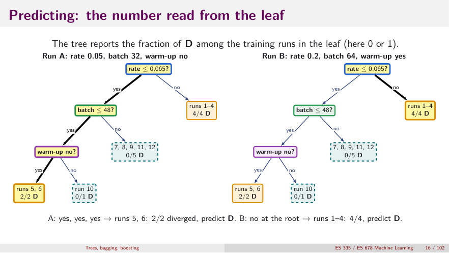
*👀 Slide 16 — The yellow path is the route; the leaf's D-fraction is the number reported (A8).*

## Slides 17–18 — Your turn: predict with the tree (and answer)
P → C (0/5), Q → C (0/1), R → D (4/4). **Least trusted: Q** — a single-run leaf. Table in A8 Step 3.

## Slide 19 — Depth and overfitting (simulated example)
Shown in A9. Training error only falls; validation error bottoms out near depth 3–4 then rises. **Depth is the complexity knob.**

## Slide 20 — Pruning: charge a price per leaf

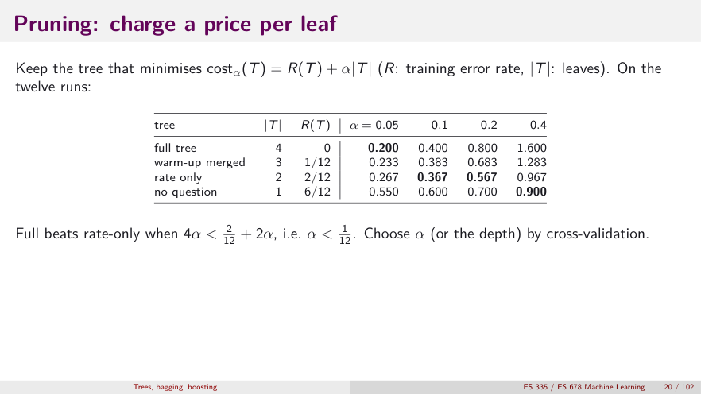
*👀 Slide 20 — Full beats rate-only when α < 1/12. Choose α by cross-validation (A9).*

## Slide 21 — Instability of a single tree

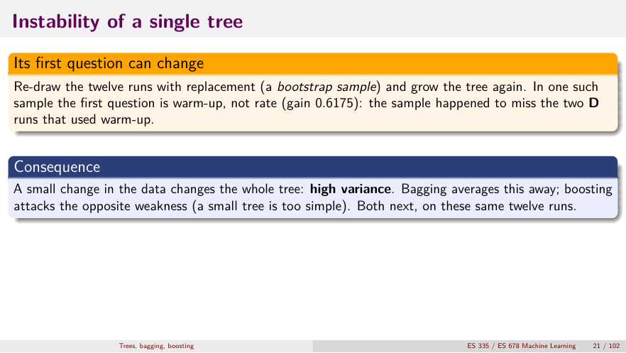
*👀 Slide 21 — Bootstrap sample S2 roots on warm-up (gain 0.6175). Continue in [L12b](L12b_bagging_random_forests.md).*

---

# Part C — Practice

From the practice sheet (`L12g`, Part A) plus checks on the deck. Keep four decimals for entropy and Gini.

**Formulas:** $H(p) = -p\log_2p - (1-p)\log_2(1-p)$; $G(p) = 2p(1-p)$; $E(p) = \min(p, 1-p)$; gain = impurity(parent) − $\tfrac{n_L}{n}$impurity(L) − $\tfrac{n_R}{n}$impurity(R); $R_\alpha(T) = R(T) + \alpha|T|$.

1. **Impurity of a group.** A group has 6 spam and 2 not-spam. Find entropy, Gini and error rate. Repeat for 3 spam, 3 not-spam.
2. **Gain of one split.** 10 emails, 6 spam / 4 not. "Contains a link?" sends 6 to yes (5 spam, 1 not) and 4 to no (1 spam, 3 not). Gain by (a) entropy, (b) Gini, (c) error rate.
3. **Which question first?** 12 emails, 7 spam / 5 not. (spam, not) counts:

   | question | yes-group | no-group |
   |---|---|---|
   | contains a link | (6, 1) | (1, 4) |
   | has an attachment | (3, 3) | (4, 2) |
   | sender unknown | (5, 1) | (2, 4) |

   (a) Entropy gain of each; choose the first question. (b) Error-rate gain of each. What do you notice about "has an attachment"?
4. **Second question, and a prediction.** Continue with "contains a link" at the root; its yes-group has 7 emails (6 spam, 1 not). Inside: *sender unknown* gives (4, 0) / (2, 1); *has an attachment* gives (3, 1) / (3, 0). (a) Entropy gain of each; choose. (b) A new email has a link and a known sender: which leaf, what prediction (with the leaf's spam fraction)?
5. **Why the error rate cannot grow a tree.** A group has 6 diverged, 2 converged. A split sends 4 diverged to one side (pure) and 2 diverged + 2 converged to the other. Gain by error rate, entropy, Gini. Which fails, and why?
6. **Pruning.** On 100 training runs: $T_1$ has 8 leaves, 2 mistakes; $T_2$ 5 leaves, 6 mistakes; $T_3$ 2 leaves, 15 mistakes. (a) $R_\alpha(T)$ for α = 0, 0.01, 0.02, 0.05; which tree wins each time? (b) For which α does $T_2$ start to beat $T_1$? $T_3$ beat $T_2$?
7. **(Deck review)** Gain of "batch ≤ 48" at the root of the twelve runs?
8. **(Deck)** Why can no question separate runs 5 and 6 of the "your turn" eight-run table?

<b>Answers</b>

1. Group 1, $p = 0.75$: $H = 0.3113 + 0.5 = 0.8113$; $G = 2(0.75)(0.25) = 0.375$; $E = 0.25$. Group 2, $p = 0.5$: $H = 1$, $G = 0.5$, $E = 0.5$ — the maximum of each: 50/50 is most mixed.
2. Parent $p = 0.6$: $H = 0.9710$, $G = 0.48$, $E = 0.4$. Yes ($p = \tfrac56$): $H = 0.6500$, $G = 0.2778$, $E = 0.1667$. No ($p = \tfrac14$): $H = 0.8113$, $G = 0.375$, $E = 0.25$. Weights 0.6, 0.4.
   (a) $0.9710 - 0.3900 - 0.3245 = 0.2564$. (b) $0.48 - 0.1667 - 0.15 = 0.1633$. (c) $0.4 - 0.1 - 0.1 = 0.2$.
3. Parent $H(\tfrac7{12}) = 0.9799$.
   Link: $0.9799 - \tfrac7{12}(0.5917) - \tfrac5{12}(0.7219) = 0.9799 - 0.3452 - 0.3008 = \mathbf{0.3339}$.
   Attachment: $0.9799 - 0.5 - \tfrac6{12}(0.9183) = 0.0207$. Unknown: $0.9799 - \tfrac6{12}(0.6500) - 0.4591 = 0.1957$.
   (a) **Link** first. (b) Parent error $\tfrac5{12} = 0.4167$. Link: $\tfrac1{12} + \tfrac1{12} = 0.1667$ ⇒ gain 0.25. Attachment: $0.25 + 0.1667 = 0.4167$ ⇒ gain **0**. Unknown: $0.0833 + 0.1667 = 0.25$ ⇒ gain 0.1667. Error rate gives attachment exactly 0 although the mix changed (50/50 and 67/33); entropy gives a small positive 0.0207.
4. Node $H(\tfrac67) = 0.5917$. Unknown: $0.5917 - \tfrac47(0) - \tfrac37(0.9183) = 0.1981$. Attachment: $0.5917 - \tfrac47(0.8113) = 0.1281$. (a) **Sender unknown**. (b) Link yes, unknown no ⇒ leaf (2 spam, 1 not): spam fraction $\tfrac23 = 0.667$ ⇒ **spam**, but only 3 emails support it.
5. Parent $p = 0.75$: $H = 0.8113$, $G = 0.375$, $E = 0.25$. Children (weight ½ each): pure (0, 0, 0); mixed (1, 0.5, 0.5). Entropy $0.8113 - 0.5 = 0.3113$; Gini $0.375 - 0.25 = 0.125$; **error rate $0.25 - 0.25 = 0$**. Error rate is concave but not *strictly*: the chord can lie on the function. Entropy and Gini are strictly concave ⇒ reward any change in the class mix.
6. $R$ = 0.02, 0.06, 0.15; leaves 8, 5, 2.

   | α | $T_1$ | $T_2$ | $T_3$ | winner |
   |---|---|---|---|---|
   | 0 | 0.02 | 0.06 | 0.15 | $T_1$ |
   | 0.01 | 0.10 | 0.11 | 0.17 | $T_1$ |
   | 0.02 | 0.18 | 0.16 | 0.19 | $T_2$ |
   | 0.05 | 0.42 | 0.31 | 0.25 | $T_3$ |

   (b) $0.06 + 5\alpha < 0.02 + 8\alpha \iff \alpha > 0.0133$; $0.15 + 2\alpha < 0.06 + 5\alpha \iff \alpha > 0.03$.
7. $1 - \tfrac4{12}(0.8113) - \tfrac8{12}(0.9544) = 0.0933$ (yes: 4 runs, 3 D; no: 8 runs, 3 D).
8. Both have rate low and warm-up no: identical features, different outcomes. Every question sends them to the same side, so the leaf keeps a D-fraction of ½.

**Next:** [L12b — Bagging & random forests](L12b_bagging_random_forests.md): grow many trees on resampled data and average them.
