# Lecture 12b — Bagging and Random Forests: Bootstrap, Averaging, Variance Floor, OOB Error

> ES 335 / ES 678 Machine Learning, Sem I 2026 — Prof. Udit Bhatia
> Sources: `Lectures/L12_student_trees_bagging_boosting_worked_deck.pdf` (Part 2, slides 22–41), `Lectures/L12c_student_bagging_variance_bias_notes.pdf` (16-page notes: bagging regression trees, bias–variance), `Lectures/L12d_student_bagging_worked_example_on_trees.pdf` (7-page worked example), `Lectures/L12g_student_practice_trees_bagging_forests.pdf` (Parts B–D) · Previous: [`L12a_decision_trees.md`](L12a_decision_trees.md) · Next: [`L12c_gradient_boosting.md`](L12c_gradient_boosting.md)

**Lecture 12 files:** [L12a Trees](L12a_decision_trees.md) → **[L12b Bagging & random forests](L12b_bagging_random_forests.md)** → [L12c Gradient boosting](L12c_gradient_boosting.md) → [L12d AdaBoost](L12d_adaboost.md) → [L12e XGBoost & comparison](L12e_xgboost_and_comparison.md)

**How to use this file.** L12a ended with a problem: one deep tree changes completely when the data change a little (**high variance**). Bagging = **b**ootstrap **agg**regat**ing**: (1) make many training sets from the one you have by resampling, (2) grow a full tree on each, (3) average them. This file explains *why* it works with one formula, $\mathrm{Var}(\bar T) = \rho\sigma^2 + (1-\rho)\sigma^2/B$, and its consequence: a **floor** that only a **random forest** can lower. Along the way: what variance and bias actually mean, the 63% / 37% rule of the bootstrap, soft vs hard voting, and the free validation set called **out-of-bag error**. Part A is the maths step by step; Part B walks slides 22–41; Part B′ covers the two sets of notes; Part C is practice.

**Two datasets are used:**
- the **twelve runs** of L12a (classification; table in [L12a](L12a_decision_trees.md)), with new runs **A** (0.05, 32, no) and **B** (0.2, 64, yes);
- **eight points** for regression (notes L12c): $x$ = model size (millions of parameters), $y$ = minutes per epoch, made from a known truth $\mu(x) = x + 1$ plus noise:

| $i$ | 1 | 2 | 3 | 4 | 5 | 6 | 7 | 8 |
|---|---|---|---|---|---|---|---|---|
| $x$ | 1 | 2 | 3 | 4 | 5 | 6 | 7 | 8 |
| $y$ | 2 | 3 | 3 | 5 | 6 | 8 | 8 | 9 |
| $\mu(x)$ | 2 | 3 | 4 | 5 | 6 | 7 | 8 | 9 |
| noise | 0 | 0 | −1 | 0 | 0 | +1 | 0 | 0 |

**What this file is really about:**
$$\underbrace{T_b = \text{full tree on bootstrap sample } b}_{\text{low bias, high variance}}\ \longrightarrow\ \underbrace{\bar T = \tfrac1B\textstyle\sum_b T_b}_{\text{same bias}}\ \longrightarrow\ \underbrace{\mathrm{Var}(\bar T) = \rho\sigma^2 + \frac{(1-\rho)\sigma^2}{B}}_{\text{floor }\rho\sigma^2\ \Rightarrow\ \text{random forest lowers }\rho}$$

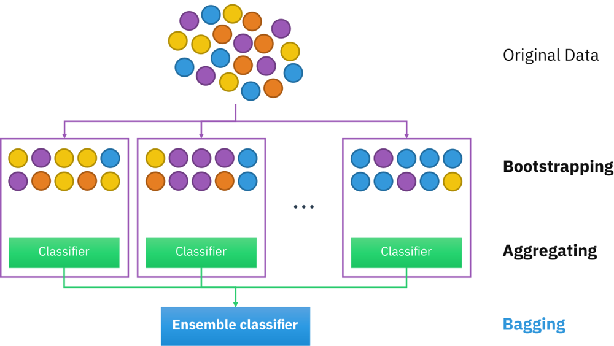
*The whole idea in one picture: resample, train in parallel, combine. (Wikimedia Commons: [Ensemble_Bagging.svg](https://commons.wikimedia.org/wiki/File:Ensemble_Bagging.svg), Sirakorn, CC BY-SA 4.0)*

## Contents

**Part A — Maths from the ground up**
1. [What "variance" and "bias" of a prediction mean](#a1-what-variance-and-bias-of-a-prediction-mean)
2. [Bias² + variance + noise](#a2-bias--variance--noise)
3. [Averaging independent predictions: σ²/B](#a3-averaging-independent-predictions-σb)
4. [Correlated trees: the floor ρσ²](#a4-correlated-trees-the-floor-ρσ)
5. [The bootstrap: many training sets from one; the 63% rule](#a5-the-bootstrap-many-training-sets-from-one-the-63-rule)
6. [Bagging on the twelve runs, step by step](#a6-bagging-on-the-twelve-runs-step-by-step)
7. [Soft vote vs hard vote; why a vote helps](#a7-soft-vote-vs-hard-vote-why-a-vote-helps)
8. [Bagging regression trees on the eight points](#a8-bagging-regression-trees-on-the-eight-points)
9. [Where ρ comes from; checking the formula](#a9-where-ρ-comes-from-checking-the-formula)
10. [Random forests: lower ρ by hiding features](#a10-random-forests-lower-ρ-by-hiding-features)
11. [Out-of-bag error: a free validation set](#a11-out-of-bag-error-a-free-validation-set)
12. [What bagging fixes and what boosting fixes](#a12-what-bagging-fixes-and-what-boosting-fixes)

**Part B — Slides 22–41** · [Jump](#part-b--slide-by-slide-slides-2241) · **Part B′ — The two notes** · [Jump](#part-b--the-notes-l12c-and-l12d) · **Part C — Practice** · [Jump](#part-c--practice)

---

# Part A — Maths From the Ground Up

## A1. What "variance" and "bias" of a prediction mean

**Step 1 — Fix one input $x_0$.** A model's prediction there, $\hat f(x_0)$, is **one number**: follow the tree to a leaf and read it.

**Step 2 — Imagine a different training set.** Same $x$'s, fresh noise. The tree would be different, $x_0$ would land in a different leaf, and the number would change.

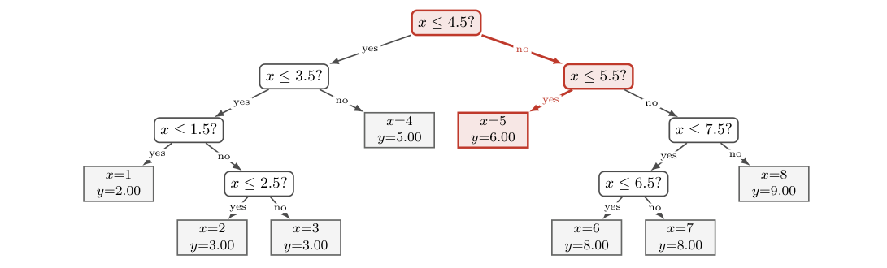
*👀 Notes Fig. 1 — A fully grown regression tree on the eight points. In 1-D it predicts the $y$ of the **nearest** training point (questions sit halfway between neighbours). $x_0 = 4.6 \to 6.00$ (truth 5.6). At $x_0 = 6.4$ it predicts 8 (truth 7.4): it copied the +1 noise of point 6.*

**Step 3 — Prediction variance** = how much that one number moves **when only the training set changes**. It is *not* the scatter of $y$ around the truth, and *not* how the prediction changes from one $x$ to another.

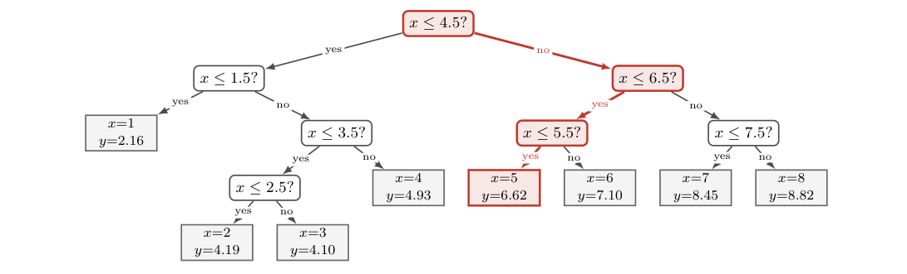
*👀 Notes Fig. 2 — Same source, new noise ⇒ different questions, different leaf values ⇒ 5.45 vs 6.62 at the same $x_0$.*

**Step 4 — Measure it on six simulated training sets** (prediction at $x_0 = 4.6$ = $y$ at $x = 5$):

| set | 1 | 2 | 3 | 4 | 5 | 6 | average |
|---|---|---|---|---|---|---|---|
| prediction | 5.45 | 6.00 | 6.62 | 5.46 | 6.33 | 5.86 | **5.953** |
| deviation | −0.50 | +0.05 | +0.67 | −0.49 | +0.38 | −0.09 | |
| squared | 0.253 | 0.002 | 0.444 | 0.243 | 0.142 | 0.009 | **0.182** |

$$\mathrm{Var}(\hat f(x_0)) = E\big[(\hat f(x_0) - E\hat f(x_0))^2\big] \approx 0.182.$$
(Six sets are few; over many it settles near $\mathrm{Var}(\varepsilon) = 0.5^2 = 0.25$, because the tree simply copies $y_5$.)

**Step 5 — Bias** = how far the **average** prediction is from the truth:
$$\mathrm{Bias}(\hat f(x_0)) = E[\hat f(x_0)] - \mu(x_0) = E[y_5] - \mu(4.6) = 6 - 5.6 = 0.4.$$
A full tree has very low bias (it can follow any shape); the 0.4 is only because it must copy a neighbour.

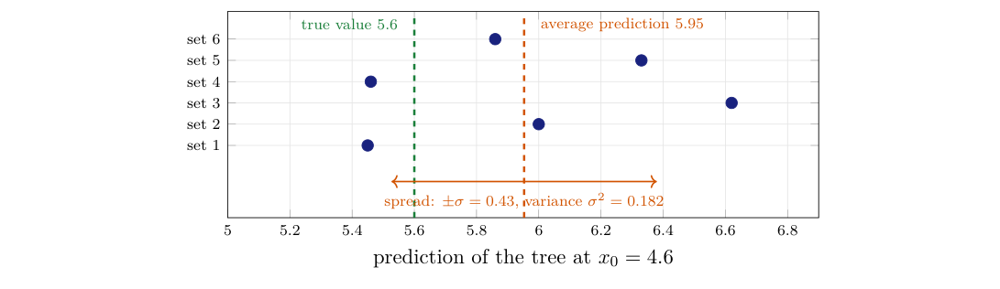
*👀 Notes Fig. 3 — **Variance** = spread of the dots around their own average (orange). **Bias** = distance from that average to the truth (green).*

## A2. Bias² + variance + noise

**Step 1 — Set-up.** A fresh measurement $y_0 = \mu + \varepsilon_0$ with $E\varepsilon_0 = 0$, $\mathrm{Var}\,\varepsilon_0 = \sigma_\varepsilon^2$; a prediction $\hat f$ independent of $\varepsilon_0$, with mean $\bar f = E\hat f$.

**Step 2 — Split the error into three pieces:**
$$y_0 - \hat f = (\mu - \bar f) + (\bar f - \hat f) + \varepsilon_0.$$

**Step 3 — Square and take expectations.** The three squares give $(\mu-\bar f)^2$, $E(\bar f - \hat f)^2$, $E\varepsilon_0^2$. The three cross terms vanish: $E[\bar f - \hat f] = 0$, $E[\varepsilon_0] = 0$, and $\hat f$, $\varepsilon_0$ are independent with zero-mean factors. So
$$\boxed{E\big[(y_0 - \hat f(x_0))^2\big] = \mathrm{Bias}^2 + \mathrm{Var}(\hat f) + \sigma_\varepsilon^2}$$

**Step 4 — Read it.** Bias: model is systematically off. Variance: model moves with the sample. Noise: nobody can predict it. **We can only reduce the first two.** Bagging works on variance; boosting on bias (A12).

## A3. Averaging independent predictions: σ²/B

**Step 1 — $B$ trees, each with variance $\sigma^2$, independent.** Average $\bar f = \frac1B\sum_b\hat f_b$.

**Step 2 — Two variance rules:** $\mathrm{Var}(cX) = c^2\mathrm{Var}(X)$; for independent terms, $\mathrm{Var}(\sum X_b) = \sum\mathrm{Var}(X_b)$.

**Step 3 — Combine:**
$$\mathrm{Var}(\bar f) = \frac{1}{B^2}\sum_b\mathrm{Var}(\hat f_b) = \frac{B\sigma^2}{B^2} = \frac{\sigma^2}{B}.$$
Five independent trees with $\sigma^2 = 0.25$: $0.25/5 = 0.05$.

**Step 4 — The bias does not move.** $E[\bar f] = \frac1B\sum_b E[\hat f_b] = m(x)$, the same as one tree. **Averaging changes the variance and leaves the bias alone.**

## A4. Correlated trees: the floor ρσ²

Trees grown on resamples of the **same** data look alike, so they are not independent.

**Step 1 — Model it.** Each tree has variance $\sigma^2$; every pair has correlation $\rho$, so $\mathrm{Cov}(T_b, T_c) = \rho\sigma^2$ for $b\ne c$.

**Step 2 — Pull out the constant:** $\mathrm{Var}(\bar T) = \frac{1}{B^2}\mathrm{Var}\big(\sum_bT_b\big)$.

**Step 3 — Expand the sum over all pairs:** $\mathrm{Var}\big(\sum_bT_b\big) = \sum_{b=1}^B\sum_{c=1}^B\mathrm{Cov}(T_b, T_c)$.

**Step 4 — Count the terms:** $B$ with $b = c$ (each $\sigma^2$) and $B(B-1)$ with $b\ne c$ (each $\rho\sigma^2$): total $B\sigma^2 + B(B-1)\rho\sigma^2$.

**Step 5 — Divide by $B^2$:**
$$\boxed{\mathrm{Var}(\bar T) = \frac{\sigma^2}{B} + \frac{B-1}{B}\rho\sigma^2 = \rho\sigma^2 + \frac{(1-\rho)\sigma^2}{B}}$$

**Step 6 — Read it.**
- $\rho = 0$: $\sigma^2/B$ (independent trees).
- $\rho = 1$: $\sigma^2$ — averaging copies does nothing.
- $B\to\infty$: the **floor** $\rho\sigma^2$ remains, however many trees.

| $\sigma^2 = 1$ | ρ = 0 | ρ = 0.3 | ρ = 0.6 | ρ = 1 |
|---|---|---|---|---|
| B = 1 | 1.000 | 1.000 | 1.000 | 1.000 |
| B = 4 | 0.250 | 0.475 | 0.700 | 1.000 |
| B = 25 | 0.040 | 0.328 | 0.616 | 1.000 |
| B = ∞ | 0.000 | 0.300 | 0.600 | 1.000 |

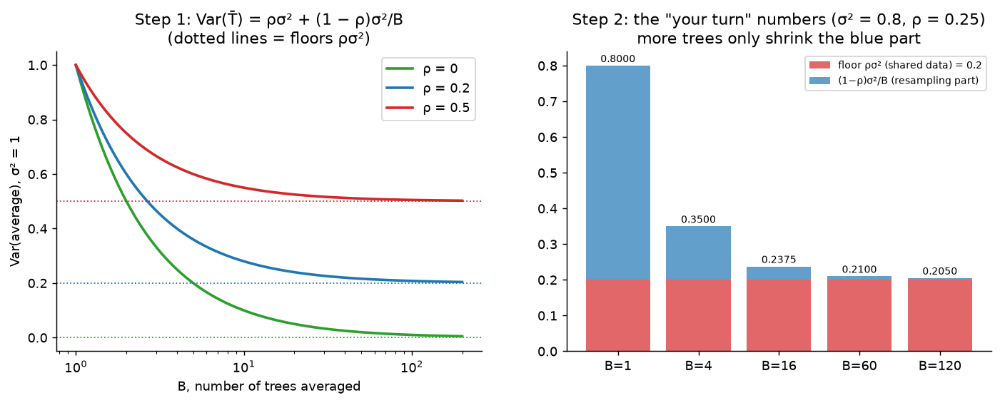
*📊 Step 1: curves flatten at their floor. Step 2: the "your turn" numbers ($\sigma^2 = 0.8$, $\rho = 0.25$): $B = 16$ gives $0.2 + 0.0375 = 0.2375$; to get within 0.01 of the floor 0.2 you need $0.6/B\le0.01$, i.e. $B\ge60$; doubling to 120 only goes 0.21 → 0.205.*

**What σ² and ρ mean at one input** (deck slide 32). Fix run A; let $T_b = 1$ if tree $b$ says D, 0 if C. If a share $p$ of trees say D, $\sigma^2 = p(1-p)$:

| share saying D, $p$ | $\sigma^2 = p(1-p)$ | meaning |
|---|---|---|
| 1.00 | 0 | every tree agrees: nothing to average away |
| 0.872 (run A) | 0.1115 | most agree, a few differ |
| 0.50 | 0.25 | trees split evenly: one tree is no better than a guess |

$\rho$ = how much two trees' answers move together (0: one tells you nothing about the other; 1: always agree).

## A5. The bootstrap: many training sets from one; the 63% rule

**Step 1 — Draw $n$ points with replacement from the $n$ you have.** A point may appear 0, 1, 2, 3… times. Same size, slightly different picture of the data.

**Step 2 — Chance a given point is never drawn.** One draw misses it with probability $1 - \frac1n$; $n$ independent draws all miss it with
$$\Big(1 - \frac1n\Big)^n\ \xrightarrow{n\to\infty}\ e^{-1} = 0.368.$$
*Why the limit:* $\ln(1 - \tfrac1n)^n = n\ln(1 - \tfrac1n)\approx n(-\tfrac1n) = -1$.

| $n$ | 8 | 12 | 20 | 100 | 1000 | ∞ |
|---|---|---|---|---|---|---|
| P(left out) | 0.344 | 0.352 | 0.358 | 0.366 | 0.368 | 0.368 |
| share appearing | 0.656 | 0.648 | 0.642 | 0.634 | 0.632 | 0.632 |

**Step 3 — Rule of thumb:** a bootstrap sample contains about **63%** of the distinct points; about **37%** are **out of bag**. That difference is what makes the trees differ.

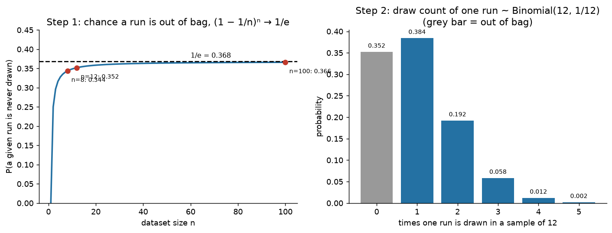
*📊 Step 1: the out-of-bag chance converges to 1/e very fast. Step 2: one run's draw count in a sample of 12 — e.g. P(exactly twice) = $\binom{12}{2}(\tfrac1{12})^2(\tfrac{11}{12})^{10} = 0.192$.*

## A6. Bagging on the twelve runs, step by step

**Step 1 — Draw three bootstrap samples** (each cell: how many times the sample drew that run):

| run | out | S1 | S2 | S3 | | run | out | S1 | S2 | S3 |
|---|---|---|---|---|---|---|---|---|---|---|
| 1 | D | 3 | 0 | 0 | | 7 | C | 1 | 0 | 2 |
| 2 | D | 0 | 2 | 0 | | 8 | C | 2 | 1 | 2 |
| 3 | D | 1 | 0 | 1 | | 9 | C | 0 | 1 | 0 |
| 4 | D | 2 | 2 | 0 | | 10 | C | 1 | 2 | 0 |
| 5 | D | 0 | 2 | 3 | | 11 | C | 2 | 1 | 0 |
| 6 | D | 0 | 1 | 2 | | 12 | C | 0 | 0 | 2 |

Column sums are 12. S1 missed 2, 5, 6, 9, 12; S2 missed 1, 3, 7, 12; S3 missed 1, 2, 4, 9, 10, 11.

**Step 2 — Grow a full tree on each** (same rule as L12a: largest entropy gain, stop when pure).

- **Tree 1 (S1):** 6 D draws (1,1,1,3,4,4), 6 C draws (7,8,8,10,11,11), $H = 1$. rate ≤ 0.065 splits them perfectly: gain $= 1 - 0 = 1.0000$ ⇒ stops after one question.
- **Tree 2 (S2):** 7 D (2,2,4,4,5,5,6), 5 C (8,9,10,10,11), $H(\tfrac7{12}) = 0.9799$. Best root **warm-up = no**: 8 draws with 7 D ($H(\tfrac78) = 0.5436$) and 4 draws all C:
  $\text{gain} = 0.9799 - \tfrac8{12}(0.5436) = 0.9799 - 0.3624 = 0.6175$.
  Run 11 (C) is in the 8-draw group, so it asks rate ≤ 0.0055 to isolate it (gain 0.5436). *Why warm-up?* S2 lacks runs 1 and 3 — the D runs **with** warm-up — so warm-up looks like the cause (rate ≤ 0.065 would only give 0.344).
- **Tree 3 (S3):** 6 D (3,5,5,5,6,6), 6 C (7,7,8,8,12,12), $H = 1$. Best root **batch ≤ 48**: 5 draws all D, 7 draws with 1 D ($H(\tfrac17) = 0.5917$):
  $\text{gain} = 1 - \tfrac7{12}(0.5917) = 1 - 0.3451 = 0.6549$. Then rate ≤ 0.065 isolates run 3.

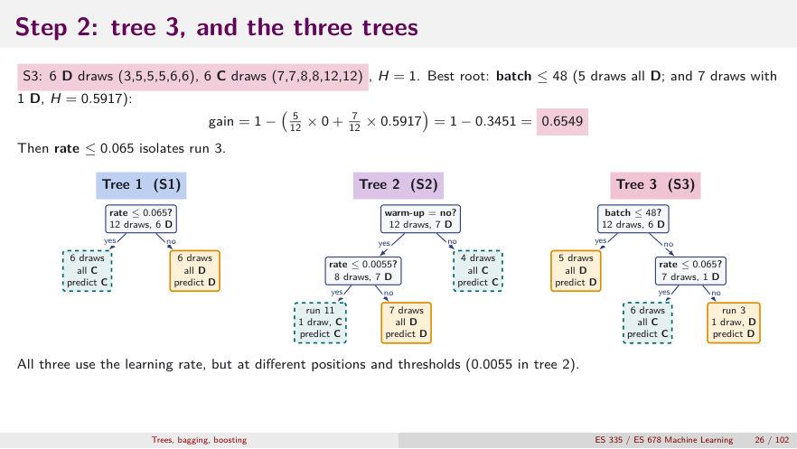
*👀 Slide 26 — Three samples of the same data ⇒ three different trees. All use the learning rate, but at different positions and thresholds.*

**Step 3 — Send a new run down every tree; read one number from each** ($T_b$ = fraction of D draws in the leaf reached):

| tree | run A (0.05, 32, no): leaf | $T_b(A)$ | run B (0.2, 64, yes): leaf | $T_b(B)$ |
|---|---|---|---|---|
| 1 | rate ≤ 0.065 yes → 0/6 | **0** | rate ≤ 0.065 no → 6/6 | **1** |
| 2 | warm-up no; rate > 0.0055 → 7/7 | **1** | warm-up yes → 0/4 | **0** |
| 3 | batch ≤ 48 yes → 5/5 | **1** | batch > 48; rate > 0.065 → 1/1 | **1** |

**Step 4 — Average, threshold at ½:**
$$\bar T(A) = \tfrac13(0 + 1 + 1) = \tfrac23\Rightarrow\textbf{D},\qquad\bar T(B) = \tfrac13(1 + 0 + 1) = \tfrac23\Rightarrow\textbf{D}.$$
Same answer as the single tree — but the single tree **showed no doubt**; the bag shows one tree in three disagrees. *Averaging turned a hidden disagreement into a number.*

**Step 5 — Three trees give a rough estimate.** With three trees $\bar T\in\{0, \tfrac13, \tfrac23, 1\}$. With 20,000 bootstrap trees (simulation) the share saying D settles at **0.872** (A) and **0.934** (B); with 200 trees, 0.845 and 0.965.

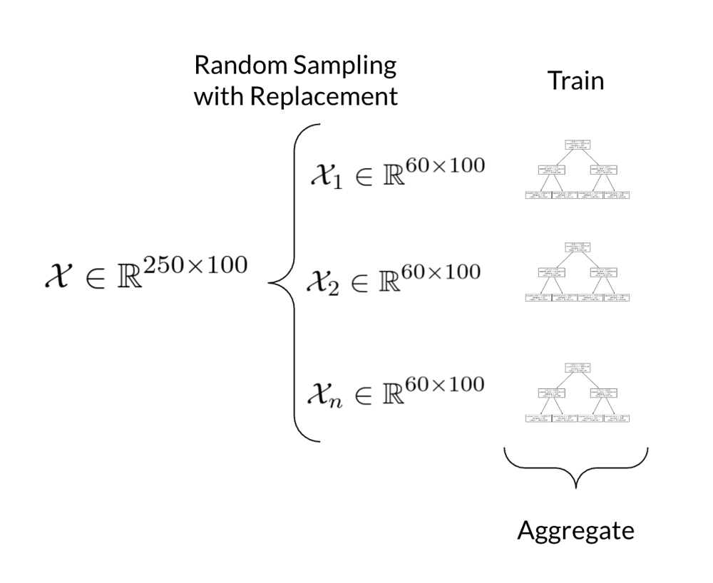
*Resample → train → aggregate, in general form. (Wikimedia Commons: [Random_Forest_Bagging_Illustration.png](https://commons.wikimedia.org/wiki/File:Random_Forest_Bagging_Illustration.png), Harry585, CC BY-SA 4.0)*

## A7. Soft vote vs hard vote; why a vote helps

**Step 1 — Two ways to combine.**
- **Soft vote:** average the trees' leaf fractions (what A6 did).
- **Hard vote:** each tree casts D if its fraction > ½, else C; count.

**Step 2 — Example (slides 30–31).** Leaves contain (4 draws, 3 D), (5, 0 D), (2, 2 D): $T = 0.75, 0, 1$. Soft: $\tfrac13(0.75 + 0 + 1) = 0.583$ ⇒ D. Hard: D, C, D ⇒ $\tfrac23 = 0.667$ ⇒ D. Same answer, different confidence.

**Step 3 — They can disagree** (practice P9): fractions 0.55, 0.52, 0.51, 0.05, 0.02. Soft: 0.33 ⇒ not spam. Hard: 3 of 5 ⇒ spam. Soft uses confidence (two very sure trees pull hard); hard counts every tree once. Soft is the usual default when trees give probabilities.

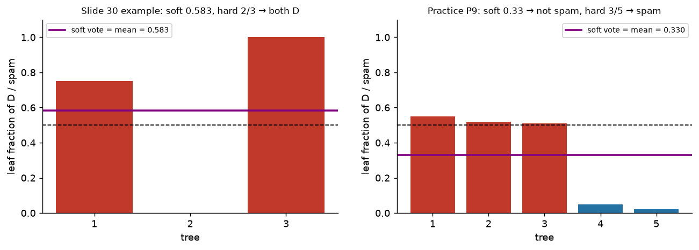
*📊 Left: the rules agree. Right: three borderline trees out-vote two confident ones under hard voting, but not under soft voting.*

**Step 4 — Why a vote helps.** Each voter right with probability 0.6, independent:

| voters | 1 | 5 | 25 | 101 |
|---|---|---|---|---|
| P(majority right) | 0.600 | 0.683 | 0.846 | 0.979 |

(5 voters: $\sum_{k=3}^5\binom5k0.6^k0.4^{5-k} = 0.683$.) **Two warnings:** (1) if the voters make the same mistakes ($\rho = 1$) the majority is no better than one voter; (2) a vote cannot fix a **bias**: if every voter is wrong for the same systematic reason, so is the majority.

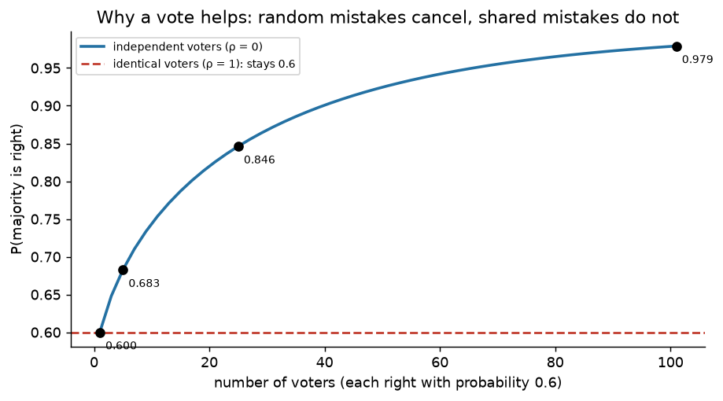
*📊 Random mistakes cancel in a large majority; shared mistakes do not.*

## A8. Bagging regression trees on the eight points

**Step 1 — Five bootstrap samples** (sorted):

| sample | points drawn | left out | distinct |
|---|---|---|---|
| 1 | 1, 1, 2, 2, 3, 6, 6, 7 | 4, 5, 8 | 5 |
| 2 | 1, 2, 2, 2, 4, 4, 7, 7 | 3, 5, 6, 8 | 4 |
| 3 | 1, 1, 1, 2, 4, 4, 7, 7 | 3, 5, 6, 8 | 4 |
| 4 | 1, 2, 3, 3, 3, 5, 5, 7 | 4, 6, 8 | 5 |
| 5 | 1, 2, 2, 2, 4, 4, 6, 8 | 3, 5, 7 | 5 |

**Step 2 — Grow a full tree on each.** Each predicts the $y$ of the nearest point **in its sample**. At $x_0 = 4.6$:

| tree | distinct $x$ in sample | nearest to 4.6 | $\hat f_b$ |
|---|---|---|---|
| 1 | 1, 2, 3, 6, 7 | 6 | 8.0 |
| 2 | 1, 2, 4, 7 | 4 | 5.0 |
| 3 | 1, 2, 4, 7 | 4 | 5.0 |
| 4 | 1, 2, 3, 5, 7 | 5 | 6.0 |
| 5 | 1, 2, 4, 6, 8 | 4 | 5.0 |

**Step 3 — Average:** $\hat f_{\text{bag}}(4.6) = 29/5 = \mathbf{5.80}$ (single tree: 6.0; truth: 5.6).

Each bootstrap tree alone is *worse* than the tree on all eight points (it has seen fewer distinct points), but their errors partly cancel. **Why not train B trees on the same data?** They would be identical ($\rho = 1$).

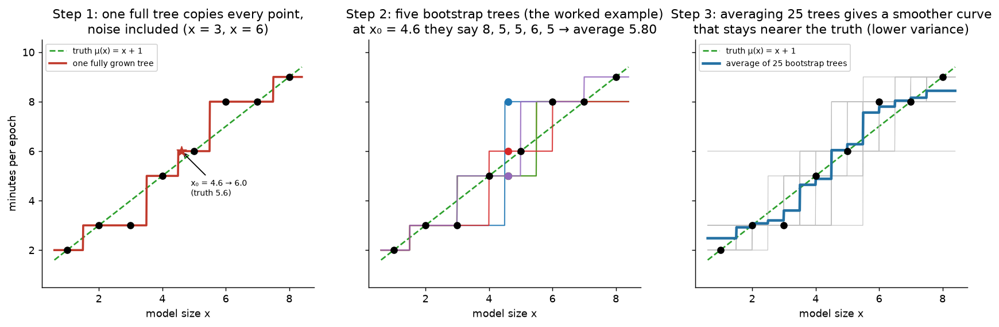
*📊 Step 1 → Step 3: one tree, five trees, the average of 25.*

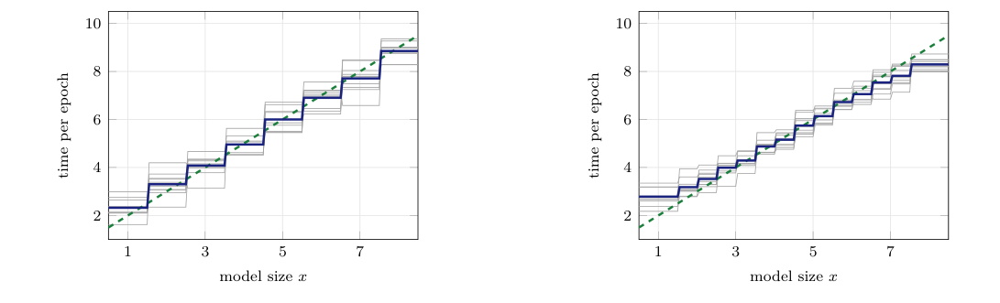
*👀 Notes Fig. 4 — Low bias, high variance (left) vs bagged: **much lower variance** (right).*

## A9. Where ρ comes from; checking the formula

**Step 1 — Check σ²/B by simulation** (resample the twelve runs, grow a tree, record its answer at run A; $p = 0.872$ ⇒ $\sigma^2_{\text{boot}} = 0.1115$):

| B | measured variance of the average | $\sigma^2_{\text{boot}}/B$ |
|---|---|---|
| 1 | 0.1118 | 0.1115 |
| 3 | 0.0362 | 0.0372 |
| 10 | 0.0111 | 0.0111 |
| 50 | 0.0021 | 0.0022 |

They agree — but **no floor**. Why? Here only the resampling varies; the dataset is fixed.

**Step 2 — Split the randomness in two.** Given the data $\mathcal D$, bootstrap trees are independent. Let $\mu(\mathcal D) = E[T\mid\mathcal D]$. By the laws of total covariance/variance, for $b\ne c$:
$$\mathrm{Cov}(T_b, T_c) = \underbrace{E[\mathrm{Cov}(T_b,T_c\mid\mathcal D)]}_{=0} + \mathrm{Var}(\mu(\mathcal D)),\qquad\sigma^2 = \mathrm{Var}(\mu(\mathcal D)) + E[\mathrm{Var}(T\mid\mathcal D)].$$

**Step 3 — Read off the two parts:**
$$\rho\sigma^2 = \mathrm{Var}(\mu(\mathcal D))\ \ (\text{due to the data}),\qquad(1-\rho)\sigma^2 = E[\mathrm{Var}(T\mid\mathcal D)]\ \ (\text{due to resampling}).$$
**Averaging removes the resampling part, not the data part: that is the floor.**

**Step 4 — Numbers.** On a simulated 200-run example: $\sigma^2 = 0.071$, $\rho = 0.26$, floor 0.019; a single full tree's validation error 0.144 fell to **0.115** for a 200-tree bag. On the eight-point regression (notes): one bootstrap tree has $\sigma^2 = 0.683$; solving the formula for ρ, $\rho = \dfrac{\mathrm{Var}_B - \sigma^2/B}{\sigma^2 - \sigma^2/B}\approx0.18$ at $B = 100$, and then the formula *predicts* the other rows:

| B | 1 | 5 | 10 | 25 | 100 |
|---|---|---|---|---|---|
| simulated | 0.683 | 0.237 | 0.181 | 0.146 | 0.131 |
| $\rho\sigma^2 + (1-\rho)\sigma^2/B$ | 0.683 | 0.237 | 0.181 | 0.148 | 0.131 |

**Step 5 — Measuring ρ directly** needs many training sets (simulation): repeat $K$ times "new training set → two bootstrap trees → their predictions $u_k, v_k$", then
$$r = \frac{\frac1K\sum(u_k - \bar u)(v_k - \bar v)}{\sqrt{\frac1K\sum(u_k - \bar u)^2\cdot\frac1K\sum(v_k-\bar v)^2}}.$$
Six pairs at $x_0 = 4.6$ give $r = 0.062/\sqrt{0.299\times0.436} = 0.17$; 6000 pairs give 0.18. With real data there is one training set, so ρ is not measured directly; its effect shows as the OOB error **stopping improving** as B grows.

## A10. Random forests: lower ρ by hiding features

**Step 1 — Are bagged trees really different?** Not very. Root-question feature over 20,000 bootstrap trees:

| | rate | batch | warm-up |
|---|---|---|---|
| bagging (all 3 features at every split) | **80.8%** | 12.2% | 6.9% |
| random forest, 2 random features per split | 58.7% | 28.0% | 13.2% |
| random forest, 1 random feature per split | 35.2% | 33.2% | 31.6% |

Plain bagging starts with rate in four trees of five ⇒ trees alike ⇒ ρ high ⇒ floor high.

**Step 2 — The random-forest trick.** At **every split** offer only a random subset of $m$ of the $p$ features (often $m\approx\sqrt p$). Trees not offered the best feature must start elsewhere ⇒ they differ more ⇒ **ρ falls** ⇒ floor falls.

**Step 3 — Where 58.7% comes from.** With 2 of 3 offered, rate is offered at the root in $\tfrac23$ of trees; when offered it wins 88% ⇒ $\tfrac23\times0.88 = 0.587$.

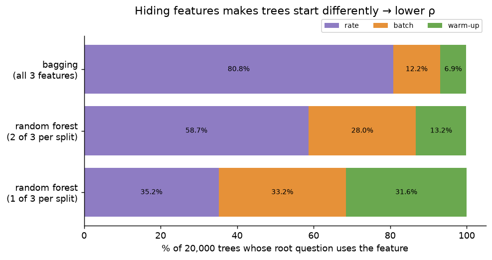
*📊 The fewer features offered, the more evenly trees start ⇒ less alike.*

**Step 4 — The price.** Each tree is a little worse (larger σ²). Simulated: σ² 0.071 → 0.082, ρ 0.26 → 0.20, floor **0.019 → 0.016**. Usually the drop in ρ wins — but not always (practice P18): if hiding features makes trees too weak, bagging wins. $m$ is a setting to tune.

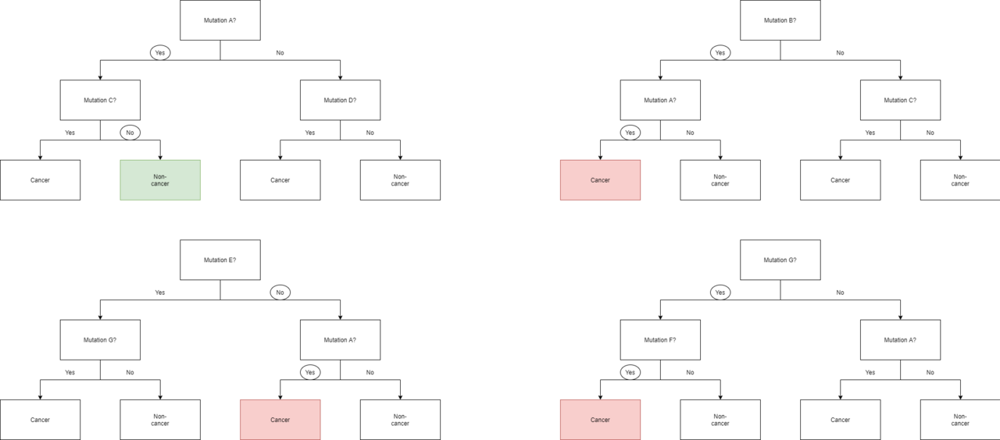
*Many different trees, one vote. (Wikimedia Commons: [Random_Forest_Diagram_with_Four_Trees.png](https://commons.wikimedia.org/wiki/File:Random_Forest_Diagram_with_Four_Trees.png), CollaborativeGeneticist, CC BY-SA 4.0)*

## A11. Out-of-bag error: a free validation set

**Step 1 — The idea.** Each tree missed ≈37% of the runs. For one training run, let **only the trees that never saw it** vote, and compare with its true class.

**Step 2 — The twelve runs, B = 200** (each run out of bag in ≈70 trees):

| run | true | trees not drawing it | frac. D | OOB | right? |
|---|---|---|---|---|---|
| 1 | D | 63 | 0.746 | D | yes |
| 2 | D | 65 | 0.985 | D | yes |
| 3 | D | 68 | 0.632 | D | yes |
| 4 | D | 77 | 0.818 | D | yes |
| 5 | D | 70 | 0.557 | D | yes |
| 6 | D | 74 | 0.189 | C | **no** |
| 7 | C | 69 | 0.406 | C | yes |
| 8 | C | 66 | 0.455 | C | yes |
| 9 | C | 80 | 0.037 | C | yes |
| 10 | C | 69 | 0.783 | D | **no** |
| 11 | C | 70 | 0.514 | D | **no** |
| 12 | C | 68 | 0.000 | C | yes |

**Step 3 — OOB error = 3/12 = 0.25.** The single tree scored on its own runs: 0 errors — an optimistic estimate. OOB is honest (no run is predicted by a tree that trained on it) and costs nothing: **no runs held out**.

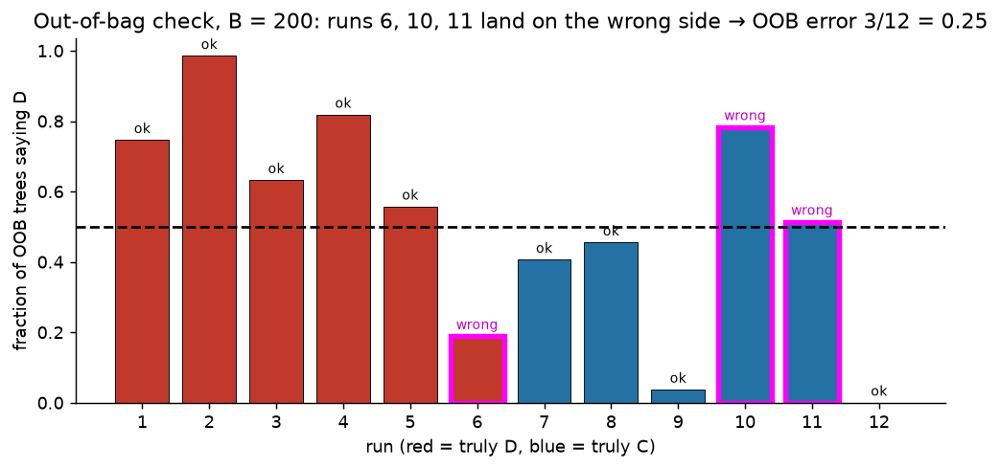
*📊 Runs 6, 10, 11 are the hard ones — exactly the low-rate/small-batch corner that needed the warm-up question.*

**Step 4 — Uses.** (i) Estimate the error of a forest without a validation set. (ii) Choose $B$ and $m$: pick the smallest OOB error. In scikit-learn: `RandomForestClassifier(oob_score=True)`.

## A12. What bagging fixes and what boosting fixes

**Step 1 — Measure all three error parts** (4000 simulated training sets of eight points, truth $x + 1$, noise sd 0.5 ⇒ $\mathrm{Var}\,\varepsilon = 0.25$; averaged over the eight $x$):

| method | bias² | variance | noise | expected error |
|---|---|---|---|---|
| average of the $y$'s only (no tree) | 5.250 | 0.033 | 0.250 | 5.533 |
| boosting, 1 round (ν = 0.5) | 2.104 | 0.222 | 0.250 | 2.575 |
| boosting, 3 rounds | 0.426 | 0.268 | 0.250 | 0.944 |
| boosting, 8 rounds | 0.011 | 0.261 | 0.250 | 0.522 |
| one fully grown tree | 0.000 | 0.252 | 0.250 | 0.502 |
| bagging, 25 fully grown trees | 0.081 | **0.146** | 0.250 | **0.477** |

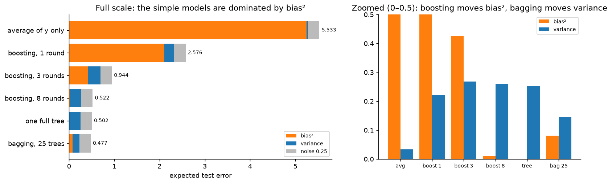
*📊 Read by columns: boosting drives **bias²** from 5.25 → 0.011; bagging cuts **variance** 0.252 → 0.146 (paying a little bias, 0.081, because bootstrap trees see fewer points).*

**Step 2 — How can a sum of weak stumps have low bias?** Bias belongs to the **whole model**. Each stump is fitted to the **residual** (what is still wrong), and the model is the sum. One stump has 2 levels; a sum of $t$ stumps can have up to $t + 1$ levels, so the family grows every round. Noise-free example (truth $x+1$, full step):

| round | stump added | F(1) | F(2) | F(3) | F(4) | F(5) | F(6) | F(7) | F(8) | bias² |
|---|---|---|---|---|---|---|---|---|---|---|
| 0 | start: average | 5.50 | 5.50 | 5.50 | 5.50 | 5.50 | 5.50 | 5.50 | 5.50 | 5.25 |
| 1 | x ≤ 4.5: −2.00, +2.00 | 3.50 | 3.50 | 3.50 | 3.50 | 7.50 | 7.50 | 7.50 | 7.50 | 1.25 |
| 2 | x ≤ 2.5: −1.00, +0.33 | 2.50 | 2.50 | 3.83 | 3.83 | 7.83 | 7.83 | 7.83 | 7.83 | 0.92 |
| 3 | x ≤ 7.5: −0.17, +1.17 | 2.33 | 2.33 | 3.67 | 3.67 | 7.67 | 7.67 | 7.67 | 9.00 | 0.72 |
| 4 | x ≤ 4.5: +0.50, −0.50 | 2.83 | 2.83 | 4.17 | 4.17 | 7.17 | 7.17 | 7.17 | 8.50 | 0.47 |

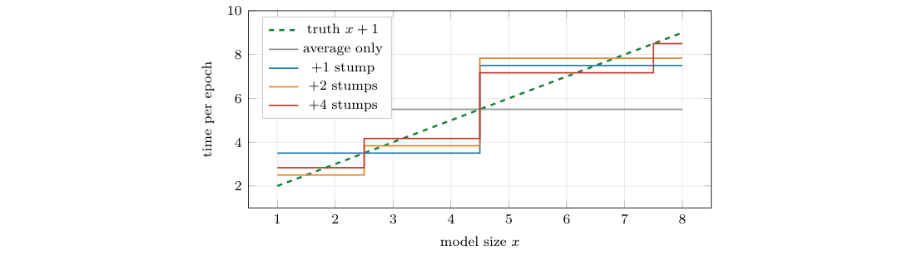
*👀 Notes Fig. 6 — Weak pieces, strong sum. The full mechanism is [L12c](L12c_gradient_boosting.md).*

**Step 3 — Side by side.**

| | bagging (random forest) | boosting |
|---|---|---|
| trees | deep: low bias, high variance | shallow: high bias, low variance |
| built | independently, on bootstrap samples (parallel) | one after another, on what is still wrong |
| combined by | average / vote | sum of small corrections |
| fixes | **variance**, down to the floor ρσ² | **bias**, step by step |
| more trees | never hurts; variance falls to a floor | too many rounds start to fit noise |
| main settings | number of trees; features per split | step size; rounds; depth |

> **One sentence:** *bagging averages away the variance of deep trees; boosting adds up small trees to remove the bias of shallow ones.*

**Common confusions.**
- *Why trees?* Deep trees are unstable — exactly what bagging fixes. Linear regression barely moves between samples, so bagging hardly helps it.
- *Does bagging overfit when B is large?* No: more trees lower variance toward the floor; the bias doesn't get worse.
- *Is the bootstrap cheating (points repeat)?* Repeats only change how much a point counts in one tree; the average over many resamples is used, and its error is checked out-of-bag.

---

# Part B — Slide by Slide (slides 22–41)

## Slide 22 — Part 2: Bagging (divider)
Colours: tree 1 (S1), tree 2 (S2), tree 3 (S3).

## Slide 23 — Bagging: the procedure

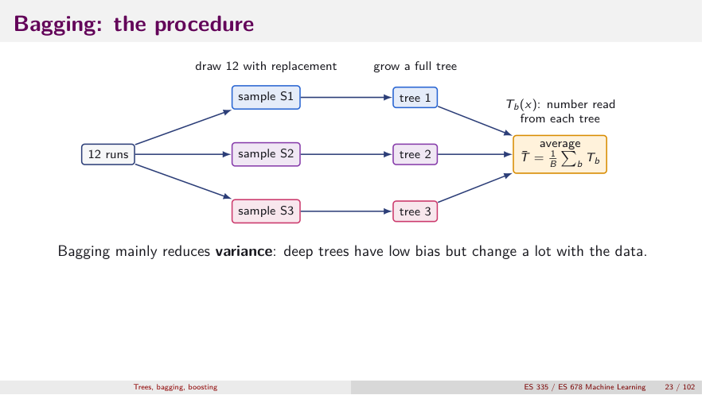
*👀 Slide 23 — Bagging mainly reduces **variance**: deep trees have low bias but change a lot with the data.*

## Slide 24 — Step 1: draw three bootstrap samples

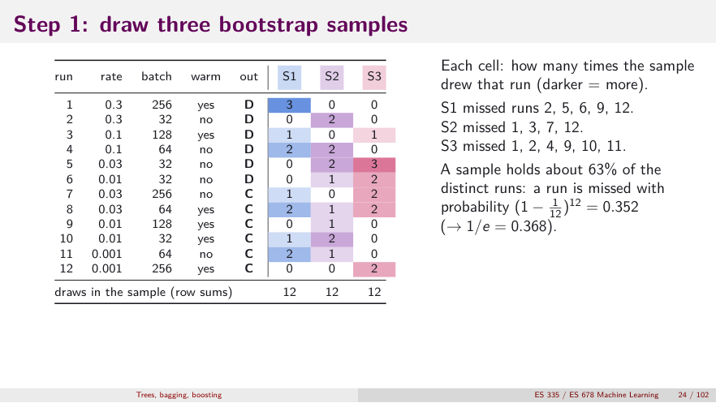
*👀 Slide 24 — $(1 - \tfrac1{12})^{12} = 0.352\to1/e$ (A5).*

## Slide 25 — Step 2: grow a tree on S1 and S2

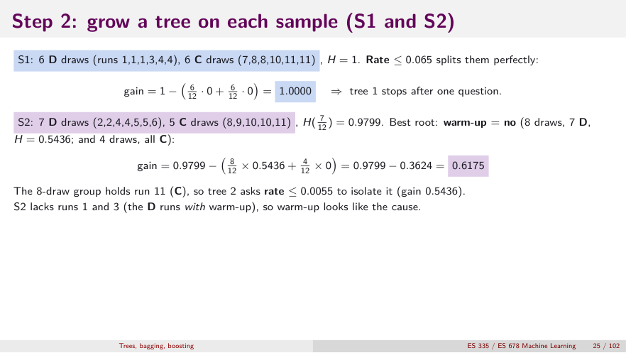
*👀 Slide 25 — S2 lacks runs 1 and 3, so warm-up looks like the cause (A6 Step 2).*

## Slide 26 — Step 2: tree 3, and the three trees
Shown in A6. S3: batch ≤ 48 gain 0.6549, then rate ≤ 0.065 isolates run 3.

## Slides 27–28 — Step 3: predictions of runs A and B by each tree

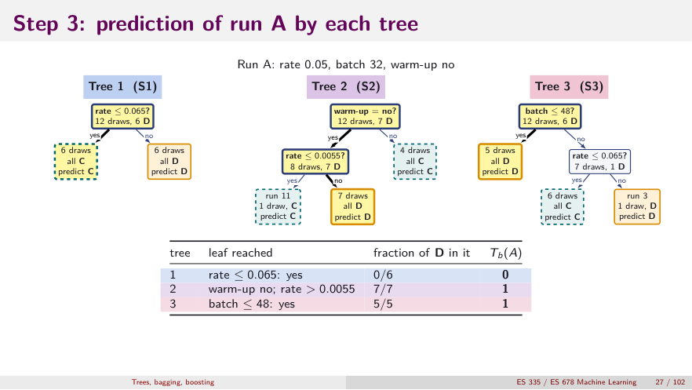
*👀 Slide 27 — $T(A) = 0, 1, 1$.*

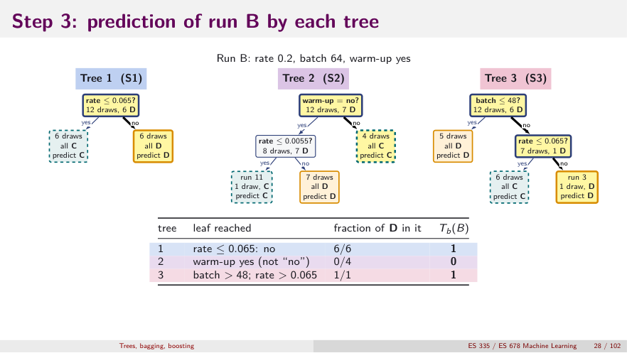
*👀 Slide 28 — $T(B) = 1, 0, 1$. Tree 2 says C because its sample has no high-rate run with warm-up.*

## Slide 29 — Step 4: average the numbers, threshold at ½

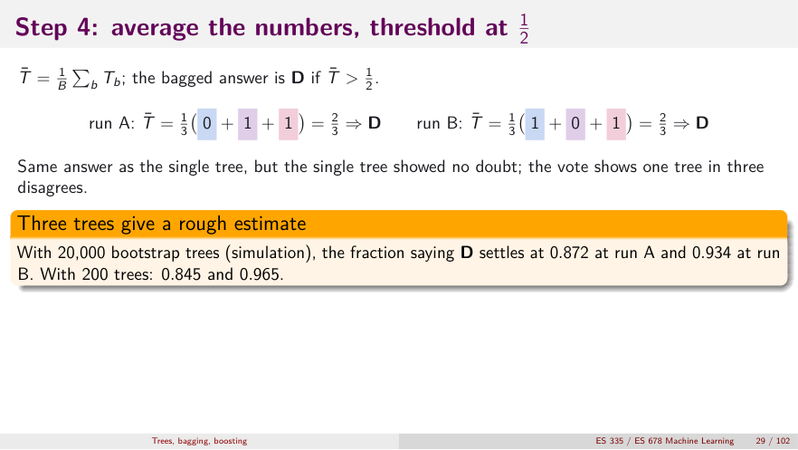
*👀 Slide 29 — The bag shows the disagreement the single tree hid.*

## Slides 30–31 — Your turn: average the trees (and answer)

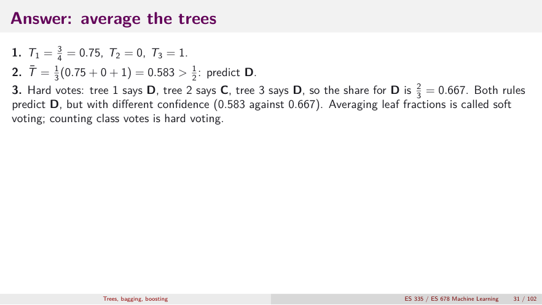
*👀 Slide 31 — Averaging leaf fractions = **soft voting**; counting class votes = **hard voting** (A7).*

## Slide 32 — What σ² and ρ measure

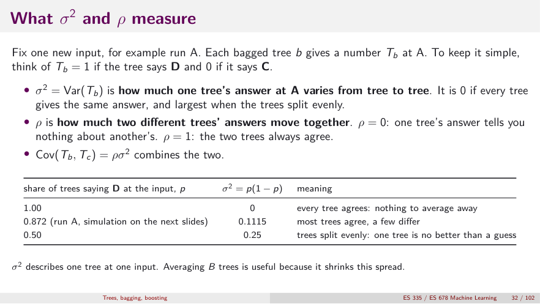
*👀 Slide 32 — σ² describes one tree at one input; averaging B trees shrinks it (A4).*

## Slides 33–34 — Why averaging helps: the variance (1 and 2 of 2)

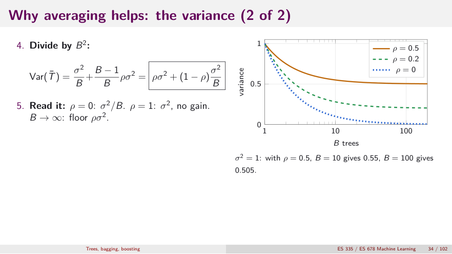
*👀 Slide 34 — Five-step derivation in A4. σ² = 1, ρ = 0.5: B = 10 → 0.55; B = 100 → 0.505.*

## Slides 35–36 — Your turn: the variance of an average (and answer)
σ² = 0.8, ρ = 0.25. (1) B = 16: $0.2 + 0.0375 = 0.2375$. (2) Floor 0.2. (3) $0.6/B\le0.01\Rightarrow B\ge60$; 120 trees only 0.21 → 0.205.

## Slide 37 — Checking the variance formula by simulation

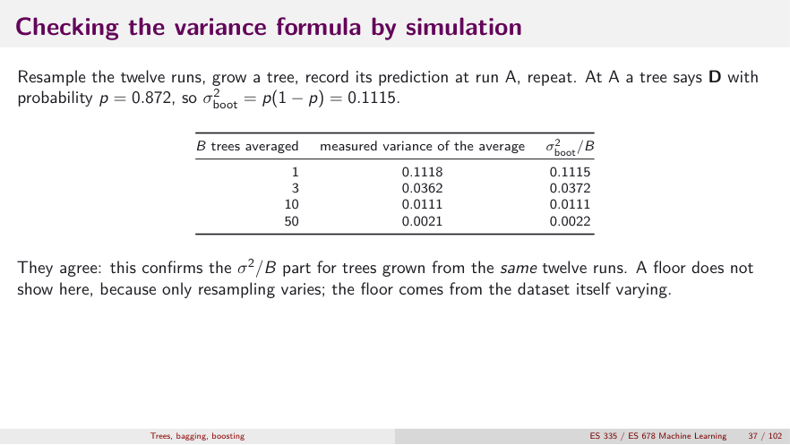
*👀 Slide 37 — Confirms σ²/B; no floor because only resampling varies (A9).*

## Slide 38 — Where the correlation ρ comes from

![Slide 38 — Law of total covariance: ρσ² = Var(μ(D)) is the data part, (1−ρ)σ² = E[Var(T|D)] the resampling part.](images/L12b/slides/s038_rho_origin.png)
*👀 Slide 38 — Averaging removes the resampling part, not the data part.*

## Slide 39 — Feature use across bagged trees; random forests

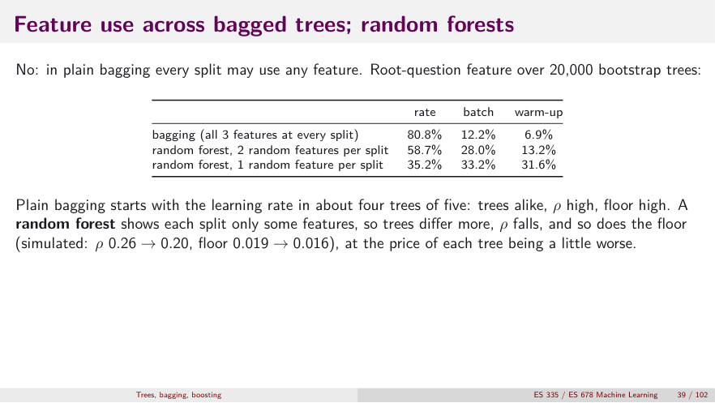
*👀 Slide 39 — Random forest: ρ 0.26 → 0.20, floor 0.019 → 0.016 (A10).*

## Slide 40 — Out-of-bag error

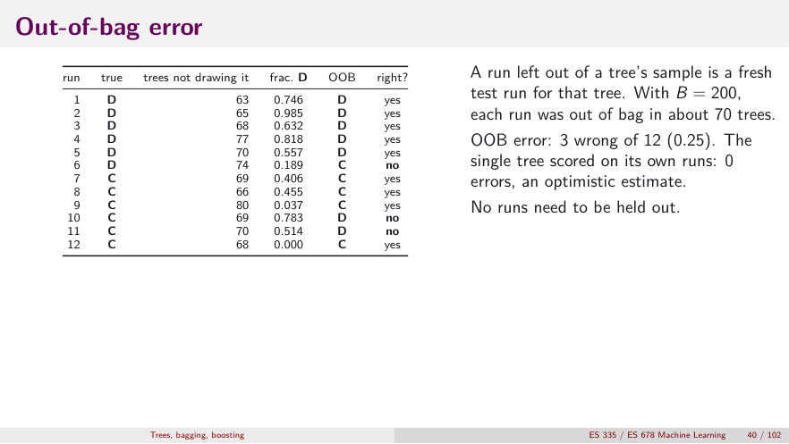
*👀 Slide 40 — OOB error 0.25; single tree on its own runs: 0 (optimistic). No runs need to be held out (A11).*

## Slide 41 — Bagging: summary of the procedure

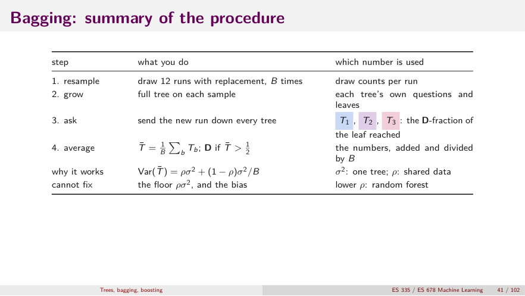
*👀 Slide 41 — Cannot fix: the floor ρσ² and the bias. Lower ρ: random forest.*

---

# Part B′ — The Notes (L12c and L12d)

### Notes L12c, §1–2 — a tree that memorises; what variance means
Eight points from $\mu(x) = x + 1$; a full tree is a nearest-neighbour step function with training error 0 because it fitted the noise. Prediction variance, bias and the six-set table: A1. Your turn 1: at $x_0 = 2.7$ and $3.4$ the nearest point is 3 ⇒ prediction 3; truths 3.7 and 4.4 ⇒ errors 0.7 and 1.4 (the noise −1 at $x = 3$ is copied over a longer stretch). Your turn 2: predictions 2.9, 5.1, 4.2, 3.4, 5.4 ⇒ mean 4.20, squared deviations sum 4.58 ⇒ variance 0.916.

### Notes L12c, §3–4 — averaging and the bootstrap
A3–A5. Your turn 3: σ² = 0.25, B = 4: (a) independent 0.0625; (b) ρ = 0.5: $0.125 + 0.03125 = 0.15625$ — four correlated trees are about as noisy as two independent ones. Your turn 4: $(7/8)^8$: $0.7656\to0.5862\to0.3436$.

### Notes L12c, §5 — bagging step by step

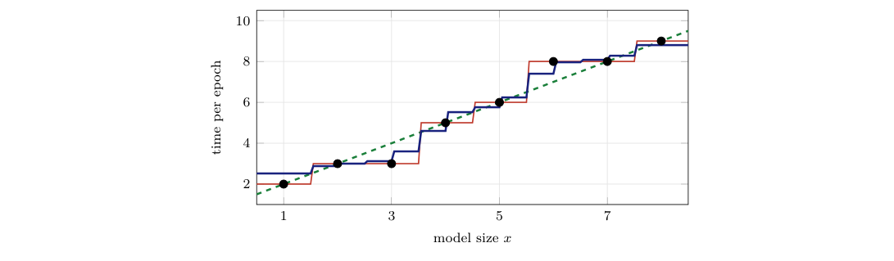
*👀 Notes Fig. 5 — The blue (bagged) curve is smoother and nearer the truth. Your turn 5: a sixth sample with $x = 3,\dots,8$ ⇒ nearest to 4.6 is 5 ⇒ 6.0; average of six $= 35/6 = 5.83$.*

### Notes L12c, §6 — bias and variance: what each method fixes
Table and noise-free boosting example in A12. ρ measured from pairs (A9 Step 5). Your turn 6: $u = 4,6,8,5,7$, $v = 5,5,7,6,7$: means 6, 6; covariance $5/5 = 1$; var(u) = 2, var(v) = 0.8 ⇒ $r = 1/\sqrt{1.6} = 0.79$.

### Notes L12c, §7–8 — voting; random forests
Majority-vote table and two warnings: A7. Random forest: at every split look at a random subset (e.g. $\sqrt d$ of $d$) ⇒ ρ falls, each tree a bit weaker; in practice the lower correlation wins.

### Notes L12c, §9 — derive-it-yourself boxes (summary)
D1: bias² + variance + noise (A2). D2: σ²/B (A3). D3: ρσ² + (1−ρ)σ²/B (A4). D4: $(1 - 1/N)^N\to e^{-1}$ (A5). D5: $E[\bar f] = m(x)$ ⇒ averaging leaves bias alone (A3 Step 4).

### Notes L12d — bagging on decision trees (worked example)
The same computation as deck slides 23–41, written out as a document: the single tree, three bootstrap samples, three trees, paths of A and B, the variance derivation, where ρ comes from, root-feature shares, OOB table, and five review questions (answers: S2 lacks runs 1 and 3; $T_2(B) = 0$; $0.3 + 0.7/20 = 0.335$, floor 0.3; no floor because only resampling varies; random forest hides features so trees use different questions). All covered in A6–A11.

---

# Part C — Practice

From the practice sheet (`L12g`, Parts B–D) plus deck review questions.

**Formulas:** P(run missed) $= (1 - \tfrac1n)^n\to e^{-1}$; soft vote = mean of leaf fractions; hard vote = share of trees with fraction > ½; $\mathrm{Var}(\bar T) = \rho\sigma^2 + (1-\rho)\sigma^2/B$, floor $\rho\sigma^2$.

**Part B — Bootstrap and bagging**
1. **(P7)** (a) $n = 12$: P(given run not drawn), and expected number of distinct runs. (b) Compare $n = 100$, $n\to\infty$. (c) P(run 3 drawn exactly twice), $n = 12$.
2. **(P8)** Sample $S = (1,1,3,4,4,6,7,7,7,9,10,12)$. (a) Out-of-bag runs? (b) Distinct runs seen? (c) Most-drawn run?
3. **(P9)** Five trees' leaf spam fractions: 0.55, 0.52, 0.51, 0.05, 0.02. (a) Soft vote? (b) Hard vote? (c) Why do they differ?
4. **(P10)** Out-of-bag votes for 8 training emails:

   | email | 1 | 2 | 3 | 4 | 5 | 6 | 7 | 8 |
   |---|---|---|---|---|---|---|---|---|
   | true | spam | spam | not | not | spam | not | spam | not |
   | trees not drawing it | 3 | 4 | 3 | 5 | 2 | 4 | 3 | 3 |
   | of these, voting spam | 2 | 1 | 0 | 3 | 2 | 1 | 3 | 1 |

   (a) OOB prediction for emails 2–8 (email 1: 2/3 spam ⇒ spam, correct). (b) OOB error. (c) Why is a full tree's 0 training mistakes not a good estimate, while OOB is?

**Part C — Variance of an average** (background: from $K = 6$ repeats of two trees, σ² ≈ 0.5 and ρ ≈ 0.3; check: average of two trees has variance 0.322 = $0.146 + 0.176$ ✓; B = 4 gives $\tfrac1{16}(4\times0.5 + 12\times0.15) = 0.2375$.)

5. **(P11)** σ² = 0.5, ρ = 0.3. Variance of the average of (a) 10, (b) 100, (c) ∞ trees; reduction factor each time.
6. **(P12)** σ² = 0.4, B = 25. Variance when ρ = 0, 0.5, 1. What does each say about averaging?
7. **(P13)** σ² = 1, ρ = 0.2. (a) Trees to get within 0.01 of the floor? (b) Trees for variance ≤ 0.25? (c) Can it reach 0.15?
8. **(P14)** Single tree variance 0.12; average of B = 10 has 0.048. Find ρ and the floor.
9. **(P15)** Six trees' leaf fractions at one input: 0.9, 0.7, 0.8, 0.4, 1.0, 0.6. (a) Prediction? (b) σ² by sample variance (divide by B − 1). (c) What does σ² measure here?

**Part D — Random forests**
10. **(P16)** $p = 5$ features, $m = 2$ offered per split. (a) Number of pairs? (b) P(strongest feature offered)? (c) P(two specific features both offered)? (d) $p = 100$, $m = 10$: P(strongest offered)? (e) With $m = 10$ and 15 splits, P(strongest never offered)?
11. **(P17)** Bagging: rate is root in 80.8% of trees. Random forest offering 2 of 3: rate wins 88% of trees where offered. (a) Fraction of trees where rate is offered at the root? (b) Where rate is the root? (c) Why is (b) < 80.8%, and why does it lower ρ?
12. **(P18)** Bagging σ² = 0.071, ρ = 0.26; forest σ² = 0.080, ρ = 0.20; B = 200. (a) Variance of each average. (b) Which is lower? (c) If the forest's σ² were 0.11, does it still win?
13. **(Deck review)** σ² = 1, ρ = 0.3, B = 20: variance and floor? Which number do we read from tree 2 for run B, and why?

<b>Answers</b>

1. (a) $(11/12)^{12} = 0.3520$; drawn with prob. 0.6480 ⇒ expected distinct $12\times0.648 = 7.78$. (b) $0.99^{100} = 0.3660$; $e^{-1} = 0.3679$ — about a third left out regardless of $n$. (c) Binomial(12, 1/12): $\binom{12}{2}(\tfrac1{12})^2(\tfrac{11}{12})^{10} = 66\times0.006944\times0.4189 = 0.192$.
2. Distinct {1, 3, 4, 6, 7, 9, 10, 12}. (a) OOB {2, 5, 8, 11}. (b) 8 distinct (4/12 = 0.333 left out, close to 0.352). (c) Run 7, three times (1 and 4 twice; total 12 draws ✓).
3. (a) Mean $1.65/5 = 0.33$ ⇒ not spam. (b) 3 of 5 trees > 0.5 ⇒ 0.6 ⇒ spam. (c) Soft uses confidence: two very confident trees (0.05, 0.02) pull hard; hard voting counts every tree once, so three borderline trees win. Soft is the usual default for probabilities.
4. (a) Shares: 2/3, 1/4, 0/3, 3/5, 2/2, 1/4, 3/3, 1/3 ⇒ spam, not, not, spam, spam, not, spam, not. Correct: 1, 3, 5, 6, 7, 8; wrong: **2 and 4**. (b) $2/8 = 0.25$. (c) A full tree has seen and memorised its training emails; for OOB each email is predicted only by trees that never saw it, so it acts as fresh test data — and nothing is held out.
5. ρσ² = 0.15, (1−ρ)σ² = 0.35. (a) $0.15 + 0.035 = 0.185$ (2.7× smaller). (b) $0.1535$ (3.3×). (c) 0.15 (at best 3.3×). Past the floor, more trees stop helping.
6. (a) $0.4/25 = 0.016$ (25× smaller). (b) $0.2 + 0.008 = 0.208$ (about 2×). (c) 0.4 (nothing). Averaging helps only to the extent that the trees differ.
7. Floor 0.2, resampling part 0.8/B. (a) $0.8/B\le0.01\Rightarrow B\ge80$. (b) $0.2 + 0.8/B\le0.25\Rightarrow B\ge16$. (c) No: always > 0.2. Lower ρ (random forest) to go below.
8. $0.048 = 0.12\rho + 0.012(1-\rho) = 0.012 + 0.108\rho\Rightarrow\rho = 1/3$; floor $= 0.04$. Check: $0.04 + 0.667\times0.012 = 0.048$ ✓.
9. (a) $4.4/6 = 0.733 > 0.5$ ⇒ spam. (b) Deviations +0.167, −0.033, +0.067, −0.333, +0.267, −0.133; squares sum 0.2333; $/5 = 0.0467$. (c) The tree-to-tree spread of one tree's answer at this fixed input; the six trees are six draws from that variation.
10. (a) $\binom52 = 10$. (b) $4/10 = m/p = 0.4$. (c) $1/10$. (d) $10/100 = 0.1$. (e) $0.9^{15} = 0.206$ — about one tree in five never gets to use the strongest feature: exactly what makes forest trees differ.
11. (a) Pairs {rate, batch}, {rate, warm-up} of 3 ⇒ $\tfrac23$. (b) $\tfrac23\times0.88 = 0.587$. (c) Rate is hidden from a third of roots, so batch and warm-up start more trees (28.0%, 13.2%); different starts ⇒ different trees ⇒ lower ρ.
12. (a) Bagging: $0.26\times0.071 = 0.0185$ + $0.74\times0.071/200 = 0.00026$ ⇒ **0.0187**. Forest: $0.016 + 0.00032$ ⇒ **0.0163**. (b) Forest: the drop in ρ outweighs the rise in σ². (c) $0.022 + 0.00044 = 0.0224 > 0.0187$ ⇒ bagging wins. Tune $m$ on held-out data or OOB error.
13. $0.3 + 0.7/20 = 0.335$; floor 0.3. $T_2(B) = 0$: warm-up is yes, so B goes to the leaf "4 draws, all C".

**Next:** [L12c — Gradient boosting](L12c_gradient_boosting.md): instead of averaging independent deep trees, add up small trees, each fitted to what the previous ones got wrong.
