# Lecture 12c — Gradient Boosting: Residuals, Newton Leaf Values, Regression and Classification

> ES 335 / ES 678 Machine Learning, Sem I 2026 — Prof. Udit Bhatia
> Sources: `Lectures/L12_student_trees_bagging_boosting_worked_deck.pdf` (Part 3, slides 42–64), `Lectures/L12a_student_gradient_boosting_regression_notes.pdf` (10-page notes), `Lectures/L12b_student_gradient_boosting_classification_notes.pdf` (14-page notes) · Previous: [`L12b_bagging_random_forests.md`](L12b_bagging_random_forests.md) · Next: [`L12d_adaboost.md`](L12d_adaboost.md)

**Lecture 12 files:** [L12a Trees](L12a_decision_trees.md) → [L12b Bagging & random forests](L12b_bagging_random_forests.md) → **[L12c Gradient boosting](L12c_gradient_boosting.md)** → [L12d AdaBoost](L12d_adaboost.md) → [L12e XGBoost & comparison](L12e_xgboost_and_comparison.md)

**How to use this file.** Bagging (L12b) grew independent deep trees and averaged them to kill **variance**. Boosting goes the other way: it adds up many **tiny** trees (stumps: one question, two leaves), each one grown on **what the trees so far still get wrong**, to kill **bias**. This file builds gradient boosting twice with the *same recipe*:
1. **Regression** (squared error, eight points) — the cleanest case: the "mistakes" are plain residuals $y - F$, and the leaf value is their average.
2. **Classification** (log loss, the twelve runs) — scores, sigmoid, residual $y - p$, and a leaf value $\sum r/\sum p(1-p)$ that is one **Newton step**.

The key idea in one line: **the residual is the negative gradient of the loss with respect to the prediction**, so fitting a tree to residuals is gradient descent in "prediction space". Part A is maths step by step; Part B walks slides 42–64; Part B′ covers the two sets of notes; Part C is practice.

**The two datasets.**
- *Regression* (notes L12a): minutes per epoch $y$ vs model size $x$ (millions of parameters).

| $i$ | 1 | 2 | 3 | 4 | 5 | 6 | 7 | 8 |
|---|---|---|---|---|---|---|---|---|
| $x$ | 1 | 2 | 3 | 4 | 5 | 6 | 7 | 8 |
| $y$ | 2 | 3 | 3 | 5 | 6 | 8 | 8 | 9 |

- *Classification*: the twelve runs of [L12a](L12a_decision_trees.md) ($y = 1$ for D, 0 for C), new runs **A** (0.05, 32, no) and **B** (0.2, 64, yes). Eight candidate questions: rate ≤ 0.0055/0.02/0.065/0.2, batch ≤ 48/96/192, warm-up = no.

**What this file is really about:**
$$F_0\ \xrightarrow{\ r = -\partial L/\partial F\ }\ \text{stump groups the residuals}\ \xrightarrow{\ \gamma = -\sum g/\sum h\ }\ F \leftarrow F + \nu\gamma\ \xrightarrow{\text{repeat}}\ F_T(x) = F_0 + \nu\sum_t\gamma_t(x)$$

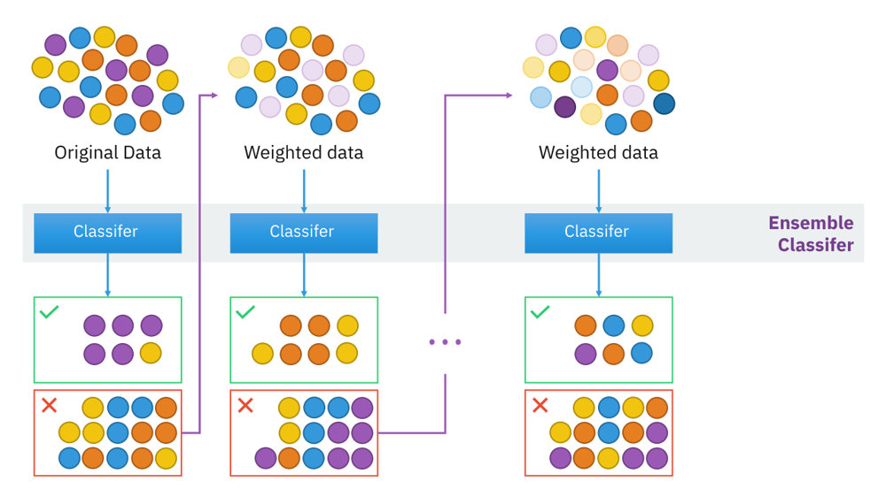
*Boosting in one picture: each learner is built on the previous learner's mistakes, then all are combined. (This picture shows the AdaBoost flavour — mistakes passed on as weights — which is [L12d](L12d_adaboost.md); gradient boosting passes them on as residuals.) (Wikimedia Commons: [Ensemble_Boosting.svg](https://commons.wikimedia.org/wiki/File:Ensemble_Boosting.svg), Sirakorn, CC BY-SA 4.0)*

## Contents

**Part A — Maths from the ground up**
1. [Bagging vs boosting: the same data used differently](#a1-bagging-vs-boosting-the-same-data-used-differently)
2. [Regression, step 0: start at the average](#a2-regression-step-0-start-at-the-average)
3. [Regression, round 1: question, leaf values, small step](#a3-regression-round-1-question-leaf-values-small-step)
4. [Why the split score is (Σr)²/n](#a4-why-the-split-score-is-σrn)
5. [Regression, rounds 2–8 and prediction](#a5-regression-rounds-28-and-prediction)
6. [Classification: score, probability, loss, residual](#a6-classification-score-probability-loss-residual)
7. [The residual is the negative gradient](#a7-the-residual-is-the-negative-gradient)
8. [The leaf value: one Newton step](#a8-the-leaf-value-one-newton-step)
9. [Classification, round 1 and round 2 in full](#a9-classification-round-1-and-round-2-in-full)
10. [All eight rounds; predicting runs A and B](#a10-all-eight-rounds-predicting-runs-a-and-b)
11. [Step size, stopping and overfitting](#a11-step-size-stopping-and-overfitting)
12. [The recipe and common confusions](#a12-the-recipe-and-common-confusions)

**Part B — Slides 42–64** · [Jump](#part-b--slide-by-slide-slides-4264) · **Part B′ — The two notes** · [Jump](#part-b--the-notes-l12a-and-l12b) · **Part C — Practice** · [Jump](#part-c--practice)

---

# Part A — Maths From the Ground Up

## A1. Bagging vs boosting: the same data used differently

**Step 1 — Bagging:** independent trees, each on its own resample, averaged. Tree 2 doesn't care about tree 1.

**Step 2 — Boosting:** tree 2 **cannot exist** before tree 1 — it is grown on tree 1's mistakes; tree 3 on the mistakes still left; and so on. The trees are **added up**.

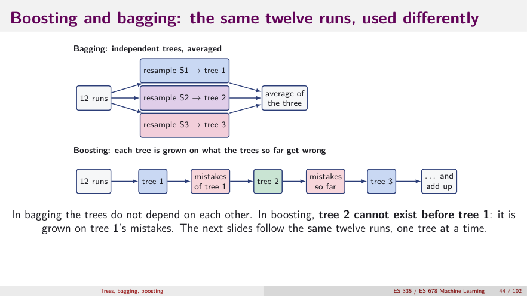
*👀 Slide 44 — Bagging in parallel, boosting in sequence.*

**Step 3 — Why tiny trees?** A stump (one question, two leaves) is **too simple** alone (high bias, low variance). Their *sum* is not: each new stump adds a new step (see the noise-free example in [L12b A12](L12b_bagging_random_forests.md#a12-what-bagging-fixes-and-what-boosting-fixes)). Boosting mainly reduces **bias**.

| | bagging (L12b) | boosting (this file) |
|---|---|---|
| tree 2 is grown on | a resample; tree 1 plays no part | all twelve runs, fitted to the errors tree 1 left |
| tree 2 looks like | deep, leaves pure | one question, two leaves |
| trees depend on each other | no | yes |
| numbers combined by | averaging (run 5: 0, 1, 1 → 0.67) | adding (run 5: −0.50 + 0.63 = +0.13, …) |
| each new tree reduces | the variance of the average | the bias: the remaining errors |

## A2. Regression, step 0: start at the average

**Step 1 — Words.** Prediction $F(x_i)$; residual $r_i = y_i - F(x_i)$ (positive ⇒ predicted too low); loss $\tfrac12\sum_i(y_i - F(x_i))^2$ (wrong by 2 costs four times wrong by 1).

**Step 2 — Best single constant $c$.** $S(c) = \tfrac12\sum(y_i - c)^2$; $S'(c) = -\sum(y_i - c) = 0\Rightarrow c = \tfrac1N\sum y_i$ ($S'' = N > 0$, a minimum). So
$$F_0 = \frac{2+3+3+5+6+8+8+9}{8} = \frac{44}{8} = 5.5.$$

**Step 3 — Residuals of the start:**

| $i$ | 1 | 2 | 3 | 4 | 5 | 6 | 7 | 8 |
|---|---|---|---|---|---|---|---|---|
| $r = y - 5.5$ | −3.5 | −2.5 | −2.5 | −0.5 | +0.5 | +2.5 | +2.5 | +3.5 |
| $r^2$ | 12.25 | 6.25 | 6.25 | 0.25 | 0.25 | 6.25 | 6.25 | 12.25 |

Sum of squares **50.00**. Small models predicted too high, large ones too low. The next step predicts *these residuals*. (They add to 0 — always true for residuals of the mean.)

## A3. Regression, round 1: question, leaf values, small step

**Step 1 — The helper is a stump** that predicts the **residuals** (not $y$): one question "$x\le t$?", each leaf holding one number.

**Step 2 — Try every threshold** $t = 1.5, 2.5, \dots, 7.5$ and score
$$\text{score} = \frac{(\sum_{L}r)^2}{n_L} + \frac{(\sum_{R}r)^2}{n_R}.$$
A good question puts positive residuals on one side and negative on the other so each side's sum is big (not cancelling).

| question | $n_L$ | $\sum_Lr$ | $\bar r_L$ | $n_R$ | $\sum_Rr$ | $\bar r_R$ | score |
|---|---|---|---|---|---|---|---|
| x ≤ 1.5 | 1 | −3.50 | −3.500 | 7 | +3.50 | +0.500 | 14.00 |
| x ≤ 2.5 | 2 | −6.00 | −3.000 | 6 | +6.00 | +1.000 | 24.00 |
| x ≤ 3.5 | 3 | −8.50 | −2.833 | 5 | +8.50 | +1.700 | 38.53 |
| **x ≤ 4.5** | 4 | −9.00 | −2.250 | 4 | +9.00 | +2.250 | **40.50** |
| x ≤ 5.5 | 5 | −8.50 | −1.700 | 3 | +8.50 | +2.833 | 38.53 |
| x ≤ 6.5 | 6 | −6.00 | −1.000 | 2 | +6.00 | +3.000 | 24.00 |
| x ≤ 7.5 | 7 | −3.50 | −0.500 | 1 | +3.50 | +3.500 | 14.00 |

*Your turn 1:* x ≤ 2.5 ⇒ $36/2 + 36/6 = 18 + 6 = 24$ < 40.5.

**Step 3 — Leaf values = average residual of the leaf.** Add the same $\gamma$ to every point in a leaf; leaf loss $T(\gamma) = \sum_{\text{leaf}}\tfrac12(r_i - \gamma)^2$; $T'(\gamma) = -\sum(r_i - \gamma) = 0\Rightarrow\gamma = \bar r_{\text{leaf}}$ ($T'' = n > 0$). So
$$\gamma_L = -9/4 = -2.25\ (\text{points }1\text{–}4),\qquad\gamma_R = +9/4 = +2.25\ (\text{points }5\text{–}8).$$
In slope/curvature language: $g = dL/dF = -(y - F) = -r$, $h = d^2L/dF^2 = 1$, so $\gamma = -\sum g/\sum h = \sum r/n$. Because squared error is **exactly a parabola** in $\gamma$, no approximation was needed (classification will need one: A8).

**Step 4 — Add only a fraction** $\nu = 0.5$ (the **step size** / shrinkage):
$$F_1 = 5.5 + 0.5(-2.25) = 4.375\ (x\le4.5),\qquad F_1 = 5.5 + 0.5(2.25) = 6.625\ (x > 4.5).$$
*Why only half?* One stump is crude; trusting it fully means the next tree starts from a worse place if this one was fooled by noise. *Your turn 2:* point 6 after round 1: 6.625 with ν = 0.5; 7.75 with ν = 1 (truth 8). The full step is closer *now*, but after round 3 with ν = 0.5 point 6 is at 7.735 — and small steps protect against one misled stump.

## A4. Why the split score is (Σr)²/n

**Step 1 — One leaf at its mean.** $\sum(r_i - \bar r)^2 = \sum r_i^2 - 2\bar r\sum r_i + n\bar r^2 = \sum r_i^2 - n\bar r^2$.

**Step 2 — Before vs after the split** (full step). Before: one leaf at the overall mean $\bar r = 0$ ⇒ squared error $\sum r_i^2$. After: both leaves at their means ⇒ $\sum r_i^2 - n_L\bar r_L^2 - n_R\bar r_R^2$.

**Step 3 — The fall** is
$$n_L\bar r_L^2 + n_R\bar r_R^2 = \frac{(\sum_Lr)^2}{n_L} + \frac{(\sum_Rr)^2}{n_R}.$$
In general (if the overall mean residual is not 0) subtract $n\bar r^2$, which is the **same for every question** ⇒ maximise the score. Round 1: $4(2.25)^2 + 4(2.25)^2 = 40.5$, and $50 - 40.5 = 9.5$ is the squared error after a full step.

## A5. Regression, rounds 2–8 and prediction

**Step 1 — Same recipe on new residuals** (after round 1):

| $i$ | 1 | 2 | 3 | 4 | 5 | 6 | 7 | 8 |
|---|---|---|---|---|---|---|---|---|
| $F_1$ | 4.375 | 4.375 | 4.375 | 4.375 | 6.625 | 6.625 | 6.625 | 6.625 |
| $r$ | −2.375 | −1.375 | −1.375 | +0.625 | −0.625 | +1.375 | +1.375 | +2.375 |

Sum of $r^2$: 19.625. Best question now **x ≤ 3.5** (score 14.01): $\gamma_L = (-2.375 - 1.375 - 1.375)/3 = -1.708$, $\gamma_R = (0.625 - 0.625 + 1.375 + 1.375 + 2.375)/5 = 1.025$. *Your turn 3:* $F_2(5) = 6.625 + 0.5(1.025) = 7.138$.

**Step 2 — Eight rounds:**

| round | question | $\gamma_L$ | $\gamma_R$ | sum of $r^2$ after |
|---|---|---|---|---|
| 0 | start | | | 50.000 |
| 1 | x ≤ 4.5 | −2.250 | +2.250 | 19.625 |
| 2 | x ≤ 3.5 | −1.708 | +1.025 | 9.119 |
| 3 | x ≤ 5.5 | −0.718 | +1.196 | 3.971 |
| 4 | x ≤ 7.5 | −0.181 | +1.265 | 2.600 |
| 5 | x ≤ 1.5 | −1.072 | +0.153 | 1.615 |
| 6 | x ≤ 5.5 | −0.222 | +0.371 | 1.120 |
| 7 | x ≤ 1.5 | −0.425 | +0.061 | 0.966 |
| 8 | x ≤ 7.5 | −0.049 | +0.340 | 0.867 |

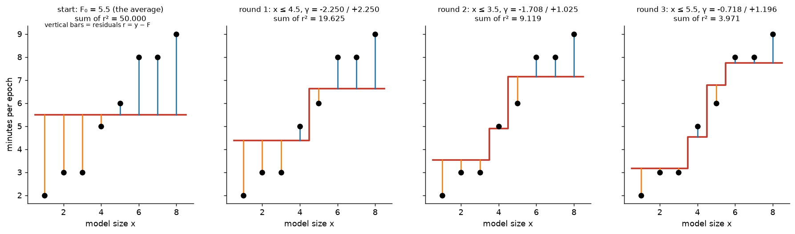
*📊 Each round adds a small step where the staircase is still wrong. Vertical bars are the residuals (blue: predicted too low; orange: too high).*

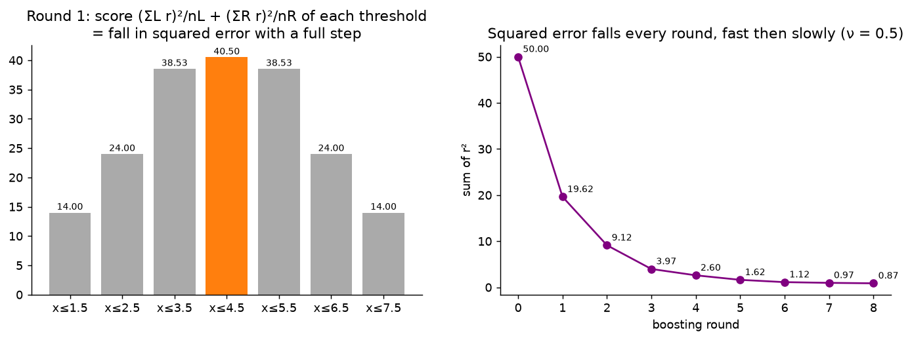
*📊 Left: the round-1 decision. Right: big errors are fixed early, then slowly.*

**Step 3 — The finished model and a new point.** $F(x) = F_0 + \nu\sum_k\gamma_k(x)$. At $x = 2.5$ (not in the data):

| round | question | 2.5 answers | adds $\nu\gamma$ | running |
|---|---|---|---|---|
| 0 | start | | | 5.500 |
| 1 | x ≤ 4.5 | yes | −1.125 | 4.375 |
| 2 | x ≤ 3.5 | yes | −0.854 | 3.521 |
| 3 | x ≤ 5.5 | yes | −0.359 | 3.162 |
| 4 | x ≤ 7.5 | yes | −0.090 | 3.072 |

After eight rounds: **3.043** minutes — both neighbours have $y = 3$.

## A6. Classification: score, probability, loss, residual

**Step 1 — Score $F$.** Any real number, the **log-odds of D**. Every run starts at $F = 0$. (Why 0? It's the log-odds of the class rate: $\ln\tfrac66 = 0$. With 9 of 12 D it would be $\ln\tfrac93 = 1.10$.)

**Step 2 — Probability** $p = S(F) = \dfrac{1}{1 + e^{-F}}$. $S(0) = 0.5$ ("I don't know"), positive ⇒ $p > 0.5$, larger $|F|$ ⇒ more confident but never exactly 0 or 1. Also $S(-F) = 1 - S(F)$.

| $F$ | −4 | −3 | −2 | −1 | −0.5 | 0 | +1 | +2 | +3 | +4 |
|---|---|---|---|---|---|---|---|---|---|---|
| $p$ | 0.018 | 0.047 | 0.119 | 0.269 | 0.378 | 0.500 | 0.731 | 0.881 | 0.953 | 0.982 |

**Step 3 — Log loss** $L = -y\ln p - (1-y)\ln(1-p)$ = minus the log of the probability given to **what actually happened**:

| probability given to the truth | 0.99 | 0.90 | 0.50 | 0.10 | 0.01 |
|---|---|---|---|---|---|
| loss | 0.010 | 0.105 | 0.693 | 2.303 | 4.605 |

Start: every run at $p = 0.5$ ⇒ average loss $\ln2 = 0.693$.

**Step 4 — Residual** $r = y - p$. D at $p = 0.5$: $r = +0.5$ (push up); C at $p = 0.5$: $r = -0.5$ (push down); confidently right ⇒ $r\approx0$. Example: run 5 after round 1: $F = -0.5$, $p = 0.378$, $y = 1$ ⇒ $r = 0.622$.

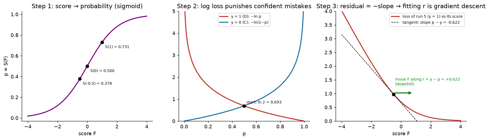
*📊 Step 1: score → probability. Step 2: confident mistakes are expensive. Step 3: the slope of run 5's loss is $p - y = -0.622$; moving $F$ in the direction of $r = +0.622$ goes **downhill**.*

## A7. The residual is the negative gradient

**Step 1 — Two small facts.** $\dfrac{dp}{dF} = S'(F) = p(1-p)$ and $\dfrac{dL}{dp} = -\dfrac{y}{p} + \dfrac{1-y}{1-p}$.
(Proof of the first: $S = (1 + e^{-F})^{-1}\Rightarrow S' = \dfrac{e^{-F}}{(1+e^{-F})^2} = \dfrac{1}{1+e^{-F}}\cdot\dfrac{e^{-F}}{1+e^{-F}} = S(1 - S)$.)

**Step 2 — Chain rule:**
$$\frac{dL}{dF} = \Big[-\frac yp + \frac{1-y}{1-p}\Big]p(1-p) = -y(1-p) + (1-y)p = p - y = -r.$$

**Step 3 — Read it.** The residual is the **negative gradient** of the loss with respect to the score. Moving each score along its residual lowers the loss: **gradient descent on the log loss**, where the "parameters" are the twelve scores. (For squared error the same thing: $dL/dF = -(y - F) = -r$.) This is the "gradient" in **gradient boosting**.

**Step 4 — But a stump cannot move the scores freely.** It can only add **one number to each of two groups**. So it chooses the question whose two groups have the most different average residual (the best two-number correction; same score as A4), and then asks: *how much* to add to each group? That is A8.

## A8. The leaf value: one Newton step

**Step 1 — Try it by brute force.** Group A = runs 5–12 (2 D, 6 C), all at $F = 0$. Add the same $\gamma$ to all eight scores:

| γ | 0 | −0.5 | −1.0 | **−1.0986** | −1.5 | −2.0 | +0.5 |
|---|---|---|---|---|---|---|---|
| total loss of the 8 | 5.545 | 4.793 | 4.506 | **4.499** | 4.611 | 5.015 | 6.793 |

Best ≈ −1: lowering helps the six C runs until the two D runs get hurt. Group B (runs 1–4, all D): loss keeps falling as γ grows (2.773 at 0, 0.073 at 4).

**Step 2 — Why no exact formula?** $T(\gamma) = \sum_iL(F_i + \gamma)$, with terms like $\ln(1 + e^{-F_i - \gamma})$ at different $F_i$; setting $T' = 0$ means solving a sum of different exponentials. No closed form.

**Step 3 — The idea (Newton).** Stand at $\gamma = 0$; feel the **slope** and the **curvature**; draw the parabola that hugs the curve there; jump to its bottom.

**Step 4 — Slope and curvature per run.** Slope $p - y$ (A7). Curvature $\dfrac{d}{dF}(p - y) = p(1-p)$: always positive (a bowl), largest 0.25 at $p = 0.5$, ≈ 0 near 0 or 1.

**Step 5 — The parabola.** $L(F_i + \gamma)\approx L(F_i) + (p_i - y_i)\gamma + \tfrac12p_i(1-p_i)\gamma^2$. Sum over the leaf with $S = \sum(p_i - y_i)$, $H = \sum p_i(1-p_i)$:
$$T(\gamma)\approx T(0) + S\gamma + \tfrac12H\gamma^2.$$

**Step 6 — Its bottom:** $S + H\gamma = 0$ ⇒
$$\boxed{\gamma = -\frac SH = \frac{\sum_{\text{leaf}}(y_i - p_i)}{\sum_{\text{leaf}}p_i(1-p_i)} = \frac{\text{total push needed}}{\text{sensitivity}}}$$
Top: how much the group needs to move. Bottom: how strongly $p$ reacts to the score (near 0.5 one unit of score moves $p$ by ≈0.25; near 0 or 1, barely). A steep slope asks for a big move; a strongly curved bowl says don't overshoot.

**Step 7 — Check on group A.** $S = 6(0.5) + 2(-0.5) = 2$, $H = 8(0.25) = 2$ ⇒ parabola $5.545 + 2\gamma + \gamma^2$, bottom $\gamma = -1$. True bottom: $-2\sigma(-\gamma) + 6\sigma(\gamma) = 0\Rightarrow\sigma(\gamma) = \tfrac14\Rightarrow e^{-\gamma} = 3\Rightarrow\gamma = -\ln3 = -1.099$. **One Newton step lands within 0.1.**

*📊 Left/middle: the parabola from slope and curvature, and where it lands. Right (slide 58): **the more wrong the leaf, the bigger the push** — for all-D leaves, $\gamma = \frac{n(1-p)}{np(1-p)} = 1/p$.*

**Step 8 — Regression is the special case $h = 1$:** $\gamma = \sum r/n$ = the average residual (A3).

## A9. Classification, round 1 and round 2 in full

**One round in four steps** (slide 53):
(a) $p_i = S(F_i)$, $r_i = y_i - p_i$.
(b) Score each question by $n_L\bar r_L^2 + n_R\bar r_R^2$; keep the largest.
(c) Leaf values $\gamma = \sum r/\sum p(1-p)$.
(d) $F_i\leftarrow F_i + \nu\gamma_{\text{leaf}(i)}$, $\nu = 0.5$.

**Round 1.** (a) All $F = 0$ ⇒ $p = 0.5$, $r = +0.5$ (D), −0.5 (C), $h = 0.25$.
(b) All eight questions:

| question | $n_L$ | $\sum_Lr$ | $n_R$ | $\sum_Rr$ | score |
|---|---|---|---|---|---|
| **rate ≤ 0.065** | 8 | −2.00 | 4 | +2.00 | **1.500** |
| rate ≤ 0.02 | 5 | −1.50 | 7 | +1.50 | 0.771 |
| rate ≤ 0.0055 | 2 | −1.00 | 10 | +1.00 | 0.600 |
| rate ≤ 0.2 | 10 | −1.00 | 2 | +1.00 | 0.600 |
| batch ≤ 48 | 4 | +1.00 | 8 | −1.00 | 0.375 |
| warm-up = no | 6 | +1.00 | 6 | −1.00 | 0.333 |
| batch ≤ 192 | 9 | +0.50 | 3 | −0.50 | 0.111 |
| batch ≤ 96 | 7 | +0.50 | 5 | −0.50 | 0.086 |

(c) $\gamma_{\text{yes}} = \dfrac{-2}{8\times0.25} = -1.000$ (runs 5–12), $\gamma_{\text{no}} = \dfrac{+2}{4\times0.25} = +2.000$ (runs 1–4).
(d) Runs 5–12: $F = -0.5$, $p = 0.378$; runs 1–4: $F = +1.0$, $p = 0.731$. Loss **0.693 → 0.504**.

*Your turn 4 (notes):* if batch ≤ 48 had been used: yes {2, 5, 6, 10}: $\sum r = 1$, $\sum h = 1$ ⇒ γ = 1.000; no: $\sum r = -1$, $\sum h = 2$ ⇒ γ = −0.500.

**What tree 1 gets wrong:**

| run | out | F | p | says | $r = y - p$ | |
|---|---|---|---|---|---|---|
| 1–4 | D | +1.00 | 0.731 | D | +0.269 | right but unsure |
| 5, 6 | D | −0.50 | 0.378 | C | **+0.622** | **wrong** |
| 7–12 | C | −0.50 | 0.378 | C | −0.378 | right |

Runs 5 and 6 (diverged at a low rate) now have the **largest** residual — up from 0.5. That is what tree 2 will be drawn to. (*Your turn 5:* run 5's |r| grew 0.5 → 0.622; run 7's shrank 0.5 → 0.378.)

**Round 2.** Scores: **batch ≤ 48 0.469**; rate ≤ 0.065 0.419; rate ≤ 0.0055 0.351; warm-up 0.334. Winner **batch ≤ 48**: yes = runs 2, 5, 6, 10.
- Yes: $\sum r = 0.269 + 0.622 + 0.622 - 0.378 = 1.136$; $\sum h = 0.731\times0.269 + 3\times0.378\times0.622 = 0.902$ ⇒ $\gamma = +1.260$.
- No (8 runs): $\sum r = -1.081$, $\sum h = 1.765$ ⇒ $\gamma = -0.612$.

**Tree 2 changes the numbers** ($\nu\gamma = +0.63$ / $-0.31$):

| run | out | after tree 1 | tree 2 adds | now | p | says | |
|---|---|---|---|---|---|---|---|
| 1, 3, 4 | D | +1.00 | −0.31 | +0.69 | 0.667 | D | |
| 2 | D | +1.00 | +0.63 | +1.63 | 0.836 | D | |
| 5, 6 | D | −0.50 | +0.63 | +0.13 | 0.532 | D | **fixed** |
| 7–9, 11, 12 | C | −0.50 | −0.31 | −0.81 | 0.309 | C | |
| 10 | C | −0.50 | +0.63 | +0.13 | 0.532 | D | **now wrong** |

Run 10 shares the leaf with 5 and 6 and is dragged up with them: mistakes go 2 → 1. Tree 3 is grown on the new errors.

## A10. All eight rounds; predicting runs A and B

| round | question | γ yes | γ no | log loss | wrong |
|---|---|---|---|---|---|
| 0 | (all scores 0) | | | 0.693 | 6 |
| 1 | rate ≤ 0.065 | −1.000 | +2.000 | 0.504 | 2 (5, 6) |
| 2 | batch ≤ 48 | +1.260 | −0.612 | 0.438 | 1 (10) |
| 3 | rate ≤ 0.065 | −0.629 | +1.448 | 0.361 | 2 (5, 6) |
| 4 | warm-up = no | +0.800 | −0.717 | 0.321 | 0 |
| 5 | rate ≤ 0.065 | −0.423 | +1.279 | 0.283 | 0 |
| 6 | batch ≤ 48 | +0.949 | −0.568 | 0.250 | 0 |
| 7 | rate ≤ 0.02 | −0.597 | +0.577 | 0.230 | 0 |
| 8 | batch ≤ 48 | +0.603 | −0.426 | 0.217 | 0 |

- **The same question can come back** (rounds 1, 3, 5): the scores changed, so it's a different problem.
- **Loss falls every round; the wrong count does not** (6, 2, 1, 2, 0): each round lowers the *loss*, not the error count.
- The single tree's three questions (rate, batch, warm-up) appear as rounds 1, 2, 4.
- From round 4 nothing is wrong, yet loss keeps falling: probabilities move towards 0 and 1.

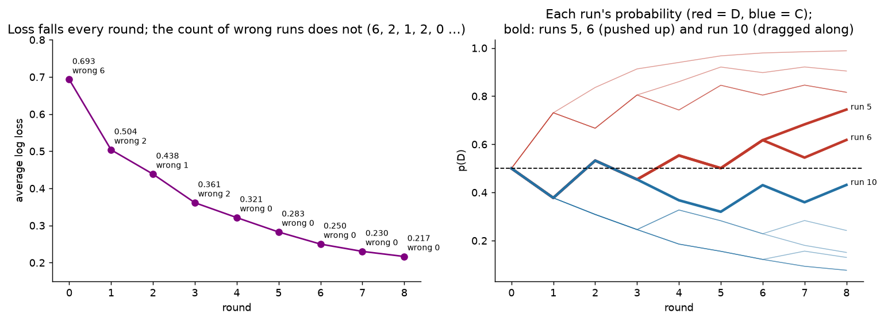
*📊 Left: steady loss decrease. Right: the story of runs 5, 6 (fixed in round 2, broken in round 3, fixed for good in round 4) and run 10 (collateral damage, then repaired by warm-up in round 4).*

**Predicting.** $F(x) = \nu\sum_t\gamma_t(\text{leaf of }x)$, $p = S(F)$ (starts from 0, the log-odds of 6/12). Each entry below is $\nu\gamma$ of the leaf reached:

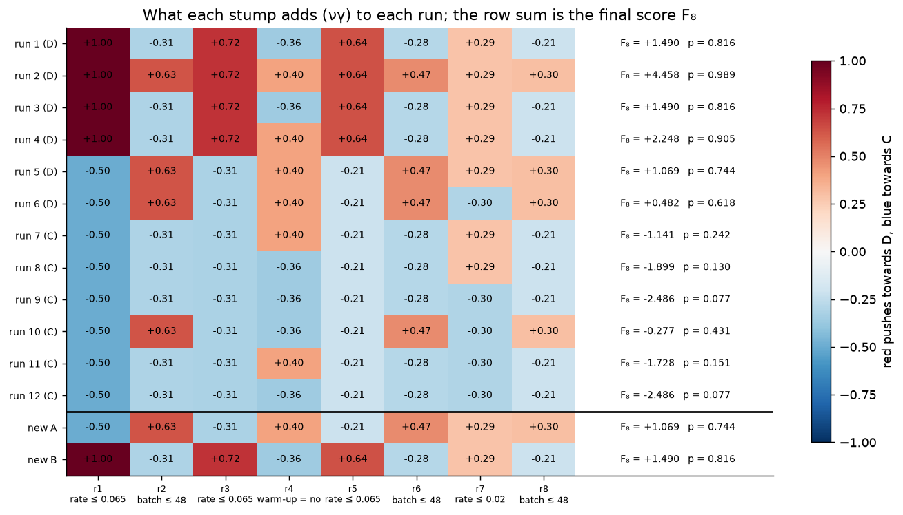
*📊 Slide 60 as a picture. Red pushes towards D, blue towards C. Rows sum to $F_8$.*

- **Run A** (0.05, 32, no): −0.500 +0.630 −0.315 +0.400 −0.212 +0.474 +0.289 +0.302 ⇒ $F_8 = 1.069$, $p = \mathbf{0.744}$ ⇒ D. (A lands exactly like runs 5 and 6.)
- **Run B** (0.2, 64, yes): +1.000 −0.306 +0.724 −0.358 +0.639 −0.284 +0.289 −0.213 ⇒ $F_8 = 1.490$, $p = \mathbf{0.816}$ ⇒ D. All three rate stumps push strongly towards D; batch and warm-up push back a little.

Run 5's story in numbers: probability of D 0.5 → 0.378 (tree 1) → … → **0.74** after eight trees. Bagging gave it three independent opinions (0, 1, 1); boosting *corrects* it step by step.

## A11. Step size, stopping and overfitting

**Step 1 — Smaller ν = trust each stump less.**

| ν | first round with no wrong run | loss after 8 rounds | rounds to reach loss 0.217 |
|---|---|---|---|
| 1.0 | 4 | 0.087 | 4 (loss 0.196) |
| 0.5 | 4 | 0.217 | 8 |
| 0.1 | 22 | 0.473 | 44 (loss 0.215) |

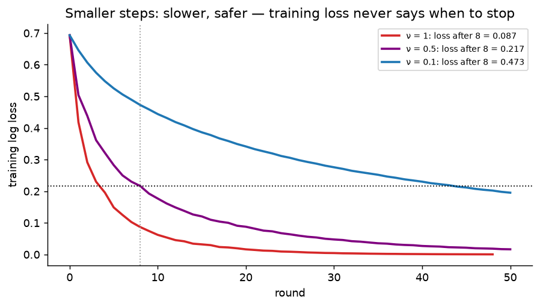
*📊 More rounds, each a safer correction. The training loss keeps falling forever — **training data can never tell you when to stop**.*

**Step 2 — Boosting can overfit.** Simulated (200 runs, depth-3 trees, ν = 0.1): training error 0 by round 60; held-out error best near round **66 (0.108)**, rising to **0.137 by round 1000**. ⇒ **Stop on held-out error** (early stopping). Contrast bagging, where more trees never hurt.

## A12. The recipe and common confusions

| step | what you do | which number is used |
|---|---|---|
| start | $F_i = F_0$ (mean of $y$ for regression; log-odds, here 0, for classification) | — |
| (a) residuals | $r_i = y_i - F_i$ (reg.) or $y_i - p_i$ (class.) | each run's current prediction |
| (b) question | largest $n_L\bar r_L^2 + n_R\bar r_R^2$ | residuals of the two groups |
| (c) leaf values | $\gamma = \sum r/\sum h$ ($h = 1$ or $p(1-p)$) | $\gamma_{\text{yes}}, \gamma_{\text{no}}$ |
| (d) update | $F_i\leftarrow F_i + \nu\gamma$ | νγ of the leaf reached |
| predict | $F = F_0 + \nu\sum_t\gamma_t$; $p = S(F)$ | one number per stump |
| stop | when held-out error stops falling | — |

**Common confusions.**
- *Why fit residuals and not $y$ again?* A tree fitted to $y$ repeats the same staircase. Residuals are exactly what the model doesn't know yet.
- *Why "gradient"?* The residual is the negative slope of the loss w.r.t. the prediction (A7). Adding a fitted residual is a gradient-descent step.
- *Why not just add the average residual in classification?* Probabilities saturate: a run at $p = 0.95$ needs a big score change to move a little. Dividing by $\sum p(1-p)$ accounts for that.
- *Why a regression tree when classifying?* The tree only groups runs by what they still need; residuals and leaf values are numbers. The class appears only at the end, through $S$.
- *Why log loss?* It punishes confident mistakes heavily, and its slope and curvature are the simple $p - y$ and $p(1-p)$.
- *How does it relate to the others?* **AdaBoost** ([L12d](L12d_adaboost.md)) = the same stagewise idea with the exponential loss $e^{-yF}$; its weights are each run's share of that loss. **XGBoost** ([L12e](L12e_xgboost_and_comparison.md)) = this file plus curvature in the split choice and penalties λ, γ.

---

# Part B — Slide by Slide (slides 42–64)

## Slide 42 — Part 3: Gradient boosting (divider)
Colours: rate stump, batch-size stump, warm-up stump.

## Slide 43 — Boosting: the procedure

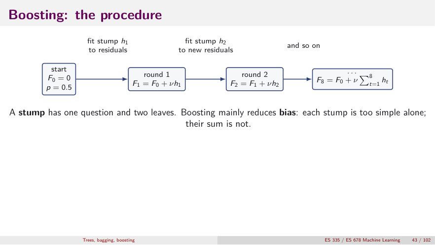
*👀 Slide 43 — A stump has one question and two leaves. Boosting mainly reduces **bias**.*

## Slide 44 — Boosting and bagging: the same twelve runs, used differently
Shown in A1.

## Slide 45 — Boosting, step 1: tree 1 is one question

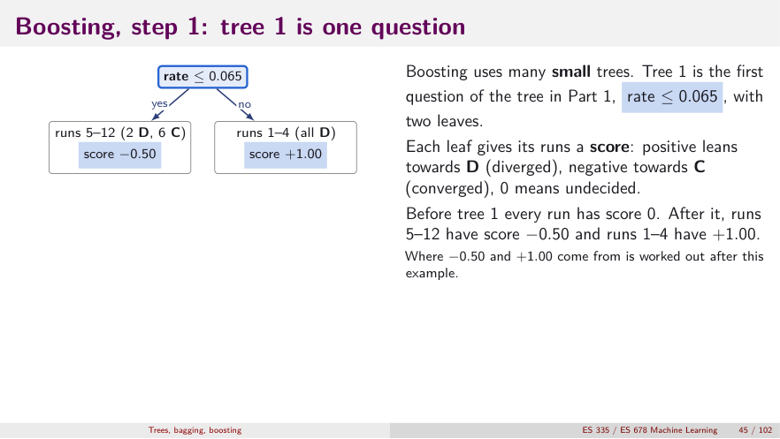
*👀 Slide 45 — Positive leans D, negative leans C, 0 undecided. Where −0.50 and +1.00 come from: A9.*

## Slide 46 — What tree 1 gets wrong

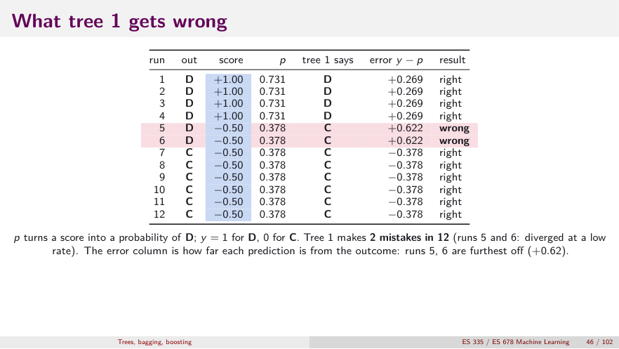
*👀 Slide 46 — 2 mistakes in 12 (runs 5, 6: diverged at a low rate); they are furthest off.*

## Slide 47 — Boosting, step 2: tree 2 is grown on the mistakes

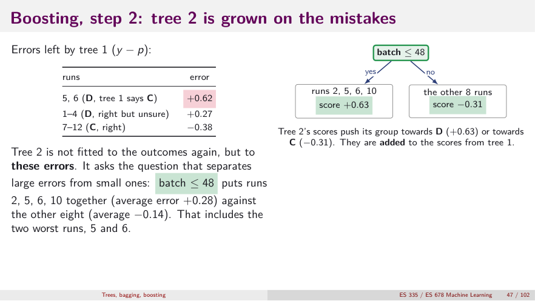
*👀 Slide 47 — Fitted to the **errors**, not the outcomes. Average error +0.28 vs −0.14 in the two groups.*

## Slide 48 — Tree 2 changes the numbers

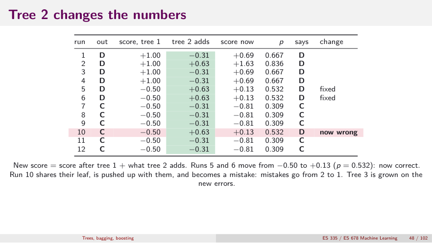
*👀 Slide 48 — Mistakes 2 → 1 (A9).*

## Slide 49 — How tree 2 differs from bagging

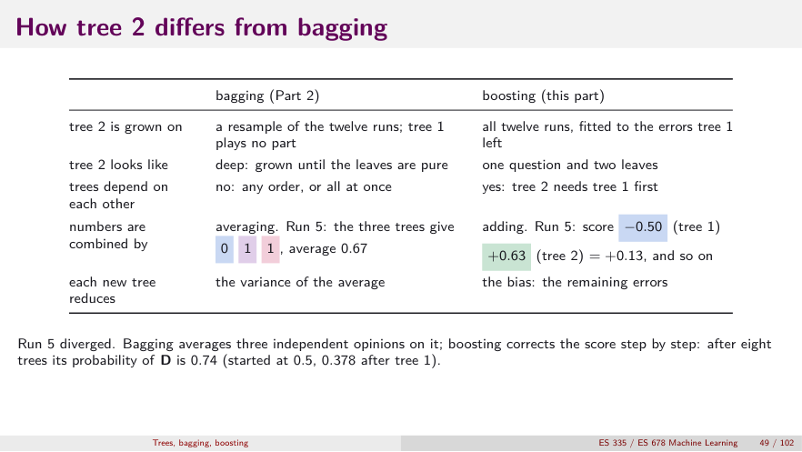
*👀 Slide 49 — After eight trees run 5's probability of D is 0.74 (started 0.5, 0.378 after tree 1).*

## Slide 50 — The math behind the scores: definitions
Score $F$ (log-odds of D, starts 0); $p = S(F) = 1/(1 + e^{-F})$ ($S(0) = 0.5$, $S(1) = 0.731$, $S(-0.5) = 0.378$); $y\in\{0, 1\}$; residual $r = y - p$; log loss $L = -y\ln p - (1-y)\ln(1-p)$. Run 5 after tree 1: $r = 0.622$ (A6).

## Slide 51 — Why the next tree is fitted to the residuals

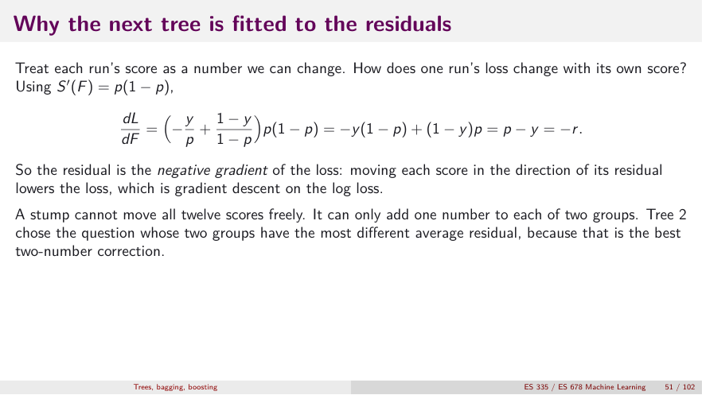
*👀 Slide 51 — Gradient descent on the log loss with the scores as variables (A7).*

## Slide 52 — The value assigned to a leaf

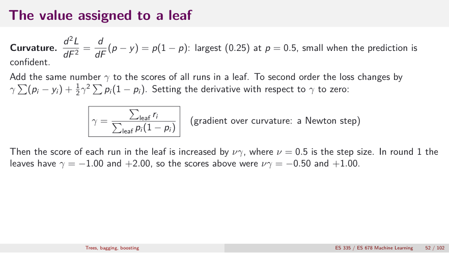
*👀 Slide 52 — Round 1 leaves: γ = −1.00 and +2.00, so scores move by −0.50 and +1.00 (A8).*

## Slide 53 — One round of boosting, in four steps
(a) $p$, $r$; (b) score $n_L\bar r_L^2 + n_R\bar r_R^2$; (c) $\gamma = \sum r/\sum p(1-p)$; (d) $F\leftarrow F + \nu\gamma$ (A9).

## Slide 54 — Round 1: choose the question
Scores 1.500 (rate ≤ 0.065), 0.771, 0.600. $\gamma_{\text{yes}} = -2/(8\times0.25) = -1$, $\gamma_{\text{no}} = +2/(4\times0.25) = +2$.

## Slide 55 — Round 1: update every run

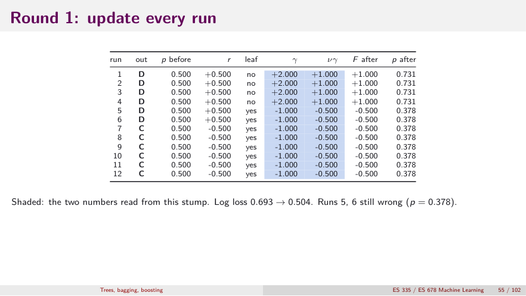
*👀 Slide 55 — Runs 5, 6 still wrong (p = 0.378).*

## Slide 56 — Round 2: choose the question

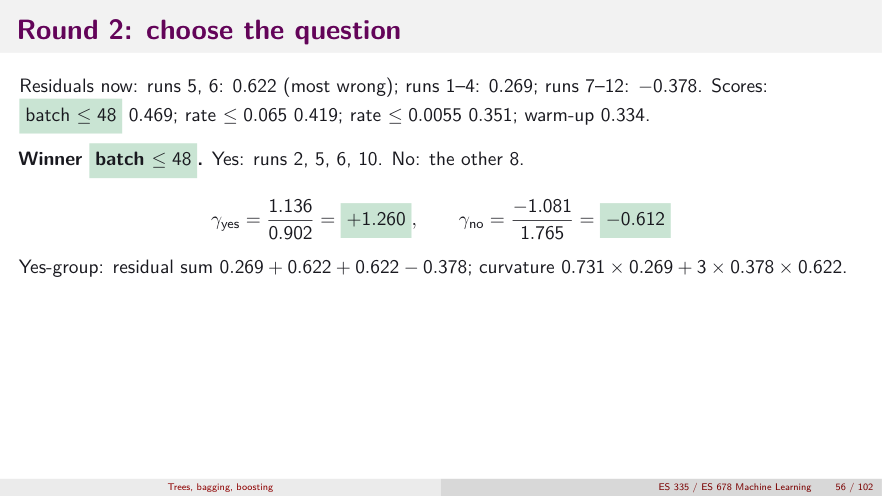
*👀 Slide 56 — Full arithmetic in A9.*

## Slides 57–58 — Your turn: one leaf's update (and answer)

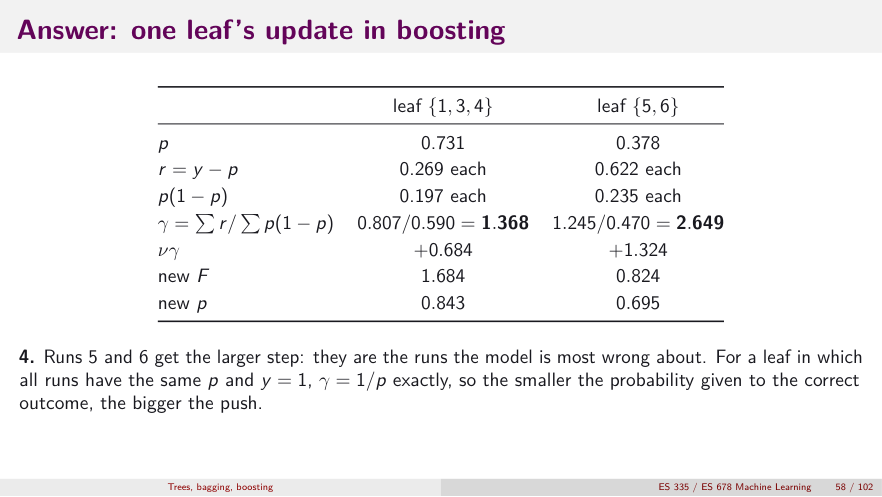
*👀 Slide 58 — For an all-D leaf with equal $p$, $\gamma = 1/p$: the less probability given to the truth, the bigger the push.*

## Slide 59 — All eight rounds

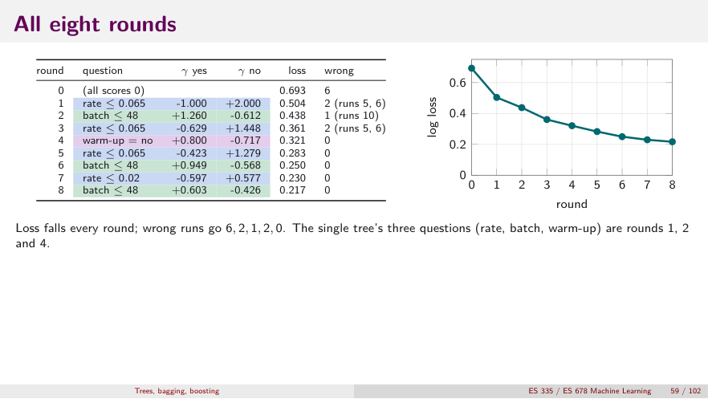
*👀 Slide 59 — Loss falls every round; wrong 6, 2, 1, 2, 0 (A10).*

## Slide 60 — Contribution of each stump to each run's score

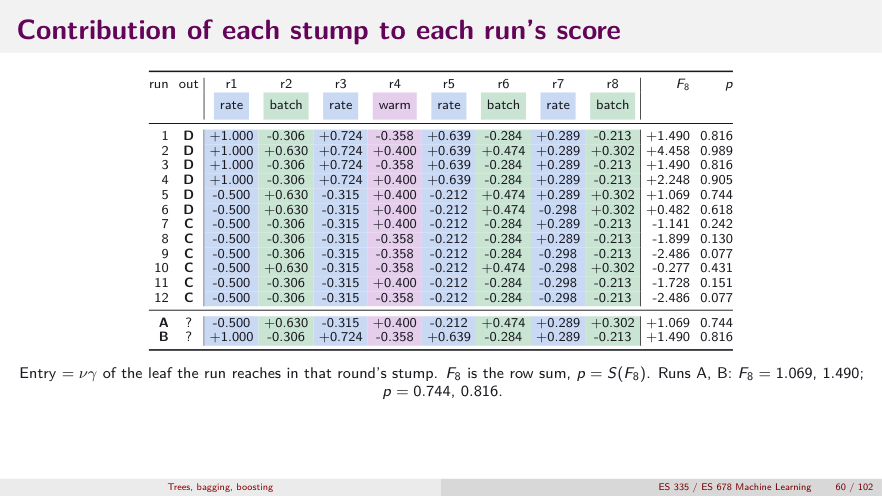
*👀 Slide 60 — A: $F_8 = 1.069$, $p = 0.744$; B: $F_8 = 1.490$, $p = 0.816$.*

## Slides 61–62 — Runs A and B: the leaf reached in each stump

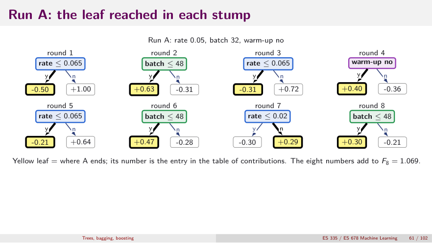
*👀 Slide 61 — The eight yellow leaves add to $F_8 = 1.069$. Slide 62 does the same for B (1.490).*

## Slide 63 — Step size and stopping

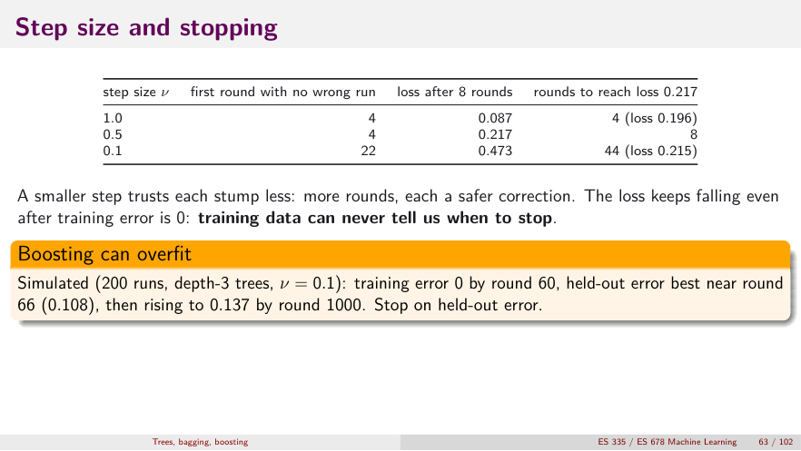
*👀 Slide 63 — Stop on held-out error (A11).*

## Slide 64 — Boosting: summary of the procedure

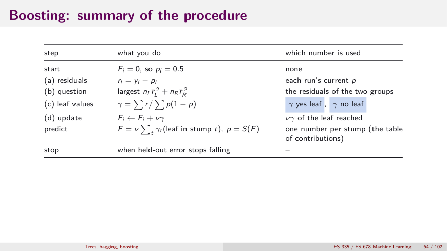
*👀 Slide 64 — Same table as A12.*

---

# Part B′ — The Notes (L12a and L12b)

### Notes L12a (regression) — summary and §1–3
Start with one number (the average), look at residuals, fit a stump to the residuals, add a fraction, repeat. Colour key: $y$ truth, $F$ prediction, $r$ residual, $\gamma$ leaf value, $\nu$ step size, $g$ slope, $h$ curvature. Full working: A2–A4.

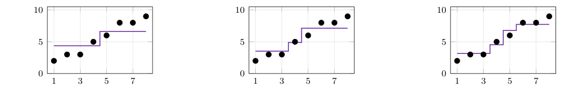
*👀 Notes Fig. 2 — Round 1 turns the flat line into a two-step staircase.*

### Notes L12a, §4–5 — rounds 2 and 3; the finished model

*👀 Notes Fig. 4 — Big errors fixed early. Prediction at $x = 2.5$: 3.043 after eight rounds (A5).*

### Notes L12a, §6 — derive-it-yourself boxes
D1: $dL/dF = -r$ ⇒ residual is the negative slope; if $r > 0$, raise $F$. D2: leaf value = average residual. D3: fall in squared error = $n_L\bar r_L^2 + n_R\bar r_R^2$ (40.5 in round 1, leaving 9.5 with ν = 1). D4: $n\bar r^2$ is the same for every question ⇒ maximise the score. D5: $\gamma = -\sum g/\sum h$; with $g = p - y$, $h = p(1-p)$ it becomes the classification leaf value.

### Notes L12a, §8 — check yourself (answers)
1 average, 5.5 · 2 $y - F$, low · 3 average · 4 $n_L$, $n_R$, largest · 5 4.5, −2.25, 2.25 · 6 6.625 · 7 19.625 · 8 40.5, 9.5 · 9 negative slope · 10 $h$, 1.

### Notes L12b (classification) — §2–4: score, probability, loss, residual
A6. Your turn 1: $\sigma(1) = 1/1.368 = 0.731$, $\sigma(-1) = 0.269$, sum 1; $p = 0.9$ needs $F\approx2.2$. Your turn 2: $p = 0.8$: loss 0.223 if D, 1.609 if C.

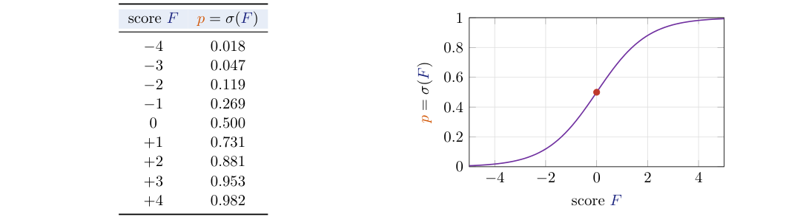
*👀 Notes Fig. 1 — The sigmoid turns any score into a probability.*

### Notes L12b, §5 — round 1 step by step, and where the formula comes from

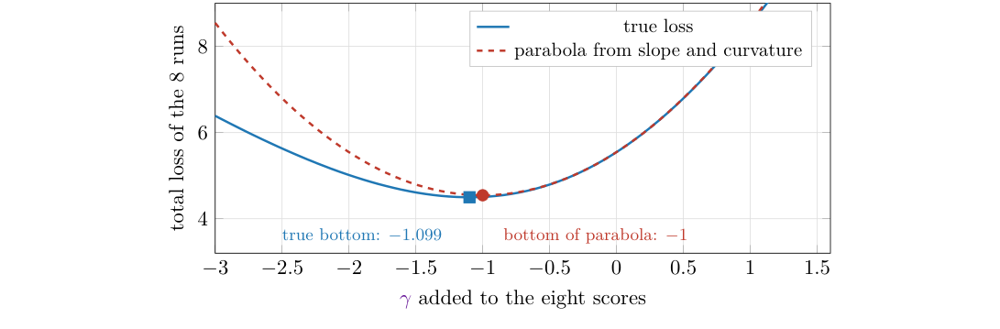
*👀 Notes Fig. 2 — The parabola hugs the true curve near γ = 0; its bottom is almost the true bottom. Four sentences of intuition and Steps (i)–(iv): A8.*

### Notes L12b, §6–7 — rounds 2–8; new run B
Tables in A9–A10. Run B's running score: +1.000, +0.694, +1.418, +1.059, +1.699, +1.415, +1.703, **+1.490** ⇒ $p = 0.816$.

### Notes L12b, §8 — derive-it-yourself boxes
D1: $\sigma' = \sigma(1-\sigma)$, $dL/dF = p - y$, $d^2L/dF^2 = p(1-p)$. D2: summing the quadratic ⇒ $\gamma = \sum(y - p)/\sum p(1-p)$. D3: score 1.5 for rate ≤ 0.065; mixed-sign groups cancel ⇒ score ≈ 0. D4: exact best γ for group A = $-\ln3 = -1.099$. D5: squared error has $h = 1$ ⇒ average residual.

### Notes L12b, §10 — check yourself (answers)
1 0.5, diverge · 2 what actually happened, $\ln2 = 0.693$ · 3 $y - p$, +0.5, −0.5 · 4 0.065, 1.500 · 5 $p(1-p)$, push, sensitivity · 6 −2/2 = −1, 2/1 = 2 · 7 −0.5, 1.0, 0.378 · 8 grown, 0.622, 0.504 · 9 $p - y$, $p(1-p)$ · 10 −1.099, −1 · 11 1, average · 12 sum.

---

# Part C — Practice

1. Regression: compute the score of **x ≤ 3.5** in round 1 from the start residuals. Compare with 40.5.
2. Regression: what is $F_1(2)$ with ν = 0.5, and with ν = 1? Which round-2 leaf is point 2 in, and what is $F_2(2)$?
3. Show that the residuals of the mean always add to 0, and use it to explain why the round-1 sums on the two sides are opposite.
4. Classification: compute $\sigma(2)$ and the log loss of a C run with $F = 2$. Is it right or wrong, and how expensive?
5. Why can the number of wrong runs go **up** in a round (round 3: 1 → 2) while the loss goes down?
6. A leaf holds three C runs, each at $F = 1$. Compute $r$, $h$, $\gamma$, the update with ν = 0.5 and the new $p$.
7. Repeat the brute-force idea: for group B (four D runs at $F = 0$) what does the parabola predict, and why does the true loss have no minimum?
8. In round 1, why is $\gamma_{\text{no}} = +2$ but each score in that leaf only rises by 1?
9. You run boosting for 1000 rounds and training error has been 0 since round 60. What should you do, and why can't the training data tell you?
10. Compute $F_8$ for run A by adding the eight contributions, then $p$.

<b>Answers</b>

1. Yes: points 1–3, $\sum r = -8.5$; no: points 4–8, $+8.5$. Score $72.25/3 + 72.25/5 = 24.08 + 14.45 = 38.53$ < 40.5.
2. $F_1(2) = 4.375$ (ν = 0.5) or $3.25$ (ν = 1). Round 2 asks x ≤ 3.5: point 2 is in the yes-leaf, $\gamma_L = -1.708$ ⇒ $F_2(2) = 4.375 - 0.854 = 3.521$.
3. $\sum(y_i - \bar y) = \sum y_i - N\bar y = 0$. So $\sum_Lr = -\sum_Rr$ for every split.
4. $\sigma(2) = 0.881$; a C run: loss $-\ln(1 - 0.881) = -\ln0.119 = 2.13$. Wrong (says D) and confident ⇒ expensive.
5. Each round lowers the average log loss, not the error count. Round 3 (rate ≤ 0.065, $\gamma_{\text{yes}} = -0.629$) pulls all low-rate runs down; this fixes run 10 but pushes runs 5, 6 (barely above 0.5 at 0.532) back below. Overall the probabilities still moved towards the truth on average.
6. $p = 0.731$, $r = -0.731$ each; $h = 0.197$ each. $\gamma = -2.193/0.590 = -3.72$ (for an all-C leaf $\gamma = -1/(1-p)$). Update $-1.86$ ⇒ $F = -0.86$, $p = 0.297$.
7. $S = -2$, $H = 1$ ⇒ parabola $2.773 - 2\gamma + \tfrac12\gamma^2$, bottom at $\gamma = +2$. True loss $4\ln(1 + e^{-\gamma})$ decreases for every γ (all four want $p\to1$), so it has no minimum — another reason for a step size and for penalties (XGBoost's λ, L12e).
8. γ is the full Newton step; the update multiplies by ν = 0.5.
9. Stop on held-out (validation) error — typically use the round where it was lowest (early stopping). The training loss keeps falling forever and training error is already 0, so neither says anything about new data; in the simulation held-out error was best at round 66 and got worse after.
10. $-0.500 + 0.630 - 0.315 + 0.400 - 0.212 + 0.474 + 0.289 + 0.302 = 1.068\approx1.069$; $p = 1/(1 + e^{-1.069}) = 0.744$.

**Next:** [L12d — AdaBoost](L12d_adaboost.md): the same boosting idea, but mistakes are passed on as **weights**, and the stumps vote.
