# Lecture 12d — AdaBoost: Run Weights, Vote Weights, Exponential Loss, and AdaBoost.R2

> ES 335 / ES 678 Machine Learning, Sem I 2026 — Prof. Udit Bhatia
> Sources: `Lectures/L12_student_trees_bagging_boosting_worked_deck.pdf` (Part 4, slides 65–81), `Lectures/L12e_student_adaboost_classification_notes.pdf` (12-page notes), `Lectures/L12f_student_adaboost_regression_notes.pdf` (13-page notes) · Previous: [`L12c_gradient_boosting.md`](L12c_gradient_boosting.md) · Next: [`L12e_xgboost_and_comparison.md`](L12e_xgboost_and_comparison.md)

**Lecture 12 files:** [L12a Trees](L12a_decision_trees.md) → [L12b Bagging & random forests](L12b_bagging_random_forests.md) → [L12c Gradient boosting](L12c_gradient_boosting.md) → **[L12d AdaBoost](L12d_adaboost.md)** → [L12e XGBoost & comparison](L12e_xgboost_and_comparison.md)

**How to use this file.** Gradient boosting (L12c) passed mistakes to the next stump as **residuals**. AdaBoost keeps the original labels and passes mistakes on as **weights**: a run the stumps so far get wrong **counts more** in the next round. The final model is a **weighted vote** of the stumps. Four numbers drive everything: run weights $w_i$, weighted error $\varepsilon$, vote weight $\alpha = \tfrac12\ln\frac{1-\varepsilon}{\varepsilon}$, normaliser $Z$. We derive $\alpha$ and the weight update from one loss, the **exponential loss** $e^{-yF}$, and show AdaBoost is gradient boosting for that loss. Then **AdaBoost.R2** extends the idea to regression with a **weighted median**. Part A is maths step by step; Part B walks slides 65–81; Part B′ covers the two notes; Part C is practice.

**Datasets.** The twelve runs of [L12a](L12a_decision_trees.md), now with **labels ±1**: $y = +1$ for D (runs 1–6), $-1$ for C (runs 7–12); new runs **A** (0.05, 32, no), **B** (0.2, 64, yes). For AdaBoost.R2: eight points (minutes per epoch vs model size):

| $i$ | 1 | 2 | 3 | 4 | 5 | 6 | 7 | 8 |
|---|---|---|---|---|---|---|---|---|
| $x$ | 1 | 2 | 3 | 4 | 5 | 6 | 7 | 8 |
| $y$ | 1.5 | 1.5 | 4 | 4 | 5.5 | 7 | 7 | 8.5 |

**What this file is really about:**
$$w_i = \tfrac1N\ \to\ \text{stump with smallest }\varepsilon = \!\!\sum_{\text{mistakes}}\!\! w_i\ \to\ \alpha = \tfrac12\ln\tfrac{1-\varepsilon}{\varepsilon}\ \to\ w_i\leftarrow\frac{w_ie^{-\alpha y_ih(x_i)}}{Z}\ \to\ \text{repeat}\ \to\ \text{sign}\Big(\sum_t\alpha_th_t(x)\Big)$$

## Contents

**Part A — Maths from the ground up**
1. [The procedure and the definitions](#a1-the-procedure-and-the-definitions)
2. [Round 1: choose the stump, compute ε and α](#a2-round-1-choose-the-stump-compute-ε-and-α)
3. [Round 1: update the weights](#a3-round-1-update-the-weights)
4. [Why this α: minimise Z](#a4-why-this-α-minimise-z)
5. [The key consequence: the old stump becomes a coin toss](#a5-the-key-consequence-the-old-stump-becomes-a-coin-toss)
6. [Round 2 and the tie rule](#a6-round-2-and-the-tie-rule)
7. [All rounds; the final weighted vote](#a7-all-rounds-the-final-weighted-vote)
8. [Same recipe, different loss: AdaBoost = boosting on e^(−yF)](#a8-same-recipe-different-loss-adaboost--boosting-on-e-yf)
9. [Why the committee gets better: the training-error bound](#a9-why-the-committee-gets-better-the-training-error-bound)
10. [AdaBoost.R2 for regression](#a10-adaboostr2-for-regression)
11. [The weighted median](#a11-the-weighted-median)
12. [The recipes and common confusions](#a12-the-recipes-and-common-confusions)

**Part B — Slides 65–81** · [Jump](#part-b--slide-by-slide-slides-6581) · **Part B′ — The two notes** · [Jump](#part-b--the-notes-l12e-and-l12f) · **Part C — Practice** · [Jump](#part-c--practice)

---

# Part A — Maths From the Ground Up

## A1. The procedure and the definitions

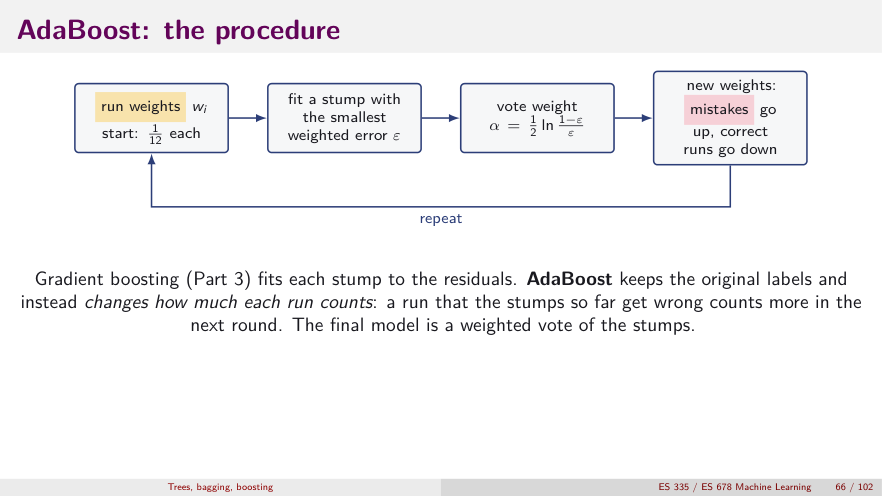
*👀 Slide 66 — AdaBoost changes **how much each run counts**, not what the stumps are fitted to.*

**Definitions** (slide 67):
- **Labels** $y_i = \pm1$. A stump gives $h(x) = \pm1$; each leaf predicts the class with the larger **total weight** in that leaf.
- **Run weights** $w_i\ge0$, $\sum w_i = 1$; start $w_i = \tfrac1{12} = 0.0833$. Think: "how much this run counts when we count mistakes".
- **Weighted error** $\varepsilon = \sum_{i:\,h(x_i)\ne y_i}w_i$ — total weight of the mistakes.
- **Vote weight** $\alpha = \tfrac12\ln\frac{1-\varepsilon}{\varepsilon}$ — large when ε small; 0 at ε = ½; negative if ε > ½.
- **Update** $w_i\leftarrow w_ie^{-\alpha y_ih(x_i)}/Z$: since $y_ih(x_i) = +1$ if right and −1 if wrong, a correct run is multiplied by $e^{-\alpha}$ (shrinks), a mistake by $e^{+\alpha}$ (grows); $Z$ makes them add to 1.
- **Model** $F(x) = \sum_t\alpha_th_t(x)$; predict D if $F > 0$.

*Rounds = stumps.* One round = pick one stump, measure ε, compute α, re-weight. After $T$ rounds there are $T$ stumps. $T$ is chosen on validation data.

## A2. Round 1: choose the stump, compute ε and α

**Step 1 — Equal weights ⇒ ε = (number of mistakes)/12.**

| question | yes-leaf says | no-leaf says | mistakes | ε |
|---|---|---|---|---|
| **rate ≤ 0.065** | C | D | 2 | **0.1667** |
| rate ≤ 0.02 | C | D | 3 | 0.2500 |
| rate ≤ 0.0055 | C | D | 4 | 0.3333 |
| rate ≤ 0.2 | C | D | 4 | 0.3333 |
| batch ≤ 48 | D | C | 4 | 0.3333 |
| warm-up = no | D | C | 4 | 0.3333 |
| batch ≤ 96 | D | C | 5 | 0.4167 |
| batch ≤ 192 | D | C | 5 | 0.4167 |

*Your turn 1 (warm-up = no):* yes-leaf {2, 4, 5, 6, 7, 11} has 4 D, 2 C ⇒ says D; no-leaf {1, 3, 8, 9, 10, 12} has 2 D, 4 C ⇒ says C. Wrong: 7, 11, 1, 3 ⇒ ε = 4/12.

**Step 2 — Keep the smallest ε.** rate ≤ 0.065: yes (runs 5–12: 6 C, 2 D) ⇒ C; no (runs 1–4, all D) ⇒ D. Mistakes: **runs 5 and 6**.
$$\varepsilon_1 = w_5 + w_6 = \tfrac2{12} = 0.1667,\qquad\alpha_1 = \tfrac12\ln\frac{0.8333}{0.1667} = \tfrac12\ln5 = 0.805.$$

**Step 3 — How α behaves** (slides 69–70):

| ε | 0.1 | 0.3 | 0.5 | 0.7 |
|---|---|---|---|---|
| α | ½ ln 9 = 1.099 | ½ ln(7/3) = 0.424 | ½ ln 1 = 0 | ½ ln(3/7) = −0.424 |

ε = 0.1 gets the loudest voice; ε = 0.5 (coin toss) gets **no** vote; ε = 0.7 gets a **negative** vote: AdaBoost uses it by **flipping its answer**. If ε → 0, α → ∞ (a perfect stump would take over), so implementations cap α. *Your turn 2:* ε = 0.25 ⇒ α = ½ ln 3 = 0.549 (quieter than 0.805).

## A3. Round 1: update the weights

**Step 1 — Multipliers.** $e^{-\alpha_1} = 1/\sqrt5 = 0.447$ (right), $e^{+\alpha_1} = \sqrt5 = 2.236$ (wrong).

**Step 2 — Multiply, add up, divide.**

| runs | right? | w before | multiplier | w × mult. | w after (÷ Z) |
|---|---|---|---|---|---|
| 1–4, 7–12 (ten runs) | yes | 0.0833 | 0.447 | 0.0373 | **0.0500** |
| 5, 6 | **no** | 0.0833 | 2.236 | 0.1863 | **0.2500** |

$Z_1 = 10(0.0373) + 2(0.1863) = 0.7454$. Check: $10\times0.05 + 2\times0.25 = 1$ ✓. *Your turn 3:* run 1: $0.0373/0.7454 = 0.050$; run 5: $0.1863/0.7454 = 0.250$.

**Step 3 — What just happened.** Runs 5, 6 jumped from 0.083 to **0.250** each; together they hold **half of all the weight**.

## A4. Why this α: minimise Z

**Step 1 — Total weight after multiplying** (before normalising), with weights summing to 1:
$$Z(\alpha) = (1-\varepsilon)e^{-\alpha} + \varepsilon e^{\alpha}.$$

**Step 2 — Choose α to make it smallest.**
$$\frac{dZ}{d\alpha} = -(1-\varepsilon)e^{-\alpha} + \varepsilon e^{\alpha} = 0\ \Rightarrow\ e^{2\alpha} = \frac{1-\varepsilon}{\varepsilon}\ \Rightarrow\ \alpha = \tfrac12\ln\frac{1-\varepsilon}{\varepsilon}.$$
(Second derivative $(1-\varepsilon)e^{-\alpha} + \varepsilon e^{\alpha} > 0$: a minimum.)

**Step 3 — The minimum value.** With $e^\alpha = \sqrt{(1-\varepsilon)/\varepsilon}$:
$$Z = \varepsilon\sqrt{\tfrac{1-\varepsilon}{\varepsilon}} + (1-\varepsilon)\sqrt{\tfrac{\varepsilon}{1-\varepsilon}} = 2\sqrt{\varepsilon(1-\varepsilon)}.$$
For ε = 1/6: $2\sqrt{5/36} = 0.7454$ — exactly $Z_1$. Why minimise $Z$? Because $Z$ is the factor by which the **exponential loss** shrinks this round (A8–A9).

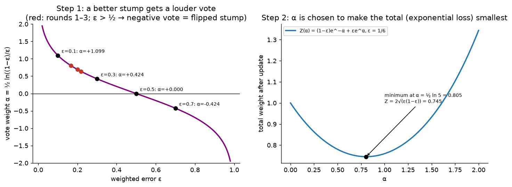
*📊 Step 1: the vote weight curve. Step 2: α is exactly the value that makes the total weight (the exponential loss) smallest.*

## A5. The key consequence: the old stump becomes a coin toss

**Step 1 — Mistakes' share after the update:**
$$\frac{\varepsilon e^{\alpha}}{Z} = \frac{\varepsilon\sqrt{(1-\varepsilon)/\varepsilon}}{2\sqrt{\varepsilon(1-\varepsilon)}} = \frac12.$$
The correct runs carry the other ½.

**Step 2 — So the stump just used has weighted error exactly ½ on the new weights.** Reusing it now would give α = 0. The next stump **must find something different** — here, something that handles runs 5 and 6. *That is the whole mechanism.*

**Step 3 — Check:** after round 1, rate ≤ 0.065 errs on runs 5, 6: $0.25 + 0.25 = 0.5$ ⇒ α = 0 ✓.

## A6. Round 2 and the tie rule

**Step 1 — Weights:** runs 5, 6 at 0.25; the rest at 0.05. Leaves now predict the class with the larger **weight**.

| question (round 2) | yes-leaf | no-leaf | ε |
|---|---|---|---|
| rate ≤ 0.0055 | C | D | 0.2000 |
| **batch ≤ 48** | D | C | **0.2000** (chosen) |
| warm-up = no | D | C | 0.2000 |
| batch ≤ 96 | D | C | 0.2500 |
| batch ≤ 192 | D | C | 0.2500 |
| rate ≤ 0.02 | D | D | 0.3000 |

**Step 2 — Work batch ≤ 48 by hand** (*your turn 4*). Yes-leaf {2, 5, 6, 10}: D weight $0.05 + 0.25 + 0.25 = 0.55$, C weight 0.05 ⇒ says D. No-leaf {1, 3, 4, 7, 8, 9, 11, 12}: D weight 0.15, C weight 0.25 ⇒ says C. Mistakes: run 10 and runs 1, 3, 4 ⇒
$$\varepsilon_2 = 4\times0.05 = 0.200\ \ (\text{ordinary error }4/12 = 0.333),\qquad\alpha_2 = \tfrac12\ln\tfrac{0.8}{0.2} = \tfrac12\ln4 = 0.693.$$
The weighted error is smaller than the ordinary one because its mistakes are runs that already count little.

**Step 3 — Tie rule.** Three questions tie at 0.2. Rule (deck and notes): prefer the feature **asked fewest times so far**, then the order rate, batch, warm-up ⇒ **batch**.

**Step 4 — Update.** Multipliers $e^{\mp0.693} = 0.5,\ 2.0$; $Z_2 = 0.8$:

| runs | right? | before | after |
|---|---|---|---|
| 1, 3, 4, 10 | no | 0.05 | **0.125** |
| 5, 6 | yes | 0.25 | **0.156** |
| 2, 7, 8, 9, 11, 12 | yes | 0.05 | **0.031** |

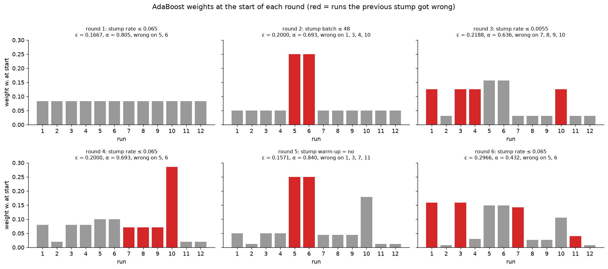
*📊 Weight flows to whatever the last stump got wrong: 5, 6 after round 1; 1, 3, 4, 10 after round 2; 7, 8, 9, 10 after round 3; and so on.*

## A7. All rounds; the final weighted vote

| round | stump | yes, no say | ε | α | stump's mistakes | committee's mistakes | mean $e^{-yF}$ |
|---|---|---|---|---|---|---|---|
| 1 | rate ≤ 0.065 | C, D | 0.1667 | 0.805 | 5, 6 | 5, 6 | 0.745 |
| 2 | batch ≤ 48 | D, C | 0.2000 | 0.693 | 1, 3, 4, 10 | 5, 6 | 0.596 |
| 3 | rate ≤ 0.0055 | C, D | 0.2188 | 0.636 | 7, 8, 9, 10 | 10 | 0.493 |
| 4 | rate ≤ 0.065 | C, D | 0.2000 | 0.693 | 5, 6 | 5, 6 | 0.394 |
| 5 | warm-up = no | D, C | 0.1571 | 0.840 | 1, 3, 7, 11 | **none** | 0.287 |
| 6 | rate ≤ 0.065 | C, D | 0.2966 | 0.432 | 5, 6 | none | 0.262 |

(Deck: five rounds; notes: six.) **A question can come back** (rounds 1, 4, 6) — the weights changed, so it is a different problem. The committee's mistake count can go **up** (round 4), but the exponential loss falls **every** round. After round 5 all twelve are right.

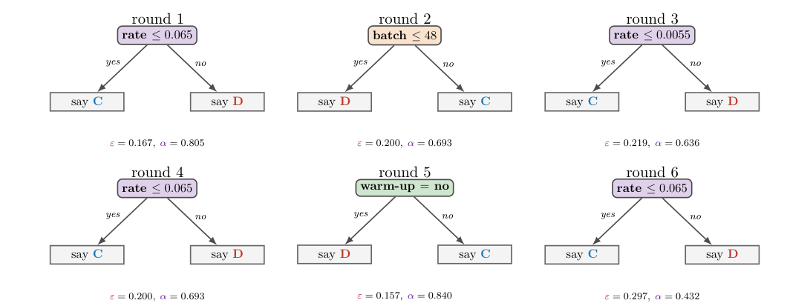
*👀 Notes Fig. 4 — The six stumps of the committee.*

**The vote.** Each stump says ±1; multiply by its α; add; the sign is the answer. Contributions $\alpha_th_t(x)$ (5 rounds):

| run | out | r1 rate | r2 batch | r3 rate | r4 rate | r5 warm | $F_5$ | says |
|---|---|---|---|---|---|---|---|---|
| 1 | D | +0.805 | −0.693 | +0.636 | +0.693 | −0.840 | +0.601 | D |
| 2 | D | +0.805 | +0.693 | +0.636 | +0.693 | +0.840 | +3.667 | D |
| 5, 6 | D | −0.805 | +0.693 | +0.636 | −0.693 | +0.840 | +0.672 | D |
| 7 | C | −0.805 | −0.693 | +0.636 | −0.693 | +0.840 | −0.715 | C |
| 10 | C | −0.805 | +0.693 | +0.636 | −0.693 | −0.840 | −1.008 | C |
| 12 | C | −0.805 | −0.693 | −0.636 | −0.693 | −0.840 | −3.667 | C |
| **A** | ? | −0.805 | +0.693 | +0.636 | −0.693 | +0.840 | **+0.672** | **D** |
| **B** | ? | +0.805 | −0.693 | +0.636 | +0.693 | −0.840 | **+0.601** | **D** |

(Full twelve-run table on slide 77.) Both A and B are D **by a small margin**: the stumps disagree. After round 6 (+0.432 for B, −0.432 for A): **B = 1.033**, **A = 0.240** — A is still D, only just. A looks like runs 5 and 6 (small rate, small batch, no warm-up): exactly where a single stump fails and the committee is unsure.

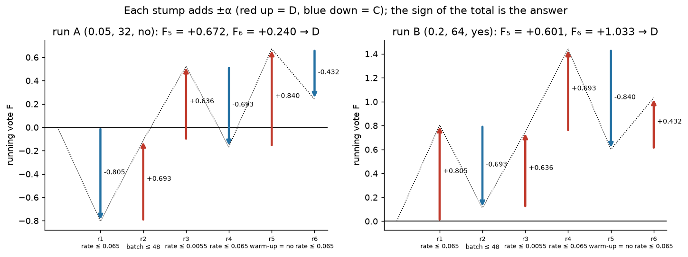
*📊 One arrow per stump. AdaBoost gives a **class and a margin**, not a probability.*

## A8. Same recipe, different loss: AdaBoost = boosting on e^(−yF)

**Step 1 — The loss.** $L = e^{-yF}$ with $y = \pm1$. Right with a big margin ($yF\gg0$): tiny. Wrong ($yF < 0$): large, and growing exponentially.

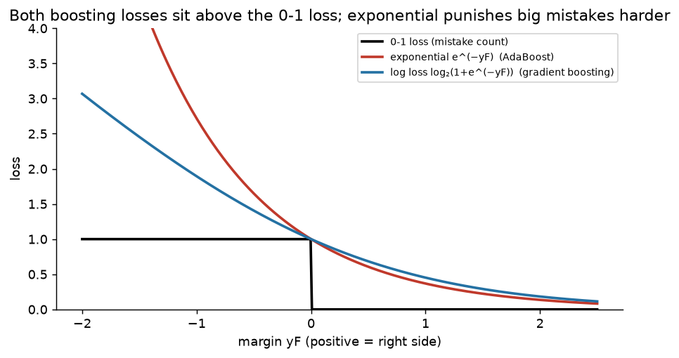
*📊 Both boosting losses lie above the 0-1 loss (so they bound the error count). The exponential punishes big mistakes harder than log loss — which also makes AdaBoost sensitive to mislabelled points.*

**Step 2 — The "residual".** $dL/dF = -y\,e^{-yF}$. So the number playing the residual's role for run $i$ has size $e^{-y_iF_i}$ — **the run's weight, before normalising**.

**Step 3 — Check after two rounds** ($F_2 = \alpha_1h_1 + \alpha_2h_2$):

| run | 1 | 2 | 3 | 4 | 5 | 6 | 7 | 8 | 9 | 10 | 11 | 12 |
|---|---|---|---|---|---|---|---|---|---|---|---|---|
| $F_2$ | +0.11 | +1.50 | +0.11 | +0.11 | −0.11 | −0.11 | −1.50 | −1.50 | −1.50 | −0.11 | −1.50 | −1.50 |
| $e^{-yF_2}$ | 0.894 | 0.224 | 0.894 | 0.894 | 1.118 | 1.118 | 0.224 | 0.224 | 0.224 | 0.894 | 0.224 | 0.224 |
| ÷ 7.16 | 0.1250 | 0.0312 | 0.1250 | 0.1250 | 0.1562 | 0.1562 | 0.0312 | 0.0312 | 0.0312 | 0.1250 | 0.0312 | 0.0312 |
| update rule | 0.1250 | 0.0312 | 0.1250 | 0.1250 | 0.1563 | 0.1563 | 0.0312 | 0.0312 | 0.0312 | 0.1250 | 0.0312 | 0.0312 |

The last two rows agree: **AdaBoost weights are the exponential-loss residuals, rescaled to add to 1.** A mistake ($yF < 0$) has $e^{-yF} > 1$ ⇒ large weight.

**Step 4 — Derive the whole algorithm from the loss** (notes boxes D1–D6). Let $w_i = e^{-y_iF_{\text{old}}(x_i)}$.
1. $E_{\text{new}} = \sum_ie^{-y_i(F_{\text{old}} + \alpha h)} = \sum_iw_ie^{-\alpha y_ih(x_i)}$.
2. Split into right and wrong: $E_{\text{new}} = W_{\text{right}}e^{-\alpha} + W_{\text{wrong}}e^{\alpha}$.
3. **Which stump?** For any α > 0, $e^\alpha > e^{-\alpha}$, so with the total fixed, $E_{\text{new}}$ is smallest when $W_{\text{wrong}}$ is smallest ⇒ **the smallest weighted error**.
4. **Which α?** $dE/d\alpha = 0\Rightarrow e^{2\alpha} = W_{\text{right}}/W_{\text{wrong}} = (1-\varepsilon)/\varepsilon$ ⇒ the formula.
5. **New weights:** $e^{-y_iF_{\text{new}}} = w_ie^{-\alpha y_ih(x_i)}$ — exactly the update rule; ÷Z normalises. **A run's weight = its share of the total exponential loss.**

## A9. Why the committee gets better: the training-error bound

**Step 1 — Mistake ⇒ large loss.** If $y_iF\le0$ then $e^{-y_iF}\ge1$; if right, $e^{-y_iF} > 0$. Either way $\mathbb 1[\text{wrong}]\le e^{-y_iF}$.

**Step 2 — Average.** $\dfrac{\#\text{wrong}}{N}\le\dfrac1N\sum_ie^{-y_iF_T(x_i)}$.

**Step 3 — Each round multiplies the total loss by $Z_t$** (starting from $N$ at $F = 0$), so
$$\text{training error}\le Z_1Z_2\cdots Z_T,\qquad Z_t = 2\sqrt{\varepsilon_t(1-\varepsilon_t)} < 1\ \text{whenever}\ \varepsilon_t\ne\tfrac12.$$

**Step 4 — Numbers.** $Z_1 = 0.7454$, $Z_2 = 0.8000$, $Z_3 = 0.8268$; product **0.4930** = the mean exponential loss after round 3 computed directly ✓. Every round with ε < ½ shrinks the bound. And ε ≤ ½ is guaranteed when each leaf says its weighted majority (each leaf is wrong on at most half its weight) ⇒ α ≥ 0.

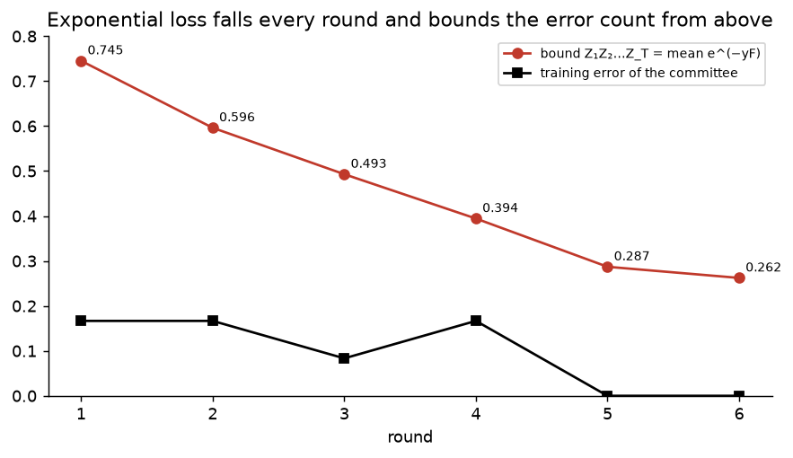
*📊 The bound falls monotonically; the error count can bounce (round 4) but always stays under it.*

## A10. AdaBoost.R2 for regression

**Step 1 — What changes.** The weak learner is a **two-level regression tree** (up to 4 leaves) whose leaves predict the **weighted average** of $y$; the error is measured **relative to the worst mistake**; the final answer is a **weighted median**.

**Step 2 — Round 1: grow the tree** (all weights 1/8). First question by smallest weighted squared error:

| question | groups | predictions | weighted SSE |
|---|---|---|---|
| x ≤ 1.5 | 1 / 7 | 1.50 / 5.36 | 4.232 |
| x ≤ 2.5 | 2 / 6 | 1.50 / 6.00 | 2.062 |
| x ≤ 3.5 | 3 / 5 | 2.33 / 6.40 | 1.983 |
| **x ≤ 4.5** | 4 / 4 | 2.75 / 7.00 | **1.344** |
| x ≤ 5.5 | 5 / 3 | 3.30 / 7.50 | 1.725 |
| x ≤ 6.5 | 6 / 2 | 3.92 / 7.75 | 3.104 |
| x ≤ 7.5 | 7 / 1 | 4.36 / 8.50 | 3.982 |

Then left by x ≤ 2.5, right by x ≤ 5.5 ⇒ leaves {1, 2}: 1.50; {3, 4}: 4.00; {5}: 5.50; {6, 7, 8}: 7.50.

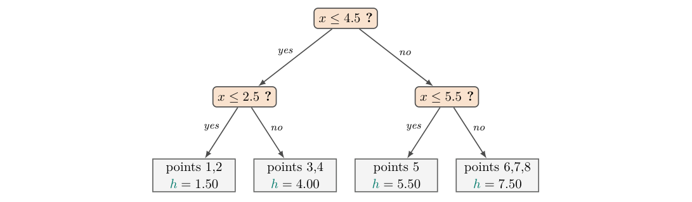
*👀 Notes Fig. 2 — Each leaf predicts the (weighted) average of its points. Your turn 1: $(7 + 7 + 8.5)/3 = 7.50$.*

**Step 3 — Errors relative to the worst.** $\delta_i = |y_i - h(x_i)|$, $\Delta = \max_i\delta_i$, $\ell_i = \delta_i/\Delta\in[0, 1]$.

| $i$ | 1–5 | 6 | 7 | 8 |
|---|---|---|---|---|
| $h$ | exact | 7.50 | 7.50 | 7.50 |
| $\delta$ | 0 | 0.5 | 0.5 | 1.0 |
| $\ell$ | 0 | 0.5 | 0.5 | 1.0 |

$\Delta = 1$. (Other choices: $\ell^2$ or $1 - e^{-\ell}$; the method is the same.)

**Step 4 — Average loss, shrink factor, confidence.**
$$\bar\ell = \sum w_i\ell_i = \tfrac18(0.5 + 0.5 + 1) = 0.25,\quad\beta = \frac{\bar\ell}{1-\bar\ell} = \frac13,\quad\alpha = \ln\frac1\beta = \ln3 = 1.0986.$$
$\beta < 1\iff\bar\ell < \tfrac12$. If $\bar\ell\ge\tfrac12$ the tree is no better than a coin toss on average ⇒ $\beta\ge1$, $\alpha\le0$ ⇒ **stop**.

**Step 5 — Re-weight:** $w_i\leftarrow w_i\beta^{1-\ell_i}/Z$. Perfect ($\ell = 0$): × β (shrinks). Worst ($\ell = 1$): × 1 (stays). In between: × $\sqrt\beta = 0.577$ for $\ell = 0.5$.

| $i$ | ℓ | multiplier | w × mult. | w after |
|---|---|---|---|---|
| 1–5 | 0 | 0.3333 | 0.0417 | **0.0872** |
| 6, 7 | 0.5 | 0.5774 | 0.0722 | **0.1511** |
| 8 | 1 | 1.0000 | 0.1250 | **0.2617** |

$Z_1 = 5(0.0417) + 2(0.0722) + 0.125 = 0.4777$. Point 8 more than doubled; the next tree tries harder on 6, 7, 8. (Shrinking the good ones vs growing the bad ones is the same thing after ÷Z: only ratios matter.)

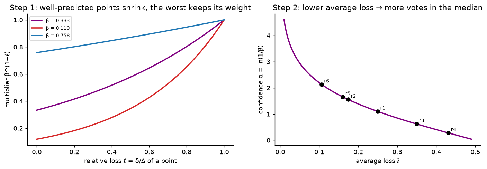
*📊 Step 5 and Step 4 as curves.*

**Step 6 — Rounds 1–6:**

| round | Δ | $\bar\ell$ | β | α = ln(1/β) | Z |
|---|---|---|---|---|---|
| 1 | 1.000 | 0.2500 | 0.3333 | 1.0986 | 0.4777 |
| 2 | 1.164 | 0.1745 | 0.2113 | 1.5544 | 0.3163 |
| 3 | 0.966 | 0.3497 | 0.5377 | 0.6204 | 0.6881 |
| 4 | 0.927 | 0.4310 | 0.7576 | 0.2776 | 0.8593 |
| 5 | 1.136 | 0.1606 | 0.1913 | 1.6537 | 0.2898 |
| 6 | 2.098 | 0.1061 | 0.1186 | 2.1317 | 0.1819 |

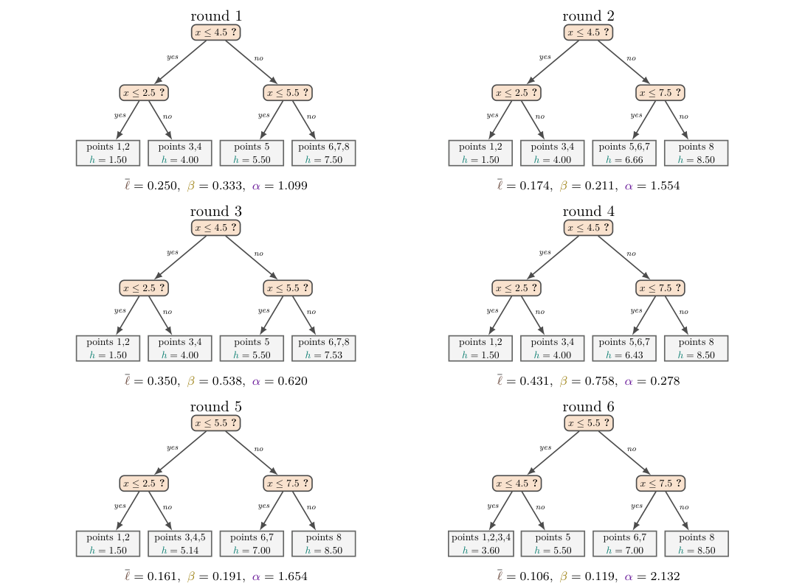
*👀 Notes Fig. 3 — The trees differ: changing weights change both the best question and each leaf's weighted average.*

**Step 7 — Special case = classification AdaBoost.** If every point is perfect ($\ell = 0$) or worst ($\ell = 1$), $\bar\ell = \varepsilon$, $\beta = \varepsilon/(1-\varepsilon)$; right × β, wrong × 1 ⇒ wrong:right ratio $1/\beta = (1-\varepsilon)/\varepsilon = e^{2\alpha_{\text{class}}}$ — the same weights. And $\ln(1/\beta) = 2\alpha_{\text{class}}$: doubling every confidence changes neither a weighted median nor the sign of a weighted vote.

## A11. The weighted median

**Step 1 — Ordinary median.** Trees say 6.4, 7.0, 7.5 ⇒ middle one 7.0.

**Step 2 — Weighted median.** Each tree carries $\alpha_t$ votes. Sort predictions; keep a **running total** of votes; the answer is the prediction where the running total **first reaches half** of all votes. Simplest case at $x = 6$ after two trees: tree 1 says 7.50 ($\alpha = 1.099$), tree 2 says 6.66 ($\alpha = 1.554$); half of 2.653 is 1.327; tree 2 alone already has 1.554 ⇒ **6.66**. The more confident tree wins.

**Step 3 — Six trees at $x = 6$** (total 7.336, half 3.668):

| tree | prediction | α | running total |
|---|---|---|---|
| 4 | 6.43 | 0.278 | 0.278 |
| 2 | 6.66 | 1.554 | 1.832 |
| 5 | 7.00 | 1.654 | 3.486 |
| **6** | **7.00** | 2.132 | **5.617 ← median** |
| 1 | 7.50 | 1.099 | 6.716 |
| 3 | 7.53 | 0.620 | 7.336 |

⇒ **7.00** (truth 7).

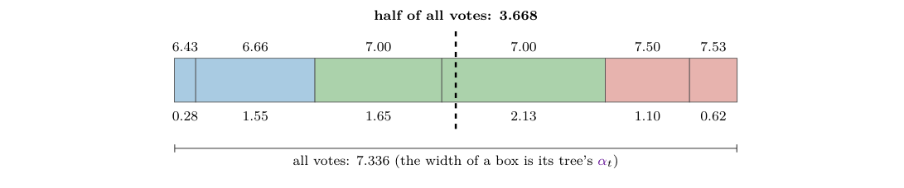
*👀 Notes Fig. 5 — Box width = votes. Wherever the halfway line falls, that box's prediction is the answer.*

**Step 4 — Why the median minimises weighted absolute distance.** $S(m) = \sum_t\alpha_t|m - v_t|$. Between two neighbouring values, $dS/dm = \sum_{v_t<m}\alpha_t - \sum_{v_t>m}\alpha_t$ (left confidence − right confidence). Moving right helps while the left total is smaller; it stops helping where they balance — the weighted median. *Why not an average?* A single confident but wild tree can drag an average far; a median barely moves.

**Combination rules side by side:**

| | every tree gives | final answer |
|---|---|---|
| gradient boosting (L12c) | a correction νγ | sum of corrections added to the start |
| AdaBoost, classification | a vote ±1 | sign of $\sum\alpha_kh_k$ |
| AdaBoost.R2 | a number $h_t(x)$ | weighted median, weights $\alpha_t$ |

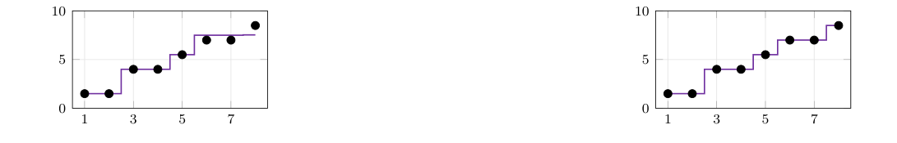
*👀 Notes Fig. 6 — On these noise-free points the ensemble ends up matching every point. On noisy data it shouldn't — choose the number of rounds on validation data.*

## A12. The recipes and common confusions

**AdaBoost (classification) in five lines.**
1. $w_i = 1/N$.
2. Pick the stump with the smallest weighted error ε (each leaf = its weighted majority).
3. $\alpha = \tfrac12\ln\frac{1-\varepsilon}{\varepsilon}$.
4. $w_i\leftarrow w_ie^{-\alpha y_ih(x_i)}$, then divide by the total.
5. Repeat; predict $\text{sign}\sum_k\alpha_kh_k(x)$.

**AdaBoost.R2 in six lines.** (1) $w_i = 1/N$. (2) Grow a small tree on the weights (leaves = weighted means). (3) $\delta_i = |y_i - h(x_i)|$, $\ell_i = \delta_i/\Delta$, $\bar\ell = \sum w_i\ell_i$ (stop if ≥ ½). (4) $\beta = \bar\ell/(1-\bar\ell)$, $\alpha = \ln(1/\beta)$. (5) $w_i\leftarrow w_i\beta^{1-\ell_i}$, normalise. (6) Repeat; predict the weighted median with weights $\alpha_t$.

**Common confusions.**
- *Why not use the best stump alone?* It is wrong on runs 5, 6 and one question cannot separate them. Adding stumps builds a more complex boundary from simple pieces.
- *Why do wrong runs get heavier?* The next stump minimises the **weighted** error; heavy mistakes are expensive, so it is steered towards them.
- *Can ε exceed ½?* Not when each leaf predicts its weighted majority.
- *Different from bagging?* Bagging grows independent trees and averages; AdaBoost grows them in sequence, each shaped by the previous mistakes, and the vote is weighted.
- *Where do the other two come from?* Gradient boosting and XGBoost keep the idea but pass mistakes as residuals (or slope + curvature). AdaBoost **is** gradient boosting for the exponential loss (A8).
- *Why relative error in R2?* It puts every round on a 0–1 scale whatever the units of $y$. Price: Δ is set by one point, so an outlier can dominate the scale.
- *R2 vs gradient boosting for regression?* GB fits residuals and **adds** (small steps); R2 fits the original $y$ with changed weights and takes a **weighted median**.

---

# Part B — Slide by Slide (slides 65–81)

## Slide 65 — Part 4: AdaBoost (divider)
Colours: run weight, mistake, and each stump's numbers by its question.

## Slide 66 — AdaBoost: the procedure
Shown in A1.

## Slide 67 — AdaBoost: definitions

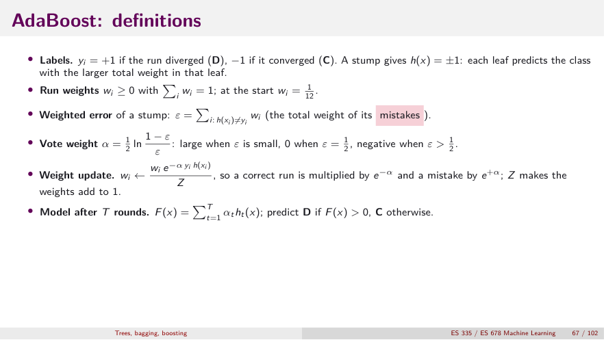
*👀 Slide 67 — All the symbols in one place (A1).*

## Slide 68 — Why this vote weight

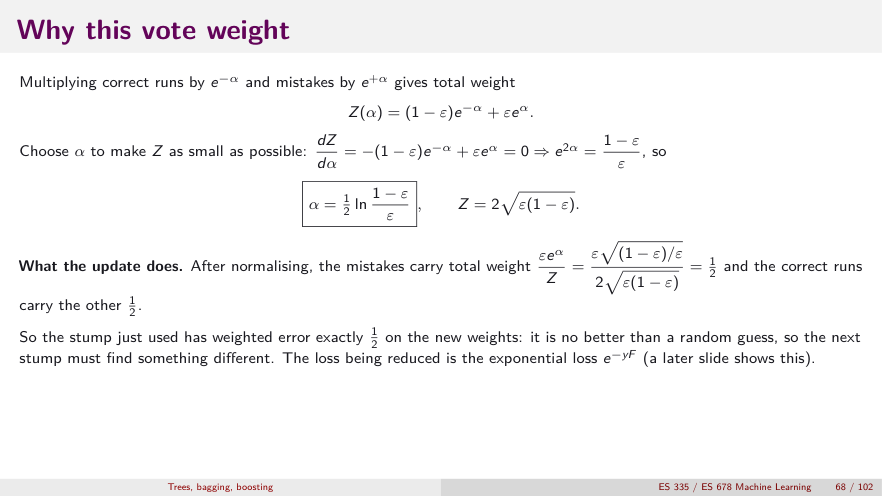
*👀 Slide 68 — The stump just used is now a coin toss; the loss being reduced is $e^{-yF}$ (A4–A5).*

## Slides 69–70 — Your turn: the vote weight (and answer)

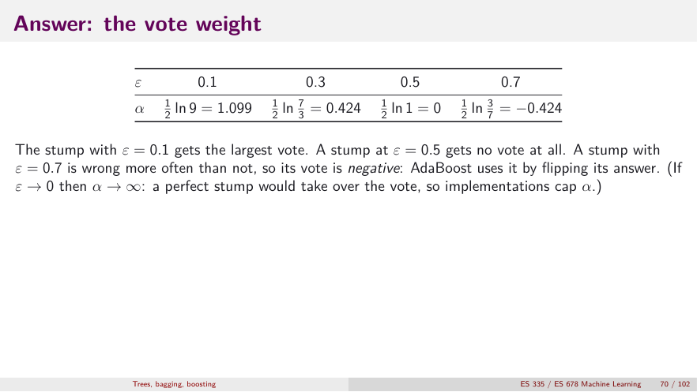
*👀 Slide 70 — Negative vote = flip the stump; perfect stump ⇒ α → ∞, so cap it.*

## Slide 71 — Round 1: choose the stump

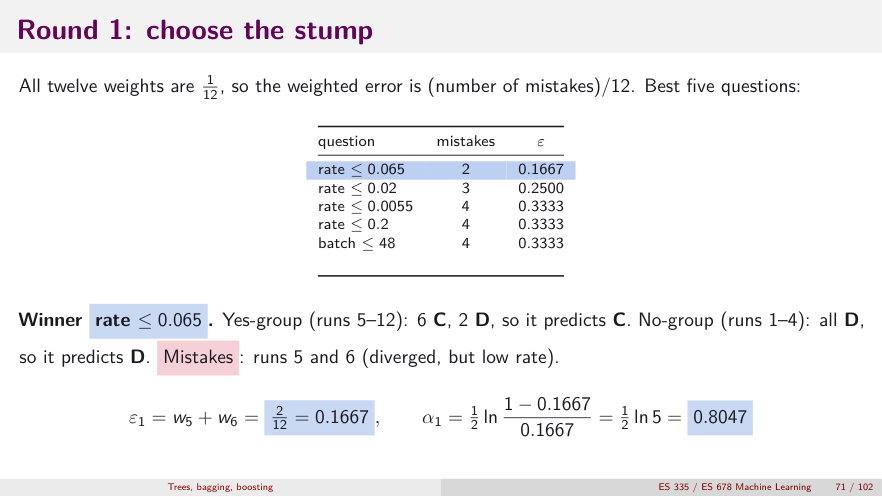
*👀 Slide 71 — Mistakes: runs 5 and 6 (A2).*

## Slide 72 — Round 1: update the weights

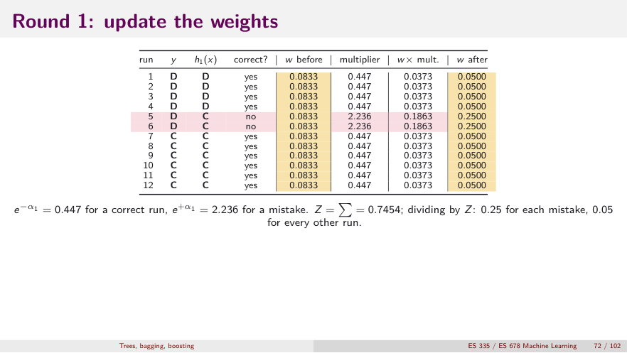
*👀 Slide 72 — A3.*

## Slides 73–74 — Your turn: the second stump (and answer)

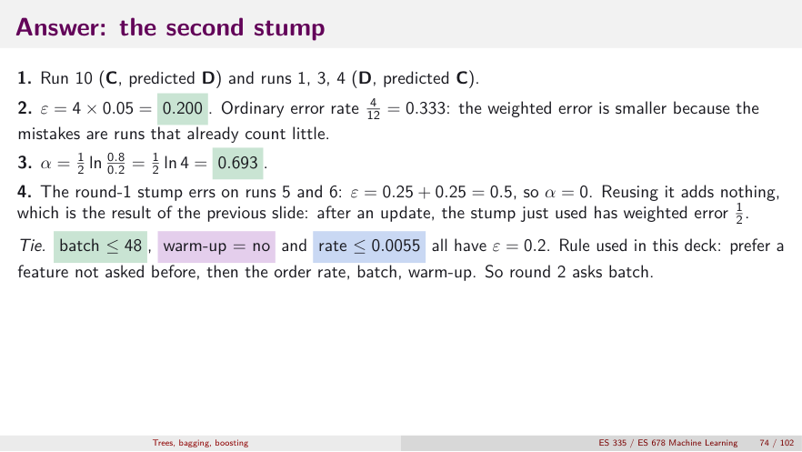
*👀 Slide 74 — A6.*

## Slide 75 — Round 2: update the weights

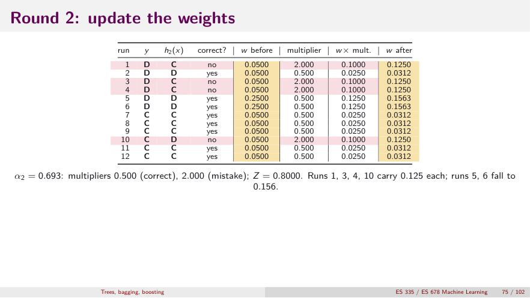
*👀 Slide 75 — A6 Step 4.*

## Slide 76 — Five rounds

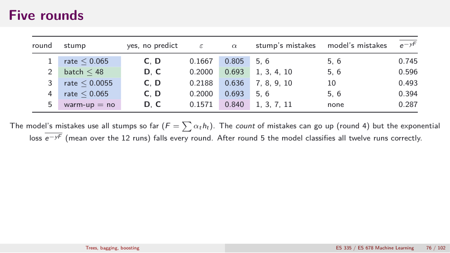
*👀 Slide 76 — Mistake count can rise (round 4); exponential loss falls every round; all twelve right after round 5 (A7).*

## Slide 77 — Contribution of each stump to each run's vote

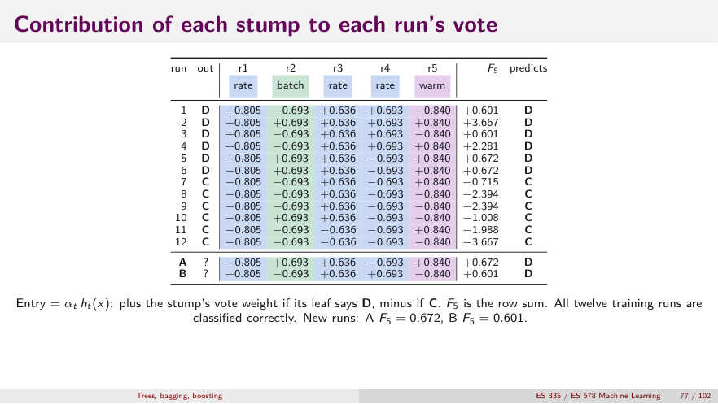
*👀 Slide 77 — A: $F_5 = 0.672$; B: $F_5 = 0.601$.*

## Slides 78–79 — Runs A and B: the leaf reached in each stump

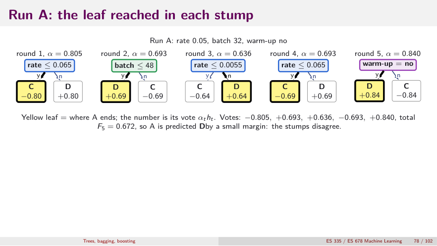
*👀 Slide 78 — Run A: D by a small margin; the stumps disagree.*

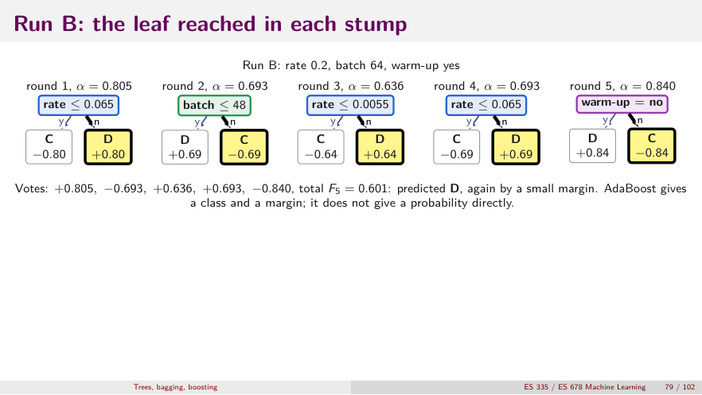
*👀 Slide 79 — AdaBoost gives a class and a margin, not a probability.*

## Slide 80 — Same recipe, different loss

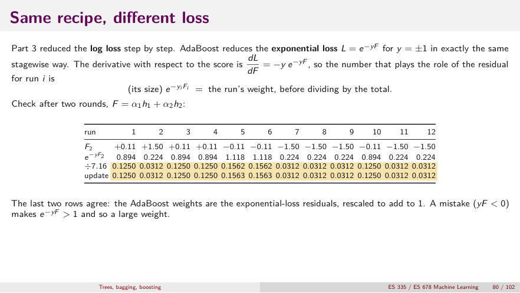
*👀 Slide 80 — Weights = exponential-loss residuals, rescaled (A8).*

## Slide 81 — AdaBoost: summary of the procedure

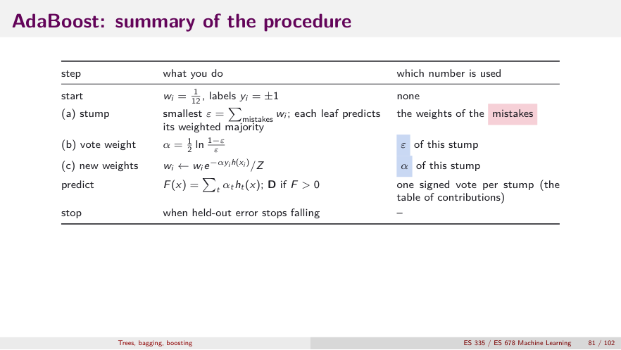
*👀 Slide 81 — Stop when held-out error stops falling.*

---

# Part B′ — The Notes (L12e and L12f)

### Notes L12e (AdaBoost classification), §1–2 — round 1 step by step
Six steps: equal weights; weighted error of every stump; keep the smallest; α; re-weight; "what just happened" (A2–A5).

### Notes L12e, §3 — rounds 2 and 3

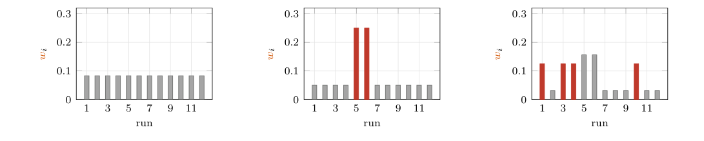
*👀 Notes Fig. 3 — Red = runs the previous stump got wrong.*

### Notes L12e, §4 — the final answer: a weighted vote

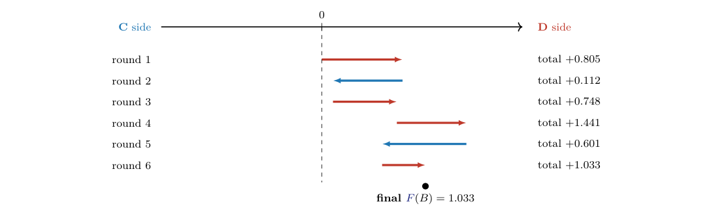
*👀 Notes Fig. 5 — Rounds 2 and 5 vote C, but the total ends clearly on the D side. Run A's six votes add to only 0.240. Committee mistakes after rounds 1–6: 2, 2, 1, 2, 0, 0.*

### Notes L12e, §5 — derive-it-yourself boxes
D1: $E_{\text{new}} = \sum w_ie^{-\alpha y_ih}$. D2: $= W_{\text{right}}e^{-\alpha} + W_{\text{wrong}}e^\alpha$. D3: choose the smallest $W_{\text{wrong}}$. D4: $\alpha = \tfrac12\ln\frac{1-\varepsilon}\varepsilon$. D5: $Z = 2\sqrt{\varepsilon(1-\varepsilon)}$ (0.7454 at ε = 1/6). D6: new loss per run = $w_ie^{-\alpha y_ih}$ = the update. D7: training error ≤ $Z_1\cdots Z_T$ (A8–A9).

### Notes L12e, §7 — check yourself (answers)
1 1/12 · 2 weight, wrong · 3 1/6, 5, 0.805 · 4 0, no say · 5 $e^{-\alpha} = 0.447$, $e^\alpha = 2.236$ · 6 0.250, 0.50 · 7 0.5, different · 8 $\alpha_k$, weighted · 9 larger · 10 exponential.

### Notes L12f (AdaBoost.R2), §1–3 — problem, round 1, rounds 2–6

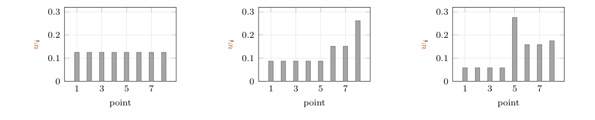
*👀 Notes Fig. 4 — Weights follow the worst-predicted points. Your turns 1–3: A10.*

### Notes L12f, §4 — the final prediction
Weighted median (A11). Your turn 4 at $x = 5$: sorted 5.14 (α 1.654, running 1.654), 5.50 (0.620, 2.274), 5.50 (1.099, 3.373), **5.50 (2.132, 5.504)**, 6.43, 6.66 ⇒ median **5.50** (truth 5.5). The ensemble's prediction (weighted median) after 1, 2, 3 and 6 trees:

| trees | x=1 | 2 | 3 | 4 | 5 | 6 | 7 | 8 |
|---|---|---|---|---|---|---|---|---|
| 1 | 1.50 | 1.50 | 4.00 | 4.00 | 5.50 | 7.50 | 7.50 | 7.50 |
| 2 | 1.50 | 1.50 | 4.00 | 4.00 | 6.66 | 6.66 | 6.66 | 8.50 |
| 3 | 1.50 | 1.50 | 4.00 | 4.00 | 5.50 | 7.50 | 7.50 | 7.53 |
| 6 | 1.50 | 1.50 | 4.00 | 4.00 | 5.50 | 7.00 | 7.00 | 8.50 |
| truth | 1.50 | 1.50 | 4.00 | 4.00 | 5.50 | 7.00 | 7.00 | 8.50 |

(rows = ensemble after that many trees)

### Notes L12f, §5 — derive-it-yourself boxes
D1–D2: the ℓ ∈ {0, 1} special case reproduces classification AdaBoost, with $\ln(1/\beta) = 2\alpha_{\text{class}}$. D3: weighted median minimises $\sum\alpha_t|m - v_t|$. D4: β < 1 ⟺ $\bar\ell < \tfrac12$; otherwise stop. D5: β = 1/3: multipliers 0.333, 0.577, 1 for ℓ = 0, 0.5, 1.

### Notes L12f, §7 — check yourself (answers)
1 1/8, 1 · 2 weighted average, more · 3 $|y_i - h(x_i)|$, Δ · 4 1, 0.25 · 5 $1 - \bar\ell$, 0.333, 1.099 · 6 β, 1, more · 7 0.262, 0.087 · 8 weighted median, $\alpha_t$, 7.00 · 9 classification, twice · 10 ½, 1.

---

# Part C — Practice

1. A stump has weighted error 0.2. Its vote weight? After the update, what is that same stump's weighted error?
2. Compute $Z$ for ε = 0.2 and check it equals $(1-\varepsilon)e^{-\alpha} + \varepsilon e^\alpha$ with your α.
3. In round 1, why is the vote weight of "batch ≤ 48" (ε = 1/3) smaller than that of "rate ≤ 0.065"? Compute it.
4. Starting from the round-2 weights (0.125, 0.031, 0.125, 0.125, 0.156, 0.156, 0.031 ×5 for 7–9, 11, 12, and 0.125 for 10), compute ε for rate ≤ 0.0055 (yes says C, no says D) and confirm 0.2188.
5. Why are AdaBoost run weights called exponential-loss residuals?
6. Prove $\mathbb 1[\text{wrong}]\le e^{-yF}$ and use it to bound the training error after three rounds.
7. AdaBoost.R2: with β = 1/3 and $Z_1 = 0.4777$, compute the new weights of points 1 and 8 (each started at 0.125).
8. AdaBoost.R2: a tree has $\bar\ell = 0.55$. What happens and why?
9. Five trees predict 3, 4, 4, 6, 9 with confidences 1, 1, 0.5, 2, 0.5. Weighted median? Ordinary mean?
10. Why is AdaBoost more sensitive to a mislabelled training point than gradient boosting with log loss?

<b>Answers</b>

1. $\alpha = \tfrac12\ln4 = 0.693$. Afterwards exactly ½ ⇒ it would get vote 0.
2. $Z = 2\sqrt{0.2\times0.8} = 0.8$. Check: $0.8\times0.5 + 0.2\times2 = 0.4 + 0.4 = 0.8$ ✓.
3. Larger error ⇒ quieter voice: $\tfrac12\ln\frac{2/3}{1/3} = \tfrac12\ln2 = 0.347$ vs 0.805.
4. rate ≤ 0.0055 yes = runs 11, 12 (C) ⇒ says C; no = the other ten: D weight $0.125\times3 + 0.031 + 0.156\times2 = 0.719$, C weight $0.031\times3 + 0.125 = 0.219$ ⇒ says D. Mistakes: runs 7, 8, 9, 10 ⇒ $3(0.03125) + 0.125 = 0.21875$ ✓.
5. $w_i\propto e^{-y_iF_i} = |dL/dF|$ for $L = e^{-yF}$: each weight is the size of that run's gradient (its share of the loss).
6. If wrong, $yF\le0$ ⇒ $e^{-yF}\ge1$; if right, $e^{-yF} > 0$. So error ≤ mean $e^{-yF}$ = $Z_1Z_2Z_3 = 0.7454\times0.8\times0.8268 = 0.493$.
7. Point 1 (ℓ = 0): $0.125\times\tfrac13/0.4777 = 0.087$. Point 8 (ℓ = 1): $0.125/0.4777 = 0.262$.
8. $\beta = 0.55/0.45 = 1.22 > 1$, $\alpha < 0$: on average the tree is no better than a coin toss; adding it with positive voice would not help ⇒ the algorithm stops.
9. Total 5, half 2.5. Running: 3 (1), 4 (2), 4 (2.5) ⇒ median **4**. Mean of the predictions: 5.2 (dragged up by the 9); weighted mean $= (3 + 4 + 2 + 12 + 4.5)/5 = 5.1$.
10. A mislabelled point keeps $yF < 0$; its exponential loss (and weight) grows like $e^{|F|}$, so it can dominate later rounds. Log loss grows only linearly for large mistakes, so its pull (residual ≤ 1) is bounded.

**Next:** [L12e — XGBoost & the comparison](L12e_xgboost_and_comparison.md): gradient boosting with curvature in the split score, and penalties λ and γ.
