# Lecture 12e — XGBoost, and Comparing Trees, Bagging and Boosting

> ES 335 / ES 678 Machine Learning, Sem I 2026 — Prof. Udit Bhatia
> Sources: `Lectures/L12_student_trees_bagging_boosting_worked_deck.pdf` (Part 5, slides 82–96; Part 6, slides 97–102) · Previous: [`L12d_adaboost.md`](L12d_adaboost.md) · Next: [`L12f_supplement_missing_topics.md`](L12f_supplement_missing_topics.md)

**Lecture 12 files:** [L12a Trees](L12a_decision_trees.md) → [L12b Bagging & random forests](L12b_bagging_random_forests.md) → [L12c Gradient boosting](L12c_gradient_boosting.md) → [L12d AdaBoost](L12d_adaboost.md) → **[L12e XGBoost & comparison](L12e_xgboost_and_comparison.md)**

**How to use this file.** XGBoost is the gradient boosting of [L12c](L12c_gradient_boosting.md) with three upgrades: (1) it writes one **objective** with slope $g$ and curvature $h$ and solves it exactly per leaf; (2) it adds a penalty **λ** on large leaf values; (3) it adds a penalty **γ** per leaf, so a split must *earn* its place. The trees can now be deeper than stumps, growing while the gain beats γ. Part A builds this step by step on the twelve runs; A8–A10 compare every method of Lecture 12. Part B walks slides 82–102. Part C is practice.

**Setting used throughout:** λ = 1, γ = 0.25, step ν = 0.5, trees at most two questions deep. Twelve runs from [L12a](L12a_decision_trees.md) ($y = 1$ for D, 0 for C); new runs **A** (0.05, 32, no) and **B** (0.2, 64, yes).

> ⚠️ **Symbol warning.** L12c called the leaf value γ. XGBoost calls the leaf value **w** and uses **γ for the penalty per leaf**.

**What this file is really about:**
$$g_i = p_i - y_i,\ h_i = p_i(1-p_i)\ \to\ w_j = -\frac{G_j}{H_j + \lambda}\ \to\ \text{gain} = \tfrac12\Big[\tfrac{G_L^2}{H_L+\lambda} + \tfrac{G_R^2}{H_R+\lambda} - \tfrac{G^2}{H+\lambda}\Big] - \gamma\ \to\ F\leftarrow F + \nu w$$

## Contents

**Part A — Maths from the ground up**
1. [What XGBoost changes](#a1-what-xgboost-changes)
2. [The objective and the leaf weight](#a2-the-objective-and-the-leaf-weight)
3. [The gain of a split](#a3-the-gain-of-a-split)
4. [Round 1: slopes, curvatures, the root question](#a4-round-1-slopes-curvatures-the-root-question)
5. [Round 1: second level, leaf weights, update](#a5-round-1-second-level-leaf-weights-update)
6. [Rounds 1–8, and what λ and γ do](#a6-rounds-18-and-what-λ-and-γ-do)
7. [Runs A and B; the XGBoost recipe](#a7-runs-a-and-b-the-xgboost-recipe)
8. [Comparison: bagging vs boosting](#a8-comparison-bagging-vs-boosting)
9. [Comparison: gradient boosting, AdaBoost, XGBoost](#a9-comparison-gradient-boosting-adaboost-xgboost)
10. [All methods on runs A and B](#a10-all-methods-on-runs-a-and-b)

**Part B — Slides 82–102** · [Jump](#part-b--slide-by-slide-slides-82102) · **Part C — Practice** · [Jump](#part-c--practice)

---

# Part A — Maths From the Ground Up

## A1. What XGBoost changes

Same loop as L12c: current probabilities → fit a tree to what is left → add a shrunken correction. With $g_i = p_i - y_i = -r_i$ (slope), $h_i = p_i(1-p_i)$ (curvature), and sums $G = \sum g_i$, $H = \sum h_i$ over a node:

| | gradient boosting (L12c) | XGBoost |
|---|---|---|
| question chosen by | largest $n_L\bar r_L^2 + n_R\bar r_R^2$ | largest gain built from $G^2/(H+\lambda)$ of yes, no and parent, minus γ |
| leaf value | $\sum r/\sum p(1-p) = -G/H$ | $w = -G/(H + \lambda)$ |
| penalty on leaf values | none | λ: larger λ ⇒ smaller $\lvert w\rvert$ |
| penalty on tree size | none | γ: a split must gain more than γ |
| tree | a stump | deeper, while a split gains more than γ |
| update | $F\leftarrow F + \nu\gamma_{\text{leaf}}$ | $F\leftarrow F + \nu w_{\text{leaf}}$ |

## A2. The objective and the leaf weight

**Step 1 — Second-order loss of one run** when its score moves by $w$ (L12c A8): $L(F_i + w)\approx L(F_i) + g_iw + \tfrac12h_iw^2$.

**Step 2 — Add the penalties.** A new tree with $T$ leaves and leaf weights $w_1,\dots,w_T$ (run $i$ gets $w_{j(i)}$):
$$\text{Obj} = \sum_i\Big[g_iw_{j(i)} + \tfrac12h_iw_{j(i)}^2\Big] + \gamma T + \tfrac12\lambda\sum_jw_j^2.$$

**Step 3 — Group by leaf.** With $G_j$, $H_j$ the sums in leaf $j$:
$$\text{Obj} = \sum_{j=1}^T\Big[G_jw_j + \tfrac12(H_j + \lambda)w_j^2\Big] + \gamma T.$$
Each leaf is a **separate parabola** in $w_j$.

**Step 4 — Minimise each:** $G_j + (H_j + \lambda)w_j = 0$ ⇒
$$\boxed{w_j = -\frac{G_j}{H_j + \lambda}},\qquad\text{leaf contributes }-\tfrac12\frac{G_j^2}{H_j + \lambda}\ \text{to the objective}.$$
(Plug in: $G\cdot(-\tfrac{G}{H+\lambda}) + \tfrac12(H+\lambda)\tfrac{G^2}{(H+\lambda)^2} = -\tfrac12\tfrac{G^2}{H+\lambda}$.)

**Step 5 — Check against L12c.** λ = 0 ⇒ $w = -G/H = \sum r/\sum p(1-p)$, the Newton leaf value. λ in the denominator pulls every leaf **towards 0**, by the factor $H/(H+\lambda)$ — most strongly when the leaf is **small** ($H$ small). That is ridge regularisation ([L07](L07_regularization_ridge_lasso_elastic_net.md)) applied to leaf values.

## A3. The gain of a split

**Step 1 — Before:** a node with $(G, H)$ as one leaf: $-\tfrac12\frac{G^2}{H+\lambda} + \gamma$.

**Step 2 — After:** split into $(G_L, H_L)$ and $(G_R, H_R)$: $-\tfrac12\frac{G_L^2}{H_L+\lambda} - \tfrac12\frac{G_R^2}{H_R+\lambda} + 2\gamma$.

**Step 3 — Fall in the objective:**
$$\boxed{\text{gain} = \frac12\Big[\frac{G_L^2}{H_L+\lambda} + \frac{G_R^2}{H_R+\lambda} - \frac{G^2}{H+\lambda}\Big] - \gamma}$$
**Rule:** take the question with the largest gain; if it is ≤ 0, don't split (make a leaf).

**Step 4 — Compare with L12a's entropy gain.** Same shape: parent vs its two groups. Here the "purity" of a group is $G^2/(H+\lambda)$: large when the runs all push the **same way** (their $g_i$ share a sign), zero when they cancel. And with λ = γ = 0 and all $h$ equal, $G^2/H\propto(\sum r)^2/n$ — L12c's score.

## A4. Round 1: slopes, curvatures, the root question

**Step 1 — Start:** all $F = 0$ ⇒ $p = 0.5$.

| runs | y | $g = p - y$ | $h = p(1-p)$ | how many |
|---|---|---|---|---|
| 1–6 (D) | 1 | −0.5 | 0.25 | 6 |
| 7–12 (C) | 0 | +0.5 | 0.25 | 6 |

**Step 2 — Parent:** $G = 6(-0.5) + 6(0.5) = 0$, $H = 12\times0.25 = 3$ ⇒ $G^2/(H+\lambda) = 0/4 = 0$.

**Step 3 — Every candidate:**

| question | yes-group $(G, H)$ | no-group $(G, H)$ | gain (before γ) |
|---|---|---|---|
| **rate ≤ 0.065** | +2.00, 2.00 | −2.00, 1.00 | **1.667** |
| rate ≤ 0.02 | +1.50, 1.25 | −1.50, 1.75 | 0.909 |
| rate ≤ 0.0055 | +1.00, 0.50 | −1.00, 2.50 | 0.476 |
| rate ≤ 0.2 | +1.00, 2.50 | −1.00, 0.50 | 0.476 |
| batch ≤ 48 | −1.00, 1.00 | +1.00, 2.00 | 0.417 |

**Step 4 — Winner in full:**
$$\text{gain} = \tfrac12\Big[\frac{2^2}{2+1} + \frac{(-2)^2}{1+1} - \frac{0^2}{3+1}\Big] = \tfrac12[1.333 + 2.000 - 0] = 1.667 > \gamma = 0.25\ \Rightarrow\ \text{split}.$$
(Yes-group $G = +2$: six C runs push up the slope, two D runs down — net: "lower these scores".)

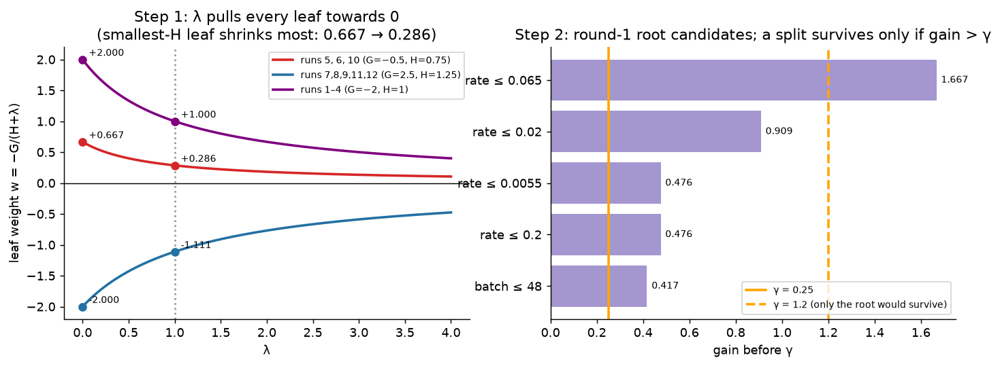
*📊 Step 1: λ shrinks every leaf; the smallest-H leaf shrinks most. Step 2: a split survives only if its gain clears γ.*

## A5. Round 1: second level, leaf weights, update

**Step 1 — Yes-group (runs 5–12)** is now a parent with $G = 2$, $H = 2$. Best question **batch ≤ 48**: gain **0.794 > γ** ⇒ split (next best warm-up, 0.333).

**Step 2 — No-group (runs 1–4)**, $G = -2$, $H = 1$. Best gain **−0.257**: negative! The four runs already agree, and splitting costs λ (each smaller leaf is shrunk more). ⇒ leaf.

**Step 3 — γ's role here.** γ = 0.25 only needs to be below 0.794 for the second split to stay; γ = 1 would remove it.

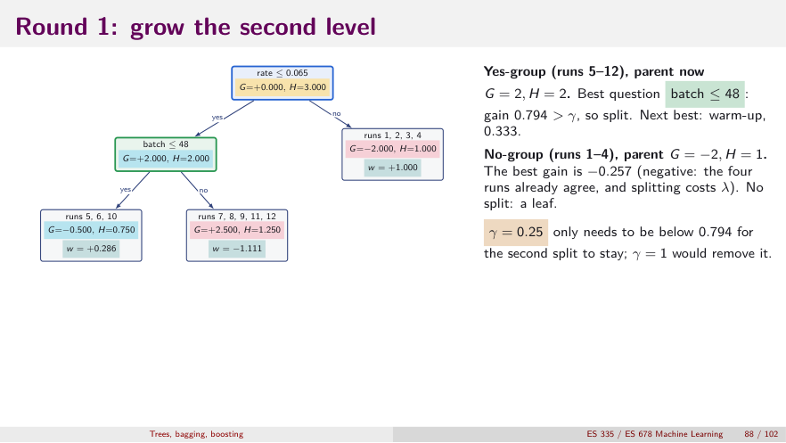
*👀 Slide 88 — A depth-2 tree with three leaves.*

**Step 4 — Leaf weights** $w = -G/(H + 1)$:

| leaf | G | H | w (λ = 1) | w (λ = 0) |
|---|---|---|---|---|
| runs 5, 6, 10 | −0.500 | 0.750 | **+0.286** | +0.667 |
| runs 7, 8, 9, 11, 12 | +2.500 | 1.250 | **−1.111** | −2.000 |
| runs 1, 2, 3, 4 | −2.000 | 1.000 | **+1.000** | +2.000 |

Every value is smaller than the Newton value by $H/(H+\lambda)$; the leaf with the fewest runs and least curvature (5, 6, 10; $H = 0.75$) is shrunk most: 0.286 vs 0.667.

**Step 5 — Update** $F\leftarrow F + 0.5w$:

| runs | leaf | νw | F after | p after |
|---|---|---|---|---|
| 1–4 (D) | (1, 2, 3, 4) | +0.500 | +0.500 | 0.622 |
| 5, 6 (D) | (5, 6, 10) | +0.143 | +0.143 | 0.536 |
| 10 (C) | (5, 6, 10) | +0.143 | +0.143 | 0.536 ✗ |
| 7, 8, 9, 11, 12 (C) | (7, 8, 9, 11, 12) | −0.556 | −0.556 | 0.365 |

Log loss 0.693 → **0.515** (L12c's stump: 0.504). Only run 10 is wrong — it shares a leaf with 5 and 6.

**"Your turn" (slides 90–91).** Node $G = +1$, $H = 2$ splits into $(G_L, H_L) = (-1, 1)$, $(G_R, H_R) = (2, 1)$, λ = 1.
1. $\text{gain} = \tfrac12\big[\tfrac{1}{2} + \tfrac{4}{2} - \tfrac{1}{3}\big] = \tfrac12[0.5 + 2 - 0.333] = 1.083$.
2. $w_L = -(-1)/2 = +0.5$, $w_R = -2/2 = -1.0$ (unsplit: $-1/3$).
3. γ = 0.25: $1.083 - 0.25 = 0.833 > 0$ ⇒ keep. γ = 1.2: $< 0$ ⇒ no split. **Larger γ ⇒ smaller trees.**

## A6. Rounds 1–8, and what λ and γ do

**Step 1 — Rounds 1–6** (λ = 1, γ = 0.25):

| round | questions (root, then yes-side) | gains before γ | leaf weights w | loss | wrong |
|---|---|---|---|---|---|
| 1 | rate ≤ 0.065, then batch ≤ 48 | 1.667, 0.794 | +0.29, −1.11, +1.00 | 0.515 | 10 |
| 2 | rate ≤ 0.065, then batch ≤ 48 | 0.939, 0.462 | +0.23, −0.84, +0.78 | 0.412 | 10 |
| 3 | rate ≤ 0.065, then warm-up = no | 0.575, 0.343 | +0.17, −0.75, +0.64 | 0.344 | none |
| 4 | rate ≤ 0.065, then batch ≤ 48 | 0.379, 0.282 | +0.21, −0.63, +0.54 | 0.295 | none |
| 5 | rate ≤ 0.065 | 0.256 | −0.26, +0.46 | 0.276 | none |
| 6 | no split | all below γ | +0.052 | 0.276 | none |

Training error 0 from round 3. In round 5 only the root clears γ; from round 6 nothing gains more than 0.25, so the "tree" is a single leaf that shifts every score by 0.03, 0.02, 0.01 and the loss stalls near 0.275. **γ stopped the learning by itself.**

**Step 2 — Five settings, eight rounds:**

| settings | first round with no wrong run | wrong after 8 | log loss after 8 | leaves in trees 1–8 |
|---|---|---|---|---|
| λ = 0, γ = 0 | 2 | none | 0.049 | 3, 4, 4, 4, 4, 4, 4, 4 |
| λ = 1, γ = 0 | 3 | none | 0.190 | 3, 3, 3, 3, 3, 3, 4, 3 |
| λ = 1, γ = 0.25 | 3 | none | 0.275 | 3, 3, 3, 3, 2, 1, 1, 1 |
| λ = 1, γ = 0.5 | never | 10 | 0.369 | 3, 2, 3, 1, 1, 1, 1, 1 |
| λ = 1, γ = 1 | never | 5, 6 | 0.573 | 2, 1, 1, 1, 1, 1, 1, 1 |

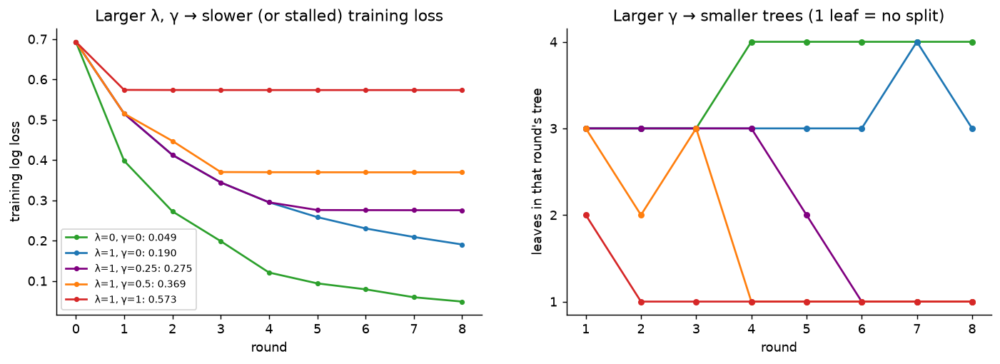
*📊 Larger λ and γ ⇒ smaller leaf values and smaller trees ⇒ training loss falls more slowly or stops. That is the intended price of a simpler model; too large γ (≥ 0.5 here) stops before the training data are even fitted. **Choose both on held-out data.***

## A7. Runs A and B; the XGBoost recipe

**Step 1 — Paths** (entry = νw of the leaf reached):

| round | run A (0.05, 32, no): path | νw | run B (0.2, 64, yes): path | νw |
|---|---|---|---|---|
| 1 | rate yes; batch ≤ 48 yes | +0.143 | rate ≤ 0.065 no | +0.500 |
| 2 | rate yes; batch ≤ 48 yes | +0.113 | rate no | +0.389 |
| 3 | rate yes; warm-up = no yes | +0.086 | rate no | +0.319 |
| 4 | rate yes; batch ≤ 48 yes | +0.104 | rate no | +0.269 |
| 5 | rate yes | −0.131 | rate no | +0.232 |

Rounds 6–8 add +0.026, +0.017, +0.012 to every run. Totals: **A: F = 0.369, p = 0.591**; **B: F = 1.764, p = 0.854**. Both D; B with more confidence. Unlike AdaBoost, XGBoost gives a **probability**.

**Step 2 — The recipe:**

| step | what you do | which number is used |
|---|---|---|
| start | $F_i = 0$, $p_i = 0.5$; choose λ, γ, ν, depth | the settings |
| (a) slopes | $g_i = p_i - y_i$, $h_i = p_i(1-p_i)$ | each run's current p |
| (b) question | largest gain $\tfrac12[\tfrac{G_L^2}{H_L+\lambda} + \tfrac{G_R^2}{H_R+\lambda} - \tfrac{G^2}{H+\lambda}] - \gamma$ | G, H of node, yes, no |
| (c) grow | split again while gain > 0; stop at the depth limit | gain after γ |
| (d) leaf weights | $w = -G/(H+\lambda)$ | G, H of the leaf, λ |
| (e) update | $F_i\leftarrow F_i + \nu w$ | w of the leaf reached |
| predict | $F = \nu\sum_tw_t(\text{leaf})$, $p = S(F)$ | one weight per tree |

## A8. Comparison: bagging vs boosting

| | bagging (random forest) | boosting |
|---|---|---|
| trees grown | side by side, each on its own bootstrap sample | one after another, each on the residuals so far |
| each tree | deep: low bias, high variance | small (a stump): high bias, low variance |
| combined by | average $\tfrac1B\sum_bT_b$ | sum $F_0 + \nu\sum_t\gamma_t(\cdot)$ |
| mainly reduces | variance, down to the floor ρσ² | bias, step by step |
| more trees | error settles; harmless | keeps fitting; stop using held-out data |
| main settings | number of trees; features per split | step size; rounds; depth |

Numbers behind this: [L12b A12](L12b_bagging_random_forests.md#a12-what-bagging-fixes-and-what-boosting-fixes) (bias² 5.25 → 0.011 for boosting; variance 0.252 → 0.146 for bagging).

## A9. Comparison: gradient boosting, AdaBoost, XGBoost

| | gradient boosting (L12c) | AdaBoost (L12d) | XGBoost (this file) |
|---|---|---|---|
| each stump/tree is fitted to | residuals $y - p$ | the data with run weights | slopes g and curvatures h |
| loss reduced | log loss | exponential loss $e^{-yF}$ | log loss, plus penalties |
| question chosen by | $n_L\bar r_L^2 + n_R\bar r_R^2$ | smallest weighted error ε | largest gain with $G^2/(H+\lambda)$ |
| number each tree contributes | $\nu\gamma_{\text{leaf}}$ | $\alpha h(x) = \pm\alpha$ | $\nu w_{\text{leaf}}$ |
| output | probability $S(F)$ | class and margin F | probability $S(F)$ |
| controls on size | step size, rounds | rounds | λ, γ, depth, step size |

**One family.** All three are *stagewise additive models*: $F\leftarrow F + (\text{small tree})$, the tree chosen to reduce a loss using its gradient. They differ only in the loss (log vs exponential), how the mistakes are passed on (residuals, weights, slope + curvature) and the regularisation.

## A10. All methods on runs A and B

| method | run A (0.05, 32, no) | run B (0.2, 64, yes) |
|---|---|---|
| single tree | D (2/2 in its leaf) | D (4/4 in its leaf) |
| bagging, 3 trees | 0, 1, 1 → 2/3, D | 1, 0, 1 → 2/3, D |
| bagging, many trees (simulated) | ≈ 0.872, D | ≈ 0.934, D |
| gradient boosting, 8 stumps | F = 1.069, p = 0.744, D | F = 1.490, p = 0.816, D |
| AdaBoost, 5 stumps | F = 0.672 (margin), D | F = 0.601 (margin), D |
| XGBoost, 8 trees | F = 0.369, p = 0.591, D | F = 1.764, p = 0.854, D |

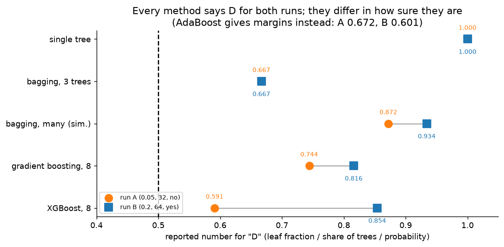
*📊 Every method says D for both; they differ in how sure. The single tree gives only a class (with false certainty); bagging shows how much the trees disagree (about 0.9 say D); boosting builds a probability from summed corrections. Run A — the "runs 5 and 6 corner" — is consistently the less certain one (except for the single tree, which cannot express doubt).*

---

# Part B — Slide by Slide (slides 82–102)

## Slide 82 — Part 5: XGBoost (divider)
Colours: parent node, yes-group, no-group, setting λ, γ (orange), leaf weight w (teal).

## Slide 83 — What XGBoost changes

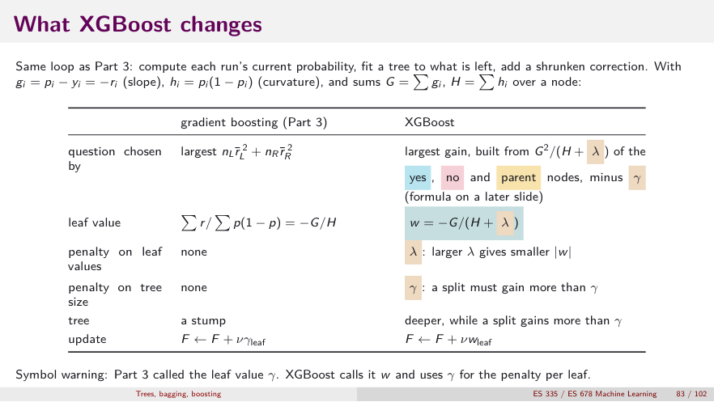
*👀 Slide 83 — A1.*

## Slide 84 — The objective and the leaf weight

![Slide 84 — Obj = Σ[g w + ½ h w²] + γT + ½λΣw², grouped by leaf; w = −G/(H+λ); leaf contributes −½G²/(H+λ).](images/L12e/slides/s084_objective_leaf_weight.png)
*👀 Slide 84 — λ pulls every leaf towards 0, more so when H is small (A2).*

## Slide 85 — The gain of a split

![Slide 85 — Gain = ½[G_L²/(H_L+λ) + G_R²/(H_R+λ) − G²/(H+λ)] − γ; take the largest, no split if ≤ 0.](images/L12e/slides/s085_split_gain.png)
*👀 Slide 85 — "Impurity" of a group is $G^2/(H+\lambda)$ (A3).*

## Slide 86 — Round 1: gradients and curvatures

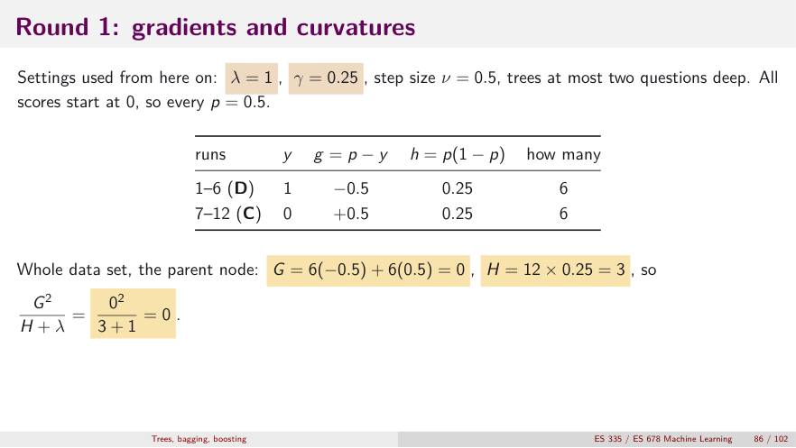
*👀 Slide 86 — A4 Steps 1–2.*

## Slide 87 — Round 1: choose the root question

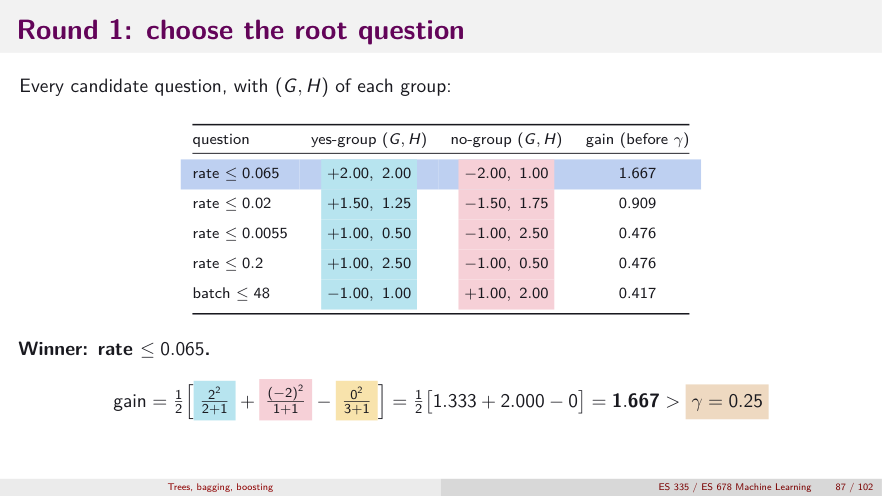
*👀 Slide 87 — A4 Steps 3–4.*

## Slide 88 — Round 1: grow the second level
Shown in A5. Yes side: batch ≤ 48, gain 0.794. No side: best gain −0.257 ⇒ leaf.

## Slide 89 — Round 1: leaf weights

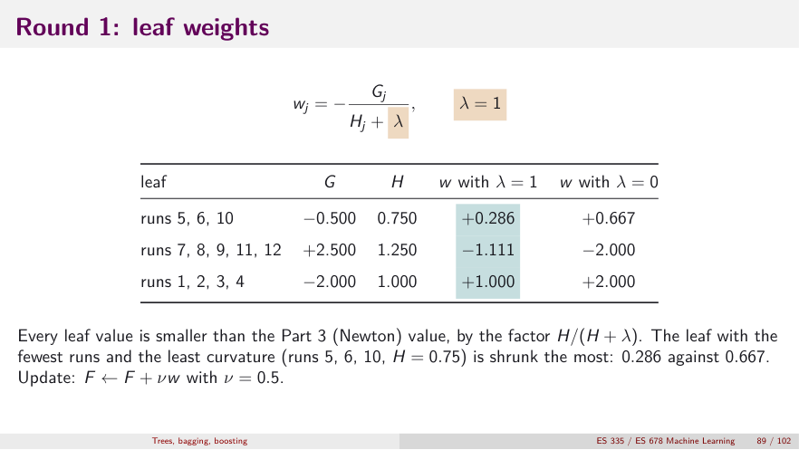
*👀 Slide 89 — A5 Step 4.*

## Slides 90–91 — Your turn: is this split worth it? (and answer)
Gain 1.083; $w_L = +0.5$, $w_R = -1.0$; keep at γ = 0.25, reject at γ = 1.2 (A5).

## Slide 92 — Round 1: update every run

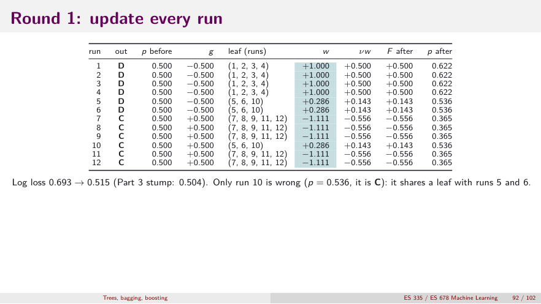
*👀 Slide 92 — Only run 10 wrong (p = 0.536).*

## Slide 93 — Rounds 1 to 6

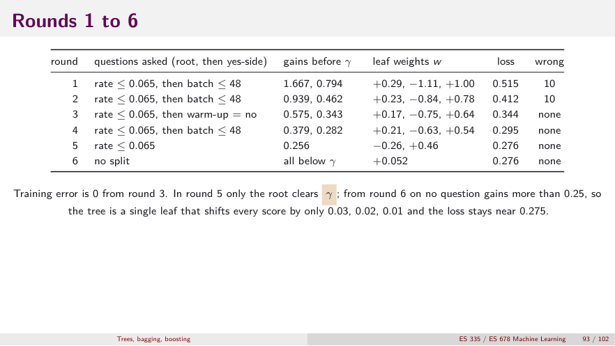
*👀 Slide 93 — Loss stalls near 0.275 once nothing clears γ (A6).*

## Slide 94 — What λ and γ do

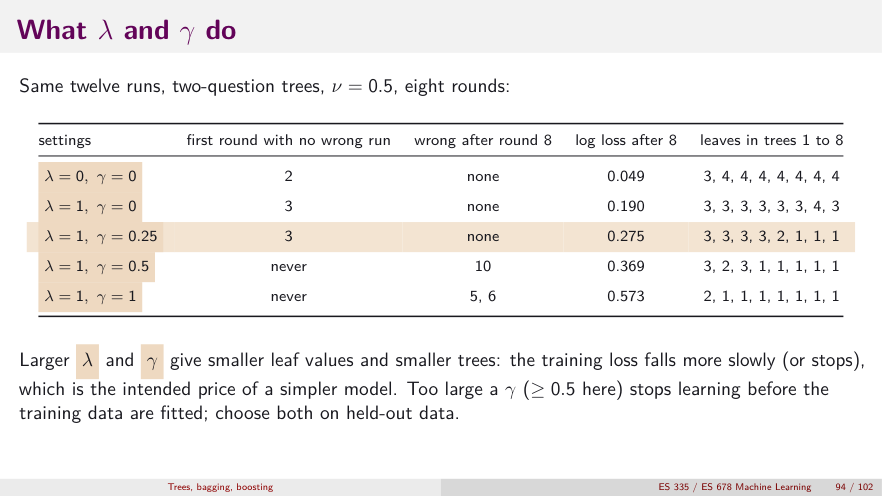
*👀 Slide 94 — Choose both on held-out data.*

## Slide 95 — Runs A and B through the trees

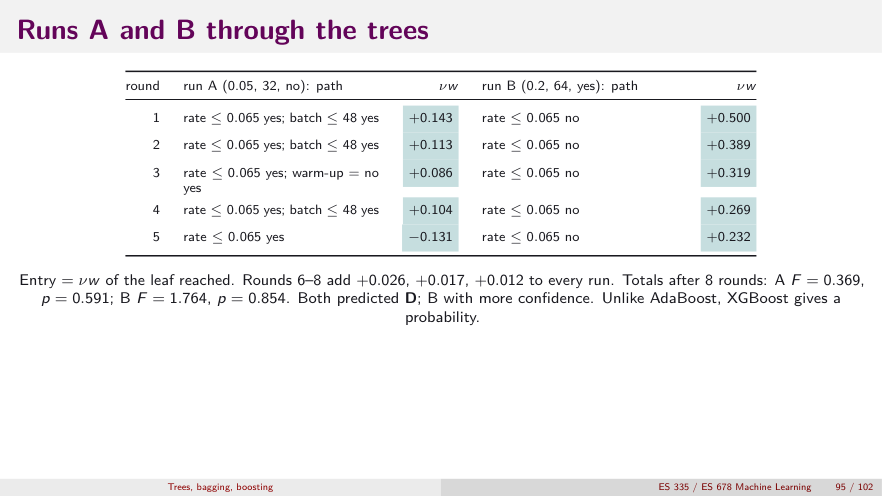
*👀 Slide 95 — XGBoost gives a probability (A7).*

## Slide 96 — XGBoost: summary of the procedure

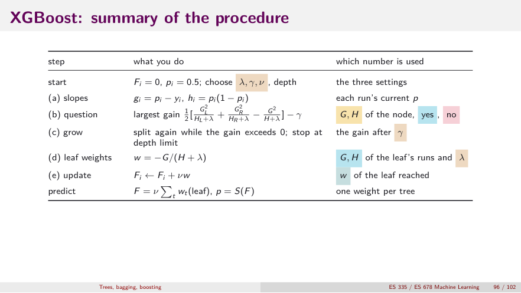
*👀 Slide 96 — A7 Step 2.*

## Slide 97 — Part 6: Comparison (divider)
One tree, many trees averaged, many small trees added.

## Slide 98 — Comparison of bagging and boosting

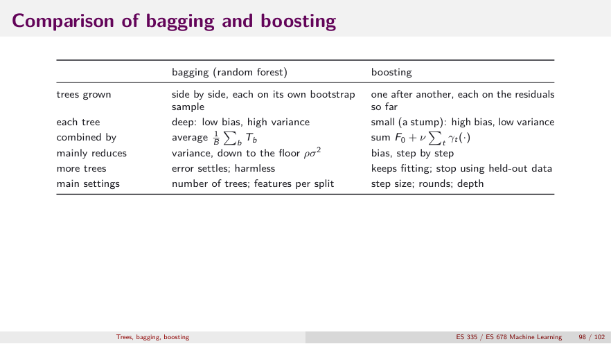
*👀 Slide 98 — A8.*

## Slide 99 — Gradient boosting, AdaBoost and XGBoost side by side

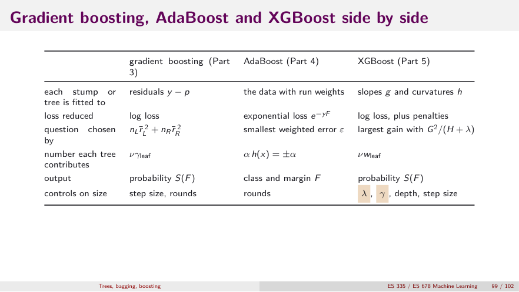
*👀 Slide 99 — A9.*

## Slide 100 — Predictions for the two new runs

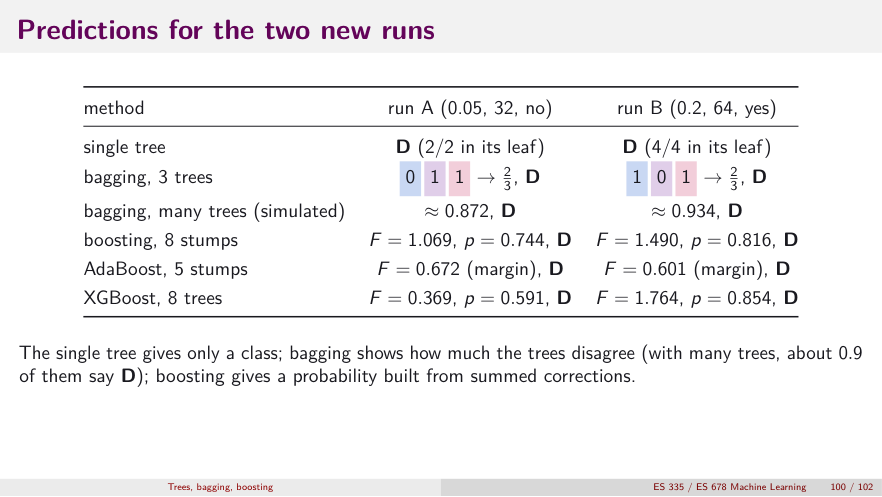
*👀 Slide 100 — A10.*

## Slides 101–102 — Review questions
Answered in Part C (Q1–Q11).

---

# Part C — Practice

**Deck review (slides 101–102):**
1. Gain of "batch ≤ 48" at the root (entropy)?
2. Which number do we read from bagged tree 2 for run B, and why?
3. σ² = 1, ρ = 0.3, B = 20: variance of the average and the floor?
4. Why does the bagging variance table match σ²/B but show no floor?
5. In boosting round 1, why is $\gamma_{\text{no}} = +2$ but each score rises by 1?
6. After round 3 two runs are wrong though the loss fell: contradiction?
7. A stump has weighted error 0.2. Vote weight? Its weighted error after the update?
8. Why are AdaBoost run weights called exponential-loss residuals?
9. What does λ do to a leaf value, and what does γ do to a tree?
10. With λ = 0, γ = 0 and stumps, which part of XGBoost still differs from L12c?

**Extra:**
11. A leaf has $G = -3$, $H = 0.5$. Compute $w$ for λ = 0, 1, 5. Which leaves are hurt most by λ?
12. Node $(G, H) = (0, 3)$, λ = 1, split into $(-2, 1)$ and $(2, 2)$. Gain before γ? Largest γ that still keeps it?
13. Why did the no-group of round 1 (runs 1–4, $G = -2$, $H = 1$) refuse to split even with γ = 0? Show any split of it has negative gain.
14. Which method would you choose, and why: (a) you need calibrated probabilities and the best accuracy on tabular data; (b) you want a robust model with almost no tuning and a free error estimate; (c) you need a model a doctor can read?

<b>Answers</b>

1. $1 - \tfrac4{12}(0.8113) - \tfrac8{12}(0.9544) = 0.0933$.
2. $T_2(B) = 0$: warm-up is yes, so B goes to the leaf "4 draws, all C".
3. $0.3 + 0.7/20 = 0.335$; floor 0.3.
4. Only the resampling varies (one fixed dataset); the floor comes from the dataset itself varying.
5. γ is the full Newton step; the update multiplies by ν = 0.5.
6. No: each round lowers the loss, not the error count.
7. $\tfrac12\ln4 = 0.693$; afterwards exactly ½ ⇒ vote 0.
8. $w_i\propto e^{-y_iF_i} = |dL/dF|$ for $L = e^{-yF}$.
9. λ shrinks $w = -G/(H+\lambda)$ towards 0; γ blocks splits whose gain is below γ (smaller trees).
10. The question score: $G^2/H$ (curvature-weighted) instead of $n\bar r^2$. (Equal only while all $h$ are equal, e.g. round 1.)
11. λ = 0: $+6$; λ = 1: $+2$; λ = 5: $+0.545$. Small leaves (small H) are shrunk most — exactly the leaves most likely to be fitting noise.
12. $\tfrac12[4/2 + 4/3 - 0/4] = \tfrac12(3.333) = 1.667$; kept for any γ < 1.667.
13. Parent term $4/2 = 2$. All four runs have $g = -0.5$, $h = 0.25$; a split into $k$ and $4-k$ runs gives $\frac{(0.5k)^2}{0.25k + 1} + \frac{(0.5(4-k))^2}{0.25(4-k)+1}$. For $k = 2$: $2\times\frac{1}{1.5} = 1.333$ ⇒ gain $\tfrac12(1.333 - 2) = -0.333$; for $k = 1$: $\frac{0.25}{1.25} + \frac{2.25}{1.75} = 1.486$ ⇒ gain −0.257 (the slide's value). Splitting a group that already agrees only adds λ penalties.
14. (a) Gradient boosting / XGBoost, tuned with early stopping on held-out data. (b) Random forest: more trees never hurt, few settings, OOB error for free. (c) A single pruned tree (depth chosen by cross-validation) — readable, though unstable and less accurate.

**Lecture 12 complete.** Next: [L12f — Supplement: syllabus topics the lectures did not cover](L12f_supplement_missing_topics.md) (leakage, shift, validation design, optimization, multiclass, trees II, KNN). Back to the start: [L12a — Decision trees](L12a_decision_trees.md).
